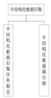
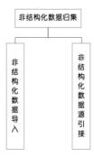

## 3.2.1.3.2 结构化数据归集任务制定/ZZSJHQZHFW-GN-SJHQ-JGHSJGJ-JGHSJGJRWZD

结构化数据归集任务制定功能用例描述见表5。

表5 结构化数据归集任务制定功能用例
<table><tr><td colspan="3">Use Case名称：结构化数据归集任务制 /ZZSJHQZHFW-GN-SJHQ-JGHSJGJ- Actors:值勤参谋、数据保障人员</td></tr><tr><td colspan="3">JGHSJGJRWZD 概述：本用例是描述结构化数据归集任务制定的过程。</td></tr><tr><td colspan="3">前置条件：系统软件正常启动，本软件正常启动，数据中台运行正常，本地数据库运行正常，网</td></tr><tr><td>络正常通联。</td><td colspan="2">主事件流 动作约束（性能、可靠性、容</td></tr><tr><td>Actor 的动作 1.打开“某”软件，进入数据获取 菜单下结构化数据归集页面；</td><td colspan="2">系统的动作</td></tr><tr><td>2.点击创建工单，选择数据 源；输入工单名称、描述，选 择目的端数据源、目的端模式 名，点击下一步；勾选需要采 集的目标数据表，并在数据表 对应的同步配置中设置读取策 略为全量或增量；点击下一 步，确认配置后创建结构化数</td><td></td><td></td></tr><tr><td>4.在结构化数据归集页面查看 成功创建的归集任务，运行该 归集任务，查看任务运行状 态；</td><td>3.将数据归集任务添加到任务列 表，若结构化数据归集任务构 建失败则执行异常流E1； 5.将源端数据采集到目标数据库</td><td></td></tr><tr><td colspan="1" rowspan="1">6.进入数据运维管理菜单下数据源管理页面，查看对应数据库下对目标数据表的采集情况；7.重复上述步骤，将2.中的采集数据分别更换为各类数据，查看对应数据库下对各类数据的的采集情况。</td><td colspan="1" rowspan="1">中，若结构化数据采集失败则执行异常流 E2；</td><td colspan="1" rowspan="1"></td></tr><tr><td colspan="3" rowspan="1">异常流E1：结构化数据归集任务构建失败；</td></tr><tr><td colspan="3" rowspan="1">异常流E2：结构化数据采集失败。</td></tr><tr><td colspan="3" rowspan="1">后置条件：无</td></tr></table>

## 3.2.1.3.3 结构化数据源引接/ZZSJHQZHFW-GN-SJHQ-JGHSJGJ-JGHSJYYJ

结构化数据源引接功能用例描述见表6。

表6 结构化数据源引接功能用例
<table><tr><td rowspan=1 colspan=2>Use Case名称：结构化数据源引接/ZZSJHQZHFW-GN-SJHQ-JGHSJGJ-JGHSJYYJ</td><td rowspan=1 colspan=2>Actors:值勤参谋、数据保障人员</td></tr><tr><td rowspan=1 colspan=4>概述：本用例是描述对结构化数据源的添加、修改、检索、删除等管理功能。</td></tr><tr><td rowspan=1 colspan=4>前置条件：系统软件正常启动，本软件正常启动，数据中台运行正常，本地数据库运行正常，网络正常通联。</td></tr><tr><td rowspan=1 colspan=4>主事件流</td></tr><tr><td rowspan=1 colspan=1>Actor 的动作</td><td rowspan=1 colspan=2>系统的动作</td><td rowspan=1 colspan=1>动作约束（性能、可靠性、容错等）</td></tr><tr><td rowspan=1 colspan=1>1.打开“某”软件，进入数据运维管理菜单下存算引擎管理页面；</td><td rowspan=1 colspan=2></td><td rowspan=1 colspan=1></td></tr></table>

<table><tr><td>2.点击新建存算引擎，选择关 系型数据库中某一类型数据 库，点击下一步，输入引擎名 称、IP地址、端口等参数，进 行连通性测试后点击确定，创 建结构化数据源引擎；</td></tr><tr><td>3.将结构化数据源引擎加入到引</td></tr><tr><td>擎列表中，若结构化数据源测</td></tr><tr><td>试不通过则执行异常流E1；</td></tr><tr><td>4 选择已创建的结构化数据源引</td></tr><tr><td>擎，点击编辑内容可对该引擎</td></tr><tr><td>名称、IP地址、端口等参数进</td></tr><tr><td>行修改，进行连通性测试后点</td></tr><tr><td>击确定保存修改；点击该结构</td></tr><tr><td>化数据源引擎对应的删除按钮 5.修改引擎参数，若结构化数据</td></tr><tr><td>删除引擎； 源引擎测试失败则执行异常流</td></tr><tr><td>E1；删除结构化数据源引擎，</td></tr><tr><td>若结构化数据源引擎删除失败</td></tr><tr><td>则执行异常流E2；</td></tr><tr><td></td></tr><tr><td>6.进入数据运维管理菜单下数 据源管理页面，选择需要创建</td></tr><tr><td>数据源的数据层次，点击新建</td></tr><tr><td>数据源，输入数据源名称，选</td></tr><tr><td>择存算引擎类型，保存配置进</td></tr><tr><td>入下一步，选择结构化数据源</td></tr><tr><td>引擎，输入用户名、密码、数</td></tr><tr><td>据库名称等参数，点击保存；</td></tr><tr><td></td></tr><tr><td>7.将结构化数据源加入到数据源</td></tr><tr><td>列表，若结构化数据源创建失</td></tr></table>

<table><tr><td>8.在数据源管理页面查看创建 的结构化数据源，选择步骤4 创建的结构化数据源点击编辑 可对该数据源用户名、密码等 参数进行修改，进行连通性测 试后点击确定保存修改；点击 该结构化数据源对应的删除按 钮删除数据源； 异常流E1：结构化数据源测试失败；</td><td>败则执行异常流E3； 9.修改数据源参数，若结构化数 据源参数修改失败则执行异常 流E4；删除结构化数据源，若 结构化数据源删除失败则执行</td><td></td></tr><tr><td colspan="2"></td><td></td></tr><tr><td colspan="2">异常流E2：结构化数据源引擎删除失败；</td><td></td></tr><tr><td colspan="2">异常流E3：结构化数据源创建失败；</td><td></td></tr><tr><td colspan="2">异常流E4：结构化数据源参数修改失败；</td><td></td></tr><tr><td colspan="2">异常流E5：结构化数据源删除失败；</td><td></td></tr></table>

## 3.2.1.4 半结构化数据归集/ZZSJHQZHFW-GN-SJHQ-BJGHSJGJ

## 3.2.1.4.1 所有子功能标识

半结构化数据归集能够面向各类半结构化数据提供数据归集功能。半结构化数据归集功能组成如图 5所示。

  
图 5 半结构化数据归集能力组成图

半结构化数据归集功能需求见表7。

表7 半结构化数据归集功能需求
<table><tr><td rowspan=1 colspan=1>序号</td><td rowspan=1 colspan=1>子功能名称/标识</td><td rowspan=1 colspan=1>功能描述</td><td rowspan=1 colspan=1>优先级</td></tr><tr><td rowspan=1 colspan=1>1</td><td rowspan=1 colspan=1>半结构化数据归集任务制定ZZSJHQZHFW-GN-SJHQ-BJGHSJGJ-BJGHSJGJRWZD</td><td rowspan=1 colspan=1>提供半结构化数据上传功能，能够根据模型应用需要，自主补充采集、导入excel、csv等格式数据。</td><td rowspan=1 colspan=1>高</td></tr><tr><td rowspan=1 colspan=1>2</td><td rowspan=1 colspan=1>半结构化数据源引接/ZZSJHQZHFW-GN-SJHQ-BJGHSJGJ-BJGHSJYYJ</td><td rowspan=1 colspan=1>支持自定义半结构化数据源，提供半结构化数据源的配置管理和概览功能。其中，数据源配置管理具备管理、添加、变更、删除半结构化数据源的功能。</td><td rowspan=1 colspan=1>中</td></tr></table>

## 3.2.1.4.2 半结构化数据归集任务制定/ZZSJHQZHFW-GN-SJHQ-BJGHSJGJ-BJGHSJGJRWZD

半结构化数据归集任务制定功能用例描述见表8。

表8 半结构化数据归集任务制定功能用例
<table><tr><td colspan="2">Use Case 名称: 半结构化数据归集任务制定 /ZZSJHQZHFW-GN-SJHQ-BJGHSJGJ-</td><td colspan="2">Actors:值勤参谋、数据保障人员</td></tr><tr><td colspan="2" rowspan="1">BJGHSJGJRWZD</td><td colspan="2" rowspan="1"></td></tr><tr><td colspan="4" rowspan="1">概述：本用例是描述半结构化数据归集任务制定的过程。</td></tr><tr><td colspan="4" rowspan="1">前置条件：系统软件正常启动，本软件正常启动，数据中台运行正常，本地数据库运行正常，网络正常通联。</td></tr><tr><td colspan="4" rowspan="1">主事件流</td></tr><tr><td colspan="1" rowspan="1">Actor的动作</td><td colspan="2" rowspan="1">系统的动作</td><td colspan="1" rowspan="1">动作约束（性能、可靠性、容错等）</td></tr><tr><td colspan="1" rowspan="1">1.打开“某”软件，进入数据获取菜单下半结构化数据归集页面；2.点击创建工单，选择文件上传路径，选择 csv 或 xls 格式的文件进行上传，选择上传的文件，点击下一步；选择目标库、表创建模式、写入方式，点击下一步；输入工单名称、分隔符等参数，点击下一步；点击获取字段查看上传文件的字段信息，点击确定创建半结构化数据归集任务；4.用户在半结构化数据归集页面查看成功创建的归集任务，运行该归集任务，查看任务运行状态；</td><td colspan="2" rowspan="1">3.将数据归集任务添加到任务列表，若半结构化数据归集任务构建失败则执行异常流E1；5.将源端数据采集到目标数据库中，若半结构化数据采集失败则执行异常流E2；</td><td colspan="1" rowspan="1"></td></tr><tr><td colspan="1" rowspan="1">6.进入数据运维管理菜单下数据源管理页面，查看对应数据库下对上传文件数据的采集情况。</td><td colspan="2" rowspan="1"></td><td colspan="1" rowspan="1"></td></tr><tr><td colspan="4" rowspan="1">异常流E1：半结构化数据归集任务构建失败；</td></tr><tr><td colspan="4" rowspan="1">异常流E2：半结构化数据采集失败；</td></tr><tr><td colspan="4" rowspan="1">后置条件：无</td></tr></table>

## 3.2.1.4.3 半结构化数据源引接/ZZSJHQZHFW-GN-SJHQ-BJGHSJGJ-BJGHSJYYJ

半结构化数据源引接功能用例描述见表9。

表9 半结构化数据源引接功能用例
<table><tr><td colspan="2" rowspan="1">Use Case名称：半结构化数据源引接/ZZSJHQZHFW-GN-SJHQ-BJGHSJGJ-BJGHSJYYJ</td><td colspan="2" rowspan="1">Actors:值勤参谋、数据保障人员</td></tr><tr><td colspan="4" rowspan="1">概述：本用例是描述对半结构化数据源的添加、修改、检索、删除等管理功能。</td></tr><tr><td colspan="4" rowspan="1">前置条件：系统软件正常启动，本软件正常启动，数据中台运行正常，本地数据库运行正常，网络正常通联。</td></tr><tr><td colspan="4" rowspan="1">主事件流</td></tr><tr><td colspan="1" rowspan="1">Actor 的动作</td><td colspan="2" rowspan="1">系统的动作</td><td colspan="1" rowspan="1">动作约束（性能、可靠性、容错等）</td></tr><tr><td colspan="1" rowspan="1">1.打开“某”软件，进入数据运维管理菜单下存算引擎管理页面；2.点击新建存算引擎，选择大数据中某一类型，点击下一步，输入引擎名称，配置连接参数，进行连通性测试后点击确定，创建半结构化数据源引擎；</td><td colspan="2" rowspan="1">3.将半结构化数据源引擎加入到引擎列表中，若半结构化数据</td><td colspan="1" rowspan="1"></td></tr><tr><td>4.选择已创建的半结构化数据 源引擎，点击编辑内容可对该 引擎名称、配置连接参数进行 修改，进行连通性测试后点击 确定保存修改；点击该半结构 化数据源引擎对应的删除按钮 删除引擎；</td><td colspan="2">源引擎测试失败则执行异常流 E1 ; 5.修改引擎参数，若半结构化数 据源引擎参数测试失败则执行 异常流E1；删除半结构化数据 源引擎，若半结构化数据源引</td><td></td></tr><tr><td>6.进入数据运维管理菜单下数 据源管理页面，选择需要创建 数据源的数据层次，点击新建 数据源，输入数据源名称，选 择存算引擎类型，保存配置进 入下一步，选择创建的半结构 化数据源引擎，进行连通性测 试后，点击保存； 8.在数据源管理页面查看创建 的半结构化数据源，选择步骤4 创建的半结构化数据源点击编 辑可对该数据源进行修改，进 行连通性测试后点击确定保存</td><td colspan="2">7.将半结构化数据源加入到数据 源列表，若半结构化数据源连 接测试失败则执行异常流E3；</td><td>擎删除失败则执行异常流E2；</td></tr><tr><td colspan="1" rowspan="1">修改；点击该半结构化数据源对应的删除按钮删除数据源；</td><td colspan="2" rowspan="1">9.修改数据源参数，若半结构化数据源参数测试失败则执行异常流E3；删除半结构化数据源，若半结构化数据源删除失败则执行异常流E4；</td><td colspan="1" rowspan="1"></td></tr><tr><td colspan="4" rowspan="1">异常流E1：半结构化数据源引擎测试失败；</td></tr><tr><td colspan="4" rowspan="1">异常流E2：半结构化数据源引擎删除失败；</td></tr><tr><td colspan="4" rowspan="1">异常流E3：半结构化数据源测试失败；</td></tr><tr><td colspan="4" rowspan="1">异常流E4：半结构化数据源删除失败。</td></tr><tr><td colspan="4" rowspan="1">后置条件：无</td></tr></table>

3.2.1.5 非结构化数据归集/ZZSJHQZHFW-GN-SJHQ-FJGHSJGJ

## 3.2.1.5.1 所有子功能标识

非结构化数据归集能够面向各类非结构化数据提供数据归集功能。非结构化数据归集功能组成如图 6所示。

  
图 6 非结构化数据归集能力组成图

非结构化数据归集功能需求见表10。

表10 非结构化数据归集功能需求
<table><tr><td rowspan=1 colspan=1>序号</td><td rowspan=1 colspan=1>子功能名称/标识</td><td rowspan=1 colspan=1>功能描述</td><td rowspan=1 colspan=1>优先级</td></tr><tr><td rowspan=1 colspan=1>1</td><td rowspan=1 colspan=1>非结构化数据导入/ZZSJHQZHFW-GN-SJHQ-FJGHSJGJ-FJGHSJDR</td><td rowspan=1 colspan=1>支持从某数据中台引接获取地理信息数据；提供非结构化数据导入功能，将非结构化数据导入原始库中。</td><td rowspan=1 colspan=1>高</td></tr><tr><td rowspan=1 colspan=1>2</td><td rowspan=1 colspan=1>非结构化数据源引接/ZZSJHQZHFW-GN-SJHQ-FJGHSJGJ-FJGHSJYYJ</td><td rowspan=1 colspan=1>支持自定义非结构化数据源，提供非结构化数据源的配置管理和概览功能。其中，数据源配置管理具备管理、添加、变更、删除非结构化数据源的功能。</td><td rowspan=1 colspan=1>中</td></tr></table>

## 3.2.1.5.2 非结构化数据导入/ZZSJHQZHFW-GN-SJHQ-FJGHSJGJ-FJGHSJDR

非结构化数据导入功能用例描述见表11。

表11 非结构化数据归集任务制定功能用例
<table><tr><td colspan="2">Use Case名称：非结构化数据导 入/ZZSJHQZHFW-GN-SJHQ-FJGHSJGJ- FJGHSJDR</td><td colspan="2">Actors:值勤参谋、数据保障人员</td></tr><tr><td colspan="4">概述：本用例是描述非结构化数据导入的过程。</td></tr><tr><td colspan="4">前置条件：系统软件正常启动，本软件正常启动，数据中台运行正常，本地数据库运行正常，网</td></tr><tr><td colspan="4">络正常通联。 主事件流</td></tr><tr><td>Actor 的动作</td><td colspan="2">系统的动作</td><td>动作约束（性能、可靠性、容 错等）</td></tr><tr><td>1.打开“某”软件，进入数据获取 菜单下非结构化数据归集页 面；</td><td colspan="2"></td><td></td></tr><tr><td>2.点击FTP/SFTP 文件上传，创 建工单，选择地理信息数据 源；输入工单名称、源端目录 地址，配置目标端目录，点击 下一步；确认配置后创建非结 3.将数据归集任务添加到任务列</td><td></td><td></td><td></td></tr></table>