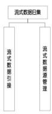
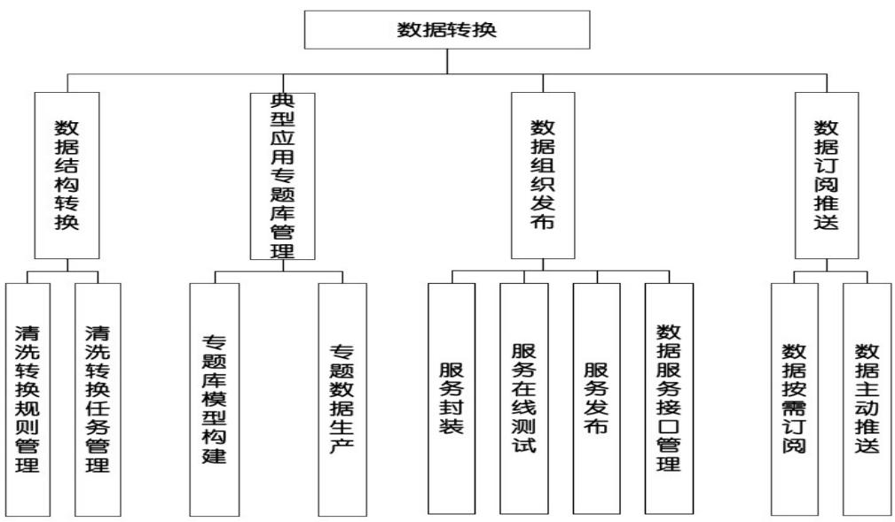
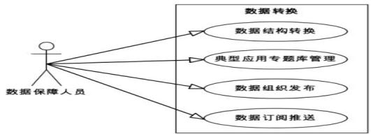

<table><tr><td>构化数据归集任务； 4.在非结构化数据归集页面查 看成功创建的归集任务，运行 该归集任务，在监控日志中查 看任务运行状态； 6.登录 hadoop 管理页面，查看 目标端目录下对源端目录地址</td><td>表，若非结构化数据归集任务 构建失败则执行异常流E1； 5.将文件从数据源上传到指定目 标目录下，若文件上传失败则 执行异常流 E2；</td><td></td></tr><tr><td colspan="2">下非结构化文件的上传情况。</td><td></td></tr><tr><td colspan="3">异常流E1：非结构化数据归集任务构建失败；</td></tr><tr><td colspan="3">异常流E2：文件上传失败。</td></tr><tr><td colspan="3">后置条件：无</td></tr></table>

## 3.2.1.5.3 非结构化数据源引接/ZZSJHQZHFW-GN-SJHQ-FJGHSJGJ-FJGHSJYYJ

非结构化数据源引接功能用例描述见表12。

表12 非结构化数据源引接功能用例
<table><tr><td colspan="2" rowspan="1">Use Case名称：非结构化数据源引接 /ZZSJHQZHFW-GN-SJHQ-FJGHSJGJ-FJGHSJYYJ</td><td colspan="2" rowspan="1">Actors:值勤参谋、数据保障人员</td></tr><tr><td colspan="4" rowspan="1">概述：本用例是描述对非结构化数据源的添加、修改、检索、删除等管理功能。</td></tr><tr><td colspan="4" rowspan="1">前置条件：系统软件正常启动，本软件正常启动，数据中台运行正常，本地数据库运行正常，网络正常通联。</td></tr><tr><td colspan="4" rowspan="1">主事件流</td></tr><tr><td colspan="1" rowspan="1">Actor的动作</td><td colspan="2" rowspan="1">系统的动作</td><td colspan="1" rowspan="1">动作约束（性能、可靠性、容错等）</td></tr><tr><td>1.打开“某”软件，进入数据获取 菜单下非结构化数据归集页 面； 2.点击FTP/SFTP 文件上传，创</td><td>建工单，选择数据源，点击新 建FTP/SFTP数据源，输入</td><td></td></tr><tr><td>创建数据源； 4.选择已创建的结构化数据源 点击编辑，可对FTP/SFTP数 据源地址、端口、用户名、密 码、类型等参数进行修改，点 击确定保存修改；点击该非结 构化数据源对应的删除按钮删 除数据源。</td><td>3.将非结构化数据源加入到数据 源列表，若非结构化数据源测 试失败则执行异常流E1； 5.修改数据源参数，若非结构化</td><td>数据源参数修改失败则执行异 常流E2；删除非结构化数据</td></tr><tr><td colspan="4">败则执行异常流E3； 异常流E1：非结构化数据源测试失败；</td></tr><tr><td colspan="4">异常流E2：非结构化数据源参数修改失败；</td></tr><tr><td colspan="4">异常流E3：非结构化数据源删除失败。</td></tr><tr><td colspan="4">后置条件：无</td></tr></table>

## 3.2.1.6 流式数据归集/ZZSJHQZHFW-GN-SJHQ-LSSJGJ

## 3.2.1.6.1 所有子功能标识

流式数据归集包括流式引接和流式数据源引接功能。其中，流式数据引

接能够实现实时数据的接入，并提供实时数据的应用；流式数据源引接功能能够管理、添加、变更、删除各类流式数据的数据源。流式数据归集功能组成如图 7所示。

  
图 7 流式数据归集能力组成图  
流式数据归集功能需求见表13。

表13 流式数据归集功能需求
<table><tr><td rowspan=1 colspan=1>序号</td><td rowspan=1 colspan=1>子功能名称/标识</td><td rowspan=1 colspan=1>功能描述</td><td rowspan=1 colspan=1>优先级</td></tr><tr><td rowspan=1 colspan=1>1</td><td rowspan=1 colspan=1>流式数据引接/ZZSJHQZHFW-GN-SJHQ-LSSJGJ-LSSJYJ</td><td rowspan=1 colspan=1>支持通过特定信源引接获取中台无法及时提供的实时数据；提供流式引接功能，支持对实时数据格式进行自定义协议解析，能够通过消息队列等实现实时数据的接入功能。</td><td rowspan=1 colspan=1>高</td></tr><tr><td rowspan=1 colspan=1>2</td><td rowspan=1 colspan=1>流式数据源管理/ZZSJHQZHFW-GN-SJHQ-LSSJGJ-LSSJYGL</td><td rowspan=1 colspan=1>支持自定义消息队列数据源，提供消息队列数据源的配置管理和概览功能。其中，数据源配置管理具备管理、添加、变更、删除消息队列数据源的功能。</td><td rowspan=1 colspan=1>高</td></tr></table>

3.2.1.6.2 流式数据引接/ZZSJHQZHFW-GN-SJHQ-LSSJGJ-LSSJYJ

## 流式数据引接功能用例描述见表14。

表14 流式数据引接功能用例
<table><tr><td>Use Case名称：流式数据引接 /ZZSJHQZHFW-GN-SJHQ-LSSJGJ-LSSJYJ</td><td colspan="2">Actors:值勤参谋、数据保障人员</td></tr><tr><td colspan="3">概述：本用例是描述流式数据引接的过程。 前置条件：系统软件正常启动，本软件正常启动，数据中台运行正常，本地数据库运行正常，网</td></tr><tr><td colspan="3">络正常通联。 主事件流</td></tr><tr><td>Actor 的动作 1.打开“某”软件，进入数据获取 菜单下流式数据归集页面；</td><td>系统的动作</td><td>动作约束（性能、可靠性、容 错等）</td></tr><tr><td>2.点击创建工单，选择数据源 类型、数据源名称、主题名 称、消费模式，配置态势数据 中待提取字段的名称、类型、 取值方式等参数，点击下一 步；点击下一步，配置目标数 据源信息，点击下一步；配置</td><td></td><td></td></tr><tr><td>流式数据字段和目标数据源表 的字段映射关系，点击下一 步；确认配置后创建流式数据</td><td></td><td></td></tr><tr><td></td><td></td><td></td></tr><tr><td></td><td></td><td></td></tr><tr><td></td><td></td><td></td></tr><tr><td></td><td></td><td></td></tr><tr><td>归集任务；</td><td></td><td></td></tr><tr><td></td><td>3.将数据归集任务添加到任务列</td><td></td></tr><tr><td></td><td></td><td></td></tr><tr><td></td><td>表，若流式数据归集任务构建</td><td></td></tr><tr><td></td><td></td><td></td></tr><tr><td></td><td>失败则执行异常流E1；</td><td></td></tr><tr><td></td><td></td><td></td></tr><tr><td>4.在流式数据归集页面查看成</td><td></td><td></td></tr><tr><td></td><td></td><td></td></tr><tr><td></td><td></td><td></td></tr><tr><td>功创建的归集任务，运行该归</td><td></td><td></td></tr><tr><td></td><td></td><td></td></tr><tr><td></td><td></td><td></td></tr><tr><td></td><td></td><td></td></tr><tr><td>集任务，查看任务运行状态；</td><td></td><td></td></tr><tr><td></td><td></td><td></td></tr><tr><td></td><td>5.将源端消息队列数据采集到目 标数据库中，若流式数据采集</td><td></td></tr><tr><td colspan="1" rowspan="1">6.模拟指定的主题发布态势数据；7.进入数据运维管理菜单下数据源管理页面，查看对应数据库下对态势数据的采集情况。</td><td colspan="1" rowspan="1">失败则执行异常流E2；</td><td colspan="1" rowspan="1"></td></tr><tr><td colspan="3" rowspan="1">异常流E1：流式数据归集任务构建失败；</td></tr><tr><td colspan="3" rowspan="1">异常流E2：流式数据采集失败。</td></tr><tr><td colspan="3" rowspan="1">后置条件：无</td></tr></table>

## 3.2.1.6.3 流式数据源管理/ZZSJHQZHFW-GN-SJHQ-LSSJGJ-LSSJYGL

流式数据源管理功能用例描述见表15。

表15 流式数据源管理功能用例
<table><tr><td colspan="2" rowspan="1">Use Case名称：流式数据源管理/ZZSJHQZHFW-GN-SJHQ-LSSJGJ-LSSJYGL</td><td colspan="2" rowspan="1">Actors:值勤参谋、数据保障人员</td></tr><tr><td colspan="4" rowspan="1">概述：本用例是描述对流式数据源的添加、修改、检索、删除等管理功能。</td></tr><tr><td colspan="4" rowspan="1">前置条件：系统软件正常启动，本软件正常启动，数据中台运行正常，本地数据库运行正常，网络正常通联。</td></tr><tr><td colspan="4" rowspan="1">主事件流</td></tr><tr><td colspan="1" rowspan="1">Actor的动作</td><td colspan="2" rowspan="1">系统的动作</td><td colspan="1" rowspan="1">动作约束（性能、可靠性、容错等）</td></tr><tr><td colspan="1" rowspan="1">1.登录某服务进入数据源管理页面，选中某流式数据源，点击删除；3.在流式数据源展示页面查看</td><td colspan="2" rowspan="1">2.判断此流式数据源是否被其他调度任务依赖，如果没有依赖则直接删除，如果被依赖则弹出提示框，若删除失败则执行异常流E1；</td><td colspan="1" rowspan="1"></td></tr><tr><td>到该数据源已被删除；</td><td colspan="2">4.在数据源检索输入框中输入 数据库名、数据库类型等检索</td><td></td></tr><tr><td>条件，开始检索； 6.显示满足条件的数据源列表 信息。</td><td colspan="2">5.查找符合检索条件的数据源返 回前端界面；</td><td></td></tr><tr><td>7.选中某流式数据源，点击编 辑；</td><td colspan="2">8.查找该数据源基本信息，并返 回；</td><td></td></tr><tr><td>9.修改数据源名称、中文名、IP 地址、用户名、密码等信息， 保存数据源信息； 11.点击新建流式数据源，输入</td><td colspan="2">10.将该数据源信息按照用户输 入修改，若数据源信息修改失 败则执行异常流 E2；</td><td></td></tr><tr><td>数据源名称、中文名、IP地 址、用户名、密码等信息，保 存数据源信息；</td><td colspan="2">12.创建该数据源并加入数据源</td><td></td></tr><tr><td>13.在流式数据源列表展示页面 可查看到创建完成的数据源信 息。 异常流E1：流式数据源删除失败；</td><td colspan="2">列表，若数据源创建失败则执 行异常流 E3；</td><td></td></tr></table>

<table><tr><td>异常流E2：流式数据源信息修改失败；</td></tr><tr><td>异常流E3：流式数据源创建失败。</td></tr><tr><td>后置条件：无</td></tr></table>

## 3.2.2 数据转换/ZZSJHQZHFW-GN-SJZH

## 3.2.2.1 数据转换能力

数据转换根据某典型应用的数据使用需求，提供对引接获取的数据进行预处理，实现数据深度治理能力，支撑其他某典型应用对各类数据的高效运用。支持对各类数据进行结构转换等操作；支持将预处理结果转储到相应典型应用专题库；支持数据转换自定义配置和自定义协议解析；支持对数据进行组织，封装形成数据服务；支持将数据发布到数据服务目录，提供服务化访问接口；支持饼状图、柱状图、折线图、雷达图等进行多样化综合统计分析展现；支持数据服务按需订阅、主动推送，为后续某典型应用运用各类数据提供支撑。

数据转换包含数据结构转换、典型应用专题库管理、数据组织发布和数据订阅推送4个方面能力，主要组成如图 8所示。

  
图 8数据转换功能框架图

## 3.2.2.2 所有功能标识

数据转换用例图如图 9所示。

  
图 9 数据转换用例图

数据转换功能划分见表16。

表16 数据转换功能划分
<table><tr><td rowspan=1 colspan=1>序号</td><td rowspan=1 colspan=1>功能名称/标识</td><td rowspan=1 colspan=1>子功能名称/标识</td><td rowspan=1 colspan=1>备注</td></tr><tr><td rowspan=1 colspan=1>1</td><td rowspan=2 colspan=1>数据结构转换ZZSJHQZHFW-GN-SJZH-ZZSJJGZH</td><td rowspan=1 colspan=1>清洗转换规则管理/ZZSJHQZHFW-GN-SJZH-ZZSJJGZH-QXZHGZGL</td><td rowspan=1 colspan=1></td></tr><tr><td rowspan=1 colspan=1>2</td><td rowspan=1 colspan=1>清洗转换任务管理/ZZSJHQZHFW-GN-SJZH-ZZSJJGZH-QXZHRWGL</td><td rowspan=1 colspan=1></td></tr><tr><td rowspan=1 colspan=1>3</td><td rowspan=2 colspan=1>典型应用专题库管理/ZZSJHQZHFW-GN-SJZH-DXYYZTKGL</td><td rowspan=1 colspan=1>专题库模型构建/ZZSJHQZHFW-GN-SJZH-DXYYZTKGL-ZTKMXGJ</td><td rowspan=1 colspan=1></td></tr><tr><td rowspan=1 colspan=1>4</td><td rowspan=1 colspan=1>专题数据生产/ZZSJHQZHFW-GN-SJZH-DXYYZTKGL-ZTSJSC</td><td rowspan=1 colspan=1></td></tr><tr><td rowspan=1 colspan=1>5</td><td rowspan=4 colspan=1>数据组织发布/ZZSJHQZHFW-GN-SJZH-ZZSJZZFB</td><td rowspan=1 colspan=1>服务封装/ZZSJHQZHFW-GN-SJZH-ZZSJZZFB-FWFZ</td><td rowspan=1 colspan=1></td></tr><tr><td rowspan=1 colspan=1>6</td><td rowspan=1 colspan=1>服务在线测试/ZZSJHQZHFW-GN-SJZH-ZZSJZZFB-FWZXCS</td><td rowspan=1 colspan=1></td></tr><tr><td rowspan=1 colspan=1>7</td><td rowspan=1 colspan=1>服务发布/ZZSJHQZHFW-GN-SJZH-ZZSJZZFB-FWFB</td><td rowspan=1 colspan=1></td></tr><tr><td rowspan=1 colspan=1>8</td><td rowspan=1 colspan=1>服务接口管理/ZZSJHQZHFW-GN-SJZH-ZZSJZZFB-FWJKGL</td><td rowspan=1 colspan=1></td></tr><tr><td rowspan=1 colspan=1>9</td><td rowspan=2 colspan=1>数据订阅推送ZZSJHQZHFW-GN-SJZH-ZZSJDYTS</td><td rowspan=1 colspan=1>数据按需订阅/ZZSJHQZHFW-GN-SJZH-ZZSJDYTS-SJAXDY</td><td rowspan=1 colspan=1></td></tr><tr><td rowspan=1 colspan=1>10</td><td rowspan=1 colspan=1>数据主动推送/ZZSJHQZHFW-GN-SJZH-ZZSJDYTS-SJZDTS</td><td rowspan=1 colspan=1></td></tr></table>

3.2.2.3 数据结构转换/ZZSJHQZHFW-GN-SJZH-ZZSJJGZH

## 3.2.2.3.1 所有子功能标识

数据结构转换主要针对不同数据形式、错误残缺、非标准化数据等进行过滤，提高数据质量，完成数据标准化的过程，主要包括清洗转换规则管理和清洗转换任务管理。数据结构转换主要能力组成如图 10所示。

图 10 数据结构转换能力组成图

数据结构转换功能需求见表17。

表17 数据结构转换功能需求
<table><tr><td rowspan=1 colspan=1>序号</td><td rowspan=1 colspan=1>子功能名称/标识</td><td rowspan=1 colspan=1>功能描述</td><td rowspan=1 colspan=1>优先级</td></tr><tr><td rowspan=1 colspan=1>1</td><td rowspan=1 colspan=1>清洗转换规则管理/ZZSJHQZHFW-GN-SJZH-ZZSJJGZH-QXZHGZGL</td><td rowspan=1 colspan=1>支持查看清洗转换规则，主要包括脱敏、加密、转换、自定义规则，支持对自定义规则进行管理。</td><td rowspan=1 colspan=1>中</td></tr><tr><td rowspan=1 colspan=1>2</td><td rowspan=1 colspan=1>清洗转换任务管理/ZZSJHQZHFW-GN-SJZH-ZZSJJGZH-QXZHRWGL</td><td rowspan=1 colspan=1>支持构建并管理清洗转换任务，支持任务运行日志查看和清洗转换数据量统计。</td><td rowspan=1 colspan=1>高</td></tr></table>

## 3.2.2.3.2 清洗转换规则管理/ZZSJHQZHFW-GN-SJZH-ZZSJJGZH-QXZHGZGL

清洗转换规则管理功能用例描述见表18。

表18 清洗转换规则管理功能用例
<table><tr><td>UseCase名称：清洗转换规则管 理/ZZSJHQZHFW-GN-SJZH-ZZSJJGZH-</td><td>Actors:值勤参谋、数据保障人员</td></tr><tr><td>QXZHGZGL 概述：本用例是描述清洗转换规则管理的过程。</td></tr><tr><td>前置条件：系统软件正常启动，本软件正常启动，数据中台运行正常，本地数据库运行正常，网 络正常通联。</td></tr></table>