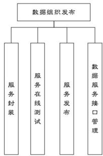

<table><tr><td colspan="3">主事件流</td></tr><tr><td>Actor 的动作</td><td>系统的动作</td><td>动作约束（性能、可靠性、容 错等）</td></tr><tr><td>1.打开“某”软件，进入数据转换 菜单下清洗转换页面； 2.点击配置规则，可查看自定 义的清洗转换规则列表；点击</td><td></td><td></td></tr><tr><td>规则包括内置规则和自定义规 则进行查看，选中某一规则查 看规则描述； 4.点击新增规则，输入规则函 数、参数、名称等参数，编写 规则代码后点击确定，创建规 则；</td><td>3.查询内置规则和自定义规则并 返回给用户，若查询规则失败 则执行异常流E1；</td><td></td></tr><tr><td>6.点击规则对应的编辑按钮， 修改规则函数、参数、名称等 参数，点击确定保存；</td><td>5.将清洗转换规则加入到规则列 表，若清洗转换规则创建失败 则执行异常流E2； 7.修改并保存清洗转换规则参</td><td></td></tr><tr><td>8.点击规则对应的删除按钮， 删除本规则</td><td>数，若清洗转换规则参数修改 失败则执行异常流E3； 9.将清洗转换规则从规则列表中 删除，若清洗转换规则删除失</td><td></td></tr></table>

<table><tr><td rowspan=1 colspan=1>异常流E1：清洗转换规则查询失败；</td></tr><tr><td rowspan=1 colspan=1>异常流E2：清洗转换规则创建失败；</td></tr><tr><td rowspan=1 colspan=1>异常流E3：清洗转换规则参数修改失败；</td></tr><tr><td rowspan=1 colspan=1>异常流E4：清洗转换规则删除失败。</td></tr><tr><td rowspan=1 colspan=1>后置条件：无</td></tr></table>

## 3.2.2.3.3 清洗转换任务管理/ZZSJHQZHFW-GN-SJZH-ZZSJJGZH-QXZHRWGL

清洗转换任务管理功能用例描述见表19。

表19 清洗转换任务管理功能用例
<table><tr><td colspan="2">Use Case名称：清洗转换任务管 理/ZZSJHQZHFW-GN-SJZH-ZZSJJGZH- QXZHRWGL</td><td colspan="2">Actors:值勤参谋、数据保障人员</td></tr><tr><td colspan="4">概述：本用例是描述清洗转换任务管理的过程。</td></tr><tr><td colspan="4">前置条件：系统软件正常启动，本软件正常启动，数据中台运行正常，本地数据库运行正常，网 络正常通联。</td></tr><tr><td colspan="4">主事件流</td></tr><tr><td>Actor的动作</td><td colspan="2">系统的动作</td><td>动作约束（性能、可靠性、容 错等）</td></tr><tr><td>1.打开“某”软件，进入数据转换 菜单下清洗转换页面；</td><td colspan="2"></td><td></td></tr><tr><td>入方式、依据字段等参数；在 数据清洗转换规则配置区域增 加字段的清洗规则，点击确定 生成清洗转换任务；</td><td>3.将清洗转换任务加入到任务列 表，若清洗转换任务创建失败</td><td></td><td></td></tr></table>

<table><tr><td rowspan=1 colspan=1>即运行按钮，通过监控日志查看该任务运行情况，选取该任务作业实例，查看本次任务执行数据量统计信息。</td><td rowspan=1 colspan=1>5.返回任务运行情况和数据量统计信息，若任务数据统计失败则执行异常流E2。</td><td rowspan=1 colspan=1></td></tr><tr><td rowspan=1 colspan=3>异常流E1：清洗转换任务创建失败；</td></tr><tr><td rowspan=1 colspan=3>异常流E2：任务数据统计失败。</td></tr><tr><td rowspan=1 colspan=3>后置条件：无</td></tr></table>

## 3.2.2.4 典型应用专题库管理/ZZSJHQZHFW-GN-SJZH-DXYYZTKGL

## 3.2.2.4.1 所有子功能标识

典型应用专题库管理主要包括专题库模型构建和专题数据生产，专题库模型构建支持构建专题库模型，包括专题库概念模型、逻辑模型和物理模型；专题数据生产支持依据已构建的专题库模型生成专题数据。典型应用专题库管理功能组成如图 11所示。

  
图 11 典型应用专题库管理能力组成图

典型应用专题库管理功能需求见表20。

表20 典型应用专题库管理功能需求
<table><tr><td rowspan=1 colspan=1>序号</td><td rowspan=1 colspan=1>子功能名称/标识</td><td rowspan=1 colspan=1>功能描述</td><td rowspan=1 colspan=1>优先级</td></tr><tr><td rowspan=1 colspan=1>1</td><td rowspan=1 colspan=1>专题库模型构建/ZZSJHQZHFW-GN-SJZH-DXYYZTKGL-ZTKMXGJ</td><td rowspan=1 colspan=1>支持构建专题库模型，包括专题库概念模型、逻辑模型和物理模型。</td><td rowspan=1 colspan=1>高</td></tr><tr><td rowspan=1 colspan=1>2</td><td rowspan=1 colspan=1>专题数据生产/ZZSJHQZHFW-GN-SJZH-DXYYZTKGL-ZTSJSC</td><td rowspan=1 colspan=1>支持依据已构建的专题库模型生成专题数据。</td><td rowspan=1 colspan=1>高</td></tr></table>

## 3.2.2.4.2 专题库模型构建/ZZSJHQZHFW-GN-SJZH-DXYYZTKGL-ZTKMXGJ

专题库模型构建功能用例描述见表21。

表21 专题库模型构建功能用例
<table><tr><td colspan="2" rowspan="1">Use Case名称：专题库模型构建/ZZSJHQZHFW-GN-SJZH-DXYYZTKGL-ZTKMXGJ</td><td colspan="2" rowspan="1">Actors:值勤参谋、数据保障人员</td></tr><tr><td colspan="4" rowspan="1">概述：本用例是描述专题库模型构建的过程。</td></tr><tr><td colspan="4" rowspan="1">前置条件：系统软件正常启动，本软件正常启动，数据中台运行正常，本地数据库运行正常，网络正常通联。</td></tr><tr><td colspan="4" rowspan="1">主事件流</td></tr><tr><td colspan="1" rowspan="1">Actor 的动作</td><td colspan="2" rowspan="1">系统的动作</td><td colspan="1" rowspan="1">动作约束（性能、可靠性、容错等）</td></tr><tr><td colspan="1" rowspan="1">1.登录某服务进入数据转换菜单下专题库模型构建页面；2.选择某一应用系统，进行模型开发，新增概念模型，添加实体和实体间关系；4.新增逻辑模型，添加数据表，配置数据表字段及约束关系，添加表之间关联关系；</td><td colspan="2" rowspan="1">3.增加概念模型，并关联实体和实体间关系，若添加实体失败则执行异常流E1，若添加实体间关系失败则执行异常流E2；5.增加逻辑模型，并关联数据表</td><td colspan="1" rowspan="1"></td></tr><tr><td>6.选中生成的逻辑模型，点击 生成为物理模型，输入物理模 型名称，数据源类型，点击确 定，在物理模型展示区域查看 生成结果； 8.选中生成的物理模型，点击 生成为库表，选择数据源、数 据源类型、物理表，测试数据 源连接成功后点击确定将物理 模型物化为数据库表；</td><td colspan="2">和数据表间关系，若添加数据表 失败则执行异常流E3，若添加数 据表间关系失败则执行异常流 E4 ; 7.将逻辑模型转换为物理模型， 若转换失败则执行异常流E5；</td><td></td></tr><tr><td>异常流E1：添加实体失败；</td><td colspan="3">9.将物理模型物化为数据库表， 若物化失败则执行异常流E6；</td></tr><tr><td colspan="4"></td></tr><tr><td colspan="4">异常流E2：添加实体间关系失败；</td></tr><tr><td colspan="4">异常流E3：添加数据表失败；</td></tr><tr><td colspan="4"></td></tr><tr><td colspan="4">异常流E4：添加数据表间关系失败；</td></tr><tr><td colspan="4">异常流E5：物理模型转换失败；</td></tr><tr><td colspan="4">异常流E6：物化失败；</td></tr><tr><td colspan="4">后置条件：无</td></tr></table>

## 3.2.2.4.3 专题数据生产/ZZSJHQZHFW-GN-SJZH-DXYYZTKGL-ZTSJSC

表22 专题数据生产功能用例
<table><tr><td>UseCase名称：专题数据生产/ZZSJHQZHFW-Actors:值勤参谋、数据保障人员</td><td></td></tr></table>

<table><tr><td colspan="3">GN-SJZH-DXYYZTKGL-ZTSJSC</td></tr><tr><td colspan="3">概述：本用例是描述专题数据生产的过程。</td></tr><tr><td colspan="3">前置条件：系统软件正常启动，本软件正常启动，数据中台运行正常，本地数据库运行正常，网 络正常通联。</td></tr><tr><td colspan="3">主事件流 Actor 的动作 系统的动作 1. 打开“某”软件，进入数据转</td></tr><tr><td>换菜单下专题数据生产页面； 2.点击新增，输入工单名称， 配置源头库，目标库选择为已 创建的专题库模型构建生成的 物化模型，配置源头表与目标 表之间的映射关系，点击确 定，构建专题数据生产任务； 3.构建专题数据生产任务，并将</td><td></td><td>动作约束（性能、可靠性、容 错等）</td></tr><tr><td>4.选中构建的专题数据生产任 E1 ; 务点击立即运行，查看该任务 运行情况； 6.进入数据运维管理菜单下数</td><td>任务添加到列表中，若专题数据 生产任务构建失败则执行异常流 5.将源端数据按照字段映射关系 存储到目标专题库中，若字段映</td><td></td></tr><tr><td>据源管理页面，查看对应数据 库下专题数据生成情况。</td><td>射失败则执行异常流E2；</td><td></td></tr><tr><td>异常流E1：专题数据生产任务构建失败；</td><td colspan="3"></td></tr><tr><td colspan="3"></td></tr><tr><td colspan="3">异常流E2：字段映射失败。</td></tr><tr><td colspan="3"></td></tr><tr><td colspan="3">后置条件：无</td></tr></table>

3.2.2.5 数据组织发布/ZZSJHQZHFW-GN-SJZH-ZZSJZZFB

## 3.2.2.5.1 所有子功能标识

数据组织发布主要包括服务封装、服务在线测试、服务发布、数据服务接口管理数据服务接口访问权限控制功能。数据组织发布主要能力组成如图12所示。

  
图 12 数据组织发布能力组成图

数据组织发布功能需求见表23。

表23 数据组织发布功能需求
<table><tr><td colspan="1" rowspan="1">序号</td><td colspan="1" rowspan="1">子功能名称/标识</td><td colspan="1" rowspan="1">功能描述</td><td colspan="1" rowspan="1">优先级</td></tr><tr><td colspan="1" rowspan="1">1</td><td colspan="1" rowspan="1">服务封装/ZZSJHQZHFW-GN-SJZH-ZZSJZZFB-FWFZ</td><td colspan="1" rowspan="1">支持依据某领域数据应用需求，对领域、实体数据进行服务化封装，构建领域数据服务并向上层应用提供统一的战备专题数据服务访问入口。</td><td colspan="1" rowspan="1">高</td></tr><tr><td colspan="1" rowspan="1">2</td><td colspan="1" rowspan="1">服务在线测试/ZZSJHQZHFW-GN-SJZH-ZZSJZZFB-FWZXCS</td><td colspan="1" rowspan="1">支持提供测试示例，对数据服务进行在线测试。</td><td colspan="1" rowspan="1">高</td></tr><tr><td colspan="1" rowspan="1">3</td><td colspan="1" rowspan="1">服务发布/ZZSJHQZHFW-GN-SJZH-ZZSJZZFB-FWFB</td><td colspan="1" rowspan="1">支持发布已封装的数据服务供用户进行申请使用。</td><td colspan="1" rowspan="1">高</td></tr><tr><td colspan="1" rowspan="1">4</td><td colspan="1" rowspan="1">服务接口管理/ZZSJHQZHFW-GN-SJZH-</td><td colspan="1" rowspan="1">支持分类管理数据服务接口，并查</td><td colspan="1" rowspan="1">高</td></tr><tr><td colspan="1" rowspan="1"></td><td colspan="1" rowspan="1">ZZSJZZFB-FWJKGL</td><td colspan="1" rowspan="1">看接口详情；支持对数据服务接口进行查询、删除、修改操作，支持以饼状图、柱状图、折线图、雷达图对数据服务访问情况进行统计展现。</td><td colspan="1" rowspan="1"></td></tr></table>

## 3.2.2.5.2 服务封装/ZZSJHQZHFW-GN-SJZH-ZZSJZZFB-FWFZ

服务封装功能用例描述见表24。

表24 服务封装功能用例
<table><tr><td colspan="2">UseCase名称：服务封 装/ZZSJHQZHFW-GN-SJZH-ZZSJZZFB- FWFZ</td><td colspan="2">Actors:值勤参谋、数据保障人员</td></tr><tr><td colspan="4">概述：本用例是描述对数据进行服务封装的过程。</td></tr><tr><td colspan="4">前置条件：系统软件正常启动，本软件正常启动，数据中台运行正常，服务编目目录已构建，本 地数据库运行正常，网络正常通联。</td></tr><tr><td colspan="4">主事件流</td></tr><tr><td>Actor 的动作</td><td colspan="3">系统的动作</td></tr><tr><td>1.打开“某”软件，进入数据转 换菜单下数据服务开发页面；</td><td colspan="3"></td></tr><tr><td>2.点击新增，输入服务编码、 服务名称等参数，点击下一 步；选择数据源，编写 SQL 语句，测试成功后点击下一 步；确定输入参数和输出参</td><td></td><td></td></tr><tr><td>数，点击确定生成数据服务； 流E1; 4.在数据服务开发页面可查看</td><td>3.将数据服务加入到服务列表， 若数据服务创建失败则执行异常</td><td></td></tr><tr><td colspan="1" rowspan="1">生成的数据服务，点击进入该数据服务，查看该服务的编码、名称、地址、入参、出参等详情参数；</td><td colspan="1" rowspan="1"></td><td colspan="1" rowspan="1"></td></tr><tr><td colspan="4" rowspan="1">异常流E1：数据服务创建失败；</td></tr><tr><td colspan="4" rowspan="1">后置条件：无</td></tr></table>

## 3.2.2.5.3 服务在线测试/ZZSJHQZHFW-GN-SJZH-ZZSJZZFB-FWZXCS

服务在线测试功能用例描述见表25。

表25 服务在线测试功能用例
<table><tr><td rowspan=1 colspan=2>Use Case名称：服务在线测试/ZZSJHQZHFW-GN-SJZH-ZZSJZZFB-FWZXCS</td><td rowspan=1 colspan=2>Actors:数据保障人员、应用开发人员</td></tr><tr><td rowspan=1 colspan=4>概述：本用例是描述服务在线测试的过程。</td></tr><tr><td rowspan=1 colspan=4>前置条件：系统软件正常启动，本软件正常启动，数据中台运行正常，服务编目目录已构建，本地数据库运行正常，网络正常通联。</td></tr><tr><td rowspan=1 colspan=4>主事件流</td></tr><tr><td rowspan=1 colspan=1>Actor 的动作</td><td rowspan=1 colspan=2>系统的动作</td><td rowspan=1 colspan=1>动作约束（性能、可靠性、容错等）</td></tr><tr><td rowspan=1 colspan=1>1.打开“某”软件，进入数据转换菜单下我的服务发布页面；2.选取已创建的数据服务，点击测试按钮，依据默认的测试示例参数进行测试，查看数据服务响应情况；4.可查看到数据服务响应数据。</td><td rowspan=1 colspan=2>3.数据服务根据请求参数返回相应数据，若数据返回失败则执行异常流E1；</td><td rowspan=1 colspan=1></td></tr></table>

<table><tr><td>异常流E1：数据服务返回数据失败。</td></tr><tr><td></td></tr><tr><td>后置条件：无</td></tr></table>

## 3.2.2.5.4 服务发布/ZZSJHQZHFW-GN-SJZH-ZZSJZZFB-FWFB

服务发布功能用例描述见表26。

表26 服务发布功能用例
<table><tr><td rowspan=1 colspan=2>UseCase名称：服务发布/ZZSJHQZHFW-GN-SJZH-ZZSJZZFB-FWFB</td><td rowspan=1 colspan=2>Actors:数据保障人员、应用开发人员</td></tr><tr><td rowspan=1 colspan=4>概述：本用例是描述服务发布的过程。</td></tr><tr><td rowspan=1 colspan=4>前置条件：系统软件正常启动，本软件正常启动，数据中台运行正常，服务编目目录已构建，本地数据库运行正常，网络正常通联。</td></tr><tr><td rowspan=1 colspan=4>主事件流</td></tr><tr><td rowspan=1 colspan=1>Actor 的动作</td><td rowspan=1 colspan=2>系统的动作</td><td rowspan=1 colspan=1>动作约束（性能、可靠性、容错等）</td></tr><tr><td rowspan=1 colspan=1>1.服务封装构建的领域数据服务默认为发布状态，用户打开“某”软件，进入数据转换菜单下我的服务发布页面，查看已发布的数据服务2.选中某一数据服务进行取消发布操作，观察服务发布状态；4.选中某一数据服务进行发布操作，观察服务发布状态；</td><td rowspan=1 colspan=2>3.取消本数据服务发布，并将发布状态修改为未发布，若取消发布失败则执行异常流E1；5.将本数据服务发布，并将发布状态修改为已发布，若发布失败则执行异常流E1；</td><td rowspan=1 colspan=1></td></tr><tr><td rowspan=1 colspan=4>异常流E1：数据服务取消发布失败；</td></tr></table>