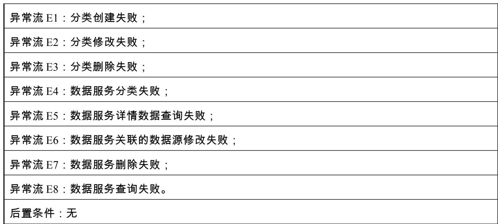
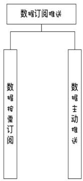
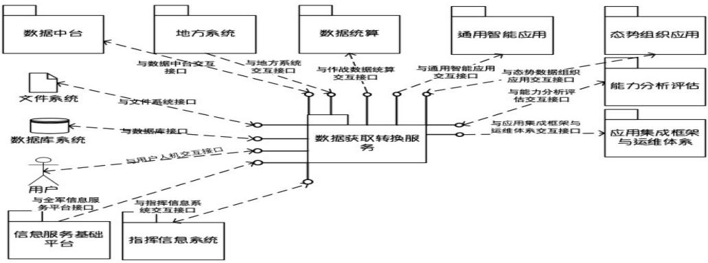

<table><tr><td>异常流E2：数据服务发布失败。</td></tr><tr><td></td></tr><tr><td>后置条件：无</td></tr></table>

## 3.2.2.5.5 服务接口管理/ZZSJHQZHFW-GN-SJZH-ZZSJZZFB-FWJKGL

服务接口管理功能用例描述见表27。

表27 服务接口管理功能用例
<table><tr><td colspan="2">Use Case名称：服务接口管 理/ZZSJHQZHFW-GN-SJZH-ZZSJZZFB- FWJKGL</td><td colspan="2">Actors：数据保障人员、应用开发人员</td></tr><tr><td colspan="3">概述：本用例是描述对数据服务接口进行管理的过程。</td></tr><tr><td colspan="3">前置条件：系统软件正常启动，本软件正常启动，数据中台运行正常，服务编目目录已构建，本 地数据库运行正常，网络正常通联。</td></tr><tr><td></td><td colspan="2">主事件流</td></tr><tr><td>Actor 的动作</td><td>系统的动作</td><td>动作约束（性能、可靠性、容 错等）</td></tr><tr><td>1.打开“某”软件，进入数据运 维管理菜单下资产目录管理页 面； 2.选择分类目录节点点击添加</td><td></td><td></td></tr><tr><td>编码等参数，提交后查看分类 添加结果； 4.点击已添加分类进行修改， 修改分类名称、分类编码等参 数后提交，查看分类修改结</td><td>3.构建该分类与其他分类的关联 层级关系，若分类创建失败则执 行异常流E1；</td><td></td></tr><tr><td>果； 6.点击已添加分类进行删除， 查看分类删除结果；</td><td>5.修改分类并保存，若分类修改 失败则执行异常流E2；</td><td></td></tr></table>

<table><tr><td>8.进入数据转换菜单下数据服 务开发页面，进行服务封装， 在构建数据服务时选择主题分 类为对应分类目录下，查看数 据服务关联分类情况； 10.点击进入某一数据服务， 查看该服务的编码、名称、地 址、入参、出参等详情参数；</td><td>7.删除该分类，若分类删除失败 则执行异常流 E3；</td></tr><tr><td></td><td>9.构建数据服务，并将数据服务 分类挂接到指定目录下，若数据 服务分类失败则执行异常流E4； 11.查询该数据服务详情数据返回 用户，若数据服务详情数据查询 失败则执行异常流E5；</td></tr><tr><td>12.选择某一数据服务点击修 改发布数据源，查看数据源修 改结果；选择某一数据服务点 击删除，查看数据服务删除结 果； 14.输入数据服务名称或服务 编码对已创建服务进行检索， 查看检索结果 码的数据服务返回给用户，若数 据服务查询失败则执行异常流</td><td>13.修改数据服务关联的数据源， 若修改失败则执行异常流E6；删 除该数据服务，若数据服务删除 失败则执行异常流E7； 15.将符合数据服务名称或服务编</td></tr></table>

  
3.2.2.6 数据订阅推送/ZZSJHQZHFW-GN-SJZH-ZZSJDYTS

## 3.2.2.6.1 所有子功能标识

数据订阅推送主要包括数据按需订阅和数据主动推送两项能力,主要能力组成如图 13所示。

  
图 13 数据订阅推送能力组成图

数据订阅推送功能需求见表28。

表28 数据订阅推送功能需求
<table><tr><td rowspan=1 colspan=1>序号</td><td rowspan=1 colspan=1>子功能名称/标识</td><td rowspan=1 colspan=1>功能描述</td><td rowspan=1 colspan=1>优先级</td></tr><tr><td rowspan=1 colspan=1>1</td><td rowspan=1 colspan=1>数据按需订阅/ZZSJHQZHFW-GN-SJZH-ZZSJDYTS-SJAXDY</td><td rowspan=1 colspan=1>能够提供服务化访问接口，支持按需订阅等方式提供数据服务,为后续某典型应用运用各类数据提供支撑。</td><td rowspan=1 colspan=1>高</td></tr><tr><td rowspan=1 colspan=1>2</td><td rowspan=1 colspan=1>数据主动推送/ZZSJHQZHFW-GN-SJZH-ZZSJDYTS-SJZDTS</td><td rowspan=1 colspan=1>能够提供服务化访问接口，支持主动推送等方式提供数据服务,为后续某典型应用运用各类数据提供支撑。</td><td rowspan=1 colspan=1>高</td></tr></table>

## 3.2.2.6.2 数据按需订阅/ZZSJHQZHFW-GN-SJZH-ZZSJDYTS-SJAXDY

数据按需订阅功能用例描述见表29。

表29 数据按需订阅功能用例
<table><tr><td colspan="2" rowspan="1">Use Case名称：数据按需订阅/ ZZSJHQZHFW-GN-SJZH-ZZSJDYTS-SJAXDY</td><td colspan="2" rowspan="1">Actors:值勤参谋、数据保障人员</td></tr><tr><td colspan="4" rowspan="1">概述：能够提供服务化访问接口，支持按需订阅等方式提供数据服务，为后续某典型应用运用各类数据提供支撑。</td></tr><tr><td colspan="4" rowspan="1">前置条件：系统软件正常启动，本软件正常启动，数据中台运行正常，本地数据库运行正常，网络正常通联。</td></tr><tr><td colspan="4" rowspan="1">主事件流</td></tr><tr><td colspan="1" rowspan="1">Actor 的动作</td><td colspan="2" rowspan="1">系统的动作</td><td colspan="1" rowspan="1">动作约束（性能、可靠性、容错等）</td></tr><tr><td colspan="1" rowspan="1">1.打开“某”软件，进入数据转换菜单下数据订阅推送页面；2.在主题列表中选择主题，订阅主题消息，配置数据接收方式为 rabbitMQ 或者websocket，查看主题订阅状态；</td><td colspan="2" rowspan="1"></td><td colspan="1" rowspan="1"></td></tr><tr><td colspan="1" rowspan="1">4.等待接收数据。</td><td colspan="2" rowspan="1">3.修改主题的订阅状态，并等待接收数据，若主题的订阅状态修改失败则执行异常流E1；</td><td colspan="1" rowspan="1"></td></tr><tr><td colspan="4" rowspan="1">异常流E1：主题的订阅状态修改失败。</td></tr><tr><td colspan="4" rowspan="1">后置条件：无</td></tr></table>

## 3.2.2.6.3 数据主动推送/ZZSJHQZHFW-GN-SJZH-ZZSJDYTS-SJZDTS

数据主动推送功能用例描述见表30。

表30 数据主动推送功能用例
<table><tr><td rowspan=1 colspan=2>Use Case 名称：数据主动推送/ ZZSJHQZHFW-GN-SJZH-ZZSJDYTS-SJZDTS</td><td rowspan=1 colspan=2>Actors:值勤参谋、数据保障人员</td></tr><tr><td rowspan=1 colspan=4>概述：通过地址信息、登录验证信息对接入数据源进行连接测试。</td></tr><tr><td rowspan=1 colspan=4>前置条件：能够提供服务化访问接口，支持主动推送等方式提供数据服务，为后续某典型应用运用各类数据提供支撑。</td></tr><tr><td rowspan=1 colspan=4>主事件流</td></tr><tr><td rowspan=1 colspan=1>Actor 的动作</td><td rowspan=1 colspan=2>系统的动作</td><td rowspan=1 colspan=1>动作约束（性能、可靠性、容错等）</td></tr><tr><td rowspan=1 colspan=1>1.打开“某”软件，进入数据转换菜单下数据订阅推送页面，向订阅成功的主题推送数据；3.订阅方用户接收到数据。</td><td rowspan=1 colspan=2>2.根据主题匹配已订阅主题用户，将数据按照用户选择的接收方式 rabbitMQ 或者 websocket 推送给用户，若数据推送失败则异常流E1。</td><td rowspan=1 colspan=1></td></tr><tr><td rowspan=1 colspan=4>异常流E1：数据推送失败。</td></tr><tr><td rowspan=1 colspan=4>后置条件：无</td></tr></table>

## 3.2.3 分系统性能需求/ZZSJHQZHFW-XN

## 3.2.3.1 性能指标

某服务系统的性能指标见表31。

表31 某服系统性能指标
<table><tr><td rowspan=1 colspan=1>序号</td><td rowspan=1 colspan=1>性能指标名称/标识</td><td rowspan=1 colspan=1>指标描述</td><td rowspan=1 colspan=1>具体要求</td><td rowspan=1 colspan=1>优先级</td><td rowspan=1 colspan=1>备注</td></tr><tr><td rowspan=1 colspan=1>1</td><td rowspan=1 colspan=1>数据获取/ZZSJHQZHFW-XN-ZZSJHQ</td><td rowspan=1 colspan=1>获取的数据资源不少于19种</td><td rowspan=1 colspan=1>获取的数据资源包括：1类数据、2类数据、3类数据、4类数据、5类数据、6类数据等；</td><td rowspan=1 colspan=1>中</td><td rowspan=1 colspan=1></td></tr><tr><td rowspan=1 colspan=1>2</td><td rowspan=1 colspan=1>数据转换/ZZSJHQZHFW-XN-ZZSJZH</td><td rowspan=1 colspan=1>接入数据进行标准转换速度不低于2000条/秒</td><td rowspan=1 colspan=1>接入数据进行标准转换速度不低于2000条/秒</td><td rowspan=1 colspan=1>中</td><td rowspan=1 colspan=1></td></tr></table>

## 3.2.3.1.1 数据获取/ZZSJHQZHFW-XN-ZZSJHQ

数据获取性能用例描述见表32所示。

表32 数据获取性能用例描述
<table><tr><td rowspan=1 colspan=1>Use Case 名称： 数据获取/ZZSJHQZHFW-XN-ZZSJHQ</td><td rowspan=1 colspan=2>Actors:值勤参谋、数据保障人员、值勤首长</td></tr><tr><td rowspan=1 colspan=3>概述：本用例是验证数据获取性能指标，考查系统获取的数据资源不少于19种，包括1类数据、2类数据、3类数据、4类数据、5类数据、6类数据等。</td></tr><tr><td rowspan=1 colspan=3>前置条件：系统软件正常启动，本软件正常启动，数据中台运行正常，本地数据库运行正常，网络正常通联。</td></tr><tr><td rowspan=1 colspan=3>主事件流</td></tr><tr><td rowspan=1 colspan=1>Actor 的动作</td><td rowspan=1 colspan=1>系统的动作</td><td rowspan=1 colspan=1>动作约束（性能、可靠性、容错等）</td></tr><tr><td rowspan=1 colspan=1>1. 用户进入某分系统，依次选择19种数据资源类型进行资源数据获取；3.用户查看数据资源获取结果。</td><td rowspan=1 colspan=1>2.本软件对所选类型数据资源进行获取并展示结果。若获取结果数据展示失败，进入异常流E1；</td><td rowspan=1 colspan=1>获取的数据资源不少于19种，包括1类数据、2类数据、3类数据、4类数据、5类数据、6类数据等。</td></tr><tr><td rowspan=1 colspan=2>异常流E1：数据资源获取失败，写入错误日志，提示失败信息，用例结束。</td><td rowspan=1 colspan=1></td></tr></table>

<table><tr><td>后置条件：无。</td></tr><tr><td></td></tr></table>

## 3.2.3.1.2 数据转换/ZZSJHQZHFW-XN-ZZSJZH

数据转换性能用例描述见表33所示。

表33 数据转换性能用例描述
<table><tr><td rowspan=1 colspan=1>Use Case 名称： 数据转换/ZZSJHQZHFW-XN-ZZSJZH</td><td rowspan=1 colspan=2>Actors:值勤参谋、数据保障人员、值勤首长</td></tr><tr><td rowspan=1 colspan=3>概述：本用例是验证数据转换性能指标，考查系统在网络状态良好的情况下，接入数据进行标准转换速度不低于2000条/秒。</td></tr><tr><td rowspan=1 colspan=3>前置条件：系统软件正常启动，本软件正常启动，数据中台运行正常，本地数据库运行正常，网络正常通联。</td></tr><tr><td rowspan=1 colspan=3>主事件流</td></tr><tr><td rowspan=1 colspan=1>Actor 的动作</td><td rowspan=1 colspan=1>系统的动作</td><td rowspan=1 colspan=1>动作约束（性能、可靠性、容错等）</td></tr><tr><td rowspan=1 colspan=1>1.用户进入某分系统，选择一种类型资源进行一分钟的资源数据获取转换；3.用户查看获取的资源数据条数是否超过120000条。</td><td rowspan=1 colspan=1>2.本软件对所选类型资源数据进行1分钟获取并展示结果。若获取结果数据展示失败，进入异常流E1 ;</td><td rowspan=1 colspan=1>在网络状态良好的情况下，接入数据进行标准转换速度不低于2000条/秒</td></tr><tr><td rowspan=1 colspan=2>异常流E1：资源数据获取失败，写入错误日志，提示失败信息，用例结束。</td><td rowspan=1 colspan=1></td></tr><tr><td rowspan=1 colspan=2>后置条件：无。</td><td rowspan=1 colspan=1></td></tr></table>

## 3.3 分系统外部接口需求/ZZSJHQZHFW-JK-WB

## 3.3.1 接口标识和接口图

系统外部接口如图 14所示。

  
图 14 某服务系统外部接口设计  
本系统的外部接口标识见表34所示。

表34 外部接口标识
<table><tr><td colspan="1" rowspan="1">序号</td><td colspan="1" rowspan="1">接口名称/标识</td><td colspan="1" rowspan="1">接口描述</td><td colspan="1" rowspan="1">发送方</td><td colspan="1" rowspan="1">接收方</td><td colspan="1" rowspan="1">接口类型</td><td colspan="1" rowspan="1">优先级</td><td colspan="1" rowspan="1">备注</td></tr><tr><td colspan="1" rowspan="1">1</td><td colspan="1" rowspan="1">与数据统算交互接口/ZZSJHQZHFW-JK-WB-ZZSJTS</td><td colspan="1" rowspan="1">数据统算调用本系统获取通算分析所需的数据</td><td colspan="1" rowspan="1">本系统</td><td colspan="1" rowspan="1">数据统算</td><td colspan="1" rowspan="1">API接口</td><td colspan="1" rowspan="1">高</td><td colspan="1" rowspan="1">一</td></tr><tr><td colspan="1" rowspan="1">2</td><td colspan="1" rowspan="1">与通用智能应用交互接口/ZZSJHQZHFW-JK-WB-TYZNYY</td><td colspan="1" rowspan="1">通用智能应用调用本系统获取应用运行所需数据</td><td colspan="1" rowspan="1">本系统</td><td colspan="1" rowspan="1">通用智能应用</td><td colspan="1" rowspan="1">API接口</td><td colspan="1" rowspan="1">高</td><td colspan="1" rowspan="1"></td></tr><tr><td colspan="1" rowspan="1">3</td><td colspan="1" rowspan="2">与态势数据组织应用交互接口/ZZSJHQZHFW-JK-WB-TSSJZZYY</td><td colspan="1" rowspan="2">本系统与态势数据组织应用之间进行态势数据共享</td><td colspan="1" rowspan="1">本系统</td><td colspan="1" rowspan="1">态势数据组织应用</td><td colspan="1" rowspan="1">API接口</td><td colspan="1" rowspan="1">高</td><td colspan="1" rowspan="1"></td></tr><tr><td colspan="1" rowspan="1">4</td><td colspan="1" rowspan="1">态势数据组织应用</td><td colspan="1" rowspan="1">本系统</td><td colspan="1" rowspan="1">API接口</td><td colspan="1" rowspan="1">高</td><td colspan="1" rowspan="1">一</td></tr><tr><td colspan="1" rowspan="1">5</td><td colspan="1" rowspan="2">与能力分析评估交互接口/ZZSJHQZHFW-JK-WB-NLFXPG</td><td colspan="1" rowspan="2">能力分析评估应用调用本系统获取评估所需数据，并将分析评估结果数据回流至本系统</td><td colspan="1" rowspan="1">本系统</td><td colspan="1" rowspan="1">能力分析评估应用</td><td colspan="1" rowspan="1">API接口</td><td colspan="1" rowspan="1">高</td><td colspan="1" rowspan="1"></td></tr><tr><td colspan="1" rowspan="1">6</td><td colspan="1" rowspan="1">能力分析评估应用</td><td colspan="1" rowspan="1">本系统</td><td colspan="1" rowspan="1">API接口</td><td colspan="1" rowspan="1">高</td><td colspan="1" rowspan="1">一</td></tr><tr><td colspan="1" rowspan="1">7</td><td colspan="1" rowspan="1">与应用集成框架与运维体系交互接口/ZZSJHQZHFW-JK-WB-YYJCKJYYWTX</td><td colspan="1" rowspan="1">本系统将系统监控、日志等信息推送至应用集成框架与运维体系</td><td colspan="1" rowspan="1">本系统</td><td colspan="1" rowspan="1">应用集成框架与运维体系</td><td colspan="1" rowspan="1">API接口、DLL接口</td><td colspan="1" rowspan="1">低</td><td colspan="1" rowspan="1">一</td></tr><tr><td colspan="1" rowspan="1">8</td><td colspan="1" rowspan="2">与指挥信息系统交互接口/ZZSJHQZHFW-JK-WB-ZHXXXT</td><td colspan="1" rowspan="2">本系统与指挥信息系统之间进行态势数据等数据共享</td><td colspan="1" rowspan="1">本系统</td><td colspan="1" rowspan="1">指挥信息系统</td><td colspan="1" rowspan="1">API接口</td><td colspan="1" rowspan="1">高</td><td colspan="1" rowspan="1">一</td></tr><tr><td colspan="1" rowspan="1">9</td><td colspan="1" rowspan="1">指挥信息系统</td><td colspan="1" rowspan="1">本系统</td><td colspan="1" rowspan="1">API接口</td><td colspan="1" rowspan="1">高</td><td colspan="1" rowspan="1">一</td></tr><tr><td colspan="1" rowspan="1">10</td><td colspan="1" rowspan="1">与某信息服务平台交互接口/ZZSJHQZHFW-JK-WB-QJXXPT</td><td colspan="1" rowspan="1">本系统调用某信息服务平台用户管理、统一时空管理、服务调度管理等服务。</td><td colspan="1" rowspan="1">某信息服务基础平台</td><td colspan="1" rowspan="1">本系统</td><td colspan="1" rowspan="1">API接口</td><td colspan="1" rowspan="1">中</td><td colspan="1" rowspan="1"></td></tr><tr><td colspan="1" rowspan="1">11</td><td colspan="1" rowspan="2">与某数据中台交互接口/ZZSJHQZHFW-JK-WB-SJZT</td><td colspan="1" rowspan="2">本系统与数据中台之间进行基础数据、动态数据、指挥决策数据等数据交互</td><td colspan="1" rowspan="1">某数据中台</td><td colspan="1" rowspan="1">本系统</td><td colspan="1" rowspan="1">API接口、消息队列接口</td><td colspan="1" rowspan="1">高</td><td colspan="1" rowspan="1">一</td></tr><tr><td colspan="1" rowspan="1">12</td><td colspan="1" rowspan="1">本系统</td><td colspan="1" rowspan="1">某数据中台</td><td colspan="1" rowspan="1">API接口</td><td colspan="1" rowspan="1">高</td><td colspan="1" rowspan="1">一</td></tr><tr><td colspan="1" rowspan="1">13</td><td colspan="1" rowspan="2">与上下级典型应用交互接口/ZZSJHQZHFW-JK-WB-SXJDXYY</td><td colspan="1" rowspan="2">本系统基于下发的通用组件与某典型应用系统之间的业务数据共享交换</td><td colspan="1" rowspan="1">某典型应用系统</td><td colspan="1" rowspan="1">本系统</td><td colspan="1" rowspan="1">API接口</td><td colspan="1" rowspan="1">中</td><td colspan="1" rowspan="1">一</td></tr><tr><td colspan="1" rowspan="1">14</td><td colspan="1" rowspan="1">本系统</td><td colspan="1" rowspan="1">某某典型应用系统</td><td colspan="1" rowspan="1">API接口</td><td colspan="1" rowspan="1">中</td><td colspan="1" rowspan="1">一</td></tr><tr><td colspan="1" rowspan="1">15</td><td colspan="1" rowspan="1">与地方系统交互接/ZZSJHQZHFW-JK-WB-DFXT</td><td colspan="1" rowspan="1">本系统需要从外部地方系统引接其他领域数据时，使用本接口进行离线数据交换。</td><td colspan="1" rowspan="1">地方系统</td><td colspan="1" rowspan="1">本系统</td><td colspan="1" rowspan="1">文件接口</td><td colspan="1" rowspan="1">中</td><td colspan="1" rowspan="1"></td></tr><tr><td colspan="1" rowspan="1">16</td><td colspan="1" rowspan="2">与用户人机交互接口/ZZSJHQZHFW-JK-WB-ZBCC-RJJH</td><td colspan="1" rowspan="2">本系统提供人机交互接口，实现用户操作使用软件</td><td colspan="1" rowspan="1">本系统</td><td colspan="1" rowspan="1">用户</td><td colspan="1" rowspan="1">API接口</td><td colspan="1" rowspan="1">高</td><td colspan="1" rowspan="1">一</td></tr><tr><td colspan="1" rowspan="1">17</td><td colspan="1" rowspan="1">用户</td><td colspan="1" rowspan="1">本系统</td><td colspan="1" rowspan="1">API接口</td><td colspan="1" rowspan="1">高</td><td colspan="1" rowspan="1">一</td></tr><tr><td colspan="1" rowspan="1">18</td><td colspan="1" rowspan="2">与数据库接口/ZZSJHQZHFW-JK-WB-SJK</td><td colspan="1" rowspan="2">本系统与数据库系统进行数据库信息、数据库状态信息的交互</td><td colspan="1" rowspan="1">本系统</td><td colspan="1" rowspan="1">数据库系统</td><td colspan="1" rowspan="1">数据库访问接口</td><td colspan="1" rowspan="1">高</td><td colspan="1" rowspan="1"></td></tr><tr><td colspan="1" rowspan="1">19</td><td colspan="1" rowspan="1">数据库系统</td><td colspan="1" rowspan="1">本系统</td><td colspan="1" rowspan="1">数据库访问接口</td><td colspan="1" rowspan="1">高</td><td colspan="1" rowspan="1"></td></tr><tr><td colspan="1" rowspan="1">20</td><td colspan="1" rowspan="2">与文件系统接口/ZZSJHQZHFW-JK-WB-WJXT</td><td colspan="1" rowspan="2">本系统与文件系统进行文本文件、图片文件、音频文件、视频文件、压缩文件等的数据交互</td><td colspan="1" rowspan="1">本系统</td><td colspan="1" rowspan="1">文件系统</td><td colspan="1" rowspan="1">文件接口</td><td colspan="1" rowspan="1">高</td><td colspan="1" rowspan="1">一</td></tr><tr><td colspan="1" rowspan="1">21</td><td colspan="1" rowspan="1">文件系统</td><td colspan="1" rowspan="1">本系统</td><td colspan="1" rowspan="1">API接口</td><td colspan="1" rowspan="1">高</td><td colspan="1" rowspan="1"></td></tr></table>

3.3.2 与数据统算交互接口/ZZSJHQZHFW-JK-WB-ZZSJTS

## 3.3.2.1 外部接口标识

与数据统算交互接口需求表见表35。

表35 与数据统算交互接口需求表
<table><tr><td rowspan=1 colspan=1>序号</td><td rowspan=1 colspan=1>接口名称/标识</td><td rowspan=1 colspan=1>接口描述</td><td rowspan=1 colspan=1>发送方</td><td rowspan=1 colspan=1>接收方</td><td rowspan=1 colspan=1>接口类型</td><td rowspan=1 colspan=1>优先级</td><td rowspan=1 colspan=1>备注</td></tr><tr><td rowspan=1 colspan=1>1</td><td rowspan=1 colspan=1>与数据统算交互接口/ZZSJHQZHFW-JK-WB-ZZSJTS</td><td rowspan=1 colspan=1>数据统算调用本系统获取统算分析所需数据</td><td rowspan=1 colspan=1>本系统</td><td rowspan=1 colspan=1>数据统算</td><td rowspan=1 colspan=1>API接口</td><td rowspan=1 colspan=1></td><td rowspan=1 colspan=1>1</td></tr></table>