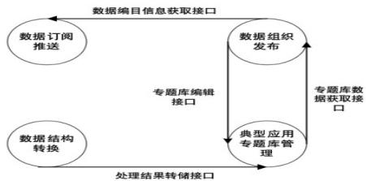

## 3.3.2.2 接口数据元素说明

与数据统算交互接口数据元素说明见表36所示。

表36 与数据统算交互接口数据元素说明
<table><tr><td rowspan=1 colspan=1>序号</td><td rowspan=1 colspan=1>数据集名称</td><td rowspan=1 colspan=1>数据组成</td><td rowspan=1 colspan=1>数据约束</td><td rowspan=1 colspan=1>数据标准</td></tr><tr><td rowspan=1 colspan=1>1</td><td rowspan=1 colspan=1>结构化数据</td><td rowspan=1 colspan=1>结构化物理模型、结构化逻辑模型、数据集合模型、数据处理过程模型、数据产品</td><td rowspan=1 colspan=1></td><td rowspan=1 colspan=1>自定义</td></tr><tr><td rowspan=1 colspan=1>2</td><td rowspan=1 colspan=1>非结构化数据</td><td rowspan=1 colspan=1>文件（文档、图片、音频、视频）、文电</td><td rowspan=1 colspan=1>1</td><td rowspan=1 colspan=1>自定义</td></tr><tr><td rowspan=1 colspan=1>3</td><td rowspan=1 colspan=1>流式数据</td><td rowspan=1 colspan=1>主题数据服务（流式数据模型）</td><td rowspan=1 colspan=1>一</td><td rowspan=1 colspan=1>自定义</td></tr><tr><td rowspan=1 colspan=1>4</td><td rowspan=1 colspan=1>数据模型</td><td rowspan=1 colspan=1>数据模型（数据建模模型)</td><td rowspan=1 colspan=1>一</td><td rowspan=1 colspan=1>自定义</td></tr><tr><td rowspan=1 colspan=1>5</td><td rowspan=1 colspan=1>数据接口</td><td rowspan=1 colspan=1>数据接口（数据接口模型）</td><td rowspan=1 colspan=1>一</td><td rowspan=1 colspan=1>自定义</td></tr><tr><td rowspan=1 colspan=1>6</td><td rowspan=1 colspan=1>数据对象</td><td rowspan=1 colspan=1>数据对象</td><td rowspan=1 colspan=1>一</td><td rowspan=1 colspan=1>自定义</td></tr><tr><td rowspan=1 colspan=1>7</td><td rowspan=1 colspan=1>数据资源元数据</td><td rowspan=1 colspan=1>技术元数据、业务元数据、管理元数据</td><td rowspan=1 colspan=1></td><td rowspan=1 colspan=1>自定义</td></tr></table>

3.3.3 与通用智能应用交互接口/ZZSJHQZHFW-JK-WB-TYZNYY

## 3.3.3.1 外部接口标识

与通用智能应用交互接口需求表见表37。

表37 与通用智能应用交互接口需求表
<table><tr><td rowspan=1 colspan=1>序号</td><td rowspan=1 colspan=1>接口名称/标识</td><td rowspan=1 colspan=1>接口描述</td><td rowspan=1 colspan=1>发送方</td><td rowspan=1 colspan=1>接收方</td><td rowspan=1 colspan=1>接口类型</td><td rowspan=1 colspan=1>优先级</td><td rowspan=1 colspan=1>备注</td></tr><tr><td rowspan=1 colspan=1>1</td><td rowspan=1 colspan=1>与通用智能应用交互接/ZZSJHQZHFW-JK-WB-TYZNYY</td><td rowspan=1 colspan=1>通用智能应用调用本系统获取所需数据</td><td rowspan=1 colspan=1>本系统</td><td rowspan=1 colspan=1>通用智能应用</td><td rowspan=1 colspan=1>API接口</td><td rowspan=1 colspan=1>中</td><td rowspan=1 colspan=1></td></tr></table>

## 3.3.3.2 接口数据元素说明

与通用智能应用交互接口数据元素说明见表38所示。

表38 与通用智能应用交互接口数据元素说明
<table><tr><td colspan="1" rowspan="1">序号</td><td colspan="1" rowspan="1">数据集名称</td><td colspan="1" rowspan="1">数据组成</td><td colspan="1" rowspan="1">数据约束</td><td colspan="1" rowspan="1">数据标准</td></tr><tr><td colspan="1" rowspan="1">1</td><td colspan="1" rowspan="1">结构化数据</td><td colspan="1" rowspan="1">结构化物理模型、结构化逻辑模型、数据集合模型、数据处理过程模型、数据产品</td><td colspan="1" rowspan="1"></td><td colspan="1" rowspan="1">自定义</td></tr><tr><td colspan="1" rowspan="1">2</td><td colspan="1" rowspan="1">非结构化数据</td><td colspan="1" rowspan="1">文件（文档、图片、音频、视频）、文电</td><td colspan="1" rowspan="1"></td><td colspan="1" rowspan="1">自定义</td></tr><tr><td colspan="1" rowspan="1">3</td><td colspan="1" rowspan="1">流式数据</td><td colspan="1" rowspan="1">主题数据服务（流式数据模型）</td><td colspan="1" rowspan="1">一</td><td colspan="1" rowspan="1">自定义</td></tr><tr><td colspan="1" rowspan="1">4</td><td colspan="1" rowspan="1">数据模型</td><td colspan="1" rowspan="1">数据模型(数据建模模型)</td><td colspan="1" rowspan="1">一</td><td colspan="1" rowspan="1">自定义</td></tr><tr><td colspan="1" rowspan="1">5</td><td colspan="1" rowspan="1">数据接口</td><td colspan="1" rowspan="1">数据接口（数据接口模型）</td><td colspan="1" rowspan="1">一</td><td colspan="1" rowspan="1">自定义</td></tr><tr><td colspan="1" rowspan="1">6</td><td colspan="1" rowspan="1">数据对象</td><td colspan="1" rowspan="1">数据对象</td><td colspan="1" rowspan="1">一</td><td colspan="1" rowspan="1">自定义</td></tr><tr><td colspan="1" rowspan="1">7</td><td colspan="1" rowspan="1">数据资源元数据</td><td colspan="1" rowspan="1">技术元数据、业务元数据、管理元数据</td><td colspan="1" rowspan="1"></td><td colspan="1" rowspan="1">自定义</td></tr></table>

3.3.4 与态势数据组织应用交互接口/ZZSJHQZHFW-JK-WB-TSSJZZYY

## 3.3.4.1 外部接口标识

与态势数据组织应用交互接口需求表见表39。

表39 与态势数据组织应用交互接口需求表
<table><tr><td rowspan=1 colspan=1>序号</td><td rowspan=1 colspan=1>接口名称/标识</td><td rowspan=1 colspan=1>接口描述</td><td rowspan=1 colspan=1>发送方</td><td rowspan=1 colspan=1>接收方</td><td rowspan=1 colspan=1>接口类型</td><td rowspan=1 colspan=1>优先级</td><td rowspan=1 colspan=1>备注</td></tr><tr><td rowspan=1 colspan=1>1</td><td rowspan=2 colspan=1>与态势数据组织应用交互接口/ZZSJHQZHFW-JK-WB-TSSJZZYY</td><td rowspan=2 colspan=1>态势数据组织应用通过调用本系统订阅接口订阅态势相关主题数据，本系统根据应用实际需要主动推送情态势等数据</td><td rowspan=1 colspan=1>本系统</td><td rowspan=1 colspan=1>态势数据组织应用</td><td rowspan=1 colspan=1>API接口</td><td rowspan=1 colspan=1>中</td><td rowspan=1 colspan=1></td></tr><tr><td rowspan=1 colspan=1>2</td><td rowspan=1 colspan=1>态势数据组织应用</td><td rowspan=1 colspan=1>本系统</td><td rowspan=1 colspan=1>API接口</td><td rowspan=1 colspan=1>中</td><td rowspan=1 colspan=1></td></tr></table>

## 3.3.4.2 接口数据元素说明

与态势数据组织应用接口数据元素说明见表40所示。

表40 与态势数据组织应用接口数据元素说明
<table><tr><td rowspan=1 colspan=1>序号</td><td rowspan=1 colspan=1>数据集名称</td><td rowspan=1 colspan=1>数据组成</td><td rowspan=1 colspan=1>数据约束</td><td rowspan=1 colspan=1>数据标准</td></tr><tr><td rowspan=1 colspan=1>1</td><td rowspan=1 colspan=1>敌情态势</td><td rowspan=1 colspan=1>1</td><td rowspan=1 colspan=1>二</td><td rowspan=1 colspan=1>自定义</td></tr><tr><td rowspan=1 colspan=1>2</td><td rowspan=1 colspan=1>我情态势</td><td rowspan=1 colspan=1>1</td><td rowspan=1 colspan=1>一</td><td rowspan=1 colspan=1>自定义</td></tr></table>

## 3.3.5 与能力分析评估交互接口/ZZSJHQZHFW-JK-WB-NLFXPG

## 3.3.5.1 外部接口标识

与能力分析评估交互接口需求表见表41。

表41 与能力分析评估交互接口需求表
<table><tr><td>序 号</td><td>接口名称/标识</td><td>接口描述</td><td>发送方</td><td>接收方</td><td>接口类型</td><td>优先级</td><td>备注</td></tr><tr><td>1</td><td rowspan="2">与能力分析评估交互接 /ZZSJHQZHFW-JK-</td><td rowspan="2">能力分析评估过调用 本系统订阅接口订阅 能力评估相关主题数 据，本系统根据应用 实际需要主动推送能 力评估数据</td><td>本系 统</td><td>能力分 析评估</td><td>API接口</td><td>中</td><td></td></tr><tr><td>WB-NLFXPG</td><td>能力 分析 评估</td><td>本系统</td><td>API接口</td><td>中</td></tr></table>

## 3.3.5.2 接口数据元素说明

与能力分析评估交互接口数据元素说明见表42所示。

表42 与能力分析评估交互接口数据元素说明
<table><tr><td rowspan=1 colspan=1>序号</td><td rowspan=1 colspan=1>数据集名称</td><td rowspan=1 colspan=1>数据组成</td><td rowspan=1 colspan=1>数据约束</td><td rowspan=1 colspan=1>数据标准</td></tr><tr><td rowspan=1 colspan=1>1</td><td rowspan=1 colspan=1>结构化数据</td><td rowspan=1 colspan=1>结构化物理模型、结构化逻辑模型、数据集合模型、数据处理过程模型、数据产品</td><td rowspan=1 colspan=1></td><td rowspan=1 colspan=1>自定义</td></tr><tr><td rowspan=1 colspan=1>2</td><td rowspan=1 colspan=1>非结构化数据</td><td rowspan=1 colspan=1>文件（文档、图片、音频、视频）、文电</td><td rowspan=1 colspan=1>1</td><td rowspan=1 colspan=1>自定义</td></tr><tr><td rowspan=1 colspan=1>3</td><td rowspan=1 colspan=1>流式数据</td><td rowspan=1 colspan=1>主题数据服务（流式数据模型）</td><td rowspan=1 colspan=1>二</td><td rowspan=1 colspan=1>自定义</td></tr><tr><td rowspan=1 colspan=1>4</td><td rowspan=1 colspan=1>数据模型</td><td rowspan=1 colspan=1>数据模型（数据建模模型）</td><td rowspan=1 colspan=1>一</td><td rowspan=1 colspan=1>自定义</td></tr><tr><td rowspan=1 colspan=1>5</td><td rowspan=1 colspan=1>数据接口</td><td rowspan=1 colspan=1>数据接口（数据接口模型）</td><td rowspan=1 colspan=1>一</td><td rowspan=1 colspan=1>自定义</td></tr><tr><td rowspan=1 colspan=1>6</td><td rowspan=1 colspan=1>数据对象</td><td rowspan=1 colspan=1>数据对象</td><td rowspan=1 colspan=1>一</td><td rowspan=1 colspan=1>自定义</td></tr><tr><td rowspan=1 colspan=1>7</td><td rowspan=1 colspan=1>数据资源元数据</td><td rowspan=1 colspan=1>技术元数据、业务元数据、管理元数据</td><td rowspan=1 colspan=1></td><td rowspan=1 colspan=1>自定义</td></tr></table>

3.3.6 与应用集成框架与运维体系交互接口/ZZSJHQZHFW-JK-WB-ZBCC-YYJCKJYYWTX

## 3.3.6.1 外部接口标识

与应用集成框架与运维体系交互接口需求表见表43。

表43 与应用集成框架与运维体系交互接口需求表
<table><tr><td rowspan=1 colspan=1>序号</td><td rowspan=1 colspan=1>接口名称/标识</td><td rowspan=1 colspan=1>接口描述</td><td rowspan=1 colspan=1>发送方</td><td rowspan=1 colspan=1>接收方</td><td rowspan=1 colspan=1>接口类型</td><td rowspan=1 colspan=1>优先级</td><td rowspan=1 colspan=1>备注</td></tr><tr><td rowspan=1 colspan=1>1</td><td rowspan=1 colspan=1>与应用集成框架与运维体系交互接口/JCYY-JK-WB-ZBCC-YYJCKJYYWTX</td><td rowspan=1 colspan=1>本系统通过调用应用集成框架与运维体系接口向其推送监控信息、告警信息、日志信息、注册信息等数据</td><td rowspan=1 colspan=1>本系统</td><td rowspan=1 colspan=1>应用集成框架与运维体系</td><td rowspan=1 colspan=1>API接口</td><td rowspan=1 colspan=1>中</td><td rowspan=1 colspan=1></td></tr></table>

## 3.3.6.2 接口数据元素说明

与应用集成框架与运维体系交互接口数据元素说明见表44所示。

表44 与应用集成框架与运维体系交互接口数据元素说明
<table><tr><td rowspan=1 colspan=1>序号</td><td rowspan=1 colspan=1>数据集名称</td><td rowspan=1 colspan=1>数据组成</td><td rowspan=1 colspan=1>数据约束</td><td rowspan=1 colspan=1>数据标准</td></tr><tr><td rowspan=1 colspan=1>1</td><td rowspan=1 colspan=1>监控信息</td><td rowspan=1 colspan=1>系统资源使用情况、程序运行状态信息、用户活动监控信息</td><td rowspan=1 colspan=1>一</td><td rowspan=1 colspan=1>自定义</td></tr><tr><td rowspan=1 colspan=1>2</td><td rowspan=1 colspan=1>告警信息</td><td rowspan=1 colspan=1>资源使用告警信息、系统健康告警信息、数据库告警信息</td><td rowspan=1 colspan=1>一</td><td rowspan=1 colspan=1>自定义</td></tr><tr><td rowspan=1 colspan=1>3</td><td rowspan=1 colspan=1>日志信息</td><td rowspan=1 colspan=1>访问日志、应用日志、安全日志、系统日志、数据库日志、错误日志、调试日志</td><td rowspan=1 colspan=1></td><td rowspan=1 colspan=1>自定义</td></tr><tr><td rowspan=1 colspan=1>4</td><td rowspan=1 colspan=1>注册信息</td><td rowspan=1 colspan=1>用户基本信息、应用注册信息</td><td rowspan=1 colspan=1>一</td><td rowspan=1 colspan=1>自定义</td></tr></table>

## 3.3.7 与指挥信息系统交互接口/ZZSJHQZHFW-JK-WB-ZHXXXT

## 3.3.7.1 外部接口标识

与指挥信息系统交互接口需求表见表45所示。

表45 与指挥信息系统交互接口需求表
<table><tr><td colspan="1" rowspan="1">序号</td><td colspan="1" rowspan="1">接口名称/标识</td><td colspan="1" rowspan="1">接口描述</td><td colspan="1" rowspan="1">发送方</td><td colspan="1" rowspan="1">接收方</td><td colspan="1" rowspan="1">接口类型</td><td colspan="1" rowspan="1">优先级</td><td colspan="1" rowspan="1">备注</td></tr><tr><td colspan="1" rowspan="1">1</td><td colspan="1" rowspan="1">态势数据融合共享接口/DXYY-ZBZQ-JK-WB-ZHXXXT-TSGX</td><td colspan="1" rowspan="1">获取指挥信息系统态势数据，指挥信息系统的态势文件能够导入到本系统展</td><td colspan="1" rowspan="1">指挥信息系统</td><td colspan="1" rowspan="1">本系统</td><td colspan="1" rowspan="1">API接口</td><td colspan="1" rowspan="1">高</td><td colspan="1" rowspan="1"></td></tr><tr><td colspan="1" rowspan="2"></td><td colspan="1" rowspan="2"></td><td colspan="1" rowspan="1">现。</td><td colspan="1" rowspan="1"></td><td colspan="1" rowspan="1"></td><td colspan="1" rowspan="1"></td><td colspan="1" rowspan="1"></td><td colspan="1" rowspan="1"></td></tr><tr><td colspan="1" rowspan="1">共享本系统的态势文件，本系统生成的态势数据能够共享到指挥信息系统并展现。</td><td colspan="1" rowspan="1">本系统</td><td colspan="1" rowspan="1">指挥信息系统</td><td colspan="1" rowspan="1">API接口</td><td colspan="1" rowspan="1">高</td><td colspan="1" rowspan="1">一</td></tr></table>

3.3.8 与某信息服务平台交互接口/ZZSJHQZHFW-JK-WB-QJXXPT

## 3.3.8.1 外部接口标识

与某信息服务平台交互接口需求表见表46所示。

表46 与某信息服务平台交互接口需求表
<table><tr><td rowspan=1 colspan=1>序号</td><td rowspan=1 colspan=1>接口名称/标识</td><td rowspan=1 colspan=1>接口描述</td><td rowspan=1 colspan=1>发送方</td><td rowspan=1 colspan=1>接收方</td><td rowspan=1 colspan=1>接口类型</td><td rowspan=1 colspan=1>优先级</td><td rowspan=1 colspan=1>备注</td></tr><tr><td rowspan=1 colspan=1>1</td><td rowspan=1 colspan=1>用户管理接口/DXYY-ZBZQ-JK-WB-QJXXPT-YHGL</td><td rowspan=1 colspan=1>获取用户基本信息数据，用户统一身份认证管理。</td><td rowspan=1 colspan=1>某信息服务基础平台</td><td rowspan=1 colspan=1>本系统</td><td rowspan=1 colspan=1>API接口</td><td rowspan=1 colspan=1>中</td><td rowspan=1 colspan=1></td></tr><tr><td rowspan=1 colspan=1>2</td><td rowspan=1 colspan=1>统一时空管理接口/DXYY-ZBZQ-JK-WB-QJXXPT-TYSK</td><td rowspan=1 colspan=1>获取统一时间、天文事件数据。</td><td rowspan=1 colspan=1>某信息服务基础平台</td><td rowspan=1 colspan=1>本系统</td><td rowspan=1 colspan=1>API接口</td><td rowspan=1 colspan=1>中</td><td rowspan=1 colspan=1></td></tr></table>

## 3.3.9 与数据中台交互接/ZZSJHQZHFW-JK-WB-ZBZQLZZZSJZT

## 3.3.9.1 外部接口标识

与某数据中台交互接口需求表见表47。

表47 与某数据中台交互接口需求表
<table><tr><td rowspan=1 colspan=1>序号</td><td rowspan=1 colspan=1>接口名称/标识</td><td rowspan=1 colspan=1>接口描述</td><td rowspan=1 colspan=1>发送方</td><td rowspan=1 colspan=1>接收方</td><td rowspan=1 colspan=1>接口类型</td><td rowspan=1 colspan=1>优先级</td><td rowspan=1 colspan=1>备注</td></tr><tr><td rowspan=1 colspan=1>1</td><td rowspan=1 colspan=1>与某数据中台交互接口/ZZSJHQZHFW-JK-WB-ZBZQLZZZSJZT</td><td rowspan=1 colspan=1>数据获取引接接口</td><td rowspan=1 colspan=1>数据中台</td><td rowspan=1 colspan=1>本系统</td><td rowspan=1 colspan=1>API接口</td><td rowspan=1 colspan=1>高</td><td rowspan=1 colspan=1></td></tr></table>

## 3.3.10 与地方系统交互接口/ZZSJHQZHFW-JK-WB-DFXT

## 3.3.10.1 外部接口标识

与地方系统交互接口需求表见表48所示。

表48 与地方系统交互接口需求表
<table><tr><td rowspan=1 colspan=1>序号</td><td rowspan=1 colspan=1>接口名称/标识</td><td rowspan=1 colspan=1>接口描述</td><td rowspan=1 colspan=1>发送方</td><td rowspan=1 colspan=1>接收方</td><td rowspan=1 colspan=1>接口类型</td><td rowspan=1 colspan=1>优先级</td><td rowspan=1 colspan=1>备注</td></tr><tr><td rowspan=1 colspan=1>1</td><td rowspan=1 colspan=1>外部数据获取接口/DXYY-ZBZQ-JK-WB-DFXT-WBSJHQ</td><td rowspan=1 colspan=1>从外部地方系统引接其他领域数据时，使用本接口进行离线数据交换。</td><td rowspan=1 colspan=1>地方系统</td><td rowspan=1 colspan=1>本系统</td><td rowspan=1 colspan=1>文件接口</td><td rowspan=1 colspan=1>中</td><td rowspan=1 colspan=1></td></tr></table>

## 3.3.10.2 接口数据元素说明

与地方系统交互接口数据元素说明见表49所示

表49 与地方系统交互接口的数据元素说明
<table><tr><td rowspan=1 colspan=1>序号</td><td rowspan=1 colspan=1>数据集名称</td><td rowspan=1 colspan=1>数据组成</td><td rowspan=1 colspan=1>数据约束</td><td rowspan=1 colspan=1>数据标准</td></tr><tr><td rowspan=1 colspan=1>1</td><td rowspan=1 colspan=1>地方数据</td><td rowspan=1 colspan=1>本系统需要从地方系统引接的如气象水文数据、开源情报数据、应急管理数据等。</td><td rowspan=1 colspan=1></td><td rowspan=1 colspan=1>遵循地方系统数据包发布相关标准</td></tr></table>

## 3.3.11 与用户人机交互接口/ZZSJHQZHFW-JK-WB-ZBCC-RJJH

## 3.3.11.1 外部接口标识

与用户人机交互接口需求表见表50。

表50 与用户人机交互接口需求表
<table><tr><td rowspan=1 colspan=1>序号</td><td rowspan=1 colspan=1>接口名称/标识</td><td rowspan=1 colspan=1>接口描述</td><td rowspan=1 colspan=1>发送方</td><td rowspan=1 colspan=1>接收方</td><td rowspan=1 colspan=1>接口类型</td><td rowspan=1 colspan=1>优先级</td><td rowspan=1 colspan=1>备注</td></tr><tr><td rowspan=1 colspan=1>1</td><td rowspan=1 colspan=1>与用户人机交互接口/</td><td rowspan=1 colspan=1>界面人机交互接口</td><td rowspan=1 colspan=1>用户</td><td rowspan=1 colspan=1>本系统</td><td rowspan=2 colspan=1>人机交互接口</td><td rowspan=1 colspan=1>高</td><td rowspan=1 colspan=1>一</td></tr><tr><td rowspan=1 colspan=1>2</td><td rowspan=1 colspan=1>ZZSJHQZHFW-JK-WB-ZBCC-RJJH</td><td rowspan=1 colspan=1>键鼠人机交互接口</td><td rowspan=1 colspan=1>本系统</td><td rowspan=1 colspan=1>用户</td><td rowspan=1 colspan=1>高</td><td rowspan=1 colspan=1></td></tr></table>

## 3.3.11.2 接口数据元素说明

与用户人机交互服务数据元素说明见表51所示

表51 与用户人机交互接口的数据元素说明
<table><tr><td rowspan=1 colspan=1>序号</td><td rowspan=1 colspan=1>数据集名称</td><td rowspan=1 colspan=1>数据组成</td><td rowspan=1 colspan=1>数据约束</td><td rowspan=1 colspan=1>数据标准</td></tr><tr><td rowspan=1 colspan=1>1</td><td rowspan=1 colspan=1>键鼠操作数据</td><td rowspan=1 colspan=1>键鼠、触控、自然语言输入、语音输入</td><td rowspan=1 colspan=1>一</td><td rowspan=1 colspan=1>自定义</td></tr><tr><td rowspan=1 colspan=1>2</td><td rowspan=1 colspan=1>界面展现数据</td><td rowspan=1 colspan=1>界面显示、界面布局、窗体风格</td><td rowspan=1 colspan=1>一</td><td rowspan=1 colspan=1>自定义</td></tr></table>

## 3.3.12 与数据库系统接口/ZZSJHQZHFW-JK-WB-SJK

## 3.3.12.1 外部接口标识

与数据库交互接口需求表见表52所示。

表52 与数据库交互接口需求表
<table><tr><td rowspan=1 colspan=1>序号</td><td rowspan=1 colspan=1>接口名称/标识</td><td rowspan=1 colspan=1>接口描述</td><td rowspan=1 colspan=1>发送方</td><td rowspan=1 colspan=1>接收方</td><td rowspan=1 colspan=1>接口类型</td><td rowspan=1 colspan=1>优先级</td><td rowspan=1 colspan=1>备注</td></tr><tr><td rowspan=2 colspan=1>1</td><td rowspan=2 colspan=1>与数据库接口/DXYY-ZBZQ-JK-WB-SJK</td><td rowspan=2 colspan=1>本系统与数据库系统进行数据库信息、数据库状态信息的交互。</td><td rowspan=1 colspan=1>本系统</td><td rowspan=1 colspan=1>数据库系统</td><td rowspan=1 colspan=1>API接口</td><td rowspan=1 colspan=1>高</td><td rowspan=1 colspan=1></td></tr><tr><td rowspan=1 colspan=1>数据库系统</td><td rowspan=1 colspan=1>本系统</td><td rowspan=1 colspan=1>API接口</td><td rowspan=1 colspan=1>高</td><td rowspan=1 colspan=1>一</td></tr></table>

## 3.3.12.2 接口数据元素说明

与数据库系统接口数据元素说明见表53所示。

表53 与数据库交互接口的数据元素说明
<table><tr><td rowspan=1 colspan=1>序号</td><td rowspan=1 colspan=1>数据集名称</td><td rowspan=1 colspan=1>数据组成</td><td rowspan=1 colspan=1>数据约束</td><td rowspan=1 colspan=1>数据标准</td></tr><tr><td rowspan=1 colspan=1>1</td><td rowspan=1 colspan=1>数据库操作数据</td><td rowspan=1 colspan=1>数据模型名、分页标志、数据标示字段、过滤条件、页码等</td><td rowspan=1 colspan=1></td><td rowspan=1 colspan=1>自定义</td></tr><tr><td rowspan=1 colspan=1>2</td><td rowspan=1 colspan=1>数据库状态信息</td><td rowspan=1 colspan=1>数据库表空间使用情况、连接句柄情况、各类数据元素的创建情况等</td><td rowspan=1 colspan=1></td><td rowspan=1 colspan=1>自定义</td></tr></table>

3.3.13 与文件系统接口/ZZSJHQZHFW-JK-WB-WJXT

## 3.3.13.1 外部接口标识

与文件系统交互接口需求表见表54所示。

表54 与文件系统交互接口需求表
<table><tr><td rowspan=1 colspan=1>序号</td><td rowspan=1 colspan=1>接口名称/标识</td><td rowspan=1 colspan=1>接口描述</td><td rowspan=1 colspan=1>发送方</td><td rowspan=1 colspan=1>接收方</td><td rowspan=1 colspan=1>接口类型</td><td rowspan=1 colspan=1>优先级</td><td rowspan=1 colspan=1>备注</td></tr><tr><td rowspan=2 colspan=1>1</td><td rowspan=2 colspan=1>与文件系统接口/DXYY-ZBZQ-JK-WB-WJXT</td><td rowspan=2 colspan=1>本系统与文件系统进行文本文件、图片文件、音频文件、视频文件、压缩文件等的数据交互。</td><td rowspan=1 colspan=1>本系统</td><td rowspan=1 colspan=1>文件系统</td><td rowspan=1 colspan=1>API接口</td><td rowspan=1 colspan=1>高</td><td rowspan=1 colspan=1></td></tr><tr><td rowspan=1 colspan=1>文件系统</td><td rowspan=1 colspan=1>本系统</td><td rowspan=1 colspan=1>API接口</td><td rowspan=1 colspan=1>高</td><td rowspan=1 colspan=1></td></tr></table>

## 3.3.13.2 接口数据元素说明

与文件系统接口数据元素说明见表55所示。

表55 与文件系统接口数据元素说明
<table><tr><td rowspan=1 colspan=1>序号</td><td rowspan=1 colspan=1>数据集名称</td><td rowspan=1 colspan=1>数据组成</td><td rowspan=1 colspan=1>数据约束</td><td rowspan=1 colspan=1>数据标准</td></tr><tr><td rowspan=1 colspan=1>1</td><td rowspan=1 colspan=1>文件数据信息</td><td rowspan=1 colspan=1>文件路径、文件名称、文件类型、文件大小文件上传时间</td><td rowspan=1 colspan=1>一</td><td rowspan=1 colspan=1>自定义</td></tr></table>

## 3.4 分系统内部接口需求/ZZSJHQZHFW-JK-NB

某服务系统内部接口包括数据协议解析接口、数据预处理配置接口。某服务系统内部接口如图 15所示。

  
图 15 某服务内部接口设计

某服务内部接口详细设计见表56。

表56 某服务内部接口详细设计表
<table><tr><td colspan="1" rowspan="1">序号</td><td colspan="1" rowspan="1">接口名称/标识</td><td colspan="1" rowspan="1">接口需求描述</td><td colspan="1" rowspan="1">接口类型</td><td colspan="1" rowspan="1">发送方</td><td colspan="1" rowspan="1">接收方</td><td colspan="1" rowspan="1">优先级</td></tr><tr><td colspan="1" rowspan="1">1</td><td colspan="1" rowspan="1">数据协议解析接口/ZZSJHQZHFW-</td><td colspan="1" rowspan="1">对引接获取的数据进行自定义协议配置和解析</td><td colspan="1" rowspan="1">API接口</td><td colspan="1" rowspan="1">数据获取</td><td colspan="1" rowspan="1">数据转换</td><td colspan="1" rowspan="1">中</td></tr><tr><td colspan="1" rowspan="1"></td><td colspan="1" rowspan="1">JK-NB-SJXYJX</td><td colspan="1" rowspan="1"></td><td colspan="1" rowspan="1"></td><td colspan="1" rowspan="1"></td><td colspan="1" rowspan="1"></td><td colspan="1" rowspan="1"></td></tr><tr><td colspan="1" rowspan="1">2</td><td colspan="1" rowspan="1">数据预处理配置接/ZZSJHQZHFW-JK-NB-SJYCLPZ</td><td colspan="1" rowspan="1">对引接获取的数据进行结构转换配置</td><td colspan="1" rowspan="1">API接口</td><td colspan="1" rowspan="1">数据获取</td><td colspan="1" rowspan="1">数据转换</td><td colspan="1" rowspan="1">中</td></tr></table>

## 3.4.1 数据获取内部接口/ZZSJHQZHFW-JK-NB-ZZSJHQ

数据获取包括数据源自定义配置接口，其内部接口图见图 16所示。

  
图 16 数据获取内部接口图

数据获取内部接口描述表见表57。

表57 数据获取内部接口表
<table><tr><td rowspan=1 colspan=1>序号</td><td rowspan=1 colspan=1>接口名称/标识</td><td rowspan=1 colspan=1>接口需求描述</td><td rowspan=1 colspan=1>接口类型</td><td rowspan=1 colspan=1>发送方</td><td rowspan=1 colspan=1>接收方</td></tr><tr><td rowspan=1 colspan=1>1</td><td rowspan=1 colspan=1>数据源自定义/配置接口/ZZSJHQZHFW-JK-NB-ZZSJHQ-SJYZDYPZ</td><td rowspan=1 colspan=1>对特定信源数据进行自定义配置</td><td rowspan=1 colspan=1>API接口</td><td rowspan=1 colspan=1>通用数据引接</td><td rowspan=1 colspan=1>精准数据获取</td></tr></table>

## 3.4.2 数据转换内部接口/ZZSJHQZHFW-JK-NB-ZZSJZH

数据转换包括处理结果转储接口、专题库数据获取接口、专题库编辑接口和数据编目信息获取接口，其内部接口图见图 17所示。

  
图 17 数据转换内部接口图  
数据转换内部接口描述表见表58。

表58 数据转换内部接口表
<table><tr><td rowspan=1 colspan=1>序号</td><td rowspan=1 colspan=1>接口名称</td><td rowspan=1 colspan=1>接口需求描述</td><td rowspan=1 colspan=1>接口类型</td><td rowspan=1 colspan=1>发送方</td><td rowspan=1 colspan=1>接收方</td></tr><tr><td rowspan=1 colspan=1>1</td><td rowspan=1 colspan=1>处理结果转储接口/ZZSJHQZHFW-JK-NB-ZZSJZH-CLJGZC</td><td rowspan=1 colspan=1>将预处理结果转储到相应典型应用专题库</td><td rowspan=1 colspan=1>API接口</td><td rowspan=1 colspan=1>数据结构转换</td><td rowspan=1 colspan=1>典型应用专题库管理</td></tr><tr><td rowspan=1 colspan=1>2</td><td rowspan=1 colspan=1>专题库数据获取接口/ZZSJHQZHFW-JK-NB-ZZSJZH-ZTKSJHQ</td><td rowspan=1 colspan=1>专题库数据查询获取</td><td rowspan=1 colspan=1>API接口</td><td rowspan=1 colspan=1>典型应用专题库管理</td><td rowspan=1 colspan=1>数据组织发布</td></tr><tr><td rowspan=1 colspan=1>3</td><td rowspan=1 colspan=1>专题库编辑接口/ZZSJHQZHFW-JK-NB-ZZSJZH-ZTKBJ</td><td rowspan=1 colspan=1>专题库目录信息编辑、更新</td><td rowspan=1 colspan=1>API接口</td><td rowspan=1 colspan=1>数据组织发布</td><td rowspan=1 colspan=1>典型应用专题库管理</td></tr><tr><td rowspan=1 colspan=1>4</td><td rowspan=1 colspan=1>数据编目信息获取接口/ZZSJHQZHFW-JK-NB-ZZSJZH-SJBMXXHQ</td><td rowspan=1 colspan=1>获取数据服务封装发布信息</td><td rowspan=1 colspan=1>API接口</td><td rowspan=1 colspan=1>数据组织发布</td><td rowspan=1 colspan=1>数据订阅推送</td></tr></table>