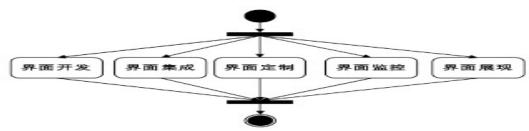
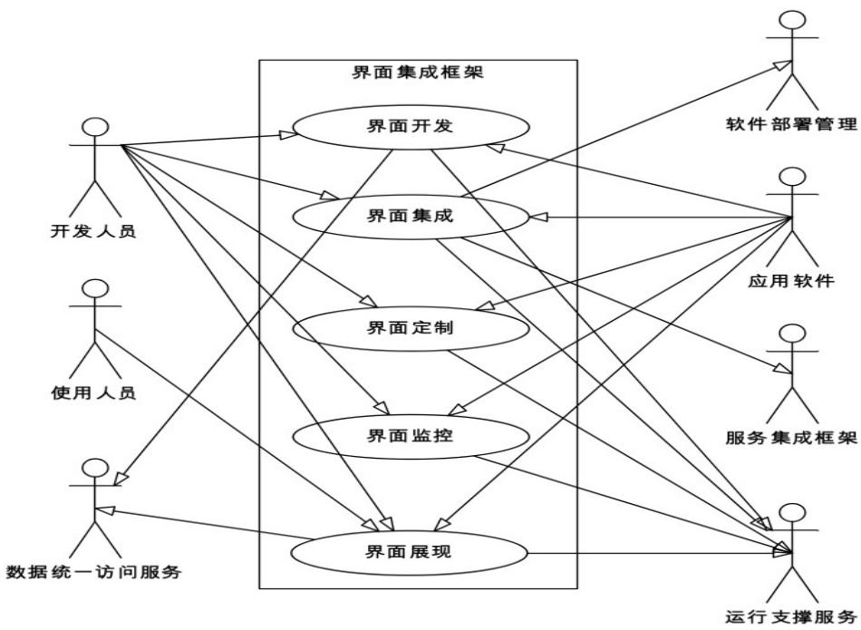
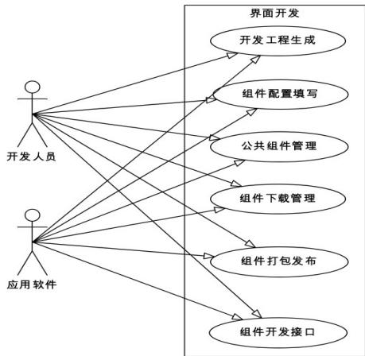
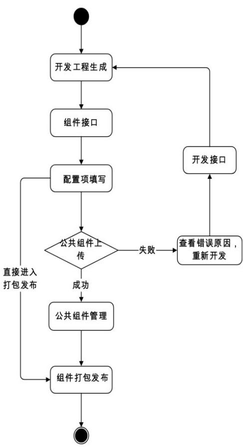
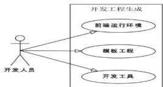

## 目 录

1 范围...  
1.1 标识.. .2  
1.2 系统概述. .2  
1.2.1 系统和软件的用途. .2  
1.2.2 系统与软件的一般特性. .2  
1.3 文档概述. .3  
2 引用文档... .3  
3 需求.... .3  
3.1 要求的状态和方式.. ..3  
3.1.1 软件状态图..  
3.1.2 软件活动图.  
3.2 能力需求... .4  
3.2.1 界面开发功能（PZXQ-GN-JMJCKJ-JMKF）. ...6  
3.2.2 界面集成功能（PZXQ-GN-JMJCKJ-JMJC）. ..21  
3.2.3 界面定制功能（PZXQ-GN-JMJCKJ-JMDZ） ..45  
3.2.4 界面监控功能（PZXQ-GN-JMJCKJ-JMJK） ...54  
3.2.5 界面展现功能（PZXQ-GN-JMJCKJ-JMZX）. ...63  
3.3 CSCI 外部接口需求.. ..82  
3.3.1 接口标识与接口图. ..82  
3.3.2 与用户的接口（PZXQ-JK-YH） ..84  
3.3.3 与应用软件的接口（PZXQ-JK-YYRJ）. ...84  
3.3.4 与软件部署管理的接口（PZXQ-JK-YXZCFW） ..84  
3.3.5 与服务集成框架的接口（PZXQ-JK-FWJCKJ）. ..84  
3.3.6 与数据统一访问服务的接口（PZXQ-JK-SJTYFW） ...85  
3.4 CSCI 内部接口需求. ..85  
3.4.1 接口标识和接口图. ..85  
3.4.2 界面集成与界面展现的接口. ..86  
3.4.3 界面监控与界面展现的接口. ..86  
3.4.4 界面开发与界面展现的接口 ..86  
3.4.5 界面开发与界面集成的接口.. ...87  
3.4.6 界面定制与界面展现的接口 ..87  
3.5 人机交互需求. ..88  
3.5.1 界面开发.. ..88  
3.5.2 界面集成.. ...88  
3.5.3 界面定制.. ...88  
3.5.4 界面监控. ..89  
3.5.5 界面展现. ...89  
3.6 CSCI 内部数据需求. ..90  
3.7 适应性需求. ..93  
3.8 安全性需求.. ..94  
3.9 保密性需求.. ...94  
3.10 CSCI 环境需求. ...94  
3.10.1 运行环境需求. ..94  
3.10.2 开发环境需求. ..95  
3.11 计算机资源需求. ..95  
3.11.1 计算机硬件需求. ..95  
3.11.2 计算机硬件资源利用需求. ..96  
3.11.3 计算机软件需求. ..96  
3.11.4 计算机通信需求. ..97  
3.12 软件质量因素.. ..97  
3.13 设计和构造的约束.. ...97  
3.14 人员需求.. ..98  
3.15 培训需求.. ..98  
3.16 软件保障需求. ..98  
3.17 其他需求. ..98  
3.18 验收、交付和包装需求. ..98  
3.19 需求的优先顺序和关键性.. ..99  
4 合格性规定... ...100  
5 需求可追踪性.. ...103  
6 注释...... .....107

## 1 范围

## 1.1 标识

a) 本文档已被批准的标识号： $\mathsf { A } Z _ { 6 9 3 } 2 . 4 9 0 . 0 1 0 2 \mathsf { S } \mathsf { R } \mathsf { S }$

b) 本文档所适用的软件名称为：界面集成框架；

c) 本文档的版本号为：V1.00.04/2020 年 12 月 31 日；

d) 本文档所适用的软件所属系统为：某级信息系统软件。

## 1.2 系统概述

## 1.2.1 系统和软件的用途

某级信息系统软件按照国产自主可控要求，进行基础软件环境选型，以及应用软件的新研和国产化迁移改造，对功能要素分散、流程独立的业务功能进行整合优化，研制适应不同使用需求、使用场景的软件，实现信息系统软件的融合、型谱优化和业务提能，推动某信息系统软件向“国产化、服务化、轻量化”方向发展。

某信息服务环境软件是某信息系统软件的重要组成，是连接底层各类硬件信息基础设施与上层各种应用系统的桥梁，通过基础平台融合汇聚底层资源，规范技术体制、支撑体系运行、促进互通互联等，是支撑构建某信息系统的重要支撑，其软件主要部署运行在各级机构的信息处理设备上，提供系统运维、数据运维、信息传输、信息处理、信息展现等功能，支撑应用软件和用户完成开发、集成、运维、运行全流程的使用。

界面集成框架部署在各级节点，提供桌面、平板、手持三种形态的软件，提供一个具备按需组装能力的多维信息可视化展现框架，是业务界面组件的宿主程序，为应用软件界面提供开发、集成、运行、定制、监控和展现的支撑，为用户提供统一的功能操作和信息展现。其中界面开发功能，支持开发人员在开发阶段使用，提供桌面版包括界面开发模板和公共组件库等功能；界面集成运行功能支持集成人员在集成阶段使用，提供桌面、平板、手持版，包括对界面进行统一集成、按需运行、组件管理、数据共享、服务请求等功能；界面定制功能满足集成人员和使用人员在集成阶段和运行阶段的使用需求，提供桌面、平板、手持版，为用户提供界面布局、快捷键、分屏状态、主题管理等功能；界面监控满足使用人员在运行阶段的使用需求，提供桌面、平板、手持版，为用户提供组件生命周期状态和资源占用情况的监控；界面展现满足使用人员在运行阶段的使用需求，依据桌面、平板、手持终端的硬件形态、尺寸大小和分辨率提供相应的界面展现风格和界面手段。

## 1.2.2 系统与软件的一般特性

a) 需方：某单位；

b) 使用方：某单位；

c) 开发方：某单位；

d) 保障机构：某单位；

e) 运行方案：在系统开机后,用户登录某信息系统，执行相关软件功能。

## 1.3 文档概述

在本文档中，第2章列出了本文档中引用的其它文档的信息，第3章详细描述了界面集成框架的各种需求以及实现方式，第4章规定了确认第3章各项需求正确实现的合格性验证方法，第5章描述本文档列出的各项需求与相应的系统需求规格说明文档列出的需求的对应关系。其中，第3章是本文档的主要部分。

## 2 引用文档

本文档的引用文档见表1。

表1 引用文档
<table><tr><td rowspan=1 colspan=1>文档编号</td><td rowspan=1 colspan=1>标题</td><td rowspan=1 colspan=1>修订版本</td><td rowspan=1 colspan=1>修订日期</td><td rowspan=1 colspan=1>编写单位</td></tr><tr><td rowspan=1 colspan=1>GJB438B-2009</td><td rowspan=1 colspan=1>《军用软件开发文档编制规范》</td><td rowspan=1 colspan=1>一</td><td rowspan=1 colspan=1>2009年5月</td><td rowspan=1 colspan=1>总装备部</td></tr><tr><td rowspan=1 colspan=1>GJB439A-2013</td><td rowspan=1 colspan=1>《军品软件质量保证通用要求》</td><td rowspan=1 colspan=1>一</td><td rowspan=1 colspan=1>2013 年7月</td><td rowspan=1 colspan=1>国防科学技术工业委员会</td></tr><tr><td rowspan=1 colspan=1>GJB450A-2004</td><td rowspan=1 colspan=1>《装备可靠性工作通用要求》</td><td rowspan=1 colspan=1></td><td rowspan=1 colspan=1>2004 年7月</td><td rowspan=1 colspan=1>总装备部</td></tr><tr><td rowspan=1 colspan=1>GJB2786A-2009</td><td rowspan=1 colspan=1>《军用软件开发通用要求》</td><td rowspan=1 colspan=1>一</td><td rowspan=1 colspan=1>2009年5月</td><td rowspan=1 colspan=1>总装备部</td></tr><tr><td rowspan=1 colspan=1>GJB    5235-2004</td><td rowspan=1 colspan=1>《军用软件配置管理》</td><td rowspan=1 colspan=1>一</td><td rowspan=1 colspan=1>2004年9月</td><td rowspan=1 colspan=1>总装备部</td></tr><tr><td rowspan=1 colspan=1>GJB/Z 102A-2012</td><td rowspan=1 colspan=1>《军用软件安全性设计指南》</td><td rowspan=1 colspan=1></td><td rowspan=1 colspan=1>2012 年7月</td><td rowspan=1 colspan=1>总装备部</td></tr><tr><td rowspan=1 colspan=1>装陆[2011]707号</td><td rowspan=1 colspan=1>《总装备部陆军装备科研订购部装备软件管理规定》</td><td rowspan=1 colspan=1></td><td rowspan=1 colspan=1>2011 年12月</td><td rowspan=1 colspan=1>总装备部</td></tr><tr><td rowspan=1 colspan=1>总装备部〔2005〕装字第4号</td><td rowspan=1 colspan=1>《军用软件质量管理规定》</td><td rowspan=1 colspan=1>一</td><td rowspan=1 colspan=1>2005 年1月</td><td rowspan=1 colspan=1>总装备部</td></tr><tr><td rowspan=1 colspan=1>AZ6932.490.0102SDTD</td><td rowspan=1 colspan=1>《界面集成框架软件研制任务书》</td><td rowspan=1 colspan=1>V1.00.03/2019年12月25 日</td><td rowspan=1 colspan=1>2019年12月</td><td rowspan=1 colspan=1>某单位</td></tr></table>

## 3 需求

## 3.1 要求的状态和方式

界面集成框架包括界面开发框架和界面集成框架两个模块。界面开发框架运行在桌

面的软件开发环境，界面集成框架运行在便携式计算机、便携式计算机（国产化）、某综合信息终端等目标环境。

## 3.1.1 软件状态图

界面集成框架软件状态图有多个运行状态，包括开发阶段、集成阶段、运行阶段；支持多种方式，包括桌面、平板、手持。

## 3.1.2 软件活动图

界面集成框架软件活动工作流程如图1所示。

  
图1界面集成框架软件活动图

## 3.2 能力需求

界面集成框架软件按照其功能需求，包含界面开发、界面集成、界面定制、界面监控、界面展现功能。

界面集成框架软件功能图见图2所示。

  
图2 界面集成框架软件功能图  
界面集成框架用例图如图3所示。

  
图3 界面集成框架软件用例图  
界面集成框架软件所有能力标识表见表2。

表2 界面集成框架软件所有能力标识
<table><tr><td colspan="1" rowspan="1">序号</td><td colspan="1" rowspan="1">Usecase名称</td><td colspan="1" rowspan="1">项目唯一标识符</td><td colspan="1" rowspan="1">需求描述</td><td colspan="1" rowspan="1">需求重用</td><td colspan="1" rowspan="1">方式名称</td><td colspan="1" rowspan="1">运行方式</td><td colspan="1" rowspan="1">对应的任务书功能/性能</td></tr><tr><td colspan="1" rowspan="1"></td><td colspan="1" rowspan="1">界面开发功能</td><td colspan="1" rowspan="1">PZXQ-GN-JMKFKJ-JMKF</td><td colspan="1" rowspan="1">提供包括界面开发模板、二次开发接口、公共组件库、依赖文件、打包编译工具的界面开发环境。</td><td colspan="1" rowspan="1">改进</td><td colspan="1" rowspan="1">桌面</td><td colspan="1" rowspan="1">开发阶段</td><td colspan="1" rowspan="1">4.1.1</td></tr><tr><td colspan="1" rowspan="1">2</td><td colspan="1" rowspan="1">界面集成功能</td><td colspan="1" rowspan="1">PZXQ-GN-JMKFKJ-JMJC</td><td colspan="1" rowspan="1">界面集成功能提供桌面、平板、手持版，包括对界面进行统一集成、按需运行、组件管理、数据共享、服务请求等功能。</td><td colspan="1" rowspan="1">改进</td><td colspan="1" rowspan="1">平板、桌面、手持</td><td colspan="1" rowspan="1">集成阶段</td><td colspan="1" rowspan="1">4.1.2/4.2 a)</td></tr><tr><td colspan="1" rowspan="1">3</td><td colspan="1" rowspan="1">界面定制功能</td><td colspan="1" rowspan="1">PZXQ-GN-JMKFKJ-JMDZ</td><td colspan="1" rowspan="1">提供依据用户身份的界面定制功能。界面定制功能提供桌面、平板、手持版，为用户提供界面布局、快捷键、分屏状态、主题管理等功能</td><td colspan="1" rowspan="1">改进</td><td colspan="1" rowspan="1">平板、桌面、手持</td><td colspan="1" rowspan="1">集成阶段、运行阶段</td><td colspan="1" rowspan="1">4.1.3/4.2 c)</td></tr><tr><td colspan="1" rowspan="1">4</td><td colspan="1" rowspan="1">界面监控功能</td><td colspan="1" rowspan="1">PZXQ-GN-JMKFKJ-JMJK</td><td colspan="1" rowspan="1">界面监控提供桌面、平板、手持版，为用户提供组件生命周期状态和资源占用情况的监控</td><td colspan="1" rowspan="1">改进</td><td colspan="1" rowspan="1">平板、桌面、手持</td><td colspan="1" rowspan="1">运行阶段</td><td colspan="1" rowspan="1">4.1.4</td></tr><tr><td colspan="1" rowspan="1">5</td><td colspan="1" rowspan="1">界面展现功能</td><td colspan="1" rowspan="1">PZXQ-GN-JMKFKJ-JMZX</td><td colspan="1" rowspan="1">界面展现依据依据桌面、平板、手持终端的硬件形态、尺寸大小和分辨率提供相应的界面展现风格和界面手段。</td><td colspan="1" rowspan="1">改进</td><td colspan="1" rowspan="1">平板、桌面、手持</td><td colspan="1" rowspan="1">运行阶段</td><td colspan="1" rowspan="1">4.1.5/4.2 b)</td></tr></table>

## 3.2.1 界面开发功能（PZXQ-GN-JMJCKJ-JMKF）

界面开发功能包括：开发工程生成、组件配置填写、公共组件管理、组件下载管理、组件打包发布、组件开发接口功能，此功能只在桌面版提供并使用，其功能用例如图4所示。

  
图4 界面开发用例图  
界面开发所有能力标识表，见表3。

表3 界面开发能力标识
<table><tr><td colspan="1" rowspan="1">序号</td><td colspan="1" rowspan="1">Usecase名称</td><td colspan="1" rowspan="1">项目唯一标识符</td><td colspan="1" rowspan="1">需求描述</td><td colspan="1" rowspan="1">需求重用</td><td colspan="1" rowspan="1">方式名称</td><td colspan="1" rowspan="1">运行状态</td><td colspan="1" rowspan="1">对应的任务书功能/性能</td></tr><tr><td colspan="1" rowspan="1">1</td><td colspan="1" rowspan="1">开发工程生成</td><td colspan="1" rowspan="1">PZXQ-GN-JMJCKJ-JMKF-KFGCSC</td><td colspan="1" rowspan="1">提供界面组件开发模板，支持应用软件基于模板开发界面组件</td><td colspan="1" rowspan="1">新研</td><td colspan="1" rowspan="1">桌面</td><td colspan="1" rowspan="1">开发阶段</td><td colspan="1" rowspan="1">4.1.1a)</td></tr><tr><td colspan="1" rowspan="1">2</td><td colspan="1" rowspan="1">组件配置填写</td><td colspan="1" rowspan="1">PZXQ-GN-JMJCKJ-JMKF-ZJPZTX</td><td colspan="1" rowspan="1">提供界面组件配置功能，能够对组件配置文件进行编辑，支持应用按照预定义类型（弹出窗、背景板、表格显控、缩略显控等）设置界面组件展示形态</td><td colspan="1" rowspan="1">沿用</td><td colspan="1" rowspan="1">桌面</td><td colspan="1" rowspan="1">开发阶段</td><td colspan="1" rowspan="1">4.1.1b)</td></tr><tr><td colspan="1" rowspan="1">3</td><td colspan="1" rowspan="1">公共组件管理</td><td colspan="1" rowspan="1">PZXQ-GN-JMJCKJ-JMKF-GGZJGL</td><td colspan="1" rowspan="1">提供公共组件展示功能，能够展示公共组件的运行效果、接口描述和使用示例；</td><td colspan="1" rowspan="1">改造</td><td colspan="1" rowspan="1">桌面</td><td colspan="1" rowspan="1">开发阶段</td><td colspan="1" rowspan="1">4.1.1c)</td></tr><tr><td colspan="1" rowspan="1">4</td><td colspan="1" rowspan="1">组件下载管理</td><td colspan="1" rowspan="1">PZXQ-GN-JMJCKJ-JMKF-ZJXZGL</td><td colspan="1" rowspan="1">提供组件包管理功能，支持界面开发所需的公共组件等相关资源的下载安装；</td><td colspan="1" rowspan="1">新研</td><td colspan="1" rowspan="1">桌面</td><td colspan="1" rowspan="1">开发阶段</td><td colspan="1" rowspan="1">4.1.1c)</td></tr><tr><td colspan="1" rowspan="1">5</td><td colspan="1" rowspan="1">组件打包发布</td><td colspan="1" rowspan="1">PZXQ-GN-JMJCKJ-JMKF-ZJDBFB</td><td colspan="1" rowspan="1">提供界面组件的打包发布功能，支持对界面组件的混淆和压缩打包；</td><td colspan="1" rowspan="1">新研</td><td colspan="1" rowspan="1">桌面</td><td colspan="1" rowspan="1">开发阶段</td><td colspan="1" rowspan="1">4.1.1g)</td></tr><tr><td colspan="1" rowspan="1">6</td><td colspan="1" rowspan="1">组件开发接口</td><td colspan="1" rowspan="1">PZXQ-GN-JMJCKJ-JMKF-ZJKFJK</td><td colspan="1" rowspan="1">提供组件生命周期管理、界面设置、数据状态管理等相关的二次开发接口。</td><td colspan="1" rowspan="1">沿用</td><td colspan="1" rowspan="1">桌面</td><td colspan="1" rowspan="1">开发阶段</td><td colspan="1" rowspan="1">4.1.1d) e) f)</td></tr></table>

界面开发流程图如下图如图5所示。

  
图5 界面开发流程图

## 3.2.1.1 开发工程生成（PZXQ-GN-JMJCKJ-JMKF-KFGCSC）

开发工程生成是提供用户进行基于界面框架二次开发的模板工程，提供界面组件开发模板生成功能，支持应用软件基于模板开发界面组件。

开发工程用例图如图 6开发工程用例

  
图 6开发工程用例

开发工程生成用例场景，见表4。

表4 开发工程生成用例描述
<table><tr><td rowspan=1 colspan=1>Use Case 名称:开发工程生成</td><td rowspan=1 colspan=2>Actors：开发人员</td></tr><tr><td rowspan=1 colspan=3>概述：本用例是开发工程生成的扩展用例，描述用户基于开发工具模板进行应用开发的过程；</td></tr><tr><td rowspan=1 colspan=3>前置条件：数据库连接正常。</td></tr><tr><td rowspan=1 colspan=3>主事件流</td></tr><tr><td rowspan=1 colspan=1>Actor 的动作</td><td rowspan=1 colspan=1>系统的动作</td><td rowspan=1 colspan=1>动作约束(性能、可靠性、容错等)</td></tr><tr><td rowspan=1 colspan=1>1.开发人员打开软件开发 ide 工具(包括webstrom。vscode等），将开发工程模板进行解压缩，修改模板工程的文件夹名称，将模板工程改成自己的软件段名称，在开发工具中进行导入。2.在工程中找到 package.json 文件，右键此文件，会显示不同的命令，双击npm run dev，即可启动模板工程4.在模板工程中新建组件</td><td rowspan=1 colspan=1>3. node 将用户运行的软件加载到内存中，通过浏览器进行用户组件的进一步渲染和加载，如果组件无法正常加载则进入异常流E1。</td><td rowspan=1 colspan=1>1.开发所用的运行环境内存需要大于等于4g。2.需要支持 nodejsV10.0.0 以上的版本。</td></tr></table>