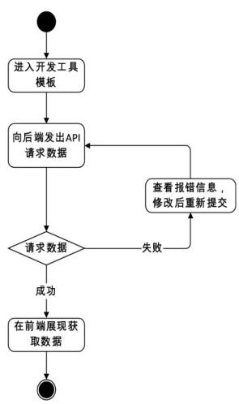
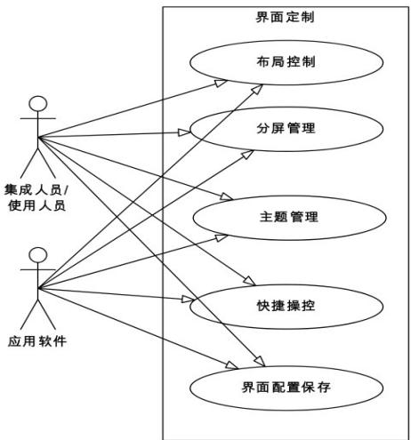
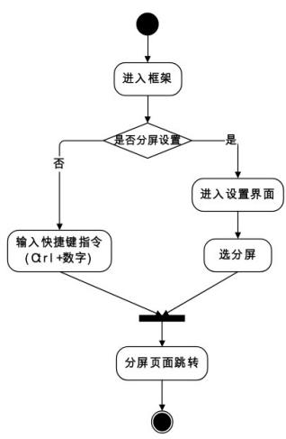

  
图 23服务请求流程

## 3.2.3 界面定制功能（PZXQ-GN-JMJCKJ-JMDZ）

界面定制功能包括：布局控制、分屏管理、主题管理、快捷操控、界面配置保存功能，其功能用例如图24所示。

  
图24 界面定制用例图  
界面定制所有能力标识表，见表20。

表20 界面定制能力标识
<table><tr><td colspan="1" rowspan="1">序号</td><td colspan="1" rowspan="1">Usecase名称</td><td colspan="1" rowspan="1">项目唯一标识符</td><td colspan="1" rowspan="1">需求描述</td><td colspan="1" rowspan="1">需求重用</td><td colspan="1" rowspan="1">方式名称</td><td colspan="1" rowspan="1">运行状态</td><td colspan="1" rowspan="1">对应的任务书功能/性能</td></tr><tr><td colspan="1" rowspan="1">1</td><td colspan="1" rowspan="1">布局控制</td><td colspan="1" rowspan="1">PZXQ-GN-JMJCKJ-JMJC-BJKZ</td><td colspan="1" rowspan="1">提供布局显示控制功能，支持用户对界面组件位置、大小、分屏等界面状态的调整；(提供桌面版、平板版、手持版三种版本形态）</td><td colspan="1" rowspan="1">改进</td><td colspan="1" rowspan="1">平板、桌面、手持</td><td colspan="1" rowspan="1">集成阶段、运行阶段</td><td colspan="1" rowspan="1">4.1.3a)</td></tr><tr><td colspan="1" rowspan="1">2</td><td colspan="1" rowspan="1">分屏管理</td><td colspan="1" rowspan="1">PZXQ-GN-JMJCKJ-JMDZ-FPGL</td><td colspan="1" rowspan="1">提供分屏状态每一屏展示组件的定制功能，支持将组件拖曳到分屏窗口；（提供桌面版、平板版、手持版三种版本形态）</td><td colspan="1" rowspan="1">新研</td><td colspan="1" rowspan="1">平板、桌面、手持</td><td colspan="1" rowspan="1">运行阶段</td><td colspan="1" rowspan="1">4.1.3b)</td></tr><tr><td colspan="1" rowspan="1">3</td><td colspan="1" rowspan="1">主题管理</td><td colspan="1" rowspan="1">PZXQ-GN-JMJCKJ-JMDZ-ZTGL</td><td colspan="1" rowspan="1">提供主题样式管理功能，支持界面字号大小、主题皮肤等样式的统一设置；（提供桌面版、平板版、手持版三种版本形态）</td><td colspan="1" rowspan="1">沿用</td><td colspan="1" rowspan="1">平板、桌面、手持</td><td colspan="1" rowspan="1">运行阶段</td><td colspan="1" rowspan="1">4.1.3c)</td></tr><tr><td colspan="1" rowspan="1">4</td><td colspan="1" rowspan="1">快捷操控</td><td colspan="1" rowspan="1">PZXQ-GN-JMJCKJ-JMDZ-KJCK</td><td colspan="1" rowspan="1">提供键盘快捷键定制功能，支持对应用所设置快捷键的冲突检测，支持用户对快捷键的重新设置；（提</td><td colspan="1" rowspan="1">沿用</td><td colspan="1" rowspan="1">桌面</td><td colspan="1" rowspan="1">集成阶段、运行阶段</td><td colspan="1" rowspan="1">4.1.3d)/4.2 c)</td></tr><tr><td colspan="1" rowspan="1"></td><td colspan="1" rowspan="1"></td><td colspan="1" rowspan="1"></td><td colspan="1" rowspan="1">供能桌面版形态）</td><td colspan="1" rowspan="1"></td><td colspan="1" rowspan="1"></td><td colspan="1" rowspan="1"></td><td colspan="1" rowspan="1"></td></tr><tr><td colspan="1" rowspan="1">5</td><td colspan="1" rowspan="1">界面配置保存</td><td colspan="1" rowspan="1">PZXQ-GN-JMJCKJ-JMDZ-JMPZBC</td><td colspan="1" rowspan="1">提供依据用户身份保存与加载界面配置信息功能，包括界面布局等信息。(提供桌面版、平板版、手持版三种版本形态）</td><td colspan="1" rowspan="1">新研</td><td colspan="1" rowspan="1">平板、桌面、手持</td><td colspan="1" rowspan="1">运行阶段</td><td colspan="1" rowspan="1">4.1.3e)</td></tr></table>

界面开发流程图如下图如图25所示。

  
图25 界面开发流程图

3.2.3.1 布局控制（PZXQ-GN-JMJCKJ-JMJC-BJKZ）

布局控制提供布局显示控制功能，支持用户对界面组件位置、大小、分屏等界面状态的调整；（提供桌面版、平板版、手持版三种版本形态）。

布局控制用例场景，见表21。

表21 布局控制用例描述
<table><tr><td>Use Case 名称:布局控制</td><td colspan="2">Actors：开发人员</td></tr><tr><td colspan="3">概述：本用例是用户对当前框架布局进行操作,框架提供几套布局风格,用户通过系统配置对布局风格进行切换；</td></tr><tr><td colspan="3">前置条件：框架正常提供布局风格。</td></tr><tr><td colspan="3" rowspan="1">主事件流</td></tr><tr><td colspan="1" rowspan="1">Actor 的动作</td><td colspan="1" rowspan="1">系统的动作</td><td colspan="1" rowspan="1">动作约束(性能、可靠性、容错等)</td></tr><tr><td colspan="1" rowspan="1">1.用户进入框架全屏界面后,点击顶部菜单栏的系统配置。3.打开配置界面，找到风格栏选择相应的风格进行切换。</td><td colspan="1" rowspan="1">2.系统根据用户操作打开配置界面，提供可供用户选择的几种布局风格。4.系统将用户选择的布局风格应用到当前框架上。如果切换布局失败则进入异常E1，用例失败。</td><td colspan="1" rowspan="1">基于2个键值组合的快捷键种类不少于36种。</td></tr><tr><td colspan="2" rowspan="1">异常流E1：切换布局失败则进入异常E1，用例失败。</td><td colspan="1" rowspan="1"></td></tr><tr><td colspan="2" rowspan="1">后置条件：无。</td><td colspan="1" rowspan="1"></td></tr></table>

布局控制流程图如图 26。

  
图 26开发工程流程图

3.2.3.2 分屏管理（PZXQ-GN-JMJCKJ-JMJC-FPGL）

分屏管理提供分屏状态每一屏展示组件的定制功能，支持将组件拖曳到分屏窗口；（提供桌面版、平板版、手持版三种版本形态）。

分屏管理用例场景，见表22。

表22 分屏管理用例描述
<table><tr><td>Use Case 名称:分屏管理</td><td colspan="2">Actors:开发人员</td></tr><tr><td colspan="3">概述：本用例是框架界面展示分屏管理，提供自由切换分屏功能，以及在分屏界面打开多个应用的操作；</td></tr><tr><td colspan="3">前置条件：系统正常登陆进入全屏界面。</td></tr><tr><td colspan="3">主事件流</td></tr><tr><td>Actor 的动作</td><td>系统的动作</td><td>动作约束 (性能、可靠性、容错等)</td></tr><tr><td>1.用户点击进入框架全屏界面后，点击顶 部菜单栏的系统配置。</td><td>2.系统根据用户操作打开配置界面，提供 可供用户选择的几种分屏界面。</td><td rowspan="6"></td></tr><tr><td>3.用户选择对应分屏。</td><td>4. 系统根据用户选择的分屏(全屏，二分 屏，三分屏，四分屏,六分屏)跳转到对应的</td></tr><tr><td>5.用户选中需要将组件打开到对应的分 屏第几屏。 6.系统根据用户点击分屏选中当前分屏</td><td>分屏界面。</td></tr><tr><td>7.用户点击底部组件名称。</td><td>(将分屏头部栏标为蓝色激活状态)。</td></tr><tr><td>9.上边的1/3 步骤也可使用快捷键操作 快速完成，用户键盘输入CRTL+数字，直 接跳转到对应的界面。</td><td>8.系统根据用户选择应用将其打开到当 前激活的分屏。</td></tr><tr><td>11.上边的5,7步骤通过拖拽底部组件名 称完成，用户直接拖拽底部组件名称到当 前分屏对应的第几分屏区域。</td><td>10.系统接受用户键盘输入的快捷键，根据 支持首屏加载时间不小于2秒， 数字跳转到对应的分屏，如果用户输入 用户响应时间不小于3秒。 的快捷键CTRL+数字,数字对应没有分屏 进入异常流E1，用例结束。</td></tr><tr><td>13.用户通过快捷键操作'ALT + 数字’将 当前分屏各个分屏区域最大化或还原初 始大小，例如：当前分屏4分屏，分屏区域</td><td>12.系统根据用户拖拽的组件最后停留的 分屏区域,将该应用打开到此分屏区域， 如果用户选择的应用加载时间过长或未 成功初始化进入异常流E2，用例结束。</td></tr><tr><td colspan="1" rowspan="1">对应1分屏区域,2分屏区域,3分屏区域，4 分屏区域，用户键盘输入ALT+3,将当前的分屏区域最大化，再次键盘输入ALT+3,将还原最大化之前状态。</td><td colspan="1" rowspan="1">14.系统根据用户快捷键输入，最大化/还原当前分屏区域，用户键盘输入数字对应最大化分屏区域不存在进入异常流E3，用例结束。</td><td colspan="1" rowspan="1"></td></tr><tr><td colspan="2" rowspan="1">异常流E1：当前无分屏，请重新操作。异常流E2：当前应用加载超时或组件初始化异常，用例结束。异常流E3：当前分屏区域不存在，用例结束。</td><td colspan="1" rowspan="1"></td></tr><tr><td colspan="2" rowspan="1">后置条件：无。</td><td colspan="1" rowspan="1"></td></tr></table>

分屏管理流程图如图 27。

  
图 27分屏管理流程图

主题管理提供主题样式管理功能，支持界面字号、皮肤等样式的统一设置；（提供桌面版、平板版、手持版三种版本形态。

主题管理用例场景，见表23。

表23 主题管理用例描述
<table><tr><td rowspan=1 colspan=1>Use Case 名称:主题管理</td><td rowspan=1 colspan=2>Actors：开发人员</td></tr><tr><td rowspan=1 colspan=3>概述：本用例是用户对系统框架的主题进行管理，用户可自由切换框架的主题设置；</td></tr><tr><td rowspan=1 colspan=3>前置条件：框架主题设定开放。</td></tr><tr><td rowspan=1 colspan=3>主事件流</td></tr><tr><td rowspan=1 colspan=1>Actor 的动作</td><td rowspan=1 colspan=1>系统的动作</td><td rowspan=1 colspan=1>动作约束(性能、可靠性、容错等)</td></tr><tr><td rowspan=1 colspan=1>1.用户进入框架全屏界面后,点击顶部菜单栏的系统配置。3.打开配置界面,找到主题栏选择相应的主题进行切换；</td><td rowspan=1 colspan=1>2.系统根据用户操作打开配置界面,提供可供用户选择的几种主题风格。4.系统将用户选择的主题风格应用到当前框架上，改变当前框架的主题。如果切换主题失败则进入异常E1，用例失败。</td><td rowspan=1 colspan=1></td></tr><tr><td rowspan=1 colspan=2>异常流E1：切换主题失败，用例失败。</td><td rowspan=1 colspan=1></td></tr><tr><td rowspan=1 colspan=2>后置条件：无。</td><td rowspan=1 colspan=1></td></tr></table>

主题管理流程图如图 28。

  
图 28主题管理流程图

3.2.3.4 快捷操控（PZXQ-GN-JMJCKJ-JMJC-KJCK）

快捷操控提供键盘快捷键定制功能，支持对应用所设置快捷键的冲突检测，支持用户对快捷键的重新设置；（提供能桌面版形态）。

快捷操控用例场景，见表24。

表24 快捷操控用例描述
<table><tr><td rowspan=1 colspan=1>Use Case 名称:快捷操控</td><td rowspan=1 colspan=2>Actors：开发人员</td></tr><tr><td rowspan=1 colspan=3>概述：本用例是对系统框架提供快捷指令，用户通过键盘快捷键快速操作框架，并通过配置界面修改/保存快捷键；</td></tr><tr><td rowspan=1 colspan=3>前置条件：无。</td></tr><tr><td rowspan=1 colspan=3>主事件流</td></tr><tr><td rowspan=1 colspan=1>Actor 的动作</td><td rowspan=1 colspan=1>系统的动作</td><td rowspan=1 colspan=1>动作约束(性能、可靠性、容错等)</td></tr><tr><td rowspan=1 colspan=1>1.用户进入框架全屏界面后，点击顶部菜单栏的系统配置。3.用户找到相对的快捷设置页面，找到框架功能对应的快捷键对其进行修改/保存。5.用户在框架中根据不同的框架功能，使用不同的快捷操作;例如按下 CTRL+4=&gt; 跳转到分屏4 界面(默认分屏切换快捷键)。</td><td rowspan=1 colspan=1>2.系统根据用户操作打开配置界面，提供可供用户修改/保存的快捷键设置功能。4.系统将用户设置修改/保存快捷键保存到数据库。如果用户设置的快捷键与其他快捷键冲突，进入异常流E1，如果用户保存过程中保存时间过长，或后台明确返回错误信息，进入异常流E2，用例结束。6.系统根据用户键盘输入的快捷指令，执行对应的框架功能或命令，某些快捷键需要特定页面生效，如果用户在非当前指令所在页面操作快捷键进入异常流E3，用例结束。</td><td rowspan=1 colspan=1>基于2个键值组合的快捷键种类不少于36种。</td></tr><tr><td rowspan=1 colspan=2>异常流E1：快捷键设置冲突，请重新设置。异常流E2：快捷键设置错误，请重新设置。异常流E3：快捷键无效，请跳转对应页面。</td><td rowspan=1 colspan=1></td></tr><tr><td rowspan=1 colspan=2>后置条件：无。</td><td rowspan=1 colspan=1></td></tr></table>

快捷操控流程图如图 29所示

  
图 29快捷操控流程图

## 3.2.3.5 界面配置保存（PZXQ-GN-JMJCKJ-JMJC-JMPZBC）

界面配置保存提供依据用户身份保存与加载界面配置信息功能，包括界面布局等信息。（提供桌面版、平板版、手持版三种版本形态）。

界面配置保存用例场景，见表25。

表25 界面配置保存用例描述
<table><tr><td colspan="1" rowspan="1">Use Case 名称:界面配置保存</td><td colspan="2" rowspan="1">Actors:开发人员</td></tr><tr><td colspan="3" rowspan="1">概述：本用例是框架界面提供的在操作框架过程中进行的配置保存功能，用户可以快速对框架布局信息等状态进行保存；</td></tr><tr><td colspan="3" rowspan="1">前置条件：除系统界面框架外，应用需单独提供配置并集成到框架。</td></tr><tr><td colspan="3" rowspan="1">主事件流</td></tr><tr><td colspan="1" rowspan="1">Actor 的动作</td><td colspan="1" rowspan="1">系统的动作</td><td colspan="1" rowspan="1">动作约束(性能、可靠性、容错等)</td></tr><tr><td colspan="1" rowspan="1">1.用户登录进入框架后,打开弹窗、右侧组件等进行操作。3.从右上角设置中选择一键保存。</td><td colspan="1" rowspan="1">2.在右上角参数配置中勾选从上次停下来的地方继续。4.系统对框架当前的布局信息等进行</td><td colspan="1" rowspan="1"></td></tr><tr><td colspan="1" rowspan="1"></td><td colspan="1" rowspan="1">保存操作。</td><td colspan="1" rowspan="1"></td></tr><tr><td colspan="2" rowspan="1">异常流：无。</td><td colspan="1" rowspan="1"></td></tr><tr><td colspan="2" rowspan="1">后置条件：无。</td><td colspan="1" rowspan="1"></td></tr></table>

界面配置保存流程图如图 30。

  
图 30界面配置流程图

## 3.2.4 界面监控功能（PZXQ-GN-JMJCKJ-JMJK）

界面监控功能包括：组件生命周期监控（组件加载、组件运行、组件卸载）、服务连接监控和资源占用监控等功能，其功能用例如图31所示。