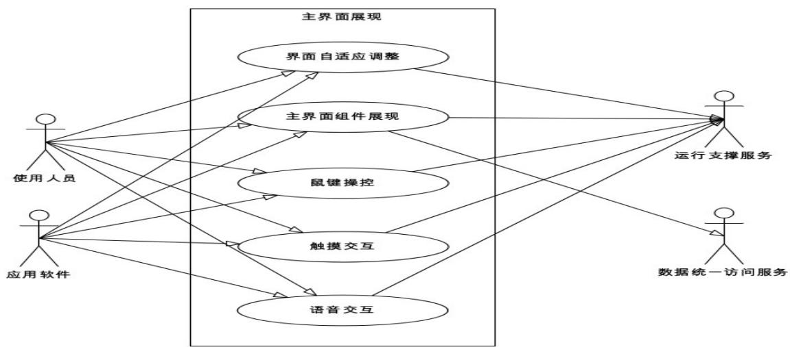
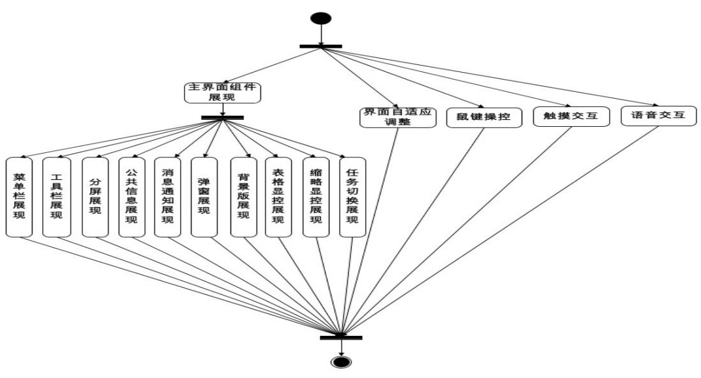
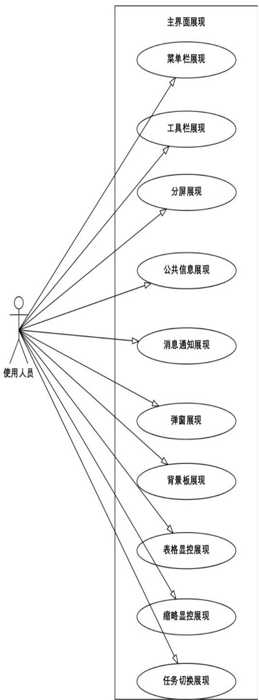
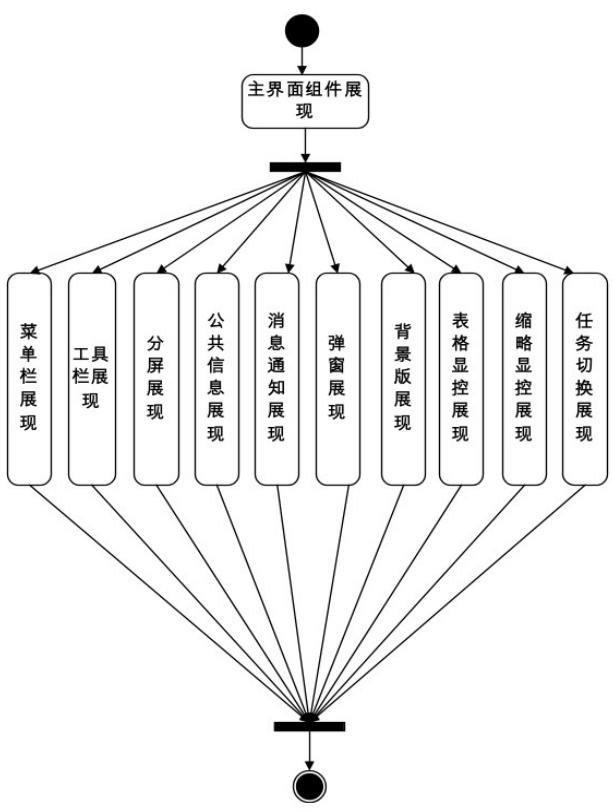

  
图36 界面展现用例图

界面展示功能标识表，见。

表33 界面展示功能标识表
<table><tr><td colspan="1" rowspan="1">序号</td><td colspan="1" rowspan="1">Usecase名称</td><td colspan="1" rowspan="1">项目唯一标识符</td><td colspan="1" rowspan="1">需求描述</td><td colspan="1" rowspan="1">需求重用</td><td colspan="1" rowspan="1">方式名称</td><td colspan="1" rowspan="1">运行状态</td><td colspan="1" rowspan="1">对应的任务书功能/性能</td></tr><tr><td colspan="1" rowspan="1">1</td><td colspan="1" rowspan="1">界面自适应调整</td><td colspan="1" rowspan="1">PZXQ-GN-JMJCKJ-JMZX-JMZSYTZ</td><td colspan="1" rowspan="1">提供界面自适应调整的功能，当框架在不同终端运行时，按照终端的大小自动匹配界面并展示；(提供桌面版、平板版、手持版三种版本形态）</td><td colspan="1" rowspan="1">新研</td><td colspan="1" rowspan="1">平板、桌面、手持</td><td colspan="1" rowspan="1">运行阶段</td><td colspan="1" rowspan="1">4.1.5a)</td></tr><tr><td colspan="1" rowspan="1">2</td><td colspan="1" rowspan="1">主界面组件展现</td><td colspan="1" rowspan="1">PZXQ-GN-JMJCKJ-JMZX-ZJMZJZX</td><td colspan="1" rowspan="1">提供主界面组件展示功能，主界面包括菜单栏、工具栏、分屏、公共信息、消息通知、弹窗、背景版、表格显控、缩略显控、任务切换等展示；(提供桌面版、平板版、手持版三种版本形</td><td colspan="1" rowspan="1">沿用</td><td colspan="1" rowspan="1">平板、桌面、手持</td><td colspan="1" rowspan="1">运行阶段</td><td colspan="1" rowspan="1">4.1.5b)c) d)e)/4.2 a)</td></tr><tr><td colspan="1" rowspan="1"></td><td colspan="1" rowspan="1"></td><td colspan="1" rowspan="1"></td><td colspan="1" rowspan="1">态）</td><td colspan="1" rowspan="1"></td><td colspan="1" rowspan="1"></td><td colspan="1" rowspan="1"></td><td colspan="1" rowspan="1"></td></tr><tr><td colspan="1" rowspan="1">3</td><td colspan="1" rowspan="1">鼠键操控</td><td colspan="1" rowspan="1">PZXQ-GN-JMJCKJ-JMZX-CJCK</td><td colspan="1" rowspan="1">提供鼠键操控显示的功能，用户可以通过键盘和鼠标对框架进行操作；（提供桌面版本形态）</td><td colspan="1" rowspan="1">沿用</td><td colspan="1" rowspan="1">桌面</td><td colspan="1" rowspan="1">运行阶段</td><td colspan="1" rowspan="1">4.1.5f)</td></tr><tr><td colspan="1" rowspan="1">4</td><td colspan="1" rowspan="1">触摸交互</td><td colspan="1" rowspan="1">PZXQ-GN-JMJCKJ-JMZX-CMJH</td><td colspan="1" rowspan="1">提供触摸交互显示的功能，用户可以通过触摸屏幕的方式对框架进行操作；（提供能手持版形态）</td><td colspan="1" rowspan="1">改进</td><td colspan="1" rowspan="1">平板、手持</td><td colspan="1" rowspan="1">运行阶段</td><td colspan="1" rowspan="1">4.1.5g)</td></tr><tr><td colspan="1" rowspan="1">5</td><td colspan="1" rowspan="1">语音交互</td><td colspan="1" rowspan="1">PZXQ-GN-JMJCKJ-JMZX-YYJH</td><td colspan="1" rowspan="1">提供语音交互显示的功能，用户可以通过语音的方式对框架进行操作。(提供桌面版、平板版、手持版三种版本形态）</td><td colspan="1" rowspan="1">新研</td><td colspan="1" rowspan="1">平板、手持</td><td colspan="1" rowspan="1">运行阶段</td><td colspan="1" rowspan="1">4.1.5f) g)</td></tr></table>

界面展示功能流程图如图37 界面展示功能流程图所示。

  
图37 界面展示功能流程图  
LXXII

## 3.2.5.1 主界面组件展现（PZXQ-GN-JMJCKJ-JMZX-ZJMZJZS）

主界面组件展现功能包括：菜单栏展现、工具栏展现、分屏展现、公共信息展现、消息通知展现、弹窗展现、背景板展现、表格显控展现、缩略显控展现、任务切换展现功能，其功能用例如图38所示。

  
图38 主界面组件展现用例图  
LXXIII

## 主界面组件展现标识表，见表34。

表34 主界面组件展现标识
<table><tr><td colspan="1" rowspan="1">序号</td><td colspan="1" rowspan="1">Usecase名称</td><td colspan="1" rowspan="1">项目唯一标识符</td><td colspan="1" rowspan="1">需求描述</td><td colspan="1" rowspan="1">需求重用</td><td colspan="1" rowspan="1">方式名称</td><td colspan="1" rowspan="1">对应的任务书功能/性能</td></tr><tr><td colspan="1" rowspan="1">1</td><td colspan="1" rowspan="1">菜单栏展现</td><td colspan="1" rowspan="1">PZXQ-GN-JMJCKJ-JMZX-ZJMZJZX-CDL</td><td colspan="1" rowspan="1">提供菜单栏展现功能，包括一级菜单和二级菜单，菜单栏在框架的左侧显示，点击菜单栏组件可以将其打开；（提供桌面版、平板版、手持版三种版本形态）</td><td colspan="1" rowspan="1">无</td><td colspan="1" rowspan="1">平板、桌面、手持</td><td colspan="1" rowspan="1">4.1.5</td></tr><tr><td colspan="1" rowspan="1">2</td><td colspan="1" rowspan="1">工具栏展现</td><td colspan="1" rowspan="1">PZXQ-GN-JMJCKJ-JMZX-ZJMZJZX-GJL</td><td colspan="1" rowspan="1">提供工具栏展现功能，通过在 esplug.json 文件中配置 toolbar 进行展现，工具栏在界面右下方位置，工具栏中每个组件打开之后在主显示区的右下方；(提供桌面版、平板版、手持版三种版本形态)</td><td colspan="1" rowspan="1">无</td><td colspan="1" rowspan="1">平板、桌面、手持</td><td colspan="1" rowspan="1">4.1.5</td></tr><tr><td colspan="1" rowspan="1">3</td><td colspan="1" rowspan="1">分屏展现</td><td colspan="1" rowspan="1">PZXQ-GN-JMJCKJ-JMZX-ZJMZJZX-FP</td><td colspan="1" rowspan="1">提供分屏展现的功能，支持一屏、二屏、四屏和六屏的设置；（提供桌面版、平板版、手持版三种版本形态）</td><td colspan="1" rowspan="1">无</td><td colspan="1" rowspan="1">平板、桌面、手持</td><td colspan="1" rowspan="1">4.1.5</td></tr><tr><td colspan="1" rowspan="1">4</td><td colspan="1" rowspan="1">公共信息展现</td><td colspan="1" rowspan="1">PZXQ-GN-JMJCKJ-JMZX-ZJMZJZX-GGXX</td><td colspan="1" rowspan="1">提供公共信息展现的功能，通过在 esplug.json 文件中配置 publicmessagebar 进行展现，在界面中右上方的位置。包括路由配置、组件配置、消息通知和系统设置等信息；（提供能桌面版形态）</td><td colspan="1" rowspan="1">无</td><td colspan="1" rowspan="1">平板、桌面、手持</td><td colspan="1" rowspan="1">4.1.5</td></tr><tr><td colspan="1" rowspan="1">5</td><td colspan="1" rowspan="1">消息通知展现</td><td colspan="1" rowspan="1">PZXQ-GN-JMJCKJ-JMZX-ZJMZJZX-XXTZ</td><td colspan="1" rowspan="1">提供消息通知展现功能，在框架右上方位置显示，可以查看不同的消息类型和总数，包括已读和未读消息。对每一条消息有删除、查看和快速回复的功能。（提供桌面版、平板版、手持版三种版本形态）</td><td colspan="1" rowspan="1">无</td><td colspan="1" rowspan="1">平板、桌面、手持</td><td colspan="1" rowspan="1">4.1.5</td></tr><tr><td colspan="1" rowspan="1">6</td><td colspan="1" rowspan="1">弹窗展现</td><td colspan="1" rowspan="1">PZXQ-GN-JMJCKJ-JMZX-ZJMZJZX-TC</td><td colspan="1" rowspan="1">提供组件弹框展现的功能，弹框组件在 esplug.json文件中配置组件的类型为 PopupWidget；（提供桌面版、平板版、手持版三种版本形态）</td><td colspan="1" rowspan="1">无</td><td colspan="1" rowspan="1">平板、桌面、手持</td><td colspan="1" rowspan="1">4.1.5</td></tr><tr><td colspan="1" rowspan="1">7</td><td colspan="1" rowspan="1">背景版展现</td><td colspan="1" rowspan="1">PZXQ-GN-JMJCKJ-JMZX-ZJMZJZX-BJB</td><td colspan="1" rowspan="1">提供背景版展现的功能，当未加载地图底图时，显示框架提前设置好的底图，如果成功加载地图，则显示地图组件作为背景底图；（提供桌面版、平板版、手持版三种版本形态）</td><td colspan="1" rowspan="1">无</td><td colspan="1" rowspan="1">平板、桌面、手持</td><td colspan="1" rowspan="1">4.1.5</td></tr><tr><td colspan="1" rowspan="1">8</td><td colspan="1" rowspan="1">表格显控展现</td><td colspan="1" rowspan="1">PZXQ-GN-JMJCKJ-JMZX-ZJMZJZX-</td><td colspan="1" rowspan="1">提供表格显控展现的功能，表格显控在 esplug.json配置组件类型为 BottomWidget；（提供桌面版、平板版、手持版三种版本形态）</td><td colspan="1" rowspan="1">无</td><td colspan="1" rowspan="1">平板、桌</td><td colspan="1" rowspan="1">4.1.5</td></tr><tr><td colspan="1" rowspan="1"></td><td colspan="1" rowspan="1"></td><td colspan="1" rowspan="1">BGXK</td><td colspan="1" rowspan="1"></td><td colspan="1" rowspan="1"></td><td colspan="1" rowspan="1">面、手持</td><td colspan="1" rowspan="1"></td></tr><tr><td colspan="1" rowspan="1">9</td><td colspan="1" rowspan="1">缩略显控展现</td><td colspan="1" rowspan="1">PZXQ-GN-JMJCKJ-JMZX-ZJMZJZX-SLXK</td><td colspan="1" rowspan="1">提供缩略显控展现的功能，在 esplug.json 文件中配置组件的类型为 RightWidget，缩略显控在界面的右侧显示；(提供桌面版、平板版、手持版三种版本形态）</td><td colspan="1" rowspan="1">无</td><td colspan="1" rowspan="1">平板、桌面、手持</td><td colspan="1" rowspan="1">4.1.5</td></tr><tr><td colspan="1" rowspan="1">10</td><td colspan="1" rowspan="1">任务切换展现</td><td colspan="1" rowspan="1">PZXQ-GN-JMJCKJ-JMZX-ZJMZJZX-RWQH</td><td colspan="1" rowspan="1">提供任务切换展现的功能，任务切换在界面的左下方显示，通过任务切换可以查看当前用户浏览过的历史路由界面，能够迅速完成界面的切换；(提供桌面版、平板版、手持版三种版本形态)</td><td colspan="1" rowspan="1">无</td><td colspan="1" rowspan="1">平板、桌面、手持</td><td colspan="1" rowspan="1">4.1.5</td></tr></table>

主界面组件展示流程图如图39所示。

  
图39 主界面展现开发流程

## 3.2.5.1.1 菜单栏展现

菜单栏展现提供所有应用的菜单展现功能。

菜单栏展现用例见表35。

表35 菜单栏展现用例描述
<table><tr><td>Use Case 名称:菜单栏展现</td><td colspan="2">Actors：用户</td></tr><tr><td colspan="3">概述：本用例是菜单栏展现的扩展用例，描述用户操作菜单栏展现功能的过程；</td></tr><tr><td colspan="3">前置条件：数据库连接正常。</td></tr><tr><td colspan="3">主事件流</td></tr><tr><td></td><td></td><td>动作约束</td></tr><tr><td>Actor 的动作</td><td>系统的动作</td><td>(性能、可靠性、容错等)</td></tr><tr><td>1.用开发工具打开本地项目，并执行 npm run dev 命令。</td><td>2. node 将用户运行的软件加载到内存 中，通过浏览器进行用户组件的进一步 渲染和加载。如果系统内存不足，或打 开项目过多，编译器会提醒异常E1，可 能会由于 node 依赖错误，导致 npm run</td><td></td></tr><tr><td>3.在浏览器输入程序启动的IP地址，打 开框架界面。</td><td>dev错误，进入异常E2，用例结束。 4.前端应用程序在 Web 界面加载，完成 js的调用。可能由于地址输入错误，界</td><td rowspan="3">支持首屏加载时间不小于3秒， 用户响应时间不小于5秒；</td></tr><tr><td>5.点击界面左侧菜单栏。</td><td>面启动失败，进入异常E3，用例结束。 6.响应鼠标点击事件。如果点击鼠标后 没有预想的效果，则进入异常E4，用例</td></tr><tr><td>7.如果有二级菜单用户可以对二级菜单 进行查看。</td><td>结束。 8.响应鼠标点击事件，如果点击鼠标后</td></tr><tr><td>9.点击菜单栏展开缩回按钮。</td><td>没有预想的效果，则进入异常E4，用例 结束。 9.主界面响应对应的点击事件，如果点 击鼠标后没有预想的效果，则进入异常</td><td></td></tr><tr><td colspan="2">E4，用例结束。 异常流E1：系统内存不足，用例结束。 异常流 E2：npm run dev 失败，用例结束。 异常流E3：界面启动失败，用例结束。 异常流E4：菜单栏事件失效，用例结束。</td><td></td></tr><tr><td colspan="2">后置条件：无。</td><td></td></tr></table>

## 3.2.5.1.2 工具栏展现

工具栏展现提供应用在界面集成框架上展示工具栏插件的功能。

工具栏展现用例见表36。

表36 工具栏展现的用例描述
<table><tr><td>Use Case 名称:工具栏展现</td><td>Actors：用户</td></tr><tr><td colspan="2">概述：本用例是工具栏展现的扩展用例，描述用户操作工具栏展现的过程；</td></tr><tr><td colspan="2">Use Case 名称:工具栏展现 Actors：用户</td></tr><tr><td colspan="2">前置条件：数据库连接正常。</td></tr><tr><td colspan="2">主事件流</td></tr><tr><td>Actor 的动作 系统的动作</td><td>动作约束 (性能、可靠性、容错等)</td></tr><tr><td>1.用开发工具打开本地项目，并执行 npm run dev 命令。 2. node 将用户运行的软件加载到内存</td><td></td></tr><tr><td></td><td>中，通过浏览器进行用户组件的进一步 渲染和加载。如果系统内存不足，或打 开项目过多，编译器会提醒异常E1，可 能会由于 node 依赖错误，导致 npm run</td></tr><tr><td>3.在浏览器输入程序启动的IP地址，打 开框架界面。</td><td>dev错误，进入异常E2，用例结束。</td></tr><tr><td></td><td>4.前端应用程序在 Web 界面加载，完成 js的调用。可能由于地址输入错误，界 面启动失败，进入异常E3，用例结束。</td></tr><tr><td>5.用户点击主界面右下方“+”号按钮。</td><td>6.界面展开所有的工具栏按钮，点击“+”</td></tr><tr><td>7.点击工具栏中的 A组件。</td><td>号后，工具栏列表没有展开，进入异常</td></tr><tr><td></td><td>E4，用例结束。</td></tr><tr><td></td><td>8.A组件在界面中右下方侧边展开显示。</td></tr><tr><td></td><td>A 组件没有展开，进入异常 E5，用例结</td></tr><tr><td>束。</td><td></td></tr><tr><td>9.点击A组件界面的缩回按钮“&gt;”。</td><td></td></tr><tr><td></td><td></td></tr><tr><td></td><td>10.在界面中显示的 A组件消失。A组</td></tr><tr><td></td><td></td></tr><tr><td></td><td>件缩回事件失效，进入异常E6，用例结</td></tr><tr><td>束。</td><td></td></tr><tr><td></td><td></td></tr><tr><td>11.用户重复工具栏组件打开或缩回的操</td><td></td></tr><tr><td>作。</td><td></td></tr><tr><td></td><td>12.主界面响应对应的点击事件。</td></tr><tr><td>异常流E1：系统内存不足，用例结束。</td><td></td></tr><tr><td></td><td></td></tr><tr><td></td><td></td></tr><tr><td></td><td></td></tr><tr><td></td><td></td></tr><tr><td>异常流 E2:npm run dev 失败，用例结束。</td><td></td></tr><tr><td></td><td></td></tr><tr><td></td><td></td></tr><tr><td>异常流E3：界面启动失败，用例结束。</td><td></td></tr><tr><td></td><td></td></tr><tr><td></td><td></td></tr><tr><td></td><td></td></tr><tr><td>异常流E4：工具栏列表展开失败，用例结束。</td><td></td></tr><tr><td></td><td></td></tr><tr><td>异常流E5：A组件展开异常，用例结束。</td><td></td></tr><tr><td></td><td></td></tr><tr><td></td><td></td></tr><tr><td colspan="2">异常流E6：组件缩回事件失效，用例结束</td></tr></table>

## 3.2.5.1.3 分屏展现

分屏展现提供在界面集成框架里分屏展示应用组件界面的功能。

分屏展现用例见表37。

表37 分屏展现的用例描述
<table><tr><td>Use Case 名称：</td><td colspan="2">Actors：用户</td></tr><tr><td colspan="3">概述：本用例是工具栏展现的扩展用例，描述用户操作工具栏展现的过程；</td></tr><tr><td colspan="3">前置条件：数据库连接正常。</td></tr><tr><td colspan="3">主事件流</td></tr><tr><td>Actor 的动作</td><td>系统的动作</td><td>动作约束 (性能、可靠性、容错等)</td></tr><tr><td>1.用开发工具打开本地项目，并执行 npm run dev 命令。 3.在浏览器输入程序启动的IP地址，打 开框架界面。</td><td>2. node 将用户运行的软件加载到内存 中，通过浏览器进行用户组件的进一步 渲染和加载。如果系统内存不足，或打 开项目过多，编译器会提醒异常E1，可 能会由于 node 依赖错误，导致 npm run dev错误，进入异常E2，用例结束。</td><td></td></tr><tr><td>5.用户点击界面设置按钮。</td><td>4.前端应用程序在 Web 界面加载，完成 js的调用。可能由于地址输入错误，界 面启动失败，进入异常E3，用例结束。</td><td></td></tr><tr><td>7.用户通过“设置-&gt;通用设置-&gt;分屏切换” 可以进行分屏切换操作。</td><td>6.界面显示设置界面窗口。</td><td></td></tr><tr><td>9.重复步骤“5-&gt;6-&gt;7-&gt;-&gt;8”操作，切换对 应的分屏展示。 10.用户切换到2屏显示。</td><td>8.主界面响应对应的分屏显示，如果分 屏失败，计入异常E4，用例结束。</td><td></td></tr><tr><td>12.用户选中其中一个屏幕后，再点击组</td><td>11.主界面显示两个屏幕。</td><td></td></tr><tr><td>件应用，之后屏幕中显示该组件。 异常流E1：系统内存不足，用例结束。 异常流 E2:npm run dev 失败，用例结束。</td><td></td><td></td></tr><tr><td colspan="2">异常流E3：界面启动失败，用例结束。 异常流E4：界面分屏失败，用例结束。</td><td></td></tr><tr><td colspan="2">后置条件：无。</td><td></td></tr></table>

## 3.2.5.1.4 公共信息展现

公共信息展现提界面集成框架公共信息的展现。

公共信息展现用例见表38。

表38 公共信息展现的用例描述
<table><tr><td rowspan=1 colspan=1>Use Case 名称：公共信息展现</td><td rowspan=1 colspan=2>Actors：用户</td></tr><tr><td rowspan=1 colspan=3>概述：本用例是公共信息展现的扩展用例，描述用户操作公共信息展现的过程；</td></tr><tr><td rowspan=1 colspan=3>前置条件：数据库连接正常。</td></tr><tr><td rowspan=1 colspan=3>主事件流</td></tr><tr><td rowspan=1 colspan=1>Actor 的动作</td><td rowspan=1 colspan=1>系统的动作</td><td rowspan=1 colspan=1>动作约束(性能、可靠性、容错等)</td></tr><tr><td rowspan=1 colspan=1>1.用开发工具打开本地项目，并执行npm run dev 命令。3.在浏览器输入程序启动的IP地址，打开框架界面。5.用户点击界面框架右上方公共信息的位置</td><td rowspan=1 colspan=1>2. node 将用户运行的软件加载到内存中，通过浏览器进行用户组件的进一步渲染和加载。如果系统内存不足，或打开项目过多，编译器会提醒异常E1，可能会由于 node 依赖错误，导致 npm rundev错误，进入异常E2，用例结束。4.前端应用程序在 Web 界面加载，完成js的调用。可能由于地址输入错误，界面启动失败，进入异常E3，用例结束。6.界面响应不通的组件界面。组件显示失败，进入异常E4，用例结束。</td><td rowspan=1 colspan=1></td></tr><tr><td rowspan=1 colspan=2>异常流E1：系统内存不足，用例结束。异常流 E2：npm run dev 失败，用例结束。异常流E3：界面启动失败，用例结束。异常流E4：公共组件加载失败，用例结束。</td><td rowspan=1 colspan=1></td></tr><tr><td rowspan=1 colspan=2>后置条件：无。</td><td rowspan=1 colspan=1></td></tr></table>

## 3.2.5.1.5 消息通知展现