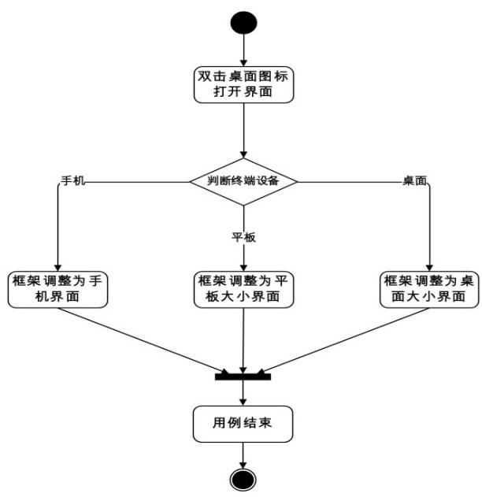

提供消息通知显示功能，支持对告警、通知、自定义消息数据的集中显示和控制，支持从消息通知跳转到界面组件（提供桌面版、平板版、手持版三种版本形态）。

消息通知展现用例见表39。

表39 消息通知展现的用例描述
<table><tr><td>Use Case 名称:消息通知展现</td><td colspan="2">Actors：用户</td></tr><tr><td colspan="3">概述：本用例是消息通知展现的扩展用例，描述用户操作消息通知展现的过程；</td></tr><tr><td colspan="3">前置条件：数据库连接正常。</td></tr><tr><td colspan="3">主事件流</td></tr><tr><td>Actor 的动作</td><td>系统的动作</td><td>动作约束 (性能、可靠性、容错等)</td></tr><tr><td>1.用开发工具打开本地项目，并执行 npm run dev 命令。</td><td>2. node 将用户运行的软件加载到内存 中，通过浏览器进行用户组件的进一步 渲染和加载。如果系统内存不足，或打</td><td></td></tr><tr><td>3.在浏览器输入程序启动的IP地址，打 开框架界面。</td><td>开项目过多，编译器会提醒异常E1，可 能会由于 node 依赖错误，导致 npm run dev错误，进入异常E2，用例结束。 4.前端应用程序在 Web 界面加载，完成 js的调用。可能由于地址输入错误，界</td><td></td></tr><tr><td>5.用户可以在公共信息栏中看到消息通 知功能。当有接受到消息时，轮播显示 消息内容与总数。点击消息组件。</td><td>面启动失败，进入异常E3，用例结束。 6.在主界面中显示消息组件界面，组件</td><td rowspan="2"></td></tr><tr><td>7.用户用鼠标选中消息并滑动鼠标。</td><td>显示失败，进入异常E4，用例结束。 8.界面中显示对消息的三个操作功能，</td></tr><tr><td>9.对消息进行删除操作。</td><td>即查看、删除和回复。</td><td rowspan="2"></td></tr><tr><td>11.点击消息的查看操作。</td><td>10.在列表中不再显示被删除的消息。 12.在消息列表中，该消息颜色变成已查</td></tr><tr><td colspan="1" rowspan="1">15.用户在回复框中填写回复的内容。16.点击回复按钮操作。</td><td colspan="1" rowspan="1">14.在消息列表中出现回复框。17.主界面响应回复按钮操作，将回复信息发送出去。消息发送失败，进入异常E5，用例结束。</td><td colspan="1" rowspan="1"></td></tr><tr><td colspan="2" rowspan="1">异常流E1：系统内存不足，用例结束。异常流 E2：npm run dev 失败，用例结束。异常流E3：界面启动失败，用例结束。异常流E4：消息通知组件加载失败，用例结束。异常流E5：消息回复功能失效，用例结束。</td><td colspan="1" rowspan="1"></td></tr><tr><td colspan="2" rowspan="1">后置条件：无。</td><td colspan="1" rowspan="1"></td></tr></table>

## 3.2.5.1.6 弹窗展现

弹窗展现提供支持应用将组件设置为弹出窗类型的组件的能力。

弹窗展现用例见表40。

表40 弹窗展现的用例描述
<table><tr><td colspan="1" rowspan="1">Use Case 名称:弹窗展现</td><td colspan="2" rowspan="1">Actors：用户</td></tr><tr><td colspan="3" rowspan="1">概述：本用例是弹窗展现的扩展用例，描述用户操作弹窗展现的过程；</td></tr><tr><td colspan="3" rowspan="1">前置条件：数据库连接正常。</td></tr><tr><td colspan="3" rowspan="1">主事件流</td></tr><tr><td colspan="1" rowspan="1">Actor 的动作</td><td colspan="1" rowspan="1">系统的动作</td><td colspan="1" rowspan="1">动作约束(性能、可靠性、容错等)</td></tr><tr><td colspan="1" rowspan="1">1.用开发工具打开本地项目，并执行npm run dev 命令。3.在浏览器输入程序启动的IP地址，打开框架界面。5.用户在集成应用时已经将弹窗组件在</td><td colspan="1" rowspan="1">2. node 将用户运行的软件加载到内存中，通过浏览器进行用户组件的进一步渲染和加载。如果系统内存不足，或打开项目过多，编译器会提醒异常E1，可能会由于 node 依赖错误，导致 npm rundev错误，进入异常E2，用例结束。4.前端应用程序在Web 界面加载，完成js的调用。可能由于地址输入错误，界面启动失败，进入异常E3，用例结束。</td><td colspan="1" rowspan="1"></td></tr><tr><td>esplug.json 文件中完成配置，在界面中 找到配置好的弹窗组件，进行点击操 作。 7.弹窗界面中有最大化最小化关闭等操 作。点击界面A最小化按钮。</td><td>6.主界面显示弹窗组件，弹窗组件显示 失败，进入异常E4，用例结束。 8.弹窗组件在界面的下侧显示缩略的状</td><td></td></tr><tr><td rowspan="2">9.点击缩略后的组件。 11.点击组件最大话按钮。</td><td>态。 10.组件A恢复到原来的位置。</td><td></td></tr><tr><td>12.组件A在界面中主显示区域，满屏显 示。组件未满屏显示进入异常E5，用例</td><td></td></tr><tr><td>13.点击组件A的关闭按钮。 异常流E1：系统内存不足，用例结束。</td><td>结束。 14.组件A将不再界面中显示。</td><td></td></tr><tr><td colspan="2">异常流 E2:npm run dev 失败，用例结束。 异常流E3：界面启动失败，用例结束。 异常流E4：弹窗组件加载失败，用例结束。 异常流E5：组件最大化失效，用例结束。</td><td></td></tr></table>

## 3.2.5.1.7 背景版展现

背景板展现提供应用集成时按照背景板类型，全屏展现界面组件的能力。

背景板展现用例见表41。

表41 工具栏展现的用例描述
<table><tr><td colspan="1" rowspan="1">Use Case 名称:背景板展现</td><td colspan="2" rowspan="1">Actors：用户</td></tr><tr><td colspan="3" rowspan="1">概述：本用例是背景板展现的扩展用例，描述背景板展现的过程；</td></tr><tr><td colspan="3" rowspan="1">前置条件：数据库连接正常。</td></tr><tr><td colspan="3" rowspan="1">主事件流</td></tr><tr><td colspan="1" rowspan="1">Actor 的动作</td><td colspan="1" rowspan="1">系统的动作</td><td colspan="1" rowspan="1">动作约束(性能、可靠性、容错等)</td></tr><tr><td colspan="1" rowspan="1">1.用户点击菜单中背景板组件。</td><td colspan="1" rowspan="1"></td><td colspan="1" rowspan="1"></td></tr><tr><td colspan="1" rowspan="1">3.用户点击菜单中的路由组件。</td><td colspan="1" rowspan="1">2. 框架将已选中的菜单组件加载至背景板中。4.框架将路由所指的组件加载至背景板中，并在任务展现中添加新的任务。如果加载失败则进入异常流E1，用例结束。</td><td colspan="1" rowspan="1"></td></tr><tr><td colspan="2" rowspan="1">异常流E1：路由组件加载失败，用例结束。</td><td colspan="1" rowspan="1"></td></tr><tr><td colspan="2" rowspan="1">后置条件：无。</td><td colspan="1" rowspan="1"></td></tr></table>

## 3.2.5.1.8 表格显控展现

表格显控提供应用在界面集成框架中以表格显控为类型的组件展示。

表格显控展现用例见表42。

表42 表格显控展现的用例描述
<table><tr><td>Use Case 名称:表格显控展现</td><td colspan="2">Actors：用户</td></tr><tr><td colspan="3">概述：本用例是表格显控展现的扩展用例，描述用户操作表格显控展现的过程；</td></tr><tr><td colspan="3">前置条件：数据库连接正常。</td></tr><tr><td colspan="3">主事件流</td></tr><tr><td>Actor 的动作</td><td>系统的动作</td><td>动作约束 (性能、可靠性、容错等)</td></tr><tr><td>1.用户点击菜单中的表格显控组件。</td><td>2. 框架将选中的组件在表格显控组件中 加载。如果菜单显示失败则进入异常流 E1，用例失败。</td><td></td></tr><tr><td>3.用户点击表格显控组件的右上角隐藏 按钮。 5.用户点中表格显控组件并拖动。</td><td>4.框架将表格显控组件下移至框架最下 方，只显示表格显控组件中已加载组件 的组件名称。</td><td></td></tr><tr><td></td><td>6.框架中的表格显控组件将随着鼠标的 移动而移动。</td><td></td></tr><tr><td>7.当有多个组件在表格显控组件中时， 用户点击不同组件的tab名称。</td><td>8.表格显控组件将显示被选中的 tab 名称</td><td></td></tr><tr><td colspan="1" rowspan="1">9.用户点击表格显控组件的 tab 名称旁边的左右箭头。</td><td colspan="1" rowspan="1">所对应的组件。10.表格显控组件将切换显示组件为当前组件的左侧组件或右侧组件。</td><td colspan="1" rowspan="1"></td></tr><tr><td colspan="2" rowspan="1">异常流E1：表格显控失败，用例结束。</td><td colspan="1" rowspan="1"></td></tr><tr><td colspan="2" rowspan="1">后置条件：无。</td><td colspan="1" rowspan="1"></td></tr></table>

## 3.2.5.1.9 缩略显控展现

缩略显控提供用户以缩略显控为类型的界面组件展示。

缩略显控用例见表43。

表43 工具栏展现的用例描述
<table><tr><td>Use Case 名称：缩略显控</td><td colspan="2">Actors：用户</td></tr><tr><td colspan="3">概述：本用例是缩略显控的扩展用例，描述用户缩略显控展现的过程；</td></tr><tr><td colspan="3">前置条件：数据库连接正常。</td></tr><tr><td colspan="4">主事件流</td></tr><tr><td>Actor 的动作</td><td>系统的动作</td><td>动作约束 (性能、可靠性、容错等)</td></tr><tr><td>1.用开发工具打开本地项目，并执行 npm run dev 命令。 3.在浏览器输入程序启动的IP地址，打 开框架界面。</td><td>2. node 将用户运行的软件加载到内存 中，通过浏览器进行用户组件的进一步 渲染和加载。如果系统内存不足，或打 开项目过多，编译器会提醒异常E1，可 能会由于 node 依赖错误，导致 npm run dev错误，进入异常E2，用例结束。 4.前端应用程序在 Web 界面加载，完成 js的调用。可能由于地址输入错误，界</td><td></td></tr><tr><td colspan="3">异常流E1：系统内存不足，用例结束。 异常流 E2:npm run dev 失败，用例结束。 异常流E3：界面启动失败，用例结束。</td></tr><tr><td colspan="3">后置条件：无。</td></tr></table>

## 3.2.5.1.10任务切换展现

任务切换提供用户能够在界面集成框架进行多任务切换、多组件切换的功能。  
任务切换展现用例见表44。

表44 任务切换展现的用例描述
<table><tr><td rowspan=1 colspan=1>Use Case 名称:任务切换展现</td><td rowspan=1 colspan=2>Actors：用户</td></tr><tr><td rowspan=1 colspan=3>概述：本用例是任务切换展现的扩展用例，描述用户操作任务切换展现的过程；</td></tr><tr><td rowspan=1 colspan=3>前置条件：数据库连接正常。</td></tr><tr><td rowspan=1 colspan=3>主事件流</td></tr><tr><td rowspan=1 colspan=1>Actor 的动作</td><td rowspan=1 colspan=1>系统的动作</td><td rowspan=1 colspan=1>动作约束(性能、可靠性、容错等)</td></tr><tr><td rowspan=1 colspan=1>1.用户点击左下角任务切换按钮。3.用户点击某一个任务。5.用户在任务展现页面点击关闭操作。7.用户关闭所有任务。</td><td rowspan=1 colspan=1>2.框架将已有任务展现出来。4.框架切换任务为选中任务。如果界面无变化，则进入异常流E1，用例结束。6.框架将选中关闭的任务移出任务展现列表。8.框架将清空任务展现列表中的所有任务。</td><td rowspan=1 colspan=1>若当前任务为选中任务，则不作反应。</td></tr><tr><td rowspan=1 colspan=2>异常流E1：任务切换失败，用例结束。</td><td rowspan=1 colspan=1></td></tr><tr><td rowspan=1 colspan=2>后置条件：无。</td><td rowspan=1 colspan=1></td></tr></table>

3.2.5.2 界面自适应调整（PZXQ-GN-JMJCKJ- JMZX-JMZSYTZ）

界面自适应调整支持依据终端的硬件形态、尺寸大小和分辨率提供相应的界面展现风格和界面手段；（提供桌面版、平板版、手持版三种版本形态）。

界面自适应调整用例场景，见表45。

表45 开发工程生成用例描述
<table><tr><td colspan="1" rowspan="1">Use Case 名称:界面自适应调整</td><td colspan="2" rowspan="1">Actors：用户</td></tr><tr><td colspan="3" rowspan="1">概述：本用例是界面自适应调整的扩展用例，描述界面自适应调整的过程；</td></tr><tr><td colspan="3" rowspan="1">前置条件：数据库连接正常。</td></tr><tr><td colspan="3" rowspan="1">主事件流</td></tr><tr><td colspan="1" rowspan="1">Actor 的动作</td><td colspan="1" rowspan="1">系统的动作</td><td colspan="1" rowspan="1">动作约束</td></tr><tr><td colspan="1" rowspan="1"></td><td colspan="1" rowspan="1"></td><td colspan="1" rowspan="1">(性能、可靠性、容错等)</td></tr><tr><td colspan="1" rowspan="1">1.用户双击桌面的界面集成框架图标。3.用户使用不同尺寸的显示器进行操作。</td><td colspan="1" rowspan="1">2.框架开始加载并打开登录界面。如果界面启动失败，则进入异常E1，用例结束。4.框架中的内容将跟随显示器尺寸对框架中所有的样式进行自适应调整。5.支持首屏加载时间不小于3秒，用户响应时间不小于5秒；</td><td colspan="1" rowspan="1"></td></tr><tr><td colspan="2" rowspan="1">异常流E1：系统启动失败，用例结束。</td><td colspan="1" rowspan="1"></td></tr><tr><td colspan="2" rowspan="1">后置条件：无。</td><td colspan="1" rowspan="1"></td></tr></table>

界面自适应流程图 40。

  
图 40界面自适应流程图LXXXVII

## 3.2.5.3 鼠键操控（PZXQ-GN-JMJCKJ-JMZX-SJCK）

鼠标操控提供支持鼠标、键盘、语音界面方式（提供桌面版形态）。

鼠标操控用例场景，见表46。

表46 公共组件管理用例描述
<table><tr><td>Use Case 名称:鼠键操控</td><td colspan="2">Actors：用户</td></tr><tr><td colspan="3">概述：本用例是鼠键操控的扩展用例，描述用户使用鼠键操控的过程；</td></tr><tr><td colspan="3">前置条件：数据库连接正常。</td></tr><tr><td colspan="3">主事件流</td></tr><tr><td>Actor 的动作</td><td>系统的动作</td><td>动作约束 (性能、可靠性、容错等)</td></tr><tr><td>1.用户使用鼠标双击桌面的框架图标。</td><td>2.进入框架界面，若已打开运维管理或 应用市场，则进入异常流E1，用例结</td><td></td></tr><tr><td rowspan="2">3.用户使用键盘输入用户名和密码。 5.用户使用框架默认的切换分屏快捷 键。</td><td>束。 4.框架的输入框获取用户的输入值。</td><td></td></tr><tr><td></td><td></td></tr><tr><td rowspan="2">7. 用户点击一级菜单。 9.用户在地图中拖动鼠标。</td><td>6.框架切换分屏状态。 8.若一级菜单为组件或路由时，打开组</td><td></td></tr><tr><td>件或跳转路由，若无则显示二级菜单。 10.地图随着用户的拖动进行地图的移 动。</td><td>基于2个键值组合的快捷键种类 不少于36种。</td></tr><tr><td>11.用户拖动弹窗。</td><td>12.弹窗随鼠标一起移动。</td><td></td></tr><tr><td>13.用户操作快捷键。</td><td>14. 实现快捷键功能效果。</td><td></td></tr><tr><td>异常流E1：系统提示已打开应用市场或运维管理，请关闭后重新打开，用例结束。</td><td></td><td></td></tr><tr><td colspan="3">后置条件：无。</td></tr></table>

触摸操控支持支持触摸的界面方式。

触摸操控用例场景，见表47。

表47 组件下载管理用例描述
<table><tr><td rowspan=1 colspan=1>Use Case 名称:触摸操控</td><td rowspan=1 colspan=2>Actors：用户</td></tr><tr><td rowspan=1 colspan=3>概述：本用例是触摸操控的扩展用例，描述用户在触摸操控的过程；</td></tr><tr><td rowspan=1 colspan=3>前置条件：使用平板或手机操控框架。</td></tr><tr><td rowspan=1 colspan=3>主事件流</td></tr><tr><td rowspan=1 colspan=1>Actor 的动作</td><td rowspan=1 colspan=1>系统的动作</td><td rowspan=1 colspan=1>动作约束(性能、可靠性、容错等)</td></tr><tr><td rowspan=1 colspan=1>1.用户点击桌面的框架图标。3.用户点击输入框。5.用户点击一级菜单。7.用户长按一级菜单。9.用户在地图中滑动。</td><td rowspan=1 colspan=1>2.框架开始加载，进入登录界面，若服务未启动，则框架打开失败，进入异常流事件E1，用例结束。4.输入框获取焦点，调起系统键盘。6.若一级菜单为组件则打开组件，若无组件则打开二级菜单。8.显示快捷组件。10.地图会随着用户的触摸点进行移动。</td><td rowspan=1 colspan=1></td></tr><tr><td rowspan=1 colspan=2>异常流E1：界面启动失败，用例结束。</td><td rowspan=1 colspan=1></td></tr><tr><td rowspan=1 colspan=2>后置条件：无。</td><td rowspan=1 colspan=1></td></tr></table>

## 3.2.5.5 语音交互（PZXQ-GN-JMJCKJ-JMJC-JMPZBC）

语音交互提供支持触摸、语音的界面方式。

语音交互用例场景，见表48。

表48 组件打包发布用例描述
<table><tr><td rowspan=1 colspan=1>Use Case 名称:语音交互</td><td rowspan=1 colspan=1>Actors：用户</td></tr><tr><td rowspan=1 colspan=2>概述：本用例是语音交互的扩展用例，描述用户使用语音进行交互的过程；</td></tr><tr><td rowspan=1 colspan=2>前置条件：数据库连接正常。</td></tr><tr><td rowspan=1 colspan=2>主事件流</td></tr></table>

<table><tr><td>Use Case 名称:语音交互</td><td colspan="2">Actors：用户</td></tr><tr><td>Actor 的动作</td><td>系统的动作</td><td>动作约束 (性能、可靠性、容错等)</td></tr><tr><td>1.用户说“打开设置”。</td><td>2.框架打开设置界面。可能会因为语音 识别失败终止交互，进入异常流E1，用 例结束。</td><td></td></tr><tr><td>3.用户说“切换分屏设置为六分屏”。</td><td>4.框架切换分屏为六分屏。</td><td>若当前分屏状态为六分屏时，提 示当前已为六分屏</td></tr><tr><td>5.用户说“切换主题为主题二”。</td><td>6.框架切换主题为主题二。</td><td>若当前主题为主题二时，提示当 前主题已为主题二</td></tr><tr><td>7.用户说“打开军标面板”。</td><td>8.框架打开军标面板组件。</td><td>若打开失败则提示军标面板打开</td></tr><tr><td>9.用户说“弹窗最大化”。</td><td>10.框架将当前弹窗最大化。</td><td>失败，请检查组件配置项 若弹窗未获取焦点，则最大化最</td></tr><tr><td>11.用户说“弹窗最小化”。</td><td></td><td>近打开的弹窗组件 若弹窗未获取焦点，则将所有弹</td></tr><tr><td>13.用户说“关闭弹窗”。</td><td>12.框架将当前弹窗最小化。</td><td>窗最小化 若弹窗未获取焦点，则关闭所有</td></tr><tr><td>15.用户说“查看消息通知”。</td><td>14.框架将关闭当前弹窗。</td><td>弹窗 若消息通知中无消息内容，则提</td></tr><tr><td>17.用户说“关闭军标面板”。</td><td>16.框架将打开消息通知组件。</td><td>示当前无消息通知 若军标面板未打开，则框架不作</td></tr><tr><td>19.用户说“返回桌面”。</td><td>18.框架将关闭军标面板。</td><td>反应，若关闭的组件未不可关闭 的组件，则最小化该组件</td></tr><tr><td></td><td>20.框架将自身最小化，返回桌面。</td><td></td></tr><tr><td>21.用户说“退出登录”。 面。</td><td>22.框架将退出登录，跳转路由至登录界</td><td></td></tr></table>