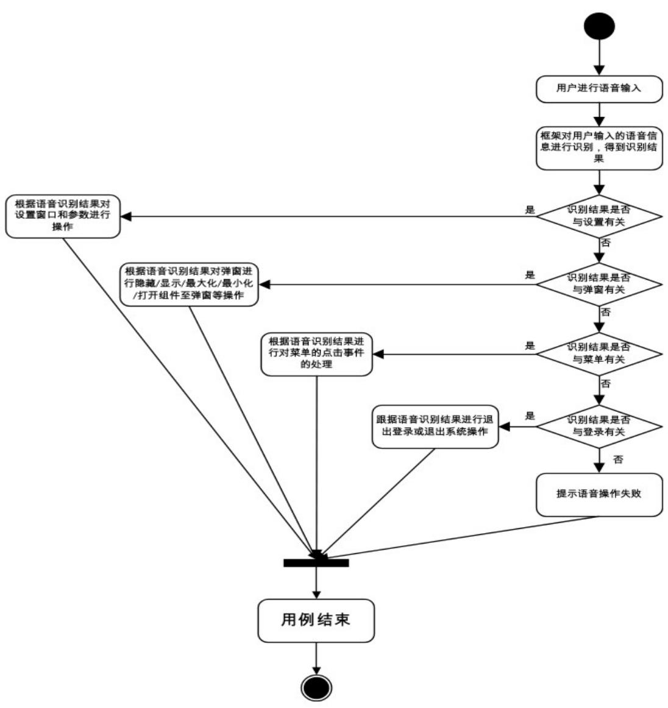
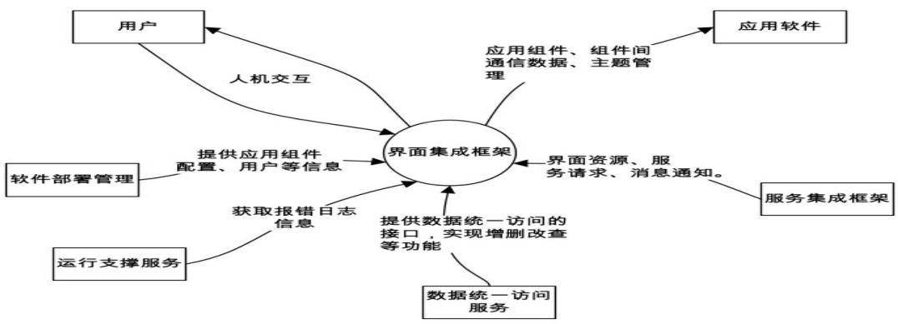
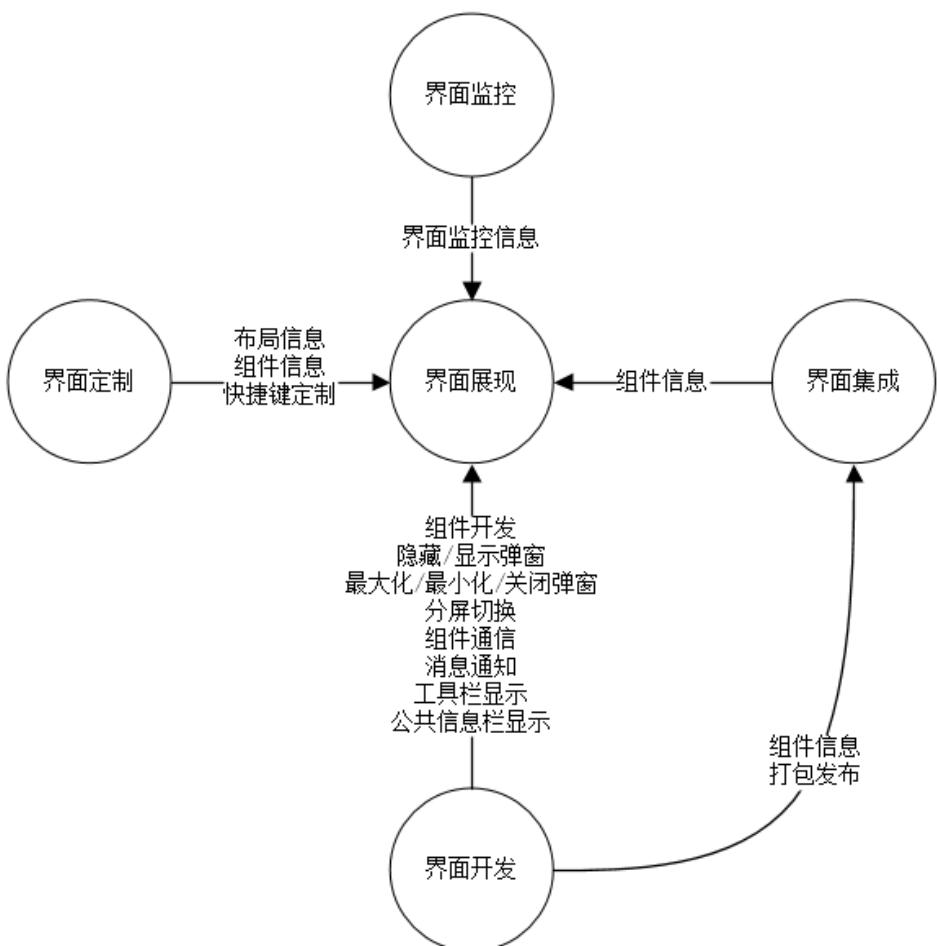

<table><tr><td rowspan=1 colspan=1>Use Case 名称:语音交互</td><td rowspan=1 colspan=2>Actors：用户</td></tr><tr><td rowspan=1 colspan=1>23用户说“退出系统”。</td><td rowspan=1 colspan=1>24.框架若在登录界面则直接退出框架。</td><td rowspan=1 colspan=1>若不在登录界面，则先退出登录再退出框架</td></tr><tr><td rowspan=1 colspan=2>异常流E1：系统提示识别失败，用例结束。</td><td rowspan=1 colspan=1></td></tr><tr><td rowspan=1 colspan=2>后置条件：无。</td><td rowspan=1 colspan=1></td></tr></table>

语音交互流程如图 41。

  
图 41语音交互流程图

## 3.3 CSCI 外部接口需求

## 3.3.1 接口标识与接口图

界面集成框架对外接口包括与用户的接口、与应用软件的接口、与软件部署管理的接口、与服务集成框架的接口、与数据统一访问服务的接口。外部接口关系如图 42所示。

图 42界面集成框架接口需求图  
界面集成框架外部接口关系格式参见表49。  
表49 界面集成框架外部接口需求
<table><tr><td colspan="1" rowspan="1">序号</td><td colspan="1" rowspan="1">接口需求名称</td><td colspan="1" rowspan="1">接口需求标识</td><td colspan="1" rowspan="1">接口类型</td><td colspan="1" rowspan="1">发送方</td><td colspan="1" rowspan="1">接收方</td><td colspan="1" rowspan="1">接口内容</td><td colspan="1" rowspan="1">接口优先级</td></tr><tr><td colspan="1" rowspan="2">1</td><td colspan="1" rowspan="2">与用户的接口</td><td colspan="1" rowspan="2">PZXQ-WBJK-YH</td><td colspan="1" rowspan="2">人机接口</td><td colspan="1" rowspan="1">用户</td><td colspan="1" rowspan="1">本软件</td><td colspan="1" rowspan="2">提供用户菜单响应、数据编辑、图上操作等功能。</td><td colspan="1" rowspan="2">高</td></tr><tr><td colspan="1" rowspan="1">本软件</td><td colspan="1" rowspan="1">用户</td></tr><tr><td colspan="1" rowspan="1">2</td><td colspan="1" rowspan="1">与应用软件的接口</td><td colspan="1" rowspan="1">PZXQ-WBJK-YYRJ</td><td colspan="1" rowspan="1">API接口</td><td colspan="1" rowspan="1">本软件</td><td colspan="1" rowspan="1">应用</td><td colspan="1" rowspan="1">提供应用组件管理、组件间通信、主题管理、支持应用调用</td><td colspan="1" rowspan="1">高</td></tr><tr><td colspan="1" rowspan="1">3</td><td colspan="1" rowspan="1">与软件部署管理的接口</td><td colspan="1" rowspan="1">PZXQ-WBJK-YXZCFW</td><td colspan="1" rowspan="1">Restful 接口</td><td colspan="1" rowspan="1">软件部署管理</td><td colspan="1" rowspan="1">本软件</td><td colspan="1" rowspan="1">调用软件部署管理接口，实现用户身份认证，实现依据身份获取应用组件配置信息</td><td colspan="1" rowspan="1">高</td></tr><tr><td colspan="1" rowspan="1">4</td><td colspan="1" rowspan="1">与服务集成框架的接口</td><td colspan="1" rowspan="1">PZXQ-WBJK-FWJCKJ</td><td colspan="1" rowspan="1">网络接口</td><td colspan="1" rowspan="1">服务集成框架</td><td colspan="1" rowspan="1">本软件</td><td colspan="1" rowspan="1">调用服务集成框架接口，实现界面资源获取、服务请求、消息通知。</td><td colspan="1" rowspan="1">高</td></tr><tr><td colspan="1" rowspan="1">5</td><td colspan="1" rowspan="1">与数据统</td><td colspan="1" rowspan="1">PZXQ-WBJK-</td><td colspan="1" rowspan="1">API接口</td><td colspan="1" rowspan="1">数据统一</td><td colspan="1" rowspan="1">本软件</td><td colspan="1" rowspan="1">调用数据统一访问</td><td colspan="1" rowspan="1">高</td></tr><tr><td colspan="1" rowspan="1"></td><td colspan="1" rowspan="1">一访问服务的接口</td><td colspan="1" rowspan="1">SJTYFW</td><td colspan="1" rowspan="1"></td><td colspan="1" rowspan="1">访问服务</td><td colspan="1" rowspan="1"></td><td colspan="1" rowspan="1">服务的接口，实现依据用户身份对应用户状态配置信息、快捷键信息、主题样式信息的保存和获取</td><td colspan="1" rowspan="1"></td></tr></table>

## 3.3.2 与用户的接口（PZXQ-JK-YH）

此接口的数据元素说明见表 50。

表 50与用户的接口的数据元素说明表
<table><tr><td rowspan=1 colspan=1>序号</td><td rowspan=1 colspan=1>数据集名称</td><td rowspan=1 colspan=1>数据组成</td><td rowspan=1 colspan=1>数据约束</td><td rowspan=1 colspan=1>数据标准</td></tr><tr><td rowspan=1 colspan=1>1</td><td rowspan=1 colspan=1>界面</td><td rowspan=1 colspan=1>点击菜单信息、鼠标位置、输入框内容</td><td rowspan=1 colspan=1>字符串</td><td rowspan=1 colspan=1>试点建设装备配套科研界面设计规范</td></tr></table>

## 3.3.3 与应用软件的接口（PZXQ-JK-YYRJ）

此接口的数据元素说明见表 51。

表 51与应用软件的接口的数据元素说明
<table><tr><td rowspan=1 colspan=1>序号</td><td rowspan=1 colspan=1>数据集名称</td><td rowspan=1 colspan=1>数据组成</td><td rowspan=1 colspan=1>数据约束</td><td rowspan=1 colspan=1>数据标准</td></tr><tr><td rowspan=1 colspan=1>1</td><td rowspan=1 colspan=1>组件管理</td><td rowspan=1 colspan=1>组件名称</td><td rowspan=1 colspan=1>字符串</td><td rowspan=3 colspan=1>试点建设装备配套科研界面集成规范</td></tr><tr><td rowspan=1 colspan=1>2</td><td rowspan=1 colspan=1>组件通信</td><td rowspan=1 colspan=1>通信参数</td><td rowspan=1 colspan=1>字符串</td></tr><tr><td rowspan=1 colspan=1>3</td><td rowspan=1 colspan=1>主题管理</td><td rowspan=1 colspan=1>主题样式</td><td rowspan=1 colspan=1>字符串</td></tr></table>

## 3.3.4 与软件部署管理的接口（PZXQ-JK-YXZCFW）

此接口的数据元素说明见表 52。

表 52与软件部署管理的接口的数据元素说明表
<table><tr><td rowspan=1 colspan=1>序号</td><td rowspan=1 colspan=1>数据集名称</td><td rowspan=1 colspan=1>数据组成</td><td rowspan=1 colspan=1>数据约束</td><td rowspan=1 colspan=1>数据标准</td></tr><tr><td rowspan=1 colspan=1>1</td><td rowspan=1 colspan=1>用户身份信息</td><td rowspan=1 colspan=1>用户 id、角色 id、用户 token</td><td rowspan=1 colspan=1>字符串</td><td rowspan=2 colspan=1>试点建设装备配套科研软件集成运维规范</td></tr><tr><td rowspan=1 colspan=1>2</td><td rowspan=1 colspan=1>应用组件配置信息</td><td rowspan=1 colspan=1>应用组件名称、应用组件资源路径、应用组件大小、应用组件打开方式等相关信息</td><td rowspan=1 colspan=1>字符串</td></tr></table>

## 3.3.5 与服务集成框架的接口（PZXQ-JK-FWJCKJ）

此接口的数据元素说明见表 53。

表 53与服务集成框架的接口的数据元素说明表
<table><tr><td colspan="1" rowspan="1">序号</td><td colspan="1" rowspan="1">数据集名称</td><td colspan="1" rowspan="1">数据组成</td><td colspan="1" rowspan="1">数据约束</td><td colspan="1" rowspan="1">数据标准</td></tr><tr><td colspan="1" rowspan="1">1</td><td colspan="1" rowspan="1">消息通知</td><td colspan="1" rowspan="1">消息id、消息内容、发送方信息、点击消息后打开的组件名称</td><td colspan="1" rowspan="1">字符串</td><td colspan="1" rowspan="1">信息系统软件服务开发和集成规</td></tr><tr><td colspan="1" rowspan="1">2</td><td colspan="1" rowspan="1">界面资源</td><td colspan="1" rowspan="1">资源路径、依赖包名称、组件名</td><td colspan="1" rowspan="1">字符串</td><td colspan="1" rowspan="2">范</td></tr><tr><td colspan="1" rowspan="1">3</td><td colspan="1" rowspan="1">服务请求</td><td colspan="1" rowspan="1">服务url、请求参数、请求相应体</td><td colspan="1" rowspan="1">字符串</td></tr></table>

## 3.3.6 与数据统一访问服务的接口（PZXQ-JK-SJTYFW）

此接口的数据元素说明见表 54。

表 54与数据统一访问服务的接口的数据元素说明表
<table><tr><td rowspan=1 colspan=1>序号</td><td rowspan=1 colspan=1>数据集名称</td><td rowspan=1 colspan=1>数据组成</td><td rowspan=1 colspan=1>数据约束</td><td rowspan=1 colspan=1>数据标准</td></tr><tr><td rowspan=1 colspan=1>1</td><td rowspan=1 colspan=1>用户信息</td><td rowspan=1 colspan=1>用户id、角色 id、用户 token、用户名称、</td><td rowspan=1 colspan=1>字符串</td><td rowspan=3 colspan=1>自定义格式</td></tr><tr><td rowspan=1 colspan=1>2</td><td rowspan=1 colspan=1>快捷键</td><td rowspan=1 colspan=1>快捷键id、快捷键信息、快捷键方法</td><td rowspan=1 colspan=1>字符串</td></tr><tr><td rowspan=1 colspan=1>3</td><td rowspan=1 colspan=1>主题样式</td><td rowspan=1 colspan=1>颜色样式、尺寸样式</td><td rowspan=1 colspan=1>字符串</td></tr></table>

## 3.4 CSCI 内部接口需求

## 3.4.1 接口标识和接口图

界面集成框架的内部就接口主要应用于集成框架内部进行集成应用信息加载、应用静态资源信息获取、组件注册、快捷键设置和获取、应用页面在目标区域显示、页面布局定制、弹窗形式切换、设备切换、分屏切换等功能，界面框架的内部接口如图 43所示。

  
图 43 CSCI 内部接口图  
界面集成框架内部接口标识见表 55。

表 55 CSCI 内部接口汇总表
<table><tr><td rowspan=1 colspan=1>序号</td><td rowspan=1 colspan=1>接口名称</td><td rowspan=1 colspan=1>接口设计标识</td><td rowspan=1 colspan=1>类型</td><td rowspan=1 colspan=1>接口数据内容</td><td rowspan=1 colspan=1>提供方</td><td rowspan=1 colspan=1>使用方</td></tr><tr><td rowspan=1 colspan=1>1</td><td rowspan=1 colspan=1>界面集成与界面展现的接口</td><td rowspan=1 colspan=1>PZXQ-NBJK-JMJC-JMZX</td><td rowspan=1 colspan=1>API函数</td><td rowspan=1 colspan=1>界面集成的应用组件信息</td><td rowspan=1 colspan=1>界面集成模块</td><td rowspan=1 colspan=1>界面展现模块</td></tr><tr><td rowspan=1 colspan=1>2</td><td rowspan=1 colspan=1>界面监控与界面展现的接口</td><td rowspan=1 colspan=1>PZXQ-NBJK-JMJK-JMZX</td><td rowspan=1 colspan=1>API函数</td><td rowspan=1 colspan=1>首屏加载时间、应用加载资源时间、应用所占资源量</td><td rowspan=1 colspan=1>界面监控模块</td><td rowspan=1 colspan=1>界面展现模块</td></tr><tr><td rowspan=1 colspan=1>3</td><td rowspan=1 colspan=1>界面开发与界面展现的接口</td><td rowspan=1 colspan=1>PZXQ-NBJK-JKKF-JMZX</td><td rowspan=1 colspan=1>API函数</td><td rowspan=1 colspan=1>组件资源、组件名称</td><td rowspan=1 colspan=1>界面开发模块</td><td rowspan=1 colspan=1>界面展现模块</td></tr><tr><td rowspan=1 colspan=1>4</td><td rowspan=1 colspan=1>界面开发与界面集成的接口</td><td rowspan=1 colspan=1>PZXQ-NBJK-JKKF-JMJC</td><td rowspan=1 colspan=1>API函数</td><td rowspan=1 colspan=1>组件名称，组件路径、依赖应用名、功能段名称</td><td rowspan=1 colspan=1>界面开发模块</td><td rowspan=1 colspan=1>界面集成模块</td></tr><tr><td rowspan=1 colspan=1>5</td><td rowspan=1 colspan=1>界面定制与界面展现的接口</td><td rowspan=1 colspan=1>PZXQ-NBJK-JMDZ-JMZX</td><td rowspan=1 colspan=1>API函数</td><td rowspan=1 colspan=1>布局组件资源、布局信息</td><td rowspan=1 colspan=1>界面定制模块</td><td rowspan=1 colspan=1>界面展现模块</td></tr></table>

## 3.4.2 界面集成与界面展现的接口

此接口数据元素说明见表 56。

表 56 界面集成与界面展现的接口数据元素说明

<table><tr><td>序号</td><td>数据集名称</td><td>数据组成</td><td>数据约束</td><td>数据标准</td></tr><tr><td>1</td><td>组件信息</td><td>组件名、组件资源路径、依赖包 名称、打开方式、标题名称、是 否以路由形式打开、界面展示类 型、组件图标、提示信息、传入 参数</td><td>字符串</td><td>试点建设装备配套 科研信息交换格式</td></tr></table>

## 3.4.3 界面监控与界面展现的接口

此接口数据元素说明见表 57。

表 57界面监控与界面展现的接口数据元素说明
<table><tr><td rowspan=1 colspan=1>序号</td><td rowspan=1 colspan=1>数据集名称</td><td rowspan=1 colspan=1>数据组成</td><td rowspan=1 colspan=1>数据约束</td><td rowspan=1 colspan=1>数据标准</td></tr><tr><td rowspan=1 colspan=1>1</td><td rowspan=1 colspan=1>界面监控信息</td><td rowspan=1 colspan=1>组件名称、组件资源路径、加载实现、组件资源文件大小、组件生命周期状态、cpu占用率、内存占用率、</td><td rowspan=1 colspan=1>字符串</td><td rowspan=1 colspan=1>试点建设装备配套科研信息交换格式</td></tr></table>

## 3.4.4 界面开发与界面展现的接口

此接口数据元素说明见表58。

表58 界面开发与界面展现的接口数据元素说明
<table><tr><td rowspan=1 colspan=1>序号</td><td rowspan=1 colspan=1>数据集名称</td><td rowspan=1 colspan=1>数据组成</td><td rowspan=1 colspan=1>数据约束</td><td rowspan=1 colspan=1>数据标准</td></tr><tr><td rowspan=1 colspan=1>1</td><td rowspan=1 colspan=1>组件信息</td><td rowspan=1 colspan=1>组件名、组件资源路径、依赖包名称、打开方式、标题名称、是否以路由形式打开、界面展示类型、组件图标、提示信息、传入参数</td><td rowspan=1 colspan=1>字符串</td><td rowspan=1 colspan=1>试点建设装备配套科研信息交换格式</td></tr><tr><td rowspan=1 colspan=1>2</td><td rowspan=1 colspan=1>隐藏/显示弹窗</td><td rowspan=1 colspan=1>弹窗id、是否显示</td><td rowspan=1 colspan=1>字符串</td><td rowspan=1 colspan=1>试点建设装备配套科研信息交换格式</td></tr><tr><td rowspan=1 colspan=1>3</td><td rowspan=1 colspan=1>最大化/最小化/关闭弹窗</td><td rowspan=1 colspan=1>弹窗id、弹窗事件类型</td><td rowspan=1 colspan=1>字符串</td><td rowspan=1 colspan=1>试点建设装备配套科研信息交换格式</td></tr><tr><td rowspan=1 colspan=1>4</td><td rowspan=1 colspan=1>分屏切换</td><td rowspan=1 colspan=1>分屏类型、分屏组件list、分屏id</td><td rowspan=1 colspan=1>字符串</td><td rowspan=1 colspan=1>试点建设装备配套科研信息交换格式</td></tr><tr><td rowspan=1 colspan=1>5</td><td rowspan=1 colspan=1>组件通信</td><td rowspan=1 colspan=1>组件名称、通信参数、</td><td rowspan=1 colspan=1>字符串</td><td rowspan=1 colspan=1>试点建设装备配套科研信息交换格式</td></tr><tr><td rowspan=1 colspan=1>6</td><td rowspan=1 colspan=1>消息通知</td><td rowspan=1 colspan=1>接收消息组件名、消息id、发送方名称、消息数据、消息主题、消息类型</td><td rowspan=1 colspan=1>字符串</td><td rowspan=1 colspan=1>试点建设装备配套科研信息交换格式</td></tr><tr><td rowspan=1 colspan=1>7</td><td rowspan=1 colspan=1>工具栏显示</td><td rowspan=1 colspan=1>组件名、组件资源路径、传入参数、tab名称、</td><td rowspan=1 colspan=1>字符串</td><td rowspan=1 colspan=1>试点建设装备配套科研信息交换格式</td></tr><tr><td rowspan=1 colspan=1>8</td><td rowspan=1 colspan=1>右侧栏显示</td><td rowspan=1 colspan=1>组件名、组件资源路径、传入参数、tab名称、</td><td rowspan=1 colspan=1>字符串</td><td rowspan=1 colspan=1>试点建设装备配套科研信息交换格式</td></tr><tr><td rowspan=1 colspan=1>9</td><td rowspan=1 colspan=1>公共信息栏</td><td rowspan=1 colspan=1>信息标题、组件图标、组件路由、组件资源路径</td><td rowspan=1 colspan=1>字符串</td><td rowspan=1 colspan=1>试点建设装备配套科研信息交换格式</td></tr></table>

## 3.4.5 界面开发与界面集成的接口

此接口数据元素说明见表59。

表59 界面开发与界面集成接口数据元素说明
<table><tr><td rowspan=1 colspan=1>序号</td><td rowspan=1 colspan=1>数据集名称</td><td rowspan=1 colspan=1>数据组成</td><td rowspan=1 colspan=1>数据约束</td><td rowspan=1 colspan=1>数据标准</td></tr><tr><td rowspan=1 colspan=1>1</td><td rowspan=1 colspan=1>组件信息</td><td rowspan=1 colspan=1>组件名、组件资源路径、依赖包名称、打开方式、标题名称、是否以路由形式打开、界面展示类型、组件图标、提示信息、传入参数</td><td rowspan=1 colspan=1>字符串</td><td rowspan=1 colspan=1>试点建设装备配套科研信息交换格式</td></tr><tr><td rowspan=1 colspan=1>2</td><td rowspan=1 colspan=1>打包发布</td><td rowspan=1 colspan=1>组件名称、依赖包名称、功能包名称，组件资源路径、</td><td rowspan=1 colspan=1>字符串</td><td rowspan=1 colspan=1>试点建设装备配套科研信息交换格式</td></tr></table>

## 3.4.6 界面定制与界面展现的接口

此接口数据元素说明见表60。

表60 界面定制与界面展现的接口数据元素说明
<table><tr><td rowspan=1 colspan=1>序号</td><td rowspan=1 colspan=1>数据集名称</td><td rowspan=1 colspan=1>数据组成</td><td rowspan=1 colspan=1>数据约束</td><td rowspan=1 colspan=1>数据标准</td></tr><tr><td rowspan=1 colspan=1>1</td><td rowspan=1 colspan=1>布局信息</td><td rowspan=1 colspan=1>布局组件名称、布局id、布局大小、布局位置、分屏状态</td><td rowspan=1 colspan=1>字符串</td><td rowspan=1 colspan=1>试点建设装备配套科研信息交换格式</td></tr><tr><td rowspan=1 colspan=1>2</td><td rowspan=1 colspan=1>组件信息</td><td rowspan=1 colspan=1>组件名、组件资源路径、依赖包名称、打开方式、标题名称、是否以路由形式打开、界面展示类型、组件图标、提示信息、传入参数</td><td rowspan=1 colspan=1>字符串</td><td rowspan=1 colspan=1>试点建设装备配套科研信息交换格式</td></tr><tr><td rowspan=1 colspan=1>3</td><td rowspan=1 colspan=1>快捷键定制</td><td rowspan=1 colspan=1>快捷键id、快捷键信息、快捷键方法</td><td rowspan=1 colspan=1>字符串</td><td rowspan=1 colspan=1>试点建设装备配套科研信息交换格式</td></tr></table>

## 3.5 人机交互需求

界面集成框架作为各个软件界面集成和展示的主体，承担了信息展现和用户交互的重要功能，界面集成框架从界面开发、界面集成、界面定制、界面监控、界面展现几方面进行人机交互需求说明。

## 3.5.1 界面开发

界面开发功能人机交互需求汇总表如表 61所示，其中，公共组件展示功能原型图设计如Error: Reference source not found所示。

表 61 界面开发人机交互需求汇总表
<table><tr><td colspan="1" rowspan="1">序号</td><td colspan="1" rowspan="1">功能名称</td><td colspan="1" rowspan="1">交互人员</td><td colspan="1" rowspan="1">界面描述</td><td colspan="1" rowspan="1">对应任务书功能</td></tr><tr><td>1</td><td>公共组件展示</td><td>开发人员</td><td>可以向开发人员展示公共组件库的运行效果、接口 说明和使用示例，示例可以动态运行，并通过导航 栏进行公共组件的快速切换和浏览</td><td>4.1.1 c )</td></tr></table>

## 3.5.2 界面集成

界面集成功能人机交互需求汇总表如表 62所示，其中，用户登录原型图设计如Error:Reference source not found所示，桌面、平板、手持的设计风格有所区别。

表 62 界面集成人机交互需求汇总表
<table><tr><td rowspan=1 colspan=1>序号</td><td rowspan=1 colspan=1>功能名称</td><td rowspan=1 colspan=1>交互人员</td><td rowspan=1 colspan=1>界面描述</td><td rowspan=1 colspan=1>对应任务书功能</td></tr><tr><td rowspan=1 colspan=1>1</td><td rowspan=1 colspan=1>用户登录</td><td rowspan=1 colspan=1>开发人员、集成人员、使用人员</td><td rowspan=1 colspan=1>用户登录界面，具有用户名密码输入功能，能够选择登录方式，用户名密码输错后需要有错误提醒。</td><td rowspan=1 colspan=1>4.1.2 a )</td></tr></table>

## 3.5.3 界面定制

界面定制功能人机交互需求汇总表如表 63所示，其中，布局功能原型图如Error:Reference source not found所示，主题管理原型图Error: Reference source not found如所示。

表 63 界面定制人机交互需求汇总表
<table><tr><td rowspan=1 colspan=1>序号</td><td rowspan=1 colspan=1>功能名称</td><td rowspan=1 colspan=1>交互人员</td><td rowspan=1 colspan=1>界面描述</td><td rowspan=1 colspan=1>对应任务书功能</td></tr><tr><td rowspan=1 colspan=1>1</td><td rowspan=1 colspan=1>布局功能</td><td rowspan=1 colspan=1>开发人员、集成人员、使用人员</td><td rowspan=1 colspan=1>按照业务功能与展现内容的需要，界面集成框架可以为应用提供公共信息组件、菜单栏组件、工具栏组件、缩略显控组件、表格显控组件、弹窗组件、消息通告组件和分屏组件等多种形态，应用可以根据不同的业务需要选择不同的形态进行显示，其中公共信息组件位于顶部显示区，工具栏组件位于工具栏区域，菜单栏组件位于左侧菜单栏显示区，表格显控组件位于底部显示区，缩略显控控件位于右侧显示区，其余位置为弹窗显示区。</td><td rowspan=1 colspan=1>4.1.3 a )</td></tr><tr><td rowspan=1 colspan=1>2</td><td rowspan=1 colspan=1>主题管理</td><td rowspan=1 colspan=1>开发人员、集成人员、使用人员</td><td rowspan=1 colspan=1>支持界面字号、皮肤等样式的统一设置和切换，框架内主题更改涉及到的变化包括：公共信息栏背景色、前景色，一级菜单栏背景色、前景色，二级菜单栏背景色、前景色，底部表格显控栏tab栏背景色、前景色，右侧缩略显控栏卡片和选项卡的背景色、前景色。</td><td rowspan=1 colspan=1>4.1.3 c )</td></tr></table>

## 3.5.4 界面监控

界面监控功能无特殊人机交互需求。

## 3.5.5 界面展现

界面展现功能人机交互需求汇总表如表 64所示，其中，菜单栏原型图如Error:Reference source not found所示，平板设备和桌面设备的展现不完全一致；分屏展现原型图如Error: Reference source not found所示，工具栏展现如Error: Reference source

not found所示，公共信息栏展现Error: Reference source not found所示，消息通知展现 如Error: Reference source not found所示。

表 64 界面展现人机交互需求汇总表
<table><tr><td rowspan=1 colspan=1>序号</td><td rowspan=1 colspan=1>功能名称</td><td rowspan=1 colspan=1>交互人员</td><td rowspan=1 colspan=1>界面描述</td><td rowspan=1 colspan=1>对应任务书功能</td></tr><tr><td rowspan=1 colspan=1>1</td><td rowspan=1 colspan=1>菜单栏展现</td><td rowspan=1 colspan=1>使用人员</td><td rowspan=1 colspan=1>桌面的菜单栏组件固定于页面左侧，宽度为120px，可以为应用提供一级和二级菜单，二级菜单宽度为120px，点击可收起。平板的菜单栏组件固定于页面中心，宽度为 200px乘 140px，可以为应用提供一级和二级菜单，二级菜单宽度为 48px，点击可收起。</td><td rowspan=1 colspan=1>4.1.5 b )</td></tr><tr><td rowspan=1 colspan=1>2</td><td rowspan=1 colspan=1>分屏展现</td><td rowspan=1 colspan=1>使用人员</td><td rowspan=1 colspan=1>(1) 顶部公共信息栏和工具栏不参与分屏；菜单栏悬浮显示，位置不变；(2) 提供三种基础分屏方式：□左右分屏，右侧缩略图为一屏，不支持左右拉伸，左侧包括背景板、表格显控组件、三维地图组件，背景板由原来的全屏显示变为左侧分屏显示。□上下分屏，底部表格显控组件、三维地图组件为一屏，不支持上下拉伸，下部包括背景板、右侧缩略图，背景板由原来的全屏显示变为下部分屏显示。□缩略图和表格显控支持隐藏，将背景板、三维地图和弹窗分屏；地图自动分屏，其余按照现有弹窗显示区数量进行分屏显示，最多不超过6分屏。</td><td rowspan=1 colspan=1>4.1.5 c)</td></tr><tr><td rowspan=1 colspan=1>3</td><td rowspan=1 colspan=1>工具栏展现</td><td rowspan=1 colspan=1>使用人员</td><td rowspan=1 colspan=1>页面工具栏区域提供工具栏组件，默认关闭，包含当前页面应用的常用操作，如地图工具标注、态势图标注、导航等，效果如下图所示。顶部工具栏的宽度为全屏宽度，高度尺寸为48px，原则上底部工具栏为一行显示，可以显示工具集合。最左侧为任务管理按钮，可以快速切换打开界面 url。</td><td rowspan=1 colspan=1>4.1.5 d )</td></tr><tr><td rowspan=1 colspan=1>4</td><td rowspan=1 colspan=1>公共信息展现</td><td rowspan=1 colspan=1>使用人员</td><td rowspan=1 colspan=1>页面顶部为框架提供的公共信息组件，不支持用户进行修改，包括车辆信息、席位信息、时间、当前经纬度等信息。公共信息栏宽度为全屏宽度。</td><td rowspan=1 colspan=1>4.1.5 d)</td></tr><tr><td rowspan=1 colspan=1>5</td><td rowspan=1 colspan=1>消息通知展现</td><td rowspan=1 colspan=1>使用人员</td><td rowspan=1 colspan=1>消息通知展现支持对告警、通知、自定义消息数据的集中显示和控制，支持从消息通知跳转到界面组件。</td><td rowspan=1 colspan=1>4.1.5 e)</td></tr></table>