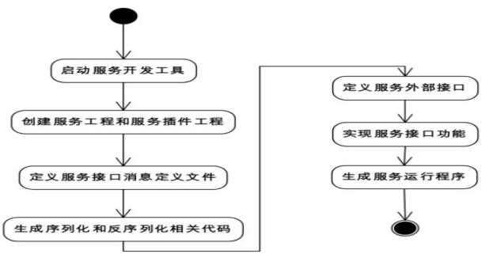

  
图7 服务开发流程图

## 3.2.1.1 创建服务工程（PZXQ-GN-FWKFZC-CJFWGC）

创建服务工程用例场景，见表4。

表4 创建服务工程用例描述
<table><tr><td>Use Case 名称:创建服务工程</td><td colspan="2">Actors:开发人员</td></tr><tr><td colspan="3">概述：服务开发过程创建服务工程。</td></tr><tr><td colspan="3">前置条件：服务开发框架安装成功。</td></tr><tr><td colspan="3">主事件流</td></tr><tr><td>Actor 的动作</td><td>系统的动作</td><td>动作约束 (性能、可靠性、容错等)</td></tr><tr><td>1.开发人员双击桌面图标打开服务开发 支撑；</td><td>2.系统提示选择服务开发向导和服务插 件开发向导选择；</td><td></td></tr><tr><td>3.开发人员选择服务开发向导，点击确 定；</td><td>4.系统提示填写服务工程名称和选择服 务工程路径；</td><td>校验工程路径的合法性，并在错 误发生时，提供详细的错误信息</td></tr><tr><td>5.开发人员填写服务工程名称；</td><td>7.系统校验路径是否合理，不合理进入</td><td></td></tr><tr><td>6.开发人员选择服务工程路径；</td><td>异常流E1，合理提示开发人员创建完</td><td></td></tr><tr><td colspan="1" rowspan="1">8.开发人员点击完成；</td><td colspan="1" rowspan="1">成；9.系统提示信息汇总，包括服务工程.pro文件、相应的服务工程目录和配置文件；</td><td colspan="1" rowspan="1"></td></tr><tr><td colspan="2" rowspan="1">异常流E1：系统提示选择正确的工程路径。</td><td colspan="1" rowspan="1"></td></tr><tr><td colspan="2" rowspan="1">后置条件：无。</td><td colspan="1" rowspan="1"></td></tr></table>

## 3.2.1.2 打开服务工程（PZXQ-GN-FWKFZC-DKFWGC）

打开服务工程用例场景，见表5。

表5打开服务工程用例描述
<table><tr><td rowspan=1 colspan=1>Use Case 名称:打开服务工程</td><td rowspan=1 colspan=2>Actors：开发人员</td></tr><tr><td rowspan=1 colspan=3>概述：服务创建成功过，打开新建的服务工程</td></tr><tr><td rowspan=1 colspan=3>前置条件：（1）服务开发框架安装成功。（2)服务工程创建成功。</td></tr><tr><td rowspan=1 colspan=3>主事件流</td></tr><tr><td rowspan=1 colspan=1>Actor 的动作</td><td rowspan=1 colspan=1>系统的动作</td><td rowspan=1 colspan=1>动作约束(性能、可靠性、容错等)</td></tr><tr><td rowspan=1 colspan=1>1.开发人员打开服务开发支撑：3.开发人员点击查看服务工程下的目录；5.开发人员双击查看服务工程下的文件；7.开发人员修改服务工程文件中的配置内容；</td><td rowspan=1 colspan=1>2.系统自动将项目导入到服务开发框架中，工程导入错误，执行异常流E1；4.系统展开该目录，显示目录下的文件；6.系统打开文件，显示文件内容。8.系统保存更改。</td><td rowspan=1 colspan=1>校验工程导入的合法性，并在错误发生时，提供详细的错误信息</td></tr><tr><td rowspan=1 colspan=2>异常流E1：系统提示工程导入异常。</td><td rowspan=1 colspan=1></td></tr><tr><td rowspan=1 colspan=2>后置条件：无。</td><td rowspan=1 colspan=1></td></tr></table>

## 3.2.1.3 关闭服务工程（PZXQ-GN-FWKFZC-GBFWGC）

关闭服务工程用例场景，见表6。

表6关闭服务工程用例描述
<table><tr><td>Use Case 名称:关闭服务工程</td><td colspan="2">Actors：开发人员</td></tr><tr><td colspan="3">概述：服务打开成功后，需要关闭服务工程</td></tr><tr><td colspan="3" rowspan="1">前置条件：服务工程打开成功。</td></tr><tr><td colspan="3" rowspan="1">主事件流</td></tr><tr><td colspan="1" rowspan="1">Actor 的动作</td><td colspan="1" rowspan="1">系统的动作</td><td colspan="1" rowspan="1">动作约束(性能、可靠性、容错等)</td></tr><tr><td colspan="1" rowspan="1">1.开发人员选中某个服务工程，点击右键；3.开发人员点击关闭选项；</td><td colspan="1" rowspan="1">2.系统弹出操作选择菜单；4.系统关闭服务工程；5.系统界面不再显示该服务工程。</td><td colspan="1" rowspan="1"></td></tr><tr><td colspan="2" rowspan="1">异常流 E1 无。</td><td colspan="1" rowspan="1"></td></tr><tr><td colspan="2" rowspan="1">后置条件：无。</td><td colspan="1" rowspan="1"></td></tr></table>

## 3.2.1.4 服务插件生成（PZXQ-GN-FWKFZC-FWCJSC）

服务插件生成用例场景，见表7。

表7服务插件生生成用例描述
<table><tr><td>Use Case 名称:服务插件生成</td><td colspan="2">Actors:开发人员</td></tr><tr><td colspan="3">概述：服务插件工程的添加，新建插件到服务工程下。</td></tr><tr><td colspan="3">前置条件：服务工程创建成功。</td></tr><tr><td colspan="3">主事件流</td></tr><tr><td>Actor 的动作</td><td>系统的动作</td><td>动作约束 (性能、可靠性、容错等)</td></tr><tr><td>1.开发人员双击桌面图标打开服务开发 支撑；</td><td>2.系统提示选择服务开发向导和服务插 件开发向导；</td><td></td></tr><tr><td>3.开发人员选择插件开发向导，确定； 5.开发人员填写插件名称；</td><td>4.系统提示填写插件名称和选择服务工 程路径；</td><td>校验输入参数的合法性，并在错 误发生时，提供详细的错误信息</td></tr><tr><td>6.开发人员选择服务工程路径；</td><td>7.系统校验所选路径下是否存在已经创</td><td></td></tr><tr><td></td><td>建的服务工程，如果不存在，进入异常 流E1;</td><td></td></tr><tr><td></td><td>8.系统弹出插件信息编辑界面；</td><td></td></tr><tr><td></td><td>9.系统自动识别所选服务，在服务名称 处显示服务工程名； 10.插件信息编辑界面显示插件名称、插</td><td></td></tr><tr><td>11.开发人员输入插件名称；</td><td>件描述信息、插件初始化参数、插件启 动方式、插件类型输入框；</td><td></td></tr><tr><td>12.开发人员选择插件类型；</td><td></td><td></td></tr><tr><td>13.开发人员选择插件启动方式；</td><td></td><td></td></tr><tr><td>14.开发人员输入插件初始化参数；</td><td></td><td></td></tr><tr><td>15.开发人员输入插件描述信息；</td><td></td><td></td></tr><tr><td>16.开发人员点击下一步；</td><td>17.系统检验输入信息的合法性，发现非</td><td></td></tr><tr><td></td><td>法输入进入异常流E2； 18.系统弹出插件依赖选择界面；</td><td></td></tr><tr><td>19.开发人员选择依赖； 20.开发人员点击下一步；</td><td></td><td></td></tr><tr><td></td><td>21.系统提示正在初始化插件信息； 22.系统生成插件描述文件，在文件中写</td><td></td></tr><tr><td></td><td>入插件编辑界面输入的信息；</td><td></td></tr><tr><td></td><td>23.系统生成插件头文件，在文件中自动 生成服务插件模板代码头文件内容；</td><td></td></tr><tr><td></td><td>24.系统生成插件逻辑实现文件，在文件 中自动写入服务插件模板代码；</td><td></td></tr><tr><td></td><td>25.系统生成插件依赖描述文件，在文件 自动写入插件依赖相关的内容；</td><td></td></tr><tr><td></td><td>26.系统提示插件创建完成。</td><td></td></tr><tr><td colspan="2">异常流E1：系统提示选择正确的服务工程路径。</td><td></td></tr><tr><td colspan="2">异常流E2：系统提示输入信息非法。</td><td></td></tr><tr><td colspan="2"></td><td></td></tr><tr><td colspan="2"></td><td></td></tr></table>

## 3.2.1.5 服务插件编译（PZXQ-GN-FWKFZC-FWCJBY）

服务插件编译用例场景，见表8。

表8服务插件编译用例描述
<table><tr><td>Use Case 名称:服务插件编译</td><td colspan="2">Actors:开发人员</td></tr><tr><td colspan="3">概述：对服务插件代码进行编译，生成服务插件动态库</td></tr><tr><td colspan="3"></td></tr><tr><td colspan="3">前置条件：服务插件代码开发完成。</td></tr><tr><td>Actor 的动作</td><td>主事件流</td><td>动作约束</td></tr><tr><td>1.开发人员选中某个服务插件工程，双 击服务插件构建文件；</td><td>系统的动作</td><td>(性能、可靠性、容错等)</td></tr><tr><td>3.开发人员修改服务插件构建文件，增 加、删除、修改服务插件编译时使用的 参数；</td><td>2.系统打开服务插件构建文件，显示内 容；</td><td rowspan="3"></td></tr><tr><td>4.开发人员点击保存</td><td>5.系统保存服务插件构建文件；</td></tr><tr><td>6.开发人员继续选中同一个服务插件工 程，右键点击；</td><td>7.系统弹出操作选择菜单；</td></tr><tr><td>8.开发人员点击“执行 qmake”；</td><td>9.系统执行 qmake 操作，生成构建文 件；</td><td rowspan="2">校验输出的合法性，并在错误发 生时，提供详细的错误信息</td></tr><tr><td rowspan="3">11.开发人员继续选中同一个服务插件工 程，右键点击；</td><td>10.系统显示执行结果，执行出错进入异 常流 E1；</td></tr><tr><td>12.系统弹出操作选择菜单；</td><td></td></tr><tr><td>13.系统开始执行构建操作； 14.系统提输出构建过程信息，如果构建 出错，进入异常流E1。</td><td></td></tr><tr><td colspan="1" rowspan="1"></td><td colspan="1" rowspan="1">15.系统输出构建成功，显示构建完成的服务插件动态库的路径等信息；</td><td colspan="1" rowspan="1"></td></tr><tr><td colspan="2" rowspan="1">异常流E1:输出错误提示信息。</td><td colspan="1" rowspan="1"></td></tr><tr><td colspan="2" rowspan="1">后置条件：无。</td><td colspan="1" rowspan="1"></td></tr></table>

## 3.2.1.6 服务工程编译（PZXQ-GN-FWKFZC-FWGCBY）

服务插件编译用例场景，见表9。

表9服务插件编译用例描述
<table><tr><td>Use Case 名称:服务工程编译</td><td colspan="2">Actors:开发人员</td></tr><tr><td colspan="3">概述：对服务插件代码进行编译，生成服务插件动态库</td></tr><tr><td colspan="3">前置条件：服务插件代码开发完成，</td></tr><tr><td colspan="3">主事件流</td></tr><tr><td>Actor 的动作</td><td>系统的动作</td><td>动作约束 (性能、可靠性、容错等)</td></tr><tr><td>1.开发人员选中某个服务工程，双击服 务工程构建文件；</td><td>2.系统打开服务工程构建文件，显示内 容；</td><td></td></tr><tr><td>加、删除、修改服务插件编译时使用的 参数； 4.开发人员点击保存</td><td></td><td></td></tr><tr><td>6.开发人员继续选中同一个服务工程， 右键点击；</td><td>5.系统保存服务工程构建文件；</td><td>校验输出的合法性，并在错误发 生时，提供详细的错误信息</td></tr><tr><td rowspan="2">8.开发人员点击“执行qmake”；</td><td>7.系统弹出操作选择菜单；</td><td></td></tr><tr><td>9.系统执行 qmake 操作，生成构建文 件；</td><td></td></tr><tr><td>11.开发人员继续选中同一个服务工程， 右键点击；</td><td>10.系统显示执行结果，执行出错进入异 常流 E1；</td><td></td></tr><tr><td colspan="1" rowspan="1">13.开发人员点击“构建”；</td><td colspan="1" rowspan="1">12.系统弹出操作选择菜单；14.系统开始执行构建操作；15.系统提输出构建过程信息，如果构建出错，进入异常流E1；16.系统输出构建成功，显示构建消耗时间，构建完成的应用程序所在路径。</td><td colspan="1" rowspan="1"></td></tr><tr><td colspan="2" rowspan="1">异常流E1：输出错误提示信息。</td><td colspan="1" rowspan="1"></td></tr><tr><td colspan="2" rowspan="1">后置条件：无。</td><td colspan="1" rowspan="1"></td></tr></table>

## 3.2.1.7 服务程序运行（PZXQ-GN-FWKFZC-FWXXYX）

服务程序运行用例场景，见表10。

表10服务程序运行用例描述
<table><tr><td colspan="1" rowspan="1">Use Case 名称：服务程序运行</td><td colspan="2" rowspan="1">Actors：开发人员、应用软件</td></tr><tr><td colspan="3" rowspan="1">概述：开发人员运行服务程序，查看运行结果。</td></tr><tr><td colspan="3" rowspan="1">前置条件：服务开发完成，服务工程编译成功。</td></tr><tr><td colspan="3" rowspan="1">主事件流</td></tr><tr><td colspan="1" rowspan="1">Actor 的动作</td><td colspan="1" rowspan="1">系统的动作</td><td colspan="1" rowspan="1">动作约束(性能、可靠性、容错等)</td></tr><tr><td colspan="1" rowspan="1">1.开发人员选中某个服务工程，右键点击；3.开发人员点击“运行”；6.应用软件依据插件描述文件，加载服务插件，插件描述文件读取失败，进入</td><td colspan="1" rowspan="1">2.系统弹出操作选择菜单；4.系统启动应用软件，启动失败，进入异常处理流E1；5.系统弹出终端，在终端输出应用软件启动过程；</td><td colspan="1" rowspan="1">校验输入参数的合法性，并在错误发生时，提供详细的错误信息</td></tr><tr><td>异常流 E2； 7.加载成功，在运行日志中记录插件加 在成功信息，加载失败，在运行日志中 记录插件加载失败信息</td><td></td><td></td></tr><tr><td colspan="2">日志文件夹；</td></tr><tr><td>10.开发人员打开服务运行日志，查看服 务插件加载信息； 11.开发人员点击“关闭”按钮；</td><td>12.系统弹出提示框，询问开发人员是否</td></tr><tr><td colspan="2">退出运行； 13.开发人员点击确认；</td></tr><tr><td colspan="2">14.系统关闭应用软件</td></tr><tr><td colspan="2">异常流E1:输出启动失败提示信息。</td></tr><tr><td colspan="2">异常流E2：在运行日志中，输出插件描述文件读取失败信息</td></tr></table>

## 3.2.1.8 服务程序调试（PZXQ-GN-FWKFZC-FWCXTS）

服务程序调试用例场景，见表11。

表11服务程序调试用例描述
<table><tr><td colspan="1" rowspan="1">Use Case 名称：服务程序调试</td><td colspan="3" rowspan="1">Actors：开发人员、应用软件</td></tr><tr><td colspan="4" rowspan="1">概述：开发人员采用常见的程序调试手端，对服务程序进行调试。</td></tr><tr><td colspan="4" rowspan="1">前置条件：服务开发完成，服务工程编译成功</td></tr><tr><td colspan="4" rowspan="1">主事件流</td></tr><tr><td colspan="1" rowspan="1">Actor 的动作</td><td colspan="1" rowspan="1">系统的动作</td><td colspan="1" rowspan="1">动作约束(性能、可靠性、容错等)</td></tr><tr><td colspan="1" rowspan="1">1.开发人员选择某个服务工程，双击待调试的代码文件；3.开发人员在需要进行调试的代码出设</td><td colspan="1" rowspan="1">2.系统打开该代码文件，显示代码内容；</td><td colspan="1" rowspan="1">校验输入参数的合法性，并在错误发生时，提供详细的错误信息</td></tr><tr><td>置断点；</td><td>4.系统对设置断点处的代码进行突出显</td><td rowspan="5"></td></tr><tr><td>5. 开发人员点击“开始调试”按钮；</td><td>示； 6.系统以调试模式启动服务工程中的应</td></tr><tr><td>7.应用软件开始执行； 9.开发人员查看当前断点处应用软件的</td><td>用软件，启动失败，进入异常流E1； 8.系统在断点处停止应用软件的执行；</td></tr><tr><td>变量值； 10.开发人员点击“单步执行”;</td><td></td></tr><tr><td></td><td>11.系统控制应用软件执行一条程序语 句；</td><td rowspan="3"></td></tr><tr><td>13.开发人员再次设置断点；</td><td>12.系统继续控制应用软件再次停止；</td></tr><tr><td>15.开发人员点击“调到下个断点”；</td><td>14.系统突出显示新设置的断点；</td></tr><tr><td>17.开发人员点击“停止调试”；</td><td>16.系统控制应用软件执行到断点处；</td><td></td></tr><tr><td colspan="2">18.系统停止应用软件，退出调试模式； 异常流E1:输出启动失败提示信息。</td><td></td></tr><tr><td colspan="2">后置条件：无。</td><td></td></tr></table>

## 3.2.1.9 服务交叉编译（PZXQ-GN-FWKFZC-FWJCBY）

服务交叉编译用例场景，见表12。

表12服务交叉编译用例描述
<table><tr><td rowspan=1 colspan=1>Use Case 名称:服务交叉编译</td><td rowspan=1 colspan=2>Actors:开发人员</td></tr><tr><td rowspan=1 colspan=3>概述：服务代码开发完成后，针对不同的操作环境，可以选择相应的交叉编译环境进行编译，生成适配不同操作系统的程序</td></tr><tr><td rowspan=1 colspan=3>前置条件：服务代码开发完成</td></tr><tr><td rowspan=1 colspan=3>主事件流</td></tr><tr><td rowspan=1 colspan=1>Actor 的动作</td><td rowspan=1 colspan=1>系统的动作</td><td rowspan=1 colspan=1>动作约束(性能、可靠性、容错等)</td></tr><tr><td rowspan=1 colspan=1>1.开发人员双击交叉编译工具图标；</td><td rowspan=1 colspan=1>2.系统弹出对话框，提示选择需要交叉</td><td rowspan=1 colspan=1>校验输入参数的合法性，并在错误发生时，提供详细的错误信息</td></tr></table>

<table><tr><td>3.开发人员选择目标平台类型；</td><td>编译目标平台类型，包括不同操作系统 (银河锐华、元心、TDOS)、交叉编 译工具链的路径、输入管理员权限密码 和交叉编译环境路径；</td></tr><tr><td>4.开发人员选择交叉编译工具链路径；</td><td></td></tr><tr><td>5.开发人员选择交叉编译环境路径；</td><td></td></tr><tr><td>6.开发人员输入密码；</td><td></td></tr><tr><td>7. 开发人员点击确认按钮；</td><td></td></tr><tr><td>9.开发人员创建服务工程；</td><td>8.系统进入工具主界面，若密码输入错 误，执行异常流E1；</td></tr><tr><td></td><td>10.系统弹出对话框，可输入服务名程； 11.系统自动生成服务主程序的 Makefile</td></tr><tr><td>12.开发人员点击添加插件；</td><td>文件; 13.系统自动生成编译插件的 Makefile 文</td></tr><tr><td></td><td>件； 14.系统生成插件描述文件；</td></tr><tr><td>15.开发人员选择编译线程数；</td><td>16.系统设置编译线程数；</td></tr><tr><td>17.开发人员点击构建按钮；</td><td>18.系统构建完成，如果构建失败则执行 异常流 E2；</td></tr><tr><td>19.开发人员点击重新构建按钮；</td><td>20.系统完成重新构建，如果构建失败则</td></tr><tr><td>21.开发人员点击导出工程，可推送到 手机直接运行；</td><td>执行异常流E2； 22.系统导出工程，如果导出失败则进入</td></tr><tr><td>23.开发人员选择导出手机入口软件工 程，可推送到手机通过界面控制服务启 停；</td><td>异常流 E3；</td></tr></table>