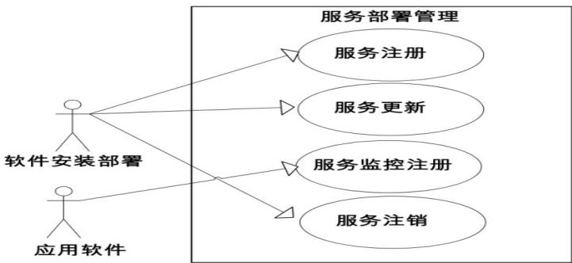
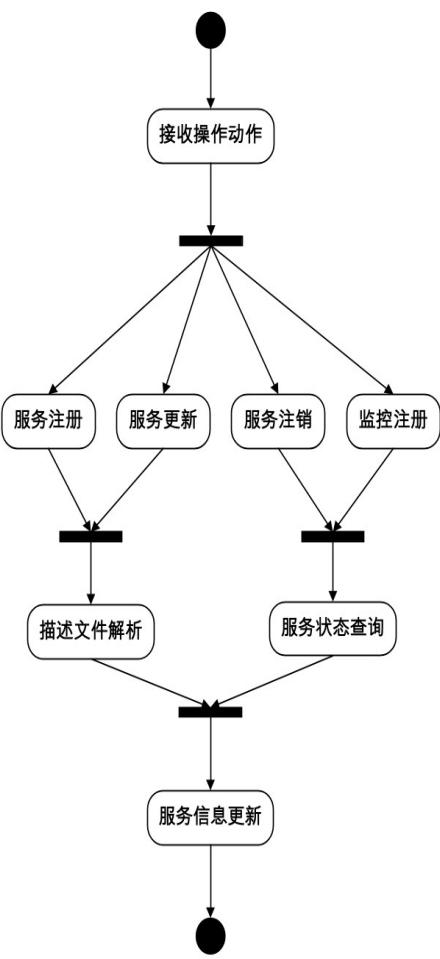

<table><tr><td rowspan=1 colspan=1>24.开发人员点击构建按钮；26.开发人员点击清除按钮；</td><td rowspan=1 colspan=1>25.系统构建入口软件完成，如果构建失败则进入异常流E2；27.系统清除生成的中间文件、可执行程序文件和动态库文件，如果清除失败则进入异常流E4</td><td rowspan=1 colspan=1></td></tr><tr><td rowspan=1 colspan=2>异常流E1：非有效密码，系统提示重新输入密码。</td><td rowspan=1 colspan=1></td></tr><tr><td rowspan=1 colspan=2>异常流E2：服务工程构建失败，系统提示构建失败。</td><td rowspan=1 colspan=1></td></tr><tr><td rowspan=1 colspan=2>异常流E3：服务工程导出失败，系统提示导出失败。</td><td rowspan=1 colspan=1></td></tr><tr><td rowspan=1 colspan=2>异常流E4：清除失败，系统提示清除失败。</td><td rowspan=1 colspan=1></td></tr><tr><td rowspan=1 colspan=2>后置条件：无。</td><td rowspan=1 colspan=1></td></tr></table>

## 3.2.1.10 插件初始化函数定义（PZXQ-GN-FWKFZC-CSHSDY）

插件初始化函数定义用例场景，见表13。

表13插件初始化函数定义用例描述
<table><tr><td>Use Case 名称:插件初始化函数定义</td><td colspan="2">Actors:开发人员</td></tr><tr><td colspan="3">概述：开发人员自定义服务插件的初始化过程。</td></tr><tr><td colspan="3">前置条件：（1)服务工程创建成功。</td></tr><tr><td colspan="3">(2)服务插件生成成功。</td></tr><tr><td>Actor 的动作</td><td>系统的动作</td><td>动作约束 (性能、可靠性、容错等)</td></tr><tr><td>1.开发人员选中某个服务插件下的 plugincore.cpp 文件，双击； 3.开发人员在 plugincore.cpp 文件内容</td><td>2.系统打开该文件，显示该文件中的内 容，内容为服务插件生成时写入到文件 中的插件模板代码，若打开失败，进入 异常流E1；</td><td></td></tr><tr><td>中定位到初始化函数； 4.开发人员修改初始化函数注释；</td><td></td><td>校验输入的合法性，并在错误发 生时，提供详细的错误信息</td></tr><tr><td>5.开发人员修改初始化函数中的代码，</td><td></td><td></td></tr><tr><td>添加插件初始化逻辑代码； 6.开发人员添加日志记录代码；</td><td></td><td></td></tr><tr><td colspan="1" rowspan="1">7.开发人员添加初始化函数返回值代码；8.开发人员点击保存；</td><td colspan="1" rowspan="1">9.系统保存开发人员更改到文件中，若保存失败，进入异常流E2。</td><td colspan="1" rowspan="1"></td></tr><tr><td colspan="2" rowspan="1">异常流E1:输出打开失败的报错信息。</td><td colspan="1" rowspan="1"></td></tr><tr><td colspan="2" rowspan="1">异常流E2:输出保存失败的报错信息。</td><td colspan="1" rowspan="1"></td></tr><tr><td colspan="2" rowspan="1">后置条件：无。</td><td colspan="1" rowspan="1"></td></tr></table>

## 3.2.1.11 插件销毁函数定义（PZXQ-GN-FWKFZC-XHHSDY）

插件销毁函数定义用例场景，见表14。

表14插件销毁函数定义用例描述
<table><tr><td colspan="1" rowspan="1">Use Case 名称:插件销毁函数定义</td><td colspan="2" rowspan="1">Actors:开发人员</td></tr><tr><td colspan="3" rowspan="1">概述：开发人员自定义服务插件的销毁过程。</td></tr><tr><td colspan="3" rowspan="1">前置条件：(1)服务工程创建成功。(2)插件创建成功。</td></tr><tr><td colspan="3" rowspan="1">主事件流</td></tr><tr><td colspan="1" rowspan="1">Actor 的动作</td><td colspan="1" rowspan="1">系统的动作</td><td colspan="1" rowspan="1">动作约束(性能、可靠性、容错等)</td></tr><tr><td colspan="1" rowspan="1">1.开发人员选中某个服务插件下的plugincore.cpp 文件，双击；3.开发人员在 plugincore.cpp 文件内容中定位到销毁函数；4.开发人员修改销毁函数注释；5.开发人员修改销毁函数中的代码，添加插件销毁逻辑代码；6.开发人员添加日志记录代码；7.开发人员添加销毁函数返回值代码；.8.开发人员点击保存；</td><td colspan="1" rowspan="1">2.系统打开该文件，显示该文件中的内容，内容为服务插件生成时写入到文件中的插件模板代码，若打开失败，进入异常流E1；</td><td colspan="1" rowspan="1">校验输入参数的合法性，并在错误发生时，提供详细的错误信息</td></tr><tr><td colspan="1" rowspan="1"></td><td colspan="1" rowspan="1">9.系统保存开发人员更改到文件中，若保存失败，进入异常流E2。</td><td colspan="1" rowspan="1"></td></tr><tr><td colspan="2" rowspan="1">异常流E1：输出打开失败的报错信息。</td><td colspan="1" rowspan="1"></td></tr><tr><td colspan="2" rowspan="1">异常流E2:输出保存失败的报错信息。</td><td colspan="1" rowspan="1"></td></tr><tr><td colspan="2" rowspan="1">后置条件：无。</td><td colspan="1" rowspan="1"></td></tr></table>

## 3.2.1.12 调用服务请求处理类接口（PZXQ-GN-FWKFZC-FWQQCL）

调用服务请求处理接口用例场景，见表15。

表15调用服务请求处理类接口用例描述
<table><tr><td>Use Case 名称：调用服务请求处理类接 口</td><td colspan="2">Actors 应用软件</td></tr><tr><td colspan="3">概述：应用程序调用服务请求处理类接口，获取请求数据、获取请求参数、获取请求数据长度、进行请求参数解码。</td></tr><tr><td colspan="3">前置条件：服务插件生成成功。</td></tr><tr><td colspan="3">主事件流</td></tr><tr><td>Actor 的动作</td><td>系统的动作</td><td>动作约束 (性能、可靠性、容错等)</td></tr><tr><td>1.应用程序进入请求处理流程； 2.应用程序调用获取参数接口；</td><td>3.系统接受到请求参数获取调用，解析 服务请求数据，提取请求参数，返 回，提取失败，进入异常处理流E1；</td><td></td></tr><tr><td>4.应用程序接收返回数据，根据返回数据 内容，进行进一步处理； 5.应用程序调用服务请求数据长度获取接 口；</td><td>6.系统接收到请求数据长度获取接口， 解析服务请求数据，提取数据长度，</td><td rowspan="2">校验输入参数的合法性，并在错 误发生时，提供详细的错误信息</td></tr><tr><td>7.应用程序接收返回数据，根据返回数据 内容，进行进一步处理； 8.应用程序调用服务请求数据获取接口；</td><td>返回，提取失败，进入异常处理流 E1; 9.系统接收到请求数据获取接口，解析 服务请求数据，提取数据实体，返</td></tr><tr><td>11.应用程序调用请求数据处理回调函数 注册接口；</td><td>12.系统接收回调函数注册，返回； 13.系统接收请求数据，接收完整后， 调用回调函数进行数据处理；</td><td>15.系统接收到请求参数解码接口，进</td></tr><tr><td>异常流E1：运行日志中记录失败报错信息，返回错误码。</td><td>行参数解码处理，返回解码结果，解 码失败，进入异常处理流E1；</td><td></td></tr><tr><td colspan="2">后置条件：无。</td><td></td></tr></table>

## 3.2.1.13 调用服务响应发送类接口（PZXQ-GN-FWKFZC-FWXYFS）

调用服务响应发送类接口用例场景，见表16。

表16调用服务响应发送类接口用例描述
<table><tr><td colspan="1" rowspan="1">Use Case 名称：服务响应发送</td><td colspan="2" rowspan="1">Actors：应用软件</td></tr><tr><td colspan="3" rowspan="1">概述：应用程序调用服务响应发送类接口，设置响应类型、设置响应数据长度、发送响应数据头、发送响应数据体。</td></tr><tr><td colspan="3" rowspan="1">前置条件：服务插件生成成功。</td></tr><tr><td colspan="3" rowspan="1">主事件流</td></tr><tr><td colspan="1" rowspan="1">Actor 的动作</td><td colspan="1" rowspan="1">系统的动作</td><td colspan="1" rowspan="1">动作约束(性能、可靠性、容错等)</td></tr><tr><td colspan="1" rowspan="1">1.应用程序调用服务响应类型设置接口；3.应用程序获取到服务的响应结果，根据响应结果作进一步处理；4.应用程序调用设置响应数据长度接口;6.应用程序获取到服务响应结果，根据响应结果作进一步处理；</td><td colspan="1" rowspan="1">2.系统接收到服务响应设置调用，解析请求参数，提取服务响应设置参数，返回，失败则执行异常流E1；5.系统接收到设置响应数据长度调用，解析请求参数，提取服务响应数据长度参数，返回，失败则执行异常流程E1；</td><td colspan="1" rowspan="1">校验输入参数的合法性，并在错误发生时，提供详细的错误信息</td></tr><tr><td colspan="1" rowspan="1">7.应用程序调用发送响应数据头接口；9.应用程序获取到服务响应结果，根据响应作进一步处理；10.应用程序调用发送响应数据体接口;12.应用程序获取到服务响应结果，根据响应作进一步处理。</td><td colspan="1" rowspan="1">8.系统接收到发送响应数据头调用，解析请求参数，提取响应数据头数据参数，打包发送数据，向客户端发送响应数据头，返回，发送失败则执行异常流程E1；11.系统接收到发送响应数据体调用，解析请求参数，提取响应数据体数据参数，打包发送数据，向客户端发送响应数据体，返回，发送失败则执行异常流程E1；</td><td colspan="1" rowspan="1"></td></tr><tr><td colspan="2" rowspan="1">异常流E1:服务响应错误码；</td><td colspan="1" rowspan="1"></td></tr><tr><td colspan="2" rowspan="1">后置条件：无。</td><td colspan="1" rowspan="1"></td></tr></table>

## 3.2.1.14 调用定时器接口（PZXQ-GN-FWKFZC-DSRW）

调用定时器接口用例场景，见表17。

表17调用定时器接口用例描述
<table><tr><td rowspan=1 colspan=1>Use Case 名称：调用定时器接口</td><td rowspan=1 colspan=2>Actors:应用软件</td></tr><tr><td rowspan=1 colspan=3>概述：服务处理业务逻辑过程中，调用定时器接口设置定时任务。</td></tr><tr><td rowspan=1 colspan=3>前置条件：服务插件生成成功。</td></tr><tr><td rowspan=1 colspan=3>主事件流</td></tr><tr><td rowspan=1 colspan=1>Actor 的动作</td><td rowspan=1 colspan=1>系统的动作</td><td rowspan=1 colspan=1>动作约束(性能、可靠性、容错等)</td></tr><tr><td rowspan=1 colspan=1>1.应用程序调用定时器设置接口，注册回调函数；4.应用程序获取到服务的请求结束，应用程序根据响应结果作进一步处理；</td><td rowspan=1 colspan=1>2.系统收到定时器接口，解析请求，提取定时器接口参数，注册定时器事件及事件的回调函数；3.等待定时器超时，事件循环根据定时器的id找到对应的定时器处理函数，并调用它，若执行失败则执行异常流E1；</td><td rowspan=1 colspan=1>校验输入参数的合法性，并在错误发生时，提供详细的错误信息</td></tr></table>

<table><tr><td>异常流 E1:服务响应错误码；</td><td></td></tr><tr><td>后置条件：无。</td><td></td></tr></table>

## 3.2.1.15 调用消息推送接口（PZXQ-GN-FWKFZC-XXTS）

调用消息推送接口用例场景，见表18。

表18调用消息推接口送用例描述
<table><tr><td rowspan=1 colspan=1>Use Case 名称:调用消息推送接口</td><td rowspan=1 colspan=2>Actors:应用软件</td></tr><tr><td rowspan=1 colspan=3>概述：应用程序调用消息推送接口，获取向界面推送数据的能力。</td></tr><tr><td rowspan=1 colspan=3>前置条件：服务插件生成成功。</td></tr><tr><td rowspan=1 colspan=3>主事件流</td></tr><tr><td rowspan=1 colspan=1>Actor 的动作</td><td rowspan=1 colspan=1>系统的动作</td><td rowspan=1 colspan=1>动作约束(性能、可靠性、容错等)</td></tr><tr><td rowspan=1 colspan=1>1.应用程序调用消息推送接口，把需要推送到前端的内容进行封装；2.应用程序把封装数据通过 websocket把消息推送到服务程序；4.接收方应用程序接收到推送消息，根据业务定义，解析消息数据，并在前端显示消息。</td><td rowspan=1 colspan=1>3.系统接受到消息推送接口调用，解析接口数据，提取推送参数，根据推送的接收方，查找与接收方建立的连接，如果未创建连接，则创建连接；然后，把数据推送到前端；如果接受失败，则执行异常流E1；</td><td rowspan=1 colspan=1>校验输入参数的合法性，并在错误发生时，提供详细的错误信息</td></tr><tr><td rowspan=1 colspan=2>异常流 E1: websocket 连接失败；</td><td rowspan=1 colspan=1></td></tr><tr><td rowspan=1 colspan=2>后置条件：无。</td><td rowspan=1 colspan=1></td></tr></table>

## 3.2.1.16 调用服务请求发送类接口（PZXQ-GN-FWKFZC-FWQQFS）

调用服务请求发送类接口用例场景，见表19。

表19服务请求发送用例描述
<table><tr><td>Use Case 名称：调用服务请求发送类接 口</td><td colspan="2">Actors:应用软件</td></tr><tr><td colspan="3">概述：应用程序调用服务访问请求发送类接口，进行请求参数设置，请求方法选择、请求数据发送、请求失败信息获 取、请求超时设置。</td></tr><tr><td colspan="3">前置条件：（1)服务创建成功。 (2)插件新建成功。</td></tr><tr><td colspan="3">主事件流</td></tr><tr><td>Actor 的动作</td><td>系统的动作</td><td>动作约束 (性能、可靠性、容错等)</td></tr><tr><td>1.应用程序调用服务请求参数设置接口； 3.应用程序获取服务处理响应结果，根据 响应作进一步处理；</td><td>2.系统收取服务请求参数设置的接口调 用，解析参数设置数据，提取参数设 置参数，返回，失败，则执行异常流 E1;</td><td></td></tr><tr><td>6.应用程序获取服务处理响应结果，根据 响应作进一步处理； 7.应用程序调用服务请求数据发送接口；</td><td>5.系统收取服务请求方法选择的接口调 用，解析请求方法选择数据，提取方 法选择参数，返回，失败，则执行异 常流E1；</td><td>校验输入参数的合法性，并在错 误发生时，提供详细的错误信息</td></tr><tr><td>9.应用程序获取服务处理响应结果，根据 响应作进一步处理； 10.应用程序调用服务请求失败信息获取 接口;</td><td>8.系统收取服务请求数据发送的接口调 用，解析发送数据，提取参数，打包 发送数据，向客户端发送，返回，发 送失败，则执行异常流E1；</td><td></td></tr><tr><td>12.应用程序获取服务处理响应结果，根 据响应作进一步处理；</td><td>11.系统收取服务请求失败信息获取的 接口调用，解析服务失败信息数据， 提取失败信息参数，返回，失败则执 行异常流E1；</td><td></td></tr><tr><td colspan="1" rowspan="1">13.应用程序调用服务请求超时设置接口；15.应用程序获取服务处理响应结果，根据响应作进一步处理。</td><td colspan="1" rowspan="1">14.系统收取服务请求超时设置的接口调用，解析超时设置请求数据，提取超时设置参数，返回，失败则执行异常流 E1;</td><td colspan="1" rowspan="1"></td></tr><tr><td colspan="2" rowspan="1">异常流E1:服务发送请求失败。</td><td colspan="1" rowspan="1"></td></tr><tr><td colspan="2" rowspan="1">后置条件：无。</td><td colspan="1" rowspan="1"></td></tr></table>

## 3.2.1.17 调用服务响应接收类接口（PZXQ-GN-FWKFZC-FWXYJS）

调用服务响应接收类接口用例场景，见表20。

表20调用服务响应接收类接口用例描述
<table><tr><td rowspan=1 colspan=1>Use Case 名称：调用服务响应接收类接口</td><td rowspan=1 colspan=2>Actors:应用软件</td></tr><tr><td rowspan=1 colspan=3>概述：应用程序调用服务响应接收类接口，进行响应处理回调函数注册。</td></tr><tr><td rowspan=1 colspan=3>前置条件：（1)服务创建成功。(2)插件新建成功。（3)服务请求发送成功。</td></tr><tr><td rowspan=1 colspan=3>主事件流</td></tr><tr><td rowspan=1 colspan=1>Actor 的动作</td><td rowspan=1 colspan=1>系统的动作</td><td rowspan=1 colspan=1>动作约束(性能、可靠性、容错等)</td></tr><tr><td rowspan=1 colspan=1>1.应用程序发送服务访问请求，被访问的服务根据处理结果等待返回响应的处理；4.应用程序服务响应接受成功，服务响应结束，若接受失败，执行异常流E1；</td><td rowspan=1 colspan=1>2系统成功处理完服务访问请求后，注册响应回调函数；3.收到服务响应后，调用响应回调函数，并把响应数据以参数传给回调函数；返回，失败则执行异常流程E1；</td><td rowspan=1 colspan=1>校验输入参数的合法性，并在错误发生时，提供详细的错误信息</td></tr><tr><td rowspan=1 colspan=2>异常流E1：服务响应返回值接受失败。</td><td rowspan=1 colspan=1></td></tr><tr><td rowspan=1 colspan=2>后置条件：无。</td><td rowspan=1 colspan=1></td></tr></table>

3.2.2 服务部署管理（PZXQ-GN-FWBSGL）

服务部署管理功能包括服务注册、服务多实例部署、服务更新和服务注销功能，其中服务注册支持通过读取服务清单文件完成服务注册；服务监控注册支持调用接口注册对某个服务进行资源占用和状态的监控；服务更新支持重新读取服务清单文件完成服务注册信息的更新；服务注销支持重新读取服务清单文件完成服务注册信息的删除；其功能用例如图8所示。

  
图8 软件安装部署用例图

服务部署管理所有能力标识表，见表21。

表21 服务部署管理所有能力能力标识
<table><tr><td colspan="1" rowspan="1">序号</td><td colspan="1" rowspan="1">Usecase 名称</td><td colspan="1" rowspan="1">项目唯一标识符</td><td colspan="1" rowspan="1">需求描述</td><td colspan="1" rowspan="1">需求重用</td><td colspan="1" rowspan="1">方式名称</td><td colspan="1" rowspan="1">运行状态</td><td colspan="1" rowspan="1">对应的任务书功能/性能</td></tr><tr><td colspan="1" rowspan="1">1</td><td colspan="1" rowspan="1">服务注册</td><td colspan="1" rowspan="1">PZXQ-GN-FWBSGL-FWZC</td><td colspan="1" rowspan="1">需要通过服务描述信息完成服务注册，使得服务全局可知</td><td colspan="1" rowspan="1">改进</td><td colspan="1" rowspan="1">桌面、平板、手持</td><td colspan="1" rowspan="1">运行阶段</td><td colspan="1" rowspan="1">4.1.2/4.2 a)</td></tr><tr><td colspan="1" rowspan="1">2</td><td colspan="1" rowspan="1">服务更新</td><td colspan="1" rowspan="1">PZXQ-GN-FWBSGL-FWGX</td><td colspan="1" rowspan="1">对服务的信息更新</td><td colspan="1" rowspan="1">改进</td><td colspan="1" rowspan="1">桌面、平板、手持</td><td colspan="1" rowspan="1">运行阶段</td><td colspan="1" rowspan="1">4.1.2</td></tr><tr><td colspan="1" rowspan="1">3</td><td colspan="1" rowspan="1">服务监控注册</td><td colspan="1" rowspan="1">PZXQ-GN-FWBSGL-FWJKZC</td><td colspan="1" rowspan="1">调用接口注册对某个服务进行资源占用和状态监控</td><td colspan="1" rowspan="1">新增</td><td colspan="1" rowspan="1">桌面、平板、</td><td colspan="1" rowspan="1">运行阶段</td><td colspan="1" rowspan="1">4.1.2</td></tr><tr><td colspan="1" rowspan="1"></td><td colspan="1" rowspan="1"></td><td colspan="1" rowspan="1"></td><td colspan="1" rowspan="1"></td><td colspan="1" rowspan="1"></td><td colspan="1" rowspan="1">手持</td><td colspan="1" rowspan="1"></td><td colspan="1" rowspan="1"></td></tr><tr><td colspan="1" rowspan="1">4</td><td colspan="1" rowspan="1">服务注销</td><td colspan="1" rowspan="1">PZXQ-GN-FWBSGL-FWZX</td><td colspan="1" rowspan="1">通过服务描述信息完成服务注册信息的删除</td><td colspan="1" rowspan="1">新增</td><td colspan="1" rowspan="1">桌面、平板、手持</td><td colspan="1" rowspan="1">运行阶段</td><td colspan="1" rowspan="1">4.1.2</td></tr></table>

服务部署管理流程如图 9所示。

  
图 9 服务部署管理流程图

## 3.2.2.1 服务注册（PZXQ-GN-FWBSGL-FWZC）

服务注册用例场景，见表22。

表22 服务注册用例描述
<table><tr><td>Use Case 名称：服务注册</td><td>Actors：软件部署管理</td></tr></table>