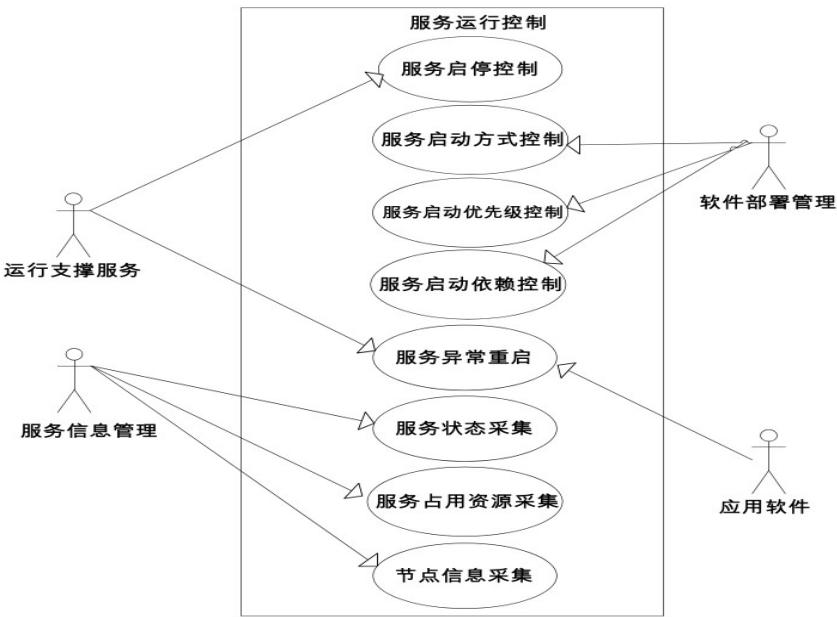
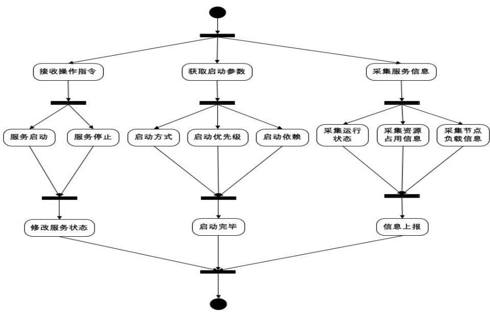

<table><tr><td colspan="3">概述：本用例描述服务运行控制将服务注册信息上报的过程。</td></tr><tr><td colspan="3">前置条件：服务运行控制与服务信息管理正常运行。</td></tr><tr><td colspan="3">主事件流</td></tr><tr><td>Actor 的动作</td><td>系统的动作</td><td>动作约束 (性能、可靠性、容错等)</td></tr><tr><td>1.服务部署管理生成服务清单信息；</td><td>2.系统读取服务清单信息，解析服务清 单； 3.系统解析服务清单内容，并读取服务 名称信息，解析并存储，失败则执行异</td><td></td></tr><tr><td></td><td>常流程 E1； 4.系统解析服务清单内容，并读取服务 类型，解析并存储，失败则执行异常流</td><td></td></tr><tr><td></td><td>程E1； 5.系统解析服务清单内容，并读取可执</td><td>桌面版，支持不少于1000个服 务的注册；</td></tr><tr><td></td><td>行文件名称，解析并存储，失败则执行 异常流程E1； 6.系统解析服务清单内容，并读取启动</td><td>平板版，支持不少于200个服务 注册；</td></tr><tr><td></td><td>参数，解析并存储，失败则执行异常流 程E1；</td><td>手持版，支持不少于100个服务 注册； 校验输入参数的合法性，并在错</td></tr><tr><td></td><td>7.系统解析服务清单内容，并读取启动 方式，解析并存储，失败则执行异常流 程E1；</td><td>误发生时，提供详细的错误信 息；</td></tr><tr><td></td><td>8.系统解析服务清单内容，并读取工作 路径，解析并存储，失败则执行异常流 程E1；</td><td></td></tr><tr><td></td><td>9.系统解析服务清单内容，并读取启动 环境变量，解析并存储，失败则执行异 常流程E1；</td><td></td></tr><tr><td></td><td></td><td></td></tr><tr><td>程E1；</td><td>10.系统解析服务清单内容，并读取依赖 服务，解析并存储，失败则执行异常流</td><td></td></tr><tr><td colspan="1" rowspan="1"></td><td colspan="1" rowspan="1">11.系统解析服务清单内容，并读取启动优先级，解析并存储，失败则执行异常流程E1；12.系统把解析后的清单信息打包存储在本地内存中；13.服务部署程序通知服务运行监控。</td><td colspan="1" rowspan="1"></td></tr><tr><td colspan="2" rowspan="1">异常流E1:与服务运行控制程序连接断开了。</td><td colspan="1" rowspan="1"></td></tr><tr><td colspan="2" rowspan="1">后置条件：无。</td><td colspan="1" rowspan="1"></td></tr></table>

## 3.2.2.2 服务更新（PZXQ-GN-FWBSGL-FWGX）

服务更新用例场景，见表23。

表23 服务更新用例描述
<table><tr><td rowspan=1 colspan=1>Use Case 名称：服务注册信息读取</td><td rowspan=1 colspan=2>Actors:软件部署管理</td></tr><tr><td rowspan=1 colspan=3>概述：本用例描述用户更新服务，系统读取新的服务注册信息的过程。</td></tr><tr><td rowspan=1 colspan=3>前置条件：服务清单配置完成，服务运行控制正常运行</td></tr><tr><td rowspan=1 colspan=3>主事件流</td></tr><tr><td rowspan=1 colspan=1>Actor 的动作</td><td rowspan=1 colspan=1>系统的动作</td><td rowspan=1 colspan=1>动作约束(性能、可靠性、容错等)</td></tr><tr><td rowspan=1 colspan=1>1.服务部署管理生成服务更新清单信息；2. 服务部署管理发出服务更新通知；</td><td rowspan=1 colspan=1>3.系统扫描清单文件目录，对比时间，如果发信文件内容有更新，则解析，解析服务若参数错误执行异常流E1；4.系统读取服务注册文件，并解析文件内容。若文件内容格式错误，执行异常流E1;5.注册文件中解析出服务的注册信息，如果服务注册信息错误，则执行异常流E1;6.使用该服务新的的注册信息替换旧的信息，上报服务信息给服务控制程序。</td><td rowspan=1 colspan=1>校验输入参数的合法性，并在错误发生时，提供详细的错误信息</td></tr></table>

<table><tr><td>异常流E1：接口调用返回错误，用例结束。</td><td></td></tr><tr><td>后置条件：无。</td><td></td></tr></table>

## 3.2.2.3 服务监控注册（PZXQ-GN-FWBSGL-FWJKZC）

服务监控注册用例场景，见表24。

表24 服务监控注册用例描述
<table><tr><td rowspan=1 colspan=1>Use Case 名称：服务监控注册</td><td rowspan=1 colspan=2>Actors：应用软件</td></tr><tr><td rowspan=1 colspan=3>概述：本实例支持通过接口向服务集成框架注册一个服务，对其进行监控</td></tr><tr><td rowspan=1 colspan=3>前置条件：服务清单配置完成，服务运行控制正常运行</td></tr><tr><td rowspan=1 colspan=3>主事件流</td></tr><tr><td rowspan=1 colspan=1>Actor 的动作</td><td rowspan=1 colspan=1>系统的动作</td><td rowspan=1 colspan=1>动作约束(性能、可靠性、容错等)</td></tr><tr><td rowspan=1 colspan=1>1.代监控应用软件启动；2.调用监控注册接口，向服务集成框架注册待监控服务的信息；</td><td rowspan=1 colspan=1>3.系统接收监控注册接口的信息，校验信息格式，如果格式错误，执行异常流E1;4.系统从注册信息中解析出待检测服务的具体名称，加入到监控队列，如果服务名称为空，则执行异常流E2；5.循环采集服务的资源占用信息、运行状态。</td><td rowspan=1 colspan=1>校验输入参数的合法性，并在错误发生时，提供详细的错误信息</td></tr><tr><td rowspan=1 colspan=2>异常流E1：日志输出错误内容，跳过该文件，解析下一个注册文件。</td><td rowspan=1 colspan=1></td></tr><tr><td rowspan=1 colspan=2>异常流E2：服务名称错误。</td><td rowspan=1 colspan=1></td></tr><tr><td rowspan=1 colspan=2>后置条件：无。</td><td rowspan=1 colspan=1></td></tr></table>

## 3.2.2.4 服务注销（PZXQ-GN-FWBSGL-FWZX）

服务注销用例场景，见表25。

表25 服务注销用例描述
<table><tr><td>Use Case 名称:服务注销</td><td colspan="2">Actors:软件部署管理</td></tr><tr><td colspan="3">概述：本用例描述用户读取服务清单文件完成服务注册信息的删除。</td></tr><tr><td colspan="3" rowspan="1">前置条件：服务清单配置完成，服务运行控制正常运行</td></tr><tr><td colspan="3" rowspan="1">主事件流</td></tr><tr><td colspan="1" rowspan="1">Actor 的动作</td><td colspan="1" rowspan="1">系统的动作</td><td colspan="1" rowspan="1">动作约束(性能、可靠性、容错等)</td></tr><tr><td colspan="1" rowspan="1">1.软件部署管理调用服务注销接口；</td><td colspan="1" rowspan="1">2.系统接收到服务注销请求，解析参数。若参数错误执行异常流E1；3.系统查询待注销服务是否存在，若不存在，执行异常流E2；4.如果服务存在，将服务的注册信息删除清空；5.服务注销成功后，上报服务控制程序。</td><td colspan="1" rowspan="1">校验输入参数的合法性，并在错误发生时，提供详细的错误信息</td></tr><tr><td colspan="2" rowspan="1">异常流E1：接口调用返回错误，用例结束。</td><td colspan="1" rowspan="1"></td></tr><tr><td colspan="2" rowspan="1">异常流E2：接口调用返回服务不存在，用例结束。</td><td colspan="1" rowspan="1"></td></tr><tr><td colspan="2" rowspan="1">后置条件：无。</td><td colspan="1" rowspan="1"></td></tr></table>

3.2.3 服务运行控制（PZXQ-GN-FWYXKZ）

服务运行控制功能包括服务启动方式控制功能，支持手动、自动、按需三种服务启动策略；服务启动优先级控制功能，支持根据配置文件按优先级启动服务；服务启动依赖控制功能，支持在某个服务启动之前先启动它所依赖的服务；服务启停控制功能，支持接收服务启停指令完成服务的启动、停止状态切换；提供服务异常重启功能，能够在检测到服务故障退出后，自动重启服务；服务状态采集，支持对服务的启动、停止状态进行监视；服务占用资源采集功能，支持对服务运行占用的CPU、内存、磁盘信息的监视；节点信息采集功能，支持根据节点IP采集占用的CPU、内存、磁盘和平均网速的信息；其功能用例如图10所示。

  
图10 服务运行控制用例图  
服务运行控制所有能力标识表，见表26。

表26 服务运行控制所有能力能力标识
<table><tr><td colspan="1" rowspan="1">序号</td><td colspan="1" rowspan="1">Usecase 名称</td><td colspan="1" rowspan="1">项目唯一标识符</td><td colspan="1" rowspan="1">需求描述</td><td colspan="1" rowspan="1">需求重用</td><td colspan="1" rowspan="1">方式名称</td><td colspan="1" rowspan="1">运行状态</td><td colspan="1" rowspan="1">对应的任务书功能/性能</td></tr><tr><td colspan="1" rowspan="1">1</td><td colspan="1" rowspan="1">服务启停控制</td><td colspan="1" rowspan="1">PZXQ-GN-FWYXKZ-FWQTKZ</td><td colspan="1" rowspan="1">控制服务进程的启动与停止。</td><td colspan="1" rowspan="1">沿用</td><td colspan="1" rowspan="1">桌面、平板、手持</td><td colspan="1" rowspan="1">运行阶段</td><td colspan="1" rowspan="1">4.1.3</td></tr><tr><td colspan="1" rowspan="1">2</td><td colspan="1" rowspan="1">服务启动控制方式控制</td><td colspan="1" rowspan="1">PZXQ-GN-FWYXKZ-FWQTKZ</td><td colspan="1" rowspan="1">根据启动方式对服务控制</td><td colspan="1" rowspan="1">新增</td><td colspan="1" rowspan="1">桌面、平板、手持</td><td colspan="1" rowspan="1">运行阶段</td><td colspan="1" rowspan="1">4.1.3</td></tr><tr><td colspan="1" rowspan="1">3</td><td colspan="1" rowspan="1">服务启动优先级控制</td><td colspan="1" rowspan="1">PZXQ-GN-FWYXKZ-FWQDYXJKZ</td><td colspan="1" rowspan="1">根据启动优先级对服务控制</td><td colspan="1" rowspan="1">沿用</td><td colspan="1" rowspan="1">桌面、平</td><td colspan="1" rowspan="1">运行阶段</td><td colspan="1" rowspan="1">4.1.3</td></tr><tr><td colspan="1" rowspan="1"></td><td colspan="1" rowspan="1"></td><td colspan="1" rowspan="1"></td><td colspan="1" rowspan="1"></td><td colspan="1" rowspan="1"></td><td colspan="1" rowspan="1">板、手持</td><td colspan="1" rowspan="1"></td><td colspan="1" rowspan="1"></td></tr><tr><td colspan="1" rowspan="1">4</td><td colspan="1" rowspan="1">服务启动依赖控制</td><td colspan="1" rowspan="1">PZXQ-GN-FWYXKZ-FWQDYLKZ</td><td colspan="1" rowspan="1">启动依赖对服务控制</td><td colspan="1" rowspan="1">沿用</td><td colspan="1" rowspan="1">桌面、平板、手持</td><td colspan="1" rowspan="1">运行阶段</td><td colspan="1" rowspan="1">4.1.3</td></tr><tr><td colspan="1" rowspan="1">5</td><td colspan="1" rowspan="1">服务异常重启</td><td colspan="1" rowspan="1">PZXQ-GN-FWYXKZ-FWYCCQ</td><td colspan="1" rowspan="1">服务异常，服务管控重启</td><td colspan="1" rowspan="1">新增</td><td colspan="1" rowspan="1">桌面、平板、手持</td><td colspan="1" rowspan="1">运行阶段</td><td colspan="1" rowspan="1">4.1.3</td></tr><tr><td colspan="1" rowspan="1">6</td><td colspan="1" rowspan="1">服务状态采集</td><td colspan="1" rowspan="1">PZXQ-GN-FWYXKZ-FWZTCJ</td><td colspan="1" rowspan="1">采集服务的运行状态信息</td><td colspan="1" rowspan="1">沿用</td><td colspan="1" rowspan="1">桌面、平板、手持</td><td colspan="1" rowspan="1">运行阶段</td><td colspan="1" rowspan="1">4.1.3/4.2 b)</td></tr><tr><td colspan="1" rowspan="1">7</td><td colspan="1" rowspan="1">服务占用资源采集</td><td colspan="1" rowspan="1">PZXQ-GN-FWYXKZ-FWZYZYCJ</td><td colspan="1" rowspan="1">采集服务占用资源的相关信息，包括CPU占用率、内存占用率和磁盘使用率等信息；</td><td colspan="1" rowspan="1">新增</td><td colspan="1" rowspan="1">桌面、平板、手持</td><td colspan="1" rowspan="1">运行阶段</td><td colspan="1" rowspan="1">4.1.3</td></tr><tr><td colspan="1" rowspan="1">8</td><td colspan="1" rowspan="1">节点信息采集</td><td colspan="1" rowspan="1">PZXQ-GN-FWYXKZ-JDXXCJ</td><td colspan="1" rowspan="1">采集节点的 CPU 使用率、内存使用率、磁盘使用率和某时段的平均网速信息</td><td colspan="1" rowspan="1">新增</td><td colspan="1" rowspan="1">桌面、平板、手持</td><td colspan="1" rowspan="1">运行阶段</td><td colspan="1" rowspan="1">4.1.3</td></tr></table>

服务运行控制流程如图 11所示。

  
图 11 服务运行控制流程图

## 3.2.3.1 服务启停控制（PZXQ-GN-FWYXKZ-FWQTKZ）

服务启停控制用例场景，见表27。

表27 服务启停控制用例描述
<table><tr><td colspan="1" rowspan="1">Use Case 名称:服务启停控制</td><td colspan="2" rowspan="1">Actors:运行支撑服务</td></tr><tr><td colspan="3" rowspan="1">概述：本用例描述服务的启动与停止的控制过程。</td></tr><tr><td colspan="3" rowspan="1">前置条件：服务清单配置完成，服务运行控制正常运行。</td></tr><tr><td colspan="3" rowspan="1">主事件流</td></tr><tr><td colspan="1" rowspan="1">Actor 的动作</td><td colspan="1" rowspan="1">系统的动作</td><td colspan="1" rowspan="1">动作约束(性能、可靠性、容错等)</td></tr><tr><td colspan="1" rowspan="1">1.运行支撑服务调用启动服务接口，填入要启动的服务名；</td><td colspan="1" rowspan="1">2.系统接收到请求后，解析服务名；</td><td colspan="1" rowspan="1">校验输入参数的合法性，并在错误发生时，提供详细的错误信息</td></tr><tr><td>6.运行支撑服务调用停止服务接口，填 入要停止的服务名；</td><td>3.从服务清单中查询该服务的注册信 息，如果无该服务，执行异常流E1； 4.然后查询服务的运行状态，如果服务 正在运行中，则执行异常流E2； 5.使用服务的注册信息中的可执行程序 信息与参数信息启动服务进程。如果启 动失败，执行异常流E4。启动成功，更 新服务状态； 7.系统接收到请求后，解析服务名； 8.查询服务是否在运行中，如未查询到 服务则执行异常流E1。如果服务未运 行，执行异常流E3； 9.向服务进程发送结束信号，停止服务 进程，更新服务状态。</td><td></td></tr><tr><td colspan="2">异常流E1：日志输出无服务，用例结束。</td><td></td></tr><tr><td colspan="2"></td><td></td></tr><tr><td colspan="2">异常流E2：日志输出服务运行中，无需启动，用例结束。</td><td></td></tr><tr><td colspan="2">异常流E3：日志记录启动失败，用例结束。</td><td></td></tr><tr><td colspan="2">异常流E4：无需停止服务，用例结束。</td><td></td></tr><tr><td colspan="2">后置条件：无。</td><td></td></tr></table>

## 3.2.3.2 服务启动方式控制（PZXQ-GN-FWYXKZ-FWQDFSKZ）

服务启动方式控制用例场景，见表28。

表28 服务启动方式控制用例描述
<table><tr><td colspan="1" rowspan="1">Use Case 名称:服务启动方式控制</td><td colspan="2" rowspan="1">Actors:软件部署管理</td></tr><tr><td colspan="3" rowspan="1">概述：本用例描述服务的不同的启动方式的控制过程。</td></tr><tr><td colspan="3" rowspan="1">前置条件：服务清单配置完成，服务运行控制正常运行。</td></tr><tr><td colspan="3" rowspan="1">主事件流</td></tr><tr><td colspan="1" rowspan="1">Actor 的动作</td><td colspan="1" rowspan="1">系统的动作</td><td colspan="1" rowspan="1">动作约束(性能、可靠性、容错等)</td></tr><tr><td colspan="1" rowspan="1">1.软件部署管理设定服务启动方式的参数为自动；</td><td colspan="1" rowspan="1"></td><td colspan="1" rowspan="1">校验输入参数的合法性，并在错误发生时，提供详细的错误信息</td></tr><tr><td colspan="1" rowspan="1">5.软件部署管理设定服务启动方式的参数为手动；</td><td colspan="1" rowspan="1">2.系统解析传入的参数；3.系统遍历服务，服务启动方式为自动的服务，进行正常启动；4.系统启动服务，如果服务启动失败,执行异常流E1；6.系统遍历服务，服务启动方式为手动的，跳过不启动；7.系统更新服务运行状态。</td><td colspan="1" rowspan="1"></td></tr><tr><td colspan="2" rowspan="1">异常流E1：日志输出服务启动失败，用例结束。</td><td colspan="1" rowspan="1"></td></tr><tr><td colspan="2" rowspan="1">后置条件：无。</td><td colspan="1" rowspan="1"></td></tr></table>

## 3.2.3.3 服务启动优先级控制（PZXQ-GN-FWYXKZ-FWQDYXJKZ）

服务启动优先级控制用例场景，见表29。

表29 服务启动优先级控制用例描述
<table><tr><td>Use Case 名称：服务启动优先级控制</td><td colspan="2">Actors:软件部署管理</td></tr><tr><td colspan="3">概述：本用例描述服务按启动优先级启动的过程。</td></tr><tr><td colspan="3">前置条件：。</td></tr><tr><td colspan="3">主事件流</td></tr><tr><td>Actor 的动作</td><td>系统的动作</td><td>动作约束 (性能、可靠性、容错等)</td></tr><tr><td rowspan="5">1.软件部署管理设置服务启动优先级， 配置服务启动的优先级文件；</td><td>2.系统启动后读取服务启动优先级文</td><td></td></tr><tr><td>件； 3.系统解析出服务启动信息的服务名 称；</td><td>校验输入参数的合法性，并在错 误发生时，提供详细的错误信息</td></tr><tr><td></td><td></td></tr><tr><td>4.系统自动启动服务时根据启动优先级 信息优先启动优先级高的服务，如果服</td><td></td></tr><tr><td>务启动失败，执行异常流E1。</td><td></td></tr><tr><td>异常流E1：日志输出服务启动失败，用例结束。</td><td></td></tr><tr><td>后置条件：无。</td><td></td></tr></table>

## 3.2.3.4 服务启动依赖控制（PZXQ-GN-FWYXKZ-FWQDYLKZ）

服务启动依赖控制用例场景，见表30。

表30 服务依赖方式控制用例描述
<table><tr><td rowspan=1 colspan=1>Use Case 名称：服务启动依赖控制</td><td rowspan=1 colspan=2>Actors:软件部署管理</td></tr><tr><td rowspan=1 colspan=3>概述：本用例描述服务的启动依赖的控制过程。</td></tr><tr><td rowspan=1 colspan=3>前置条件：服务清单配置完成，服务运行控制正常运行。</td></tr><tr><td rowspan=1 colspan=3>主事件流</td></tr><tr><td rowspan=1 colspan=1>Actor 的动作</td><td rowspan=1 colspan=1>系统的动作</td><td rowspan=1 colspan=1>动作约束(性能、可靠性、容错等)</td></tr><tr><td rowspan=1 colspan=1>1.软件部署管理设置服务启动的依赖，并写入服务启动配置中；</td><td rowspan=1 colspan=1>2.系统扫描服务启动设置，解析服务依赖，得到服务启动所依赖的服务列表；3.查询依赖服务列表中各服务运行状态；4.若依赖的服务有未运行服务，则不启动，执行异常流E1，若所有依赖的服务都已运行则启动该服务；5.查询服务进程的运行状态，启动成功，则更新服务运行状态；6.服务控制程序上报服务状态到服务信息管理程序。</td><td rowspan=1 colspan=1>校验输入参数的合法性，并在错误发生时，提供详细的错误信息</td></tr><tr><td rowspan=1 colspan=2>异常流E1：日志输出服务启动失败，用例结束。</td><td rowspan=1 colspan=1></td></tr><tr><td rowspan=1 colspan=2>后置条件：无。</td><td rowspan=1 colspan=1></td></tr></table>

## 3.2.3.5 服务异常重启（PZXQ-GN-FWYXKZ-FWYCCQ）

服务异常重启用例场景，见表31。

表31 服务异常重启用例描述
<table><tr><td>Use Case 名称:服务异常重启</td><td>Actors：运行支撑服务、应用软件</td></tr><tr><td colspan="2">概述：本用例描述服务运行控制监控到服务异常退出，并自动重启的过程。</td></tr></table>