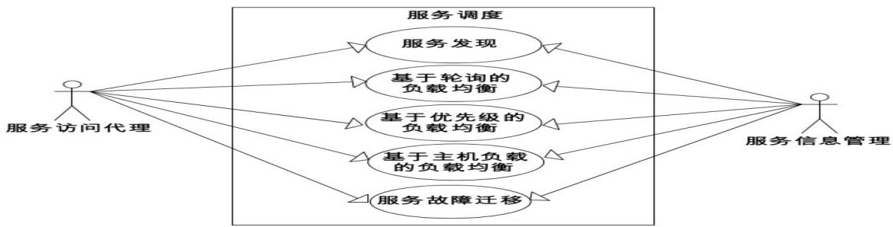
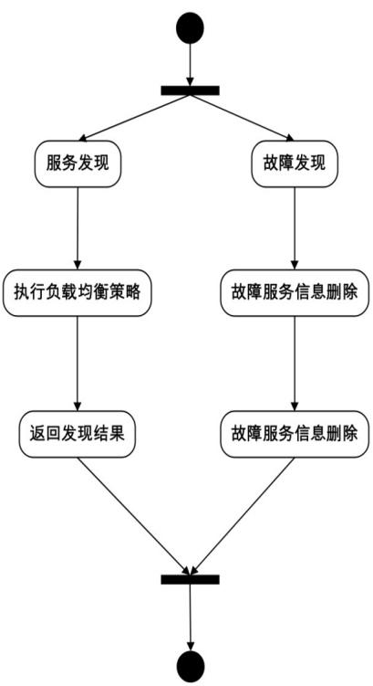

3.2.4.4 服务运行状态汇总（PZXQ-GN-FWXXGL-FWYXZTHZ）
<table><tr><td>2.服务运行控制构造服务注册信息数据 结构； 3.服务运行控制调用服务注册信息上报 接口；</td><td>1.系统启动监听端口，如果端口监听失 败则进入异常流E1；如果端口监听成 功，等待服务注册信息上报； 4.系统接收上报的服务注册信息，否则 进入异常流E2； 5.系统解析上报服务注册信息数据结 构，提取服务id、服务启动类型、服务 负载均衡类型和服务启动位置等服务注 册信息，如果解析提取失败进入异常流 E3; 6. 以服务 id 作为 key 值，服务注册信息 作为键值，在本地数据结构中存储服务</td><td>校验输入参数的合法性，并在错 误发生时，提供详细的错误信 息；</td></tr><tr><td colspan="2">异常流E1：端口被占用，端口监听失败，绑定新端口。</td><td></td></tr><tr><td colspan="2">注册信息。</td><td></td></tr><tr><td colspan="2">异常流E2:接收数据异常，检查网络连接是否正常。</td><td></td></tr><tr><td colspan="2">后置条件：无。</td><td></td></tr></table>

服务运行状态汇总用例场景，见表40。

表40服务运行状态汇总
<table><tr><td colspan="1" rowspan="1">Use Case 名称：服务运行状态汇总</td><td colspan="2" rowspan="1">Actors：服务运行控制</td></tr><tr><td colspan="3" rowspan="1">概述：本用例是服务运行控制在服务启动成功后，对服务的运行状态信息向系统上报相关数据，系统对服务运行状态信息进行实时汇总；</td></tr><tr><td colspan="3" rowspan="1">前置条件：服务运行控制启动成功。</td></tr><tr><td colspan="3" rowspan="1">主事件流</td></tr><tr><td colspan="1" rowspan="1">Actor 的动作</td><td colspan="1" rowspan="1">系统的动作</td><td colspan="1" rowspan="1">动作约束(性能、可靠性、容错等)</td></tr><tr><td colspan="1" rowspan="1"></td><td colspan="1" rowspan="1">1.系统启动监听端口，如果端口监听失败则进入异常流E1：如果端口监听成功，等待服务注册信息上报；</td><td colspan="1" rowspan="1">校验输入参数的合法性，并在错误发生时，提供详细的错误信息；</td></tr><tr><td colspan="1" rowspan="1">2.服务运行控制构造服务运行状态信息数据结构；3.服务运行控制调用服务运行状态信息上报接口；</td><td colspan="1" rowspan="1">4.系统接收上报的服务运行状态信息，否则进入异常流E2；5.系统解析上报服务运行状态信息数据结构，提取服务id，如果解析提取失败进入异常流E3；6. 以服务 id 作为 key 值，服务运行状态信息作为键值，在本地数据结构中存储服务运行状态信息。</td><td colspan="1" rowspan="1"></td></tr><tr><td colspan="2" rowspan="1">异常流E1：端口被占用，端口监听失败，绑定新端口。</td><td colspan="1" rowspan="1"></td></tr><tr><td colspan="2" rowspan="1">异常流E2：接收数据异常，检查网络连接是否正常。</td><td colspan="1" rowspan="1"></td></tr><tr><td colspan="2" rowspan="1">后置条件：无。</td><td colspan="1" rowspan="1"></td></tr></table>

## 3.2.4.5 服务占用资源汇总（PZXQ-GN-FWXXGL-FWZYZYHZ）

服务占用资源汇总用例场景，见表41。

表41服务占用资源信息汇总
<table><tr><td colspan="1" rowspan="1">Use Case 名称:节点信息汇总</td><td colspan="2" rowspan="1">Actors：服务运行控制</td></tr><tr><td colspan="3" rowspan="1">概述：本用例是服务运行控制在系统运行过程中，对服务占用资源信息向系统上报相关数据，系统对服务资源占用信息进行汇总；</td></tr><tr><td colspan="3" rowspan="1">前置条件：服务运行控制启动成功。</td></tr><tr><td colspan="3" rowspan="1">主事件流</td></tr><tr><td colspan="1" rowspan="1">Actor 的动作</td><td colspan="1" rowspan="1">系统的动作</td><td colspan="1" rowspan="1">动作约束(性能、可靠性、容错等)</td></tr><tr><td colspan="1" rowspan="1">2.服务运行控制构造服务资源占用信息数据结构；3.服务运行控制调用服务资源占用信息上报接口；</td><td colspan="1" rowspan="1">1.系统启动监听端口，如果端口监听失败则进入异常流E1；如果端口监听成功，等待服务资源占用信息上报；4.系统接收上报的服务资源占用信息，</td><td colspan="1" rowspan="1">校验输入参数的合法性，并在错误发生时，提供详细的错误信息；</td></tr><tr><td colspan="1" rowspan="1"></td><td colspan="1" rowspan="1">否则进入异常流E2；5.系统解析上报服务资源占用信息数据结构，提取服务id，如果解析提取失败进入异常流E3；6. 以服务 id 作为 key 值，服务资源占用信息作为键值，在本地数据结构中存储服务资源占用信息。</td><td colspan="1" rowspan="1"></td></tr><tr><td colspan="2" rowspan="1">异常流E1：端口被占用，端口监听失败，绑定新端口。</td><td colspan="1" rowspan="1"></td></tr><tr><td colspan="2" rowspan="1">异常流E2:接收数据异常，检查网络连接是否正常。</td><td colspan="1" rowspan="1"></td></tr><tr><td colspan="2" rowspan="1">后置条件：无。</td><td colspan="1" rowspan="1"></td></tr></table>

## 3.2.4.6 节点信息汇总（PZXQ-GN-FWXXGL-JDXXHZ）

节点信息汇总用例场景，见表42。

表42节点信息汇总
<table><tr><td colspan="1" rowspan="1">Use Case 名称:节点信息汇总</td><td colspan="2" rowspan="1">Actors:服务运行控制</td></tr><tr><td colspan="3" rowspan="1">概述：本用例是在系统运行过程中，服务运行控制对节点状态信息向系统实时上报相关数据，系统对节点状态信息进行汇总；</td></tr><tr><td colspan="3" rowspan="1">前置条件：服务运行控制启动成功。</td></tr><tr><td colspan="3" rowspan="1">主事件流</td></tr><tr><td colspan="1" rowspan="1">Actor 的动作</td><td colspan="1" rowspan="1">系统的动作</td><td colspan="1" rowspan="1">动作约束(性能、可靠性、容错等)</td></tr><tr><td colspan="1" rowspan="1">2.服务运行控制构造节点信息数据结构；3.服务运行控制调用节点信息上报接口；</td><td colspan="1" rowspan="1">1.系统启动监听端口，如果端口监听失败则进入异常流E1：如果端口监听成功，等待服务注册信息上报；4.系统接收上报的节点信息，否则进入异常流 E2；5.系统解析上报节点信息数据结构，提取服务id，如果解析提取失败进入异常流E3；6. 以服务 id 作为 key 值，节点信息作为</td><td colspan="1" rowspan="1">校验输入参数的合法性，并在错误发生时，提供详细的错误信息；</td></tr><tr><td colspan="1" rowspan="1"></td><td colspan="1" rowspan="1">键值，在本地数据结构中存储节点信息。</td><td colspan="1" rowspan="1"></td></tr><tr><td colspan="2" rowspan="1">异常流E1：端口被占用，端口监听失败，绑定新端口。</td><td colspan="1" rowspan="1"></td></tr><tr><td colspan="2" rowspan="1">异常流E2:接收数据异常，检查网络连接是否正常。</td><td colspan="1" rowspan="1"></td></tr><tr><td colspan="2" rowspan="1">后置条件：无。</td><td colspan="1" rowspan="1"></td></tr></table>

3.2.5 服务调度（PZXQ-GN-FWDD）

服务调度功能包括服务发现、服务负载均衡功能、基于优先级的负载均衡、基于主机负载的负载均衡；支持服务故障迁移功能，将访问故障服务的请求调度到运行正常的服务，其用例图功能如图14所示；

  
图14 服务调度用例图

服务信息管理所有能力标识表，见表43。

表43服务信息管理所有能力能力标识
<table><tr><td colspan="1" rowspan="1">序号</td><td colspan="1" rowspan="1">Use case名称</td><td colspan="1" rowspan="1">项目唯一标识符</td><td colspan="1" rowspan="1">需求描述</td><td colspan="1" rowspan="1">需求重用</td><td colspan="1" rowspan="1">方式名称</td><td colspan="1" rowspan="1">运行状态</td><td colspan="1" rowspan="1">对应的任务书功能/性能</td></tr><tr><td colspan="1" rowspan="1">1</td><td colspan="1" rowspan="1">服务发现</td><td colspan="1" rowspan="1">PZXQ-GN-FWDD-FWFX</td><td colspan="1" rowspan="1">服务访问代理向服务信息管理查询，自动发现所有服务信息和所有服务提供者位置</td><td colspan="1" rowspan="1">新增</td><td colspan="1" rowspan="1">桌面、平板、</td><td colspan="1" rowspan="1">运行阶段</td><td colspan="1" rowspan="1">4.1.5</td></tr><tr><td colspan="1" rowspan="1"></td><td colspan="1" rowspan="1"></td><td colspan="1" rowspan="1"></td><td colspan="1" rowspan="1"></td><td colspan="1" rowspan="1"></td><td colspan="1" rowspan="1">手持</td><td colspan="1" rowspan="1"></td><td colspan="1" rowspan="1"></td></tr><tr><td colspan="1" rowspan="1">2</td><td colspan="1" rowspan="1">基于轮询的负载均衡</td><td colspan="1" rowspan="1">PZXQ-GN-FWDD-FWLXFZ</td><td colspan="1" rowspan="1">服务访问代理以轮询的方式将服务分发到不同主机，具有同一类服务的节点获得服务请求的概率相同</td><td colspan="1" rowspan="1">新增</td><td colspan="1" rowspan="1">桌面、平板、手持</td><td colspan="1" rowspan="1">运行阶段</td><td colspan="1" rowspan="1">4.1.5</td></tr><tr><td colspan="1" rowspan="1">3</td><td colspan="1" rowspan="1">基于优先级的负载均衡</td><td colspan="1" rowspan="1">PZXQ-GN-FWDD-FWYXJFZ</td><td colspan="1" rowspan="1">按照预先配置的服务优先级将服务按比例分发到不同主机上，具有同一种服务的节点过的服务请求的概率与优先级成正比</td><td colspan="1" rowspan="1">新增</td><td colspan="1" rowspan="1">桌面、平板、手持</td><td colspan="1" rowspan="1">运行阶段</td><td colspan="1" rowspan="1">4.1.5</td></tr><tr><td colspan="1" rowspan="1">4</td><td colspan="1" rowspan="1">基于主机负载的负载均衡</td><td colspan="1" rowspan="1">PZXQ-GN-FWDD-FWZJFZ</td><td colspan="1" rowspan="1">通过比较服务主机负载将服务分发到负载最小的主机上</td><td colspan="1" rowspan="1">新增</td><td colspan="1" rowspan="1">桌面、平板、手持</td><td colspan="1" rowspan="1">运行阶段</td><td colspan="1" rowspan="1">4.1.5</td></tr><tr><td colspan="1" rowspan="1">5</td><td colspan="1" rowspan="1">服务故障迁移</td><td colspan="1" rowspan="1">PZXQ-GN-FWDD-FWGZQY</td><td colspan="1" rowspan="1">出现服务访问故障的请求自动调度到运行正常的服务</td><td colspan="1" rowspan="1">新增</td><td colspan="1" rowspan="1">桌面、平板、手持</td><td colspan="1" rowspan="1">运行阶段</td><td colspan="1" rowspan="1">4.1.5</td></tr></table>

服务调度运行流程如图 15所示。

  
图 15 服务调度运行流程图

## 3.2.5.1 服务发现（PZXQ-GN-FWDD-FWFX）

服务发现用例场景，见表44。

表44 服务发现用例描述
<table><tr><td colspan="1" rowspan="1">Use Case 名称：服务发现</td><td colspan="2" rowspan="1">Actors：服务访问代理、服务信息管理</td></tr><tr><td colspan="3" rowspan="1">概述：本用例描述通过服务名称获取服务的运行地址。</td></tr><tr><td colspan="3" rowspan="1">前置条件：服务访问代理与服务信息管理正常运行。</td></tr><tr><td colspan="3" rowspan="1">主事件流</td></tr><tr><td colspan="1" rowspan="1">Actor 的动作</td><td colspan="1" rowspan="1">系统的动作</td><td colspan="1" rowspan="1">动作约束(性能、可靠性、容错等)</td></tr><tr><td colspan="1" rowspan="1">1.服务访问代理发送服务请求；5.服务信息管理查询所有服务信息与服</td><td colspan="1" rowspan="1">2.系统接收到服务请求；3.系统解析参数，如果解析错误执行异常流E1；如果解析成功，提取出服务名称；4.通过服务名称调用服务调度接口，如果调用失败执行异常流E2；</td><td colspan="1" rowspan="1">校验输入参数的合法性，并在错误发生时，提供详细的错误信息；</td></tr><tr><td colspan="1" rowspan="1">务提供者信息，将结果发送到系统；8.服务访问代理接收到结果，对服务请求向目标服务提供者进行请求转发。</td><td colspan="1" rowspan="1">6.系统接收到服务提供者信息，通过负载均衡策略对节点进行选择；7.将选择结果返回；</td><td colspan="1" rowspan="1"></td></tr><tr><td colspan="2" rowspan="1">异常流E1:系统解析参数失败，返回解析失败信息。</td><td colspan="1" rowspan="1"></td></tr><tr><td colspan="2" rowspan="1">异常流E2：服务调度接口失败，返回调用失败信息。</td><td colspan="1" rowspan="1"></td></tr><tr><td colspan="2" rowspan="1">后置条件：无。</td><td colspan="1" rowspan="1"></td></tr></table>

## 3.2.5.2 基于轮询的负载均衡（PZXQ-GN-FWDD-FWLXFZ）

基于轮询的负载均衡用例见表45。

表45基于轮询的负载均衡用例描述
<table><tr><td>Use Case 名称：基于轮询的负载均衡</td><td colspan="2">Actors：服务访问代理、服务信息管理</td></tr><tr><td colspan="3">概述：本用例是将服务访问代理发送的请求按照轮询的方式分发到服务主机，实现负载均衡；</td></tr><tr><td colspan="3">前置条件：数据库连接正常，服务管控程序连接正常。</td></tr><tr><td></td><td colspan="2">主事件流</td></tr><tr><td>Actor 的动作</td><td>系统的动作</td><td>动作约束 (性能、可靠性、容错等)</td></tr><tr><td>2.服务信息管理收到查询请求，返回服 务的所有信息；</td><td>1.系统向服务信息管理查询所有服务的 相关信息； 3.系统解析数据，形成服务实例列表， 为每个服务记录负载均衡策略以及调用</td><td></td></tr><tr><td rowspan="2">4.服务访问代理发起服务地址查询请 求；</td><td>信息，调用信息包括每个服务示例被调 用的次数； 5.系统接收到查询请求，从参数中解析</td><td>校验输入参数的合法性，并在错 误发生时，提供详细的错误信</td></tr><tr><td>服务名称提取并存储数据结构，如果解 析失败则进入异常流E1； 6.系统根据服务名称发现该服务使用基</td><td>息；</td></tr><tr><td colspan="1" rowspan="1">9.服务访问代理接收到结果，提取服务实例主机IP和端口号.如果提取失败则进入异常流E2；10.服务访问代理向该IP和端口号的服务转发请求；11.服务访问代理接收到服务响应结果。</td><td colspan="1" rowspan="1">于轮询的服务负载均衡调度请求；7.系统从实例列表中按序选择一个服务实例；8.系统将该实例的相关信息返回给服务访问代理；</td><td colspan="1" rowspan="1"></td></tr><tr><td colspan="2" rowspan="1">异常流E1:参数解析失败。</td><td colspan="1" rowspan="1"></td></tr><tr><td colspan="2" rowspan="1">异常流E2:主机IP端口异常。</td><td colspan="1" rowspan="1"></td></tr><tr><td colspan="2" rowspan="1">后置条件：无。</td><td colspan="1" rowspan="1"></td></tr></table>

## 3.2.5.3 基于优先级的负载均衡（PZXQ-GN-FWDD-FWYXJFZ）

基于优先级的负载均衡用例见表46。

表46基于优先级的负载均衡用例描述
<table><tr><td colspan="1" rowspan="1">Use Case 名称：基于优先级的负载均衡</td><td colspan="2" rowspan="1">Actors：服务访问代理、服务信息管理</td></tr><tr><td colspan="3" rowspan="1">概述：本用例是将服务访问代理发送的请求按照优先级的方式分发到服务主机，实现负载均衡；</td></tr><tr><td colspan="3" rowspan="1">前置条件：服务访问代理、服务信息管理正常。</td></tr><tr><td colspan="3" rowspan="1">主事件流</td></tr><tr><td colspan="1" rowspan="1">Actor 的动作</td><td colspan="1" rowspan="1">系统的动作</td><td colspan="1" rowspan="1">动作约束(性能、可靠性、容错等)</td></tr><tr><td colspan="1" rowspan="1">2.服务信息管理收到查询请求，返回服务的所有信息；</td><td colspan="1" rowspan="1">1.系统向服务信息管理查询所有服务的相关信息；3.系统解析数据，形成服务实例列表，为每个服务记录负载均衡策略以及调用</td><td colspan="1" rowspan="1">校验输入参数的合法性，并在错误发生时，提供详细的错误信息；</td></tr><tr><td colspan="1" rowspan="1">4.服务访问代理发起服务地址查询请求；9.服务访问代理接收到结果，提取服务实例主机IP和端口号.如果提取失败则进入异常流E2；10.服务访问代理向该IP和端口号的服务转发请求；11.服务访问代理接收到服务响应结果。</td><td colspan="1" rowspan="1">信息，调用信息包括每个服务示例被调用的优先级；5.系统接收到查询请求，提取服务名称，如果参数解析失败执行异常流E1；6.系统根据服务名称发现该服务使用基于优先级的服务负载均衡调度请求；7.系统按照优先级大小决定调用服务实例的概率，服务的优先级越高被调用的概率越高；服务的优先级越低则被调用的概率越低；8.系统将实例返回给服务访问代理；</td><td colspan="1" rowspan="1"></td></tr><tr><td colspan="2" rowspan="1">异常流E1：请求解析失败，返回错误代码。</td><td colspan="1" rowspan="1"></td></tr><tr><td colspan="2" rowspan="1">异常流E2：服务访问代理解析数据失败，返回错误码。</td><td colspan="1" rowspan="1"></td></tr><tr><td colspan="2" rowspan="1">后置条件：无。</td><td colspan="1" rowspan="1"></td></tr></table>

3.2.5.4 基于主机负载的负载均衡（PZXQ-GN-FWDD-FWZJFZ）

基于主机负载的负载均衡用例见表47。

表47基于主机负载的负载均衡用例描述
<table><tr><td colspan="1" rowspan="1">Use Case 名称:基于主机负载的负载均衡</td><td colspan="2" rowspan="1">Actors：服务访问代理、服务信息管理</td></tr><tr><td colspan="3" rowspan="1">概述：本用例是将服务访问代理发送的请求分发到主机负载最小的服务主机，实现负载均衡；</td></tr><tr><td colspan="3" rowspan="1">前置条件：服务访问代理、服务信息管理正常。</td></tr><tr><td colspan="3" rowspan="1">主事件流</td></tr><tr><td colspan="1" rowspan="1">Actor 的动作</td><td colspan="1" rowspan="1">系统的动作</td><td colspan="1" rowspan="1">动作约束</td></tr><tr><td></td><td></td><td>(性能、可靠性、容错等)</td></tr><tr><td>2.服务信息管理收到查询请求，返回服 务的所有信息；</td><td>1.系统向服务信息管理查询所有服务的 相关信息；</td><td></td></tr><tr><td>4.服务访问代理发起服务地址查询请 求；</td><td>3.系统解析数据，形成服务实例列表， 为每个服务记录负载均衡策略以及调用 信息，调用信息包括每个服务示例主机 负载，能够反映CPU占用率、内存占用 大小、线程数大小以及端口的占用情 况；</td><td rowspan="2"></td></tr><tr><td rowspan="5">9.服务访问代理接收到结果，提取服务 实例主机IP和端口号.如果提取失败则 进入异常流E2；</td><td rowspan="2">5.系统接收到查询请求，提取服务名 称，如果解析失败执行异常流E1 6.系统根据服务名称发现所有等于该服</td></tr><tr><td>校验输入参数的合法性，并在错 误发生时，提供详细的错误信 息； 务名称且使用基于主机负载的服务负载</td></tr><tr><td rowspan="2">均衡调度请求； 7.系统查找主机负载最小的服务实例； 如果主机负载相同，则从中随机选择服 务实例；</td></tr><tr><td>8.系统返回服务实例；</td></tr><tr><td>10.服务访问代理向该IP和端口号的服</td><td></td></tr><tr><td colspan="2">务转发请求； 11.服务访问代理接收到服务响应结果。</td><td></td></tr><tr><td colspan="2">异常流E1：请求解析失败，返回错误代码。</td><td></td></tr><tr><td colspan="3"></td></tr><tr><td colspan="2">异常流E2：服务访问代理解析数据失败，返回错误码。</td><td></td></tr><tr><td colspan="2">后置条件：无。</td><td></td></tr></table>

3.2.5.5 服务故障迁移（PZXQ-GN-FWDD-FWGZQY）