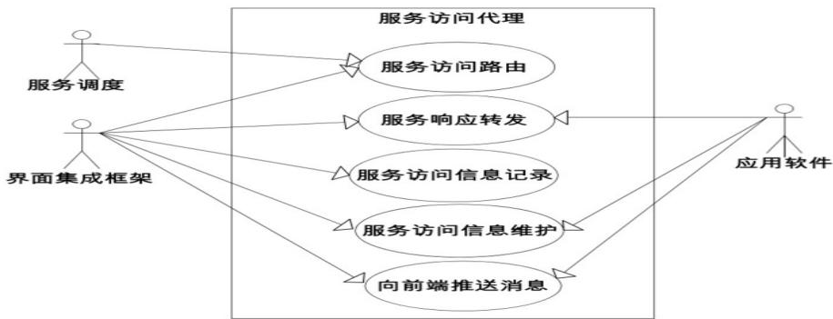
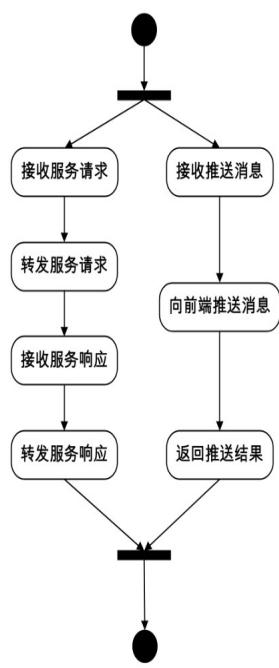
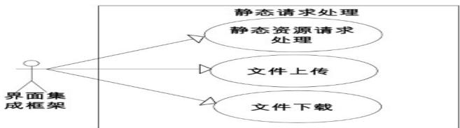
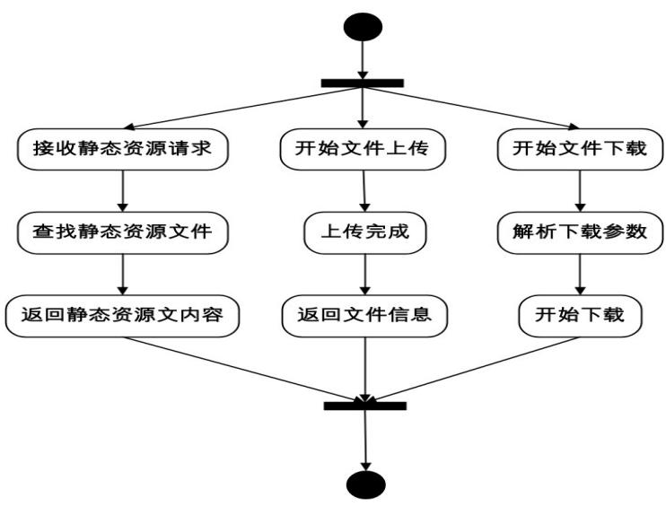

服务故障迁移用例见表48。

表48服务故障迁移用例描述
<table><tr><td rowspan=1 colspan=1>Use Case 名称:服务故障迁移</td><td rowspan=1 colspan=2>Actors：服务访问代理、服务信息管理</td></tr><tr><td rowspan=1 colspan=3>概述：本用例是在用户无感知的情况下，将访问故障服务的请求调度到运行正常的服务器上，从而不影响用户的使用体验提高服务的质量；</td></tr><tr><td rowspan=1 colspan=3>前置条件：服务访问代理和服务信息管理运行正常。</td></tr><tr><td rowspan=1 colspan=3>主事件流</td></tr><tr><td rowspan=1 colspan=1>Actor 的动作</td><td rowspan=1 colspan=1>系统的动作</td><td rowspan=1 colspan=1>动作约束(性能、可靠性、容错等)</td></tr><tr><td rowspan=1 colspan=1>3.服务访问代理访问服务发现服务响应异常；4.服务访问代理向系统上报错误信息，包括服务位置、服务名称等；5.服务访问代理发出服务地址查询信息；7.服务访问代理接收包含服务地址的响应；8.服务访问代理再次访问服务9.服务访问代理接收到正常响应，如果响应异常则进入异常流E2。</td><td rowspan=1 colspan=1>1.系统向服务信息管理查询所有服务的相关信息；2.系统解析查询到的服务信息，生成可用服务列表，解析失败进行异常流E1；6.系统接收到信息，查询可用的服务信息，构造服务名称和服务位置的数据结构返回；</td><td rowspan=1 colspan=1>校验输入参数的合法性，并在错误发生时，提供详细的错误信息；</td></tr><tr><td rowspan=1 colspan=2>异常流E1：数据解析失败，返回错误码。</td><td rowspan=1 colspan=1></td></tr><tr><td rowspan=1 colspan=2>异常流E2：服务响应失败，进行服务迁移。</td><td rowspan=1 colspan=1></td></tr><tr><td rowspan=1 colspan=2>后置条件：无。</td><td rowspan=1 colspan=1></td></tr></table>

3.2.6 服务访问代理（PZXQ-GN-FWFWDL）

服务访问代理功能包括服务访问路由功能，支持将服务请求发送到具体的服务实例；服务响应转发功能，支持将服务响应发给服务访问发起者；服务访问信息记录功能，可在文件中查看服务调用发起的时间、调用方法、响应状态码等信息；服务访问会话信息维护功能，可在服务响应数据中植入会话信息，可在服务请求数据中提取会话信息；向前端推送消息的功能，支持接收其它程序发来的数据并转发到指定 节点上的界面集成框架；其功能用例如图16所示。

  
图16 服务访问代理用例图

服务访问代理所有能力标识表，见表49。

表49 服务访问代理所有能力标识
<table><tr><td rowspan=1 colspan=1>序号</td><td rowspan=1 colspan=1>Use case名称</td><td rowspan=1 colspan=1>项目唯一标识符</td><td rowspan=1 colspan=1>需求描述</td><td rowspan=1 colspan=1>需求重用</td><td rowspan=1 colspan=1>方式名称</td><td rowspan=1 colspan=1>运行状态</td><td rowspan=1 colspan=1>对应的任务书功能/性能</td></tr><tr><td rowspan=1 colspan=1>1</td><td rowspan=1 colspan=1>服务访问路由</td><td rowspan=1 colspan=1>PZXQ-FWJCKJ-GN-FWFWLY</td><td rowspan=1 colspan=1>支持将服务请求发送到具体的服务实例</td><td rowspan=1 colspan=1>新增</td><td rowspan=1 colspan=1>桌面、平板、手持</td><td rowspan=1 colspan=1>运行阶段</td><td rowspan=1 colspan=1>4.1.5</td></tr><tr><td rowspan=1 colspan=1>2</td><td rowspan=1 colspan=1>服务响应转发</td><td rowspan=1 colspan=1>PZXQ-FWJCKJ-GN-FWXYZF</td><td rowspan=1 colspan=1>支持将服务响应发给服务访问发起者</td><td rowspan=1 colspan=1>新增</td><td rowspan=1 colspan=1>桌面、平板、手持</td><td rowspan=1 colspan=1>运行阶段</td><td rowspan=1 colspan=1>4.1.5</td></tr><tr><td rowspan=1 colspan=1>3</td><td rowspan=1 colspan=1>服务访问信息记录</td><td rowspan=1 colspan=1>PZXQ-FWJCKJ-GN-FWFWJL</td><td rowspan=1 colspan=1>服务调用发起的时间、调用方法、响应状态码进行记录</td><td rowspan=1 colspan=1>新增</td><td rowspan=1 colspan=1>桌面、平板、手持</td><td rowspan=1 colspan=1>运行阶段</td><td rowspan=1 colspan=1>4.1.5</td></tr><tr><td rowspan=1 colspan=1>4</td><td rowspan=1 colspan=1>服务访问信息维护</td><td rowspan=1 colspan=1>PZXQ-FWJCKJ-GN-FWFWWH</td><td rowspan=1 colspan=1>服务请求数据中提取会话信息进行维护</td><td rowspan=1 colspan=1>新增</td><td rowspan=1 colspan=1>桌面、平板、手持</td><td rowspan=1 colspan=1>运行阶段</td><td rowspan=1 colspan=1>4.1.5</td></tr><tr><td rowspan=1 colspan=1>5</td><td rowspan=1 colspan=1>向前端推送消息</td><td rowspan=1 colspan=1>PZXQ-FWJCKJ-GN-QDTSXX</td><td rowspan=1 colspan=1>支持后台程序主动向前端界面推送数据</td><td rowspan=1 colspan=1>新增</td><td rowspan=1 colspan=1>桌面、平板、手持</td><td rowspan=1 colspan=1>运行阶段</td><td rowspan=1 colspan=1>4.1.5</td></tr></table>

服务访问代理运行流程如图 17所示。

  
图 17 服务访问代理运行流程图

## 3.2.6.1 服务访问路由（PZXQ-GN-FWFWDL-FWFWLY）

服务访问路由用例场景，见表50。

表50 服务访问路由生成用例描述
<table><tr><td colspan="1" rowspan="1">Use Case 名称：服务访问路由</td><td colspan="2" rowspan="1">Actors：界面集成框架、服务调度</td></tr><tr><td colspan="3" rowspan="1">概述：本用例是界面集成框架调用服务，通过服务访问代理查询服务进行透明统一访问；</td></tr><tr><td colspan="3" rowspan="1">前置条件：网络正常，服务运行控制、服务访问代理、服务信息管理运行正常。</td></tr><tr><td colspan="3" rowspan="1">主事件流</td></tr><tr><td colspan="1" rowspan="1">Actor 的动作</td><td colspan="1" rowspan="1">系统的动作</td><td colspan="1" rowspan="1">动作约束(性能、可靠性、容错等)</td></tr><tr><td colspan="1" rowspan="1">2.界面集成框架向服务访问代理发送服务访问请求，内容包括服务标识、服务名称、插件名称和调用服务接口；</td><td colspan="1" rowspan="1">1.系统循环向本地控制器进行服务的信息查询，不断更新服务清单和状态信息；3.系统接收到服务访问请求，进行内容解析；如果内容解析错误，执行异常流</td><td colspan="1" rowspan="1">校验输入参数的合法性，并在错误发生时，提供详细的错误信息；</td></tr><tr><td>7.服务调度接收服务发现请求，运行负 载均衡算法，返回结果；</td><td>E1; 4.通过解析出的服务名称，进行本地服 务查询，如果查询到服务在本地，将转 发地址设置为本地服务地址； 6.如果本地不存在访问的服务名称，则 向服务调度进行服务发现，查询远端服 务地址； 8.系统接收服务调度返回的结果，将转 发地址设置为返回的服务地址； 9.系统将请求的响应返回；如果查询不</td><td></td></tr><tr><td colspan="2">10.界面集成框架接收到响应结果进行下 果异常，则执行异常流E3； 一步处理。</td><td>到服务执行异常流E2，如果服务返回结</td></tr><tr><td colspan="2">异常流E1：日志输出HTTP请求错误，用例结束。</td><td></td></tr><tr><td colspan="2">异常流E2：日志输出服务不存在，访问失败，用例结束。</td><td></td></tr><tr><td colspan="2"></td><td></td></tr><tr><td colspan="2">异常流E3：日志输出返回结果失败，用例结束。 后置条件：无。</td><td></td></tr></table>

## 3.2.6.2 服务响应转发（PZXQ-GN-FWFWDL-FWXYZF）

服务响应转发生成用例场景，见表51。

表51 访问响应转发生成用例描述
<table><tr><td colspan="1" rowspan="1">Use Case 名称：服务响应转发</td><td colspan="2" rowspan="1">Actors:界面集成框架、应用软件</td></tr><tr><td colspan="3" rowspan="1">概述：本用例是服务访问响应转发用例场景；</td></tr><tr><td colspan="3" rowspan="1">前置条件：网络正常，服务运行控制、服务访问代理、服务信息管理运行正常。</td></tr><tr><td colspan="3" rowspan="1">主事件流</td></tr><tr><td colspan="1" rowspan="1">Actor 的动作</td><td colspan="1" rowspan="1">系统的动作</td><td colspan="1" rowspan="1">动作约束(性能、可靠性、容错等)</td></tr><tr><td colspan="1" rowspan="1">1.界面集成框架发出服务访问请求；</td><td colspan="1" rowspan="1">2.系统接收到请求，进行服务发现，查询服务地址；3.系统转发请求到应用程序需，如果没</td><td colspan="1" rowspan="1">校验输入参数的合法性，并在错误发生时，提供详细的错误信息；</td></tr><tr><td colspan="1" rowspan="1">4.应用软件接收服务访问请求，返回响应结果；7.界面集成框架接收到响应内容进行业务逻辑处理。</td><td colspan="1" rowspan="1">有查询到服务，执行异常流E1；5.系统接收到响应头和响应体，通过服务访问的频率对内容进行缓存；6.系统将响应内容进行转发，转发过程中如果发生异常则执行异常流E2；</td><td colspan="1" rowspan="1"></td></tr><tr><td colspan="2" rowspan="1">异常流E1：日志输出服务不存在，访问失败，用例结束。</td><td colspan="1" rowspan="1"></td></tr><tr><td colspan="2" rowspan="1">异常流E2：日志输出返回结果失败，用例结束。</td><td colspan="1" rowspan="1"></td></tr><tr><td colspan="2" rowspan="1">后置条件：无。</td><td colspan="1" rowspan="1"></td></tr></table>

## 3.2.6.3 服务访问信息记录（PZXQ-GN-FWFWDL-FWFWJL）

服务访问信息记录用例场景，见表52。

表52 服务访问信息记录用例描述
<table><tr><td>Use Case 名称：服务访问信息记录</td><td colspan="2">Actors:界面集成框架</td></tr><tr><td colspan="3">概述：本用例是对服务访问的基本信息进行记录保存；</td></tr><tr><td colspan="3">前置条件：网络正常，服务访问代理运行正常。</td></tr><tr><td colspan="3">主事件流</td></tr><tr><td>Actor 的动作</td><td>系统的动作</td><td>动作约束 (性能、可靠性、容错等)</td></tr><tr><td rowspan="5">1.界面集成框架发送服务访问请求；</td><td>2.系统收到请求，接收请求体，对请求</td><td rowspan="3">校验输入参数的合法性，并在错 误发生时，提供详细的错误信 息；</td></tr><tr><td>体进行解析，然后对服务访问做逻辑处 理和判断，调用处理函数； 3.系统获取服务调用的发起时间、调用</td></tr><tr><td>方法、响应状态码等信息； 4.系统将请求访问信息保存到指定的地</td></tr><tr><td>址文件中，如果保存过程中失败，执行 异常流E1；</td><td></td></tr><tr><td colspan="1" rowspan="1">5.用户打开信息记录文件，可以查看到每一次服务访问请求的基本信息。</td><td colspan="1" rowspan="1"></td><td colspan="1" rowspan="1"></td></tr><tr><td colspan="2" rowspan="1">异常流E1：系统提示信息记录保存失败，文件不存在。</td><td colspan="1" rowspan="1"></td></tr><tr><td colspan="2" rowspan="1">后置条件：无。</td><td colspan="1" rowspan="1"></td></tr></table>

## 3.2.6.4 服务访问信息维护（PZXQ-GN-FWFWDL-FWFWWH）

服务访问信息维护用例场景，见表53。

表53 服务访问信息维护用例描述
<table><tr><td rowspan=1 colspan=1>Use Case 名称：服务访问信息维护</td><td rowspan=1 colspan=2>Actors:界面集成框架、应用软件</td></tr><tr><td rowspan=1 colspan=3>概述：本用例是对服务响应的数据中加入会话信息；</td></tr><tr><td rowspan=1 colspan=3>前置条件：网络正常，服务访问代理运行正常。</td></tr><tr><td rowspan=1 colspan=3>主事件流</td></tr><tr><td rowspan=1 colspan=1>Actor 的动作</td><td rowspan=1 colspan=1>系统的动作</td><td rowspan=1 colspan=1>动作约束(性能、可靠性、容错等)</td></tr><tr><td rowspan=1 colspan=1>1.界面集成框架发送服务访问请求；3.应用软件接收到访问请求，调用会话信息植入接口，将会话信息随响应数据写入响应信息中；5.界面集成框架根据业务需求在服务响应数据中获取植入的会话信息。</td><td rowspan=1 colspan=1>2.系统收到请求，转发服务访问请求到应用程序，若访问请求处理异常，执行异常流E1；4.系统将服务响应返回；如果数据返回异常，执行异常流E2；</td><td rowspan=1 colspan=1>校验输入参数的合法性，并在错误发生时，提供详细的错误信息；</td></tr><tr><td rowspan=1 colspan=2>异常流E1：日志输出请求处理失败，用例结束。</td><td rowspan=1 colspan=1></td></tr><tr><td rowspan=1 colspan=2>异常流E2：日志输出返回结果失败，用例结束。</td><td rowspan=1 colspan=1></td></tr><tr><td rowspan=1 colspan=2>后置条件：无。</td><td rowspan=1 colspan=1></td></tr></table>

## 3.2.6.5 向前端推送消息（PZXQ-GN-FWFWDL-QDTSXX）

向前端推送消息生成用例场景，见表54。

表54 向前端推送消息发生成用例描述
<table><tr><td>Use Case 名称:向前端推送消息</td><td>Actors：界面集成框架、应用软件</td></tr></table>

<table><tr><td colspan="3">概述：本用例是服务访问代理向前端推送消息的过程；</td></tr><tr><td colspan="3">前置条件：网络正常，服务访问代理运行正常。</td></tr><tr><td colspan="4">主事件流</td></tr><tr><td>Actor 的动作</td><td>系统的动作</td><td>动作约束 (性能、可靠性、容错等)</td></tr><tr><td rowspan="5">1.应用软件调用向前端推送消息的操 作； 5.界面集成框架获得数据，执行下一步 操作；</td><td>2.系统对需要推送的消息数据进行json 封装； 3.系统调用消息推送接口，按照推送消</td><td></td></tr><tr><td>息数据的内容，长度和上下文推送到指 定目标地址和端口上；</td><td>校验输入参数的合法性，并在错 误发生时，提供详细的错误信 息；</td></tr><tr><td>4.系统通过推送通道向界面集成框架发 送数据；</td><td></td></tr><tr><td>6.系统产生网络IO错误则执行异常流 E1；如果推送成功，清除缓冲区关闭网</td><td></td></tr><tr><td>络端口资源。 异常流E1：系统提示IO错误，用例结束。</td><td></td></tr><tr><td colspan="2">后置条件：无。</td><td></td></tr></table>

3.2.7 静态请求处理（PZXQ-GN-JTQQCL）

静态请求处理功能包括静态资源请求处理功能，可根据请求信息返回对应的静态资源文件；文件上传功能，可对上传文件的大小、上传速度进行控制，可支持服务获取上传文件的位置、大小信息；文件下载功能，可根据文件资源路径下载文件；其功能用例如图18所示。

  
图18 静态请求处理用例图  
静态请求处理所有能力标识表，见表55。

表55 静态请求处理所有能力标识
<table><tr><td rowspan=1 colspan=1>序号</td><td rowspan=1 colspan=1>Use case名称</td><td rowspan=1 colspan=1>项目唯一标识符</td><td rowspan=1 colspan=1>需求描述</td><td rowspan=1 colspan=1>需求重用</td><td rowspan=1 colspan=1>方式名称</td><td rowspan=1 colspan=1>运行状态</td><td rowspan=1 colspan=1>对应的任务书功能/性能</td></tr><tr><td rowspan=1 colspan=1>1</td><td rowspan=1 colspan=1>静态资源请求处理</td><td rowspan=1 colspan=1>PZXQ-GN-JTQQCL-JTQQCL</td><td rowspan=1 colspan=1>接收获取HTML、CSS 等资源的请求，进行处理，返回静态资源文件</td><td rowspan=1 colspan=1>新增</td><td rowspan=1 colspan=1>桌面、平板、手持</td><td rowspan=1 colspan=1>运行阶段</td><td rowspan=1 colspan=1>4.1.6</td></tr><tr><td rowspan=1 colspan=1>2</td><td rowspan=1 colspan=1>文件上传</td><td rowspan=1 colspan=1>PZXQ-GN-JTQQCL-WJSC</td><td rowspan=1 colspan=1>支持对文件上传到指定位置，包括文件的大小和名称等信息</td><td rowspan=1 colspan=1>新增</td><td rowspan=1 colspan=1>桌面、平板、手持</td><td rowspan=1 colspan=1>运行阶段</td><td rowspan=1 colspan=1>4.1.6</td></tr><tr><td rowspan=1 colspan=1>3</td><td rowspan=1 colspan=1>文件下载</td><td rowspan=1 colspan=1>PZXQ-GN-JTQQCL-WJXZ</td><td rowspan=1 colspan=1>通过文件资源路径下载文件</td><td rowspan=1 colspan=1>新增</td><td rowspan=1 colspan=1>桌面、平板、手持</td><td rowspan=1 colspan=1>运行阶段</td><td rowspan=1 colspan=1>4.1.6</td></tr></table>

静态请求处理运行流程如图 15所示。

  
图 19 静态请求处理运行流程图

## 3.2.7.1 静态资源请求处理（PZXQ-GN-JTQQCL-JTQQCL）

静态资源请求处理生成用例场景，见表56。

表56 静态资源请求处理发生成用例描述
<table><tr><td colspan="1" rowspan="1">Use Case 名称:静态资源请求处理</td><td colspan="2" rowspan="1">Actors:界面集成框架</td></tr><tr><td colspan="3" rowspan="1">概述：本用例是根据请求信息返回对应的静态资源文件；</td></tr><tr><td colspan="3" rowspan="1">前置条件：静态资源正常、网络正常。</td></tr><tr><td colspan="3" rowspan="1">主事件流</td></tr><tr><td colspan="1" rowspan="1">Actor 的动作</td><td colspan="1" rowspan="1">系统的动作</td><td colspan="1" rowspan="1">动作约束(性能、可靠性、容错等)</td></tr><tr><td colspan="1" rowspan="1">1.界面集成框架发送静态资源访问请求；</td><td colspan="1" rowspan="1">2.系统接收静态资源请求，解析接收到的服务请求；3.系统通过请求标识识别出请求的静态资源，在配置好的静态资源路径下进行查找；</td><td colspan="1" rowspan="1">校验输入参数的合法性，并在错误发生时，提供详细的错误信息；</td></tr><tr><td colspan="1" rowspan="1">6.界面集成框架接收资源内容；</td><td colspan="1" rowspan="1">4.如果发现静态资源，查找成功：如果未找到静态资源，则执行异常流E1;5.系统对静态资源数据进行返回；</td><td colspan="1" rowspan="1"></td></tr><tr><td colspan="2" rowspan="1">异常流E1：日志输出静态资源不存在，用例结束。</td><td colspan="1" rowspan="1"></td></tr><tr><td colspan="2" rowspan="1">后置条件：无。</td><td colspan="1" rowspan="1"></td></tr></table>

## 3.2.7.2 文件上传（PZXQ-GN-JTQQCL-WJSC）

文件上传生成用例场景，见表57。

表57 文件上传用例描述
<table><tr><td rowspan=1 colspan=1>Use Case 名称:文件上传</td><td rowspan=1 colspan=2>Actors:界面集成框架</td></tr><tr><td rowspan=1 colspan=3>概述：本用例是文件上传的过程；</td></tr><tr><td rowspan=1 colspan=3>前置条件：网络正常，服务访问代理运行正常。</td></tr><tr><td rowspan=1 colspan=3>主事件流</td></tr><tr><td rowspan=1 colspan=1>Actor 的动作</td><td rowspan=1 colspan=1>系统的动作</td><td rowspan=1 colspan=1>动作约束(性能、可靠性、容错等)</td></tr><tr><td rowspan=1 colspan=1>1.界面集成框架触发文件上传功能；6.界面集成框架收到上传文件信息进行下一步操作。</td><td rowspan=1 colspan=1>2.系统根据文件的上传配置文件，对上传文件的大小、上传速度进行控制；3.系统收到请求，接收请求体，对请求体进行解析，同时将获取上传文件的位置、大小、名称等信息；4.系统将文件存储在磁盘中，如果存储过程中失败，执行异常流E1；5. 将上传文件的基本信息保存返回给发送请求端；</td><td rowspan=1 colspan=1>校验输入参数的合法性，并在错误发生时，提供详细的错误信息；</td></tr><tr><td rowspan=1 colspan=2>异常流E1：系统提示上传失败，用例结束。</td><td rowspan=1 colspan=1></td></tr><tr><td rowspan=1 colspan=2>后置条件：无。</td><td rowspan=1 colspan=1></td></tr></table>

## 3.2.7.3 文件下载（PZXQ-GN-JTQQCL-WJXZ）