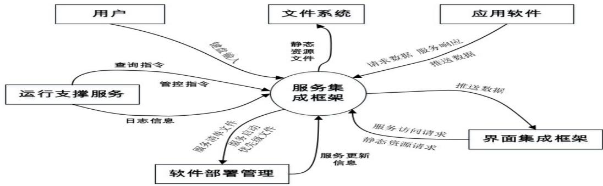
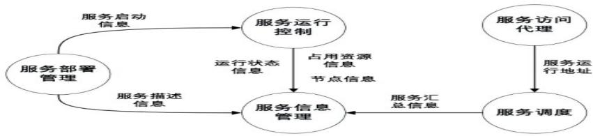

文件下载用例场景，见表58。

表58 文件下载用例描述
<table><tr><td rowspan=1 colspan=1>Use Case 名称:文件下载</td><td rowspan=1 colspan=2>Actors:界面集成框架</td></tr><tr><td rowspan=1 colspan=3>概述：本用例是文件下载的过程；</td></tr><tr><td rowspan=1 colspan=3>前置条件：网络正常，服务访问代理运行正常。</td></tr><tr><td rowspan=1 colspan=3>主事件流</td></tr><tr><td rowspan=1 colspan=1>Actor 的动作</td><td rowspan=1 colspan=1>系统的动作</td><td rowspan=1 colspan=1>动作约束(性能、可靠性、容错等)</td></tr><tr><td rowspan=1 colspan=1>1.界面集成框架发送文件下载请求；5.界面集成框架获取下载的文件进行下一步操作。</td><td rowspan=1 colspan=1>2.系统收到下载请求，解析下载的路由地址；如果路由地址解析正确，进行文件查找，如果解析错误，执行异常流E1;3.系统查询下载文件是否存在磁盘中，如果存在，从磁盘中读文件数据，如果文件不存在，执行异常流E2；4.系统将请求下载的文件返回；</td><td rowspan=1 colspan=1>校验输入参数的合法性，并在错误发生时，提供详细的错误信息；</td></tr><tr><td rowspan=1 colspan=2>异常流E1：系统提示下载地址不正确，用例结束。</td><td rowspan=1 colspan=1></td></tr><tr><td rowspan=1 colspan=2>异常流E2：系统提示下载失败，文件不存在，用例结束。</td><td rowspan=1 colspan=1></td></tr><tr><td rowspan=1 colspan=2>后置条件：无。</td><td rowspan=1 colspan=1></td></tr></table>

## 3.3 CSCI 外部接口需求

## 3.3.1 接口标识和接口图

服务集成框架外部接口需求见图20所示，包括：与运行支撑服务软件接口、与软件部署管理软件接口、与界面集成框架软件接口、与应用软件的接口、人机接口、文件系统接口。

  
图20 服务集成框架外部接口需求

服务集成框架外部接口需求见表59。

表59 服务集成框架外部接口需求
<table><tr><td colspan="1" rowspan="1">序号</td><td colspan="1" rowspan="1">接口需求名称</td><td colspan="1" rowspan="1">接口需求标识</td><td colspan="1" rowspan="1">接口类型</td><td colspan="1" rowspan="1">发送方</td><td colspan="1" rowspan="1">接收方</td><td colspan="1" rowspan="1">接口内容</td><td colspan="1" rowspan="1">接口优先级</td></tr><tr><td colspan="1" rowspan="3">1</td><td colspan="1" rowspan="3">与运行支撑服务的接口</td><td colspan="1" rowspan="3">PZXQ-WBJK-FWJCKJ-YXZC</td><td colspan="1" rowspan="1">网络接口</td><td colspan="1" rowspan="1">运行支撑服务</td><td colspan="1" rowspan="1">本系统</td><td colspan="1" rowspan="1">查询指令</td><td colspan="1" rowspan="1">高</td></tr><tr><td colspan="1" rowspan="1">网络接口</td><td colspan="1" rowspan="1">运行支撑服务</td><td colspan="1" rowspan="1">本系统</td><td colspan="1" rowspan="1">管控指令</td><td colspan="1" rowspan="1">高</td></tr><tr><td colspan="1" rowspan="1">API接口</td><td colspan="1" rowspan="1">本系统</td><td colspan="1" rowspan="1">运行支撑服务</td><td colspan="1" rowspan="1">日志信息</td><td colspan="1" rowspan="1">高</td></tr><tr><td colspan="1" rowspan="3">2</td><td colspan="1" rowspan="3">与界面集成框架的接口</td><td colspan="1" rowspan="3">PZXQ-WBJK-FWJCKJ-JMJC</td><td colspan="1" rowspan="1">网络接口</td><td colspan="1" rowspan="1">界面集成框架</td><td colspan="1" rowspan="1">本系统</td><td colspan="1" rowspan="1">服务访问请求</td><td colspan="1" rowspan="1">高</td></tr><tr><td colspan="1" rowspan="1">网络接口</td><td colspan="1" rowspan="1">界面集成框架</td><td colspan="1" rowspan="1">本系统</td><td colspan="1" rowspan="1">静态资源请求</td><td colspan="1" rowspan="1">高</td></tr><tr><td colspan="1" rowspan="1">网络接口</td><td colspan="1" rowspan="1">本系统</td><td colspan="1" rowspan="1">界面集成框架</td><td colspan="1" rowspan="1">推送数据</td><td colspan="1" rowspan="1">高</td></tr><tr><td colspan="1" rowspan="3">3</td><td colspan="1" rowspan="3">与软件部署管理的接口</td><td colspan="1" rowspan="3">PZXQ-WBJK-FWJCKJ-BSGL</td><td colspan="1" rowspan="1">文件接口</td><td colspan="1" rowspan="1">本系统</td><td colspan="1" rowspan="1">软件部署管理</td><td colspan="1" rowspan="1">服务清单信息</td><td colspan="1" rowspan="1">高</td></tr><tr><td colspan="1" rowspan="1">文件接口</td><td colspan="1" rowspan="1">本系统</td><td colspan="1" rowspan="1">软件部署管理</td><td colspan="1" rowspan="1">服务启动优先级信息</td><td colspan="1" rowspan="1">高</td></tr><tr><td colspan="1" rowspan="1">网络接口</td><td colspan="1" rowspan="1">软件部署</td><td colspan="1" rowspan="1">本系统</td><td colspan="1" rowspan="1">服务更新信息</td><td colspan="1" rowspan="1">高</td></tr><tr><td colspan="1" rowspan="1"></td><td colspan="1" rowspan="1"></td><td colspan="1" rowspan="1"></td><td colspan="1" rowspan="1"></td><td colspan="1" rowspan="1">管理</td><td colspan="1" rowspan="1"></td><td colspan="1" rowspan="1"></td><td colspan="1" rowspan="1"></td></tr><tr><td colspan="1" rowspan="1">4</td><td colspan="1" rowspan="1">与用户之间接口</td><td colspan="1" rowspan="1">PZXQ-WBJK-FWJCKJ-RJJH</td><td colspan="1" rowspan="1">人机接口</td><td colspan="1" rowspan="1">用户</td><td colspan="1" rowspan="1">本系统</td><td colspan="1" rowspan="1">键盘输入信息</td><td colspan="1" rowspan="1">中</td></tr><tr><td colspan="1" rowspan="3">5</td><td colspan="1" rowspan="3">与应用软件接口</td><td colspan="1" rowspan="3">PZXQ-WBJK-FWJCKJ-YYRJ</td><td colspan="1" rowspan="1">API接口</td><td colspan="1" rowspan="1">应用软件</td><td colspan="1" rowspan="1">本系统</td><td colspan="1" rowspan="1">请求数据</td><td colspan="1" rowspan="1">中</td></tr><tr><td colspan="1" rowspan="1">API接口</td><td colspan="1" rowspan="1">应用软件</td><td colspan="1" rowspan="1">本系统</td><td colspan="1" rowspan="1">响应数据</td><td colspan="1" rowspan="1">中</td></tr><tr><td colspan="1" rowspan="1">API接口</td><td colspan="1" rowspan="1">本系统</td><td colspan="1" rowspan="1">应用软件</td><td colspan="1" rowspan="1">推送数据</td><td colspan="1" rowspan="1">中</td></tr><tr><td colspan="1" rowspan="1">6</td><td colspan="1" rowspan="1">与文件系统接口</td><td colspan="1" rowspan="1">PZXQ-WBJK-FWJCKJ-JTWJ</td><td colspan="1" rowspan="1">文件接口</td><td colspan="1" rowspan="1">本系统</td><td colspan="1" rowspan="1">文件系统</td><td colspan="1" rowspan="1">静态资源文件</td><td colspan="1" rowspan="1">中</td></tr></table>

## 3.3.2 与运行支撑服务接口（PZXQ-WBJK-FWJCKJ-YXZC）

与运行支撑服务接口数据元素说明表，见表60。

表60与运行支撑服务接口数据元素说明
<table><tr><td rowspan=1 colspan=1>序号</td><td rowspan=1 colspan=1>数据集名称</td><td rowspan=1 colspan=1>数据组成</td><td rowspan=1 colspan=1>数据约束</td><td rowspan=1 colspan=1>数据标准</td></tr><tr><td rowspan=3 colspan=1>1</td><td rowspan=3 colspan=1>查询指令</td><td rowspan=1 colspan=1>服务名称</td><td rowspan=1 colspan=1>字符串</td><td rowspan=8 colspan=1>某试点建设装备配套科研服务运行调度规范</td></tr><tr><td rowspan=1 colspan=1>节点IP</td><td rowspan=1 colspan=1>字符串</td></tr><tr><td rowspan=1 colspan=1>查询类型</td><td rowspan=1 colspan=1>整型</td></tr><tr><td rowspan=2 colspan=1>2</td><td rowspan=2 colspan=1>管控指令</td><td rowspan=1 colspan=1>服务名称</td><td rowspan=1 colspan=1>字符串</td></tr><tr><td rowspan=1 colspan=1>动作类型</td><td rowspan=1 colspan=1>整型</td></tr><tr><td rowspan=3 colspan=1>3</td><td rowspan=3 colspan=1>日志信息</td><td rowspan=1 colspan=1>日志级别</td><td rowspan=1 colspan=1>整型</td></tr><tr><td rowspan=1 colspan=1>日志消息</td><td rowspan=1 colspan=1>字符串</td></tr><tr><td rowspan=1 colspan=1>格式信息</td><td rowspan=1 colspan=1>字符串</td></tr></table>

## 3.3.3 与软件部署管理接口（PZXQ-WBJK-FWJCKJ-BSGL）

与软件部署管理接口数据元素说明表，见表61。

表61与软件部署管理接口数据元素说明
<table><tr><td colspan="1" rowspan="1">序号</td><td colspan="1" rowspan="1">数据集名称</td><td colspan="1" rowspan="1">数据组成</td><td colspan="1" rowspan="1">数据约束</td><td colspan="1" rowspan="1">数据标准</td></tr><tr><td colspan="1" rowspan="5">1</td><td colspan="1" rowspan="5">服务清单</td><td colspan="1" rowspan="1">适用平台</td><td colspan="1" rowspan="1">字符串</td><td colspan="1" rowspan="5">某试点建设装备配套科研服务运行调度规范</td></tr><tr><td colspan="1" rowspan="1">服务名称</td><td colspan="1" rowspan="1">字符串</td></tr><tr><td colspan="1" rowspan="1">服务中文名称</td><td colspan="1" rowspan="1">字符串</td></tr><tr><td colspan="1" rowspan="1">服务类型</td><td colspan="1" rowspan="1">字符串</td></tr><tr><td colspan="1" rowspan="1">可执行程序名</td><td colspan="1" rowspan="1">字符串</td></tr><tr><td colspan="1" rowspan="8"></td><td colspan="1" rowspan="8"></td><td colspan="1" rowspan="1">启动参数</td><td colspan="1" rowspan="1">字符串</td><td colspan="1" rowspan="12"></td></tr><tr><td colspan="1" rowspan="1">启动方式</td><td colspan="1" rowspan="1">字符串</td></tr><tr><td colspan="1" rowspan="1">版本号</td><td colspan="1" rowspan="1">字符串</td></tr><tr><td colspan="1" rowspan="1">访问优先级</td><td colspan="1" rowspan="1">字符串</td></tr><tr><td colspan="1" rowspan="1">负载策略</td><td colspan="1" rowspan="1">字符串</td></tr><tr><td colspan="1" rowspan="1">工作路径</td><td colspan="1" rowspan="1">字符串</td></tr><tr><td colspan="1" rowspan="1">启动环境变量</td><td colspan="1" rowspan="1">字符串</td></tr><tr><td colspan="1" rowspan="1">依赖库</td><td colspan="1" rowspan="1">字符串</td></tr><tr><td colspan="1" rowspan="2">2</td><td colspan="1" rowspan="2">服务启动优先级</td><td colspan="1" rowspan="1">服务名称</td><td colspan="1" rowspan="1">字符串</td></tr><tr><td colspan="1" rowspan="1">启动优先级</td><td colspan="1" rowspan="1">整型</td></tr><tr><td colspan="1" rowspan="2">3</td><td colspan="1" rowspan="2">服务更新信息</td><td colspan="1" rowspan="1">服务名称</td><td colspan="1" rowspan="1">整型</td></tr><tr><td colspan="1" rowspan="1">操作类型</td><td colspan="1" rowspan="1">字符串</td></tr></table>

与界面集成框架接口数据元素说明表，见表62。

3.3.4 与界面集成框架接口（PZXQ-WBJK-FWJCKJ-JMJC）

表62与界面集成框架接口数据元素说明
<table><tr><td rowspan=1 colspan=1>序号</td><td rowspan=1 colspan=1>数据集名称</td><td rowspan=1 colspan=1>数据组成</td><td rowspan=1 colspan=1>数据约束</td><td rowspan=1 colspan=1>数据标准</td></tr><tr><td rowspan=4 colspan=1>1</td><td rowspan=4 colspan=1>服务访问请求</td><td rowspan=1 colspan=1>请求方法</td><td rowspan=1 colspan=1>字符串</td><td rowspan=11 colspan=1>某试点建设装备配套科研界面集成规范</td></tr><tr><td rowspan=1 colspan=1>请求参数</td><td rowspan=1 colspan=1>字符串</td></tr><tr><td rowspan=1 colspan=1>服务请求 URL</td><td rowspan=1 colspan=1>字符串</td></tr><tr><td rowspan=1 colspan=1>服务请求数据</td><td rowspan=1 colspan=1>字符串</td></tr><tr><td rowspan=4 colspan=1>2</td><td rowspan=4 colspan=1>静态资源请求</td><td rowspan=1 colspan=1>请求方法</td><td rowspan=1 colspan=1>字符串</td></tr><tr><td rowspan=1 colspan=1>请求参数</td><td rowspan=1 colspan=1>字符串</td></tr><tr><td rowspan=1 colspan=1>请求 URL</td><td rowspan=1 colspan=1>字符串</td></tr><tr><td rowspan=1 colspan=1>请求数据</td><td rowspan=1 colspan=1>字符串</td></tr><tr><td rowspan=3 colspan=1>3</td><td rowspan=3 colspan=1>推送数据</td><td rowspan=1 colspan=1>推送数据</td><td rowspan=1 colspan=1>字符串</td></tr><tr><td rowspan=1 colspan=1>通道标识</td><td rowspan=1 colspan=1>整型</td></tr><tr><td rowspan=1 colspan=1>数据长度</td><td rowspan=1 colspan=1>整型</td></tr></table>

3.3.5 与应用软件接口（PZXQ-WBJK-FWJCKJ-YYRJ）

与应用软件接口数据元素说明表，见表63。

表63与应用软件接口数据元素说明
<table><tr><td rowspan=1 colspan=1>序号</td><td rowspan=1 colspan=1>数据集名称</td><td rowspan=1 colspan=1>数据组成</td><td rowspan=1 colspan=1>数据约束</td><td rowspan=1 colspan=1>数据标准</td></tr><tr><td rowspan=4 colspan=1>1</td><td rowspan=4 colspan=1>请求数据</td><td rowspan=1 colspan=1>请求方法</td><td rowspan=1 colspan=1>字符串</td><td rowspan=10 colspan=1>某试点建设装备配套科研信息交换格式</td></tr><tr><td rowspan=1 colspan=1>请求参数</td><td rowspan=1 colspan=1>字符串</td></tr><tr><td rowspan=1 colspan=1>请求数据</td><td rowspan=1 colspan=1>字符串</td></tr><tr><td rowspan=1 colspan=1>请求数据长度</td><td rowspan=1 colspan=1>整型</td></tr><tr><td rowspan=3 colspan=1>2</td><td rowspan=3 colspan=1>响应数据</td><td rowspan=1 colspan=1>响应类型</td><td rowspan=1 colspan=1>字符串</td></tr><tr><td rowspan=1 colspan=1>响应长度</td><td rowspan=1 colspan=1>整型</td></tr><tr><td rowspan=1 colspan=1>响应数据</td><td rowspan=1 colspan=1>字符串</td></tr><tr><td rowspan=3 colspan=1>3</td><td rowspan=3 colspan=1>推送数据</td><td rowspan=1 colspan=1>推送数据</td><td rowspan=1 colspan=1>字符串</td></tr><tr><td rowspan=1 colspan=1>数据长度</td><td rowspan=1 colspan=1>整型</td></tr><tr><td rowspan=1 colspan=1>通道标识</td><td rowspan=1 colspan=1>整型</td></tr></table>

3.3.6 与用户接口（PZXQ-WBJK-FWJCKJ-RJJK）  
与用户接口数据元素说明表，见表64。

表64与用户接口数据元素说明
<table><tr><td rowspan=1 colspan=1>序号</td><td rowspan=1 colspan=1>数据集名称</td><td rowspan=1 colspan=1>数据组成</td><td rowspan=1 colspan=1>数据约束</td><td rowspan=1 colspan=1>数据标准</td></tr><tr><td rowspan=1 colspan=1>1</td><td rowspan=1 colspan=1>键盘输入数据</td><td rowspan=1 colspan=1>输入数据</td><td rowspan=1 colspan=1>字符串</td><td rowspan=1 colspan=1>某试点建设装备配套科研界面设计规范</td></tr></table>

## 3.3.7 与文件系统接口（PZXQ-WBJK-FWJCKJ-JTWJ）

与文件系统接口数据元素说明表，见表65。

表65与文件系统接口数据元素说明
<table><tr><td rowspan=1 colspan=1>序号</td><td rowspan=1 colspan=1>数据集名称</td><td rowspan=1 colspan=1>数据组成</td><td rowspan=1 colspan=1>数据约束</td><td rowspan=1 colspan=1>数据标准</td></tr><tr><td rowspan=1 colspan=1>1</td><td rowspan=1 colspan=1>静态资源文件</td><td rowspan=1 colspan=1>静态资源描述</td><td rowspan=1 colspan=1>字符串</td><td rowspan=1 colspan=1>某试点建设装备配套科研界面集成规范</td></tr></table>

## 3.4 CSCI 内部接口需求

## 3.4.1 接口标识和接口图

服务集成框架内部接口如图21所示。

  
图21服务集成框架内部接口需求  
服务集成框架内部接口需求表见表66。

表66 服务集成框架内部接口需求
<table><tr><td rowspan=1 colspan=1>序号</td><td rowspan=1 colspan=1>接口需求名称</td><td rowspan=1 colspan=1>接口需求标识</td><td rowspan=1 colspan=1>接口类型</td><td rowspan=1 colspan=1>发送方</td><td rowspan=1 colspan=1>接收方</td><td rowspan=1 colspan=1>接口内容</td><td rowspan=1 colspan=1>接口优先级</td></tr><tr><td rowspan=1 colspan=1>1</td><td rowspan=1 colspan=1>服务部署管理与服务运行控制接口</td><td rowspan=1 colspan=1>PZXQ-NBJK-FWJCKJ-FWQD</td><td rowspan=1 colspan=1>API接口</td><td rowspan=1 colspan=1>服务部署管理</td><td rowspan=1 colspan=1>服务运行控制</td><td rowspan=1 colspan=1>服务启动信息</td><td rowspan=1 colspan=1>低</td></tr><tr><td rowspan=1 colspan=1>2</td><td rowspan=1 colspan=1>服务部署管理与服务信息管理接口</td><td rowspan=1 colspan=1>PZXQ-NBJK-FWJCKJ-FWZC</td><td rowspan=1 colspan=1>网络接口</td><td rowspan=1 colspan=1>服务部署管理</td><td rowspan=1 colspan=1>服务运行控制</td><td rowspan=1 colspan=1>服务描述信息</td><td rowspan=1 colspan=1>低</td></tr><tr><td rowspan=2 colspan=1>3</td><td rowspan=2 colspan=1>服务运行控制与服务信息管理接口</td><td rowspan=2 colspan=1>PZXQ-NBJK-FWJCKJ-ZTJS</td><td rowspan=1 colspan=1>网络接口</td><td rowspan=1 colspan=1>服务运行控制</td><td rowspan=1 colspan=1>服务状态监视</td><td rowspan=1 colspan=1>运行状态信息</td><td rowspan=1 colspan=1>低</td></tr><tr><td rowspan=1 colspan=1>网络接口</td><td rowspan=1 colspan=1>服务运行控制</td><td rowspan=1 colspan=1>服务状态监视</td><td rowspan=1 colspan=1>资源占用信息</td><td rowspan=1 colspan=1>低</td></tr><tr><td rowspan=1 colspan=1>4</td><td rowspan=1 colspan=1>服务信息管理与服务调度的关系</td><td rowspan=1 colspan=1>PZXQ-NBJK-FWJCKJ-FWDD</td><td rowspan=1 colspan=1>API接口</td><td rowspan=1 colspan=1>服务状态监视</td><td rowspan=1 colspan=1>服务调度</td><td rowspan=1 colspan=1>服务汇总信息</td><td rowspan=1 colspan=1>低</td></tr><tr><td rowspan=1 colspan=1>5</td><td rowspan=1 colspan=1>服务访问代理与服务调度的关系</td><td rowspan=1 colspan=1>PZXQ-NBJK-FWJCKJ-FWDL</td><td rowspan=1 colspan=1>网络接口</td><td rowspan=1 colspan=1>服务访问代理</td><td rowspan=1 colspan=1>服务调度</td><td rowspan=1 colspan=1>服务运行地址</td><td rowspan=1 colspan=1>低</td></tr></table>

## 3.4.2 服务部署与运行控制接口（PZXQ-NBJK-FWJCKJ-FWQD）

服务部署与运行控制数据元素说明表，见表67。

表67服务部署与运行控制数据元素说明
<table><tr><td rowspan=1 colspan=1>序号</td><td rowspan=1 colspan=1>数据集名称</td><td rowspan=1 colspan=1>数据组成</td><td rowspan=1 colspan=1>数据约束</td><td rowspan=1 colspan=1>数据标准</td></tr><tr><td rowspan=9 colspan=1>1</td><td rowspan=9 colspan=1>服务启动信息</td><td rowspan=1 colspan=1>服务名称</td><td rowspan=1 colspan=1>字符串</td><td rowspan=1 colspan=1>自定义标准</td></tr><tr><td rowspan=1 colspan=1>服务类型</td><td rowspan=1 colspan=1>字符串</td><td rowspan=1 colspan=1>自定义标准</td></tr><tr><td rowspan=1 colspan=1>可执行程序名</td><td rowspan=1 colspan=1>字符串</td><td rowspan=1 colspan=1>自定义标准</td></tr><tr><td rowspan=1 colspan=1>启动参数</td><td rowspan=1 colspan=1>字符串</td><td rowspan=1 colspan=1>自定义标准</td></tr><tr><td rowspan=1 colspan=1>启动方式</td><td rowspan=1 colspan=1>字符串</td><td rowspan=1 colspan=1>自定义标准</td></tr><tr><td rowspan=1 colspan=1>工作路径</td><td rowspan=1 colspan=1>字符串</td><td rowspan=1 colspan=1>自定义标准</td></tr><tr><td rowspan=1 colspan=1>启动环境变量</td><td rowspan=1 colspan=1>字符串</td><td rowspan=1 colspan=1>自定义标准</td></tr><tr><td rowspan=1 colspan=1>依赖服务</td><td rowspan=1 colspan=1>字符串</td><td rowspan=1 colspan=1>自定义标准</td></tr><tr><td rowspan=1 colspan=1>启动优先级</td><td rowspan=1 colspan=1>整型</td><td rowspan=1 colspan=1>自定义标准</td></tr></table>

3.4.3 运行控制与信息管理接口（PZXQ-NBJK-FWJCKJ-ZTJS）  
运行控制与信息管理接口数据元素说明表，见表68。

表68服务部署与运行控制数据元素说明
<table><tr><td colspan="1" rowspan="1">序号</td><td colspan="1" rowspan="1">数据集名称</td><td colspan="1" rowspan="1">数据组成</td><td colspan="1" rowspan="1">数据约束</td><td colspan="1" rowspan="1">数据标准</td></tr><tr><td colspan="1" rowspan="5">1</td><td colspan="1" rowspan="5">运行状态信息</td><td colspan="1" rowspan="1">服务id</td><td colspan="1" rowspan="1">字符串</td><td colspan="1" rowspan="1">自定义标准</td></tr><tr><td colspan="1" rowspan="1">状态</td><td colspan="1" rowspan="1">枚举型</td><td colspan="1" rowspan="1">自定义标准</td></tr><tr><td colspan="1" rowspan="1">启动次数</td><td colspan="1" rowspan="1">整型</td><td colspan="1" rowspan="1">自定义标准</td></tr><tr><td colspan="1" rowspan="1">运行地址</td><td colspan="1" rowspan="1">字符串</td><td colspan="1" rowspan="1">自定义标准</td></tr><tr><td colspan="1" rowspan="1">监听端口</td><td colspan="1" rowspan="1">整型</td><td colspan="1" rowspan="1">自定义标准</td></tr><tr><td colspan="1" rowspan="4">2</td><td colspan="1" rowspan="4">资源占用信息</td><td colspan="1" rowspan="1">服务id</td><td colspan="1" rowspan="1">字符串</td><td colspan="1" rowspan="1">自定义标准</td></tr><tr><td colspan="1" rowspan="1">进程id</td><td colspan="1" rowspan="1">整型</td><td colspan="1" rowspan="1">自定义标准</td></tr><tr><td colspan="1" rowspan="1">CPU占用率</td><td colspan="1" rowspan="1">浮点型</td><td colspan="1" rowspan="1">自定义标准</td></tr><tr><td colspan="1" rowspan="1">内存占用率</td><td colspan="1" rowspan="1">浮点型</td><td colspan="1" rowspan="1">自定义标准</td></tr><tr><td colspan="1" rowspan="2">3</td><td colspan="1" rowspan="2">节点信息</td><td colspan="1" rowspan="1">地址</td><td colspan="1" rowspan="1">字符串</td><td colspan="1" rowspan="1">自定义标准</td></tr><tr><td colspan="1" rowspan="1">系统类型</td><td colspan="1" rowspan="1">字符串</td><td colspan="1" rowspan="1">自定义标准</td></tr><tr><td colspan="1" rowspan="6"></td><td colspan="1" rowspan="6"></td><td colspan="1" rowspan="1">平台类型</td><td colspan="1" rowspan="1">字符串</td><td colspan="1" rowspan="1">自定义标准</td></tr><tr><td colspan="1" rowspan="1">服务数量</td><td colspan="1" rowspan="1">整型</td><td colspan="1" rowspan="1">自定义标准</td></tr><tr><td colspan="1" rowspan="1">启动时间</td><td colspan="1" rowspan="1">字符串</td><td colspan="1" rowspan="1">自定义标准</td></tr><tr><td colspan="1" rowspan="1">节点 CPU 占用率</td><td colspan="1" rowspan="1">浮点型</td><td colspan="1" rowspan="1">自定义标准</td></tr><tr><td colspan="1" rowspan="1">节点磁盘占用率</td><td colspan="1" rowspan="1">浮点型</td><td colspan="1" rowspan="1">自定义标准</td></tr><tr><td colspan="1" rowspan="1">节点内存占用率</td><td colspan="1" rowspan="1">浮点型</td><td colspan="1" rowspan="1">自定义标准</td></tr></table>

服务部署与信息管理接口数据元素说明表，见表69。

3.4.4 服务部署与信息管理接口（PZXQ-NBJK-FWJCKJ-FWZC）

表69服务部署与状态监视数据元素说明
<table><tr><td rowspan=1 colspan=1>序号</td><td rowspan=1 colspan=1>数据集名称</td><td rowspan=1 colspan=1>数据组成</td><td rowspan=1 colspan=1>数据约束</td><td rowspan=1 colspan=1>数据标准</td></tr><tr><td rowspan=13 colspan=1>1</td><td rowspan=13 colspan=1>服务描述信息</td><td rowspan=1 colspan=1>适用平台</td><td rowspan=1 colspan=1>字符串</td><td rowspan=1 colspan=1>自定义标准</td></tr><tr><td rowspan=1 colspan=1>服务名称</td><td rowspan=1 colspan=1>字符串</td><td rowspan=1 colspan=1>自定义标准</td></tr><tr><td rowspan=1 colspan=1>服务中文名称</td><td rowspan=1 colspan=1>字符串</td><td rowspan=1 colspan=1>自定义标准</td></tr><tr><td rowspan=1 colspan=1>服务类型</td><td rowspan=1 colspan=1>字符串</td><td rowspan=1 colspan=1>自定义标准</td></tr><tr><td rowspan=1 colspan=1>可执行程序名</td><td rowspan=1 colspan=1>字符串</td><td rowspan=1 colspan=1>自定义标准</td></tr><tr><td rowspan=1 colspan=1>启动参数</td><td rowspan=1 colspan=1>字符串</td><td rowspan=1 colspan=1>自定义标准</td></tr><tr><td rowspan=1 colspan=1>启动方式</td><td rowspan=1 colspan=1>字符串</td><td rowspan=1 colspan=1>自定义标准</td></tr><tr><td rowspan=1 colspan=1>版本号</td><td rowspan=1 colspan=1>字符串</td><td rowspan=1 colspan=1>自定义标准</td></tr><tr><td rowspan=1 colspan=1>访问优先级</td><td rowspan=1 colspan=1>字符串</td><td rowspan=1 colspan=1>自定义标准</td></tr><tr><td rowspan=1 colspan=1>负载策略</td><td rowspan=1 colspan=1>字符串</td><td rowspan=1 colspan=1>自定义标准</td></tr><tr><td rowspan=1 colspan=1>工作路径</td><td rowspan=1 colspan=1>字符串</td><td rowspan=1 colspan=1>自定义标准</td></tr><tr><td rowspan=1 colspan=1>启动环境变量</td><td rowspan=1 colspan=1>字符串</td><td rowspan=1 colspan=1>自定义标准</td></tr><tr><td rowspan=1 colspan=1>依赖库</td><td rowspan=1 colspan=1>字符串</td><td rowspan=1 colspan=1>自定义标准</td></tr></table>

3.4.5 信息管理与服务调度接口（PZXQ-NBJK-FWJCKJ-FWDD）  
信息管理与服务调度接口数据元素说明表，见表70。

表70服务部署与运行控制数据元素说明
<table><tr><td rowspan=1 colspan=1>序号</td><td rowspan=1 colspan=1>数据集名称</td><td rowspan=1 colspan=1>数据组成</td><td rowspan=1 colspan=1>数据约束</td><td rowspan=1 colspan=1>数据标准</td></tr><tr><td rowspan=21 colspan=2>1      服务汇总信息</td><td rowspan=1 colspan=1>适用平台</td><td rowspan=1 colspan=1>字符串</td><td rowspan=1 colspan=1>自定义标准</td></tr><tr><td rowspan=1 colspan=1>服务名称</td><td rowspan=1 colspan=1>字符串</td><td rowspan=1 colspan=1>自定义标准</td></tr><tr><td rowspan=1 colspan=1>服务id</td><td rowspan=1 colspan=1>字符串</td><td rowspan=1 colspan=1>自定义标准</td></tr><tr><td rowspan=1 colspan=1>服务中文名称</td><td rowspan=1 colspan=1>字符串</td><td rowspan=1 colspan=1>自定义标准</td></tr><tr><td rowspan=1 colspan=1>服务类型</td><td rowspan=1 colspan=1>字符串</td><td rowspan=1 colspan=1>自定义标准</td></tr><tr><td rowspan=1 colspan=1>可执行程序名</td><td rowspan=1 colspan=1>字符串</td><td rowspan=1 colspan=1>自定义标准</td></tr><tr><td rowspan=1 colspan=1>启动参数</td><td rowspan=1 colspan=1>字符串</td><td rowspan=1 colspan=1>自定义标准</td></tr><tr><td rowspan=1 colspan=1>启动方式</td><td rowspan=1 colspan=1>字符串</td><td rowspan=1 colspan=1>自定义标准</td></tr><tr><td rowspan=1 colspan=1>版本号</td><td rowspan=1 colspan=1>字符串</td><td rowspan=1 colspan=1>自定义标准</td></tr><tr><td rowspan=1 colspan=1>访问优先级</td><td rowspan=1 colspan=1>字符串</td><td rowspan=1 colspan=1>自定义标准</td></tr><tr><td rowspan=1 colspan=1>负载策略</td><td rowspan=1 colspan=1>字符串</td><td rowspan=1 colspan=1>自定义标准</td></tr><tr><td rowspan=1 colspan=1>工作路径</td><td rowspan=1 colspan=1>字符串</td><td rowspan=1 colspan=1>自定义标准</td></tr><tr><td rowspan=1 colspan=1>启动环境变量</td><td rowspan=1 colspan=1>字符串</td><td rowspan=1 colspan=1>自定义标准</td></tr><tr><td rowspan=1 colspan=1>依赖服务</td><td rowspan=1 colspan=1>字符串</td><td rowspan=1 colspan=1>自定义标准</td></tr><tr><td rowspan=1 colspan=1>状态</td><td rowspan=1 colspan=1>枚举型</td><td rowspan=1 colspan=1>自定义标准</td></tr><tr><td rowspan=1 colspan=1>启动次数</td><td rowspan=1 colspan=1>整型</td><td rowspan=1 colspan=1>自定义标准</td></tr><tr><td rowspan=1 colspan=1>运行地址</td><td rowspan=1 colspan=1>字符串</td><td rowspan=1 colspan=1>自定义标准</td></tr><tr><td rowspan=1 colspan=1>监听端口</td><td rowspan=1 colspan=1>整型</td><td rowspan=1 colspan=1>自定义标准</td></tr><tr><td rowspan=1 colspan=1>进程id</td><td rowspan=1 colspan=1>整型</td><td rowspan=1 colspan=1>自定义标准</td></tr><tr><td rowspan=1 colspan=1>CPU 占用率</td><td rowspan=1 colspan=1>浮点型</td><td rowspan=1 colspan=1>自定义标准</td></tr><tr><td rowspan=1 colspan=1>内存占用率</td><td rowspan=1 colspan=1>浮点型</td><td rowspan=1 colspan=1>自定义标准</td></tr></table>

## 3.4.6 服务代理与服务调度接口（PZXQ-NBJK-FWJCKJ-FWDL）

服务代理与服务调度接口数据元素说明表，见表71。

表71服务代理与服务调度接口数据元素说明

<table><tr><td rowspan=1 colspan=1>序号</td><td rowspan=1 colspan=1>数据集名称</td><td rowspan=1 colspan=1>数据组成</td><td rowspan=1 colspan=1>数据约束</td><td rowspan=1 colspan=1>数据标准</td></tr><tr><td rowspan=4 colspan=1>1</td><td rowspan=4 colspan=1>运行状态信息</td><td rowspan=1 colspan=1>服务名称</td><td rowspan=1 colspan=1>字符串</td><td rowspan=1 colspan=1>自定义标准</td></tr><tr><td rowspan=1 colspan=1>服务运行地址</td><td rowspan=1 colspan=1>字符串</td><td rowspan=1 colspan=1>自定义标准</td></tr><tr><td rowspan=1 colspan=1>监听端口</td><td rowspan=1 colspan=1>整型</td><td rowspan=1 colspan=1>自定义标准</td></tr><tr><td rowspan=1 colspan=1>服务状态</td><td rowspan=1 colspan=1>枚举型</td><td rowspan=1 colspan=1>自定义标准</td></tr></table>

## 3.5 CSCI 内部数据需求

表72对 CSCI 所有内部数据元素进行汇总。

表72 服务集成框架内部数据汇总表
<table><tr><td rowspan=1 colspan=1>序号</td><td rowspan=1 colspan=1>数据名称</td><td rowspan=1 colspan=1>数据内容</td><td rowspan=1 colspan=1>相关功能及标识</td><td rowspan=1 colspan=1>备注</td></tr><tr><td rowspan=1 colspan=1>1</td><td rowspan=1 colspan=1>服务部署信息</td><td rowspan=1 colspan=1>服务名称、适用平台、服务中文名称、服务类型、可执行程序名、启动参数、启动方式、版本号、访问优先级、负载策略、工作路径、启动环境变量、运行依赖库</td><td rowspan=1 colspan=1>服务描述</td><td rowspan=1 colspan=1></td></tr><tr><td rowspan=1 colspan=1>2</td><td rowspan=1 colspan=1>节点监视信息</td><td rowspan=1 colspan=1>地址、系统类型、平台类型、负载值、启动时间</td><td rowspan=1 colspan=1>节点监视</td><td rowspan=1 colspan=1></td></tr><tr><td rowspan=1 colspan=1>3</td><td rowspan=1 colspan=1>服务监视信息</td><td rowspan=1 colspan=1>服务名称、启动位置、运行地址、运行端口、启动次数、状态、进程id、CPU占用率、内存占用率</td><td rowspan=1 colspan=1>服务监视</td><td rowspan=1 colspan=1></td></tr></table>

服务部署信息数据描述表见表73。

表73 服务部署信息数据描述表
<table><tr><td rowspan=1 colspan=1>序号</td><td rowspan=1 colspan=1>数据项</td><td rowspan=1 colspan=1>最大值</td><td rowspan=1 colspan=1>最小值</td><td rowspan=1 colspan=1>精度</td><td rowspan=1 colspan=1>单位</td><td rowspan=1 colspan=1>备注</td></tr><tr><td rowspan=1 colspan=1>1</td><td rowspan=1 colspan=1>适用平台</td><td rowspan=1 colspan=1>64</td><td rowspan=1 colspan=1>1</td><td rowspan=1 colspan=1>1</td><td rowspan=1 colspan=1>字符</td><td rowspan=1 colspan=1>1</td></tr><tr><td rowspan=1 colspan=1>2</td><td rowspan=1 colspan=1>服务名称</td><td rowspan=1 colspan=1>64</td><td rowspan=1 colspan=1>1</td><td rowspan=1 colspan=1>1</td><td rowspan=1 colspan=1>字符</td><td rowspan=1 colspan=1>1</td></tr><tr><td rowspan=1 colspan=1>3</td><td rowspan=1 colspan=1>服务中文名称</td><td rowspan=1 colspan=1>64</td><td rowspan=1 colspan=1>1</td><td rowspan=1 colspan=1>1</td><td rowspan=1 colspan=1>字符</td><td rowspan=1 colspan=1>1</td></tr><tr><td rowspan=1 colspan=1>4</td><td rowspan=1 colspan=1>服务类型</td><td rowspan=1 colspan=1>64</td><td rowspan=1 colspan=1>1</td><td rowspan=1 colspan=1>1</td><td rowspan=1 colspan=1>字符</td><td rowspan=1 colspan=1>1</td></tr><tr><td rowspan=1 colspan=1>5</td><td rowspan=1 colspan=1>可执行程序名</td><td rowspan=1 colspan=1>64</td><td rowspan=1 colspan=1>1</td><td rowspan=1 colspan=1>1</td><td rowspan=1 colspan=1>字符</td><td rowspan=1 colspan=1></td></tr><tr><td rowspan=1 colspan=1>6</td><td rowspan=1 colspan=1>启动参数</td><td rowspan=1 colspan=1>256</td><td rowspan=1 colspan=1>1</td><td rowspan=1 colspan=1>1</td><td rowspan=1 colspan=1>字符</td><td rowspan=1 colspan=1></td></tr><tr><td rowspan=1 colspan=1>7</td><td rowspan=1 colspan=1>启动方式</td><td rowspan=1 colspan=1>64</td><td rowspan=1 colspan=1>1</td><td rowspan=1 colspan=1>1</td><td rowspan=1 colspan=1>字符</td><td rowspan=1 colspan=1></td></tr><tr><td rowspan=1 colspan=1>8</td><td rowspan=1 colspan=1>版本号</td><td rowspan=1 colspan=1>64</td><td rowspan=1 colspan=1>1</td><td rowspan=1 colspan=1>1</td><td rowspan=1 colspan=1>字符</td><td rowspan=1 colspan=1></td></tr></table>