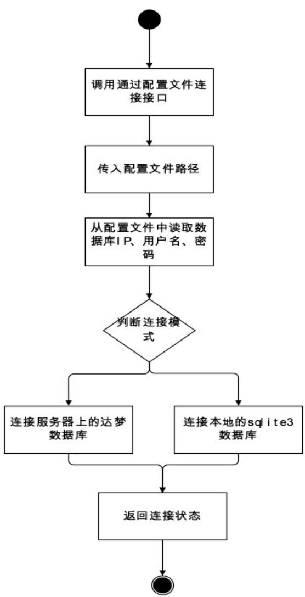
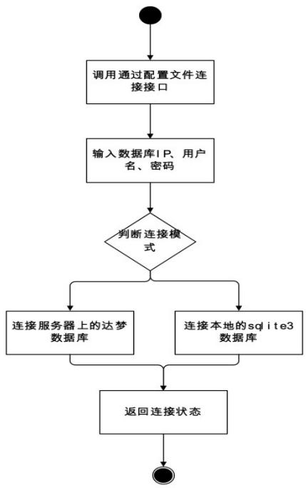
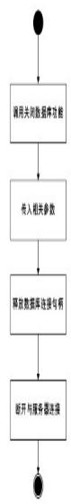
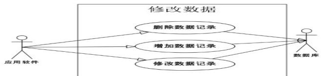
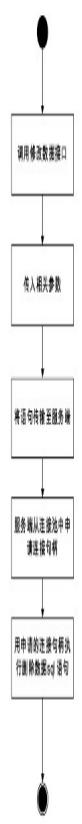
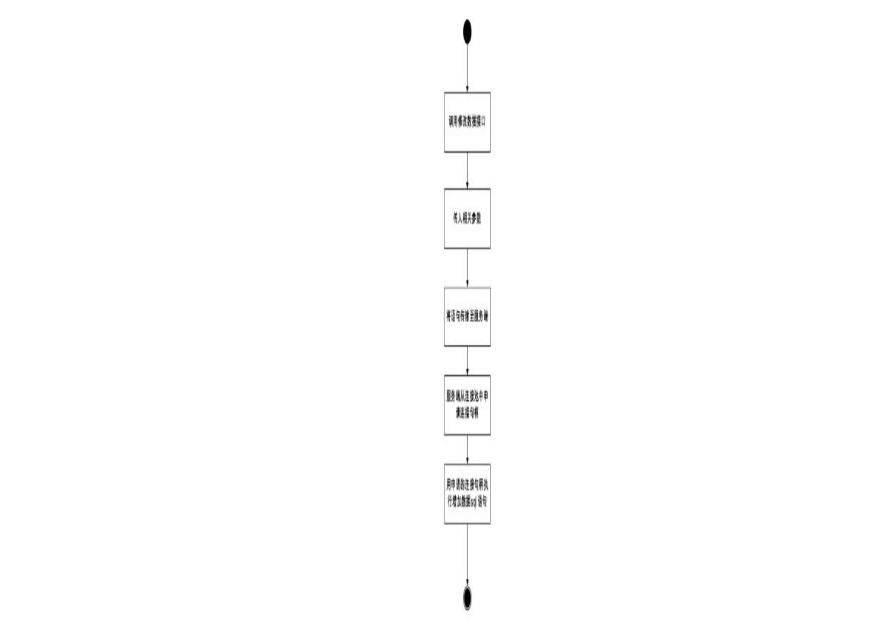
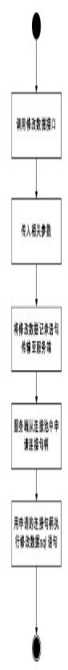

<table><tr><td rowspan=1 colspan=1>1.应用软件调用读取配置文件连接接口输入相关参数，如配置文件路径等参数；3.应用软件输出连接状态，如果返回的连接失败，通过获取错误信息接口，输出具体的连接错误信息。</td><td rowspan=1 colspan=1>2.读取配置文件中的的用户名、密码、IP地址连接对应的数据库，如果在桌面版、平板版连接的数据库为服务器上的达梦数据库，如果在手持上连接本地的sqlite3数据库，连接成功则保存连接句柄，连接失败则执行异常流E1；</td><td rowspan=1 colspan=1>如果无法连接到服务端，提示连接错误。</td></tr><tr><td rowspan=1 colspan=2>异常流E1：系统提示连接失败，用例结束。</td><td rowspan=1 colspan=1></td></tr><tr><td rowspan=1 colspan=2>后置条件：无。</td><td rowspan=1 colspan=1></td></tr></table>

读取配置文件连接流程图如图 6所示：

  
图 6读取配置文件连接流程图

3.2.1.1.3 数据库操作-数据库连接（PZXQ-GN-SQLFW-SJKCZ-SJKLJ）

数据库连接用例场景，见表7所示。

表7 数据库连接用例描述
<table><tr><td>Use Case 名称:数据库连接</td><td>Actors：应用软件</td></tr></table>

<table><tr><td rowspan=1 colspan=3>概述：本用例是SQL访问的扩展用例，描述数据库连接的过程；</td></tr><tr><td rowspan=1 colspan=3>前置条件：数据库初始化成功。</td></tr><tr><td rowspan=1 colspan=3>主事件流</td></tr><tr><td rowspan=1 colspan=1>Actor 的动作</td><td rowspan=1 colspan=1>系统的动作</td><td rowspan=1 colspan=1>动作约束(性能、可靠性、容错等)</td></tr><tr><td rowspan=1 colspan=1>1.应用软件调用数据库连接接口输入相关参数，如用户名、密码、IP地址、sqlite3 的 db 文件路径等参数；3.应用软件输出连接状态，如果返回的连接失败，通过获取错误信息接口，输出具体的连接错误信息。</td><td rowspan=1 colspan=1>2.根据应用软件输入的用户名、密码、IP地址连接对应的数据库，如果在桌面版、平板版连接的数据库为服务器上的达梦数据库，如果在手持上连接本地的sqlite3数据库，连接成功则保存连接句柄，则将错误信息返回则执行异常流E1;</td><td rowspan=1 colspan=1>如果无法连接到服务端，提示连接错误。</td></tr><tr><td rowspan=1 colspan=2>异常流E1：系统提示连接失败，用例结束。</td><td rowspan=1 colspan=1></td></tr><tr><td rowspan=1 colspan=2>后置条件：无。</td><td rowspan=1 colspan=1></td></tr></table>

数据库连接流程图如图7所示：

  
图7数据库连接流程图

3.2.1.1.4 数据库操作-数据库关闭（PZXQ-GN-SQLFW-SJKCZ-SJKGB）

数据库关闭用例场景，见表8所示。

表8 数据库关闭用例描述
<table><tr><td colspan="1" rowspan="1">Use Case 名称:数据库关闭</td><td colspan="2" rowspan="1">Actors：应用软件</td></tr><tr><td colspan="3" rowspan="1">概述：本用例是SQL访问的扩展用例，描述数据库关闭的过程；</td></tr><tr><td colspan="3" rowspan="1">前置条件：数据库连接正常。</td></tr><tr><td colspan="3" rowspan="1">主事件流</td></tr><tr><td colspan="1" rowspan="1">Actor 的动作</td><td colspan="1" rowspan="1">系统的动作</td><td colspan="1" rowspan="1">动作约束(性能、可靠性、容错等)</td></tr><tr><td colspan="1" rowspan="1">1.应用软件调用数据库关闭接口，传入连接句柄；</td><td colspan="1" rowspan="1">2.关闭数据库连接句柄并断开与服务端连接，释放连接结构体；</td><td colspan="1" rowspan="1">如果无法连接到服务端，提示连接错误。</td></tr><tr><td colspan="1" rowspan="1">3.数据库完成断开连接操作。</td><td colspan="1" rowspan="1"></td><td colspan="1" rowspan="1"></td></tr><tr><td colspan="2" rowspan="1">后置条件：无。</td><td colspan="1" rowspan="1"></td></tr></table>

数据库关闭流程图如图8所示：

  
图 8数据库关闭用例图  
3.2.1.2 SQL 访问-修改数据（PZXQ-GN-SQLFW-XGSJ）

修改数据功能包括：删除数据记录、增加数据记录、修改数据记录功能，其用例图如图9所示：

## 图9 修改数据用例图

修改数据功能标识表，见表9所示。

表9修改数据所有能力标识
<table><tr><td rowspan=1 colspan=1>序号</td><td rowspan=1 colspan=1>Use case名称</td><td rowspan=1 colspan=1>项目唯一标识符</td><td rowspan=1 colspan=1>需求描述</td><td rowspan=1 colspan=1>需求重用</td><td rowspan=1 colspan=1>方式名称</td><td rowspan=1 colspan=1>运行状态</td><td rowspan=1 colspan=1>对应的任务书功能/性能</td></tr><tr><td rowspan=1 colspan=1>1</td><td rowspan=1 colspan=1>删除数据记录</td><td rowspan=1 colspan=1>PZXQ-GN-SQLFW-SJXG</td><td rowspan=1 colspan=1>支持删除数据记录</td><td rowspan=1 colspan=1>沿用</td><td rowspan=1 colspan=1>桌面、平版、手持</td><td rowspan=1 colspan=1>开发阶段、运行阶段</td><td rowspan=1 colspan=1>4.1.1</td></tr><tr><td rowspan=1 colspan=1>2</td><td rowspan=1 colspan=1>增加数据记录</td><td rowspan=1 colspan=1>PZXQ-GN-SQLFW-ZXSW</td><td rowspan=1 colspan=1>支持增加数据记录</td><td rowspan=1 colspan=1>沿用</td><td rowspan=1 colspan=1>桌面、平版、手持</td><td rowspan=1 colspan=1>开发阶段、运行阶段</td><td rowspan=1 colspan=1>4.1.1</td></tr><tr><td rowspan=1 colspan=1>3</td><td rowspan=1 colspan=1>修改数据记录</td><td rowspan=1 colspan=1>PZXQ-GN-SQLFW-TJSW</td><td rowspan=1 colspan=1>支持修改数据记录</td><td rowspan=1 colspan=1>沿用</td><td rowspan=1 colspan=1>桌面、平版、手持</td><td rowspan=1 colspan=1>开发阶段、运行阶段</td><td rowspan=1 colspan=1>4.1.1</td></tr></table>

3.2.1.2.1 修改数据-删除数据记录（PZXQ-GN-SQLFW-XGSJ-SJXG）

删除数据记录用例场景，见表10所示。

表10 删除数据记录用例描述
<table><tr><td rowspan=1 colspan=1>Use Case 名称:删除数据记录</td><td rowspan=1 colspan=2>Actors：应用软件、数据库</td></tr><tr><td rowspan=1 colspan=3>概述：本用例是SQL访问的扩展用例，描述删除数据记录的过程；</td></tr><tr><td rowspan=1 colspan=3>前置条件：数据库连接正常。</td></tr><tr><td rowspan=1 colspan=3>主事件流</td></tr><tr><td rowspan=1 colspan=1>Actor 的动作</td><td rowspan=1 colspan=1>系统的动作</td><td rowspan=1 colspan=1>动作约束(性能、可靠性、容错等)</td></tr><tr><td rowspan=1 colspan=1>1.应用软件调用修改数据记录接口输入相关参数，如删除 sqI 语句；3.数据库完成删除数据记录操作。</td><td rowspan=1 colspan=1>2.将sql传输到服务端，服务端从连接池中申请连接句柄，并执行删除sqI语句，执行完成释放连接句柄同时如果执行错误将错误信息返回来，执行异常流E1;</td><td rowspan=1 colspan=1>如果无法连接到服务端，提示连接错误。</td></tr><tr><td rowspan=1 colspan=2>异常流E1：系统提示删除数据库记录错误，用例结束。</td><td rowspan=1 colspan=1></td></tr><tr><td rowspan=1 colspan=2>后置条件：无。</td><td rowspan=1 colspan=1></td></tr></table>

删除数据记录流程图如图 10所示：

  
图 10删除数据记录流程图

3.2.1.2.2 修改数据-增加数据记录（PZXQ-GN-SQLFW-XGSJ-ZXSW）

增加数据记录用例场景，见表11所示。  
表11 增加数据记录业务用例描述
<table><tr><td colspan="1" rowspan="1">Use Case 名称:增加数据记录</td><td colspan="2" rowspan="1">Actors：应用软件、数据库</td></tr><tr><td colspan="3" rowspan="1">概述：本用例是SQL访问的扩展用例，描述增加数据记录的过程；</td></tr><tr><td colspan="3" rowspan="1">前置条件：数据库连接正常。</td></tr><tr><td colspan="3" rowspan="1">主事件流</td></tr><tr><td colspan="1" rowspan="1">Actor 的动作</td><td colspan="1" rowspan="1">系统的动作</td><td colspan="1" rowspan="1">动作约束(性能、可靠性、容错等)</td></tr><tr><td colspan="1" rowspan="1">1.应用软件调用增加数据记录接口输入相关参数，如修改的 sqI 语句；3.数据库完成增加数据记录操作。</td><td colspan="1" rowspan="1">2. 将 sqI 传输到服务端，服务端从连接池中申请连接句柄，并执行增加sql语句，执行完成释放连接句柄同时如果执行错误将错误信息返回来，执行异常流E1;</td><td colspan="1" rowspan="1">如果无法连接到服务端，提示连接错误。</td></tr><tr><td colspan="2" rowspan="1">异常流E1：系统提示执行失败，用例结束。</td><td colspan="1" rowspan="1"></td></tr><tr><td colspan="2" rowspan="1">后置条件：无。</td><td colspan="1" rowspan="1"></td></tr></table>

增加数据记录流程图如图 11所示：

  
图 11增加数据记录流程图

## 3.2.1.2.3 修改数据-修改数据记录（PZXQ-GN-SQLFW-TJSW）

修改数据记录用例场景，见表12所示。

表12 修改数据记录用例描述
<table><tr><td rowspan=1 colspan=1>Use Case 名称：修改数据记录</td><td rowspan=1 colspan=2>Actors：应用软件、数据库</td></tr><tr><td rowspan=1 colspan=3>概述：本用例是SQL访问的扩展用例，描述修改数据记录的过程；</td></tr><tr><td rowspan=1 colspan=3>前置条件：数据库连接正常。</td></tr><tr><td rowspan=1 colspan=3>主事件流</td></tr><tr><td rowspan=1 colspan=1>Actor 的动作</td><td rowspan=1 colspan=1>系统的动作</td><td rowspan=1 colspan=1>动作约束(性能、可靠性、容错等)</td></tr><tr><td rowspan=1 colspan=1>1.应用软件调用修改数据记录接口输入相关参数，如增加的 sql 语句；3.数据库完成增加数据记录操作。</td><td rowspan=1 colspan=1>2.将sql传输到服务端，服务端从连接池中申请连接句柄，并执行修改sqI语句，执行完成释放连接句柄同时如果执行错误将错误信息返回来，执行异常流E1;</td><td rowspan=1 colspan=1>如果无法连接到服务端，提示连接错误。</td></tr><tr><td rowspan=1 colspan=2>异常流E1：系统提示提交失败，用例结束。</td><td rowspan=1 colspan=1></td></tr><tr><td rowspan=1 colspan=2>后置条件：无。</td><td rowspan=1 colspan=1></td></tr></table>

修改数据记录流程图如图 12所示：

  
图 12修改数据记录流程图  
3.2.1.3 SQL 访问-查询数据（PZXQ-GN-SQLFW-CXSJ）

查询数据功能包括：数据查询、获取错误信息、二维数据输出、JSON输出、SQL文件输出、逐行获取INT、逐行获取STRING、逐行获取FLOAT、逐行获取LOB功能，其用例图如图13所示：