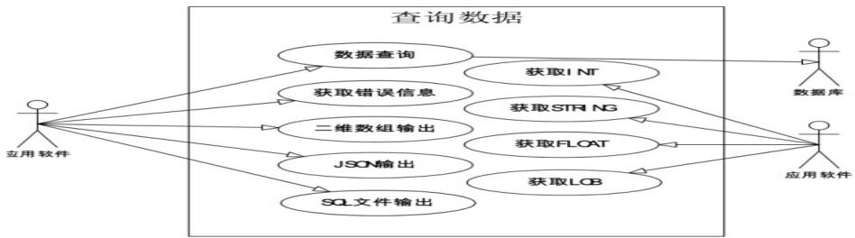
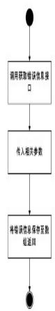
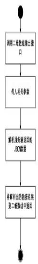
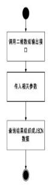
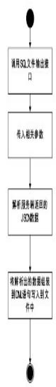

图13 查询数据用例图  
查询数据功能标识表，见表13所示。  
表13 查询数据所有能力标识
<table><tr><td colspan="1" rowspan="1">序号</td><td colspan="1" rowspan="1">Use case 名称</td><td colspan="1" rowspan="1">项目唯一标识符</td><td colspan="1" rowspan="1">需求描述</td><td colspan="1" rowspan="1">需求重用</td><td colspan="1" rowspan="1">方式名称</td><td colspan="1" rowspan="1">运行状态</td><td colspan="1" rowspan="1">对应的任务书功能/性能</td></tr><tr><td colspan="1" rowspan="1">1</td><td colspan="1" rowspan="1">数据查询</td><td colspan="1" rowspan="1">PZXQ-GN-SQLFW-CXSJ-SJCX</td><td colspan="1" rowspan="1">查询数据</td><td colspan="1" rowspan="1">沿用</td><td colspan="1" rowspan="1">桌面、平版、手持</td><td colspan="1" rowspan="1">开发阶段、运行阶段</td><td colspan="1" rowspan="1">4.1.1</td></tr><tr><td colspan="1" rowspan="1">2</td><td colspan="1" rowspan="1">获取错误信息</td><td colspan="1" rowspan="1">PZXQ-GN-SQLFW-CXSJ-HQCWXX</td><td colspan="1" rowspan="1">支持获取数据库操作中的错误信息</td><td colspan="1" rowspan="1">沿用</td><td colspan="1" rowspan="1">桌面、平版、手持</td><td colspan="1" rowspan="1">开发阶段、运行阶段</td><td colspan="1" rowspan="1">4.1.1</td></tr><tr><td colspan="1" rowspan="1">3</td><td colspan="1" rowspan="1">二维数组输出</td><td colspan="1" rowspan="1">PZXQ-GN-SQLFW-CXSJ-EWSZSC</td><td colspan="1" rowspan="1">将查询结果以二维数组形式输出</td><td colspan="1" rowspan="1">沿用</td><td colspan="1" rowspan="1">桌面、平版、手持</td><td colspan="1" rowspan="1">开发阶段、运行阶段</td><td colspan="1" rowspan="1">4.1.1</td></tr><tr><td colspan="1" rowspan="1">4</td><td colspan="1" rowspan="1">JSON输出</td><td colspan="1" rowspan="1">PZXQ-GN-SQLFW-CXSJ-JSONSC</td><td colspan="1" rowspan="1">将查询结果以JSON形式输出</td><td colspan="1" rowspan="1">沿用</td><td colspan="1" rowspan="1">桌面、平版、手持</td><td colspan="1" rowspan="1">开发阶段、运行阶段</td><td colspan="1" rowspan="1">4.1.1</td></tr><tr><td colspan="1" rowspan="1">5</td><td colspan="1" rowspan="1">SQL 文件输出</td><td colspan="1" rowspan="1">PZXQ-GN-SQLFW-CXSJ-DMLSC</td><td colspan="1" rowspan="1">将查询结果以 sql 文件形式输出</td><td colspan="1" rowspan="1">沿用</td><td colspan="1" rowspan="1">桌面、平版</td><td colspan="1" rowspan="1">开发阶段、运行阶段</td><td colspan="1" rowspan="1">4.1.1</td></tr><tr><td colspan="1" rowspan="1">6</td><td colspan="1" rowspan="1">获取INT</td><td colspan="1" rowspan="1">PZXQ-GN-SQLFW-CXSJ-HQINT</td><td colspan="1" rowspan="1">逐行获取 INT 值</td><td colspan="1" rowspan="1">沿用</td><td colspan="1" rowspan="1">桌面、平版、手持</td><td colspan="1" rowspan="1">开发阶段、运行阶段</td><td colspan="1" rowspan="1">4.1.1</td></tr><tr><td colspan="1" rowspan="1">7</td><td colspan="1" rowspan="1">获取STRING</td><td colspan="1" rowspan="1">PZXQ-GN-SQLFW-CXSJ-HQSTRING</td><td colspan="1" rowspan="1">逐行获取 STRING 值</td><td colspan="1" rowspan="1">沿用</td><td colspan="1" rowspan="1">桌面、平版、手持</td><td colspan="1" rowspan="1">开发阶段、运行阶段</td><td colspan="1" rowspan="1">4.1.1</td></tr><tr><td colspan="1" rowspan="1">8</td><td colspan="1" rowspan="1">获取 FLOAT</td><td colspan="1" rowspan="1">PZXQ-GN-SQLFW-CXSJ-HQFLOAT</td><td colspan="1" rowspan="1">逐行获取 FLOAT 值</td><td colspan="1" rowspan="1">沿用</td><td colspan="1" rowspan="1">桌面、平版、手持</td><td colspan="1" rowspan="1">开发阶段、运行阶段</td><td colspan="1" rowspan="1">4.1.1</td></tr><tr><td colspan="1" rowspan="1">9</td><td colspan="1" rowspan="1">获取LOB</td><td colspan="1" rowspan="1">PZXQ-GN-SQLFW-CXSJ-HQLOB</td><td colspan="1" rowspan="1">逐行获取LOB 值</td><td colspan="1" rowspan="1">沿用</td><td colspan="1" rowspan="1">桌面、平版、手持</td><td colspan="1" rowspan="1">开发阶段、运行阶段</td><td colspan="1" rowspan="1">4.1.1</td></tr></table>

## 3.2.1.3.1 查询数据-数据查询（PZXQ-GN-SQLFW-CXSJ-SJCX）

数据查询用例场景，见表14所示。

表14 数据查询用例描述
<table><tr><td rowspan=1 colspan=1>Use Case 名称:数据查询</td><td rowspan=1 colspan=2>Actors：应用软件、数据库</td></tr><tr><td rowspan=1 colspan=3>概述：本用例是SQL访问的扩展用例，描述数据查询的过程；</td></tr><tr><td rowspan=1 colspan=3>前置条件：数据库连接正常。</td></tr><tr><td rowspan=1 colspan=3>主事件流</td></tr><tr><td rowspan=1 colspan=1>Actor 的动作</td><td rowspan=1 colspan=1>系统的动作</td><td rowspan=1 colspan=1>动作约束(性能、可靠性、容错等)</td></tr><tr><td rowspan=1 colspan=1>1.应用软件调用数据查询接口输入相关参数，如数据的 sqI 语句；3.数据库完成查询数据操作。</td><td rowspan=1 colspan=1>2.将查询sqI传输到服务端，服务端从连接池中申请连接句柄，并执行sql语句，执行完成释放连接句柄，同时将查询结果以json的方式返回，如果执行错误将错误信息返回来，执行异常流E1。</td><td rowspan=1 colspan=1>查询1000条数据的时间应小于1s。如果无法连接到服务端，提示连接错误。</td></tr><tr><td rowspan=1 colspan=2>异常流E1：系统提示查询失败，用例结束。</td><td rowspan=1 colspan=1></td></tr><tr><td rowspan=1 colspan=2>后置条件：无。</td><td rowspan=1 colspan=1></td></tr></table>

数据查询流程图如图 14所示：

  
图 14数据查询流程图

3.2.1.3.2 查询数据-获取错误信息（PZXQ-GN-SQLFW-HQCWXX）

获取错误信息用例场景，见表15所示。  
表15 获取错误信息用例描述
<table><tr><td colspan="1" rowspan="1">Use Case 名称:获取错误信息</td><td colspan="2" rowspan="1">Actors:应用软件</td></tr><tr><td colspan="3" rowspan="1">概述：本用例是SQL访问的扩展用例，描述获取错误信息的过程；</td></tr><tr><td colspan="3" rowspan="1">前置条件：数据库连接正常。</td></tr><tr><td colspan="3" rowspan="1">主事件流</td></tr><tr><td colspan="1" rowspan="1">Actor 的动作</td><td colspan="1" rowspan="1">系统的动作</td><td colspan="1" rowspan="1">动作约束(性能、可靠性、容错等)</td></tr><tr><td colspan="1" rowspan="1">1.应用软件调用错误信息获取接口输入相关参数；</td><td colspan="1" rowspan="1">2.将执行的错误信息返回给应用软件。</td><td colspan="1" rowspan="1">如果无法连接到服务端，提示连接错误。</td></tr><tr><td colspan="2" rowspan="1">异常流E1：系统提示获取失败，用例结束。</td><td colspan="1" rowspan="1"></td></tr><tr><td colspan="2" rowspan="1">后置条件：无。</td><td colspan="1" rowspan="1"></td></tr></table>

获取错误信息流程图如图 15所示：

  
图 15获取错误信息流程图

3.2.1.3.3 查询数据-二维数组输出（PZXQ-GN-SQLFW-EWSZSC）

二维数组输出用例场景，见表16所示。

表16 二维数组输出用例描述
<table><tr><td rowspan=1 colspan=1>Use Case 名称：二维数组输出</td><td rowspan=1 colspan=1>Actors:应用软件</td></tr><tr><td rowspan=1 colspan=2>概述：本用例是SQL访问的扩展用例，描述二维数组输出的过程；</td></tr><tr><td rowspan=1 colspan=2>前置条件：数据库连接正常。</td></tr><tr><td rowspan=1 colspan=2>主事件流</td></tr></table>

<table><tr><td rowspan=1 colspan=1>Actor 的动作</td><td rowspan=1 colspan=1>系统的动作</td><td rowspan=1 colspan=1>动作约束(性能、可靠性、容错等)</td></tr><tr><td rowspan=1 colspan=1>1.应用软件调用通过二维数据获取数据的接口输入相关参数，如数据库句柄；</td><td rowspan=1 colspan=1>2.将查询结果组织到二维数组中返回，其中数组的列数对应每条记录的字段数，数组的行数代表共有多少条记录，如果获取失败，则执行异常流E1</td><td rowspan=1 colspan=1>如果无法连接到服务端，提示连接错误。</td></tr><tr><td rowspan=1 colspan=2>异常流E1：系统提示获取失败，用例结束。</td><td rowspan=1 colspan=1></td></tr><tr><td rowspan=1 colspan=2>后置条件：无。</td><td rowspan=1 colspan=1></td></tr></table>

二维数组输出流程图如图 16所示：

  
图 16二维数组输出流程图

3.2.1.3.4 查询数据-JSON 输出（PZXQ-GN-SQLFW-CXSJ-JSONSC）

JSON输出用例场景，见表17所示。

表17 JSON 输出用例描述

<table><tr><td rowspan=1 colspan=1>Use Case 名称:JSON 输出</td><td rowspan=1 colspan=2>Actors:应用软件</td></tr><tr><td rowspan=1 colspan=3>概述：本用例是SQL访问的扩展用例，描述JSON输出的过程；</td></tr><tr><td rowspan=1 colspan=3>前置条件：数据库连接正常。</td></tr><tr><td rowspan=1 colspan=3>主事件流</td></tr><tr><td rowspan=1 colspan=1>Actor的动作</td><td rowspan=1 colspan=1>系统的动作</td><td rowspan=1 colspan=1>动作约束(性能、可靠性、容错等)</td></tr><tr><td rowspan=1 colspan=1>1.应用软件调用通过JSON获取数据的接口输入相关参数，如数据库句柄；</td><td rowspan=1 colspan=1>2.将查询的数据组织成JSON 中返回，其中JSON中的查询状态关键字表示是否成功获取到数据，记录数关键字表示获取到的记录数，内容关键字表示获取到的具体数据，如果获取失败，则执行异常流E1</td><td rowspan=1 colspan=1>如果无法连接到服务端，提示连接错误。</td></tr><tr><td rowspan=1 colspan=2>异常流E1：系统提示获取失败，用例结束。</td><td rowspan=1 colspan=1></td></tr><tr><td rowspan=1 colspan=2>后置条件：无。</td><td rowspan=1 colspan=1></td></tr></table>

JSON输出流程图如图 17所示：

  
图 17 JSON 输出流程图

3.2.1.3.5 查询数据-SQL 文件输出（PZXQ-GN-SQLFW-CXSJ-DMLSC）

SQL 文件输出用例场景，见表18所示。

表18 SQL文件输出用例描述
<table><tr><td rowspan=1 colspan=1>Use Case 名称:SQL 文件输出</td><td rowspan=1 colspan=2>Actors:应用软件</td></tr><tr><td rowspan=1 colspan=3>概述：本用例是 SQL 访问的扩展用例，描述 SQL 文件输出的过程；</td></tr><tr><td rowspan=1 colspan=3>前置条件：数据库连接正常。</td></tr><tr><td rowspan=1 colspan=3>主事件流</td></tr><tr><td rowspan=1 colspan=1>Actor 的动作</td><td rowspan=1 colspan=1>系统的动作</td><td rowspan=1 colspan=1>动作约束(性能、可靠性、容错等)</td></tr><tr><td rowspan=1 colspan=1>1.应用软件调用 SQL 文件输出接口输入相关参数，如数据库句柄；</td><td rowspan=1 colspan=1>2.将查询的数据组织成特定格式的DML语句，并输出到内存或文件中以供其他软件调用，如果获取失败，则执行异常流E1</td><td rowspan=1 colspan=1>如果无法连接到服务端，提示连接错误。</td></tr><tr><td rowspan=1 colspan=2>异常流E1：系统提示获取失败，用例结束。</td><td rowspan=1 colspan=1></td></tr><tr><td rowspan=1 colspan=2>后置条件：无。</td><td rowspan=1 colspan=1></td></tr></table>

SQL文件输出流程图如图 18所示：

  
图 18 SQL 文件输出流程图

3.2.1.3.6 查询数据-获取 INT（PZXQ-GN-SQLFW-ZHHQSJ-HQINT）

获取 INT 用例场景，见表19所示。  
表19 获取INT用例描述
<table><tr><td colspan="1" rowspan="1">Use Case 名称:获取 INT</td><td colspan="2" rowspan="1">Actors：应用软件</td></tr><tr><td colspan="3" rowspan="1">概述：本用例是SQL访问的扩展用例，描述获取INT的过程；</td></tr><tr><td colspan="3" rowspan="1">前置条件：数据库连接正常。</td></tr><tr><td colspan="3" rowspan="1">主事件流</td></tr><tr><td colspan="1" rowspan="1">Actor 的动作</td><td colspan="1" rowspan="1">系统的动作</td><td colspan="1" rowspan="1">动作约束(性能、可靠性、容错等)</td></tr><tr><td colspan="1" rowspan="1">1.应用软件在逐行获取数据后，调用获取INT的接口，输入相关参数，如字段名或索引；</td><td colspan="1" rowspan="1">2. 将查询结果数据转换成 int 格式返回给应用软件，如果获取失败，则执行异</td><td colspan="1" rowspan="1">如果无法连接到服务端，提示连接错误。</td></tr><tr><td colspan="1" rowspan="1"></td><td colspan="1" rowspan="1">常流E1</td><td colspan="1" rowspan="1"></td></tr><tr><td colspan="2" rowspan="1">异常流E1：系统提示获取失败，用例结束。</td><td colspan="1" rowspan="1"></td></tr><tr><td colspan="2" rowspan="1">后置条件：无。</td><td colspan="1" rowspan="1"></td></tr></table>

获取INT流程图如图 19所示：

  
图 19获取INT流程图  
3.2.1.3.7 查询数据-获取 STRING（PZXQ-GN-SQLFW-ZHHQSJ-HQSTRING）

获取 STRING 用例场景，见表20所示。

表20 获取 STRING 用例描述
<table><tr><td rowspan=1 colspan=1>Use Case 名称:获取 STRING</td><td rowspan=1 colspan=1>Actors：应用软件</td></tr><tr><td rowspan=1 colspan=2>概述：本用例是 SQL 访问的扩展用例，描述获取 STRING 的过程；</td></tr><tr><td rowspan=1 colspan=2>前置条件：数据库连接正常。</td></tr><tr><td rowspan=1 colspan=2>主事件流</td></tr></table>

<table><tr><td rowspan=1 colspan=1>Actor 的动作</td><td rowspan=1 colspan=1>系统的动作</td><td rowspan=1 colspan=1>动作约束(性能、可靠性、容错等)</td></tr><tr><td rowspan=1 colspan=1>1.应用软件在逐行获取数据后，调用获取STRING的接口，输入相关参数，如字段名或索引；</td><td rowspan=1 colspan=1>2. 将查询数据转换成 string 格式返回给应用软件，如果获取失败，则执行异常流E1</td><td rowspan=1 colspan=1>如果无法连接到服务端，提示连接错误。</td></tr><tr><td rowspan=1 colspan=2>异常流E1：系统提示获取失败，用例结束。</td><td rowspan=1 colspan=1></td></tr><tr><td rowspan=1 colspan=2>后置条件：无。</td><td rowspan=1 colspan=1></td></tr></table>

获取STRING流程图如图 20所示：

  
图 20获取 STRING 流程图  
3.2.1.3.8 查询数据-获取 FLOAT（PZXQ-GN-SQLFW-  
ZHHQSJ-HQFLOAT）

获取 FLOAT 用例场景，见表 21 所示。

表21 获取 FLOAT 用例描述