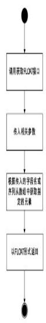
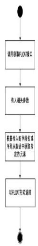
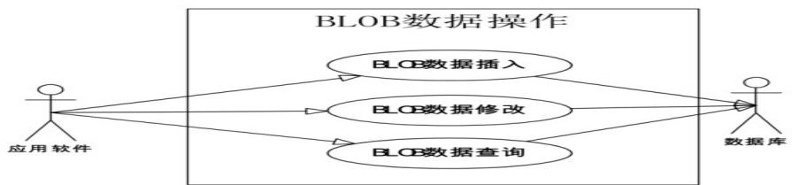
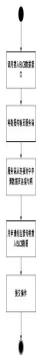
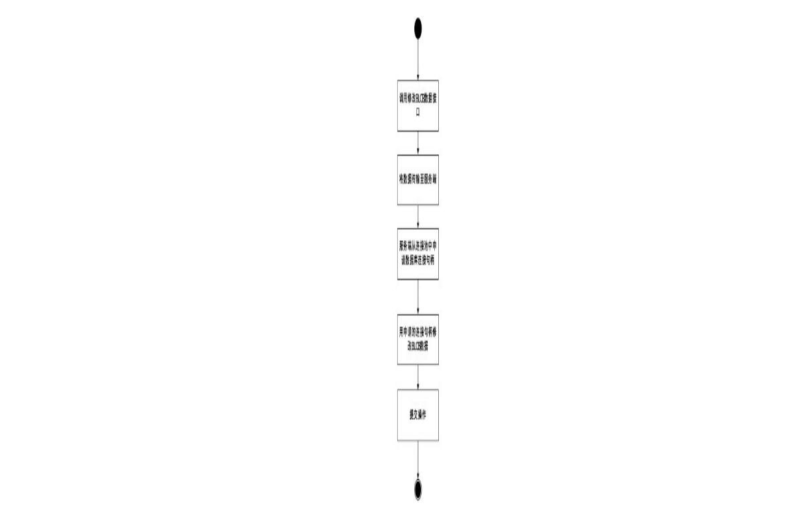
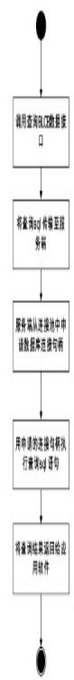
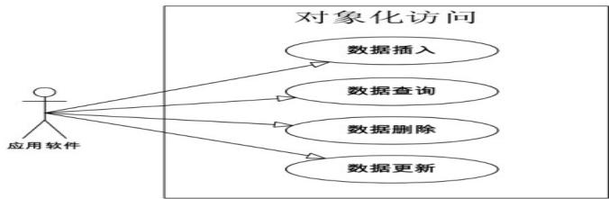
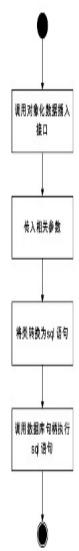

<table><tr><td rowspan=1 colspan=1>Use Case 名称:获取 FLOAT</td><td rowspan=1 colspan=2>Actors:应用软件</td></tr><tr><td rowspan=1 colspan=3>概述：本用例是SQL访问的扩展用例，描述获取FLOAT的过程；</td></tr><tr><td rowspan=1 colspan=3>前置条件：数据库连接正常。</td></tr><tr><td rowspan=1 colspan=3>主事件流</td></tr><tr><td rowspan=1 colspan=1>Actor 的动作</td><td rowspan=1 colspan=1>系统的动作</td><td rowspan=1 colspan=1>动作约束(性能、可靠性、容错等)</td></tr><tr><td rowspan=1 colspan=1>1.应用软件在逐行获取数据后，调用获取FLOAT的接口，输入相关参数，如字段名或索引；</td><td rowspan=1 colspan=1>2.将查询数据转换成 float 格式返回给应用软件，如果获取失败，则执行异常流E1</td><td rowspan=1 colspan=1>如果无法连接到服务端，提示连接错误。</td></tr><tr><td rowspan=1 colspan=2>异常流E1：系统提示获取失败，用例结束。</td><td rowspan=1 colspan=1></td></tr><tr><td rowspan=1 colspan=2>后置条件：无。</td><td rowspan=1 colspan=1></td></tr></table>

获取 FLOAT 流程图如图 21所示：

  
图 21获取 FLOAT 流程图

## 3.2.1.3.9 查询数据-获取 LOB（PZXQ-GN-SQLFW-ZHHQSJ-HQLOB）

获取LOB用例场景，见表22所示。

表22 获取 LOB 用例描述
<table><tr><td rowspan=1 colspan=1>Use Case 名称:获取 LOB</td><td rowspan=1 colspan=2>Actors：用户</td></tr><tr><td rowspan=1 colspan=3>概述：本用例是SQL访问的扩展用例，描述获取LOB的过程；</td></tr><tr><td rowspan=1 colspan=3>前置条件：数据库连接正常。</td></tr><tr><td rowspan=1 colspan=3>主事件流</td></tr><tr><td rowspan=1 colspan=1>Actor 的动作</td><td rowspan=1 colspan=1>系统的动作</td><td rowspan=1 colspan=1>动作约束(性能、可靠性、容错等)</td></tr><tr><td rowspan=1 colspan=1>1.应用软件在逐行获取数据后，调用获取FLOAT的接口，输入相关参数，如字段名或索引；</td><td rowspan=1 colspan=1>2. 系统将指定类型的数据返回给应用软件，如果获取失败，则执行异常流E1</td><td rowspan=1 colspan=1>如果无法连接到服务端，提示连接错误。</td></tr><tr><td rowspan=1 colspan=2>异常流E1：系统提示获取失败，用例结束。</td><td rowspan=1 colspan=1></td></tr><tr><td rowspan=1 colspan=2>后置条件：无。</td><td rowspan=1 colspan=1></td></tr></table>

获取 FLOAT 流程图如图 22所示：

  
图 22获取LOB流程图  
3.2.1.4 SQL 访问-BLOB 数据操作（PZXQ-GN-SQLFW-BLOBSJCZ）

BLOB数据操作功能包括：BLOB数据插入、BLOB删除数据记录、BLOB数据查询功能，其用例图如图23所示：

  
图23 BLOB 数据操作用例图

BLOB 数据操作功能标识表，见表23所示。

表23 BLOB数据操作所有能力标识
<table><tr><td rowspan=1 colspan=1>序号</td><td rowspan=1 colspan=1>Use case 名称</td><td rowspan=1 colspan=1>项目唯一标识符</td><td rowspan=1 colspan=1>需求描述</td><td rowspan=1 colspan=1>需求重用</td><td rowspan=1 colspan=1>方式名称</td><td rowspan=1 colspan=1>运行状态</td><td rowspan=1 colspan=1>对应的任务书功能/性能</td></tr><tr><td rowspan=1 colspan=1>1</td><td rowspan=1 colspan=1>Blob 数据修改</td><td rowspan=1 colspan=1>PZXQ-GN-SQLFW-BLOBSJXG</td><td rowspan=1 colspan=1>支持对 BLOB 数据的修改</td><td rowspan=1 colspan=1>沿用</td><td rowspan=1 colspan=1>桌面、平板</td><td rowspan=1 colspan=1>开发阶段、运行阶段</td><td rowspan=1 colspan=1>4.1.1</td></tr><tr><td rowspan=1 colspan=1>2</td><td rowspan=1 colspan=1>Blob 数据查询</td><td rowspan=1 colspan=1>PZXQ-GN-SQLFW-BLOBSJCX</td><td rowspan=1 colspan=1>支持对 BLOB 数据的查询</td><td rowspan=1 colspan=1>沿用</td><td rowspan=1 colspan=1>桌面、平板</td><td rowspan=1 colspan=1>开发阶段、运行阶段</td><td rowspan=1 colspan=1>4.1.1</td></tr><tr><td rowspan=1 colspan=1>3</td><td rowspan=1 colspan=1>BLOB 数据插入</td><td rowspan=1 colspan=1>PZXQ-GN-SQLFW-BLOBSJCR</td><td rowspan=1 colspan=1>支持对 BLOB 数据的插入</td><td rowspan=1 colspan=1>沿用</td><td rowspan=1 colspan=1>桌面、平板</td><td rowspan=1 colspan=1>开发阶段、运行阶段</td><td rowspan=1 colspan=1>4.1.1</td></tr></table>

3.2.1.4.1 BLOB 数据操作-BLOB 数据插入（PZXQ-GN-

$$
\mathsf { S Q L F W - B L O B S } \mathsf { | C Z - B L O B S | C R \ ) }
$$

Blob 数据插入用例场景，见表 24 所示。

表24 Blob数据插入用例描述
<table><tr><td rowspan=1 colspan=1>Use Case 名称:Blob 数据插入</td><td rowspan=1 colspan=2>Actors：应用软件、数据库</td></tr><tr><td rowspan=1 colspan=3>概述：本用例是SQL访问的扩展用例，描述Blob数据插入的过程；</td></tr><tr><td rowspan=1 colspan=3>前置条件：数据库连接正常。</td></tr><tr><td rowspan=1 colspan=3>主事件流</td></tr><tr><td rowspan=1 colspan=1>Actor 的动作</td><td rowspan=1 colspan=1>系统的动作</td><td rowspan=1 colspan=1>动作约束(性能、可靠性、容错等)</td></tr><tr><td rowspan=1 colspan=1>1.应用软件调用数据查询接口输入相关参数，如执行 sql 语句、插入 blob数据数组、插入字段的个数；3.数据库完成插入BLOB数据操作。</td><td rowspan=1 colspan=1>2.则将 sql 语句、blob 数据数组组织成json格式传输到服务端，服务端解析接收的json数据，如果解析失败则直接返回错误信息，执行异常流E1，解析成功从连接池中申请连接句柄，并执行sql语句，执行完成释放连接句柄，如果执行错误将错误信息返回来，执行异常流E1;</td><td rowspan=1 colspan=1>每个BLOB 数据大小应不大于65535字节。如果无法连接到服务端，提示连接错误。</td></tr><tr><td rowspan=1 colspan=2>异常流E1：系统提示BLOB数据插入失败，用例结束。</td><td rowspan=1 colspan=1></td></tr><tr><td rowspan=1 colspan=2>后置条件：无。</td><td rowspan=1 colspan=1></td></tr></table>

BLOB 数据插入流程图如图 24所示：

  
图 24 BLOB数据插入流程图

3.2.1.4.2 BLOB 数据操作-BLOB 数据修改（PZXQ-GN-SQLFW-BLOBSJCZ- BLOBSJXG）

Blob数据修改用例场景，见表25所示。  
表25 Blob数据修改用例描述
<table><tr><td colspan="1" rowspan="1">Use Case 名称:Blob 数据修改</td><td colspan="2" rowspan="1">Actors：应用软件、数据库</td></tr><tr><td colspan="3" rowspan="1">概述：本用例是SQL访问的扩展用例，描述Blob数据修改的过程；</td></tr><tr><td colspan="3" rowspan="1">前置条件：数据库连接正常。</td></tr><tr><td colspan="3" rowspan="1">主事件流</td></tr><tr><td colspan="1" rowspan="1">Actor 的动作</td><td colspan="1" rowspan="1">系统的动作</td><td colspan="1" rowspan="1">动作约束(性能、可靠性、容错等)</td></tr><tr><td colspan="1" rowspan="1">1.应用软件调用数据查询接口输入相关参数，如执行 sql 语句、插入 blob 数据</td><td colspan="1" rowspan="1"></td><td colspan="1" rowspan="1">如果无法连接到服务端，提示连</td></tr><tr><td colspan="1" rowspan="1">数组、插入字段的个数；3.数据库完成BLOB修改操作。</td><td colspan="1" rowspan="1">2. 将 sql 语句、blob 数据数组组织成json 格式传输到服务端，服务端解析接收的 json数据，如果解析失败则直接返回错误信息，执行异常流E1，解析成功从连接池中申请连接句柄，并执行sqI 语句，执行完成释放连接句柄，如果执行错误将错误信息返回来，执行异常流E1 ;</td><td colspan="1" rowspan="1">接错误。</td></tr><tr><td colspan="2" rowspan="1">异常流E1：系统提示初始化，用例结束。</td><td colspan="1" rowspan="1"></td></tr><tr><td colspan="2" rowspan="1">后置条件：无。</td><td colspan="1" rowspan="1"></td></tr></table>

BLOB数据修改流程图如图 25所示：

  
图 25 BLOB 数据修改流程图

## 3.2.1.4.3 BLOB 数据操作-BLOB 数据查询（PZXQ-GN-SQLFW-BLOBSJCZ-BLOBSJCX）

Blob数据查询用例场景，见表26所示。

表26 Blob数据查询用例描述
<table><tr><td rowspan=1 colspan=1>Use Case 名称：Blob 数据查询</td><td rowspan=1 colspan=2>Actors：应用软件</td></tr><tr><td rowspan=1 colspan=3>概述：本用例是 SQL访问的扩展用例，描述数 Blob数据查询的过程；</td></tr><tr><td rowspan=1 colspan=3>前置条件：数据库连接正常。</td></tr><tr><td rowspan=1 colspan=3>主事件流</td></tr><tr><td rowspan=1 colspan=1>Actor 的动作</td><td rowspan=1 colspan=1>系统的动作</td><td rowspan=1 colspan=1>动作约束(性能、可靠性、容错等)</td></tr><tr><td rowspan=1 colspan=1>1.应用软件调用数据查询接口输入相关参数，如查询的 sql 语句；3.数据库完成查询BLOB数据操作。</td><td rowspan=1 colspan=1>2.将 sql传输到服务端，服务端从连接池中申请连接句柄，并执行sql语句，执行完成释放连接句柄，同时将查询结果以json的方式返回，如果执行错误将错误信息返回来，执行异常流E1；</td><td rowspan=1 colspan=1>如果无法连接到服务端，提示连接错误。</td></tr><tr><td rowspan=1 colspan=2>异常流E1：系统提示初始化，用例结束。</td><td rowspan=1 colspan=1></td></tr><tr><td rowspan=1 colspan=2>后置条件：无。</td><td rowspan=1 colspan=1></td></tr></table>

BLOB数据查询流程图如图 26所示：

  
图 26 BLOB数据查询流程图

## 3.2.2 象对 化访问（PZXQ-GN-DXHFW）

借助对象关系映射的方式实现对数据库操作，用户直接引用头文件创建数据模型对象，此对象与数据库中的字段一一对应，通过操作对象的方式来操作数据库，无需通过SQL语句操作。对象化访问功能包括：数据插入、数据更新、数据查询、数据删除，其功能用例如图27所示。

  
图27 对象化访问用例图

对象化访问所有能力标识表，见表27所示。

表27 对象化访问所有能力能力标识
<table><tr><td rowspan=1 colspan=1>序号</td><td rowspan=1 colspan=1>Use case名称</td><td rowspan=1 colspan=1>项目唯一标识符</td><td rowspan=1 colspan=1>需求描述</td><td rowspan=1 colspan=1>需求重用</td><td rowspan=1 colspan=1>方式名称</td><td rowspan=1 colspan=1>运行状态</td><td rowspan=1 colspan=1>对应的任务书功能/性能</td></tr><tr><td rowspan=1 colspan=1>1</td><td rowspan=1 colspan=1>数据插入</td><td rowspan=1 colspan=1>PZXQ-GN-DXHFW-SJCR</td><td rowspan=1 colspan=1>通过对象化访问进行数据插入</td><td rowspan=1 colspan=1>沿用</td><td rowspan=1 colspan=1>桌面、平板、手持</td><td rowspan=1 colspan=1>开发阶段、运行阶段</td><td rowspan=1 colspan=1>4.1.1</td></tr><tr><td rowspan=1 colspan=1>2</td><td rowspan=1 colspan=1>数据查询</td><td rowspan=1 colspan=1>PZXQ-GN-DXHFW-SJCX</td><td rowspan=1 colspan=1>通过对象化访问进行数据查询</td><td rowspan=1 colspan=1>沿用</td><td rowspan=1 colspan=1>桌面、平板、手持</td><td rowspan=1 colspan=1>开发阶段、运行阶段</td><td rowspan=1 colspan=1>4.1.1</td></tr><tr><td rowspan=1 colspan=1>3</td><td rowspan=1 colspan=1>数据删除</td><td rowspan=1 colspan=1>PZXQ-GN-DXHFW-SJSC</td><td rowspan=1 colspan=1>通过对象化访问进行数据删除</td><td rowspan=1 colspan=1>沿用</td><td rowspan=1 colspan=1>桌面、平板、手持</td><td rowspan=1 colspan=1>开发阶段、运行阶段</td><td rowspan=1 colspan=1>4.1.1</td></tr><tr><td rowspan=1 colspan=1>4</td><td rowspan=1 colspan=1>数据更新</td><td rowspan=1 colspan=1>PZXQ-GN-DXHFW-SJGX</td><td rowspan=1 colspan=1>通过对象化访问进行数据更新</td><td rowspan=1 colspan=1>沿用</td><td rowspan=1 colspan=1>桌面、平板、手持</td><td rowspan=1 colspan=1>开发阶段、运行阶段</td><td rowspan=1 colspan=1>4.1.1</td></tr></table>

## 3.2.2.1 对象化访问-数据插入（PZXQ-GN-DXHFW-SJCR）

数据插入用例场景，见表28所示。

表28 数据插入用例描述
<table><tr><td colspan="1" rowspan="1">Use Case 名称:数据插入</td><td colspan="2" rowspan="1">Actors：应用软件、数据库</td></tr><tr><td colspan="3" rowspan="1">概述：本用例是对象化访问的扩展用例，描述数据插入的过程；</td></tr><tr><td colspan="3" rowspan="1">前置条件：数据库连接正常。</td></tr><tr><td colspan="3" rowspan="1">主事件流</td></tr><tr><td colspan="1" rowspan="1">Actor 的动作</td><td colspan="1" rowspan="1">系统的动作</td><td colspan="1" rowspan="1">动作约束(性能、可靠性、容错等)</td></tr><tr><td colspan="1" rowspan="1">1. 应用软件调用对象化数据插入接口并输入相应参数，如要插入数据的类；</td><td colspan="1" rowspan="1"></td><td colspan="1" rowspan="1"></td></tr><tr><td colspan="1" rowspan="1">4.数据库完成数据插入操作。</td><td colspan="1" rowspan="1">2. 将类转换成 sql 语句；3.调用数据库句柄执行sqI 语句。</td><td colspan="1" rowspan="1"></td></tr><tr><td colspan="2" rowspan="1">异常流E1：系统提示插入失败，用例结束。</td><td colspan="1" rowspan="1"></td></tr><tr><td colspan="2" rowspan="1">后置条件：无。</td><td colspan="1" rowspan="1"></td></tr></table>

数据插入流程图如图 28所示：

  
图 28数据插入流程图

## 3.2.2.2 对象化访问-数据查询（PZXQ-GN-DXHFW-SJCX）

数据查询用例场景，见表29所示。

表29 数据查询用例描述
<table><tr><td rowspan=1 colspan=1>Use Case 名称：数据查询</td><td rowspan=1 colspan=1>Actors：应用软件、数据库</td></tr><tr><td rowspan=1 colspan=2>概述：本用例是对象化访问的扩展用例，描述数据查询的过程；</td></tr><tr><td rowspan=1 colspan=2>前置条件：数据库连接正常。</td></tr><tr><td rowspan=1 colspan=2>主事件流</td></tr></table>