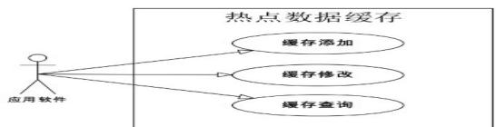
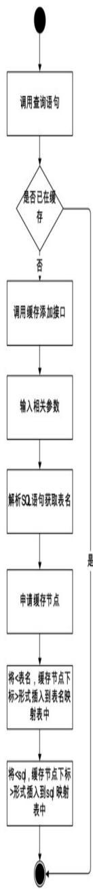
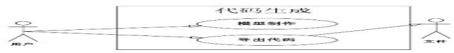

<table><tr><td rowspan=1 colspan=1>Actor 的动作</td><td rowspan=1 colspan=1>系统的动作</td><td rowspan=1 colspan=1>动作约束(性能、可靠性、容错等)</td></tr><tr><td rowspan=1 colspan=1>1.应用软件调用对象化数据查询接口并输入相应参数，如类名，查询数据的类；3.数据库完成数据插入操作。4.应用软件通过调用“类.属性”的方式进行遍历查询</td><td rowspan=1 colspan=1>2.将类转换成 sqI 语句，调用数据库句柄执行 sqI 语句，将查询结果组织成 json格式并映射到类。</td><td rowspan=1 colspan=1></td></tr><tr><td rowspan=1 colspan=2>异常流E1：系统提示查询失败，用例结束。</td><td rowspan=1 colspan=1></td></tr><tr><td rowspan=1 colspan=2>后置条件：无。</td><td rowspan=1 colspan=1></td></tr></table>

数据查询流程图如图 29所示：

  
图 29数据查询流程图

3.2.2.3 对象化访问-数据删除（PZXQ-GN-DXHFW-SJSC）数据删除用例场景，见表30所示。

表30 数据删除用例描述
<table><tr><td colspan="1" rowspan="1">Use Case 名称:数据删除</td><td colspan="2" rowspan="1">Actors：应用软件、数据库</td></tr><tr><td colspan="3" rowspan="1">概述：本用例是对象化访问的扩展用例，描述数据删除的过程；</td></tr><tr><td colspan="3" rowspan="1">前置条件：数据库连接正常。</td></tr><tr><td colspan="3" rowspan="1">主事件流</td></tr><tr><td colspan="1" rowspan="1">Actor 的动作</td><td colspan="1" rowspan="1">系统的动作</td><td colspan="1" rowspan="1">动作约束(性能、可靠性、容错等)</td></tr><tr><td colspan="1" rowspan="1">1.应用软件调用对象化数据删除接口并输入相应参数，如类名，删除数据的类；</td><td colspan="1" rowspan="1"></td><td colspan="1" rowspan="1"></td></tr><tr><td>4、数据库完成数据删除操作。</td><td>3. 调用数据库句柄执行 sqI 语句。</td><td></td></tr><tr><td>异常流E1：系统提示删除失败，用例结束。</td><td></td><td></td></tr><tr><td>后置条件：无。</td><td></td><td></td></tr></table>

数据删除流程图如图 30所示：

  
图 30数据删除流程图

3.2.2.4 对象化访问-数据更新（PZXQ-GN-DXHFW-SJGX）数据更新用例场景，见表31所示。

表31 数据更新用例描述
<table><tr><td colspan="1" rowspan="1">Use Case 名称:数据更新</td><td colspan="2" rowspan="1">Actors：应用软件、数据库</td></tr><tr><td colspan="3" rowspan="1">概述：本用例是对象化访问的扩展用例，描述数据更新的过程；</td></tr><tr><td colspan="3" rowspan="1">前置条件：数据库连接正常。</td></tr><tr><td colspan="3" rowspan="1">主事件流</td></tr><tr><td colspan="1" rowspan="1">Actor 的动作</td><td colspan="1" rowspan="1">系统的动作</td><td colspan="1" rowspan="1">动作约束</td></tr><tr><td>1.应用软件调用对象化数据删除接口并 输入相应参数，如类名，更新数据的 类；</td><td></td><td>(性能、可靠性、容错等)</td></tr><tr><td>4.数据库完成更新操作。</td><td>2. 将类转换成 sql 语句； 3. 调用数据库句柄执行 sql 语句。</td><td></td></tr><tr><td colspan="2">异常流E1:系统提示更新失败，用例结束。</td><td></td></tr><tr><td colspan="2">后置条件：无。</td><td></td></tr></table>

数据更新流程图如图 31所示：

  
图 31数据更新流程图  
3.2.3 热点数 缓据 存（PZXQ-GN-RDSJHC）

热点数据缓存包括缓存添加功能、缓存修改功能、缓存查询功能，其功能用例如图32所示。

  
图32 热点数据缓存用例图

热点数据缓存所有能力标识表，见表32所示。

表32 热点数据缓存所有能力能力标识
<table><tr><td rowspan=1 colspan=1>序号</td><td rowspan=1 colspan=1>Use case名称</td><td rowspan=1 colspan=1>项目唯一标识符</td><td rowspan=1 colspan=1>需求描述</td><td rowspan=1 colspan=1>需求重用</td><td rowspan=1 colspan=1>方式名称</td><td rowspan=1 colspan=1>运行状态</td><td rowspan=1 colspan=1>对应的任务书功能/性能</td></tr><tr><td rowspan=1 colspan=1>1</td><td rowspan=1 colspan=1>缓存添加</td><td rowspan=1 colspan=1>PZXQ-GN-RDSJHC-HCTJ</td><td rowspan=1 colspan=1>支持将新的查询结果添加到缓存</td><td rowspan=1 colspan=1>新研</td><td rowspan=1 colspan=1>桌面</td><td rowspan=1 colspan=1>运行阶段</td><td rowspan=1 colspan=1>4.1.2</td></tr><tr><td rowspan=1 colspan=1>2</td><td rowspan=1 colspan=1>缓存更新</td><td rowspan=1 colspan=1>PZXQ-GN-RDSJHC-HCGX</td><td rowspan=1 colspan=1>支持更新缓存信息</td><td rowspan=1 colspan=1>新研</td><td rowspan=1 colspan=1>桌面</td><td rowspan=1 colspan=1>运行阶段</td><td rowspan=1 colspan=1>4.1.2</td></tr><tr><td rowspan=1 colspan=1>3</td><td rowspan=1 colspan=1>缓存查询</td><td rowspan=1 colspan=1>PZXQ-GN-RDSJHC-HCCX</td><td rowspan=1 colspan=1>支持将缓存列表中查询缓存信息</td><td rowspan=1 colspan=1>新研</td><td rowspan=1 colspan=1>桌面</td><td rowspan=1 colspan=1>运行阶段</td><td rowspan=1 colspan=1>4.1.2</td></tr></table>

## 3.2.3.1 热点数据缓存-缓存添加（PZXQ-GN-RDSJHC-HCTJ）

缓存添加用例场景，见表33所示。

表33 缓存添加用例描述
<table><tr><td colspan="1" rowspan="1">Use Case 名称:缓存添加</td><td colspan="2" rowspan="1">Actors:应用软件</td></tr><tr><td colspan="3" rowspan="1">概述：本用例是热点数据缓存的扩展用例，描述缓存添加的过程；</td></tr><tr><td colspan="3" rowspan="1">前置条件：数据库连接正常。</td></tr><tr><td colspan="3" rowspan="1">主事件流</td></tr><tr><td colspan="1" rowspan="1">Actor 的动作</td><td colspan="1" rowspan="1">系统的动作</td><td colspan="1" rowspan="1">动作约束(性能、可靠性、容错等)</td></tr><tr><td colspan="1" rowspan="1">1.没有查询到缓存并执行sql查询获取查询结果时，调用缓存添加接口输入相关参数，如sqI语句、缓存的内容等参数；</td><td colspan="1" rowspan="1">2.解析 sqI 语句，获取对应的表名，申</td><td colspan="1" rowspan="1"></td></tr><tr><td colspan="1" rowspan="1"></td><td colspan="1" rowspan="1">请缓存节点，添加到缓存节点数组中同时以&lt;表名，缓存节点下标&gt;形式插入到表名映射表中，以&lt;sql，缓存节点下标&gt;形式插入到 sqI 映射表中。</td><td colspan="1" rowspan="1"></td></tr><tr><td colspan="2" rowspan="1">异常流E1：系统提示初始化，用例结束。</td><td colspan="1" rowspan="1"></td></tr><tr><td colspan="2" rowspan="1">后置条件：无。</td><td colspan="1" rowspan="1"></td></tr></table>

缓存添加流程图如图 33所示：

图 33缓存添加流程图

## 3.2.3.2 热点数据缓存-缓存更新（PZXQ-GN-RDSJHC-HCGX）缓存更新用例场景，见表34所示。

表34 缓存更新用例描述
<table><tr><td rowspan=1 colspan=1>Use Case 名称:缓存更新</td><td rowspan=1 colspan=2>Actors:应用软件</td></tr><tr><td rowspan=1 colspan=3>概述：本用例是热点数据缓存的扩展用例，描述缓存更新的过程；</td></tr><tr><td rowspan=1 colspan=3>前置条件：数据库连接正常。</td></tr><tr><td rowspan=1 colspan=3>主事件流</td></tr><tr><td rowspan=1 colspan=1>Actor 的动作</td><td rowspan=1 colspan=1>系统的动作</td><td rowspan=1 colspan=1>动作约束(性能、可靠性、容错等)</td></tr><tr><td rowspan=1 colspan=1>1.执行修改 sql 语句，调用缓存更新接口并调用缓存更新接口，如 sqI ；3.查询到的缓存失效并执行sql查询获取查询结果时，调用缓存更新接口输入相关参数，如sqI语句、缓存的内容等参数；</td><td rowspan=1 colspan=1>2.解析sql语句，获取相关表名，在表名映射表中找到表名映射的缓存节点下标，遍历并修改标志为失效。4. 在 sql 映射表中找到 sql 映射的缓存节点下标，先释放空间后添加缓存内容。</td><td rowspan=1 colspan=1>如果无法连接到服务端，提示连接错误。</td></tr><tr><td rowspan=1 colspan=2>异常流E1：系统提示初始化，用例结束。</td><td rowspan=1 colspan=1></td></tr><tr><td rowspan=1 colspan=2>后置条件：无。</td><td rowspan=1 colspan=1></td></tr></table>

缓存更新流程图如图 34所示：

  
图 34缓存更新流程图

3.2.3.3 热点数据缓存-缓存查询（PZXQ-GN-RDSJHC-HCCX）缓存查询用例场景，见表35所示。

表35 缓存查询用例描述
<table><tr><td rowspan=1 colspan=1>Use Case 名称:缓存查询</td><td rowspan=1 colspan=2>Actors:应用软件</td></tr><tr><td rowspan=1 colspan=3>概述：本用例是热点数据缓存的扩展用例，描述缓存查询的过程；</td></tr><tr><td rowspan=1 colspan=3>前置条件：数据库连接正常。</td></tr><tr><td rowspan=1 colspan=3>主事件流</td></tr><tr><td rowspan=1 colspan=1>Actor 的动作</td><td rowspan=1 colspan=1>系统的动作</td><td rowspan=1 colspan=1>动作约束(性能、可靠性、容错等)</td></tr><tr><td rowspan=1 colspan=1>1.查询数据时，调用缓存查询接口并输入相关参数，如 sql ；3.如果查询到缓存数据，则返回数据，如果没有查询到缓存或缓存失效，则执行 sql 查询</td><td rowspan=1 colspan=1>2. 依据 sql 在 sql 映射表查询缓存数据，如果没有查询到则返回NULL，如果查询到判断缓存是否失效，如果失效则返回失效标志，如果没有失效则返回数据。</td><td rowspan=1 colspan=1>如果无法连接到服务端，提示连接错误。</td></tr><tr><td rowspan=1 colspan=2>异常流E1：系统提示初始化，用例结束。</td><td rowspan=1 colspan=1></td></tr><tr><td rowspan=1 colspan=2>后置条件：无。</td><td rowspan=1 colspan=1></td></tr></table>

3.2.4 代码生成（PZXQ-GN-DMSC）  
代码生成包括模型制作功能、导出代码功能，其功能用例如图35所示。

  
图35 代码生成用例图

SQL访问所有能力标识表，见表36所示。

表36 代码生成所有能力能力标识
<table><tr><td colspan="1" rowspan="1">序号</td><td colspan="1" rowspan="1">Use case 名称</td><td colspan="1" rowspan="1">项目唯一标识符</td><td colspan="1" rowspan="1">需求描述</td><td colspan="1" rowspan="1">需求重用</td><td colspan="1" rowspan="1">方式名称</td><td colspan="1" rowspan="1">运行状态</td><td colspan="1" rowspan="1">对应的任务书功能/性能</td></tr><tr><td colspan="1" rowspan="1">1</td><td colspan="1" rowspan="1">模型制作</td><td colspan="1" rowspan="1">PZXQ-GN-DMSC-MXZZ</td><td colspan="1" rowspan="1">制作数据模型</td><td colspan="1" rowspan="1">沿用</td><td colspan="1" rowspan="1">桌面</td><td colspan="1" rowspan="1">开发阶段</td><td colspan="1" rowspan="1">4.1.1</td></tr><tr><td colspan="1" rowspan="1">2</td><td colspan="1" rowspan="1">导出代码</td><td colspan="1" rowspan="1">PZXQ-GN-DMSC-DCDM</td><td colspan="1" rowspan="1">导出代码</td><td colspan="1" rowspan="1">沿用</td><td colspan="1" rowspan="1">桌面</td><td colspan="1" rowspan="1">开发阶段</td><td colspan="1" rowspan="1">4.1.1</td></tr></table>

## 3.2.4.1 代码生成-模型制作（PZXQ-GN-DMSC-MXZZ）

模型制作用例场景，见表37所示。

表37 模型制作用例描述
<table><tr><td rowspan=1 colspan=1>Use Case 名称:模型制作</td><td rowspan=1 colspan=2>Actors:用户</td></tr><tr><td rowspan=1 colspan=3>概述：本用例是代码生成的扩展用例，描述模型制作的过程；</td></tr><tr><td rowspan=1 colspan=3>前置条件：数据库连接正常。</td></tr><tr><td rowspan=1 colspan=3>主事件流</td></tr><tr><td rowspan=1 colspan=1>Actor 的动作</td><td rowspan=1 colspan=1>系统的动作</td><td rowspan=1 colspan=1>动作约束(性能、可靠性、容错等)</td></tr><tr><td rowspan=1 colspan=1>1、用户打开集成开发工具，点击数据开发按钮；3、用户在展示的列表中选择先选择分类域，再从分类域中勾选需要的表。5、用户在表下选择需要的字段，生成模型。</td><td rowspan=1 colspan=1>2、系统连接到元数据库，如果连接失败，执行异常流E1。获取到所有表名及其分类域,如果获取失败，则执行异常流E2。将获取到的数据按分类域组织成二级列表，返回到前端页面。4、系统根据用户选择的表，从元数据库中查询表下所有字段，若查询失败，则执行异常流E3.将获取到的数据组织成列表形式，返回到前端页面。6.系统判断用户生成的模型中，有没有重复的字段，有重复的字段名称，则执行异常流E4。</td><td rowspan=1 colspan=1>如果无法连接到服务端，提示连接错误。</td></tr><tr><td rowspan=1 colspan=2>异常流E1：系统提示连接数据库异常，用例结束。异常流E2：系统提示获取信息失败，用例结束。异常流E3：系统提示查询字段失败，用例结束。</td><td rowspan=1 colspan=1></td></tr></table>