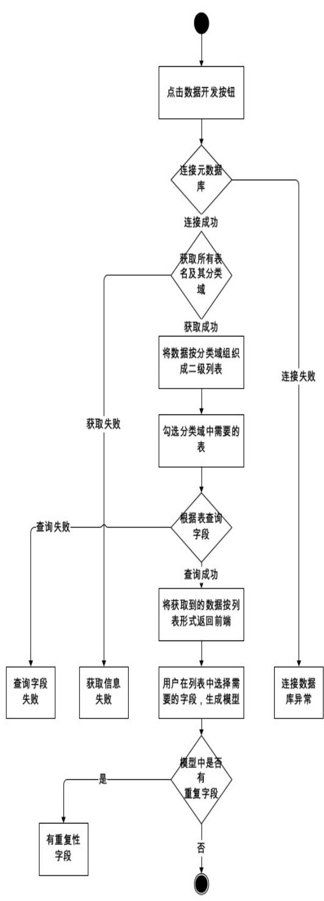
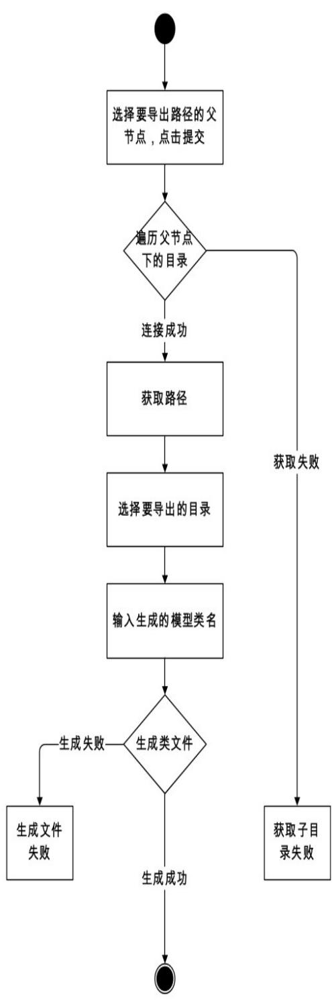
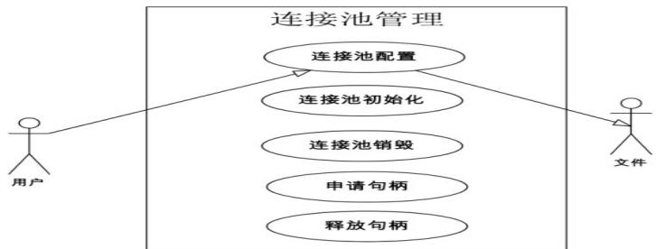
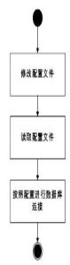
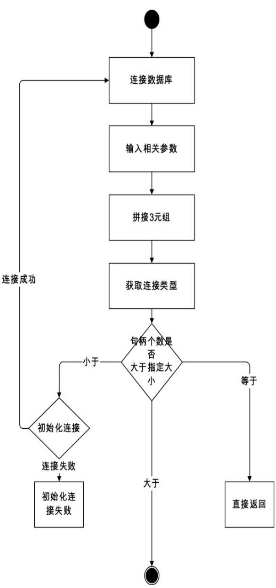

<table><tr><td>异常流E4：系统提示有重复性的字段，用例结束。</td><td></td></tr><tr><td>后置条件：无。</td><td></td></tr></table>

代码生成流程图如图 36所示：

  
图 36代码生成流程图

## 3.2.4.2 代码生成-导出代码（PZXQ-GN-DMSC-DCDM）导出代码用例场景，见表38所示。

表38 导出代码用例描述
<table><tr><td rowspan=1 colspan=1>Use Case 名称：导出代码</td><td rowspan=1 colspan=2>Actors：用户、文件</td></tr><tr><td rowspan=1 colspan=3>概述：本用例是代码生成的扩展用例，描述导出代码的过程；</td></tr><tr><td rowspan=1 colspan=3>前置条件：数据库连接正常。</td></tr><tr><td rowspan=1 colspan=3>主事件流</td></tr><tr><td rowspan=1 colspan=1>Actor 的动作</td><td rowspan=1 colspan=1>系统的动作</td><td rowspan=1 colspan=1>动作约束(性能、可靠性、容错等)</td></tr><tr><td rowspan=1 colspan=1>1. 用户点击提交按钮，选择要导出路径的父节点。3、用户依次在返回的目录中选择需要导出的目录，点击确定。输入要生成模型的类名，点击确定。5、在指定的路径下生成的文件。</td><td rowspan=1 colspan=1>2、系统遍历父节点下的所有目录，如果获取路径失败，则执行异常流E1。将子目录返回给前端页面。4、系统将用户选择的表、字段及类名生成为类文件，如果生成失败，则执行异常流 E2。</td><td rowspan=1 colspan=1>如果无法连接到服务端，提示连接错误。</td></tr><tr><td rowspan=1 colspan=2>异常流E1：系统提示获取子目录失败，用例结束。异常流E2：系统提示生成文件失败，用例结束。</td><td rowspan=1 colspan=1></td></tr><tr><td rowspan=1 colspan=2>后置条件：无。</td><td rowspan=1 colspan=1></td></tr></table>

导出代码流程图如图 37所示：

  
图 37导出代码流程图

## 3.2.5 连接池管理（PZXQ-GN-LJCGL）

连接池管理包括连接池配置功能、连接池初始化功能、连接池销毁功能、申请句柄功能、释放句柄功能，其功能用例如图38所示。

  
图38 连接池管理用例图

SQL访问所有能力标识表，见表39所示。

表39 连接池管理所有能力能力标识
<table><tr><td rowspan=1 colspan=1>序号</td><td rowspan=1 colspan=1>Use case名称</td><td rowspan=1 colspan=1>项目唯一标识符</td><td rowspan=1 colspan=1>需求描述</td><td rowspan=1 colspan=1>需求重用</td><td rowspan=1 colspan=1>方式名称</td><td rowspan=1 colspan=1>运行状态</td><td rowspan=1 colspan=1>对应的任务书功能/性能</td></tr><tr><td rowspan=1 colspan=1>1</td><td rowspan=1 colspan=1>连接池配置</td><td rowspan=1 colspan=1>PZXQ-GN-LJCGL-LJCPZ</td><td rowspan=1 colspan=1>支持配置连接池</td><td rowspan=1 colspan=1>新研</td><td rowspan=1 colspan=1>桌面</td><td rowspan=1 colspan=1>运行阶段</td><td rowspan=1 colspan=1>4.1.2</td></tr><tr><td rowspan=1 colspan=1>2</td><td rowspan=1 colspan=1>连接池初始化</td><td rowspan=1 colspan=1>PZXQ-GN-LJCGL-LJCCSH</td><td rowspan=1 colspan=1>提供初始化连接池的能力</td><td rowspan=1 colspan=1>新研</td><td rowspan=1 colspan=1>桌面</td><td rowspan=1 colspan=1>运行阶段</td><td rowspan=1 colspan=1>4.1.2</td></tr><tr><td rowspan=1 colspan=1>3</td><td rowspan=1 colspan=1>连接池销毁</td><td rowspan=1 colspan=1>PZXQ-GN-LJCGL-LJCXH</td><td rowspan=1 colspan=1>支持销毁连接池并释放资源</td><td rowspan=1 colspan=1>新研</td><td rowspan=1 colspan=1>桌面</td><td rowspan=1 colspan=1>运行阶段</td><td rowspan=1 colspan=1>4.1.2</td></tr><tr><td rowspan=1 colspan=1>4</td><td rowspan=1 colspan=1>申请句柄</td><td rowspan=1 colspan=1>PZXQ-GN-LJCGL-LJCJB</td><td rowspan=1 colspan=1>提供申请连接句柄的能力</td><td rowspan=1 colspan=1>新研</td><td rowspan=1 colspan=1>桌面</td><td rowspan=1 colspan=1>运行阶段</td><td rowspan=1 colspan=1>4.1.2</td></tr><tr><td rowspan=1 colspan=1>5</td><td rowspan=1 colspan=1>释放句柄</td><td rowspan=1 colspan=1>PZXQ-GN-LJCGL-SFJB</td><td rowspan=1 colspan=1>提供释放连接句柄的能力</td><td rowspan=1 colspan=1>新研</td><td rowspan=1 colspan=1>桌面</td><td rowspan=1 colspan=1>运行阶段</td><td rowspan=1 colspan=1>4.1.2</td></tr></table>

## 3.2.5.1 连接池管理-连接池配置（PZXQ-GN-LJCGL-LJCCSH）

连接池配置用例场景，见表40所示。

表40 连接池配置用例描述
<table><tr><td colspan="1" rowspan="1">Use Case 名称：连接池配置</td><td colspan="2" rowspan="1">Actors：用户、文件</td></tr><tr><td colspan="3" rowspan="1">概述：本用例是连接池管理的扩展用例，描述连接池配置的过程；</td></tr><tr><td colspan="3" rowspan="1">前置条件：数据库连接正常。</td></tr><tr><td colspan="3" rowspan="1">主事件流</td></tr><tr><td colspan="1" rowspan="1">Actor 的动作</td><td colspan="1" rowspan="1">系统的动作</td><td colspan="1" rowspan="1">动作约束(性能、可靠性、容错等)</td></tr><tr><td colspan="1" rowspan="1">1.修改配置文件中的数据库IP、数据库密码、数据库用户名及连接池大小并启动应用软件；</td><td colspan="1" rowspan="1">2.读取配置文件中的数据库IP、数据库密码、数据库用户名及连接池大小，并按此配置进行数据库连接。</td><td colspan="1" rowspan="1">如果无法连接到服务端，提示连接错误。</td></tr><tr><td colspan="2" rowspan="1">异常流E1：系统提示初始化，用例结束。</td><td colspan="1" rowspan="1"></td></tr><tr><td colspan="2" rowspan="1">后置条件：无。</td><td colspan="1" rowspan="1"></td></tr></table>

连接池配置流程图如图 39所示：

  
图 39连接池配置流程图

3.2.5.2 连接池管理-连接池初始化（PZXQ-GN-LJCGL-LJCCSH）连接池初始化用例场景，见表41所示。

表41 连接池初始化用例描述
<table><tr><td colspan="1" rowspan="1">Use Case 名称:连接池初始化</td><td colspan="2" rowspan="1">Actors：应用软件</td></tr><tr><td colspan="3" rowspan="1">概述：本用例是连接池管理的扩展用例，描述连接池初始化的过程；</td></tr><tr><td colspan="3" rowspan="1">前置条件：数据库连接正常。</td></tr><tr><td colspan="3" rowspan="1">主事件流</td></tr><tr><td colspan="1" rowspan="1">Actor 的动作</td><td colspan="1" rowspan="1">系统的动作</td><td colspan="1" rowspan="1">动作约束(性能、可靠性、容错等)</td></tr><tr><td colspan="1" rowspan="1">1.服务端连接数据库时，调用连接池初</td><td colspan="1" rowspan="1"></td><td colspan="1" rowspan="1"></td></tr><tr><td colspan="1" rowspan="1">始化接口并输入相关参数，如用户名，密码，ip；</td><td colspan="1" rowspan="1">2.拼接3元组，根据3元组获取连接类型，判断连接句柄个数是否大于指定大小，如果没有大于指定大小，则初始化并连接，失败则执行异常流E1，如果等于指定大小，则直接返回。</td><td colspan="1" rowspan="1">如果无法连接到服务端，提示连接错误。</td></tr><tr><td colspan="2" rowspan="1">异常流E1：系统提示初始化，用例结束。</td><td colspan="1" rowspan="1"></td></tr><tr><td colspan="2" rowspan="1">后置条件：无。</td><td colspan="1" rowspan="1"></td></tr></table>

连接池管理流程图如图 40所示：

  
图 40连接池初始化流程图  
3.2.5.3 连接池管理-连接池销毁（PZXQ-GN-LJCGL-LJCXH）

连接池销毁用例场景，见表42所示。

表42 连接池销毁用例描述
<table><tr><td>Use Case 名称:连接池销毁</td><td colspan="2">Actors:应用软件</td></tr><tr><td colspan="3">概述：本用例是连接池管理的扩展用例，描述连接池销毁的过程；</td></tr><tr><td colspan="3" rowspan="1">前置条件：数据库连接正常。</td></tr><tr><td colspan="3" rowspan="1">主事件流</td></tr><tr><td colspan="1" rowspan="1">Actor 的动作</td><td colspan="1" rowspan="1">系统的动作</td><td colspan="1" rowspan="1">动作约束(性能、可靠性、容错等)</td></tr><tr><td colspan="1" rowspan="1">1.服务端退出时，则调用连接池销毁接口并调用相关参数；</td><td colspan="1" rowspan="1">2.遍历连接池中的连接句柄，并关闭数据库连接句柄。</td><td colspan="1" rowspan="1">如果无法连接到服务端，提示连接错误。</td></tr><tr><td colspan="2" rowspan="1">异常流E1：系统提示初始化，用例结束。</td><td colspan="1" rowspan="1"></td></tr><tr><td colspan="2" rowspan="1">后置条件：无。</td><td colspan="1" rowspan="1"></td></tr></table>

连接池销毁流程图如图 41所示：

  
图 41连接池销毁流程图

## 3.2.5.4 连接池管理-申请句柄（PZXQ-GN-LJCGL-SQJB）申请句柄用例场景，见表43所示。

表43 申请句柄用例描述
<table><tr><td rowspan=1 colspan=1>Use Case 名称:申请句柄</td><td rowspan=1 colspan=2>Actors:应用软件</td></tr><tr><td rowspan=1 colspan=3>概述：本用例是热点数据缓存的扩展用例，描述申请句柄的过程；</td></tr><tr><td rowspan=1 colspan=3>前置条件：数据库连接正常。</td></tr><tr><td rowspan=1 colspan=3>主事件流</td></tr><tr><td rowspan=1 colspan=1>Actor 的动作</td><td rowspan=1 colspan=1>系统的动作</td><td rowspan=1 colspan=1>动作约束(性能、可靠性、容错等)</td></tr><tr><td rowspan=1 colspan=1>1.执行sqI语句时，调用申请句柄接口并输入相关参数，如ID；3.使用连接句柄进行数据库操作</td><td rowspan=1 colspan=1>2.根据ID获取对应的句柄类型，如果句柄类型为-1，执行异常流E1；获取该句柄类型对应的连接句柄数组，循环遍历获取空闲句柄，将分配的句柄的状态置使用状态，返回给连接句柄以及下标（释放时使用)；</td><td rowspan=1 colspan=1>如果无法连接到服务端，提示连接错误。</td></tr><tr><td rowspan=1 colspan=2>异常流E1：系统提示初始化，用例结束。</td><td rowspan=1 colspan=1></td></tr><tr><td rowspan=1 colspan=2>后置条件：无。</td><td rowspan=1 colspan=1></td></tr></table>

申请句柄流程图如图 42所示：