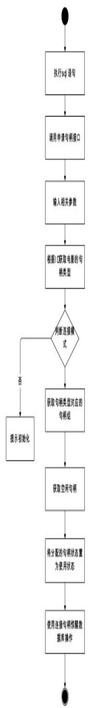
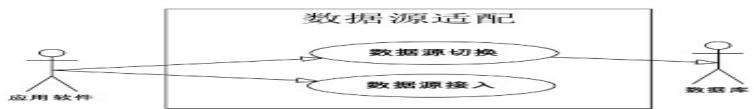
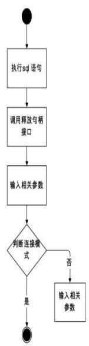
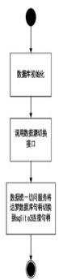
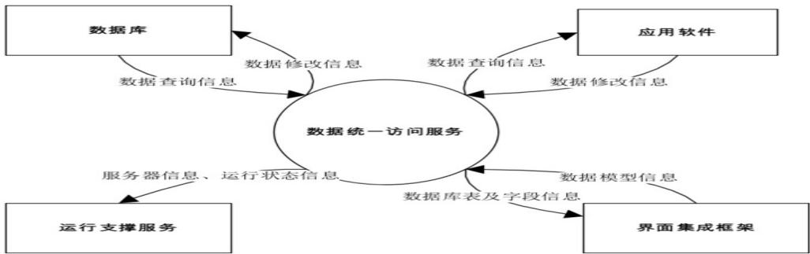
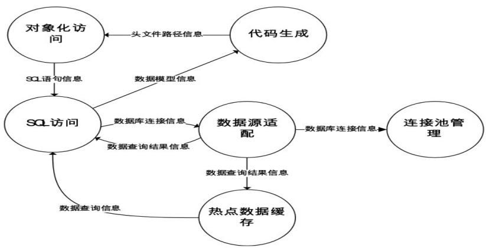

  
图 42申请句柄流程图

## 3.2.5.5 连接池管理-释放句柄（PZXQ-GN-LJCGL-SFJB）

释放句柄用例场景，见表44所示。

表44 释放句柄用例描述
<table><tr><td>Use Case 名称:释放句柄</td><td colspan="2">Actors:应用软件</td></tr><tr><td colspan="3">概述：本用例是热点数据缓存的扩展用例，描述释放句柄的过程；</td></tr><tr><td colspan="3" rowspan="1">前置条件：数据库连接正常。</td></tr><tr><td colspan="3" rowspan="1">主事件流</td></tr><tr><td colspan="1" rowspan="1">Actor 的动作</td><td colspan="1" rowspan="1">系统的动作</td><td colspan="1" rowspan="1">动作约束(性能、可靠性、容错等)</td></tr><tr><td colspan="1" rowspan="1">1.执行sql语句完成之后，调用释放句柄接口并输入相应的参数，如连接类型以及下标；</td><td colspan="1" rowspan="1">2.依据连接类型找到连接句柄数组，将连接句柄数组下标置为空闲状态。</td><td colspan="1" rowspan="1">如果无法连接到服务端，提示连接错误。</td></tr><tr><td colspan="2" rowspan="1">异常流E1：系统提示初始化，用例结束。</td><td colspan="1" rowspan="1"></td></tr><tr><td colspan="2" rowspan="1">后置条件：无。</td><td colspan="1" rowspan="1"></td></tr></table>

释放句柄流程图如图 43所示：

图 43释放句柄流程图

3.2.6 数据源适配（PZXQ-GN-SJYSP）

数据源适配包括数据源切换功能、数据源接入功能，其功能用例如图44所示。

  
图44 数据源适配用例图

数据源适配所有能力标识表，见表45所示。

表45 数据源适配所有能力标识
<table><tr><td rowspan=1 colspan=1>序号</td><td rowspan=1 colspan=1>Use case名称</td><td rowspan=1 colspan=1>项目唯一标识符</td><td rowspan=1 colspan=1>需求描述</td><td rowspan=1 colspan=1>需求重用</td><td rowspan=1 colspan=1>方式名称</td><td rowspan=1 colspan=1>运行状态</td><td rowspan=1 colspan=1>对应的任务书功能/性能</td></tr><tr><td rowspan=1 colspan=1>1</td><td rowspan=1 colspan=1>数据源接入</td><td rowspan=1 colspan=1>PZXQ-GN-SJYSP-SJYJR</td><td rowspan=1 colspan=1>提供接入数据源的能力</td><td rowspan=1 colspan=1>新研</td><td rowspan=1 colspan=1>平板</td><td rowspan=1 colspan=1>运行阶段</td><td rowspan=1 colspan=1>4.1.2</td></tr><tr><td rowspan=1 colspan=1>2</td><td rowspan=1 colspan=1>数据源切换</td><td rowspan=1 colspan=1>PZXQ-GN-SJYSP-SJYQH</td><td rowspan=1 colspan=1>提供切换数据源的能力</td><td rowspan=1 colspan=1>新研</td><td rowspan=1 colspan=1>平板</td><td rowspan=1 colspan=1>运行阶段</td><td rowspan=1 colspan=1>4.1.2</td></tr></table>

## 3.2.6.1 数据源适配-数据源接入（PZXQ-GN-SJYSP-SJYJR）

数据源接入用例场景，见表46所示。

表46 数据源接入用例描述
<table><tr><td colspan="1" rowspan="1">Use Case 名称:数据源接入</td><td colspan="2" rowspan="1">Actors:应用软件</td></tr><tr><td colspan="3" rowspan="1">概述：本用例是数据源适配的扩展用例，描述数据源接入的过程；</td></tr><tr><td colspan="3" rowspan="1">前置条件：数据库连接正常。</td></tr><tr><td colspan="3" rowspan="1">主事件流</td></tr><tr><td colspan="1" rowspan="1">Actor 的动作</td><td colspan="1" rowspan="1">系统的动作</td><td colspan="1" rowspan="1">动作约束(性能、可靠性、容错等)</td></tr><tr><td colspan="1" rowspan="1">1.数据库初始化时，应用软件调用数据源接入接口；</td><td colspan="1" rowspan="1">2.依据连接模式加载对应的数据库驱动，加载失败则执行异常流E1。</td><td colspan="1" rowspan="1">如果无法连接到服务端，提示连接错误。</td></tr><tr><td colspan="2" rowspan="1">异常流E1：系统提示初始化，用例结束。</td><td colspan="1" rowspan="1"></td></tr><tr><td colspan="2">后置条件：无。</td><td></td></tr><tr><td colspan="2"></td><td></td></tr></table>

数据源接入流程图如图 45所示：

  
图 45数据源接入流程图

## 3.2.6.2 数据源适配-数据源切换（PZXQ-GN-SJYSP-SJYQH）

数据源切换用例场景，见表47所示。

表47 数据源切换用例描述
<table><tr><td rowspan=1 colspan=1>Use Case 名称:数据源切换</td><td rowspan=1 colspan=2>Actors：应用软件</td></tr><tr><td rowspan=1 colspan=3>概述：本用例是数据源适配的扩展用例，描述数据源切换的过程；</td></tr><tr><td rowspan=1 colspan=3>前置条件：数据库连接正常。</td></tr><tr><td rowspan=1 colspan=3>主事件流</td></tr><tr><td rowspan=1 colspan=1>Actor 的动作</td><td rowspan=1 colspan=1>系统的动作</td><td rowspan=1 colspan=1>动作约束(性能、可靠性、容错等)</td></tr><tr><td rowspan=1 colspan=1>1.车上切换到车下时，应用软件调用数据源切换接口；</td><td rowspan=1 colspan=1>2.数据统一访问服务将达梦数据库句柄切换到sqlite3 连接句柄。</td><td rowspan=1 colspan=1>数据源切换时间不超过 2s。如果无法连接到服务端，提示连接错误。</td></tr></table>

<table><tr><td>异常流E1：系统提示初始化，用例结束。</td><td></td></tr><tr><td>后置条件：无。</td><td></td></tr></table>

数据源切换流程图如图 46所示：

  
图 46数据源切换流程图

## 3.3 CSCI 外部接口需求

## 3.3.1 接口标识和接口图

数据统一访问服务软件接口需求图，如图47所示。

  
图47 数据统一访问服务软件外部接口需求

数据统一访问服务软件外部接口包括：与数据库接口、与应用软件接口、与运行支撑服务接口、与界面集成框架接口。数据统一访问服务软件外部接口需求表见表48所示。

表48 数据统一访问服务软件外部接口需求
<table><tr><td rowspan=1 colspan=1>序号</td><td rowspan=1 colspan=1>接口需求名称</td><td rowspan=1 colspan=1>接口需求标识</td><td rowspan=1 colspan=1>接口类型</td><td rowspan=1 colspan=1>发送方</td><td rowspan=1 colspan=1>接收方</td><td rowspan=1 colspan=1>接口内容</td><td rowspan=1 colspan=1>接口优先级</td></tr><tr><td rowspan=2 colspan=1>1</td><td rowspan=2 colspan=1>数据统一访问服务与应用软件接口</td><td rowspan=2 colspan=1>PZXQ-JK-SJTYFW-YYRJ</td><td rowspan=2 colspan=1>API接口</td><td rowspan=1 colspan=1>本系统</td><td rowspan=1 colspan=1>应用软件</td><td rowspan=1 colspan=1>数据查询信息</td><td rowspan=2 colspan=1>中</td></tr><tr><td rowspan=1 colspan=1>应用软件</td><td rowspan=1 colspan=1>本系统</td><td rowspan=1 colspan=1>删除数据记录信息</td></tr><tr><td rowspan=1 colspan=1>2</td><td rowspan=1 colspan=1>数据统一访问服务与运行支撑服务接口</td><td rowspan=1 colspan=1>PZXQ-JK-SJTBGX-YXZCFW</td><td rowspan=1 colspan=1>API接口</td><td rowspan=1 colspan=1>运行支撑服务</td><td rowspan=1 colspan=1>本系统</td><td rowspan=1 colspan=1>服务器信息、运行状态信息</td><td rowspan=1 colspan=1>中</td></tr><tr><td rowspan=2 colspan=1>3</td><td rowspan=2 colspan=1>数据统一访问服务与界面集成框架接口</td><td rowspan=2 colspan=1>PZXQ-JK-SJTBGX-JMJCKJ</td><td rowspan=2 colspan=1>人机接口</td><td rowspan=1 colspan=1>本系统</td><td rowspan=1 colspan=1>界面集成框架</td><td rowspan=1 colspan=1>数据库表及字段信息</td><td rowspan=2 colspan=1>中</td></tr><tr><td rowspan=1 colspan=1>界面集成框架</td><td rowspan=1 colspan=1>本系统</td><td rowspan=1 colspan=1>数据模型信息</td></tr><tr><td rowspan=2 colspan=1>4</td><td rowspan=2 colspan=1>数据统一访问服务与数据库接口</td><td rowspan=2 colspan=1>PZXQ-JK-SJTBGX-SJK</td><td rowspan=2 colspan=1>数据库接口</td><td rowspan=1 colspan=1>本系统</td><td rowspan=1 colspan=1>数据库</td><td rowspan=1 colspan=1>删除数据记录信息</td><td rowspan=2 colspan=1>中</td></tr><tr><td rowspan=1 colspan=1>数据库</td><td rowspan=1 colspan=1>本系统</td><td rowspan=1 colspan=1>数据查询信息</td></tr></table>

## 3.3.2 与应用软件接口（PZXQ-JK-SJTYFW-YYRJ）

数据统一访问服务与应用软件接口数据元素说明表，见表49所示。

表49 应用软件接口数据元素说明
<table><tr><td rowspan=1 colspan=1>序号</td><td rowspan=1 colspan=1>数据集名称</td><td rowspan=1 colspan=1>数据组成</td><td rowspan=1 colspan=1>数据约束</td><td rowspan=1 colspan=1>数据标准</td></tr><tr><td rowspan=3 colspan=1>1</td><td rowspan=3 colspan=1>数据查询信息</td><td rowspan=1 colspan=1>查询到的数据集</td><td rowspan=1 colspan=1>字符串</td><td rowspan=3 colspan=1>某试点建设装备配套科研数据访问规范</td></tr><tr><td rowspan=1 colspan=1>查询到的数据大小</td><td rowspan=1 colspan=1>字符串</td></tr><tr><td rowspan=1 colspan=1>查询结果</td><td rowspan=1 colspan=1>字符串</td></tr><tr><td rowspan=2 colspan=1>2</td><td rowspan=2 colspan=1>修改数据信息</td><td rowspan=1 colspan=1>数据库句柄</td><td rowspan=1 colspan=1>结构体</td><td rowspan=2 colspan=1>某试点建设装备配套科研数据访问规范</td></tr><tr><td rowspan=1 colspan=1>修改数据语句</td><td rowspan=1 colspan=1>字符串</td></tr></table>

## 3.3.3 与运行支撑服务接口（PZXQ-JK-SJTYFW-YXZCFW）

数据统一访问服务与运行支撑服务接口数据元素说明表，见表50所示。

表50运行支撑服务接口数据元素说明
<table><tr><td rowspan=1 colspan=1>序号</td><td rowspan=1 colspan=1>数据集名称</td><td rowspan=1 colspan=1>数据组成</td><td rowspan=1 colspan=1>数据约束</td><td rowspan=1 colspan=1>数据标准</td></tr><tr><td rowspan=2 colspan=1>1</td><td rowspan=2 colspan=1>服务器信息</td><td rowspan=1 colspan=1>本机IP</td><td rowspan=1 colspan=1>字符串</td><td rowspan=3 colspan=1>某试点建设装备配套科研软件集成运维规范</td></tr><tr><td rowspan=1 colspan=1>服务器IP</td><td rowspan=1 colspan=1>字符串</td></tr><tr><td rowspan=1 colspan=1>2</td><td rowspan=1 colspan=1>运行状态信息</td><td rowspan=1 colspan=1>在线离线</td><td rowspan=1 colspan=1>字符串</td></tr></table>

## 3.3.4 与界面集成框架接口（PZXQ-JK-SJTYFW-JMJCKJ）

数据统一访问服务与界面集成框架接口数据元素说明表，见表51所示。

表51 界面集成接口数据元素说明
<table><tr><td rowspan=1 colspan=1>序号</td><td rowspan=1 colspan=1>数据集名称</td><td rowspan=1 colspan=1>数据组成</td><td rowspan=1 colspan=1>数据约束</td><td rowspan=1 colspan=1>数据标准</td></tr><tr><td rowspan=3 colspan=1>1</td><td rowspan=3 colspan=1>数据库表及字段信息</td><td rowspan=1 colspan=1>分类域信息</td><td rowspan=1 colspan=1>字符串</td><td rowspan=5 colspan=1>某试点建设装备配套科研数据集成规范</td></tr><tr><td rowspan=1 colspan=1>表信息</td><td rowspan=1 colspan=1>字符串</td></tr><tr><td rowspan=1 colspan=1>字段信息</td><td rowspan=1 colspan=1>字符串</td></tr><tr><td rowspan=2 colspan=1>2</td><td rowspan=2 colspan=1>数据模型信息</td><td rowspan=1 colspan=1>用户选择的表名</td><td rowspan=1 colspan=1>字符串</td></tr><tr><td rowspan=1 colspan=1>用户选择的字段名</td><td rowspan=1 colspan=1>字符串</td></tr></table>

## 3.3.5 与数据库接口（PZXQ-JK-SJTYFW-SJK）

数据统一访问服务与数据库接口数据元素说明表，见表52所示。

表52 数据库接口数据元素说明
<table><tr><td rowspan=1 colspan=1>序号</td><td rowspan=1 colspan=1>数据集名称</td><td rowspan=1 colspan=1>数据组成</td><td rowspan=1 colspan=1>数据约束</td><td rowspan=1 colspan=1>数据标准</td></tr><tr><td rowspan=2 colspan=1>1</td><td rowspan=2 colspan=1>修改数据信息</td><td rowspan=1 colspan=1>数据库句柄</td><td rowspan=1 colspan=1>结构体</td><td rowspan=2 colspan=1>某试点建设装备配套科研数据访问规范</td></tr><tr><td rowspan=1 colspan=1>修改数据语句</td><td rowspan=1 colspan=1>字符串</td></tr><tr><td rowspan=3 colspan=1>1</td><td rowspan=3 colspan=1>数据查询信息</td><td rowspan=1 colspan=1>查询到的数据集</td><td rowspan=1 colspan=1>字符串</td><td rowspan=3 colspan=1>某试点建设装备配套科研数据访问规范</td></tr><tr><td rowspan=1 colspan=1>查询到的数据大小</td><td rowspan=1 colspan=1>字符串</td></tr><tr><td rowspan=1 colspan=1>查询结果</td><td rowspan=1 colspan=1>字符串</td></tr></table>

## 3.4 CSCI 内部接口需求

## 3.4.1 接口标识和接口图

数据统一访问服务软件内部接口需求如图 48所示。

  
图 48数据统一访问服务软件内部接口需求

数据统一访问服务软件内部接口需求表见表53。

表53 数据统一访问服务软件内部接口需求
<table><tr><td rowspan=1 colspan=1>序号</td><td rowspan=1 colspan=1>接口需求名称</td><td rowspan=1 colspan=1>接口需求标识</td><td rowspan=1 colspan=1>接口类型</td><td rowspan=1 colspan=1>发送方</td><td rowspan=1 colspan=1>接收方</td><td rowspan=1 colspan=1>接口内容</td><td rowspan=1 colspan=1>接口优先级</td></tr><tr><td rowspan=1 colspan=1>1</td><td rowspan=1 colspan=1>代码生成与对象化访问接口</td><td rowspan=1 colspan=1>PZXQ-NBJK-DMSC-DXHFW</td><td rowspan=1 colspan=1>API</td><td rowspan=1 colspan=1>代码生成</td><td rowspan=1 colspan=1>对象化访问</td><td rowspan=1 colspan=1>头文件路径信息</td><td rowspan=1 colspan=1>中</td></tr></table>

DXHFW-DMSC）

<table><tr><td rowspan=1 colspan=1>2</td><td rowspan=1 colspan=1>对象化访问与SQL 访问接口</td><td rowspan=1 colspan=1>PZXQ-NBJK-DXHFW-SQLFW</td><td rowspan=1 colspan=1>API</td><td rowspan=1 colspan=1>对象化访问</td><td rowspan=1 colspan=1>SQL访问</td><td rowspan=1 colspan=1>SQL 语句信息</td><td rowspan=1 colspan=1>中</td></tr><tr><td rowspan=1 colspan=1>3</td><td rowspan=1 colspan=1>SQL 访问与代码生成接口</td><td rowspan=1 colspan=1>PZXQ-NBJK-SQLFW-DMSC</td><td rowspan=1 colspan=1>API</td><td rowspan=1 colspan=1>SQL访问</td><td rowspan=1 colspan=1>代码生成</td><td rowspan=1 colspan=1>数据模型信息</td><td rowspan=1 colspan=1>中</td></tr><tr><td rowspan=1 colspan=1>4</td><td rowspan=1 colspan=1>SQL 访问与数据源适配接口</td><td rowspan=1 colspan=1>PZXQ-NBJK-SQLFW-SJYSP</td><td rowspan=1 colspan=1>API</td><td rowspan=1 colspan=1>SQL访问</td><td rowspan=1 colspan=1>数据源适配</td><td rowspan=1 colspan=1>数据库连接信息</td><td rowspan=1 colspan=1>中</td></tr><tr><td rowspan=1 colspan=1>5</td><td rowspan=1 colspan=1>数据源适配与SQL 访问接口</td><td rowspan=1 colspan=1>PZXQ-NBJK-SJYSP-SQLFW</td><td rowspan=1 colspan=1>API</td><td rowspan=1 colspan=1>数据源适配</td><td rowspan=1 colspan=1>SQL访问</td><td rowspan=1 colspan=1>数据查询结果信息</td><td rowspan=1 colspan=1>中</td></tr><tr><td rowspan=1 colspan=1>6</td><td rowspan=1 colspan=1>数据源适配与连接池管理</td><td rowspan=1 colspan=1>PZXQ-NBJK-SJYSP-LJCGL</td><td rowspan=1 colspan=1>API</td><td rowspan=1 colspan=1>数据源适配</td><td rowspan=1 colspan=1>连接池管理</td><td rowspan=1 colspan=1>数据库连接信息</td><td rowspan=1 colspan=1>中</td></tr><tr><td rowspan=1 colspan=1>7</td><td rowspan=1 colspan=1>数据源适配与热点数据缓存接口</td><td rowspan=1 colspan=1>PZXQ-NBJK-SJYSP-RDSJHC</td><td rowspan=1 colspan=1>API</td><td rowspan=1 colspan=1>数据源适配</td><td rowspan=1 colspan=1>热点数据缓存</td><td rowspan=1 colspan=1>数据查询结果信息</td><td rowspan=1 colspan=1>中</td></tr><tr><td rowspan=1 colspan=1>8</td><td rowspan=1 colspan=1>热点数据缓存与 SQL 访问接口</td><td rowspan=1 colspan=1>PZXQ-NBJK-RDSJHC-SQLFW</td><td rowspan=1 colspan=1>API</td><td rowspan=1 colspan=1>热点数据缓存</td><td rowspan=1 colspan=1>SQL访问</td><td rowspan=1 colspan=1>数据查询结果信息</td><td rowspan=1 colspan=1>中</td></tr></table>

## 3.4.2 代码生成与对象化访问接口（PZXQ-NBJK-

代码生成与对象化访问接口数据元素说明表，见表54所示。

表54代码生成与对象化访问接口数据元素说明
<table><tr><td rowspan=1 colspan=1>序号</td><td rowspan=1 colspan=1>数据集名称</td><td rowspan=1 colspan=1>数据组成</td><td rowspan=1 colspan=1>数据约束</td><td rowspan=1 colspan=1>数据标准</td></tr><tr><td rowspan=1 colspan=1>1</td><td rowspan=1 colspan=1>头文件路径信息</td><td rowspan=1 colspan=1>文件路径</td><td rowspan=1 colspan=1>字符串</td><td rowspan=1 colspan=1>某试点建设装备配套科研信息交换格式</td></tr></table>

## 3.4.3 对象化访问与 SQL 访问接口（PZXQ-NBJK-

对象化访问与 SQL 访问接口数据元素说明表，见表55所示。

表55对象化访问与 SQL 访问接口数据元素说明
<table><tr><td colspan="1" rowspan="1">序号</td><td colspan="1" rowspan="1">数据集名称</td><td colspan="1" rowspan="1">数据组成</td><td colspan="1" rowspan="1">数据约束</td><td colspan="1" rowspan="1">数据标准</td></tr><tr><td colspan="1" rowspan="3">1</td><td colspan="1" rowspan="3">SQL 语句信息</td><td colspan="1" rowspan="1">数据库句柄</td><td colspan="1" rowspan="1">结构体</td><td colspan="1" rowspan="1">某试点建设装备配套科研信息交换格式</td></tr><tr><td colspan="1" rowspan="1">表名</td><td colspan="1" rowspan="1">字符串</td><td colspan="1" rowspan="1">某试点建设装备配套科研信息交换格式</td></tr><tr><td colspan="1" rowspan="1">字段名</td><td colspan="1" rowspan="1">字符串</td><td colspan="1" rowspan="1">某试点建设装备配</td></tr><tr><td colspan="1" rowspan="2"></td><td colspan="1" rowspan="2"></td><td colspan="1" rowspan="1"></td><td colspan="1" rowspan="1"></td><td colspan="1" rowspan="1">套科研信息交换格式</td></tr><tr><td colspan="1" rowspan="1">执行条件</td><td colspan="1" rowspan="1">字符串</td><td colspan="1" rowspan="1">某试点建设装备配套科研信息交换格式</td></tr></table>

3.4.4 SQL 访问与代码生成接口（PZXQ-NBJK-

$$
{ \mathsf { S Q L F W - D M S C } } \ )
$$

SQL访问与代码生成接口数据元素说明表，见表56所示。

表56 SQL访问与代码生成接口数据元素说明
<table><tr><td rowspan=1 colspan=1>序号</td><td rowspan=1 colspan=1>数据集名称</td><td rowspan=1 colspan=1>数据组成</td><td rowspan=1 colspan=1>数据约束</td><td rowspan=1 colspan=1>数据标准</td></tr><tr><td rowspan=3 colspan=1>1</td><td rowspan=3 colspan=1>数据模型信息</td><td rowspan=1 colspan=1>类名</td><td rowspan=1 colspan=1>字符串</td><td rowspan=1 colspan=1>某试点建设装备配套科研信息交换格式</td></tr><tr><td rowspan=1 colspan=1>表名</td><td rowspan=1 colspan=1>字符串</td><td rowspan=1 colspan=1>某试点建设装备配套科研信息交换格式</td></tr><tr><td rowspan=1 colspan=1>字段名</td><td rowspan=1 colspan=1>字符串</td><td rowspan=1 colspan=1>某试点建设装备配套科研信息交换格式</td></tr></table>

3.4.5 SQL 访问与数据源适配接口（PZXQ-NBJK-SQLFW-SJYSP）  
SQL访问与数据源适配接口数据元素说明表，见表57所示。

表57 SQL访问与数据源适配接口数据元素说明
<table><tr><td rowspan=1 colspan=1>序号</td><td rowspan=1 colspan=1>数据集名称</td><td rowspan=1 colspan=1>数据组成</td><td rowspan=1 colspan=1>数据约束</td><td rowspan=1 colspan=1>数据标准</td></tr><tr><td rowspan=4 colspan=1>1</td><td rowspan=4 colspan=1>数据库连接信息</td><td rowspan=1 colspan=1>数据库IP</td><td rowspan=1 colspan=1>字符串</td><td rowspan=1 colspan=1>某试点建设装备配套科研信息交换格式</td></tr><tr><td rowspan=1 colspan=1>数据库用户名</td><td rowspan=1 colspan=1>字符串</td><td rowspan=1 colspan=1>某试点建设装备配套科研信息交换格式</td></tr><tr><td rowspan=1 colspan=1>数据库密码</td><td rowspan=1 colspan=1>字符串</td><td rowspan=1 colspan=1>某试点建设装备配套科研信息交换格式</td></tr><tr><td rowspan=1 colspan=1>SQLITE3 文件路径</td><td rowspan=1 colspan=1>字符串</td><td rowspan=1 colspan=1>某试点建设装备配套科研信息交换格式</td></tr></table>