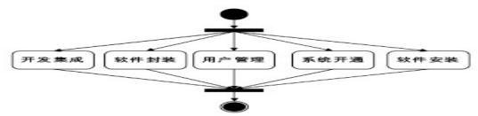
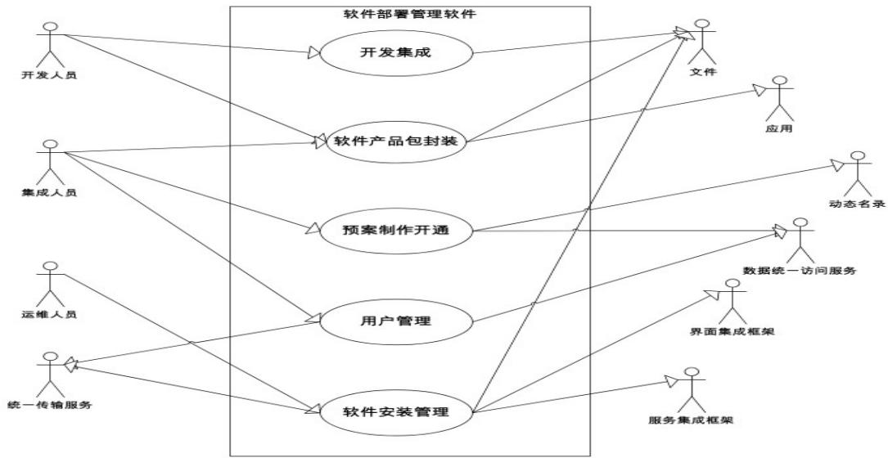
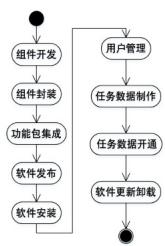

## 目 录

1 范围..
1.1 标识..
1.2 系统概述..
1.2.1 系统和软件的用途...
1.2.2 系统与软件的一般特性....
1.3 文档概述.
2 引用文档.. ..2
3 需求...... ...2
3.1 要求的状态和方式... ...2
3.2 CSCI 能力需求.. ..3
3.2.1 开发集成（PZXQ-GN-RJBSGL-KFJC）. ...7
3.2.2 软件产品包封装（PZXQ-GN-RJBSGL-RJFZ）. ..20
3.2.3 预案制作开通（PZXQ-GN-RJBSGL-YAZZKT）. .29
3.2.4 用户管理（PZXQ-GN-RJBSGL-YHGL）. ..38
3.2.5 软件安装管理（PZXQ-GN-RJBSGL-RJAZGL）. ..52
3.3 CSCI 外部接口需求. .67
3.3.1 接口标识和接口图. ..67
3.3.2 人机交互接口（PZXQ-WBJK-RJJH）. .69
3.3.3 应用软件接口（PZXQ-WBJK-YYRJ）. ..70
3.3.4 与数据统一访问接口（PZXQ-WBJK-SJFW） ..71
3.3.5 与服务集成框架接口（PZXQ-WBJK-FWKJ） ..71
3.3.6 与界面集成框架接口（PZXQ-WBJK-JMKJ）. ...73
3.3.7 与统一传输服务接口（PZXQ-WBJK-TYCS）. ....73
3.3.8 与运行支撑服务接口（PZXQ-WBJK-YXZC）. ...74
3.3.9 文件接口（PZXQ-WBJK-WJ）. ... 75
3.4 CSCI 内部接口需求.. ...76
3.4.1 接口标识和接口图.. ..76
3.4.2 用户管理与软件安装管理接口（PZXQ-NBJK-YHGL-RJAZGL）. ...77
3.4.3 用户管理与预案制作开通接口（PZXQ-NBJK-YHGL-YAZZKT） ....78
3.4.4 软件产品包封装与软件安装管理接口（PZXQ-NBJK-RJANBFZ-RJAZGL）......78
3.4.5 开发集成与软件产品包封装接口（PZXQ-NBJK-KFJC-RJCPBFZ）. ..79
3.5 CSCI 内部数据需求. ..80
3.6 适应性需求.. ...82
3.7 安全性需求. ...82
3.8 保密性需求.. ...82
3.9 CSCI 环境需求. ..83
3.9.1 运行环境需求. ..83
3.9.2 开发环境需求. ...83
3.10 计算机资源需求.. ...83
3.10.1 计算机硬件需求. ...83
3.10.2 计算机硬件资源利用需求.. ...84
3.10.3 计算机软件需求.. ...84
3.10.4 计算机通信需求. ..85
3.11 软件质量因素.... ...85
3.12 设计和构造的约束.. ..86
3.13 人员需求.. ..86
3.14 培训需求... ..86
3.15 软件保障需求. ..86
3.16 其他需求.. ...87
3.17 验收、交付和包装需求. ...87
3.18 需求的优先顺序和关键性. ..87
4 合格性规定.. ...88
5 需求可追踪性.. ..90
6 注释... ..95

## 1 范围

## 1.1 标识

a) 本文档已被批准的标识号： $\mathsf { A } Z _ { 6 9 3 } 2 . 4 9 0 . 0 1 0 4 \mathsf { S } \mathsf { R } \mathsf { S }$

b) 本文档所适用的软件名称为：软件部署管理软件；

c) 本文档的版本号为：V1.00.02/2020 年 01 月 03 日；

d) 本文档所适用的软件所属系统为：某信息系统软件。

## 1.2 系统概述

## 1.2.1 系统和软件的用途

某级信息系统软件按照国产自主可控要求，进行基础软件环境选型，以及应用软件的新研和国产化迁移改造，对功能要素分散、流程独立的业务功能进行整合优化，研制适应不同使用需求、使用场景的软件，实现信息系统软件的融合、型谱优化和业务提能，推动某信息系统软件向“国产化、服务化、轻量化”方向发展。

某信息服务环境软件是某信息系统软件的重要组成，是连接底层各类硬件信息基础设施与上层各种应用系统的桥梁，通过基础平台融合汇聚底层资源，规范技术体制、支撑体系运行、促进互通互联等，是支撑构建某信息系统的重要支撑，其软件主要部署运行在各级机构的信息处理设备上，提供系统运维、数据运维、信息传输、信息处理、信息展现等功能，支撑应用软件和用户完成开发、集成、运维、运行全流程的使用。

软件部署管理支撑完成信息服务环境功能域系统运维的功能，部署在各级节点，提供桌面、平板、手持三种形态的软件，主要完成软件封装、集成、发布、安装以及系统开通等功能，提供应用、数据、服务的封装，提供用户信息的维护管理功能，提供面向任务-用户的功能包集成，提供软件的发布管理，提供软件的安装部署，提供预案制作和预案开通，满足按需集成、快速部署的系统集成开设需求。

## 1.2.2 系统与软件的一般特性

a) 需方：某单位；

b) 使用方：某单位；

c) 开发方：某单位；

d) 保障机构：某单位；

e) 运行方案：在系统开机后,用户登录某信息系统，执行相关软件功能。

## 1.3 文档概述

在本文档中，第2章列出了本文档中引用的其它文档的信息，第3章详细描述了软件部署管理软件的各种需求以及实现方式，第4章规定了确认第3章各项需求正确实现的合格性验证方法，第5章描述本文档列出的各项需求与相应的系统需求规格说明文档列出的

需求的对应关系。其中，第 3 章是本文档的主要部分。

## 2 引用文档

本文档的引用文档见表1。

表1 引用文档

<table><tr><td rowspan=1 colspan=1>文档编号</td><td rowspan=1 colspan=1>标题</td><td rowspan=1 colspan=1>修订版本</td><td rowspan=1 colspan=1>修订日期</td><td rowspan=1 colspan=1>编写单位</td></tr><tr><td rowspan=1 colspan=1>GJB 438B-2009</td><td rowspan=1 colspan=1>《军用软件开发文档编制规范》</td><td rowspan=1 colspan=1>一</td><td rowspan=1 colspan=1>2009年5月</td><td rowspan=1 colspan=1>总装备部</td></tr><tr><td rowspan=1 colspan=1>GJB 439A-2013</td><td rowspan=1 colspan=1>《军品软件质量保证通用要求》</td><td rowspan=1 colspan=1>一</td><td rowspan=1 colspan=1>2013年7月</td><td rowspan=1 colspan=1>国防科学技术工业委员会</td></tr><tr><td rowspan=1 colspan=1>GJB 450A-2004</td><td rowspan=1 colspan=1>《装备可靠性工作通用要求》</td><td rowspan=1 colspan=1>一</td><td rowspan=1 colspan=1>2004年7月</td><td rowspan=1 colspan=1>总装备部</td></tr><tr><td rowspan=1 colspan=1>GJB 2786A-2009</td><td rowspan=1 colspan=1>《军用软件开发通用要求》</td><td rowspan=1 colspan=1>一</td><td rowspan=1 colspan=1>2009年5月</td><td rowspan=1 colspan=1>总装备部</td></tr><tr><td rowspan=1 colspan=1>GJB 5235-2004</td><td rowspan=1 colspan=1>《军用软件配置管理》</td><td rowspan=1 colspan=1>一</td><td rowspan=1 colspan=1>2004年9月</td><td rowspan=1 colspan=1>总装备部</td></tr><tr><td rowspan=1 colspan=1>GJB/Z 102A-2012</td><td rowspan=1 colspan=1>《军用软件安全性设计指南》</td><td rowspan=1 colspan=1>一</td><td rowspan=1 colspan=1>2012年7月</td><td rowspan=1 colspan=1>总装备部</td></tr><tr><td rowspan=1 colspan=1>装陆[2011]707号</td><td rowspan=1 colspan=1>《总装备部陆军装备科研订购部装备软件管理规定》</td><td rowspan=1 colspan=1></td><td rowspan=1 colspan=1>2011 年 12月</td><td rowspan=1 colspan=1>总装备部</td></tr><tr><td rowspan=1 colspan=1>总装备部〔2005〕装字第4号</td><td rowspan=1 colspan=1>《军用软件质量管理规定》</td><td rowspan=1 colspan=1></td><td rowspan=1 colspan=1>2005年1月</td><td rowspan=1 colspan=1>总装备部</td></tr><tr><td rowspan=1 colspan=1>AZ6932.490.0104SDTD</td><td rowspan=1 colspan=1>《软件部署管理软件研制任务书》</td><td rowspan=1 colspan=1>V1.00.03/2019年12月25日</td><td rowspan=1 colspan=1>2019年12月</td><td rowspan=1 colspan=1>某单位</td></tr></table>

## 3 需求

## 3.1要求的状态和方式

软件部署管理软件存在多种运行状态，包括开发阶段、集成阶段、运行阶段；支持多种方式，包括桌面、平板、手持。

## 3.1.1 软件状态图

软件部署管理软件状态图描述了软件部署管理软件所有可能出现的状态，以及各状态之间的相互转移情况。

软件部署管理软件的状态图如图1所示：

图1 软件部署管理软件状态图

## 3.1.2 软件活动图

软件部署管理软件活动工作流程如图2所示。

图2 软件部署管理软件活动图

## 3.2 CSCI 能力需求

软件部署管理软件按照其功能需求，包含开发集成、软件产品包封装、预案制作开通、用户管理、软件安装管理功能。

软件部署管理软件功能图，见图3所示。

图3 软件部署管理软件功能图
软件部署管理软件用例图，如图4所示。

图4 软件部署管理软件用例图
软件部署管理软件所有能力标识表，见表2所示。

表2 软件部署管理软件所有能力标识

<table><tr><td colspan="1" rowspan="1">序号</td><td colspan="1" rowspan="1">Usecase名称</td><td colspan="1" rowspan="1">项目唯一标识符</td><td colspan="1" rowspan="1">需求描述</td><td colspan="1" rowspan="1">需求重用</td><td colspan="1" rowspan="1">方式名称</td><td colspan="1" rowspan="1">运行状态</td><td colspan="1" rowspan="1">对应的任务书功能/性能</td></tr><tr><td colspan="1" rowspan="1">1</td><td colspan="1" rowspan="1">开发集成</td><td colspan="1" rowspan="1">PZXQ-GN-RJBSGL-KFJC</td><td colspan="1" rowspan="1">a)提供软件开发项目工程的创建、编辑、封装、发布、集成的管理功能，支持项目基本信息（项目名称、项目标识、创建时间、创建人）编辑；b)提供软件开发工具的集成功能，支持界面开发工具vscode、服务开发工具、QtCreator、模板开发工具、元数据管理工具、软件产品包封装工具的集成；c)提供软件开发引导功能，能够引导用户进行界面程序、服务程序的代码编辑，能够引导用户进行数据库表编辑、模板的制</td><td colspan="1" rowspan="1">新研</td><td colspan="1" rowspan="1">桌面</td><td colspan="1" rowspan="1">开发阶段</td><td colspan="1" rowspan="1">4.1.1</td></tr><tr><td colspan="1" rowspan="1"></td><td colspan="1" rowspan="1"></td><td colspan="1" rowspan="1"></td><td colspan="1" rowspan="1">作；d)提供软件开发规范和接口的查看和检索功能，支持以树形结构分类显示软件开发规范和接口，支持用户通过输入关键字检索开发规范和接口内容，能够自动列出关键字所匹配的内容，支持用户通过选择所匹配内容查看对应的规范和接口详细信息，并高亮关键字。</td><td colspan="1" rowspan="1"></td><td colspan="1" rowspan="1"></td><td colspan="1" rowspan="1"></td><td colspan="1" rowspan="1"></td></tr><tr><td colspan="1" rowspan="1">2</td><td colspan="1" rowspan="1">软件产品包封装</td><td colspan="1" rowspan="1">PZXQ-GN-RJBSGL-RJFZ</td><td colspan="1" rowspan="1">a)提供软件包工程的新建、打开功能，支持软件包反向编辑功能；b)提供软件包描述文件的编辑和更新功能，能够对软件包的版本、功能描述、更新信息、包内界面资源、服务资源、依赖关系信息进行编辑；c)提供对软件包目录结构和源文件的编辑和更新功能，支持包内文件和文件夹的编辑，能够设置文件权限、快捷方式、环境变量、安装卸载过程的执行文件；d)提供软件包打包功能，能够对包内的文件夹及文件进行压缩加密；e)提供软件包发布功能，支持本地发布和远程发布，能够生成软件包文件夹，并将软件包文件夹存储到本地磁盘或者按照软件商店发布规范发布到软件商店内；f)提供业务功能清单制作功能，能够进行业务功能清单的名称、版本、创建人、功能描述等信息的录入，能够根据业务功能清单，选取一个或者多个软件包，生成业务功能清单，支持业务功能清单文件的编辑、导入、导出功能；g)提供系统安装包制作功能，能够根据系统安装包的功能，选取一个或者多个业务功能，生成系统安装包，支持系统安装包编辑、导入、导出功能。</td><td colspan="1" rowspan="1">改进</td><td colspan="1" rowspan="1">桌面</td><td colspan="1" rowspan="1">开发阶段、集成阶段</td><td colspan="1" rowspan="1">4.1.2</td></tr><tr><td colspan="1" rowspan="1">3</td><td colspan="1" rowspan="1">预案制作开通</td><td colspan="1" rowspan="1">PZXQ-GN--RJBSGL-YAZZKT</td><td colspan="1" rowspan="1">a)提供任务数据包可视化管理功能，支持任务数据包的新建、编辑、删除、导入、导出的功能；b)提供任务数据包制作功能，能够导入 sqI类型的基础数据、sqI类型的用户信息数据、xml类型的动态名录文件、地图数据文件、网络规划文件的任务数据文件，并</td><td colspan="1" rowspan="1">改进</td><td colspan="1" rowspan="1">桌面、平板、手持</td><td colspan="1" rowspan="1">集成阶段、运行阶段</td><td colspan="1" rowspan="1">4.1.3</td></tr><tr><td colspan="1" rowspan="1"></td><td colspan="1" rowspan="1"></td><td colspan="1" rowspan="1"></td><td colspan="1" rowspan="1">引导用户逐步完成任务数据包的制作，能够对未完成任务数据包进行保存，支持在未完成预案包的基础上进行任务数据包的继续制作，能够提供任务数据包制作接口，支持应用进行任务数据包的制作；c)提供任务数据开通功能，能够将任务数据包内的基础数据、用户信息数据导入数据库，能够将任务数据包内的动态名录文件、地图文件、网络规划文件拷贝到系统指定目录下，完成系统开通；d)提供开通数据验证的功能，能够对任务数据包内的基础数据、用户信息数据、动态名录文件、地图文件、网络规划文件的大小、文件类型、文件格式进行校验，对未通过验证的数据进行提示。</td><td colspan="1" rowspan="1"></td><td colspan="1" rowspan="1"></td><td colspan="1" rowspan="1"></td><td colspan="1" rowspan="1"></td></tr><tr><td colspan="1" rowspan="2">4</td><td colspan="2" rowspan="2">PZXQ-GN--用户RJBSGL-管理YHGL</td><td colspan="1" rowspan="1">a)提供用户基本信息（用户ID、用户密码）编辑、导入、导出的维护功能；b)提供用户角色信息(角色名称、角色描述、角色功能菜单、角色权限）编辑、导入、导出的维护功能，支持角色模板制作和依据角色模板的用户角色制作功能；c)提供角色分配的功能，能够为用户分配角色，完成角色信息和用户信息的关联匹配；d)提供用户权限信息(权限名称、权限描述）编辑功能；e)提供权限分配功能，能够为角色分配权限，完成权限信息和角色信息的关联匹配，支持权限的批量分配功能；</td><td colspan="1" rowspan="2">改进</td><td colspan="1" rowspan="2">桌面、平板、手持</td><td colspan="1" rowspan="2">集成阶段、运行阶段</td><td colspan="1" rowspan="2">4.1.4</td></tr><tr><td colspan="1" rowspan="1">f)提供用户功能菜单的编辑、导入、导出维护功能；g)提供编组文件的导入、查看等功能，能够对编组内的用户进行角色分配功能，能够将编组内的用户信息数据导出为 sqI 文件；h)提供用户信息数据（用户基本信息、角色信息、权限信息、功能菜单信息）制作功能，支持将用户信息数据导出为 sqI 文件；i)提供用户数据备份还原功能，能够在用户登录时加载用户使用数据（界面菜单信</td></tr><tr><td colspan="1" rowspan="1"></td><td colspan="1" rowspan="1"></td><td colspan="1" rowspan="1"></td><td colspan="1" rowspan="1">息、界面布局信息、态势图层信息以及和用户相关的应用配置信息)，能够在用户退出登录时保存用户使用数据。</td><td colspan="1" rowspan="1"></td><td colspan="1" rowspan="1"></td><td colspan="1" rowspan="1"></td><td colspan="1" rowspan="1"></td></tr><tr><td colspan="3" rowspan="1">软件 PZXQ-GN-5  安装 RJBSGL-管理    RJAZGL</td><td colspan="1" rowspan="1">a)提供软件、数据发布管理功能，能够进行软件、数据的上架、下架；b)提供本地软件管理功能，支持软件的单个导入、单个删除、批量导入、批量删除，能够查看软件的基本信息(名称、大小、版本、安装状态），能够对软件进行版本检测，支持软件版本升级提示；c)提供本地软件安装、升级、卸载功能，支持软件一键安装、一键升级、一键卸载，支持软件安装、升级、卸载进度显示查看；d)提供服务启动清单及界面集成框架菜单的生成功能，能够根据当前登录的用户信息通过读取软件的安装信息，生成服务启动清单和面集成框架菜单，并能够为服务集成框架配置服务启动清单，为界面集成框架提供菜单清单的访问接口；e)提供软件的远程安装、更新、卸载功能，在有线网络或者高速无线网的条件下，能够对网内的客户端进行远程安装、更新、卸载以及状态监控，能够进行软件更新包的远程推送及软件更新：f)提供在线升级安装功能，在有线网络或者高速无线网的条件下，能够对网内的客户端进行软件的在线下载、安装更新，能够显示在线下载安装(或在线更新)的进度，能够主动提示用户存在未更新软件信息，能够在线下载未安装和未更新软件，并进行安装、更新；g)提供任务数据包远程索取功能，在有线网络或者高速无线网的条件下，能够从指定服务器索取任务数据包并进行系统开通；h)提供系统远程开通控制功能，支持在有线网络或者高速无线网的条件下，对网内的节点进行远程开通控制功能，提供可视化的远程推送开通界面，能够向网内的节点推送任务数据包并进行远程开通控制，</td><td colspan="1" rowspan="1">改进</td><td colspan="2" rowspan="1">运行阶段桌面、平板、手持</td><td colspan="1" rowspan="1">4.1.5</td></tr><tr><td colspan="1" rowspan="1"></td><td colspan="1" rowspan="1"></td><td colspan="1" rowspan="1"></td><td colspan="1" rowspan="1">能够显示开通进度和开通结果。</td><td colspan="1" rowspan="1"></td><td colspan="1" rowspan="1"></td><td colspan="1" rowspan="1"></td><td colspan="1" rowspan="1"></td></tr></table>

软件部署管理软件活动图如图5所示。

图5 软件部署管理软件活动图

软件部署管理软件的运行流程：

a）启动开发集成工具，创建工程，进行界面程序、服务程序、数据库表的编辑、编译、调试，生成指定格式的界面组件、服务组件和数据组件，并根据业务需求可进行模板的制作、编辑；

b）开发完成后，使用软件产品封装工具将组件封装为软件包，根据业务功能将软件包集成为功能包，并且发布；

c）软件商店将发布后的功能包下载并安装；

d）用户管理软件，对已安装功能包内的组件、菜单进行管理，制作角色并为角色分配功能及权限，根据任务需求为编制的编组内用户分配角色；

e）制作任务数据包，包含用户数据、地图数据、网络规划数据等；

f）开通任务数据包，将任务数据包内的数据并行导入系统；

g）根据任务需求可进行软件的更新及卸载。

## 3.2.1 开发集成（PZXQ-GN-RJBSGL-KFJC）

开发集成功能包括：新建前后端项目、打开项目，清除历史项目，封装，发布，开发，集成，查看帮助文档，其功能用例如图6所示。
