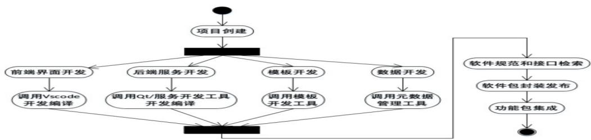
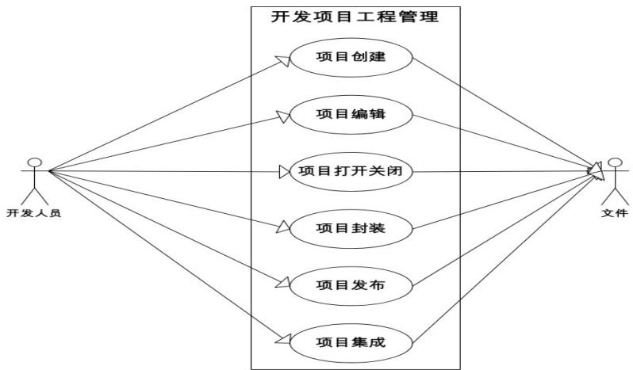
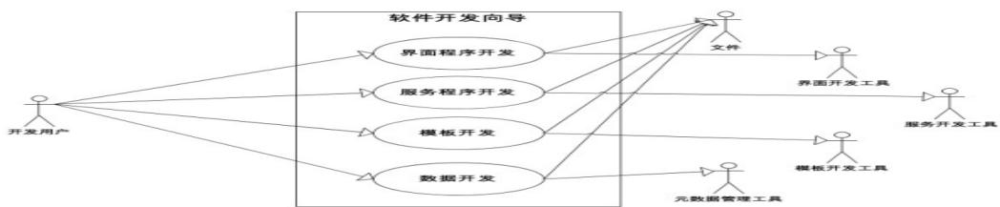

  
图6 开发集成用例图  
开发集成所有能力标识表，见表3所示。

表3 开发集成所有能力能力标识
<table><tr><td rowspan=1 colspan=1>序号</td><td rowspan=1 colspan=1>Usecase名称</td><td rowspan=1 colspan=1>项目唯一标识符</td><td rowspan=1 colspan=1>需求描述</td><td rowspan=1 colspan=1>需求重用</td><td rowspan=1 colspan=1>方式名称</td><td rowspan=1 colspan=1>运行状态</td><td rowspan=1 colspan=1>对应的任务书功能/性能</td></tr><tr><td rowspan=1 colspan=1>1</td><td rowspan=1 colspan=1>开发项目工程管理</td><td rowspan=1 colspan=1>PZXQ-GN-RJBSGL-KFJC-KFXMGL</td><td rowspan=1 colspan=1>提供软件开发项目工程的创建、编辑、封装、发布、集成的管理功能，支持项目基本信息（项目名称、项目标识、创建时间、创建人）编辑；</td><td rowspan=1 colspan=1>无</td><td rowspan=1 colspan=1>桌面</td><td rowspan=1 colspan=1>开发阶段</td><td rowspan=1 colspan=1>4.1.1 a)</td></tr><tr><td rowspan=1 colspan=1>2</td><td rowspan=1 colspan=1>软件开发工具集成</td><td rowspan=1 colspan=1>PZXQ-GN-RJBSGL-KFJC-KFGJJC</td><td rowspan=1 colspan=1>提供软件开发工具的集成功能，支持界面开发工具vscode、服务开发工具、Qt Creator、模板开发工具、元数据管理工具、软件产品包封装工具的集成；</td><td rowspan=1 colspan=1>无</td><td rowspan=1 colspan=1>桌面</td><td rowspan=1 colspan=1>开发阶段</td><td rowspan=1 colspan=1>4.1.1 b)</td></tr><tr><td rowspan=1 colspan=1>3</td><td rowspan=1 colspan=1>软件开发引导</td><td rowspan=1 colspan=1>PZXQ-GN-RJBSGL-KFJC-RJKFYD</td><td rowspan=1 colspan=1>提供软件开发引导功能，能够引导用户进行界面程序、服务程序的代码编辑，能够引导用户进行数据库表编辑、模板的制作；</td><td rowspan=1 colspan=1>无</td><td rowspan=1 colspan=1>桌面</td><td rowspan=1 colspan=1>开发阶段</td><td rowspan=1 colspan=1>4.1.1 c)</td></tr><tr><td rowspan=1 colspan=1>4</td><td rowspan=1 colspan=1>开发规范接口检索</td><td rowspan=1 colspan=1>PZXQ-GN-RJBSGL-KFJC-KFJKCX</td><td rowspan=1 colspan=1>提供软件开发规范和接口的查看和检索功能，支持以树形结构分类显示软件开发规范和接口，支持查看开发规范和接口内容。</td><td rowspan=1 colspan=1>无</td><td rowspan=1 colspan=1>桌面</td><td rowspan=1 colspan=1>开发阶段</td><td rowspan=1 colspan=1>4.1.1 d)</td></tr></table>

开发集成功能的处理流程如图7。

  
图7 开发集成处理流程

开发集成功能的处理流程是：

a）启动开发集成工具，创建项目，用户可编辑项目的名称、标识、包含的项目资源、版本等信息，生成项目；

b）用户可对已创建或者已打开的项目工程，如果选择前端界面开发，则调用VScode并将前端资源路径传入，进行前端代码的编辑、调试、打包；如果选择后端服务开发，则调用服务开发工具，生成服务及其插件，调用Qt5.9.6进行服务代码的编辑、编译和调试；如果选择模板开发，调用模板开发工具，进行模板的编辑、生成；如果选择数据开发，调用元数据管理工具进行数据库表的编辑、生成数据组件；

c）用户在开发过程中，可通过软件规范和接口，通过树形结构或者通过关键字查询指定规范接口内容；

d）用户在项目开发完毕后，调用软件产品包封装工具，对项目中的组件进行封装生成指定格式的软件包；

e）用户可调用软件产品包封装工具，对软件包进行集成，生成软件功能包。

## 3.2.1.1 开发项目工程管理（PZXQ-GN-RJBSGL-KFJC-KFXMGL）

开发项目工程管理是对软件开发的项目工程进行创建、编辑、打开、关闭、封装、发布、集成的管理。

开发项目工程管理的用例如图8所示。

  
图8 开发项目工程管理  
开发项目工程管理所有能力标识表，见表4所示。

表4 开发项目工程管理所有能力标识
<table><tr><td rowspan=1 colspan=1>序号</td><td rowspan=1 colspan=1>Usecase 名称</td><td rowspan=1 colspan=1>项目唯一标识符</td><td rowspan=1 colspan=1>需求描述</td><td rowspan=1 colspan=1>需求重用</td><td rowspan=1 colspan=1>方式名称</td><td rowspan=1 colspan=1>运行方式</td><td rowspan=1 colspan=1>对应的任务书功能/性能</td></tr><tr><td rowspan=1 colspan=1>1</td><td rowspan=1 colspan=1>项目创建</td><td rowspan=1 colspan=1>PZXQ-GN-RJBSGL-KFJC-KFXMGL-XMCJ</td><td rowspan=1 colspan=1>提供项目创建及项目描述信息编辑功能</td><td rowspan=1 colspan=1>新研</td><td rowspan=1 colspan=1>桌面</td><td rowspan=1 colspan=1>开发阶段</td><td rowspan=1 colspan=1>4.1.1 a)</td></tr><tr><td rowspan=1 colspan=1>2</td><td rowspan=1 colspan=1>项目打开关闭</td><td rowspan=1 colspan=1>PZXQ-GN-RJBSGL-KFJC-KFGJJC-XMGBDK</td><td rowspan=1 colspan=1>提供项目的打开、关闭，最近项目的快速打开和清除功能</td><td rowspan=1 colspan=1>新研</td><td rowspan=1 colspan=1>桌面</td><td rowspan=1 colspan=1>开发阶段</td><td rowspan=1 colspan=1>4.1.1 a)</td></tr><tr><td rowspan=1 colspan=1>3</td><td rowspan=1 colspan=1>项目封装</td><td rowspan=1 colspan=1>PZXQ-GN-RJBSGL-KFJC-RJKFYD-XMFZ</td><td rowspan=1 colspan=1>提供对项目开发的文件和文件夹进行封装功能；</td><td rowspan=1 colspan=1>新研</td><td rowspan=1 colspan=1>桌面</td><td rowspan=1 colspan=1>开发阶段</td><td rowspan=1 colspan=1>4.1.1 a)</td></tr><tr><td rowspan=1 colspan=1>4</td><td rowspan=1 colspan=1>项目发布</td><td rowspan=1 colspan=1>PZXQ-GN-RJBSGL-KFJC-KFJKCX-XMFB</td><td rowspan=1 colspan=1>提供项目软件产品的发布功能；</td><td rowspan=1 colspan=1>新研</td><td rowspan=1 colspan=1>桌面</td><td rowspan=1 colspan=1>开发阶段</td><td rowspan=1 colspan=1>4.1.1 a)</td></tr><tr><td rowspan=1 colspan=1>5</td><td rowspan=1 colspan=1>项目集成</td><td rowspan=1 colspan=1>PZXQ-GN-RJBSGL-KFJC-KFJKCX-XMJC</td><td rowspan=1 colspan=1>提供对项目软件包的集成工具</td><td rowspan=1 colspan=1>新研</td><td rowspan=1 colspan=1>桌面</td><td rowspan=1 colspan=1>开发阶段</td><td rowspan=1 colspan=1>4.1.1 a)</td></tr></table>

开发项目工程管理的处理流程如图9。

图9 开发项目工程管理的处理流程

## 3.2.1.1.1 项目创建（PZXQ-GN-RJBSGL-KFJC-KFXMGL-XMCJ）

项目工程创建编辑的用例场景，见表5所示。

表5 项目工程创建编辑用例描述
<table><tr><td colspan="1" rowspan="1">Use Case 名称:项目工程创建编辑</td><td colspan="2" rowspan="1">Actors：开发人员、文件</td></tr><tr><td colspan="3" rowspan="1">概述：本用例是描述开发人员创建和编辑软件项目工程的过程；</td></tr><tr><td colspan="3" rowspan="1">前置条件：开发集成服务启动正常。</td></tr><tr><td colspan="3" rowspan="1">主事件流</td></tr><tr><td colspan="1" rowspan="1">Actor 的动作</td><td colspan="1" rowspan="1">系统的动作</td><td colspan="1" rowspan="1">动作约束(性能、可靠性、容错等)</td></tr><tr><td colspan="1" rowspan="1">1.开发人员输入项目的相关信息，如项目名称，版本信息，项目标识，项目属性，项目类型，操作系统等参数；</td><td colspan="1" rowspan="1">2.系统将对项目信息参数进行校验，如果参数输入不正确，执行异常流E1；如果检测磁盘已满，执行异常流E2；3.系统按照规范的目录结构在本地创建软件工程目录文件夹，并将项目信息保存到json 文件中，同时将需要的配置文</td><td colspan="1" rowspan="1"></td></tr><tr><td colspan="1" rowspan="1"></td><td colspan="1" rowspan="1">件以及工程目录拷贝到workspace目录下；4.如果参数中包含加载地图数据，则将地图开发模板数据拷贝到项目工程中；</td><td colspan="1" rowspan="1"></td></tr><tr><td colspan="2" rowspan="1">异常流E1：系统提示项目参数输入不正确，返回项目信息输入界面。异常流E2：系统提示项目创建失败，用例结束。</td><td colspan="1" rowspan="1"></td></tr><tr><td colspan="2" rowspan="1">后置条件：无。</td><td colspan="1" rowspan="1"></td></tr></table>

## 3.2.1.1.2 项目打开关闭（PZXQ-GN-RJBSGL-KFJC-KFGJJC-XMGBDK）

打开关闭项目用例场景，如下表6所示。

表6 打开关闭项目用例描述
<table><tr><td>Use Case 名称:打开关闭项目</td><td colspan="2">Actors：开发人员、文件</td></tr><tr><td colspan="3">概述：本用例是描述开发人员打开已有项目和清除历史项目的过程；</td></tr><tr><td colspan="3">前置条件：开发集成服务启动正常。</td></tr><tr><td colspan="4">主事件流</td></tr><tr><td>Actor 的动作</td><td>系统的动作</td><td>动作约束 (性能、可靠性、容错等)</td></tr><tr><td>1. 开发人员点击“打开项目”； 3. 开发人员选择对应的项目工程json文 件； 界面，并在最近打开列表中显示工程名 称；</td><td>2.系统弹出项目选择对话框； 4.系统读取项目工程json文件内容，对 文件内容进行检测，若文件内容不完 整，执行异常流E1，并将工程信息显示到</td><td></td></tr><tr><td>5.开发人员点击“关闭项目”； 7.开发人员在最近列表中，点击项目名</td><td>6.系统读取项目的描述信息，并将项目 的信息更新到项目描述文件中，关闭项 目信息显示窗口；</td><td></td></tr><tr><td>称；</td><td></td><td></td></tr><tr><td colspan="1" rowspan="1">9.开发人员点击“清除历史”；</td><td colspan="1" rowspan="1">8.系统依据最近项目中的路径，读取项目的信息，并将项目信息显示到界面，将当前打开项目在最近列表中置顶；10.系统将最近列表信息清空。</td><td colspan="1" rowspan="1"></td></tr><tr><td colspan="2" rowspan="1">异常流E1：项目工程描述不完整，提示用户打开失败。</td><td colspan="2" rowspan="1"></td></tr><tr><td colspan="2" rowspan="1">后置条件：无。</td><td colspan="2" rowspan="1"></td></tr></table>

## 3.2.1.1.3 项目封装（PZXQ-GN-RJBSGL-KFJC-RJKFYD-XMFZ）

项目封装用例场景，如下表7所示。

表7 项目封装用例描述
<table><tr><td>Use Case 名称：项目封装</td><td colspan="2">Actors:开发人员、文件</td></tr><tr><td colspan="3">概述：本用例是描述开发人员将项目开发完成的软件组件进行封装的过程；</td></tr><tr><td colspan="3">前置条件：开发集成服务启动正常。</td></tr><tr><td colspan="3">主事件流</td></tr><tr><td>Actor 的动作</td><td>系统的动作</td><td>动作约束 (性能、可靠性、容错等)</td></tr><tr><td>1.开发人员设置软件封装工具的路径</td><td>2.系统记录软件封装工具的路径，并保 存到 json 文件中；</td><td></td></tr><tr><td>3.开发人员选中工程点击一键封装；</td><td>4.系统根据配置文件中软件封装工具路 径，将调用软件封装工具，显示软件封 装工具界面；</td><td></td></tr><tr><td>5.开发人员输入封装信息，点击封装；</td><td>6.软件封装工具将项目开发软件组件封 装成软件产品包。</td><td></td></tr><tr><td colspan="3">异常流：无。</td></tr></table>

<table><tr><td>后置条件：无。</td><td></td></tr></table>

## 3.2.1.1.4 项目发布（PZXQ-GN-RJBSGL-KFJC-KFJKCX-XMFB）

项目发布用例场景，如下表8所示。

表8 项目发布用例描述
<table><tr><td rowspan=1 colspan=1>Use Case 名称：项目发布</td><td rowspan=1 colspan=2>Actors:开发人员、文件</td></tr><tr><td rowspan=1 colspan=3>概述：本用例是描述开发人员发布项目的过程；</td></tr><tr><td rowspan=1 colspan=3>前置条件：开发集成服务启动正常。</td></tr><tr><td rowspan=1 colspan=3>主事件流</td></tr><tr><td rowspan=1 colspan=1>Actor 的动作</td><td rowspan=1 colspan=1>系统的动作</td><td rowspan=1 colspan=1>动作约束(性能、可靠性、容错等)</td></tr><tr><td rowspan=1 colspan=1>1.开发人员选择左侧菜单的打开界面，界面显示最近需要发布的项目列表；3.开发人员选中需要发布的项目或者项目下的版本，点击一键发布；5.开发人员选择需要发布完后的路径</td><td rowspan=1 colspan=1>2.系统将发布的项目拷贝到用户选择的路径中；4.调用封装工具，进行项目封装打包；6.封装工具将软件包发布到指定路径下。</td><td rowspan=1 colspan=1></td></tr><tr><td rowspan=1 colspan=2>异常流：无。</td><td rowspan=1 colspan=1></td></tr><tr><td rowspan=1 colspan=2>后置条件：无。</td><td rowspan=1 colspan=1></td></tr></table>

## 3.2.1.1.5 项目集成（PZXQ-GN-RJBSGL-KFJC-KFJKCX-XMJC）

项目集成用例场景，如下表9所示。

表9 项目集成用例描述
<table><tr><td rowspan=1 colspan=1>Use Case 名称：项目集成</td><td rowspan=1 colspan=1>Actors：开发人员、文件</td></tr><tr><td rowspan=1 colspan=2>概述：本用例描述开发人员进行项目集成的过程；</td></tr><tr><td rowspan=1 colspan=2>前置条件：服务启动正常。</td></tr><tr><td rowspan=1 colspan=2>主事件流</td></tr></table>

<table><tr><td rowspan=1 colspan=1>Actor 的动作</td><td rowspan=1 colspan=1>系统的动作</td><td rowspan=1 colspan=1>动作约束(性能、可靠性、容错等)</td></tr><tr><td rowspan=1 colspan=1>1.开发人员打开集成界面，设置功能包集成工具的路径3.开发人员点击打开功能包集成工具</td><td rowspan=1 colspan=1>2.系统将用户设置的功能包集成工具的路径写入json 文件中4.系统根据json 文件调用功能包集成工具，对各个包文件进行集成。如果调用功能包集成工具失败，执行异常数据流E1</td><td rowspan=1 colspan=1></td></tr><tr><td rowspan=1 colspan=2>异常流E1：调用功能包集成工具异常，用例结束</td><td rowspan=1 colspan=1></td></tr><tr><td rowspan=1 colspan=2>后置条件：无。</td><td rowspan=1 colspan=1></td></tr></table>

## 3.2.1.2 软件开发工具集成（PZXQ-GN-RJBSGL-KFJC-KFGJJC）

软件开发工具的集成能够将界面开发工具、服务开发工具、模板开发工具、元数据管理工具、软件产品包封装工具进行集成。

软件开发工具集成功能的用例场景，见表10所示。

表10 软件开发工具集成用例描述
<table><tr><td colspan="1" rowspan="1">Use Case 名称:软件开发工具集成</td><td colspan="2" rowspan="1">Actors：开发人员、界面开发工具、服务开发工具、模板开发工具、元数据管理工具、软件产品包封装工具</td></tr><tr><td colspan="3" rowspan="1">概述：本用例描述软件开发工具集成的过程；</td></tr><tr><td colspan="3" rowspan="1">前置条件：开发集成服务启动正常。</td></tr><tr><td colspan="3" rowspan="1">主事件流</td></tr><tr><td colspan="1" rowspan="1">Actor的动作</td><td colspan="1" rowspan="1">系统的动作</td><td colspan="1" rowspan="1">动作约束(性能、可靠性、容错等)</td></tr><tr><td colspan="1" rowspan="1">1.开发人员设置 vscode 的路径；3.开发人员点击界面开发；</td><td colspan="1" rowspan="1">2.系统将 vscode 路径写入到配置文件中；4.系统根据 vscode 路径，调用</td><td colspan="1" rowspan="1"></td></tr><tr><td>5.开发人员选择服务开发，设置Qt的路 径；</td><td>vscode，如果 vscode 打开失败，执行异 常流 E1,否则，显示 vscode 界面；</td><td></td></tr><tr><td>7.开发人员点击服务开发；</td><td>6.系统将 Qt 路径写入到配置文件中； 8.系统根据 Qt路径，调用 Qt，如果 Qt</td><td></td></tr><tr><td>9.开发人员设置模板开发工具的路径；</td><td>打开失败，执行异常流E2,否则，显示 Qt界面；</td><td></td></tr><tr><td>11.开发人员点击模板开发；</td><td>10. 系统将模板开发工具路径写入到配置 文件中； 12.系统根据模板开发工具路径，调用模</td><td></td></tr><tr><td>13.开发人员点击数据开发；</td><td>板开发工具，如果模板开发工具打开失 败，执行异常流E3，否则，显示模板开 发工具界面； 14.系统跳转到元数据管理工具界面，如</td><td></td></tr><tr><td>异常流 E1：系统提示 vscode 打开失败。 异常流 E2：系统提示 Qt 打开失败。</td><td>果元数据管理工具跳转失败，执行异常 流E4，否则，显示元数据管理工具界 面。</td><td></td></tr><tr><td colspan="2">异常流E3：系统提示模板开发工具打开失败。 异常流E4：系统提示元数据管理工具跳转失败。 后置条件：无。</td><td></td></tr></table>

## 3.2.1.3 软件开发引导（PZXQ-GN-RJBSGL-KFJC-RJKFYD）

软件开发引导能够引导用户进行界面类程序的编辑、编译、调试，生成指定格式的界面组件，能够引导用户进行服务类程序的代码编辑、编译、调试，生成指定格式的服务组件，能够引导用户进行数据库表编辑，生成指定格式的数据组件；能够引导用户进

行模板的制作、编辑。

软件开发引导的用例如图10所示。

  
图10 软件开发引导

软件开发引导所有能力标识表，见表11所示。

表11 软件开发引导所有能力标识
<table><tr><td rowspan=1 colspan=1>序号</td><td rowspan=1 colspan=1>Usecase名称</td><td rowspan=1 colspan=1>项目唯一标识符</td><td rowspan=1 colspan=1>需求描述</td><td rowspan=1 colspan=1>需求重用</td><td rowspan=1 colspan=1>方式名称</td><td rowspan=1 colspan=1>运行状态</td><td rowspan=1 colspan=1>对应的任务书功能/性能</td></tr><tr><td rowspan=1 colspan=1>1</td><td rowspan=1 colspan=1>界面程序开发</td><td rowspan=1 colspan=1>PZXQ-GN-RJBSGL-KFJC-KFXMGL-JMCXKF</td><td rowspan=1 colspan=1>能够引导用户进行界面类程序的编辑、编译、调试，生成指定格式的界面组件；</td><td rowspan=1 colspan=1>新研</td><td rowspan=1 colspan=1>桌面</td><td rowspan=1 colspan=1>开发阶段</td><td rowspan=1 colspan=1>4.1.1 c)</td></tr><tr><td rowspan=1 colspan=1>2</td><td rowspan=1 colspan=1>服务程序开发</td><td rowspan=1 colspan=1>PZXQ-GN-RJBSGL-KFJC-KFGJJC-FWCXKF</td><td rowspan=1 colspan=1>能够引导用户进行服务类程序的代码编辑、编译、调试，生成指定格式的服务组件；</td><td rowspan=1 colspan=1>新研</td><td rowspan=1 colspan=1>桌面</td><td rowspan=1 colspan=1>开发阶段</td><td rowspan=1 colspan=1>4.1.1 c)</td></tr><tr><td rowspan=1 colspan=1>3</td><td rowspan=1 colspan=1>模板开发</td><td rowspan=1 colspan=1>PZXQ-GN-RJBSGL-KFJC-RJKFYD-MBKF</td><td rowspan=1 colspan=1>能够引导用户进行模板的制作、编辑；</td><td rowspan=1 colspan=1>新研</td><td rowspan=1 colspan=1>桌面</td><td rowspan=1 colspan=1>开发阶段</td><td rowspan=1 colspan=1>4.1.1 c)</td></tr><tr><td rowspan=1 colspan=1>4</td><td rowspan=1 colspan=1>数据开发</td><td rowspan=1 colspan=1>PZXQ-GN-RJBSGL-KFJC-KFJKCX-SJKF</td><td rowspan=1 colspan=1>能够引导用户进行数据库表编辑，生成指定格式的数据组件；</td><td rowspan=1 colspan=1>新研</td><td rowspan=1 colspan=1>桌面</td><td rowspan=1 colspan=1>开发阶段</td><td rowspan=1 colspan=1>4.1.1 c)</td></tr></table>