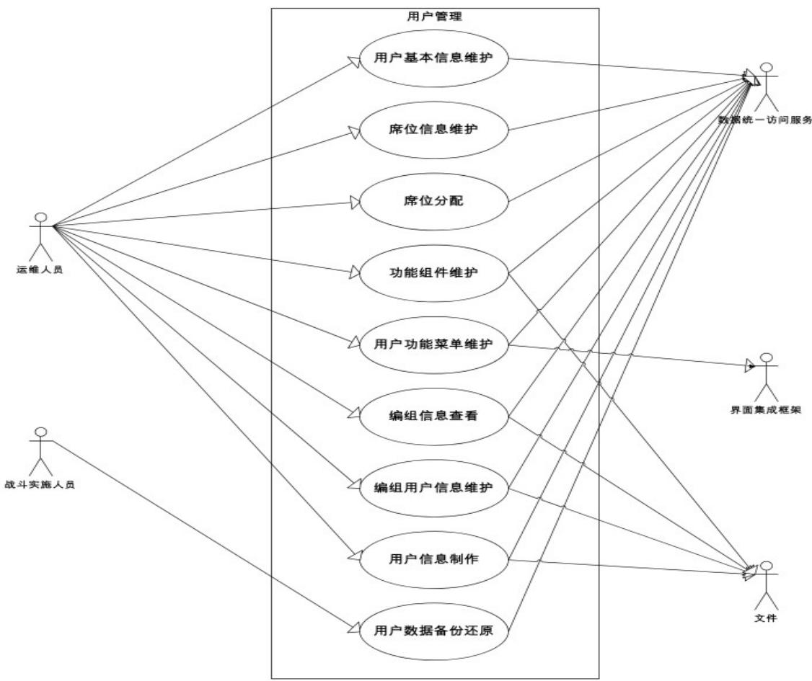
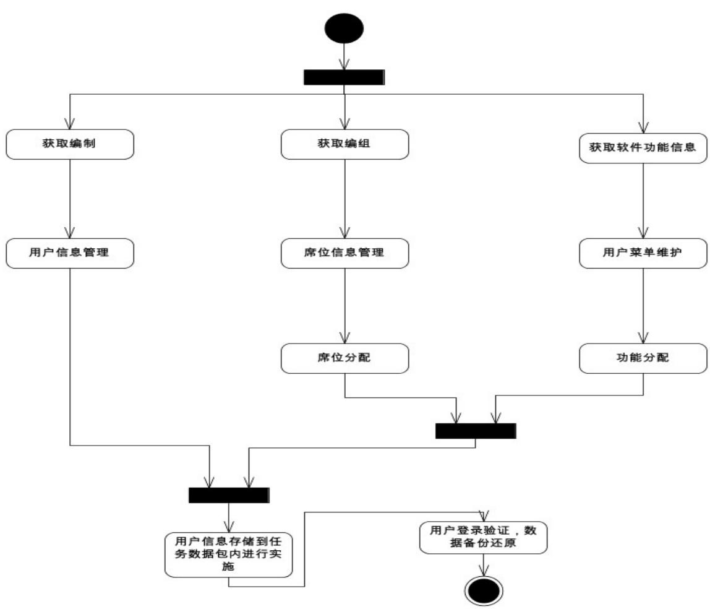

<table><tr><td rowspan=1 colspan=1>出的任务数据包，点击删除。3.运维人员在弹框中点击确定。</td><td rowspan=1 colspan=1>2.系统弹框提示是否确认删除。4.系统将用户选择的预案包进行删除。如果删除失败，执行异常流E1。如果删除成功，系统提示删除成功，任务数据列表中不展现被删除任务数据包。</td><td rowspan=1 colspan=1></td></tr><tr><td rowspan=1 colspan=2>异常流E1：删除预案包不存在。</td><td rowspan=1 colspan=1></td></tr><tr><td rowspan=1 colspan=2>后置条件：无。</td><td rowspan=1 colspan=1></td></tr></table>

## 3.2.3.1.4 任务数据包修改（PZXQ-GN-YAZZKT-RWSJBGL-SJBXG）

任务数据包修改用例场景，见表29所示。

表29 任务数据包修改用例描述
<table><tr><td rowspan=1 colspan=1>Use Case 名称:修改任务数据包</td><td rowspan=1 colspan=2>Actors：运维人员、文件</td></tr><tr><td rowspan=1 colspan=3>概述：本用例是任务数据包管理的扩展用例，描述用户修改任务数据包的过程；</td></tr><tr><td rowspan=1 colspan=3>前置条件：服务正常启动</td></tr><tr><td rowspan=1 colspan=3>主事件流</td></tr><tr><td rowspan=1 colspan=1>Actor 的动作</td><td rowspan=1 colspan=1>系统的动作</td><td rowspan=1 colspan=1>动作约束(性能、可靠性、容错等)</td></tr><tr><td rowspan=1 colspan=1>1.运维人员在任务数据包列表选中任务数据包进行修改。3.运维人员修改当前任务数据包名。</td><td rowspan=1 colspan=1>2.系统进入修改页面，任务数据包的相关属性可编辑。4.系统将用户选择的预案包进行修改。如果修改失败，执行异常流E1。如果修改成功，系统提示修改成功，任务数据列表中展现修改后的任务数据包。</td><td rowspan=1 colspan=1></td></tr><tr><td rowspan=1 colspan=2>异常流E1：修改后的预案包名已存在。</td><td rowspan=1 colspan=1></td></tr><tr><td rowspan=1 colspan=2>后置条件：无。</td><td rowspan=1 colspan=1></td></tr></table>

## 3.2.3.2 任务数据包制作（PZXQ-GN-YAZZKT-RWSJBZZ）

任务数据包制作提供任务数据包制作功能，能够导入sql类型的基础数据、sql类型的用户信息数据、xml类型的动态名录文件、地图数据文件、网络规划文件的任务数据文件，并引导用户逐步完成任务数据包的制作，能够对未完成任务数据包进行保存，支持在未完成预案包的基础上进行任务数据包的继续制作，能够提供任务数据包制作接口，支持应用进行任务数据包的制作。

任务数据包制作用例场景，见表30所示。

表30 任务数据包制作用例描述
<table><tr><td colspan="1" rowspan="1">Use Case 名称：任务数据包制作</td><td colspan="2" rowspan="1">Actors：运维人员、文件</td></tr><tr><td colspan="3" rowspan="1">概述：本用例是任务数据包管理的扩展用例，描述用户制作任务数据包的过程；</td></tr><tr><td colspan="3" rowspan="1">前置条件：服务正常启动</td></tr><tr><td colspan="3" rowspan="1">主事件流</td></tr><tr><td colspan="1" rowspan="1">Actor 的动作</td><td colspan="1" rowspan="1">系统的动作</td><td colspan="1" rowspan="1">动作约束(性能、可靠性、容错等)</td></tr><tr><td colspan="1" rowspan="1">1.运维人员在任务数据包列表点击新建。3.运维人员输入任务数据包描述信息。5.在数据导入界面，用户进行基础数据、地图数据、编组数据、通讯录数</td><td colspan="1" rowspan="1">2.系统弹框，提示用户输入任务数据包描述信息。4.系统将用户输入的信息进行文件保存。如果保存失败，执行异常流E1。如果修改成功，系统提示保存成功，在对应预案包下会有 yuanbao.json 文件，里面保存用户输入的任务数据包描述信息；界面进入数据导入页面。</td><td colspan="1" rowspan="1"></td></tr><tr><td>据、网络规划数据的添加。 7.运维人员点击封装按钮。</td><td>6.系统将用户导入的数据进行保存。 (1)如果保存基础数据失败，执行异常 流E2;如果保存成功，系统提示基础数据 保存成功，界面展现基础数据大小、名 称; (2)如果保存通讯录数据失败，执行异 常流E3;如果保存成功，系统提示通讯录 数据保存成功，界面展现通讯录数据文 件大小、名称； (3)如果保存编组数据失败，执行异常 流E4;如果保存成功，系统提示编组数据 保存成功，界面展现通讯编组数据文件 大小、名称。 8.系统将用户新建的任务数据包进行封 装。如果封装失败，执行异常流E5;如果 封装成功，系统提示任务数据包封装成</td><td></td></tr><tr><td colspan="2">异常流E1：修改后的预案包名已存在。 异常流 E2：保存基础数据文件非 sqI 文件。</td><td>功，界面展现封装完成的任务数据包。</td></tr><tr><td colspan="2">异常流E3：保存通讯录数据文件非xml文件 异常流 E4：保存编组数据文件非 xml 文件</td><td></td></tr></table>

## 3.2.3.3 任务数据开通（PZXQ-GN-YAZZKT-RWSJBKT）

任务数据包开通提供任务数据开通功能，能够将任务数据包内的基础数据、用户信息数据导入数据库，能够将任务数据包内的动态名录文件、地图文件、网络规划文件拷贝到系统指定目录下，完成系统开通。

任务数据包开通用例场景，见表31所示

表31 任务数据包开通用例描述
<table><tr><td colspan="1" rowspan="1">Use Case 名称:开通任务数据包</td><td colspan="2" rowspan="1">Actors：运维人员、文件、组织筹划、数据统一访问服务、动态名录、网络规划</td></tr><tr><td colspan="3" rowspan="1">概述：本用例是作战任务管理的扩展用例，描述用户开通任务数据包的过程；</td></tr><tr><td colspan="3" rowspan="1">前置条件：服务正常启动</td></tr><tr><td colspan="3" rowspan="1">主事件流</td></tr><tr><td colspan="1" rowspan="1">Actor 的动作</td><td colspan="1" rowspan="1">系统的动作</td><td colspan="1" rowspan="1">动作约束(性能、可靠性、容错等)</td></tr><tr><td colspan="1" rowspan="1">1.运维人员在任务数据包列表选择任务数据包进行开通</td><td colspan="1" rowspan="1">2.系统将用户选中任务数据包中的相关数据进行分类处理。界面显示当前开通总进度以及各个数据处理进度。(1)如果基础数据导入到数据库失败，执行异常流E1；如果导入成功，在数据库中存在导入数据；(2)如果地图数据处理异常，执行异常流E2;如果处理成功，支持地图制作工具利用此数据制作地图；(3)如果通讯录数据处理异常，执行异常流E3;如果处理成功，支持名录查看工具进行查看具体内容；(4)如果编组数据处理异常，执行异常流E4;如果处理成功，编组文件存放指定位置；(5)如果网络规划数据处理失败，执行异常流E5;如果处理成功，网络规划文件存放到指定位置。</td><td colspan="1" rowspan="1">任务数据包内包含基础数据、组织筹划数据、动态名录数据、地图数据、网络规划数据，且任务数据包不大于2GB条件下，任务数据开通时间不超过5分钟</td></tr><tr><td colspan="2" rowspan="1">异常流E1：数据库未安装或数据库包未正确安装。异常流E2：磁盘空间不足或地图数据包未正确安装。异常流E3：磁盘空间不足或动态名录包未正确安装。异常流E4：磁盘空间不足或编组相关包未正确安装。异常流E5:磁盘空间不足或网络规划相关包未正确安装。</td><td colspan="1" rowspan="1"></td></tr><tr><td colspan="2" rowspan="1">后置条件：无。</td><td colspan="1" rowspan="1"></td></tr></table>

## 3.2.3.4 任务数据验证（PZXQ-GN-YAZZKT-RWSJBYZ）

任务数据验证提供开通数据验证的功能，能够对任务数据包内的基础数据、用户信息数据、动态名录文件、地图文件、网络规划文件的大小、文件类型、文件格式进行校验，对未通过验证的数据进行提示。

任务数据包验证用例场景，见表32所示

表32 任务数据包验证用例描述
<table><tr><td colspan="1" rowspan="1">Use Case 名称：验证任务数据包</td><td colspan="2" rowspan="1">Actors：运维人员、文件</td></tr><tr><td colspan="3" rowspan="1">概述：本用例是任务数据包在开通过程中进行数据验证的过程；</td></tr><tr><td colspan="3" rowspan="1">前置条件：服务正常启动</td></tr><tr><td colspan="3" rowspan="1">主事件流</td></tr><tr><td colspan="1" rowspan="1">Actor 的动作</td><td colspan="1" rowspan="1">系统的动作</td><td colspan="1" rowspan="1">动作约束(性能、可靠性、容错等)</td></tr><tr><td colspan="1" rowspan="1">1.运维人员在任务数据包列表选中任务数据包进行验证。3.运维人员验证当前任务数据包名。</td><td colspan="1" rowspan="1">2.系统进入验证页面，任务数据包的相关属性可编辑。4.系统将用户选择的预案包进行验证。如果验证失败，执行异常流E1。如果验证成功，系统提示验证成功，任务数据列表中展现验证后的任务数据包。</td><td colspan="1" rowspan="1"></td></tr><tr><td colspan="2" rowspan="1">异常流E1:验证后的预案包名已存在。</td><td colspan="1" rowspan="1"></td></tr><tr><td colspan="2" rowspan="1">后置条件：无。</td><td colspan="1" rowspan="1"></td></tr></table>

## 3.2.4 用户管理（PZXQ-GN-RJBSGL-YHGL）

用户管理功能包括：用户基本信息维护、坐位信息维护、坐位分配、用户功能菜单维护、功能组件编辑、编组信息查看、编组用户信息维护、用户信息制作、用户数据备份还原，其功能用例如图18所示。

  
图18 用户管理用例图

用户管理所有能力标识表，见表33所示。

表33 用户管理所有能力标识
<table><tr><td colspan="1" rowspan="1">序号</td><td colspan="1" rowspan="1">Usecase名称</td><td colspan="1" rowspan="1">项目唯一标识符</td><td colspan="1" rowspan="1">需求描述</td><td colspan="1" rowspan="1">需求重用</td><td colspan="1" rowspan="1">方式名称</td><td colspan="1" rowspan="1">运行状态</td><td colspan="1" rowspan="1">对应的任务书功能/性能</td></tr><tr><td colspan="1" rowspan="1">1</td><td colspan="1" rowspan="1">用户基本信息维护</td><td colspan="1" rowspan="1">PZXQ-GN-RJBSGL-YHGL-YHJBXXWH</td><td colspan="1" rowspan="1">提供用户基本信息（用户ID、用户密码）编辑、导入、导出的维护功能；</td><td colspan="1" rowspan="1">改进</td><td colspan="1" rowspan="1">桌面、平板</td><td colspan="1" rowspan="1">集成阶段、运行阶段</td><td colspan="1" rowspan="1">4.1.4 a)</td></tr><tr><td colspan="1" rowspan="1">2</td><td colspan="1" rowspan="1">坐位信</td><td colspan="1" rowspan="1">PZXQ-GN-</td><td colspan="1" rowspan="1">提供坐位信息（坐位名称、坐</td><td colspan="1" rowspan="1">改进</td><td colspan="1" rowspan="1">桌面、平</td><td colspan="1" rowspan="1">集成阶</td><td colspan="1" rowspan="1">4.1.4 b)</td></tr><tr><td colspan="1" rowspan="1"></td><td colspan="1" rowspan="1">息维护</td><td colspan="1" rowspan="1">RJBSGL-YHGL-XWXXWH</td><td colspan="1" rowspan="1">位描述、坐位功能菜单）编辑、导入、导出的维护功能，支持坐位模板制作和依据坐位模板的坐位制作功能；</td><td colspan="1" rowspan="1"></td><td colspan="1" rowspan="1">板</td><td colspan="1" rowspan="1">段、运行阶段</td><td colspan="1" rowspan="1"></td></tr><tr><td colspan="1" rowspan="1">3</td><td colspan="1" rowspan="1">坐位分配</td><td colspan="1" rowspan="1">PZXQ-GN-RJBSGL-YHGL-XWFP</td><td colspan="1" rowspan="1">提供坐位分配的功能，能够为用户分配坐位，完成坐位信息和用户信息的关联匹配；</td><td colspan="1" rowspan="1">改进</td><td colspan="1" rowspan="1">桌面、平板</td><td colspan="1" rowspan="1">集成阶段、运行阶段</td><td colspan="1" rowspan="1">4.1.4 c)</td></tr><tr><td colspan="1" rowspan="1">4</td><td colspan="1" rowspan="1">功能组件维护</td><td colspan="1" rowspan="1">PZXQ-GN-RJBSGL-YHGL-GNZJWH</td><td colspan="1" rowspan="1">提供功能组件的编辑功能，支持组件的导入、导出；</td><td colspan="1" rowspan="1">改进</td><td colspan="1" rowspan="1">桌面、平板</td><td colspan="1" rowspan="1">集成阶段、运行阶段</td><td colspan="1" rowspan="1">4.1.4 d)</td></tr><tr><td colspan="1" rowspan="1">5</td><td colspan="1" rowspan="1">用户功能菜单维护</td><td colspan="1" rowspan="1">PZXQ-GN-RJBSGL-YHGL-YHGNCDWH</td><td colspan="1" rowspan="1">提供用户功能菜单的编辑、导入、导出维护功能；</td><td colspan="1" rowspan="1">改进</td><td colspan="1" rowspan="1">桌面、平板</td><td colspan="1" rowspan="1">集成阶段、运行阶段</td><td colspan="1" rowspan="1">4.1.4 e)</td></tr><tr><td colspan="1" rowspan="1">6</td><td colspan="1" rowspan="1">编组信息查看</td><td colspan="1" rowspan="1">PZXQ-GN-RJBSGL-YHGL-BZXXCK</td><td colspan="1" rowspan="1">提供编组文件的导入、查看功能，能够查看编组内用户信息；</td><td colspan="1" rowspan="1">改进</td><td colspan="1" rowspan="1">桌面、平板</td><td colspan="1" rowspan="1">集成阶段、运行阶段</td><td colspan="1" rowspan="1">4.1.4 f)</td></tr><tr><td colspan="1" rowspan="1">7</td><td colspan="1" rowspan="1">编组用户信息维护</td><td colspan="1" rowspan="1">PZXQ-GN-RJBSGL-YHGL-BZYHXXWH</td><td colspan="1" rowspan="1">提供对编组内的用户进行坐位分配功能，能够将编组内的用户信息数据导出为 sqI 文件;</td><td colspan="1" rowspan="1">改进</td><td colspan="1" rowspan="1">桌面、平板</td><td colspan="1" rowspan="1">集成阶段、运行阶段</td><td colspan="1" rowspan="1">4.1.4 g)</td></tr><tr><td colspan="1" rowspan="1">8</td><td colspan="1" rowspan="1">用户信息制作</td><td colspan="1" rowspan="1">PZXQ-GN-RJBSGL-YHGL-YHXXZZ</td><td colspan="1" rowspan="1">提供用户信息数据（用户基本信息、角色信息、权限信息、功能菜单信息）制作功能，支持将用户信息数据导出为 sqI 文件；</td><td colspan="1" rowspan="1">改进</td><td colspan="1" rowspan="1">桌面、平板</td><td colspan="1" rowspan="1">集成阶段、运行阶段</td><td colspan="1" rowspan="1">4.1.4 h)</td></tr><tr><td colspan="1" rowspan="1">9</td><td colspan="1" rowspan="1">用户数据备份还原</td><td colspan="1" rowspan="1">PZXQ-GN-RJBSGL-YHGL-YHSJBFHY</td><td colspan="1" rowspan="1">提供用户数据备份还原功能，能够在用户登录时加载用户使用数据（界面菜单信息、界面布局信息、态势图层信息以及和用户相关的应用配置信息），能够在用户退出登录时保存用户使用数据。</td><td colspan="1" rowspan="1">改进</td><td colspan="1" rowspan="1">桌面、平板、手持</td><td colspan="1" rowspan="1">运行阶段</td><td colspan="1" rowspan="1">4.1.4 i)</td></tr></table>

用户管理功能的处理流程如图19。

  
图19 用户管理处理流程

用户管理的处理流程是：

a）运维人员依据人员编制数据，为编制人员分配用户，维护用户的基本信息（用户ID、用户名称、用户密码、用户职务等）；

b）维护常用的坐位信息（坐位 ID、坐位名称、坐位描述等），形成坐位清单；

c）通过接入软件商店，获取系统提供的业务功能包，通过菜单维护，形成系统功能菜单清单；

d）在坐位清单和功能菜单清单基础上，通过功能分配（依据任务清单），形成角色权限功能清单；

e）将已维护的坐位信息分配给指定用户，形成作战用户信息，将作战用户信息以基础数据形式导出存放到任务数据包。

h）用户进行登录验证后，对用户数据进行备份还原，实现用户数据随身。

## 3.2.4.1 用户基本信息维护（PZXQ-GN-YHGL-JBXXWH）

用户基本信息维护提供用户基本信息（用户 ID、用户密码）编辑、导入、导出的维护功能。

用户基本信息维护用例场景，见表34所示。

表34 用户基本信息维护用例描述
<table><tr><td colspan="1" rowspan="1">Use Case 名称:用户基本信息维护</td><td colspan="2" rowspan="1">Actors：运维人员、数据统一访问服务</td></tr><tr><td colspan="3" rowspan="1">概述：本用例是用户管理的扩展用例，描述用户基本信息维护的过程；</td></tr><tr><td colspan="3" rowspan="1">前置条件：数据库连接正常。</td></tr><tr><td colspan="3" rowspan="1">主事件流</td></tr><tr><td colspan="1" rowspan="1">Actor 的动作</td><td colspan="1" rowspan="1">系统的动作</td><td colspan="1" rowspan="1">动作约束(性能、可靠性、容错等)</td></tr><tr><td colspan="1" rowspan="1">1.运维人员点击系统用户管理-信息维护，选择编制下的某个用户（未添加），点击操作列的新增按钮，填写用户密码并确认密码，用户从目前维护的角色中选择一个角色进行角色分配；用户从目前维护的权限中选择一个权限进行权限分配；3.运维人员点击系统用户管理-信息维护，选择编制下的某个用户（已添加），点击操作列的编辑按钮，修改用户密码并确认密码、修改用户角色、修改用户权限；</td><td colspan="1" rowspan="1">2.系统将用户信息保存到数据库中。如果保存失败，执行异常流E1；如果保存成功，系统在信息维护界面的用户列表该用户显示已添加；4.系统将修改后用户信息保存到数据库。如果保存失败，执行异常流E2；如果保存成功，选中用户的信息为编辑后的用户信息；</td><td colspan="1" rowspan="1"></td></tr><tr><td>5.运维人员点击系统用户管理-信息维 护，选择编制下的某个用户（已添 加），点击操作列的删除按钮，提示是 否确认删除，点击取消，则取消删除， 点击确定，则对选中用户进行删除；</td><td>6.系统将选中的用户信息在数据库中删 除。如果删除失败，执行异常流E3；如 果删除成功，系统在信息维护界面的用 户列表该用户显示未添加；</td><td></td></tr><tr><td>7.运维人员点击系统用户管理-信息维 护，点击导出按钮；</td><td>8.系统将用户信息数据（用户基本信 息、用户角色信息、用户权限信息、用 户功能菜单信息)导出。如果导出失 败，执行异常流E4；如果导出成功，用 户信息数据导出为用户信息模板；</td><td></td></tr><tr><td>9.运维人员点击系统用户管理-信息维 护，点击导入按钮； 异常流E1：系统提示用户添加异常，用例结束。</td><td>10. 系统将用户信息数据（用户基本信 息、用户角色信息、用户权限信息、用 户功能菜单信息)导入。如果导入失 败，执行异常流E5；如果导入成功，信 息维护界面展现导入数据。</td><td></td></tr><tr><td colspan="2">异常流E2: 系统提示用户更新异常，用例结束。 异常流E3:系统提示用户删除异常，用例结束。 异常流E4: 系统提示用户信息数据导出失败，用例结束。 异常流E5: 系统提示用户信息数据导入失败，用例结束。</td><td></td></tr><tr><td colspan="2">后置条件：无。</td><td></td></tr></table>

## 3.2.4.2 坐位信息维护（PZXQ-GN-YHGL-ZWXXWH）

坐位信息维护提供供坐位信息（坐位名称、坐位描述、坐位功能菜单）编辑、导入、导出的维护功能，支持坐位模板制作和依据坐位模板的坐位制作功能。

坐位信息维护用例场景，见表35所示。

表35 坐位信息维护用例描述
<table><tr><td>Use Case 名称:坐位信息维护</td><td>Actors：运维人员、数据统一访问服务</td></tr></table>