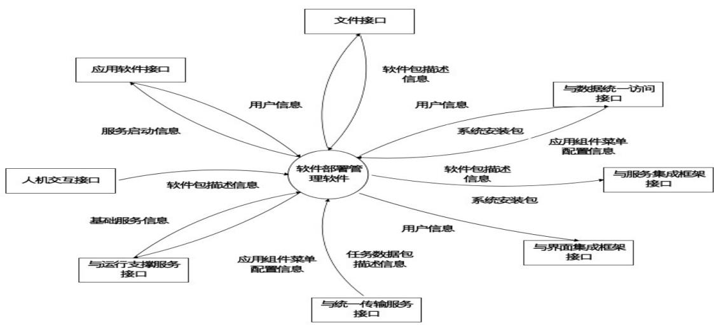

软件本地安装提供本地软件安装、升级、卸载功能，支持软件一键安装、一键升级、一键卸载，支持软件安装、升级、卸载进度显示查看。

软件本地安装用例场景，见表46所示。

表46 软件本地安装用例场景
<table><tr><td>Use Case 名称：软件本地安装</td><td colspan="2">Actors：运维人员</td></tr><tr><td colspan="3">概述：本用例是软件本地安装，支持最小功能包的导入，并能够进行单个或批量软件的安装和卸载功能</td></tr><tr><td colspan="3">前置条件：软件商店正常启动，软件正常导入</td></tr><tr><td colspan="3"></td></tr><tr><td>Actor 的动作</td><td>主事件流 系统的动作</td><td>动作约束</td></tr><tr><td>1.运维人员在切换到未安装界面；</td><td>2.系统显示当前未安装的软件信息；</td><td>(性能、可靠性、容错等)</td></tr><tr><td>3.运维人员选中一个软件，进行单个安 装； 5.运维人员选中多个软件，进行一键安 装；</td><td>4.系统读取选中软件的信息，检查磁盘 剩余空间是否足够，若磁盘不够，执行 异常流E1，否则，开始进行软件解包、 拷贝、配置等安装流程，向前端推送软 件的安装进度，直到软件安装完毕，将 该软件从未安装列表删除，并加入到已 安装列表中；</td><td>在软件包平均大小不大于 100MB且不进行数据导入条件 下，每个软件包的安装时间不超</td></tr><tr><td>7.运维人员在已安装列表中，进行单个 软件更新；</td><td>6.系统读取选中软件的信息，检查磁盘 剩余空间是否足够，若磁盘不够，执行 异常流E1，否则，开始进行逐个软件解 包、拷贝、配置等安装流程，向前端推 送软件的安装进度，直到所选软件全部 安装完毕，将所选软件从未安装列表删 除，并加入到已安装列表中； 8.系统提取软件中的增量更新数据，对</td><td>过10秒，支持不少于300 个软 件包的安装，支持并行安装的软 件包数量不少于5个</td></tr><tr><td>9. 运维人员在已安装列表中，进行多个 软件一键更新；</td><td>增量部分进行重新安装，在安装过程中 保留运维人员数据，显示系统更新进度 直到软件更新完毕；</td><td></td></tr><tr><td>11.运维人员在已安装列表中，进行单个 软件卸载；</td><td>10.系统提取选中软件中的增量更新数 据，对增量部分进行重新安装，在安装 过程中保留运维人员数据，显示系统更 新进度直到软件更新完毕；</td><td></td></tr><tr><td>13.运维人员确认软件卸载；</td><td>12.系统读取软件安装信息，提示运维人 员进行软件卸载，显示软件信息；</td><td></td></tr><tr><td>15.运维人员在已安装列表中，进行多个</td><td>14.系统将软件从安装目录中删除，并同 步删除软件的配置信息，卸载过程中前 端显示软件卸载进度，直到软件卸载结 束，并将该软件从已安装列表中删除， 并在未安装列表中增加该软件；</td><td></td></tr><tr><td></td><td>16.系统将选中的软件从安装目录中删 除，并同步删除软件的配置信息，卸载 过程中前端显示软件卸载进度，直到选 中软件卸载结束，并将该选中软件从已 安装列表中删除，并在未安装列表中增</td><td></td></tr><tr><td>异常流E1：系统提示磁盘空间不足，安装失败</td><td>加所选软件。</td><td></td></tr><tr><td colspan="2">后置条件：无。</td><td></td></tr></table>

## 3.2.5.4 服务配置与菜单配置（PZXQ-GN-RJBSGL-RJAZGL-FWPZCDPZ）

服务配置与菜单配置提供服务启动清单及界面集成框架菜单的生成功能，能够根据当前登录的运维人员信息通过读取软件的安装信息，生成服务启动清单和面集成框架菜

单，并能够为服务集成框架配置服务启动清单，为界面集成框架提供菜单清单的访问接口

服务配置与菜单配置用例场景，见表47所示。

表47 服务配置与菜单配置用例场景
<table><tr><td rowspan=1 colspan=1>Use Case 名称：服务配置与菜单配置</td><td rowspan=1 colspan=2>Actors：运维人员</td></tr><tr><td rowspan=1 colspan=3>概述：本用例是软件本地安装，支持最小功能包的导入，并能够进行单个或批量软件的安装和卸载功能</td></tr><tr><td rowspan=1 colspan=3>前置条件：软件商店正常安装</td></tr><tr><td rowspan=1 colspan=3>主事件流</td></tr><tr><td rowspan=1 colspan=1>Actor 的动作</td><td rowspan=1 colspan=1>系统的动作</td><td rowspan=1 colspan=1>动作约束(性能、可靠性、容错等)</td></tr><tr><td rowspan=1 colspan=1>1.运维人员登录某信息系统；4.界面集成框架通过接口查询菜单；</td><td rowspan=1 colspan=1>2.系统读取运维人员所需的软件信息，并根据软件信息，从安装目录中抽取软件的服务配置信息文件，将服务配置信息文件拷贝到服务集成框架指定目录下；3.系统运维人员所需的软件信息从安装目录抽取软件的前端菜单信息，并进行组织，生成运维人员所需的菜单信息；5.系统将运维人员所需的菜单信息返回给调用方。</td><td rowspan=1 colspan=1></td></tr><tr><td rowspan=1 colspan=2>异常流：无。</td><td rowspan=1 colspan=1></td></tr><tr><td rowspan=1 colspan=2>后置条件：无。</td><td rowspan=1 colspan=1></td></tr></table>

## 3.2.5.5 软件远程安装（PZXQ-GN-RJBSGL-RJAZGL-RJYCAZ）

软件远程安装提供软件的远程安装、更新、卸载功能，在有线网络或者高速无线网的条件下，能够对网内的客户端进行远程安装、更新、卸载以及状态监控，能够进行软件更新包的远程推送及软件更新。

软件远程安装用例场景，见表48所示。

表48 软件远程安装用例场景

<table><tr><td>Use Case 名称:软件远程安装</td><td colspan="2">Actors：运维人员</td></tr><tr><td colspan="3">概述：本用例是软件远程安装，支持最小功能包的导入，能够进行远程单个和批量安装与卸载</td></tr><tr><td colspan="3">前置条件：局域网连通正常，软件商店服务在局域网内的服务器和客户端上正常启动，存在可安装的软件</td></tr><tr><td colspan="3">主事件流</td></tr><tr><td>Actor 的动作 1.运维人员在服务器端，输入客户端IP 地址；</td><td>系统的动作</td><td rowspan="3">动作约束 (性能、可靠性、容错等)</td></tr><tr><td>3.运维人员切换到未安装界面，选中单 个待安装的软件，并选取远程安装的计 算机的IP地址，进行远程安装；</td><td>2.系统读取输入的IP信息，将IP信息写 入配置文件；</td></tr><tr><td>5.运维人员查看客户端的安装进度； 6.运维人员切换到未安装界面，选中多</td><td>4.系统读取远程安装的计算机IP地址， 向对应IP的客户端发送软件安装报文， 同时将待安装的软件包发送到指定的客 户端，在软件包发送完毕之后，发送远 程安装报文，客户端开始进行软件的安 装，并向服务器返回安装进度，直到软 件安装完毕；</td></tr><tr><td rowspan="2">个待安装的软件，并选取远程安装的计 算机的IP地址，进行远程安装； 8.运维人员查看客户端的安装进度；</td><td>7.系统读取远程安装的计算机IP地址， 向对应IP的客户端发送软件安装报文， 同时将待安装的软件包发送到指定的客</td><td rowspan="2"></td></tr><tr><td>户端，在软件包发送完毕之后，发送远 程安装报文，客户端开始进行软件的安 装，并向服务器返回安装进度，直到软 件安装完毕；</td></tr></table>

<table><tr><td>9.运维人员切换到已安装界面，选中单 个待更新的软件，并选取远程安装的计 算机的IP地址，进行远程更新； 10.系统读取远程安装的计算机IP地址， 向对应IP的客户端发送软件更新报文， 同时将待更新的软件增量更新包发送到</td><td>指定的客户端，在软件增量更新包发送</td></tr><tr><td>11.运维人员查看客户端的安装进度： 12.运维人员切换到已安装界面，选中多 个待更新的软件，并选取远程安装的计 算机的IP地址，进行远程更新；</td><td>完毕之后，发送远程更新报文，客户端 开始进行软件的更新，并向服务器返回 更新进度，直到软件更新完毕； 13.系统读取远程安装的计算机IP地址，</td></tr><tr><td>14.运维人员查看客户端的安装进度；</td><td>向对应IP的客户端发送软件更新报文， 同时将待更新的软件增量更新包发送到 指定的客户端，在软件增量更新包发送 完毕之后，发送远程更新报文，客户端</td></tr><tr><td>15.运维人员切换到已安装界面，选中单 个待卸载的软件，并选取远程安装的计 算机的IP地址，进行远程卸载；</td><td>开始进行软件的更新，并向服务器返回 更新进度，直到软件更新完毕； 16.系统读取远程安装的计算机IP地址. 向对应IP的客户端发送软件卸载报文，</td></tr></table>

<table><tr><td>算机的IP地址，进行远程卸载； 20.运维人员查看客户端的安装进度。</td><td>19.系统读取远程安装的计算机IP地址. 向对应IP的客户端发送软件卸载报文， 客户端开始进行软件的卸载，并向服务 器返回卸载进度，直到软件卸载完毕；</td><td></td></tr><tr><td>21.运维人员点击客户端IP地址，切换 到未安装界面，进行远程安装；</td><td>22.系统向客户端发送远程安装报文，客 户端开始进行远程安装，并返回安装进 度；</td><td></td></tr><tr><td>23.运维人员查看客户端的安装进度；</td><td></td><td></td></tr><tr><td>24.运维人员点击客户端IP地址，切换 到已安装界面，进行远程更新；</td><td>25.系统向客户端发送远程更新报文，客 户端开始进行远程更新，并返回更新进</td><td></td></tr><tr><td>26.运维人员查看客户端的更新进度； 27.运维人员点击客户端IP地址，切换 到已安装界面，进行远程卸载；</td><td>度；</td><td></td></tr><tr><td></td><td>28.系统向客户端发送远程卸载报文，客 户端开始进行远程卸载，并返回卸载进 度；</td><td></td></tr><tr><td colspan="2">29.运维人员查看客户端的卸载进度。 异常流E1： 后置条件：无。</td><td></td></tr></table>

3.2.5.6 软件在线升级（PZXQ-GN-RJBSGL-RJAZGL-RJZXSJ）

软件在线升级提供在线升级安装功能，在有线网络或者高速无线网的条件下，能够对网内的客户端进行软件的在线下载、安装更新，能够显示在线下载安装（或在线更新）的进度，能够主动提示运维人员存在未更新软件信息，能够在线下载未安装和未更新软件，并进行安装、更新。

软件在线升级用例场景，见表49所示。

表49 软件在线升级用例场景
<table><tr><td>Use Case 名称：软件在线升级</td><td colspan="2">Actors：运维人员</td></tr><tr><td colspan="3">概述：软件在线升级即在线从远程服务器上下载最新的软件版本，更新本地的软件</td></tr><tr><td colspan="3">前置条件：软件商店正常安装</td></tr><tr><td colspan="3">主事件流</td></tr><tr><td>Actor 的动作 1.运维人员双击桌面图标</td><td>系统的动作</td><td>动作约束 (性能、可靠性、容错等)</td></tr><tr><td>3.点击服务器右边的“+”</td><td>2.打开软件商店软件 4.弹出添加服务器的IP框</td><td></td></tr><tr><td>5.左侧选中安装管理下的管理选项，在 弹出的框中输入服务器的IP</td><td></td><td></td></tr><tr><td rowspan="5">7.点击选中需要更新的软件，点击远程 操作，在弹出的框中选中远程的主机IP</td><td rowspan="2">6.在右侧显示出已安装的所有软件信 息，新服务器被加入到软件商店中</td><td></td></tr><tr><td></td></tr><tr><td>8.弹出远程操作框，如果远程主机上已 经安装了该软件，那么右下角就会显示 出远程更新按钮，直接点击按钮确定， 如果远程主机上没有安装软件，则显示</td><td></td></tr><tr><td>远程安装选项</td><td></td></tr><tr><td>9.软件商店会从远程主机上将最新的软 件下载到本地中，然后进行软件的更新</td><td></td></tr><tr><td></td><td></td></tr><tr><td></td><td>操作。</td><td></td></tr><tr><td>异常流 E1 :</td><td></td><td></td></tr><tr><td>后置条件：无。</td><td></td><td></td></tr></table>

## 3.2.5.7 任务数据包远程下载（PZXQ-GN-RJBSGL-RJAZGL-RWSJBYCXZ）

任务数据包远程下载提供任务数据包远程索取功能，在有线网络或者高速无线网的条件下，能够从指定服务器索取任务数据包并进行系统开通。

任务数据包远程下载用例场景，见表50所示。

表50 任务数据包远程下载用例场景
<table><tr><td rowspan=1 colspan=1>Use Case 名称:任务数据包远程下载</td><td rowspan=1 colspan=2>Actors：运维人员</td></tr><tr><td rowspan=1 colspan=3>概述：任务数据包远程下载功能即在线从软件仓库中下载最新的软件</td></tr><tr><td rowspan=1 colspan=3>前置条件：软件商店正常安装</td></tr><tr><td rowspan=1 colspan=3>主事件流</td></tr><tr><td rowspan=1 colspan=1>Actor 的动作</td><td rowspan=1 colspan=1>系统的动作</td><td rowspan=1 colspan=1>动作约束(性能、可靠性、容错等)</td></tr><tr><td rowspan=1 colspan=1>1.运维人员双击桌面图标3.选择安装管理-应用选项卡5.选中相应的软件-点击下载按钮</td><td rowspan=1 colspan=1>2.打开软件商店软件4.右侧显示出可以下载的所有软件6.软件自动被下载到本地，在管理选项卡的未安装中可以看到下载的最新的软件。</td><td rowspan=1 colspan=1></td></tr><tr><td rowspan=1 colspan=2>异常流 E1：</td><td rowspan=1 colspan=1></td></tr><tr><td rowspan=1 colspan=2>后置条件：无。</td><td rowspan=1 colspan=1></td></tr></table>

## 3.2.5.8 任务数据包远程开通（PZXQ-GN-RJBSGL-RJAZGL-RWSJBYCKT）

任务数据包远程开通提供任务数据包远程索取功能，在有线网络或者高速无线网的条件下，能够从指定服务器索取任务数据包并进行系统开通。

任务数据包远程开通用例场景，见表51所示。

表51 任务数据包远程开通用例场景
<table><tr><td>Use Case 名称:任务数据包远程开通</td><td colspan="2">Actors：运维人员</td></tr><tr><td colspan="3">概述：任务数据包远程开通功能即开通为软件提供数据</td></tr><tr><td colspan="3">前置条件：软件商店正常安装</td></tr><tr><td colspan="3">主事件流</td></tr><tr><td>Actor 的动作</td><td>系统的动作</td><td>动作约束 (性能、可靠性、容错等)</td></tr><tr><td>1.运维人员双击桌面图标 3.点击左边仓库管理-管理选项卡，在右 边选中数据包，点击导入</td><td>2.打开软件商店软件</td><td></td></tr><tr><td rowspan="2">5.点击安装管理-数据选项卡</td><td>4.弹出数据包导入框，选中包含数据包 的文件夹，选择数据包的类型信息，导 入，此时，数据包的信息显示在界面 上，选中导入的数据包，点击上架按 钮，将数据包上架</td><td></td></tr><tr><td>6.右侧显示已上架的所有的数据包</td><td></td></tr><tr><td rowspan="2">7.点击下载按钮下载数据包 9.选中下载的数据包，点击开通</td><td>8.数据包被下载到软件商店中，显示下 载进度。</td><td></td></tr><tr><td>10.相应的数据包被软件商店开通，软件 就可以进行正常的数据访问。</td><td></td></tr><tr><td colspan="2">异常流E1：</td><td></td></tr><tr><td colspan="2">后置条件：无。</td><td></td></tr></table>

## 3.3 CSCI 外部接口需求

## 3.3.1 接口标识和接口图

软件部署管理软件接口需求图，见图23所示。

  
图23 软件部署管理软件外部接口需求  
软件部署管理软件外部接口需求表见表52所示。

表52 软件部署管理软件外部接口需求
<table><tr><td rowspan=1 colspan=1>序号</td><td rowspan=1 colspan=1>接口需求名称</td><td rowspan=1 colspan=1>接口需求标识</td><td rowspan=1 colspan=1>接口类型</td><td rowspan=1 colspan=1>发送方</td><td rowspan=1 colspan=1>接收方</td><td rowspan=1 colspan=1>接口内容</td><td rowspan=1 colspan=1>接口优先级</td></tr><tr><td rowspan=1 colspan=1>1</td><td rowspan=1 colspan=1>人机交互接口</td><td rowspan=1 colspan=1>PZXQ-WBJK-RJJH</td><td rowspan=1 colspan=1>人机接口</td><td rowspan=1 colspan=1>用户</td><td rowspan=1 colspan=1>软件部署管理</td><td rowspan=1 colspan=1>实现用户对软件部署管理软件的操作</td><td rowspan=1 colspan=1>低</td></tr><tr><td rowspan=1 colspan=1>2</td><td rowspan=2 colspan=1>应用软件接口</td><td rowspan=2 colspan=1>PZXQ-WBJK-YYRJ</td><td rowspan=2 colspan=1>HTTP接口</td><td rowspan=1 colspan=1>软件部署管理</td><td rowspan=1 colspan=1>应用软件</td><td rowspan=1 colspan=1>实现预案制作开通软件与其他应用软件进行</td><td rowspan=1 colspan=1>低</td></tr><tr><td rowspan=1 colspan=1>3</td><td rowspan=1 colspan=1>应用软件</td><td rowspan=1 colspan=1>软件部署管理</td><td rowspan=1 colspan=1>相应任务数据的交互</td><td rowspan=1 colspan=1>低</td></tr><tr><td rowspan=1 colspan=1>4</td><td rowspan=2 colspan=1>与数据统一访问接口</td><td rowspan=2 colspan=1>PZXQ-WBJK-SJFW</td><td rowspan=2 colspan=1>API接口</td><td rowspan=1 colspan=1>软件部署管理</td><td rowspan=1 colspan=1>数据统一访问服务</td><td rowspan=2 colspan=1>通过数据统一访问服务，实现与数据库的交互，实现，基础数据的制作与实施，用户数据的管理，用户登录验证、访问控制</td><td rowspan=1 colspan=1>低</td></tr><tr><td rowspan=1 colspan=1>5</td><td rowspan=1 colspan=1>数据统一访问服务</td><td rowspan=1 colspan=1>软件部署管理</td><td rowspan=1 colspan=1>低</td></tr><tr><td rowspan=1 colspan=1>6</td><td rowspan=1 colspan=1>与服务集成框架接口</td><td rowspan=1 colspan=1>PZXQ-WBJK-FWKJ</td><td rowspan=1 colspan=1>文件接口</td><td rowspan=1 colspan=1>软件部署管理</td><td rowspan=1 colspan=1>服务支撑环境</td><td rowspan=1 colspan=1>实现软件部署管理软件向服务集成框架配置服务启动清单</td><td rowspan=1 colspan=1>中</td></tr></table>