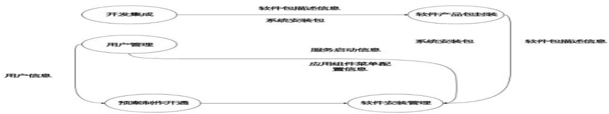

<table><tr><td rowspan=1 colspan=1>序号</td><td rowspan=1 colspan=1>接口需求名称</td><td rowspan=1 colspan=1>接口需求标识</td><td rowspan=1 colspan=1>接口类型</td><td rowspan=1 colspan=1>发送方</td><td rowspan=1 colspan=1>接收方</td><td rowspan=1 colspan=1>接口内容</td><td rowspan=1 colspan=1>接口优先级</td></tr><tr><td rowspan=1 colspan=1>7</td><td rowspan=1 colspan=1>与界面集成框架接口</td><td rowspan=1 colspan=1>PZXQ-WBJK-JMKJ</td><td rowspan=1 colspan=1>文件接口</td><td rowspan=1 colspan=1>软件部署管理</td><td rowspan=1 colspan=1>界面集成框架</td><td rowspan=1 colspan=1>实现为界面集成框架配置人机界面功能菜单</td><td rowspan=1 colspan=1>中</td></tr><tr><td rowspan=1 colspan=1>8</td><td rowspan=1 colspan=1>与统一传输服务接口</td><td rowspan=1 colspan=1>PZXQ-WBJK-TYCS</td><td rowspan=1 colspan=1>API接口</td><td rowspan=1 colspan=1>软件部署管理</td><td rowspan=1 colspan=1>统一传输服务</td><td rowspan=1 colspan=1>实现软件产品、数据产品车际的交互</td><td rowspan=1 colspan=1>低</td></tr><tr><td rowspan=1 colspan=1>9</td><td rowspan=2 colspan=1>与运行支撑服务接口</td><td rowspan=2 colspan=1>PZXQ-WBJK-YXZC</td><td rowspan=2 colspan=1>API接口</td><td rowspan=1 colspan=1>运行支撑服务</td><td rowspan=1 colspan=1>软件部署管理</td><td rowspan=2 colspan=1>实现软件日志的记录、基础信息的获取</td><td rowspan=1 colspan=1>低</td></tr><tr><td rowspan=1 colspan=1>10</td><td rowspan=1 colspan=1>软件部署管理</td><td rowspan=1 colspan=1>运行支撑服务</td><td rowspan=1 colspan=1>低</td></tr><tr><td rowspan=1 colspan=1>11</td><td rowspan=1 colspan=1>文件接</td><td rowspan=1 colspan=1>PZXQ-WBJK-</td><td rowspan=1 colspan=1>文件</td><td rowspan=1 colspan=1>软件部署管理</td><td rowspan=1 colspan=1>文件</td><td rowspan=1 colspan=1>实现软件部署管理软件运行过程中文件的存</td><td rowspan=1 colspan=1>低</td></tr><tr><td rowspan=1 colspan=1>12</td><td rowspan=1 colspan=1>口</td><td rowspan=1 colspan=1>WJ</td><td rowspan=1 colspan=1>接口</td><td rowspan=1 colspan=1>文件</td><td rowspan=1 colspan=1>软件部署管理</td><td rowspan=1 colspan=1>取</td><td rowspan=1 colspan=1>低</td></tr></table>

## 3.3.2 人机交互接口（PZXQ-WBJK-RJJH）

与人机交互接口数据元素说明表，见表53所示。

表53 与人机交互接口数据元素说明
<table><tr><td colspan="1" rowspan="1">序号</td><td colspan="1" rowspan="1">数据集名称</td><td colspan="1" rowspan="1">数据组成</td><td colspan="1" rowspan="1">数据约束</td><td colspan="2" rowspan="1">数据标准</td></tr><tr><td colspan="1" rowspan="11">1</td><td colspan="1" rowspan="11">软件包描述信息</td><td colspan="1" rowspan="1">软件名称</td><td colspan="1" rowspan="1">QString</td><td colspan="2" rowspan="11"></td></tr><tr><td colspan="1" rowspan="1">软件前缀</td><td colspan="2" rowspan="1">QString</td></tr><tr><td colspan="1" rowspan="1">软件版本</td><td colspan="2" rowspan="1">QString</td></tr><tr><td colspan="1" rowspan="1">软件类型</td><td colspan="2" rowspan="1">QString</td></tr><tr><td colspan="1" rowspan="1">软件图标</td><td colspan="2" rowspan="1">QString</td></tr><tr><td colspan="1" rowspan="1">软件描述</td><td colspan="2" rowspan="1">QString</td></tr><tr><td colspan="1" rowspan="1">修改时间-时</td><td colspan="2" rowspan="1">Int</td></tr><tr><td colspan="1" rowspan="1">修改时间-分</td><td colspan="2" rowspan="1">Int</td></tr><tr><td colspan="1" rowspan="1">修改时间-秒</td><td colspan="2" rowspan="1">Int</td></tr><tr><td colspan="1" rowspan="1">开发单位</td><td colspan="2" rowspan="1">QString</td></tr><tr><td colspan="1" rowspan="1">界面资源</td><td colspan="2" rowspan="1">QString</td></tr><tr><td colspan="1" rowspan="2">2</td><td colspan="1" rowspan="2">服务启动信息</td><td colspan="1" rowspan="1">服务名称</td><td colspan="1" rowspan="1">QString</td><td colspan="2" rowspan="2"></td></tr><tr><td colspan="1" rowspan="1">文件名称</td><td colspan="2" rowspan="1">Int</td></tr><tr><td colspan="1" rowspan="5"></td><td colspan="1" rowspan="5"></td><td colspan="1" rowspan="1">服务类型</td><td colspan="1" rowspan="1">QString</td><td colspan="1" rowspan="5"></td></tr><tr><td colspan="1" rowspan="1">环境变量</td><td colspan="1" rowspan="1">QString</td></tr><tr><td colspan="1" rowspan="1">启动位置</td><td colspan="1" rowspan="1">QString</td></tr><tr><td colspan="1" rowspan="1">启动参数</td><td colspan="1" rowspan="1">QString</td></tr><tr><td colspan="1" rowspan="1">启动类型</td><td colspan="1" rowspan="1">QString</td></tr><tr><td colspan="1" rowspan="4">3</td><td colspan="1" rowspan="4">任务数据包描述信息</td><td colspan="1" rowspan="1">任务数据包名称</td><td colspan="1" rowspan="1">QString</td><td colspan="1" rowspan="4"></td></tr><tr><td colspan="1" rowspan="1">制作人</td><td colspan="1" rowspan="1">QString</td></tr><tr><td colspan="1" rowspan="1">创建时间</td><td colspan="1" rowspan="1">QString</td></tr><tr><td colspan="1" rowspan="1">任务数据包ID</td><td colspan="1" rowspan="1">Int</td></tr><tr><td colspan="1" rowspan="6">4</td><td colspan="1" rowspan="6">用户信息</td><td colspan="1" rowspan="1">用户ID</td><td colspan="1" rowspan="1">Int</td><td colspan="1" rowspan="6"></td></tr><tr><td colspan="1" rowspan="1">用户密码</td><td colspan="1" rowspan="1">Int</td><td colspan="1" rowspan="1"></td></tr><tr><td colspan="1" rowspan="1">角色名称</td><td colspan="1" rowspan="1">QString</td><td colspan="1" rowspan="1"></td></tr><tr><td colspan="1" rowspan="1">功能菜单</td><td colspan="1" rowspan="1">QString</td></tr><tr><td colspan="1" rowspan="1">权限信息</td><td colspan="1" rowspan="1">QString</td></tr><tr><td colspan="1" rowspan="1">编组内码</td><td colspan="1" rowspan="1">Int</td></tr><tr><td colspan="1" rowspan="4">5</td><td colspan="1" rowspan="4">应用组件菜单配置信息</td><td colspan="1" rowspan="1">菜单名称</td><td colspan="1" rowspan="1">QString</td><td colspan="1" rowspan="4"></td></tr><tr><td colspan="1" rowspan="1">菜单类型</td><td colspan="1" rowspan="1">Int</td></tr><tr><td colspan="1" rowspan="1">菜单图标</td><td colspan="1" rowspan="1">QString</td></tr><tr><td colspan="1" rowspan="1">菜单关联组件</td><td colspan="1" rowspan="1">QString</td></tr><tr><td colspan="1" rowspan="3">6</td><td colspan="1" rowspan="3">日志信息</td><td colspan="1" rowspan="1">记录时间</td><td colspan="1" rowspan="1">Int</td><td colspan="1" rowspan="3"></td></tr><tr><td colspan="1" rowspan="1">日志级别</td><td colspan="1" rowspan="1">Int</td></tr><tr><td colspan="1" rowspan="1">日志内容</td><td colspan="1" rowspan="1">QString</td></tr><tr><td colspan="1" rowspan="4">7</td><td colspan="1" rowspan="4">系统安装包</td><td colspan="1" rowspan="1">系统安装包名称</td><td colspan="1" rowspan="1">QString</td><td colspan="1" rowspan="4"></td></tr><tr><td colspan="1" rowspan="1">系统安装包所属级别</td><td colspan="1" rowspan="1">Int</td></tr><tr><td colspan="1" rowspan="1">系统安装包版本</td><td colspan="1" rowspan="1">QString</td></tr><tr><td colspan="1" rowspan="1">系统安装包创建</td><td colspan="1" rowspan="1">QString</td></tr></table>

3.3.3 应用软件接口（PZXQ-WBJK-YYRJ）  
应用软件接口数据元素说明表，见表54所示。

表54 与应用软件接口数据元素说明
<table><tr><td rowspan=1 colspan=1>序号</td><td rowspan=1 colspan=1>数据集名称</td><td rowspan=1 colspan=1>数据组成</td><td rowspan=1 colspan=1>数据约束</td><td rowspan=1 colspan=1>数据标准</td></tr><tr><td rowspan=9 colspan=1>1</td><td rowspan=9 colspan=1>用户信息</td><td rowspan=1 colspan=1>用户ID</td><td rowspan=1 colspan=1>Int</td><td rowspan=9 colspan=1></td></tr><tr><td rowspan=1 colspan=1>用户密码</td><td rowspan=1 colspan=1>Int</td></tr><tr><td rowspan=1 colspan=1>角色名称</td><td rowspan=1 colspan=1>QString</td></tr><tr><td rowspan=1 colspan=1>功能菜单</td><td rowspan=1 colspan=1>QString</td></tr><tr><td rowspan=1 colspan=1>权限信息</td><td rowspan=1 colspan=1>QString</td></tr><tr><td rowspan=1 colspan=1>编组内码</td><td rowspan=1 colspan=1>Int</td></tr><tr><td rowspan=1 colspan=1>系统安装包所属级别</td><td rowspan=1 colspan=1>Int</td></tr><tr><td rowspan=1 colspan=1>系统安装包版本</td><td rowspan=1 colspan=1>QString</td></tr><tr><td rowspan=1 colspan=1>系统安装包创建</td><td rowspan=1 colspan=1>QString</td></tr></table>

## 3.3.4 与数据统一访问接口（PZXQ-WBJK-SJFW）

与数据统一访问接口数据元素说明表，见表55所示。

表55 与数据统一访问接口数据元素说明
<table><tr><td colspan="1" rowspan="1">序号</td><td colspan="1" rowspan="1">数据集名称</td><td colspan="1" rowspan="1">数据组成</td><td colspan="1" rowspan="1">数据约束</td><td colspan="1" rowspan="1">数据标准</td></tr><tr><td colspan="1" rowspan="6">1</td><td colspan="1" rowspan="6">用户信息</td><td colspan="1" rowspan="1">用户ID</td><td colspan="1" rowspan="1">Int</td><td colspan="1" rowspan="6"></td></tr><tr><td colspan="1" rowspan="1">用户密码</td><td colspan="1" rowspan="1">Int</td></tr><tr><td colspan="1" rowspan="1">角色名称</td><td colspan="1" rowspan="1">QString</td></tr><tr><td colspan="1" rowspan="1">功能菜单</td><td colspan="1" rowspan="1">QString</td></tr><tr><td colspan="1" rowspan="1">权限信息</td><td colspan="1" rowspan="1">QString</td></tr><tr><td colspan="1" rowspan="1">编组内码</td><td colspan="1" rowspan="1">Int</td></tr><tr><td colspan="1" rowspan="4">2</td><td colspan="1" rowspan="4">应用组件菜单配置信息</td><td colspan="1" rowspan="1">菜单名称</td><td colspan="1" rowspan="1">QString</td><td colspan="1" rowspan="4"></td></tr><tr><td colspan="1" rowspan="1">菜单类型</td><td colspan="1" rowspan="1">Int</td></tr><tr><td colspan="1" rowspan="1">菜单图标</td><td colspan="1" rowspan="1">QString</td></tr><tr><td colspan="1" rowspan="1">菜单关联组件</td><td colspan="1" rowspan="1">QString</td></tr><tr><td colspan="1" rowspan="3">3</td><td colspan="1" rowspan="3">系统安装包</td><td colspan="1" rowspan="1">系统安装包名称</td><td colspan="1" rowspan="1">QString</td><td colspan="1" rowspan="3"></td></tr><tr><td colspan="1" rowspan="1">系统安装包所属级别</td><td colspan="1" rowspan="1">Int</td></tr><tr><td colspan="1" rowspan="1">系统安装包版本</td><td colspan="1" rowspan="1">QString</td></tr><tr><td colspan="1" rowspan="1"></td><td colspan="1" rowspan="1"></td><td colspan="1" rowspan="1">系统安装包创建</td><td colspan="1" rowspan="1">QString</td><td colspan="1" rowspan="1"></td></tr></table>

## 3.3.5 与服务集成框架接口（PZXQ-WBJK-FWKJ）

与服务集成框架接口数据元素说明表，见表56所示。

表56 与服务集成框架接口数据元素说明
<table><tr><td colspan="1" rowspan="1">序号</td><td colspan="1" rowspan="1">数据集名称</td><td colspan="1" rowspan="1">数据组成</td><td colspan="2" rowspan="1">数据约束</td><td colspan="1" rowspan="1">数据标准</td></tr><tr><td colspan="1" rowspan="11">1</td><td colspan="1" rowspan="11">软件包描述信息</td><td colspan="1" rowspan="1">软件名称</td><td colspan="2" rowspan="1">QString</td><td colspan="1" rowspan="11"></td></tr><tr><td colspan="1" rowspan="1">软件前缀</td><td colspan="2" rowspan="1">QString</td></tr><tr><td colspan="1" rowspan="1">软件版本</td><td colspan="2" rowspan="1">QString</td></tr><tr><td colspan="1" rowspan="1">软件类型</td><td colspan="2" rowspan="1">QString</td></tr><tr><td colspan="1" rowspan="1">软件图标</td><td colspan="2" rowspan="1">QString</td></tr><tr><td colspan="1" rowspan="1">软件描述</td><td colspan="2" rowspan="1">QString</td></tr><tr><td colspan="1" rowspan="1">修改时间-时</td><td colspan="2" rowspan="1">Int</td><td colspan="1" rowspan="1"></td></tr><tr><td colspan="1" rowspan="1">修改时间-分</td><td colspan="2" rowspan="1">Int</td><td colspan="1" rowspan="1"></td></tr><tr><td colspan="1" rowspan="1">修改时间-秒</td><td colspan="2" rowspan="1">Int</td></tr><tr><td colspan="1" rowspan="1">开发单位</td><td colspan="2" rowspan="1">QString</td></tr><tr><td colspan="1" rowspan="1">界面资源</td><td colspan="2" rowspan="1">QString</td></tr><tr><td colspan="1" rowspan="9">2</td><td colspan="1" rowspan="9">服务启动信息</td><td colspan="1" rowspan="1">服务名称</td><td colspan="2" rowspan="1">QString</td><td colspan="1" rowspan="9"></td></tr><tr><td colspan="1" rowspan="1">文件名称</td><td colspan="2" rowspan="1">Int</td><td colspan="1" rowspan="1"></td></tr><tr><td colspan="1" rowspan="2">服务类型</td><td colspan="2" rowspan="2">QString</td><td colspan="1" rowspan="1"></td></tr><tr><td colspan="1" rowspan="1"></td></tr><tr><td colspan="1" rowspan="2">环境变量</td><td colspan="2" rowspan="2">QString</td></tr><tr><td colspan="1" rowspan="1"></td></tr><tr><td colspan="1" rowspan="1">启动位置</td><td colspan="2" rowspan="1">QString</td></tr><tr><td colspan="1" rowspan="1">启动参数</td><td colspan="2" rowspan="1">QString</td></tr><tr><td colspan="1" rowspan="1">启动类型</td><td colspan="2" rowspan="1">QString</td></tr><tr><td colspan="1" rowspan="4">3</td><td colspan="1" rowspan="4">任务数据包描述信息</td><td colspan="1" rowspan="1">任务数据包名称</td><td colspan="2" rowspan="1">QString</td><td colspan="1" rowspan="4"></td></tr><tr><td colspan="1" rowspan="1">制作人</td><td colspan="2" rowspan="1">QString</td></tr><tr><td colspan="1" rowspan="1">创建时间</td><td colspan="2" rowspan="1">QString</td></tr><tr><td colspan="1" rowspan="1">任务数据包ID</td><td colspan="2" rowspan="1">Int</td></tr><tr><td colspan="1" rowspan="1">4</td><td colspan="1" rowspan="1">用户信息</td><td colspan="1" rowspan="1">用户ID</td><td colspan="2" rowspan="1">Int</td><td colspan="1" rowspan="1"></td></tr><tr><td colspan="1" rowspan="5"></td><td colspan="1" rowspan="5"></td><td colspan="1" rowspan="1">用户密码</td><td colspan="2" rowspan="1">Int</td><td colspan="1" rowspan="5"></td></tr><tr><td colspan="1" rowspan="1">角色名称</td><td colspan="3" rowspan="1">QString</td></tr><tr><td colspan="1" rowspan="1">功能菜单</td><td colspan="3" rowspan="1">QString</td></tr><tr><td colspan="1" rowspan="1">权限信息</td><td colspan="3" rowspan="1">QString</td></tr><tr><td colspan="1" rowspan="1">编组内码</td><td colspan="3" rowspan="1">Int</td></tr><tr><td colspan="1" rowspan="4">5</td><td colspan="1" rowspan="4">应用组件菜单配置信息</td><td colspan="1" rowspan="1">菜单名称</td><td colspan="2" rowspan="1">QString</td><td colspan="1" rowspan="4"></td></tr><tr><td colspan="1" rowspan="1">菜单类型</td><td colspan="3" rowspan="1">Int</td></tr><tr><td colspan="1" rowspan="1">菜单图标</td><td colspan="3" rowspan="1">QString</td></tr><tr><td colspan="1" rowspan="1">菜单关联组件</td><td colspan="3" rowspan="1">QString</td></tr><tr><td colspan="1" rowspan="3">6</td><td colspan="1" rowspan="3">日志信息</td><td colspan="1" rowspan="1">记录时间</td><td colspan="2" rowspan="1">Int</td><td colspan="1" rowspan="3"></td></tr><tr><td colspan="1" rowspan="1">日志级别</td><td colspan="3" rowspan="1">Int</td></tr><tr><td colspan="1" rowspan="1">日志内容</td><td colspan="3" rowspan="1">QString</td></tr><tr><td colspan="1" rowspan="4">7</td><td colspan="1" rowspan="4">系统安装包</td><td colspan="1" rowspan="1">系统安装包名称</td><td colspan="2" rowspan="1">QString</td><td colspan="1" rowspan="4"></td></tr><tr><td colspan="1" rowspan="1">系统安装包所属级别</td><td colspan="3" rowspan="1">Int</td></tr><tr><td colspan="1" rowspan="1">系统安装包版本</td><td colspan="3" rowspan="1">QString</td></tr><tr><td colspan="1" rowspan="1">系统安装包创建</td><td colspan="3" rowspan="1">QString</td></tr></table>

## 3.3.6 与界面集成框架接口（PZXQ-WBJK-JMKJ）

与界面集成框架接口数据元素说明表，见表57所示。

表57 与界面集成框架接口数据元素说明
<table><tr><td colspan="1" rowspan="1">序号</td><td colspan="1" rowspan="1">数据集名称</td><td colspan="1" rowspan="1">数据组成</td><td colspan="1" rowspan="1">数据约束</td><td colspan="1" rowspan="1">数据标准</td></tr><tr><td colspan="1" rowspan="7">1</td><td colspan="1" rowspan="7">用户信息</td><td colspan="1" rowspan="1">用户ID</td><td colspan="1" rowspan="1">Int</td><td colspan="1" rowspan="7"></td></tr><tr><td colspan="1" rowspan="1">用户密码</td><td colspan="1" rowspan="1">Int</td></tr><tr><td colspan="1" rowspan="1">角色名称</td><td colspan="1" rowspan="1">QString</td></tr><tr><td colspan="1" rowspan="1">功能菜单</td><td colspan="1" rowspan="1">QString</td></tr><tr><td colspan="1" rowspan="1">权限信息</td><td colspan="1" rowspan="1">QString</td></tr><tr><td colspan="1" rowspan="1">编组内码</td><td colspan="1" rowspan="1">Int</td></tr><tr><td colspan="1" rowspan="1">系统安装包所属级别</td><td colspan="1" rowspan="1">Int</td></tr><tr><td colspan="1" rowspan="2"></td><td colspan="1" rowspan="2"></td><td colspan="1" rowspan="1">系统安装包版本</td><td colspan="1" rowspan="1">QString</td><td colspan="1" rowspan="2"></td></tr><tr><td colspan="1" rowspan="1">系统安装包创建</td><td colspan="1" rowspan="1">QString</td></tr></table>

## 3.3.7 与统一传输服务接口（PZXQ-WBJK-TYCS）

与统一传输服务接口数据元素说明表，见表58所示。

表58 与统一传输服务接口数据元素说明
<table><tr><td rowspan=1 colspan=1>序号</td><td rowspan=1 colspan=1>数据集名称</td><td rowspan=1 colspan=1>数据组成</td><td rowspan=1 colspan=1>数据约束</td><td rowspan=1 colspan=1>数据标准</td></tr><tr><td rowspan=4 colspan=1>1</td><td rowspan=4 colspan=1>任务数据包描述信息</td><td rowspan=1 colspan=1>任务数据包名称</td><td rowspan=1 colspan=1>QString</td><td rowspan=4 colspan=1></td></tr><tr><td rowspan=1 colspan=1>制作人</td><td rowspan=1 colspan=1>QString</td></tr><tr><td rowspan=1 colspan=1>创建时间</td><td rowspan=1 colspan=1>QString</td></tr><tr><td rowspan=1 colspan=1>任务数据包ID</td><td rowspan=1 colspan=1>Int</td></tr><tr><td rowspan=6 colspan=1>2</td><td rowspan=6 colspan=1>用户信息</td><td rowspan=1 colspan=1>用户ID</td><td rowspan=1 colspan=1>Int</td><td rowspan=6 colspan=1></td></tr><tr><td rowspan=1 colspan=1>用户密码</td><td rowspan=1 colspan=1>Int</td></tr><tr><td rowspan=1 colspan=1>角色名称</td><td rowspan=1 colspan=1>QString</td></tr><tr><td rowspan=1 colspan=1>功能菜单</td><td rowspan=1 colspan=1>QString</td></tr><tr><td rowspan=1 colspan=1>权限信息</td><td rowspan=1 colspan=1>QString</td></tr><tr><td rowspan=1 colspan=1>编组内码</td><td rowspan=1 colspan=1>Int</td></tr><tr><td rowspan=4 colspan=1>3</td><td rowspan=4 colspan=1>应用组件菜单配置信息</td><td rowspan=1 colspan=1>菜单名称</td><td rowspan=1 colspan=1>QString</td><td rowspan=4 colspan=1></td></tr><tr><td rowspan=1 colspan=1>菜单类型</td><td rowspan=1 colspan=1>Int</td></tr><tr><td rowspan=1 colspan=1>菜单图标</td><td rowspan=1 colspan=1>QString</td></tr><tr><td rowspan=1 colspan=1>菜单关联组件</td><td rowspan=1 colspan=1>QString</td></tr><tr><td rowspan=3 colspan=1>4</td><td rowspan=3 colspan=1>日志信息</td><td rowspan=1 colspan=1>记录时间</td><td rowspan=1 colspan=1>Int</td><td rowspan=3 colspan=1></td></tr><tr><td rowspan=1 colspan=1>日志级别</td><td rowspan=1 colspan=1>Int</td></tr><tr><td rowspan=1 colspan=1>日志内容</td><td rowspan=1 colspan=1>QString</td></tr><tr><td rowspan=4 colspan=1>5</td><td rowspan=4 colspan=1>系统安装包</td><td rowspan=1 colspan=1>系统安装包名称</td><td rowspan=1 colspan=1>QString</td><td rowspan=4 colspan=1></td></tr><tr><td rowspan=1 colspan=1>系统安装包所属级别</td><td rowspan=1 colspan=1>Int</td></tr><tr><td rowspan=1 colspan=1>系统安装包版本</td><td rowspan=1 colspan=1>QString</td></tr><tr><td rowspan=1 colspan=1>系统安装包创建</td><td rowspan=1 colspan=1>QString</td></tr></table>

## 3.3.8 与运行支撑服务接口（PZXQ-WBJK-YXZC）

与运行支撑服务接口数据元素说明表，见表59所示。

表59 与运行支撑服务接口数据元素说明
<table><tr><td rowspan=1 colspan=1>序号</td><td rowspan=1 colspan=1>数据集名称</td><td rowspan=1 colspan=1>数据组成</td><td rowspan=1 colspan=1>数据约束</td><td rowspan=1 colspan=1>数据标准</td></tr><tr><td rowspan=3 colspan=1>1</td><td rowspan=3 colspan=1>日志信息</td><td rowspan=1 colspan=1>记录时间</td><td rowspan=1 colspan=1>Int</td><td rowspan=3 colspan=1></td></tr><tr><td rowspan=1 colspan=1>日志级别</td><td rowspan=1 colspan=1>Int</td></tr><tr><td rowspan=1 colspan=1>日志内容</td><td rowspan=1 colspan=1>QString</td></tr><tr><td rowspan=13 colspan=1>2</td><td rowspan=13 colspan=1>基础服务信息</td><td rowspan=1 colspan=1>服务内网网卡名称</td><td rowspan=1 colspan=1>QString</td><td rowspan=13 colspan=1></td></tr><tr><td rowspan=1 colspan=1>服务内网网卡IP地址</td><td rowspan=1 colspan=1>QString</td></tr><tr><td rowspan=1 colspan=1>服务内网网卡子网掩码</td><td rowspan=1 colspan=1>QString</td></tr><tr><td rowspan=1 colspan=1>服务内网网卡默认网关</td><td rowspan=1 colspan=1>QString</td></tr><tr><td rowspan=1 colspan=1>服务外网网卡名称</td><td rowspan=1 colspan=1>QString</td></tr><tr><td rowspan=1 colspan=1>服务外网网卡IP地址</td><td rowspan=1 colspan=1>QString</td></tr><tr><td rowspan=1 colspan=1>服务外网网卡子网掩码</td><td rowspan=1 colspan=1>QString</td></tr><tr><td rowspan=1 colspan=1>服务外网网卡默认网关</td><td rowspan=1 colspan=1>QString</td></tr><tr><td rowspan=1 colspan=1>本机网卡名称</td><td rowspan=1 colspan=1>QString</td></tr><tr><td rowspan=1 colspan=1>本机网卡IP地址</td><td rowspan=1 colspan=1>QString</td></tr><tr><td rowspan=1 colspan=1>本机网卡子网掩码</td><td rowspan=1 colspan=1>QString</td></tr><tr><td rowspan=1 colspan=1>本机网卡默认网关</td><td rowspan=1 colspan=1>QString</td></tr><tr><td rowspan=1 colspan=1>本机密码</td><td rowspan=1 colspan=1>Int</td></tr></table>

## 3.3.9 文件接口（PZXQ-WBJK-WJ）

与文件接口数据元素说明表，见表60所示。

表60 与文件接口数据元素说明
<table><tr><td colspan="1" rowspan="1">序号</td><td colspan="1" rowspan="1">数据集名称</td><td colspan="1" rowspan="1">数据组成</td><td colspan="1" rowspan="1">数据约束</td><td colspan="1" rowspan="1">数据标准</td></tr><tr><td colspan="1" rowspan="5">1</td><td colspan="1" rowspan="5">软件包描述信息</td><td colspan="1" rowspan="1">软件名称</td><td colspan="1" rowspan="1">QString</td><td colspan="1" rowspan="5"></td></tr><tr><td colspan="1" rowspan="1">软件前缀</td><td colspan="1" rowspan="1">QString</td></tr><tr><td colspan="1" rowspan="1">软件版本</td><td colspan="1" rowspan="1">QString</td></tr><tr><td colspan="1" rowspan="1">软件类型</td><td colspan="1" rowspan="1">QString</td></tr><tr><td colspan="1" rowspan="1">软件图标</td><td colspan="1" rowspan="1">QString</td></tr><tr><td colspan="1" rowspan="6"></td><td colspan="1" rowspan="6"></td><td colspan="1" rowspan="1">软件描述</td><td colspan="1" rowspan="1">QString</td><td colspan="1" rowspan="6"></td></tr><tr><td colspan="1" rowspan="1">修改时间-时</td><td colspan="1" rowspan="1">Int</td></tr><tr><td colspan="1" rowspan="1">修改时间-分</td><td colspan="1" rowspan="1">Int</td></tr><tr><td colspan="1" rowspan="1">修改时间-秒</td><td colspan="1" rowspan="1">Int</td></tr><tr><td colspan="1" rowspan="1">开发单位</td><td colspan="1" rowspan="1">QString</td></tr><tr><td colspan="1" rowspan="1">界面资源</td><td colspan="1" rowspan="1">QString</td></tr><tr><td colspan="1" rowspan="7">2</td><td colspan="1" rowspan="7">服务启动信息</td><td colspan="1" rowspan="1">服务名称</td><td colspan="1" rowspan="1">QString</td><td colspan="1" rowspan="7"></td></tr><tr><td colspan="1" rowspan="1">文件名称</td><td colspan="1" rowspan="1">Int</td></tr><tr><td colspan="1" rowspan="1">服务类型</td><td colspan="1" rowspan="1">QString</td></tr><tr><td colspan="1" rowspan="1">环境变量</td><td colspan="1" rowspan="1">QString</td></tr><tr><td colspan="1" rowspan="1">启动位置</td><td colspan="1" rowspan="1">QString</td></tr><tr><td colspan="1" rowspan="1">启动参数</td><td colspan="1" rowspan="1">QString</td></tr><tr><td colspan="1" rowspan="1">启动类型</td><td colspan="1" rowspan="1">QString</td></tr><tr><td colspan="1" rowspan="4">3</td><td colspan="1" rowspan="4">任务数据包描述信息</td><td colspan="1" rowspan="1">任务数据包名称</td><td colspan="1" rowspan="1">QString</td><td colspan="1" rowspan="4"></td></tr><tr><td colspan="1" rowspan="1">制作人</td><td colspan="1" rowspan="1">QString</td></tr><tr><td colspan="1" rowspan="1">创建时间</td><td colspan="1" rowspan="1">QString</td></tr><tr><td colspan="1" rowspan="1">任务数据包ID</td><td colspan="1" rowspan="1">Int</td></tr><tr><td colspan="1" rowspan="4">5</td><td colspan="1" rowspan="4">应用组件菜单配置信息</td><td colspan="1" rowspan="1">菜单名称</td><td colspan="1" rowspan="1">QString</td><td colspan="1" rowspan="4"></td></tr><tr><td colspan="1" rowspan="1">菜单类型</td><td colspan="1" rowspan="1">Int</td></tr><tr><td colspan="1" rowspan="1">菜单图标</td><td colspan="1" rowspan="1">QString</td></tr><tr><td colspan="1" rowspan="1">菜单关联组件</td><td colspan="1" rowspan="1">QString</td></tr></table>

## 3.4 CSCI 内部接口需求

## 3.4.1 接口标识和接口图

软件部署管理软件内部接口如图24所示。

  
图24 软件部署管理软件内部接口需求  
软件部署管理软件内部接口需求表见表61。

表61 软件部署管理软件内部接口需求
<table><tr><td rowspan=1 colspan=1>序号</td><td rowspan=1 colspan=1>接口需求名称</td><td rowspan=1 colspan=1>接口需求标识</td><td rowspan=1 colspan=1>接口类型</td><td rowspan=1 colspan=1>发送方</td><td rowspan=1 colspan=1>接收方</td><td rowspan=1 colspan=1>接口内容</td><td rowspan=1 colspan=1>接口优先级</td></tr><tr><td rowspan=1 colspan=1>1</td><td rowspan=1 colspan=1>用户管理与软件安装管理接口</td><td rowspan=1 colspan=1>PZXQ-NBJK-YHGL-RJAZGL</td><td rowspan=1 colspan=1>API</td><td rowspan=1 colspan=1>用户管理</td><td rowspan=1 colspan=1>软件安装管理</td><td rowspan=1 colspan=1>服务启动信息应用组件菜单配置信息</td><td rowspan=1 colspan=1>低</td></tr><tr><td rowspan=1 colspan=1>2</td><td rowspan=1 colspan=1>用户管理与预案制作开通接口</td><td rowspan=1 colspan=1>PZXQ-NBJK-YHGL-YAZZKT</td><td rowspan=1 colspan=1>API</td><td rowspan=1 colspan=1>用户管理</td><td rowspan=1 colspan=1>预案制作开通</td><td rowspan=1 colspan=1>用户信息</td><td rowspan=1 colspan=1>低</td></tr><tr><td rowspan=1 colspan=1>3</td><td rowspan=1 colspan=1>软件产品包封装与软件安装管理接口</td><td rowspan=1 colspan=1>PZXQ-NBJK-RJANBFZ-RJAZGL</td><td rowspan=1 colspan=1>API</td><td rowspan=1 colspan=1>软件产品包封装</td><td rowspan=1 colspan=1>软件安装管理</td><td rowspan=1 colspan=1>软件包描述信息系统安装包</td><td rowspan=1 colspan=1>低</td></tr><tr><td rowspan=1 colspan=1>4</td><td rowspan=1 colspan=1>开发集成与软件产品包封装接口</td><td rowspan=1 colspan=1>PZXQ-NBJK-KFJC-RJCPBFZ</td><td rowspan=1 colspan=1>网络</td><td rowspan=1 colspan=1>开发集成</td><td rowspan=1 colspan=1>软件产品包封装</td><td rowspan=1 colspan=1>软件包描述信息系统安装包</td><td rowspan=1 colspan=1>低</td></tr></table>

## 3.4.2 用户管理与软件安装管理接口（PZXQ-NBJK-YHGL-RJAZGL）

用户管理与软件安装管理接口数据元素说明表，见表62所示。

表62 用户管理与软件安装管理接口数据元素说明
<table><tr><td colspan="1" rowspan="1">序号</td><td colspan="1" rowspan="1">数据集名称</td><td colspan="1" rowspan="1">数据组成</td><td colspan="1" rowspan="1">数据约束</td><td colspan="1" rowspan="1">数据标准</td></tr><tr><td colspan="1" rowspan="2">1</td><td colspan="1" rowspan="2">服务启动信息</td><td colspan="1" rowspan="1">服务名称</td><td colspan="1" rowspan="1">QString</td><td colspan="1" rowspan="1">自定义</td></tr><tr><td colspan="1" rowspan="1">文件名称</td><td colspan="1" rowspan="1">Int</td><td colspan="1" rowspan="1">自定义</td></tr><tr><td colspan="1" rowspan="5"></td><td colspan="1" rowspan="5"></td><td colspan="1" rowspan="1">服务类型</td><td colspan="1" rowspan="1">QString</td><td colspan="1" rowspan="1">自定义</td></tr><tr><td colspan="1" rowspan="1">环境变量</td><td colspan="1" rowspan="1">QString</td><td colspan="1" rowspan="1">自定义</td></tr><tr><td colspan="1" rowspan="1">启动位置</td><td colspan="1" rowspan="1">QString</td><td colspan="1" rowspan="1">自定义</td></tr><tr><td colspan="1" rowspan="1">启动参数</td><td colspan="1" rowspan="1">QString</td><td colspan="1" rowspan="1">自定义</td></tr><tr><td colspan="1" rowspan="1">启动类型</td><td colspan="1" rowspan="1">QString</td><td colspan="1" rowspan="1">自定义</td></tr><tr><td colspan="1" rowspan="4">2</td><td colspan="1" rowspan="4">应用组件菜单配置信息</td><td colspan="1" rowspan="1">菜单名称</td><td colspan="1" rowspan="1">QString</td><td colspan="1" rowspan="1">自定义</td></tr><tr><td colspan="1" rowspan="1">菜单类型</td><td colspan="1" rowspan="1">Int</td><td colspan="1" rowspan="1">自定义</td></tr><tr><td colspan="1" rowspan="1">菜单图标</td><td colspan="1" rowspan="1">QString</td><td colspan="1" rowspan="1">自定义</td></tr><tr><td colspan="1" rowspan="1">菜单关联组件</td><td colspan="1" rowspan="1">QString</td><td colspan="1" rowspan="1">自定义</td></tr></table>

## 3.4.3 用户管理与预案制作开通接口（PZXQ-NBJK-YHGL-YAZZKT）

用户管理与预案制作开通接口数据元素说明表，见表63所示。

表63 用户管理与预案制作开通接口数据元素说明
<table><tr><td rowspan=1 colspan=1>序号</td><td rowspan=1 colspan=1>数据集名称</td><td rowspan=1 colspan=1>数据组成</td><td rowspan=1 colspan=1>数据约束</td><td rowspan=1 colspan=1>数据标准</td></tr><tr><td rowspan=6 colspan=1>1</td><td rowspan=6 colspan=1>用户信息</td><td rowspan=1 colspan=1>用户ID</td><td rowspan=1 colspan=1>Int</td><td rowspan=1 colspan=1>自定义</td></tr><tr><td rowspan=1 colspan=1>用户密码</td><td rowspan=1 colspan=1>Int</td><td rowspan=1 colspan=1>自定义</td></tr><tr><td rowspan=1 colspan=1>角色名称</td><td rowspan=1 colspan=1>QString</td><td rowspan=1 colspan=1>自定义</td></tr><tr><td rowspan=1 colspan=1>功能菜单</td><td rowspan=1 colspan=1>QString</td><td rowspan=1 colspan=1>自定义</td></tr><tr><td rowspan=1 colspan=1>权限信息</td><td rowspan=1 colspan=1>QString</td><td rowspan=1 colspan=1>自定义</td></tr><tr><td rowspan=1 colspan=1>编组内码</td><td rowspan=1 colspan=1>Int</td><td rowspan=1 colspan=1>自定义</td></tr></table>

## 3.4.4 软件产品包封装与软件安装管理接口（PZXQ-NBJK-RJANBFZ-RJAZGL）

软件产品包封装与软件安装管理接口数据元素说明表，见表64所示。

表64 软件产品包封装与软件安装管理接口数据元素说明
<table><tr><td rowspan=1 colspan=1>序号</td><td rowspan=1 colspan=1>数据集名称</td><td rowspan=1 colspan=1>数据组成</td><td rowspan=1 colspan=1>数据约束</td><td rowspan=1 colspan=1>数据标准</td></tr><tr><td rowspan=3 colspan=1>1</td><td rowspan=3 colspan=1>软件包描述信息</td><td rowspan=1 colspan=1>软件名称</td><td rowspan=1 colspan=1>QString</td><td rowspan=1 colspan=1>自定义</td></tr><tr><td rowspan=1 colspan=1>软件前缀</td><td rowspan=1 colspan=1>QString</td><td rowspan=1 colspan=1>自定义</td></tr><tr><td rowspan=1 colspan=1>软件版本</td><td rowspan=1 colspan=1>QString</td><td rowspan=1 colspan=1>自定义</td></tr></table>