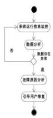
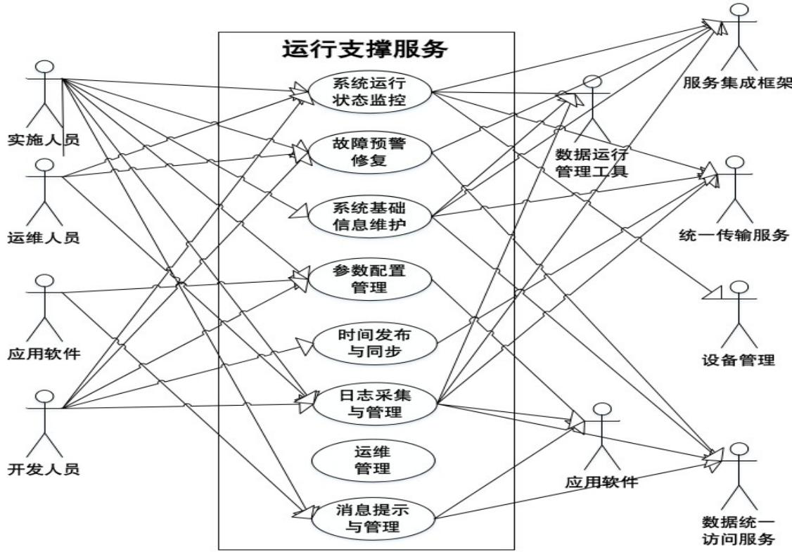
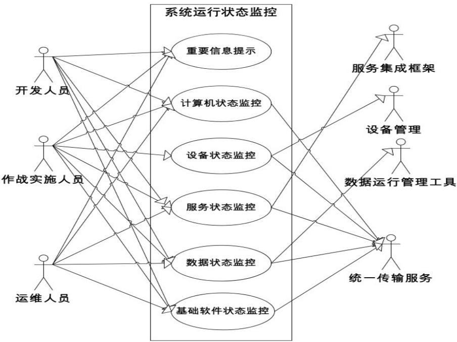

## 目 录

1 范围..  
1.1 标识..  
1.2 系统概述.  
1.2.1 系统和软件的用途.  
1.2.2 系统与软件的一般特性.  
1.3 文档概述.  
2 引用文档..  
3 需求... .2  
3.1 要求的状态和方式. ..2  
3.1.1 软件状态图. .2  
3.1.2 软件活动图. .2  
3.2 CSCI 能力需求. ..3  
3.2.1 系统运行状态监控（PZXQ-YXZCFW-GN-XTYXZTJK） ..6  
3.2.2 故障预警修复（PZXQ-YXZCFW-GN-GZYJXF） ..28  
3.2.3 系统基础信息维护（PZXQ-YXZCFW-GN-XTJCXXWH） .40  
3.2.4 参数配置管理（PZXQ-YXZCFW-GN-CSPZGL） .54  
3.2.5 日志采集与管理（PZXQ-YXZCFW-GN-RZCJYGL）. ..62  
3.2.6 运维管理（PZXQ-YXZCFW-GN-YWGL） .66  
3.2.7 消息提示与管理（PZXQ-YXZCFW-GN-JBSFYGL） .68  
3.3 CSCI 外部接口需求.. ..71  
3.3.1 接口标识和接口图.. ..71  
3.3.2 人机交互接口（PZXQ-WBJK-YXZCFW-RJJHJK） ..72  
3.3.3 与数据运行管理工具接口（PZXQ-WBJK-YXZCFW-SJYXGLGJ） ..72  
3.3.4 与界面集成框架接口（PZXQ-WBJK-YXZCFW-JMJCKJ） ..72  
3.3.5 与统一传输服务接口（PZXQ-WBJK-YXZCFW-TYCSFW） ..73  
3.3.6 与设备管理接口（PZXQ-WBJK-YXZCFW-SBGL）. ...73  
3.3.7 与数据统一访问服务接口（PZXQ-WBJK-YXZCFW-SJTYFWFW） ..73  
3.3.8 与服务集成框架接口（PZXQ-WBJK-YXZCFW-SJTYFWFW） ..73  
3.3.9 与应用软件接口（PZXQ-WBJK-YXZCFW-YYRJ）. ..73  
3.4 CSCI 内部接口需求.. ..74  
3.4.1 接口标识和接口图.. ...74  
3.4.2 基础信息服务与日志服务接口（PZXQ-NBJK-YXZCFW- JCXXFWRZFWJK）.....76  
3.4.3 基础信息服务与系统运行监控接口（PZXQ-NBJK-YXZCFW-  
JCXXFWXTYXJKJK）. ..76  
3.4.4 基础信息服务与环境运行保障接口（PZXQ-NBJK-YXZCFW-  
JCXXFWHJYXBZJK）. ..76  
3.4.5 系统运行监控与日志服务接口（PZXQ-NBJK-YXZCFW-XTYXJKRZFWJK）.......77  
3.4.6 环境运行保障与日志服务接口（PZXQ-NBJK-YXZCFW-HJYXBZRZFWJK）.......77  
3.4.7 消息服务与日志服务接口（PZXQ-NBJK-YXZCFW-XXFWRZFWJK）. ....77  
3.4.8 系统配置管理与日志服务接口（PZXQ-NBJK-YXZCFW-XTPZGLRZFWJK）.......77  
3.5 CSCI 内部数据需求. ..77  
3.6 适应性需求.. ..81  
3.7 安全性需求. ..81  
3.8 保密性需求. ..81  
3.9 CSCI 环境需求. ...82  
3.9.1 运行环境需求. ..82  
3.9.2 开发环境需求. ..82  
3.10 计算机资源需求. .82  
3.10.1 计算机硬件需求. ..82  
3.10.2 计算机硬件资源利用需求. ..83  
3.10.3 计算机软件需求. ..83  
3.10.4 计算机通信需求. ..84  
3.11 软件质量因素... ..84  
3.12 设计和构造的约束. ..84  
3.13 人员需求.. ..84  
3.14 培训需求... ..85  
3.15 软件保障需求. ..85  
3.16 其他需求.... ..85  
3.17 验收、交付和包装需求. ..85  
3.18 需求的优先顺序和关键性. ..85  
4 合格性规定.. ...86  
5 需求可追踪性. ..86  
6 注释... ..88

## 1 范围

## 1.1 标识

a) 本文档已被批准的标识号： ${ \mathsf { A Z } } _ { 6 9 3 } 2$ .490.0105 SRS；

b) 本文档所适用的软件名称为：运行支撑服务软件；

c) 本文档的版本号为：V1.00.03/2020 年 06 月 25 日；

d) 本文档所适用的软件所属系统为：某级信息系统软件。

## 1.2 系统概述

## 1.2.1 系统和软件的用途

某级信息系统软件按照国产自主可控要求，进行基础软件环境选型，以及应用软件的新研和国产化迁移改造，对功能要素分散、流程独立的业务功能进行整合优化，研制适应不同使用需求、使用场景的软件，实现信息系统软件的融合、型谱优化和业务提能，推动某信息系统软件向“国产化、服务化、轻量化”方向发展。

某信息服务环境软件是某信息系统软件的重要组成，是连接底层各类硬件信息基础设施与上层各种应用系统的桥梁，通过基础平台融合汇聚底层资源，规范技术体制、支撑体系运行、促进互通互联等，是支撑构建某信息系统的重要支撑，其软件主要部署运行在各级机构的信息处理设备上，提供系统运维、数据运维、信息传输、信息处理、信息展现等功能，支撑应用软件和用户完成开发、集成、运维、运行全流程的使用。

运行支撑服务主要完成提供系统运行信息的维护管理及系统运行状态的监控管理功能；提供日志服务，实现对软件运行日志和用户操作日志的记录和统计分析；提供统一的系统运行参数配置入口，能够集成调度应用软件的设置界面，支持对业务配置参数进行集中管理；提供系统运行监控功能，支持对系统状态、服务运行状态、应用运行状态、数据访问状态等信息进行实时监控；提供环境运行保障，支持根据既定故障策略，对系统环境存在的故障进行探测、诊断、修复和预警；提供基础信息服务，支持对系统基础运行信息的设置与检索功能，满足综合运维、实时监控的系统运维管理需求。

## 1.2.2 系统与软件的一般特性

a) 需方：某单位；

b) 使用方：某单位；

c) 开发方：某单位；

d) 保障机构：某单位；

e) 运行方案：在系统开机后,用户登录某信息系统，执行相关软件功能。

## 1.3 文档概述

在本文档中，第2章列出了本文档中引用的其它文档的信息，第3章详细描述了运行支撑服务软件的各种需求以及实现方式，第4章规定了确认第3章各项需求正确实现的合格性验证方法，第5章描述本文档列出的各项需求与相应的系统需求规格说明文档列出的需求的对应关系。其中，第3章是本文档的主要部分。

## 2 引用文档

本文档的引用文档见表1。

表1 引用文档
<table><tr><td rowspan=1 colspan=1>文档编号</td><td rowspan=1 colspan=1>标题</td><td rowspan=1 colspan=1>修订版本</td><td rowspan=1 colspan=1>修订日期</td><td rowspan=1 colspan=1>编写单位</td></tr><tr><td rowspan=1 colspan=1>GJB 438B-2009</td><td rowspan=1 colspan=1>《军用软件开发文档编制规范》</td><td rowspan=1 colspan=1>一</td><td rowspan=1 colspan=1>2009年5月</td><td rowspan=1 colspan=1>总装备部</td></tr><tr><td rowspan=1 colspan=1>GJB 439A-2013</td><td rowspan=1 colspan=1>《军品软件质量保证通用要求》</td><td rowspan=1 colspan=1>一</td><td rowspan=1 colspan=1>2013年7月</td><td rowspan=1 colspan=1>国防科学技术工业委员会</td></tr><tr><td rowspan=1 colspan=1>GJB 450A-2004</td><td rowspan=1 colspan=1>《装备可靠性工作通用要求》</td><td rowspan=1 colspan=1>一</td><td rowspan=1 colspan=1>2004年7月</td><td rowspan=1 colspan=1>总装备部</td></tr><tr><td rowspan=1 colspan=1>GJB 2786A-2009</td><td rowspan=1 colspan=1>《军用软件开发通用要求》</td><td rowspan=1 colspan=1>一</td><td rowspan=1 colspan=1>2009年5月</td><td rowspan=1 colspan=1>总装备部</td></tr><tr><td rowspan=1 colspan=1>GJB 5235-2004</td><td rowspan=1 colspan=1>《军用软件配置管理》</td><td rowspan=1 colspan=1>一</td><td rowspan=1 colspan=1>2004年9月</td><td rowspan=1 colspan=1>总装备部</td></tr><tr><td rowspan=1 colspan=1>GJB/Z 102A-2012</td><td rowspan=1 colspan=1>《军用软件安全性设计指南》</td><td rowspan=1 colspan=1></td><td rowspan=1 colspan=1>2012年7月</td><td rowspan=1 colspan=1>总装备部</td></tr><tr><td rowspan=1 colspan=1>装陆[2011]707号</td><td rowspan=1 colspan=1>《总装备部陆军装备科研订购部装备软件管理规定》</td><td rowspan=1 colspan=1></td><td rowspan=1 colspan=1>2011年12月</td><td rowspan=1 colspan=1>总装备部</td></tr><tr><td rowspan=1 colspan=1>总装备部〔2005〕装字第4号</td><td rowspan=1 colspan=1>《军用软件质量管理规定》</td><td rowspan=1 colspan=1></td><td rowspan=1 colspan=1>2005年1月</td><td rowspan=1 colspan=1>总装备部</td></tr><tr><td rowspan=1 colspan=1>AZ6932.490.0120SDTD</td><td rowspan=1 colspan=1>《运行支撑服务软件研制任务书》</td><td rowspan=1 colspan=1></td><td rowspan=1 colspan=1>2019年12月</td><td rowspan=1 colspan=1>某单位</td></tr></table>

## 3 需求

## 3.1 要求的状态和方式

运行支撑服务软件只有一个运行状态，无需多个运行状态和运行方式。

## 3.1.1 软件状态图

运行支撑服务软件状态图有多个运行状态，包括开发阶段、集成阶段、运行阶段；支持多种方式，包括桌面、平板、手持。

## 3.1.2 软件活动图

运行支撑服务软件主要活动图如图1所示。

  
图1 运行支撑服务软件活动图

运行支撑服务软件对系统运行过程中的计算机运行状态信息、服务运行状态信息、数据运行状态信息、链路运行状态信息、基础软件运行状态信息进行监控，并对监控数据进行分析，若数据存在异常，则分析故障原因，在故障库中查询故障修复策略，引导用户进行修复。

## 3.2 CSCI 能力需求

运行支撑服务软件按照其功能需求，包含系统运行状态监控、故障探测预警、系统基础信息维护、参数配置管理、时间发布与同步、日志采集与管理、运维管理和消息提示与管理。

运行支撑服务软件功能图，见图2所示。

  
图2 运行支撑服务软件功能图

运行支撑服务软件用例图，如图3所示。

图3 运行支撑服务软件用例图  
运行支撑服务软件所有能力标识表，见表2所示。  
表2 运行支撑服务软件所有能力标识
<table><tr><td colspan="1" rowspan="1">序号</td><td colspan="1" rowspan="1">Usecase名称</td><td colspan="1" rowspan="1">项目唯一标识符</td><td colspan="1" rowspan="1">需求描述</td><td colspan="1" rowspan="1">需求重用</td><td colspan="1" rowspan="1">方式名称</td><td colspan="1" rowspan="1">运行状态</td><td colspan="1" rowspan="1">对应的任务书功能/性能</td></tr><tr><td colspan="1" rowspan="1">1</td><td colspan="1" rowspan="1">系统运行状态监控</td><td colspan="1" rowspan="1">PZXQ-YXZCFW-GN-XTYXZTJK</td><td colspan="1" rowspan="1">a)能够对系统运行过程中的重要信息包括计算机CPU占用信息、内存占用信息、磁盘占用信息、服务启动数量、数据库连接状态、本机与服务器网络</td><td colspan="1" rowspan="1">改进</td><td colspan="1" rowspan="1">桌面、平板、手持</td><td colspan="1" rowspan="1">运行阶段</td><td colspan="1" rowspan="1">4.1.1</td></tr><tr><td colspan="1" rowspan="1"></td><td colspan="1" rowspan="1"></td><td colspan="1" rowspan="1"></td><td colspan="1" rowspan="1">连通状态进行显示；b)能够读取计算机中正在运行软件的CPU状态详细信息、内存占用详细信息、磁盘占用详细信息，能够读取本机与服务器网络连通信息包括上行速度和下行速度，对以上数据进行汇总并进行显示；c)能够读取计算机的数据库连接状态、数据库最大连接数、数据库当前连接数信息，对以上数据进行汇总并进行显示；d)能够接收服务支撑框架提供的服务启动数量、服务启动状态、服务内存资源消耗和CPU占用信息，对以上信息进行显示，支持对服务的启停控制；e)能够获取计算机安装的 WPS 和杀毒软件的版本号、安装位置并进行显示；f)能够显示车内终端的在线信息、终端用户登陆信息。</td><td colspan="1" rowspan="1"></td><td colspan="1" rowspan="1"></td><td colspan="1" rowspan="1"></td><td colspan="1" rowspan="1"></td></tr><tr><td colspan="1" rowspan="1">2</td><td colspan="1" rowspan="1">故障预警修复</td><td colspan="1" rowspan="1">PZXQ-YXZCFW-GN-GZYJXF</td><td colspan="1" rowspan="1">a)提供故障策略库管理功能，支持用户录入故障信息、故障原因和故障修复策略信息，支持故障修复策略信息的查询、增加、删除和修改等；b)能够对系统运行过程中的服务崩溃信息进行代码跟踪，通过界面显示跟踪结果信息；c)提供开机进行环境自检功能，检测网卡的启动情况，检测系统基础服务包括服务集成框架、数据统一访问服务、检测与服务器网络连接状态，将上述信息的检测结果提示用户，若系统基础服务启动存在异常，则引导用户进行修复。</td><td colspan="1" rowspan="1">改进</td><td colspan="1" rowspan="1">桌面</td><td colspan="1" rowspan="1">开发阶段、运行阶段</td><td colspan="1" rowspan="1">4.1.2</td></tr><tr><td colspan="1" rowspan="1">3</td><td colspan="1" rowspan="1">系统基础信息维护</td><td colspan="1" rowspan="1">PZXQ-YXZCFW-GN-XTJCXXWH</td><td colspan="1" rowspan="1">a)提供接口支持对当前登录的用户名、用户ID、所属编组、部署车辆等信息进行查询和设置；b)提供接口支持对指挥所内服务器、备份服务器的IP信息，本机的IP信息，本机客户端/服务器标识、操作系统的</td><td colspan="1" rowspan="1">改进</td><td colspan="1" rowspan="1">桌面、平板、手持</td><td colspan="1" rowspan="1">开发阶段、集成阶段、运行阶段</td><td colspan="1" rowspan="1">4.1.3</td></tr><tr><td colspan="1" rowspan="1"></td><td colspan="1" rowspan="1"></td><td colspan="1" rowspan="1"></td><td colspan="1" rowspan="1">超级用户密码信息进行查询和设置；c)提供对当前开通的任务数据包信息的查询和设置功能，包括任务数据包的ID信息；d)提供对当前计算机网卡信息的查询和设置。</td><td colspan="1" rowspan="1"></td><td colspan="1" rowspan="1"></td><td colspan="1" rowspan="1"></td><td colspan="1" rowspan="1"></td></tr><tr><td colspan="1" rowspan="1">4</td><td colspan="1" rowspan="1">参数配置管理</td><td colspan="1" rowspan="1">PZXQ-YXZCFW-GN-CSPZGL</td><td colspan="1" rowspan="1">a)能够对界面集成框架的分屏、字体大小、背景颜色、弹窗切换、设备切换、布局切换参数进行配置；b)提供参数配置界面二次开发接口，依据《界面开发规范》开发的配置界面，能够集成到界面集成框架的参数设置界面，支持应用软件配置信息的写入、查询、删除、修改。</td><td colspan="1" rowspan="1">改进</td><td colspan="1" rowspan="1">桌面、平板、手持</td><td colspan="1" rowspan="1">开发阶段、运行阶段</td><td colspan="1" rowspan="1">4.1.4</td></tr><tr><td colspan="1" rowspan="1">5</td><td colspan="1" rowspan="1">日志采集与管理</td><td colspan="1" rowspan="1">PZXQ-YXZCFW-GN-RZCJYGL</td><td colspan="1" rowspan="1">a)提供软件日志记录接口，支持应用软件记录日志信息。支持日志文件的拆分，当单个日志文件超过50MB时，自动拆分为两个日志文件；b)提供对软件日志文件的查询接口，支持对软件日志文件的查询，包括按照软件名称、日志时间等条件查询日志；c)提供对软件日志文件的删除功能。d)支持按照日志记录时间对日志文件进行清理。</td><td colspan="1" rowspan="1">新增</td><td colspan="1" rowspan="1">桌面</td><td colspan="1" rowspan="1">开发阶段、集成阶段、运行阶段</td><td colspan="1" rowspan="1">4.1.6</td></tr><tr><td colspan="1" rowspan="1">6</td><td colspan="1" rowspan="1">运维管理</td><td colspan="1" rowspan="1">PZXQ-YXZCFW-GN-YWGL</td><td colspan="1" rowspan="1">a)提供运维管理统一集成框架，能够对用户管理、基础数据维护、地图数据维护、任务数据包管理、任务数据包开设、任务系统配置的界面进行显示和切换；</td><td colspan="1" rowspan="1">改进</td><td colspan="1" rowspan="1">桌面</td><td colspan="1" rowspan="1">运行阶段</td><td colspan="1" rowspan="1">4.1.7</td></tr><tr><td colspan="1" rowspan="1">7</td><td colspan="1" rowspan="1">消息提示与管理</td><td colspan="1" rowspan="1">PZXQ-YXZCFW-GN-XXTSYGL</td><td colspan="1" rowspan="1">a)提供消息提示功能，支持以弹框的形式对消息进行提示。b)提供消息的管理功能，支持将消息通过数据统一访问服务存储至数据库中，提供消息查询接口。</td><td colspan="1" rowspan="1">改进</td><td colspan="1" rowspan="1">桌面</td><td colspan="1" rowspan="1">运行阶段</td><td colspan="1" rowspan="1">4.1.8</td></tr></table>

3.2.1 系统运行状态监控（PZXQ-YXZCFW-GN-XTYXZTJK）

系统运行状态监控功能包括：重要信息提示、计算机状态监控、设备状态监控、服务状态监控、数据状态监控、基础软件状态监控，其功能用例如图4所示。

  
图4 系统运行监控用例图

系统运行监控所有能力标识表，见表3所示。

表3 系统运行监控所有能力标识
<table><tr><td colspan="1" rowspan="1">序号</td><td colspan="1" rowspan="1">Usecase名称</td><td colspan="1" rowspan="1">项目唯一标识符</td><td colspan="1" rowspan="1">需求描述</td><td colspan="1" rowspan="1">需求重用</td><td colspan="1" rowspan="1">方式名称</td><td colspan="1" rowspan="1">运行状态</td><td colspan="1" rowspan="1">对应的任务书功能/性能</td></tr><tr><td colspan="1" rowspan="1">1</td><td colspan="1" rowspan="1">重要信息提示</td><td colspan="1" rowspan="1">PZXQ-YXZCFW-GN-XTYXZTJK-ZYXXTS</td><td colspan="1" rowspan="1">能够对系统运行过程中的重要信息包括计算机CPU占用信息、内存占用信息、磁盘占用信息、服务启动数量、数据库连接状态、本机与服务器网络连通状态进行显示</td><td colspan="1" rowspan="1">新增</td><td colspan="1" rowspan="1">桌面、平板、手持</td><td colspan="1" rowspan="1">开发阶段、集成阶段、运行阶段</td><td colspan="1" rowspan="1">4.1.1 a)</td></tr><tr><td colspan="1" rowspan="1">2</td><td colspan="1" rowspan="1">计算机状态监控</td><td colspan="1" rowspan="1">PZXQ-YXZCFW-GN-XTYXZTJK-JSJZTJK</td><td colspan="1" rowspan="1">能够读取计算机中正在运行软件的CPU状态详细信息、内存占用详细信息、磁盘占用详细信息，能够读取本机与服务器网络连通信息包括上行速度和下行速度，对以上数据进行汇总</td><td colspan="1" rowspan="1">新增</td><td colspan="1" rowspan="1">桌面、平板、手持</td><td colspan="1" rowspan="1">开发阶段、集成阶段、运行阶段</td><td colspan="1" rowspan="1">4.1.1 b)</td></tr><tr><td colspan="1" rowspan="1"></td><td colspan="1" rowspan="1"></td><td colspan="1" rowspan="1"></td><td colspan="1" rowspan="1">并进行显示</td><td colspan="1" rowspan="1"></td><td colspan="1" rowspan="1"></td><td colspan="1" rowspan="1"></td><td colspan="1" rowspan="1"></td></tr><tr><td colspan="1" rowspan="1">3</td><td colspan="1" rowspan="1">数据状态监控</td><td colspan="1" rowspan="1">PZXQ-YXZCFW-GN-XTYXZTJK-SJZTJK</td><td colspan="1" rowspan="1">能够读取计算机的数据库连接状态、数据库最大连接数、数据库当前连接数、非法软件的数据库连接数信息，对以上数据进行汇总并进行显示</td><td colspan="1" rowspan="1">新增</td><td colspan="1" rowspan="1">桌面、平板、手持</td><td colspan="1" rowspan="1">开发阶段、集成阶段、运行阶段</td><td colspan="1" rowspan="1">4.1.1 c)</td></tr><tr><td colspan="1" rowspan="1">4</td><td colspan="1" rowspan="1">服务状态监控</td><td colspan="1" rowspan="1">PZXQ-YXZCFW-GN-XTYXZTJK-FWZTJK</td><td colspan="1" rowspan="1">能够接收服务支撑框架提供的服务启动数量、服务启动状态、服务内存资源消耗和CPU占用信息，以表格方式进行显示，支持对服务的启停控制</td><td colspan="1" rowspan="1">改进</td><td colspan="1" rowspan="1">桌面、平板、手持</td><td colspan="1" rowspan="1">开发阶段、集成阶段、运行阶段</td><td colspan="1" rowspan="1">4.1.1 d)</td></tr><tr><td colspan="1" rowspan="1">5</td><td colspan="1" rowspan="1">软件状态监控</td><td colspan="1" rowspan="1">PZXQ-YXZCFW-GN-XTYXZTJK-RJZTJK</td><td colspan="1" rowspan="1">能够获取计算机安装的WPS 和杀毒软件的版本号、安装位置并进行显示</td><td colspan="1" rowspan="1">新增</td><td colspan="1" rowspan="1">桌面</td><td colspan="1" rowspan="1">开发阶段、集成阶段、运行阶段</td><td colspan="1" rowspan="1">4.1.1 e)</td></tr><tr><td colspan="1" rowspan="1">6</td><td colspan="1" rowspan="1">设备状态监控</td><td colspan="1" rowspan="1">PZXQ-YXZCFW-GN-XTYXZTJK-SBZTJK</td><td colspan="1" rowspan="1">能够显示车内终端的在线信息、终端用户登陆信息</td><td colspan="1" rowspan="1">新增</td><td colspan="1" rowspan="1">桌面、平板、手持</td><td colspan="1" rowspan="1">运行阶段</td><td colspan="1" rowspan="1">4.1.1 f)</td></tr></table>

系统运行监控流程图如图5所示。