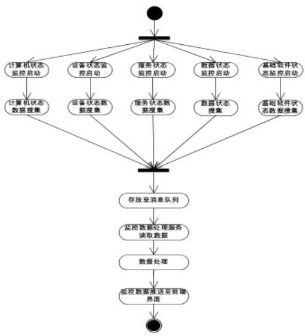
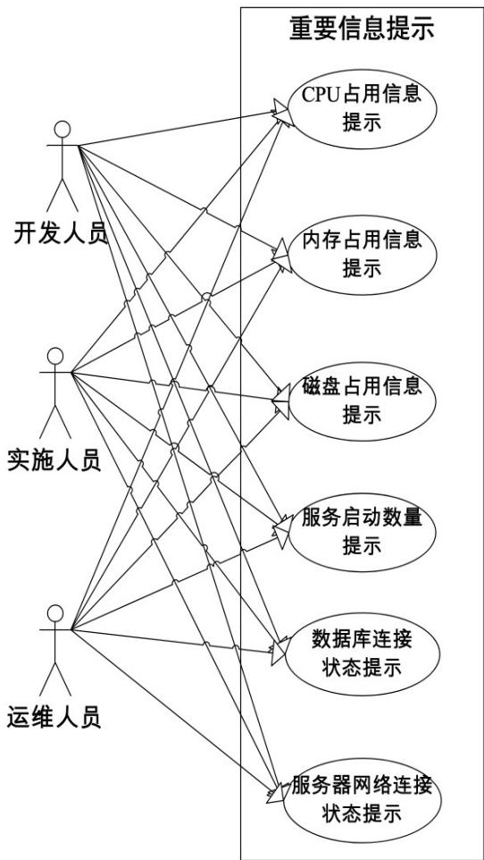
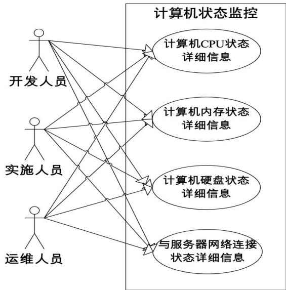

  
图5 系统运行监控流程图

系统运行监控包括计算机状态监控、设备状态监控、服务状态监控、数据状态监控、基础软件状态监控，各监控服务启动后，搜集相关的监控数据，包括计算机状态数据、设备状态数据、服务状态数据、数据状态、基础软件数据，搜集完毕后存放在统一传输服务的消息队列中，监控数据处理服务从消息队列中读取上述数据并进行分析，然后推送至前端显示界面。

3.2.1.1 重要信息提示（PZXQ-YXZCFW-GN-XTYXZTJK-ZYXXTS）

重要信息提示能够对系统运行过程中的重要信息包括计算机CPU占用信息、内存占用信息、磁盘占用信息、服务启动数量、数据库连接状态、本机与服务器网络连通状态进行显示。功能用例图如图6所示。

  
图6 重要信息提示用例图

重要信息提示所有能力标识表，见表4所示。

表4 重要信息提示所有能力能力标识
<table><tr><td colspan="1" rowspan="1">序号</td><td colspan="1" rowspan="1">Use case名称</td><td colspan="1" rowspan="1">项目唯一标识符</td><td colspan="1" rowspan="1">需求描述</td><td colspan="1" rowspan="1">需求重用</td><td colspan="1" rowspan="1">方式名称</td><td colspan="1" rowspan="1">运行状态</td><td colspan="1" rowspan="1">对应的任务书功能/性能</td></tr><tr><td colspan="1" rowspan="1">1</td><td colspan="1" rowspan="1">CPU 占用信息提示</td><td colspan="1" rowspan="1">PZXQ-YXZCFW-GN-XTYXZTJK-ZYXXTS-CPUZYXXTS</td><td colspan="1" rowspan="1">能够显示计算机 CPU 占用状态信息</td><td colspan="1" rowspan="1">新增</td><td colspan="1" rowspan="1">桌面、平板、手持</td><td colspan="1" rowspan="1">开发阶段、集成阶段、运行阶段</td><td colspan="1" rowspan="1">4.1.1 a)</td></tr><tr><td colspan="1" rowspan="1">2</td><td colspan="1" rowspan="1">内存占用信息提示</td><td colspan="1" rowspan="1">PZXQ-YXZCFW-GN-XTYXZTJK-ZYXXTS-NCZYXXTS</td><td colspan="1" rowspan="1">能够显示计算机内存占用状态信息</td><td colspan="1" rowspan="1">新增</td><td colspan="1" rowspan="1">桌面、平板、手持</td><td colspan="1" rowspan="1">开发阶段、集成阶段、运行阶段</td><td colspan="1" rowspan="1">4.1.1 a)</td></tr><tr><td colspan="1" rowspan="1">3</td><td colspan="1" rowspan="1">磁盘占用</td><td colspan="1" rowspan="1">PZXQ-YXZCFW-GN-XTYXZTJK-</td><td colspan="1" rowspan="1">能够显示计算</td><td colspan="1" rowspan="1">新增</td><td colspan="1" rowspan="1">桌面、</td><td colspan="1" rowspan="1">开发阶段、</td><td colspan="1" rowspan="1">4.1.1 a)</td></tr><tr><td colspan="1" rowspan="1"></td><td colspan="1" rowspan="1">信息提示</td><td colspan="1" rowspan="1">ZYXXTS-CPZYXXTS</td><td colspan="1" rowspan="1">机磁盘占用状态信息</td><td colspan="1" rowspan="1"></td><td colspan="1" rowspan="1">平板、手持</td><td colspan="1" rowspan="1">集成阶段、运行阶段</td><td colspan="1" rowspan="1"></td></tr><tr><td colspan="1" rowspan="1">4</td><td colspan="1" rowspan="1">服务启动数量提示</td><td colspan="1" rowspan="1">PZXQ-YXZCFW-GN-XTYXZTJK-ZYXXTS-FWQDSLTS</td><td colspan="1" rowspan="1">能够显示计算机服务启动数量</td><td colspan="1" rowspan="1">新增</td><td colspan="1" rowspan="1">桌面、平板、手持</td><td colspan="1" rowspan="1">开发阶段、集成阶段、运行阶段</td><td colspan="1" rowspan="1">4.1.1 a)</td></tr><tr><td colspan="1" rowspan="1">5</td><td colspan="1" rowspan="1">数据库连接状态提示</td><td colspan="1" rowspan="1">PZXQ-YXZCFW-GN-XTYXZTJK-ZYXXTS-SJKLJZTTS</td><td colspan="1" rowspan="1">能够显示计算机数据库连接状态</td><td colspan="1" rowspan="1">新增</td><td colspan="1" rowspan="1">桌面、平板、手持</td><td colspan="1" rowspan="1">开发阶段、集成阶段、运行阶段</td><td colspan="1" rowspan="1">4.1.1 a)</td></tr><tr><td colspan="1" rowspan="1">6</td><td colspan="1" rowspan="1">服务器网络连接状态提示</td><td colspan="1" rowspan="1">PZXQ-YXZCFW-GN-XTYXZTJK-ZYXXTS-FWQWLLJZTTS</td><td colspan="1" rowspan="1">能够显示计算机与服务器网络连接状态</td><td colspan="1" rowspan="1">新增</td><td colspan="1" rowspan="1">桌面、平板、手持</td><td colspan="1" rowspan="1">开发阶段、集成阶段、运行阶段</td><td colspan="1" rowspan="1">4.1.1 a)</td></tr></table>

## ZYXXTS-CPUZYXXTS）

CPU占用信息提示用例场景，见表5所示。

表5 CPU 占用信息提示用例描述
<table><tr><td colspan="1" rowspan="1">Use Case 名称：CPU 占用信息</td><td colspan="2" rowspan="1">Actors：开发人员、实施人员、运维人员</td></tr><tr><td colspan="3" rowspan="1">概述：描述本软件向用户提供重要信息中的计算机CPU重要信息的过程；</td></tr><tr><td colspan="3" rowspan="1">前置条件：信息系统正常安装，服务集成框架启动正常。</td></tr><tr><td colspan="3" rowspan="1">主事件流</td></tr><tr><td colspan="1" rowspan="1">Actor 的动作</td><td colspan="1" rowspan="1">系统的动作</td><td colspan="1" rowspan="1">动作约束(性能、可靠性、容错等)</td></tr><tr><td colspan="1" rowspan="1">1.用户点击打开系统运行监控主界面，选择重要信息提示；3.用户可查看到CPU状态显示过高还是正常，以及信息提示的时间；4.用户点击详情；</td><td colspan="1" rowspan="1">2.若系统运行监控程序未启动，则执行异常流E1；若系统运行监控程序启动成功，则实时从操作系统获取计算机CPU的占用状态信息，并进行计算分析，当CPU状态超过80%时，则提示计算机CPU 状态过高，当 CPU 状态未超过80%时，则提示计算机CPU状态正常；5.系统进入计算机CPU状态详情；</td><td colspan="1" rowspan="1">计算机 CPU 占用信息监控间隔不大于6秒</td></tr><tr><td colspan="2" rowspan="1">异常流E1：重要信息页面显示暂无数据。</td><td colspan="1" rowspan="1"></td></tr><tr><td colspan="2">后置条件：无。</td><td></td></tr></table>

## 3.2.1.1.2 内存占用信息提示（PZXQ-YXZCFW-GN-XTYXZTJK-ZYXXTS-NCZYXXTS）

内存占用信息提示用例场景，见表6所示。

表6 内存占用信息提示用例描述
<table><tr><td rowspan=1 colspan=1>Use Case 名称：内存占用信息</td><td rowspan=1 colspan=2>Actors：开发人员、实施人员、运维人员</td></tr><tr><td rowspan=1 colspan=3>概述：描述本软件向用户提供重要信息中的内存占用信息的过程；</td></tr><tr><td rowspan=1 colspan=3>前置条件：信息系统正常安装，服务集成框架启动正常。</td></tr><tr><td rowspan=1 colspan=3>主事件流</td></tr><tr><td rowspan=1 colspan=1>Actor 的动作</td><td rowspan=1 colspan=1>系统的动作</td><td rowspan=1 colspan=1>动作约束(性能、可靠性、容错等)</td></tr><tr><td rowspan=1 colspan=1>1.用户点击打开系统运行监控主界面，选择重要信息提示；3.用户可查看到内存占用状态显示过高还是正常，以及信息提示的时间；4.用户点击详情；</td><td rowspan=1 colspan=1>2.若系统运行监控程序未启动，则执行异常流E1；若系统运行监控程序启动成功，则实时从操作系统获取计算机内存占用信息，并进行计算分析，当内存占用状态超过80%时，则提示计算机内存占用状态过高，当内存占用状态未超过80%时，则提示计算机内存占用状态正常；5.系统进入计算机内存占用状态详情；</td><td rowspan=1 colspan=1>内存占用信息监控间隔不大于6秒</td></tr><tr><td rowspan=1 colspan=2>异常流E1：重要信息页面显示暂无数据。</td><td rowspan=1 colspan=1></td></tr><tr><td rowspan=1 colspan=2>后置条件：无。</td><td rowspan=1 colspan=1></td></tr></table>

磁盘占用信息提示用例场景，见表7所示。

表7 磁盘占用信息提示用例描述
<table><tr><td></td><td>Actors：开发人员、实施人员、运维人员</td></tr><tr><td>Use Case 名称:磁盘占用信息</td><td></td></tr></table>

<table><tr><td rowspan=1 colspan=3>概述：描述本软件向用户提供重要信息中的磁盘占用信息的过程；</td></tr><tr><td rowspan=1 colspan=3>前置条件：信息系统正常安装，服务集成框架启动正常。</td></tr><tr><td rowspan=1 colspan=3>主事件流</td></tr><tr><td rowspan=1 colspan=1>Actor 的动作</td><td rowspan=1 colspan=1>系统的动作</td><td rowspan=1 colspan=1>动作约束(性能、可靠性、容错等)</td></tr><tr><td rowspan=1 colspan=1>1.用户点击打开系统运行监控主界面，选择重要信息提示；3.用户可查看到磁盘占用状态显示过高还是正常，以及信息提示的时间：4.用户点击详情；</td><td rowspan=1 colspan=1>2.若系统运行监控程序未启动.则执行异常流E1；若系统运行监控程序启动成功，则实时从操作系统获取计算机磁盘占用信息，并进行计算分析，当磁盘占用超过80%时，则提示计算机磁盘占用过高，当磁盘占用未超过80%时，则提示计算机内存占用正常；5.系统进入计算机磁盘占用状态详情；</td><td rowspan=1 colspan=1>磁盘占用信息的监控间隔不大于6秒</td></tr><tr><td rowspan=1 colspan=2>异常流E1：重要信息页面显示暂无数据。</td><td rowspan=1 colspan=1></td></tr><tr><td rowspan=1 colspan=2>后置条件：无。</td><td rowspan=1 colspan=1></td></tr></table>

服务启动数量提示用例场景，见表8所示。

表8 服务启动数量提示用例描述
<table><tr><td colspan="1" rowspan="1">Use Case 名称:服务启动数量</td><td colspan="2" rowspan="1">Actors：开发人员、实施人员、运维人员</td></tr><tr><td colspan="3" rowspan="1">概述：描述本软件向用户提供重要信息中的服务启动数量的过程；</td></tr><tr><td colspan="3" rowspan="1">前置条件：信息系统正常安装，服务集成框架启动正常。</td></tr><tr><td colspan="3" rowspan="1">主事件流</td></tr><tr><td colspan="1" rowspan="1">Actor 的动作</td><td colspan="1" rowspan="1">系统的动作</td><td colspan="1" rowspan="1">动作约束(性能、可靠性、容错等)</td></tr><tr><td colspan="1" rowspan="1">1.用户点击打开系统运行监控主界面，选择重要信息提示；</td><td colspan="1" rowspan="1">2.若系统运行监控程序未启动，则执行异常流E1；若系统运行监控程序启动成功，则实时向服务集成框架请求当前服务的启动状态，若请求未响应，则执行</td><td colspan="1" rowspan="1">服务启动数量的监控间隔不大于6秒</td></tr><tr><td colspan="1" rowspan="1">3.用户可查看到服务总数、正常启动的服务数量；4.用户点击详情；</td><td colspan="1" rowspan="1">异常流E2，服务集成框架将服务总数、已经启动的服务数量返回至系统运行监控，系统运行监控后台服务将数据返回至前端界面；5.系统进入服务启动状态详情；</td><td colspan="1" rowspan="1"></td></tr><tr><td colspan="2" rowspan="1">异常流E1：重要信息页面显示暂无数据。</td><td colspan="1" rowspan="1"></td></tr><tr><td colspan="2" rowspan="1">异常流E1：服务启动数量信息值暂无数据。</td><td colspan="1" rowspan="1"></td></tr><tr><td colspan="2" rowspan="1">后置条件：无。</td><td colspan="1" rowspan="1"></td></tr></table>

## 3.2.1.1.5 数据库连接状态提示（PZXQ-YXZCFW-GN-XTYXZTJK-ZYXXTS-SJKLJZTTS）

数据库连接状态提示用例场景，见表9所示。

表9 数据库连接状态提示用例描述
<table><tr><td colspan="1" rowspan="1">Use Case 名称:数据库连接状态</td><td colspan="2" rowspan="1">Actors：开发人员、实施人员、运维人员</td></tr><tr><td colspan="3" rowspan="1">概述：描述本软件向用户提供重要信息中的数据库连接状态的过程；</td></tr><tr><td colspan="3" rowspan="1">前置条件：信息系统正常安装，服务集成框架启动正常。</td></tr><tr><td colspan="3" rowspan="1">主事件流</td></tr><tr><td colspan="1" rowspan="1">Actor 的动作</td><td colspan="1" rowspan="1">系统的动作</td><td colspan="1" rowspan="1">动作约束(性能、可靠性、容错等)</td></tr><tr><td colspan="1" rowspan="1">1.用户点击打开系统运行监控主界面，选择重要信息提示；3.用户可查看到数据库连接状态；4.用户点击详情；</td><td colspan="1" rowspan="1">2.若系统运行监控程序未启动，则执行异常流E1；若系统运行监控程序启动成功，则实时向数据运行管理工具请求当前服务的启动状态，若数据运行管理工具未启动，请求未响应，则执行异常流E2，数据运行管理工具将数据库连接状态返回至系统运行监控，系统运行监控后台服务将数据返回至前端界面，若数据库连接中断，则显示数据库连接异常，若数据库连接正常，则显示数据库连接正常；</td><td colspan="1" rowspan="1">数据库连接状态监控间隔不大于6秒</td></tr><tr><td colspan="1" rowspan="1"></td><td colspan="1" rowspan="1">5.系统进入数据库状态详情；</td><td colspan="1" rowspan="1"></td></tr><tr><td colspan="2" rowspan="1">异常流E1:重要信息页面显示暂无数据。</td><td colspan="1" rowspan="1"></td></tr><tr><td colspan="2" rowspan="1">异常流E2:数据库连接状态界面显示暂无数据。</td><td colspan="1" rowspan="1"></td></tr><tr><td colspan="2" rowspan="1">后置条件：无。</td><td colspan="1" rowspan="1"></td></tr></table>

服务器网络连接状态提示（PZXQ-YXZCFW-GN-XTYXZTJK-ZYXXTS-FWQWLLJZTTS）

服务器网络连接状态提示用例场景，见表10所示。

表10 服务器网络连接状态提示用例描述
<table><tr><td rowspan=1 colspan=1>Use Case 名称：服务器网络连接状态</td><td rowspan=1 colspan=2>Actors：开发人员、实施人员、运维人员</td></tr><tr><td rowspan=1 colspan=3>概述：描述本软件向用户提供重要信息中的服务器网络连接状态的过程；</td></tr><tr><td rowspan=1 colspan=3>前置条件：信息系统正常安装，服务集成框架启动正常。</td></tr><tr><td rowspan=1 colspan=3>主事件流</td></tr><tr><td rowspan=1 colspan=1>Actor 的动作</td><td rowspan=1 colspan=1>系统的动作</td><td rowspan=1 colspan=1>动作约束(性能、可靠性、容错等)</td></tr><tr><td rowspan=1 colspan=1>1.用户点击打开系统运行监控主界面，选择重要信息提示；3.用户可查看到与服务器网络的连接状态；4.用户点击详情；</td><td rowspan=1 colspan=1>2.若系统运行监控程序未启动，则执行异常流E1；若系统运行监控程序启动成功，则实时向基础信息服务请求当前服务器的IP信息，若基础信息服务未启动，请求未响应，则执行异常流E2，系统运行监控接收到服务器IP信息后，向服务器 IP 进行 ping 操作，若能够 ping通，则显示与服务器网络连接正常，若无法 ping 通，则显示与服务器网络连接失败；5.系统进入网络状态详情；</td><td rowspan=1 colspan=1>本机与服务器网络连通状态的监控间隔不大于6秒</td></tr><tr><td rowspan=1 colspan=2>异常流E1：重要信息页面显示暂无数据。</td><td rowspan=1 colspan=1></td></tr><tr><td rowspan=1 colspan=2>异常流E2：服务器网络连接状态界面显示暂无数据。</td><td rowspan=1 colspan=1></td></tr><tr><td rowspan=1 colspan=2>后置条件：无。</td><td rowspan=1 colspan=1></td></tr></table>

3.2.1.2 计算机状态监控（PZXQ-YXZCFW-GN-XTYXZTJK-JSJZTJK）

能够读取计算机中正在运行的软件的CPU状态详细信息、内存占用详细信息、磁盘占用详细信息、与服务器网络连通详细信息，对以上数据进行汇总并进行显示。用例图如图7所示。

  
图7 计算机状态监控用例图

计算机状态监控所有能力标识表，见表11所示。

表11 计算机状态所有能力标识
<table><tr><td colspan="1" rowspan="1">序号</td><td colspan="1" rowspan="1">Usecase名称</td><td colspan="1" rowspan="1">项目唯一标识符</td><td colspan="1" rowspan="1">需求描述</td><td colspan="1" rowspan="1">需求重用</td><td colspan="1" rowspan="1">方式名称</td><td colspan="1" rowspan="1">运行状态</td><td colspan="1" rowspan="1">对应的任务书功能/性能</td></tr><tr><td colspan="1" rowspan="1">1</td><td colspan="1" rowspan="1">计算机CPU状态详细信息</td><td colspan="1" rowspan="1">PZXQ-YXZCFW-GN-XTYXZTJK-JSJZTJK-JSJCPUZTXXXX</td><td colspan="1" rowspan="1">能够读取计算机中正在运行软件的 CPU状态详细信息，对以上数据进行汇总并进行显示</td><td colspan="1" rowspan="1">新增</td><td colspan="1" rowspan="1">桌面、平板、手持</td><td colspan="1" rowspan="1">开发阶段、集成阶段、运行阶段</td><td colspan="1" rowspan="1">4.1.1 b)</td></tr><tr><td colspan="1" rowspan="1">2</td><td colspan="1" rowspan="1">计算机内存状态详细信息</td><td colspan="1" rowspan="1">PZXQ-YXZCFW-GN-XTYXZTJK-JSJZTJK-JSJNCZTXXXX</td><td colspan="1" rowspan="1">能够读取计算机中正在运行软件的内存占用详细信息，对以上数据进行汇总并进行显示</td><td colspan="1" rowspan="1">新增</td><td colspan="1" rowspan="1">桌面、平板、手持</td><td colspan="1" rowspan="1">开发阶段、集成阶段、运行阶段</td><td colspan="1" rowspan="1">4.1.1b)</td></tr><tr><td colspan="1" rowspan="1">3</td><td colspan="1" rowspan="1">计算机硬盘状态详细信息</td><td colspan="1" rowspan="1">PZXQ-YXZCFW-GN-XTYXZTJK-JSJZTJK-JSJYPZTXXXX</td><td colspan="1" rowspan="1">能够读取计算机中正在运行软件的磁盘占用详细信息，对以上数据进行汇总并进行显示</td><td colspan="1" rowspan="1">新增</td><td colspan="1" rowspan="1">桌面、平板、手持</td><td colspan="1" rowspan="1">开发阶段、集成阶段、运行阶段</td><td colspan="1" rowspan="1">4.1.1b)</td></tr><tr><td colspan="1" rowspan="1">4</td><td colspan="1" rowspan="1">与服务器网络连接状态详细</td><td colspan="1" rowspan="1">PZXQ-YXZCFW-GN-XTYXZTJK-JSJZTJK-JSJYFWQWLLJZTXXXX</td><td colspan="1" rowspan="1">能够读取本机与服务器网络连通信息包括上行速度和下行速度，对以上数据进行汇总并进行显示</td><td colspan="1" rowspan="1">新增</td><td colspan="1" rowspan="1">桌面、平板、手持</td><td colspan="1" rowspan="1">开发阶段、集成阶段、运行阶段</td><td colspan="1" rowspan="1">4.1.1b)</td></tr><tr><td colspan="1" rowspan="1"></td><td colspan="1" rowspan="1">信息</td><td colspan="1" rowspan="1"></td><td colspan="1" rowspan="1"></td><td colspan="1" rowspan="1"></td><td colspan="1" rowspan="1"></td><td colspan="1" rowspan="1"></td><td colspan="1" rowspan="1"></td></tr></table>

计算机CPU状态详细信息用例场景，见表12所示。

表12 计算机CPU状态详细信息用例描述
<table><tr><td colspan="1" rowspan="1">Use Case 名称:计算机 CPU 状态详细信息</td><td colspan="2" rowspan="1">Actors：开发人员、实施人员、运维人员</td></tr><tr><td colspan="3" rowspan="1">概述:描述用户查看计算机CPU状态详细信息的过程；</td></tr><tr><td colspan="3" rowspan="1">前置条件：信息系统正常安装，服务集成框架正常启动。</td></tr><tr><td colspan="3" rowspan="1">主事件流</td></tr><tr><td colspan="1" rowspan="1">Actor 的动作</td><td colspan="1" rowspan="1">系统的动作</td><td colspan="1" rowspan="1">动作约束(性能、可靠性、容错等)</td></tr><tr><td colspan="1" rowspan="1">1.用户点击打开系统运行监控主界面，选择计算机状态信息；3.用户点击状态信息；5.用户点击折线图上的节点信息；7.用户点击CPU详细信息；</td><td colspan="1" rowspan="1">2.若系统运行监控程序未启动.则执行异常流E1；若系统运行监控正常启动，则调用系统接口获取当前计算机CPU占用的状态信息，以图文形式展现，若系统接口调用失败，则执行异常流E2；4. 系统以折线图形式显示CPU状态的变化信息，每隔一段时间进行更新；6.系统返回节点数据信息；8.系统调用系统接口获取当前计算机内正常运行的软件信息，包括软件的CPU占用信息和软件的位置信息，系统对软件的CPU占用率进行排序，取占用率排前十的软件进行显示，若系统接口调用失败，则执行异常流E3。</td><td colspan="1" rowspan="1"></td></tr><tr><td colspan="2" rowspan="1">异常流E1：计算机状态监控页面显示暂无数据。</td><td colspan="1" rowspan="1"></td></tr><tr><td colspan="2" rowspan="1">异常流E2:计算机状态监控页面CPU状态数据显示数据异常。</td><td colspan="1" rowspan="1"></td></tr><tr><td colspan="2" rowspan="1">异常流E3:计算机状态监控页面CPU详细数据列表中没有数据。</td><td colspan="1" rowspan="1"></td></tr><tr><td colspan="2">后置条件：无。</td><td></td></tr></table>

## 3.2.1.2.2 计算机内存状态详细信息（PZXQ-YXZCFW-GN-XTYXZTJK-JSJZTJK-JSJNCZTXXXX）

计算机内存状态详细信息用例场景，见表13所示。

表13 计算机内存状态详细信息用例描述
<table><tr><td rowspan=1 colspan=1>Use Case 名称：计算机内存状态详细信息</td><td rowspan=1 colspan=2>Actors：开发人员、实施人员、运维人员</td></tr><tr><td rowspan=1 colspan=3>概述：描述用户查看计算机内存状态详细信息的过程；</td></tr><tr><td rowspan=1 colspan=3>前置条件：信息系统正常安装，服务集成框架正常启动。</td></tr><tr><td rowspan=1 colspan=3>主事件流</td></tr><tr><td rowspan=1 colspan=1>Actor 的动作</td><td rowspan=1 colspan=1>系统的动作</td><td rowspan=1 colspan=1>动作约束(性能、可靠性、容错等)</td></tr><tr><td rowspan=1 colspan=1>1.用户点击打开系统运行监控主界面，选择计算机状态信息；3.用户点击状态信息；5.用户点击折线图上的节点信息；7.用户点击内存详细信息；</td><td rowspan=1 colspan=1>2.若系统运行监控程序未启动，则执行异常流E1；若系统运行监控正常启动，则调用系统接口获取当前计算机内存占用的状态信息，以图文形式展现，若系统接口调用失败，则执行异常流E2；4. 系统以折线图形式显示内存状态的变化信息，每隔一段时间进行更新；6.系统返回节点数据信息；8.系统调用系统接口获取当前计算机内正常运行的软件信息，包括软件的内存占用信息和软件的位置信息，系统对软件的内存占用率进行排序，取占用率排前十的软件进行显示，若系统接口调用失败，则执行异常流E3。</td><td rowspan=1 colspan=1>o</td></tr><tr><td rowspan=1 colspan=2>异常流E1：计算机状态监控页面显示暂无数据。</td><td rowspan=1 colspan=1></td></tr><tr><td rowspan=1 colspan=2>异常流E2:计算机状态监控页面内存状态数据显示数据异常。</td><td rowspan=1 colspan=1></td></tr><tr><td rowspan=1 colspan=2>异常流E3：计算机状态监控页面内存详细数据列表中没有数据。</td><td rowspan=1 colspan=1></td></tr><tr><td rowspan=1 colspan=2>后置条件：无。</td><td rowspan=1 colspan=1></td></tr></table>

3.2.1.2.3 计算机硬盘状态详细信息（PZXQ-YXZCFW-GN-XTYXZTJK-JSJZTJK-JSJYPZTXXXX）