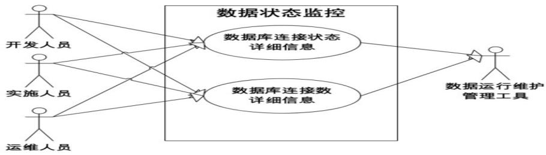
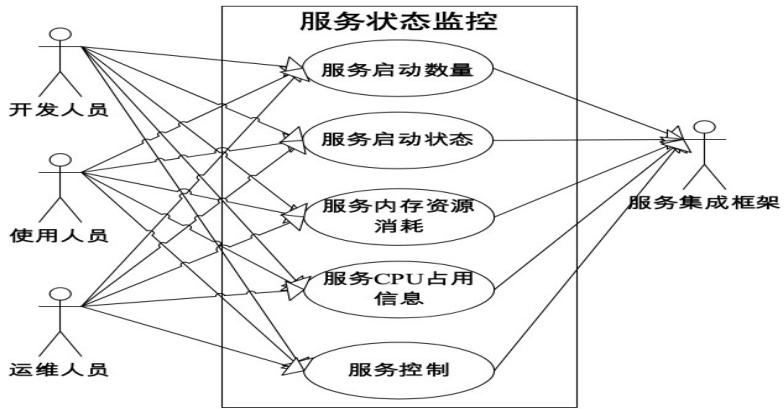

计算机硬盘状态详细信息用例场景，见表14所示。

3.2.1.2.4 与服务器网络连接状态详细信息（PZXQ-YXZCFW-GN-XTYXZTJK-JSJZTJK-JSJYFWQWLLJZTXXXX）  
表14 计算机硬盘状态详细信息用例描述
<table><tr><td rowspan=1 colspan=1>Use Case 名称:计算机硬盘状态详细信息</td><td rowspan=1 colspan=2>Actors：开发人员、实施人员、运维人员</td></tr><tr><td rowspan=1 colspan=3>概述：描述用户查看计算机硬盘状态详细信息的过程；</td></tr><tr><td rowspan=1 colspan=3>前置条件：信息系统正常安装，服务集成框架正常启动。</td></tr><tr><td rowspan=1 colspan=3>主事件流</td></tr><tr><td rowspan=1 colspan=1>Actor 的动作</td><td rowspan=1 colspan=1>系统的动作</td><td rowspan=1 colspan=1>动作约束(性能、可靠性、容错等)</td></tr><tr><td rowspan=1 colspan=1>1.用户点击打开系统运行监控主界面，选择计算机状态信息；3.用户点击状态信息；5.用户点击折线图上的节点信息；7.用户点击硬盘详细信息；</td><td rowspan=1 colspan=1>2.若系统运行监控程序未启动，则执行异常流E1；若系统运行监控正常启动，则调用系统接口获取当前计算机硬盘占用的状态信息，以图文形式展现，若系统接口调用失败，则执行异常流E2；4. 系统以折线图形式显示计算机硬盘状态的变化信息，每隔一段时间进行更新；6.系统返回节点数据信息；8.系统调用系统接口获取当前计算机内正常运行的软件信息，包括软件的硬盘占用信息和软件的位置信息，系统对软件的硬盘占用率进行排序，取占用率排前十的软件进行显示，若系统接口调用失败，则执行异常流E3。</td><td rowspan=1 colspan=1></td></tr><tr><td rowspan=1 colspan=2>异常流E1：计算机状态监控页面显示暂无数据。</td><td rowspan=1 colspan=1></td></tr><tr><td rowspan=1 colspan=2>异常流E2：计算机状态监控页面硬盘状态数据显示数据异常。</td><td rowspan=1 colspan=1></td></tr><tr><td rowspan=1 colspan=2>异常流E3：计算机状态监控页面硬盘详细数据列表中没有数据。</td><td rowspan=1 colspan=1></td></tr><tr><td rowspan=1 colspan=2>后置条件：无。</td><td rowspan=1 colspan=1></td></tr></table>

与服务器网络连接状态详细信息用例场景，见表15所示。

表15 与服务器网络连接状态详细信息用例描述
<table><tr><td>Use Case 名称:计算机 CPU 状态详细</td><td colspan="2">Actors：开发人员、实施人员、运维人员</td></tr><tr><td>信息</td><td colspan="2"></td></tr><tr><td colspan="3">概述：描述用户查看计算机与服务器网络连接状态详细信息的过程；</td></tr><tr><td colspan="3">前置条件：信息系统正常安装，服务集成框架正常启动。</td></tr><tr><td colspan="3">主事件流</td></tr><tr><td>Actor 的动作</td><td>系统的动作</td><td>动作约束 (性能、可靠性、容错等)</td></tr><tr><td>1.用户点击打开系统运行监控主界面， 选择计算机状态信息； 3.用户点击状态信息；</td><td>2.若系统运行监控程序未启动，则执行 异常流E1；若系统运行监控正常启动， 则调用系统接口获取当前计算机与计算 机网络连接的状态信息，以图文形式展 现，若系统接口调用失败，则执行异常 流E2;</td><td></td></tr><tr><td>5.用户点击折线图上的节点信息；</td><td>态的变化信息，包括上行速度和下行速 度，每隔一段时间进行更新； 6.系统返回节点数据信息；</td><td></td></tr><tr><td colspan="2">异常流E1:计算机状态监控页面显示暂无数据。</td><td></td></tr><tr><td colspan="2">异常流E2:计算机状态监控页面网络状态显示数据异常。</td><td></td></tr><tr><td colspan="2">后置条件：无。</td><td></td></tr></table>

## 3.2.1.3 数据状态监控（PZXQ-YXZCFW-GN-XTYXZTJK-SJZTJK）

能够读取计算机的数据库连接状态、数据库最大连接数、数据库当前连接数信息，对以上数据进行汇总并进行显示。用例图如图8所示。

  
图8 数据状态监控用例图

数据状态监控所有能力标识表，见表16所示。

表16 数据状态监控所有能力标识
<table><tr><td rowspan=1 colspan=1>序号</td><td rowspan=1 colspan=1>Usecase 名称</td><td rowspan=1 colspan=1>项目唯一标识符</td><td rowspan=1 colspan=1>需求描述</td><td rowspan=1 colspan=1>需求重用</td><td rowspan=1 colspan=1>方式名称</td><td rowspan=1 colspan=1>运行状态</td><td rowspan=1 colspan=1>对应的任务书功能/性能</td></tr><tr><td rowspan=1 colspan=1>1</td><td rowspan=1 colspan=1>数据库连接状态详细信息</td><td rowspan=1 colspan=1>PZXQ-YXZCFW-GN-XTYXZTJK-SJZTJK-SJKLJZTXXXX</td><td rowspan=1 colspan=1>能够读取计算机的数据库连接状态详细信息，对以上数据进行汇总并进行显示</td><td rowspan=1 colspan=1>新增</td><td rowspan=1 colspan=1>桌面、平板、手持</td><td rowspan=1 colspan=1>开发阶段、集成阶段、运行阶段</td><td rowspan=1 colspan=1>4.1.1 c)</td></tr><tr><td rowspan=1 colspan=1>2</td><td rowspan=1 colspan=1>数据库连接数详细信息</td><td rowspan=1 colspan=1>PZXQ-YXZCFW-GN-XTYXZTJK-JSJZTJK-SJKLJSXXXX</td><td rowspan=1 colspan=1>能够读取计算机的数据库连接数详细信息，对以上数据进行汇总并进行显示</td><td rowspan=1 colspan=1>新增</td><td rowspan=1 colspan=1>桌面、平板、手持</td><td rowspan=1 colspan=1>开发阶段、集成阶段、运行阶段</td><td rowspan=1 colspan=1>4.1.1 c)</td></tr></table>

数据库连接状态详细信息用例场景，见表17所示。

表17 数据库连接状态详细信息用例描述
<table><tr><td>Use Case 名称:数据库连接状态详细 信息</td><td colspan="2">Actors：开发人员、实施人员、运维人员、数据运行维护管理工具</td></tr><tr><td colspan="3">概述：描述用户查看计算机数据库连接状态详细信息的过程；</td></tr><tr><td colspan="3" rowspan="1">前置条件：信息系统正常安装，服务集成框架正常启动。</td></tr><tr><td colspan="3" rowspan="1">主事件流</td></tr><tr><td colspan="1" rowspan="1">Actor 的动作</td><td colspan="1" rowspan="1">系统的动作</td><td colspan="1" rowspan="1">动作约束(性能、可靠性、容错等)</td></tr><tr><td colspan="1" rowspan="1">1.用户点击打开系统运行监控主界面，选择计算机数据状态信息；3.用户可查看计算机数据库连接状态信息；</td><td colspan="1" rowspan="1">2.若系统运行监控程序未启动，则执行异常流E1；若系统运行监控正常启动，则调用数据运行维护管理工具接口获取当前计算机数据库连接状态信息，以图文形式展现，若数据库连接正常，则系统运行监控服务向前端返回数据库连接正常，若数据库连接失败，则系统运行监控服务向前端返回数据库连接异常，若系统接口调用失败，则执行异常流E2;</td><td colspan="1" rowspan="1"></td></tr><tr><td colspan="2" rowspan="1">异常流E1:计算机数据状态监控页面显示暂无数据。</td><td colspan="1" rowspan="1"></td></tr><tr><td colspan="2" rowspan="1">异常流E2:计算机状态监控页面数据状态显示数据异常。</td><td colspan="1" rowspan="1"></td></tr><tr><td colspan="2" rowspan="1">后置条件：无。</td><td colspan="1" rowspan="1"></td></tr></table>

3.2.1.3.2 数据库连接数详细信息（PZXQ-YXZCFW-GN-XTYXZTJK-JSJZTJK-SJKLJSXXXX）

数据库连接数详细信息用例场景，见表18所示。

表18 数据库连接数详细信息用例描述
<table><tr><td colspan="1" rowspan="1">Use Case 名称:数据库连接数详细信息</td><td colspan="2" rowspan="1">Actors：开发人员、实施人员、运维人员、数据运行维护管理工具</td></tr><tr><td colspan="3" rowspan="1">概述:描述用户查看计算机数据库连接数详细信息的过程；</td></tr><tr><td colspan="3" rowspan="1">前置条件：信息系统正常安装，服务集成框架正常启动。</td></tr><tr><td colspan="3" rowspan="1">主事件流</td></tr><tr><td colspan="1" rowspan="1">Actor 的动作</td><td colspan="1" rowspan="1">系统的动作</td><td colspan="1" rowspan="1">动作约束(性能、可靠性、容错等)</td></tr><tr><td colspan="1" rowspan="1">1.用户点击打开系统运行监控主界面，选择计算机数据状态信息；</td><td colspan="1" rowspan="1">2.若系统运行监控程序未启动，则执行异常流E1；若系统运行监控正常启动，则调用数据统一访问服务接口获取当前计算机数据库最大连接数，当前的连接数信息，以图文形式展现，若数据统一</td><td colspan="1" rowspan="1"></td></tr><tr><td colspan="1" rowspan="1">3.用户可查看计算机数据库最大连接数和当前连接数信息；</td><td colspan="1" rowspan="1">访问服务接口调用失败，则执行异常流E2;</td><td colspan="1" rowspan="1"></td></tr><tr><td colspan="2" rowspan="1">异常流E1：计算机数据状态监控页面显示暂无数据。</td><td colspan="1" rowspan="1"></td></tr><tr><td colspan="2" rowspan="1">异常流E2:计算机状态监控页面数据状态不显示最大连接数和当前连接数信息。</td><td colspan="1" rowspan="1"></td></tr><tr><td colspan="2" rowspan="1">后置条件：无。</td><td colspan="1" rowspan="1"></td></tr></table>

## 3.2.1.4 设备状态监控（PZXQ-YXZCFW-GN-XTYXZTJK-SBZTJK）

能够显示车内终端的在线信息、终端用户登陆信息。用例图如图9所示。

  
图9 设备状态监控用例图

设备状态监控所有能力标识表，见表19所示。

表19 设备状态监控所有能力标识
<table><tr><td rowspan=1 colspan=1>序号</td><td rowspan=1 colspan=1>Use case名称</td><td rowspan=1 colspan=1>项目唯一标识符</td><td rowspan=1 colspan=1>需求描述</td><td rowspan=1 colspan=1>需求重用</td><td rowspan=1 colspan=1>方式名称</td><td rowspan=1 colspan=1>运行状态</td><td rowspan=1 colspan=1>对应的任务书功能/性能</td></tr><tr><td rowspan=1 colspan=1>1</td><td rowspan=1 colspan=1>终端设备状态监控</td><td rowspan=1 colspan=1>PZXQ-YXZCFW-GN-XTYXZTJK-JSJZTJK-ZDSBZTJK</td><td rowspan=1 colspan=1>能够显示车内终端的在线信息、终端用户登陆信息</td><td rowspan=1 colspan=1>新增</td><td rowspan=1 colspan=1>桌面、平板、手持</td><td rowspan=1 colspan=1>运行阶段</td><td rowspan=1 colspan=1>4.1.1 f)</td></tr></table>

## 3.2.1.4.1 终端设备状态监控（PZXQ-YXZCFW-GN-XTYXZTJK-JSJZTJK-ZDSBZTJK）

终端设备状态监控用例场景，见表20所示。

表20 终端设备状态监控用例描述
<table><tr><td>Use Case 名称：终端设备信息监控</td><td colspan="2">Actors：实施人员、设备管理</td></tr><tr><td colspan="3">概述：描述用户查看终端设备状态信息的过程；</td></tr><tr><td colspan="3" rowspan="1">前置条件：信息系统正常安装、服务集成框架正常启动。</td></tr><tr><td colspan="3" rowspan="1">主事件流</td></tr><tr><td colspan="1" rowspan="1">Actor 的动作</td><td colspan="1" rowspan="1">系统的动作</td><td colspan="1" rowspan="1">动作约束(性能、可靠性、容错等)</td></tr><tr><td colspan="1" rowspan="1">1.用户点击打开系统运行监控主界面，选择设备状态信息；3.用户查看终端设备的启动状态，若设备正常启动，用户可以点击详细信息；5.用户可查看终端设备的详细信息；</td><td colspan="1" rowspan="1">2.若系统运行监控程序未启动，则执行异常流E1；系统运行监控向设备管理请求终端设备的设备信息，若请求失败，则执行异常流E2；设备管理向系统运行监控返回终端设备的启动状态信息，系统运行监控向前端页面推送信息；4. 系统运行监控向设备管理请求终端设备的详细信息，包括终端设备的在线信息，终端用户的登陆信息等，若请求失败，则执行异常流E3；</td><td colspan="1" rowspan="1"></td></tr><tr><td colspan="2" rowspan="1">异常流E1：设备状态监控页面显示暂无数据。</td><td colspan="1" rowspan="1"></td></tr><tr><td colspan="2" rowspan="1">异常流E2:设备状态终端设备监控页面显示暂无数据。</td><td colspan="1" rowspan="1"></td></tr><tr><td colspan="2" rowspan="1">后置条件：无。</td><td colspan="1" rowspan="1"></td></tr></table>

## 3.2.1.5 服务状态监控（PZXQ-YXZCFW-GN-XTYXZTJK-FWZTJK）

能够接收服务支撑框架提供的服务启动数量、服务启动状态、服务内存资源消耗和CPU占用信息，以表格方式进行显示，支持对服务的启停控制。用例图如图10所示。

  
图10 服务状态监控用例图

服务状态监控所有能力标识表，见表21所示。

表21 服务状态监控所有能力标识
<table><tr><td colspan="1" rowspan="1">序号</td><td colspan="1" rowspan="1">Usecase名称</td><td colspan="1" rowspan="1">项目唯一标识符</td><td colspan="1" rowspan="1">需求描述</td><td colspan="1" rowspan="1">需求重用</td><td colspan="1" rowspan="1">方式名称</td><td colspan="1" rowspan="1">运行状态</td><td colspan="1" rowspan="1">对应的任务书功能/性能</td></tr><tr><td colspan="1" rowspan="1">1</td><td colspan="1" rowspan="1">服务启动数量</td><td colspan="1" rowspan="1">PZXQ-YXZCFW-GN-XTYXZTJK-FWZTJK-FWQDSL</td><td colspan="1" rowspan="1">能够接收服务支撑框架提供的服务启动数量信息，以表格方式进行显示</td><td colspan="1" rowspan="1">改进</td><td colspan="1" rowspan="1">桌面、平板、手持</td><td colspan="1" rowspan="1">开发阶段、集成阶段、运行阶段</td><td colspan="1" rowspan="1">4.1.1 d)</td></tr><tr><td colspan="1" rowspan="1">2</td><td colspan="1" rowspan="1">服务启动状态</td><td colspan="1" rowspan="1">PZXQ-YXZCFW-GN-XTYXZTJK-FWZTJK-FWQDZT</td><td colspan="1" rowspan="1">能够接收服务支撑框架提供的服务启动状态，以表格方式进行显示</td><td colspan="1" rowspan="1">改进</td><td colspan="1" rowspan="1">桌面、平板、手持</td><td colspan="1" rowspan="1">开发阶段、集成阶段、运行阶段</td><td colspan="1" rowspan="1">4.1.1 d)</td></tr><tr><td colspan="1" rowspan="1">3</td><td colspan="1" rowspan="1">服务内存资源消耗</td><td colspan="1" rowspan="1">PZXQ-YXZCFW-GN-XTYXZTJK-FWZTJK-FWNCZYXH</td><td colspan="1" rowspan="1">能够接收服务支撑框架提供的服务内存资源消耗信息，以表格方式进行显示</td><td colspan="1" rowspan="1">新增</td><td colspan="1" rowspan="1">桌面、平板、手持</td><td colspan="1" rowspan="1">开发阶段、集成阶段、运行阶段</td><td colspan="1" rowspan="1">4.1.1 d)</td></tr><tr><td colspan="1" rowspan="1">4</td><td colspan="1" rowspan="1">服务CPU占用信息</td><td colspan="1" rowspan="1">PZXQ-YXZCFW-GN-XTYXZTJK-FWZTJK-FWCPUZYXX</td><td colspan="1" rowspan="1">能够接收服务 CPU占用信息，以表格方式进行显示</td><td colspan="1" rowspan="1">新增</td><td colspan="1" rowspan="1">桌面、平板、手持</td><td colspan="1" rowspan="1">开发阶段、集成阶段、运行阶段</td><td colspan="1" rowspan="1">4.1.1 d)</td></tr><tr><td colspan="1" rowspan="1">5</td><td colspan="1" rowspan="1">服务</td><td colspan="1" rowspan="1">PZXQ-YXZCFW-GN-XTYXZTJK-</td><td colspan="1" rowspan="1">支持对服务的启停控</td><td colspan="1" rowspan="1">改进</td><td colspan="1" rowspan="1">桌面、</td><td colspan="1" rowspan="1">开发阶</td><td colspan="1" rowspan="1">4.1.1 d)</td></tr><tr><td colspan="1" rowspan="1"></td><td colspan="1" rowspan="1">控制</td><td colspan="1" rowspan="1">FWZTJK-FWKZ</td><td colspan="1" rowspan="1">制</td><td colspan="1" rowspan="1"></td><td colspan="1" rowspan="1">平板、手持</td><td colspan="1" rowspan="1">段、集成阶段、运行阶段</td><td colspan="1" rowspan="1"></td></tr></table>

## 3.2.1.5.1 服务启动数量（PZXQ-YXZCFW-GN-XTYXZTJK-FWZTJK-FWQDSL）

服务启动数量监控用例场景，见表22所示。

表22 服务启动数量监控用例描述
<table><tr><td rowspan=1 colspan=1>Use Case 名称:服务启动数量监控</td><td rowspan=1 colspan=2>Actors：开发人员、实施人员、运维人员、服务集成框架</td></tr><tr><td rowspan=1 colspan=3>概述:描述用户查看服务启动数量信息的过程；</td></tr><tr><td rowspan=1 colspan=3>前置条件：信息系统正常安装，服务集成框架正常启动。</td></tr><tr><td rowspan=1 colspan=3>主事件流</td></tr><tr><td rowspan=1 colspan=1>Actor 的动作</td><td rowspan=1 colspan=1>系统的动作</td><td rowspan=1 colspan=1>动作约束(性能、可靠性、容错等)</td></tr><tr><td rowspan=1 colspan=1>1.用户点击打开系统运行监控主界面，选择服务状态信息；3.用户查看服务的总数和正常启动的数量；</td><td rowspan=1 colspan=1>2.若系统运行监控程序未启动，则执行异常流E1；若系统运行监控程序启动成功，则实时向服务集成框架请求当前服务启动数量信息，若请求未响应，则执行异常流E2，服务集成框架将服务总数、已经启动的服务数量返回至系统运行监控，系统运行监控后台服务将数据返回至前端界面；</td><td rowspan=1 colspan=1>服务状态监控数据的刷新速度不大于1分钟。</td></tr><tr><td rowspan=1 colspan=2>异常流E1：服务状态监控页面显示暂无数据。</td><td rowspan=1 colspan=1></td></tr><tr><td rowspan=1 colspan=2>异常流E2:服务状态监控页面服务总数和正常启动的数量显示暂无数据。</td><td rowspan=1 colspan=1></td></tr><tr><td rowspan=1 colspan=2>后置条件：无。</td><td rowspan=1 colspan=1></td></tr></table>

## 3.2.1.5.2 服务启动状态（PZXQ-YXZCFW-GN-XTYXZTJK-FWZTJK-FWQDZT）

服务启动状态监控用例场景，见表23所示。

表23 服务启动状态监控用例描述
<table><tr><td></td><td></td></tr><tr><td>Use Case 名称：服务启动状态监控</td><td>Actors：开发人员、实施人员、运维人员、服务集成框架</td></tr></table>

<table><tr><td rowspan=1 colspan=3>概述:描述用户查看服务启动状态信息的过程；</td></tr><tr><td rowspan=1 colspan=3>前置条件：信息系统正常安装，服务集成框架正常启动。</td></tr><tr><td rowspan=1 colspan=3>主事件流</td></tr><tr><td rowspan=1 colspan=1>Actor 的动作</td><td rowspan=1 colspan=1>系统的动作</td><td rowspan=1 colspan=1>动作约束(性能、可靠性、容错等)</td></tr><tr><td rowspan=1 colspan=1>1.用户点击打开系统运行监控主界面，选择服务状态信息；3.用户查看所有服务的启动状态，服务状态显示异常和正常；</td><td rowspan=1 colspan=1>2.若系统运行监控程序未启动，则执行异常流E1；若系统运行监控程序启动成功，则实时向服务集成框架请求当前服务的启动状态，若请求未响应，则执行异常流E2，服务集成框架将所有服务的启动状态返回至系统运行监控，系统运行监控后台服务将数据返回至前端界面；</td><td rowspan=1 colspan=1>服务状态监控数据的刷新速度不大于1分钟。</td></tr><tr><td rowspan=1 colspan=2>异常流E1：服务状态监控页面显示暂无数据。</td><td rowspan=1 colspan=1></td></tr><tr><td rowspan=1 colspan=2>异常流E2:服务状态监控页面服务状态显示暂无数据。</td><td rowspan=1 colspan=1></td></tr><tr><td rowspan=1 colspan=2>后置条件：无。</td><td rowspan=1 colspan=1></td></tr></table>

## 3.2.1.5.3 服务 CPU 资源消耗（PZXQ-YXZCFW-GN-XTYXZTJK-FWZTJK-FWCPUZYXH）

服务CPU资源消耗监控用例场景，见表24所示。

表24 服务CPU资源消耗用例描述
<table><tr><td colspan="1" rowspan="1">Use Case 名称：服务 CPU 资源消耗监控</td><td colspan="2" rowspan="1">Actors：开发人员、实施人员、运维人员、服务集成框架</td></tr><tr><td colspan="3" rowspan="1">概述：描述用户查看服务CPU资源消耗信息的过程；</td></tr><tr><td colspan="3" rowspan="1">前置条件：信息系统正常安装，服务集成框架正常启动。</td></tr><tr><td colspan="3" rowspan="1">主事件流</td></tr><tr><td colspan="1" rowspan="1">Actor 的动作</td><td colspan="1" rowspan="1">系统的动作</td><td colspan="1" rowspan="1">动作约束(性能、可靠性、容错等)</td></tr><tr><td colspan="1" rowspan="1">1.用户点击打开系统运行监控主界面，选择服务状态信息；</td><td colspan="1" rowspan="1">2.若系统运行监控程序未启动，则执行异常流E1；若系统运行监控程序启动成功，则实时向服务集成框架请求当前服务的CPU占用状态，若请求未响应，则执行异常流E2，服务集成框架将所有服</td><td colspan="1" rowspan="1">服务状态监控数据的刷新速度不大于1分钟。</td></tr><tr><td colspan="1" rowspan="1">3.用户查看每个服务的 CPU 占用状态；</td><td colspan="1" rowspan="1">务的 CPU占用状态返回至系统运行监控，系统运行监控后台服务将数据返回至前端界面；</td><td colspan="1" rowspan="1"></td></tr><tr><td colspan="2" rowspan="1">异常流E1：服务状态监控页面显示暂无数据。</td><td colspan="1" rowspan="1"></td></tr><tr><td colspan="2" rowspan="1">异常流E2:服务状态监控页面每个服务的CPU消耗状态显示暂无数据。</td><td colspan="1" rowspan="1"></td></tr><tr><td colspan="2" rowspan="1">后置条件：无。</td><td colspan="1" rowspan="1"></td></tr></table>

3.2.1.5.4 服务内存资源消耗（PZXQ-YXZCFW-GN-XTYXZTJK-FWZTJK-FWNCZYXH）

服务内存占用监控用例场景，见表25所示。

表25 服务内存占用监控用例描述
<table><tr><td rowspan=1 colspan=1>Use Case 名称：服务内存占用监控</td><td rowspan=1 colspan=2>Actors：开发人员、实施人员、运维人员、服务集成框架</td></tr><tr><td rowspan=1 colspan=3>概述：描述用户查看服务内存占用监控的过程；</td></tr><tr><td rowspan=1 colspan=3>前置条件：信息系统正常安装，服务集成框架正常启动。</td></tr><tr><td rowspan=1 colspan=3>主事件流</td></tr><tr><td rowspan=1 colspan=1>Actor 的动作</td><td rowspan=1 colspan=1>系统的动作</td><td rowspan=1 colspan=1>动作约束(性能、可靠性、容错等)</td></tr><tr><td rowspan=1 colspan=1>1.用户点击打开系统运行监控主界面，选择服务状态信息；3.用户查看每个服务的内存占用状态；</td><td rowspan=1 colspan=1>2.若系统运行监控程序未启动，则执行异常流E1；若系统运行监控程序启动成功，则实时向服务集成框架请求当前服务的内存占用状态，若请求未响应，则执行异常流E2，服务集成框架将所有服务的内存占用状态返回至系统运行监控，系统运行监控后台服务将数据返回至前端界面；</td><td rowspan=1 colspan=1>服务状态监控数据的刷新速度不大于1分钟。</td></tr><tr><td rowspan=1 colspan=2>异常流E1：服务状态监控页面显示暂无数据。</td><td rowspan=1 colspan=1></td></tr><tr><td rowspan=1 colspan=2>异常流E2:服务状态监控页面每个服务的内存占用状态显示暂无数据。</td><td rowspan=1 colspan=1></td></tr><tr><td rowspan=1 colspan=2>后置条件：无。</td><td rowspan=1 colspan=1></td></tr></table>

3.2.1.5.5 服务控制（PZXQ-YXZCFW-GN-XTYXZTJK-FWZTJK-FWKZ）

服务控制用例场景，见表26所示。

表26 服务控制用例描述