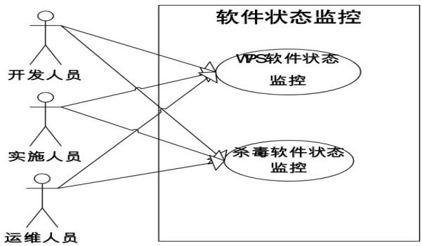
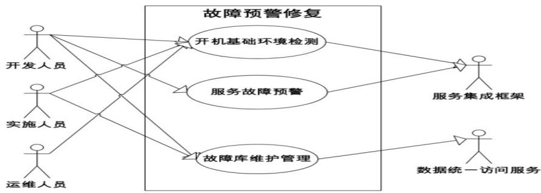
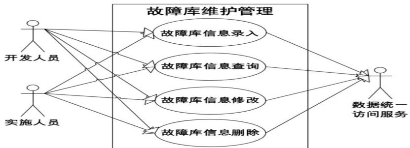
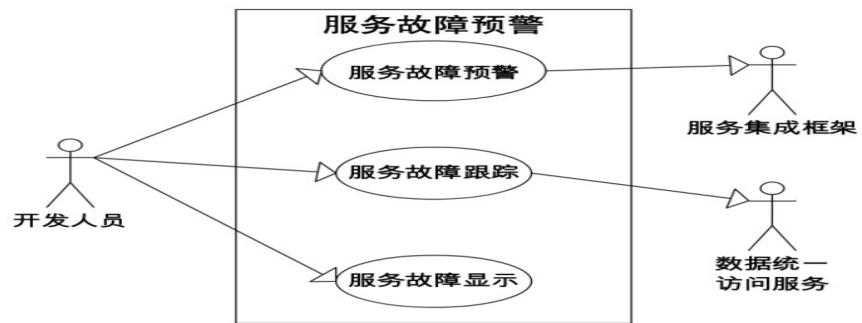

<table><tr><td rowspan=1 colspan=1>Use Case 名称：服务控制</td><td rowspan=1 colspan=2>Actors：开发人员、实施人员、运维人员、服务集成框架</td></tr><tr><td rowspan=1 colspan=3>概述：描述用户进行服务控制的过程；</td></tr><tr><td rowspan=1 colspan=3>前置条件：信息系统正常安装，服务集成框架正常启动。</td></tr><tr><td rowspan=1 colspan=3>主事件流</td></tr><tr><td rowspan=1 colspan=1>Actor 的动作</td><td rowspan=1 colspan=1>系统的动作</td><td rowspan=1 colspan=1>动作约束(性能、可靠性、容错等)</td></tr><tr><td rowspan=1 colspan=1>1.用户点击打开系统运行监控主界面，选择服务状态信息；3.用户选择某个服务点击停用；5.用户查看服务停用成功信息。</td><td rowspan=1 colspan=1>2.若系统运行监控程序未启动，则执行异常流E1；若系统运行监控程序启动成功，则实时向服务集成框架请求当前所有服务的启动状态，若请求未响应，则执行异常流E2，服务集成框架将所有服务的启动状态返回至系统运行监控，系统运行监控后台服务将数据返回至前端界面；4.系统调用接口将停用服务的信息发送至服务集成框架，若接口调用失败，则执行异常流E3；调用成功待服务集成框架返回停用成功信息，系统运行监控将成功信息返回至前端界面；</td><td rowspan=1 colspan=1></td></tr><tr><td rowspan=1 colspan=2>异常流E1：服务状态监控页面显示暂无数据。</td><td rowspan=1 colspan=1></td></tr><tr><td rowspan=1 colspan=2>异常流E2：服务状态监控页面服务状态显示暂无数据。</td><td rowspan=1 colspan=1></td></tr><tr><td rowspan=1 colspan=2>异常流E3:服务状态监控页面显示该服务状态依旧为正常。</td><td rowspan=1 colspan=1></td></tr><tr><td rowspan=1 colspan=2>后置条件：无。</td><td rowspan=1 colspan=1></td></tr></table>

## 3.2.1.6 软件状态监控（PZXQ-YXZCFW-GN-XTYXZTJK-RJZTJK）

能够获取计算机安装的WPS和杀毒软件的版本号、安装位置和启动状态并进行显示。用例图如图11所示。

图11 软件状态监控用例图  
软件状态监控所有能力标识表，见表27所示。  
表27 软件状态监控所有能力标识
<table><tr><td rowspan=1 colspan=1>序号</td><td rowspan=1 colspan=1>Usecase 名称</td><td rowspan=1 colspan=1>项目唯一标识符</td><td rowspan=1 colspan=1>需求描述</td><td rowspan=1 colspan=1>需求重用</td><td rowspan=1 colspan=1>方式名称</td><td rowspan=1 colspan=1>运行状态</td><td rowspan=1 colspan=1>对应的任务书功能/性能</td></tr><tr><td rowspan=1 colspan=1>1</td><td rowspan=1 colspan=1>WPS软件状态监控</td><td rowspan=1 colspan=1>PZXQ-YXZCFW-GN-XTYXZTJK-RJZTJK-WPSRJZTJK</td><td rowspan=1 colspan=1>能够获取计算机安装的 WPS 软件的版本号、安装位置和启动状态并进行显示</td><td rowspan=1 colspan=1>新增</td><td rowspan=1 colspan=1>桌面</td><td rowspan=1 colspan=1>开发阶段、集成阶段、运行阶段</td><td rowspan=1 colspan=1>4.1.1 e)</td></tr><tr><td rowspan=1 colspan=1>2</td><td rowspan=1 colspan=1>杀毒软件状态监控</td><td rowspan=1 colspan=1>PZXQ-YXZCFW-GN-XTYXZTJK-RJZTJK-SDRJZTJK</td><td rowspan=1 colspan=1>能够获取计算机安装的杀毒软件的版本号、安装位置和启动状态并进行显示</td><td rowspan=1 colspan=1>新增</td><td rowspan=1 colspan=1>桌面</td><td rowspan=1 colspan=1>开发阶段、集成阶段、运行阶段</td><td rowspan=1 colspan=1>4.1.1 e)</td></tr></table>

## 3.2.1.6.1 WPS 软件状态监控（PZXQ-YXZCFW-GN-XTYXZTJK-RJZTJK-WPSRJZTJK）

WPS软件状态监控用例场景，见表28所示。

表28 WPS软件状态监控用例描述
<table><tr><td></td><td></td></tr><tr><td>Use Case 名称:WPS 软件状态监控</td><td>Actors：开发人员、实施人员、运维人员</td></tr></table>

<table><tr><td rowspan=1 colspan=3>概述：描述用户查看WPS软件状态信息的过程；</td></tr><tr><td rowspan=1 colspan=3>前置条件：信息系统正常安装，服务集成框架正常启动。</td></tr><tr><td rowspan=1 colspan=3>主事件流</td></tr><tr><td rowspan=1 colspan=1>Actor 的动作</td><td rowspan=1 colspan=1>系统的动作</td><td rowspan=1 colspan=1>动作约束(性能、可靠性、容错等)</td></tr><tr><td rowspan=1 colspan=1>1.用户点击打开系统运行监控主界面，选择基础软件状态信息；3.用户查看WPS 软件的运行信息；4.用户点击详细信息；6.用户查看WPS 软件的详细信息；</td><td rowspan=1 colspan=1>2.若系统运行监控程序未启动，则执行异常流E1；系统运行监控检测WPS的安装信息，若未安装，则向用户返回WPS 软件未安装；若安装则检测 WPS软件的运行状态，返回至前端界面；5.系统运行监控检测 WPS的安装信息，获取版本号、安装路径等信息；并将上述信息返回至前端界面；</td><td rowspan=1 colspan=1></td></tr><tr><td rowspan=1 colspan=2>异常流：基础软件状态监控页面显示暂无数据。</td><td rowspan=1 colspan=1></td></tr><tr><td rowspan=1 colspan=2>后置条件：无。</td><td rowspan=1 colspan=1></td></tr></table>

## 3.2.1.6.2 杀毒软件状态监控（PZXQ-YXZCFW-GN-XTYXZTJK-RJZTJK-SDRJZTJK）

杀毒软件状态监控用例场景，见表29所示。

表29 杀毒状态监控用例描述
<table><tr><td colspan="1" rowspan="1">Use Case 名称:杀毒软件状态监控</td><td colspan="2" rowspan="1">Actors：开发人员、实施人员、运维人员</td></tr><tr><td colspan="3" rowspan="1">概述：描述用户查看杀毒软件状态信息的过程；</td></tr><tr><td colspan="3" rowspan="1">前置条件：信息系统正常安装，服务集成框架正常启动。</td></tr><tr><td colspan="3" rowspan="1">主事件流</td></tr><tr><td colspan="1" rowspan="1">Actor 的动作</td><td colspan="1" rowspan="1">系统的动作</td><td colspan="1" rowspan="1">动作约束(性能、可靠性、容错等)</td></tr><tr><td colspan="1" rowspan="1">1.用户点击打开系统运行监控主界面，选择基础软件状态信息；</td><td colspan="1" rowspan="1">2.若系统运行监控程序未启动，则执行异常流E1；系统运行监控检测杀毒软件的安装信息，若未安装，则向用户返回杀毒软件未安装；若安装则检测杀毒软</td><td colspan="1" rowspan="1"></td></tr><tr><td colspan="1" rowspan="1">3.用户查看杀毒软件的运行信息；4.用户点击详细信息；6.用户查看杀毒软件的详细信息；</td><td colspan="1" rowspan="1">件的运行状态，返回至前端界面：5.系统运行监控检测杀毒软件的安装信息，获取版本号、安装路径等信息；并将上述信息返回至前端界面；</td><td colspan="1" rowspan="1"></td></tr><tr><td colspan="2" rowspan="1">异常流：基础软件状态监控页面显示暂无数据。</td><td colspan="1" rowspan="1"></td></tr><tr><td colspan="2" rowspan="1">后置条件：无。</td><td colspan="1" rowspan="1"></td></tr></table>

## 3.2.2 故障预警修复（PZXQ-YXZCFW-GN-GZYJXF）

故障预警修复功能包括：故障库维护管理、服务故障预警、开机基础环境检测，其功能用例如图12所示。

  
图12 故障预警修复用例图

故障预警修复所有能力标识表，见表30所示。

表30 故障预警修复所有能力标识
<table><tr><td colspan="1" rowspan="1">序号</td><td colspan="1" rowspan="1">Usecase名称</td><td colspan="1" rowspan="1">项目唯一标识符</td><td colspan="1" rowspan="1">需求描述</td><td colspan="1" rowspan="1">需求重用</td><td colspan="1" rowspan="1">方式名称</td><td colspan="1" rowspan="1">运行状态</td><td colspan="1" rowspan="1">对应的任务书功能/性能</td></tr><tr><td colspan="1" rowspan="1">1</td><td colspan="1" rowspan="1">故障库维护管</td><td colspan="1" rowspan="1">PZXQ-YXZCFW-GN-GZYJXF-GZKWHGL</td><td colspan="1" rowspan="1">提供故障策略库管理功能，支持用户录入故障信息、故障原因和故障修复策略信息，支持故障修复策略</td><td colspan="1" rowspan="1">新增</td><td colspan="1" rowspan="1">桌面</td><td colspan="1" rowspan="1">开发阶段、运行阶段</td><td colspan="1" rowspan="1">4.1.2a)</td></tr><tr><td colspan="1" rowspan="1"></td><td colspan="1" rowspan="1">理</td><td colspan="1" rowspan="1"></td><td colspan="1" rowspan="1">信息的查询、增加、删除和修改等</td><td colspan="1" rowspan="1"></td><td colspan="1" rowspan="1"></td><td colspan="1" rowspan="1"></td><td colspan="1" rowspan="1"></td></tr><tr><td colspan="1" rowspan="1">2</td><td colspan="1" rowspan="1">服务故障预警</td><td colspan="1" rowspan="1">PZXQ-YXZCFW-GN-GZYJXF-FWGZYJXF</td><td colspan="1" rowspan="1">能够对系统运行过程中的服务崩溃信息进行代码跟踪，通过界面显示跟踪结果信息</td><td colspan="1" rowspan="1">新增</td><td colspan="1" rowspan="1">桌面</td><td colspan="1" rowspan="1">开发阶段</td><td colspan="1" rowspan="1">4.1.2b)</td></tr><tr><td colspan="1" rowspan="1">3</td><td colspan="1" rowspan="1">开机基础环境检测</td><td colspan="1" rowspan="1">PZXQ-YXZCFW-GN-GZYJXF-KJJCHJJC</td><td colspan="1" rowspan="1">提供开机进行环境自检功能，检测网卡的启动情况，检测内存、硬盘资源是否满足系统的正常运行，检测系统基础服务包括服务集成框架、数据统一访问服务、检测与服务器网络连接状态，将上述信息的检测结果提示用户，若系统基础服务启动存在异常，则引导用户进行修复</td><td colspan="1" rowspan="1">新增</td><td colspan="1" rowspan="1">桌面</td><td colspan="1" rowspan="1">开发阶段、集成阶段、运行阶段</td><td colspan="1" rowspan="1">4.1.2c)</td></tr></table>

服务故障预警流程图如图13所示。

  
图13 服务故障预警流程图

环境运行保障启动后，对服务的运行状态进行分析，发现故障后进入代码分析，定位故障代码并显示。

## 3.2.2.1 故障库维护管理（PZXQ-YXZCFW-GN-GZYJXF-GZKWHGL）

故障库维护管理提供故障策略库管理功能，支持用户录入故障信息、故障原因和故障修复策略信息，支持故障修复策略信息的查询、增加、删除和修改等。用例图如图14所示。

  
图14 故障库维护管理用例图

故障库维护管理所有能力标识表，见表31所示。

表31 故障库维护管理所有能力标识
<table><tr><td rowspan=1 colspan=1>序号</td><td rowspan=1 colspan=1>Use case名称</td><td rowspan=1 colspan=1>项目唯一标识符</td><td rowspan=1 colspan=1>需求描述</td><td rowspan=1 colspan=1>需求重用</td><td rowspan=1 colspan=1>方式名称</td><td rowspan=1 colspan=1>运行状态</td><td rowspan=1 colspan=1>对应的任务书功能/性能</td></tr><tr><td rowspan=1 colspan=1>1</td><td rowspan=1 colspan=1>故障库信息录入</td><td rowspan=1 colspan=1>PZXQ-YXZCFW-GN-GZYJXF-GZKWHGL-GZKXXLR</td><td rowspan=1 colspan=1>支持用户向故障库录入故障信息</td><td rowspan=1 colspan=1>新增</td><td rowspan=1 colspan=1>桌面</td><td rowspan=1 colspan=1>开发阶段、运行阶段</td><td rowspan=1 colspan=1>4.1.2 a)</td></tr><tr><td rowspan=1 colspan=1>2</td><td rowspan=1 colspan=1>故障库信息查询</td><td rowspan=1 colspan=1>PZXQ-YXZCFW-GN-GZYJXF-GZKWHGL-GZKXXCX</td><td rowspan=1 colspan=1>支持用户查询故障库的故障信息</td><td rowspan=1 colspan=1>新增</td><td rowspan=1 colspan=1>桌面</td><td rowspan=1 colspan=1>开发阶段、运行阶段</td><td rowspan=1 colspan=1>4.1.2 a)</td></tr><tr><td rowspan=1 colspan=1>3</td><td rowspan=1 colspan=1>故障库信息修改</td><td rowspan=1 colspan=1>PZXQ-YXZCFW-GN-GZYJXF-GZKWHGL-GZKXXXG</td><td rowspan=1 colspan=1>支持用户修改故障库的故障信息</td><td rowspan=1 colspan=1>新增</td><td rowspan=1 colspan=1>桌面</td><td rowspan=1 colspan=1>开发阶段、运行阶段</td><td rowspan=1 colspan=1>4.1.2 a)</td></tr><tr><td rowspan=1 colspan=1>4</td><td rowspan=1 colspan=1>故障库信息删除</td><td rowspan=1 colspan=1>PZXQ-YXZCFW-GN-GZYJXF-GZKWHGL-GZKXXSC</td><td rowspan=1 colspan=1>支持用户删除故障库的故障信息</td><td rowspan=1 colspan=1>新增</td><td rowspan=1 colspan=1>桌面</td><td rowspan=1 colspan=1>开发阶段、运行阶段</td><td rowspan=1 colspan=1>4.1.2 a)</td></tr></table>

3.2.2.1.1 故障库信息录入（PZXQ-YXZCFW-GN-GZYJXF-GZKWHGL-GZKXXLR）

故障库信息录入用例场景，见表32所示。

表32 故障库信息录入用例描述
<table><tr><td rowspan=1 colspan=1>Use Case 名称:故障库信息录入</td><td rowspan=1 colspan=2>Actors：开发人员、实施人员</td></tr><tr><td rowspan=1 colspan=3>概述：本例是检测故障库信息录入功能是否正常。</td></tr><tr><td rowspan=1 colspan=3>前置条件：信息系统正常安装。</td></tr><tr><td rowspan=1 colspan=3>主事件流</td></tr><tr><td rowspan=1 colspan=1>Actor 的动作</td><td rowspan=1 colspan=1>系统的动作</td><td rowspan=1 colspan=1>动作约束(性能、可靠性、容错等)</td></tr><tr><td rowspan=1 colspan=1>1. 用户打开系统运行监控主界面，点击故障信息管理。3.用户看到故障库中的故障信息；4.用户点击新增故障信息，进入故障信息录入界面，输入故障类别、故障描述、故障修复策略等信息，点击保存；6.用户查看故障库信息录入结果信息；</td><td rowspan=1 colspan=1>2.若环境运行保障启动失败，执行异常流E1，用例结束；若启动成功，则通过数据统一访问服务访问数据库中的故障信息，若访问失败，则执行异常流E2，用例结束；5.系统将故障详细信息通过数据统一访问服务存储至数据库中，若存储失败，则执行异常流E3，用例结束；若存储成功，则向前端界面返回存储成功信息；</td><td rowspan=1 colspan=1></td></tr><tr><td rowspan=1 colspan=2>异常流E1：故障库管理界面没有数据。</td><td rowspan=1 colspan=1></td></tr><tr><td rowspan=1 colspan=2>异常流E2：故障库管理界面没有数据。</td><td rowspan=1 colspan=1></td></tr><tr><td rowspan=1 colspan=2>异常流E3:故障库管理界面显示故障信息录入失败。</td><td rowspan=1 colspan=1></td></tr><tr><td rowspan=1 colspan=2>后置条件：无。</td><td rowspan=1 colspan=1></td></tr></table>

3.2.2.1.2 故障库信息查询（PZXQ-YXZCFW-GN-GZYJXF-GZKWHGL-GZKXXCX）  
故障库信息查询用例场景，见表33所示。

表33 故障库信息查询用例描述
<table><tr><td rowspan=1 colspan=1>Use Case 名称:故障库信息查询</td><td rowspan=1 colspan=2>Actors：开发人员、实施人员</td></tr><tr><td rowspan=1 colspan=3>概述:本例是检测故障库信息查询功能是否正常。</td></tr><tr><td rowspan=1 colspan=3>前置条件：信息系统正常安装。</td></tr><tr><td rowspan=1 colspan=3>主事件流</td></tr><tr><td rowspan=1 colspan=1>Actor 的动作</td><td rowspan=1 colspan=1>系统的动作</td><td rowspan=1 colspan=1>动作约束(性能、可靠性、容错等)</td></tr><tr><td rowspan=1 colspan=1>1. 用户打开系统运行监控主界面，点击故障信息管理。3.用户查看故障库中的故障信息；</td><td rowspan=1 colspan=1>2.若环境运行保障启动失败，执行异常流E1，用例结束；若启动成功，则通过数据统一访问服务访问数据库中的故障信息，若访问失败，则执行异常流E2，用例结束；</td><td rowspan=1 colspan=1></td></tr><tr><td rowspan=1 colspan=2>异常流E1：故障库管理界面没有数据。</td><td rowspan=1 colspan=1></td></tr><tr><td rowspan=1 colspan=2>异常流E2：故障库管理界面没有数据。</td><td rowspan=1 colspan=1></td></tr><tr><td rowspan=1 colspan=2>后置条件：无。</td><td rowspan=1 colspan=1></td></tr></table>

## 3.2.2.1.3 故障库信息修改（PZXQ-YXZCFW-GN-GZYJXF-GZKWHGL-GZKXXXG）

故障库信息修改用例场景，见表34所示。

表34 故障库信息修改用例描述
<table><tr><td colspan="1" rowspan="1">Use Case 名称:故障库信息修改</td><td colspan="2" rowspan="1">Actors：开发人员、实施人员</td></tr><tr><td colspan="3" rowspan="1">概述:本例是检测故障库信息修改功能是否正常。</td></tr><tr><td colspan="3" rowspan="1">前置条件：信息系统正常安装。</td></tr><tr><td colspan="3" rowspan="1">主事件流</td></tr><tr><td colspan="1" rowspan="1">Actor 的动作</td><td colspan="1" rowspan="1">系统的动作</td><td colspan="1" rowspan="1">动作约束(性能、可靠性、容错等)</td></tr><tr><td colspan="1" rowspan="1">1. 用户打开系统运行监控主界面，点击故障信息管理。</td><td colspan="1" rowspan="1">2.若环境运行保障启动失败，执行异常</td><td colspan="1" rowspan="1"></td></tr><tr><td colspan="1" rowspan="1">3.用户看到故障库中的故障信息；4.用户点击修改故障信息，进入故障信息修改界面，修改故障类别、故障描述、故障修复策略等信息，点击保存；6.用户查看故障库信息修改结果信息；</td><td colspan="1" rowspan="1">流E1，用例结束；若启动成功，则通过数据统一访问服务访问数据库中的故障信息，若访问失败，则执行异常流E2，用例结束；5.系统将故障详细信息通过数据统一访问服务存储至数据库中，若存储失败，则执行异常流E3，用例结束；若存储成功，则向前端界面返回存储成功信息；</td><td colspan="1" rowspan="1"></td></tr><tr><td colspan="2" rowspan="1">异常流E1：故障库管理界面没有数据。</td><td colspan="1" rowspan="1"></td></tr><tr><td colspan="2" rowspan="1">异常流E2：故障库管理界面没有数据。</td><td colspan="1" rowspan="1"></td></tr><tr><td colspan="2" rowspan="1">异常流E3:故障库管理界面显示故障信息修改失败。</td><td colspan="1" rowspan="1"></td></tr><tr><td colspan="2" rowspan="1">后置条件：无。</td><td colspan="1" rowspan="1"></td></tr></table>

## 3.2.2.1.4 故障库信息删除（PZXQ-YXZCFW-GN-GZYJXF-GZKWHGL-GZKXXSC）

故障库信息删除用例场景，见表35所示。

表35 故障库信息删除用例描述
<table><tr><td colspan="1" rowspan="1">Use Case 名称:故障库信息删除</td><td colspan="2" rowspan="1">Actors：开发人员、实施人员</td></tr><tr><td colspan="3" rowspan="1">概述：本例是检测故障库信息删除功能是否正常。</td></tr><tr><td colspan="3" rowspan="1">前置条件：信息系统正常安装。</td></tr><tr><td colspan="3" rowspan="1">主事件流</td></tr><tr><td colspan="1" rowspan="1">Actor 的动作</td><td colspan="1" rowspan="1">系统的动作</td><td colspan="1" rowspan="1">动作约束(性能、可靠性、容错等)</td></tr><tr><td colspan="1" rowspan="1">1. 用户打开系统运行监控主界面，点击故障信息管理。</td><td colspan="1" rowspan="1">2.若环境运行保障启动失败，执行异常流E1，用例结束；若启动成功，则通过数据统一访问服务访问数据库中的故障</td><td colspan="1" rowspan="1"></td></tr><tr><td>3.用户查看故障库中的故障信息； 4.用户点击某条故障信息，进行删除， 点击保存；</td><td>信息，若访问失败，则执行异常流E2， 用例结束； 5.系统将通过数据统一访问服务删除数 据库中的故障信息，若存储失败，则执 行异常流E3，用例结束；若存储成功， 则向前端界面返回存储成功信息；</td><td></td></tr><tr><td colspan="2">6.用户查看故障库信息录入结果信息；</td><td></td></tr><tr><td colspan="2">异常流E1：故障库管理界面没有数据。</td><td></td></tr><tr><td colspan="2">异常流E2：故障库管理界面没有数据。</td><td></td></tr><tr><td colspan="2">异常流E3:故障库管理界面显示故障信息删除失败。</td><td></td></tr><tr><td colspan="2">后置条件：无。</td><td></td></tr></table>

## 3.2.2.2 服务故障预警（PZXQ-YXZCFW-GN-GZYJXF-FWGZYJ）

能够对系统运行过程中的服务崩溃信息进行代码跟踪，通过界面显示跟踪结果信息。用例图如图15所示。

