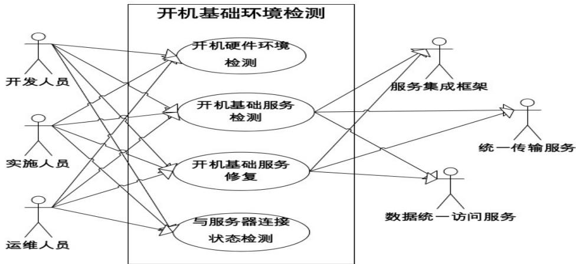
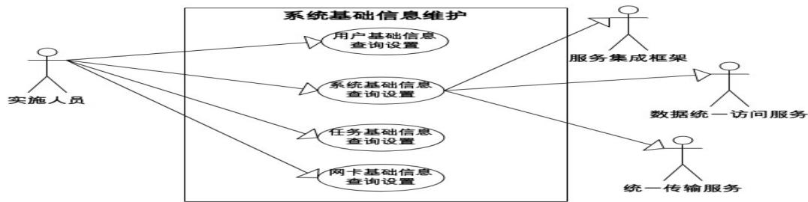
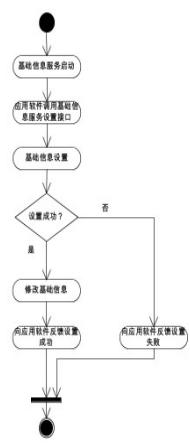

图15 服务故障预警用例图

服务故障预警所有能力标识表，见表36所示。

表36 服务故障预警修复所有能力标识
<table><tr><td rowspan=1 colspan=1>序号</td><td rowspan=1 colspan=1>Usecase 名称</td><td rowspan=1 colspan=1>项目唯一标识符</td><td rowspan=1 colspan=1>需求描述</td><td rowspan=1 colspan=1>需求重用</td><td rowspan=1 colspan=1>方式名称</td><td rowspan=1 colspan=1>运行状态</td><td rowspan=1 colspan=1>对应的任务书功能/性能</td></tr><tr><td rowspan=1 colspan=1>1</td><td rowspan=1 colspan=1>服务故障预警</td><td rowspan=1 colspan=1>PZXQ-YXZCFW-GN-GZYJXF-FWGZYJXF-FWGZYJ</td><td rowspan=1 colspan=1>能够对系统运行过程中的服务崩溃信息进行预警</td><td rowspan=1 colspan=1>改进</td><td rowspan=1 colspan=1>桌面</td><td rowspan=1 colspan=1>开发阶段</td><td rowspan=1 colspan=1>4.1.2 b)</td></tr><tr><td rowspan=1 colspan=1>2</td><td rowspan=1 colspan=1>服务故障跟踪</td><td rowspan=1 colspan=1>PZXQ-YXZCFW-GN-GZYJXF-FWGZYJXF-FWGZGZ</td><td rowspan=1 colspan=1>能够对系统运行过程中的服务崩溃信息进行代码跟踪</td><td rowspan=1 colspan=1>改进</td><td rowspan=1 colspan=1>桌面</td><td rowspan=1 colspan=1>开发阶段</td><td rowspan=1 colspan=1>4.1.2 b)</td></tr><tr><td rowspan=1 colspan=1>3</td><td rowspan=1 colspan=1>服务故障显示</td><td rowspan=1 colspan=1>PZXQ-YXZCFW-GN-GZYJXF-FWGZYJXF-FWGZXS</td><td rowspan=1 colspan=1>能够将服务崩溃的代码信息进行界面显示</td><td rowspan=1 colspan=1>改进</td><td rowspan=1 colspan=1>桌面</td><td rowspan=1 colspan=1>开发阶段</td><td rowspan=1 colspan=1>4.1.2 b)</td></tr></table>

## 3.2.2.2.1 服务故障预警（PZXQ-YXZCFW-GN-GZYJXF-FWGZYJXF-FWGZYJ）

服务故障预警用例场景，见表37所示。

表37 服务故障预警用例描述
<table><tr><td colspan="1" rowspan="1">Use Case 名称：服务故障预警</td><td colspan="2" rowspan="1">Actors:开发人员</td></tr><tr><td colspan="3" rowspan="1">概述：本例是检测安装的服务是否运行正常，若不正常，则给予用户预警</td></tr><tr><td colspan="3" rowspan="1">前置条件：信息系统正常安装。</td></tr><tr><td colspan="3" rowspan="1">主事件流</td></tr><tr><td colspan="1" rowspan="1">Actor 的动作</td><td colspan="1" rowspan="1">系统的动作</td><td colspan="1" rowspan="1">动作约束(性能、可靠性、容错等)</td></tr><tr><td colspan="1" rowspan="1">1. 用户启动计算机。</td><td colspan="1" rowspan="1">2.环境运行保障启动失败，执行异常流E1，用例结束；若环境运行保障启动成功，则向服务集成框架请求服务的运行信息，若服务集成框架启动失败，则执行异常流E2，用例结束；若服务集成框架启动成功，则向环境运行保障返回服务的启动状态信息；3.环境运行保障分析服务的运行状态，若发现服务异常，则通过日志文件进行记录，并向服务集成框架请求服务的关</td><td colspan="1" rowspan="1"></td></tr><tr><td colspan="1" rowspan="1">4.用户在界面集成框架中查看到服务预警提示框，包括服务名称、服务故障等信息；</td><td colspan="1" rowspan="1">键性信息，若请求失败，则执行异常流E3；若请求成功，则返回服务的关键性信息，环境运行保障依据关键性信息，调用界面集成框架的弹出显示框，若调用失败，则执行异常流E4；调用成功，则向前端界面推送服务异常信息；</td><td colspan="1" rowspan="1"></td></tr><tr><td colspan="2" rowspan="1">异常流E1：当服务存在异常时，系统运行监控显示存在服务异常，但没有提示信息。</td><td colspan="1" rowspan="1"></td></tr><tr><td colspan="2" rowspan="1">异常流E2：当服务存在异常时，系统运行监控显示存在服务异常，但没有提示信息。</td><td colspan="1" rowspan="1"></td></tr><tr><td colspan="2" rowspan="1">异常流E3：当服务存在异常时，系统运行监控显示存在服务异常，但没有提示信息。</td><td colspan="1" rowspan="1"></td></tr><tr><td colspan="2" rowspan="1">异常流E4：当服务存在异常时，系统运行监控显示存在服务异常，但没有提示信息。</td><td colspan="1" rowspan="1"></td></tr><tr><td colspan="2" rowspan="1">后置条件：无。</td><td colspan="1" rowspan="1"></td></tr></table>

3.2.2.2.2 服务故障跟踪（PZXQ-YXZCFW-GN-GZYJXF-FWGZYJXF-FWGZYYGZ）

服务故障跟踪用例场景，见表38所示。

表38 服务故障原因分析用例描述
<table><tr><td colspan="1" rowspan="1">Use Case 名称：服务故障跟踪</td><td colspan="2" rowspan="1">Actors:开发人员</td></tr><tr><td colspan="3" rowspan="1">概述：本例是检测本软件能够跟踪服务崩溃信息</td></tr><tr><td colspan="3" rowspan="1">前置条件：信息系统正常安装。</td></tr><tr><td colspan="3" rowspan="1">主事件流</td></tr><tr><td colspan="1" rowspan="1">Actor 的动作</td><td colspan="1" rowspan="1">系统的动作</td><td colspan="1" rowspan="1">动作约束(性能、可靠性、容错等)</td></tr><tr><td colspan="1" rowspan="1">1. 用户启动计算机；</td><td colspan="1" rowspan="1">2.环境运行保障启动失败，执行异常流E1，用例结束；若环境运行保障启动成功，则向服务集成框架请求服务的运行信息，若服务集成框架启动失败，则执行异常流E2，用例结束；若服务集成框架启动成功，则向环境运行保障返回服务的启动状态信息；</td><td colspan="1" rowspan="1"></td></tr><tr><td colspan="1" rowspan="1"></td><td colspan="1" rowspan="1">3.环境运行保障分析服务的运行状态，若发现服务异常；环境运行保障分析服务代码文件，跟踪服务异常信息；</td><td colspan="1" rowspan="1"></td></tr><tr><td colspan="2" rowspan="1">异常流E1：当服务存在异常时，系统运行监控显示存在服务异常，但没有提示信息。</td><td colspan="1" rowspan="1"></td></tr><tr><td colspan="2" rowspan="1">异常流E2：当服务存在异常时，系统运行监控显示存在服务异常，但没有提示信息。</td><td colspan="1" rowspan="1"></td></tr><tr><td colspan="2" rowspan="1">后置条件：无。</td><td colspan="1" rowspan="1"></td></tr></table>

## 3.2.2.2.3 服务故障显示（PZXQ-YXZCFW-GN-GZYJXF-FWGZYJXF-FWGZXS）

服务故障显示用例场景，见表39所示。

表39 服务故障显示用例描述
<table><tr><td rowspan=1 colspan=1>Use Case 名称:服务故障显示</td><td rowspan=1 colspan=2>Actors：开发人员</td></tr><tr><td rowspan=1 colspan=3>概述：本例是检测本软件能够将错误代码进行显示。</td></tr><tr><td rowspan=1 colspan=3>前置条件：信息系统正常安装。</td></tr><tr><td rowspan=1 colspan=3>主事件流</td></tr><tr><td rowspan=1 colspan=1>Actor 的动作</td><td rowspan=1 colspan=1>系统的动作</td><td rowspan=1 colspan=1>动作约束(性能、可靠性、容错等)</td></tr><tr><td rowspan=1 colspan=1>1.用户启动计算机；3.用户打开故障查看页面，查看定位的故障代码信息；</td><td rowspan=1 colspan=1>2.环境运行保障启动失败，执行异常流E1，用例结束；；</td><td rowspan=1 colspan=1></td></tr><tr><td rowspan=1 colspan=2>异常流E1：当服务存在异常时，系统运行监控显示存在服务异常，但没有提示信息。</td><td rowspan=1 colspan=1></td></tr><tr><td rowspan=1 colspan=2>后置条件：无。</td><td rowspan=1 colspan=1></td></tr></table>

## 3.2.2.3 开机基础环境检测（PZXQ-YXZCFW-GN-GZYJXF-KJJCHJJC）

提供开机进行环境自检功能，检测网卡的启动情况，检测内存、硬盘资源是否满足系统的正常运行，检测系统基础服务包括服务集成框架、数据统一访问服务、统一传输

服务的启动状态，检测与服务器网络连接状态，将上述信息的检测结果提示用户，若系统基础服务启动存在异常，则引导用户进行修复。用例图如图16所示。

图16 开机基础环境检测用例图  
开机基础环境检测所有能力标识表，见表40所示。  
表40 开机基础环境检测所有能力标识
<table><tr><td colspan="1" rowspan="1">序号</td><td colspan="1" rowspan="1">Usecase名称</td><td colspan="1" rowspan="1">项目唯一标识符</td><td colspan="1" rowspan="1">需求描述</td><td colspan="1" rowspan="1">需求重用</td><td colspan="1" rowspan="1">方式名称</td><td colspan="1" rowspan="1">运行状态</td><td colspan="1" rowspan="1">对应的任务书功能/性能</td></tr><tr><td colspan="1" rowspan="1">1</td><td colspan="1" rowspan="1">开机硬件环境检测</td><td colspan="1" rowspan="1">PZXQ-YXZCFW-GN-GZYJXF-KJJCHJJC-KJYJHJJC</td><td colspan="1" rowspan="1">检测网卡的启动情况，检测内存、硬盘资源是否满足系统的正常运行。</td><td colspan="1" rowspan="1">新增</td><td colspan="1" rowspan="1">桌面</td><td colspan="1" rowspan="1">开发阶段、集成阶段、运行阶段</td><td colspan="1" rowspan="1">4.1.2 c)</td></tr><tr><td colspan="1" rowspan="1">2</td><td colspan="1" rowspan="1">开机基础服务检测</td><td colspan="1" rowspan="1">PZXQ-YXZCFW-GN-GZYJXF-KJJCHJJC-KJJCFWJC</td><td colspan="1" rowspan="1">检测系统基础服务包括服务集成框架、数据统一访问服务、统一传输服务的启动状态，将上述信息的检测结果提示用户</td><td colspan="1" rowspan="1">新增</td><td colspan="1" rowspan="1">桌面</td><td colspan="1" rowspan="1">开发阶段、集成阶段、运行阶段</td><td colspan="1" rowspan="1">4.1.2 c)</td></tr><tr><td colspan="1" rowspan="1">3</td><td colspan="1" rowspan="1">开机基础服务</td><td colspan="1" rowspan="1">PZXQ-YXZCFW-GN-GZYJXF-</td><td colspan="1" rowspan="1">若系统基础服务启动存在异常，则引导用户进行修复</td><td colspan="1" rowspan="1">新增</td><td colspan="1" rowspan="1">桌面</td><td colspan="1" rowspan="1">开发阶段、集成</td><td colspan="1" rowspan="1">4.1.2 c)</td></tr><tr><td colspan="1" rowspan="1"></td><td colspan="1" rowspan="1">修复</td><td colspan="1" rowspan="1">KJJCHJJC-KJJCFWXF</td><td colspan="1" rowspan="1"></td><td colspan="1" rowspan="1"></td><td colspan="1" rowspan="1"></td><td colspan="1" rowspan="1">阶段、运行阶段</td><td colspan="1" rowspan="1"></td></tr><tr><td colspan="1" rowspan="1">4</td><td colspan="1" rowspan="1">与服务器连接状态检测</td><td colspan="1" rowspan="1">PZXQ-YXZCFW-GN-GZYJXF-KJJCHJJC-YFWQLJZTJC</td><td colspan="1" rowspan="1">检测与服务器网络连接状态，将上述信息的检测结果提示用户。</td><td colspan="1" rowspan="1">新增</td><td colspan="1" rowspan="1">桌面</td><td colspan="1" rowspan="1">开发阶段、集成阶段、运行阶段</td><td colspan="1" rowspan="1">4.1.2 c)</td></tr></table>

3.2.2.3.1 开机硬件环境检测（PZXQ-YXZCFW-GN-GZYJXF-KJJCHJJC-KJYJHJJC）

开机硬件环境检测用例场景，见表41所示。

表41 开机基础环境检测用例描述
<table><tr><td rowspan=1 colspan=1>Use Case 名称:开机硬件环境检测</td><td rowspan=1 colspan=2>Actors：开发人员、实施人员、运维人员</td></tr><tr><td rowspan=1 colspan=3>概述：本用例是描述系统对硬件环境检测的过程：</td></tr><tr><td rowspan=1 colspan=3>前置条件：信息系统正常安装。</td></tr><tr><td rowspan=1 colspan=3>主事件流</td></tr><tr><td rowspan=1 colspan=1>Actor 的动作</td><td rowspan=1 colspan=1>系统的动作</td><td rowspan=1 colspan=1>动作约束(性能、可靠性、容错等)</td></tr><tr><td rowspan=1 colspan=1>1.用户启动计算机，系统运行监控托盘启动；3.用户查看到存在开机环境异常信息；</td><td rowspan=1 colspan=1>2.若环境运行保障启动失败，执行异常流E1，用例结束；若环境运行保障启动成功，则向系统请求网卡的启动状态内存资源的状态、硬盘的资源状态，若请求失败，则执行异常流E2，用例结束；若请求成功，则获取上述数据信息，环境运行保障对数据信息进行分析，若存在异常，则将异常信息返回至前端页面；</td><td rowspan=1 colspan=1></td></tr><tr><td rowspan=1 colspan=2>异常流E1：启动服务中显示环境运行保障启动失败。</td><td rowspan=1 colspan=1></td></tr><tr><td rowspan=1 colspan=2>异常流E2:启动服务页面中显示硬件环境数据信息。</td><td rowspan=1 colspan=1></td></tr><tr><td rowspan=1 colspan=2>后置条件：无。</td><td rowspan=1 colspan=1></td></tr></table>

3.2.2.3.2 开机基础服务检测（PZXQ-YXZCFW-GN-GZYJXF-KJJCHJJC-KJJCFWJC）

开机基础服务检测用例场景，见表42所示。

表42 开机基础环境检测用例描述
<table><tr><td rowspan=1 colspan=1>Use Case 名称:开机基础服务检测</td><td rowspan=1 colspan=2>Actors：开发人员、实施人员、运维人员</td></tr><tr><td rowspan=1 colspan=3>概述：本用例是描述系统对硬件环境检测的过程；</td></tr><tr><td rowspan=1 colspan=3>前置条件：信息系统正常安装。</td></tr><tr><td rowspan=1 colspan=3>主事件流</td></tr><tr><td rowspan=1 colspan=1>Actor 的动作</td><td rowspan=1 colspan=1>系统的动作</td><td rowspan=1 colspan=1>动作约束(性能、可靠性、容错等)</td></tr><tr><td rowspan=1 colspan=1>1.用户启动计算机，系统运行监控托盘启动；3.用户查看到存在基础服务异常信息；</td><td rowspan=1 colspan=1>2.若环境运行保障启动失败，执行异常流E1，用例结束；若环境运行保障启动成功，则检测基础服务的启动状态，包括服务集成框架、数据统一访问服务、统一传输服务的启动状态，若请求失败，则执行异常流E2，用例结束；若请求成功，则获取上述数据信息，环境运行保障对数据信息进行分析，若存在异常，则将异常信息返回至前端页面；</td><td rowspan=1 colspan=1></td></tr><tr><td rowspan=1 colspan=2>异常流E1：系统运行监控托盘不显示数据信息。</td><td rowspan=1 colspan=1></td></tr><tr><td rowspan=1 colspan=2>异常流E2：系统运行监控显示基础服务数据异常信息。</td><td rowspan=1 colspan=1></td></tr><tr><td rowspan=1 colspan=2>后置条件：无。</td><td rowspan=1 colspan=1></td></tr></table>

## 3.2.2.3.3 开机基础服务修复（PZXQ-YXZCFW-GN-GZYJXF-KJJCHJJC-KJJCFWXF）

开机基础服务修复用例场景，见表43所示。

表43 开机基础环境检测用例描述
<table><tr><td colspan="1" rowspan="1">Use Case 名称：开机基础服务修复</td><td colspan="2" rowspan="1">Actors：开发人员、实施人员、运维人员</td></tr><tr><td colspan="3" rowspan="1">概述：本用例是描述系统对硬件环境修复的过程；</td></tr><tr><td colspan="3" rowspan="1">前置条件：信息系统正常安装。</td></tr><tr><td colspan="3" rowspan="1">主事件流</td></tr><tr><td colspan="1" rowspan="1">Actor 的动作</td><td colspan="1" rowspan="1">系统的动作</td><td colspan="1" rowspan="1">动作约束</td></tr><tr><td></td><td></td><td>(性能、可靠性、容错等)</td></tr><tr><td>1.用户启动计算机，系统运行监控托盘 启动；</td><td>2.若环境运行保障启动失败，执行异常 流E1，用例结束；若环境运行保障启动 成功，则检测基础服务的启动状态，包 括服务集成框架、数据统一访问服务、 统一传输服务的启动状态，若请求失 败，则执行异常流E2，用例结束；若请 求成功，则获取上述数据信息，环境运 行保障对数据信息进行分析，若存在异 常，则将异常信息返回至前端页面；</td><td></td></tr><tr><td></td><td>4.环境运行保障检测基础服务的异常原 因，针对异常原因进行修复，将修复结 果返回至前端界面；</td><td></td></tr><tr><td colspan="2">5.用户在托盘页面查看修复的结果信息 异常流E1：系统运行监控托盘不显示数据信息。</td><td></td></tr><tr><td colspan="2"></td><td></td></tr><tr><td colspan="2">异常流E2：系统运行监控显示基础服务数据异常信息。 后置条件：无。</td><td></td></tr></table>

3.2.2.3.4 与服务器连接状态检测（PZXQ-YXZCFW-GN-GZYJXF-KJJCHJJC-YFWQLJZTJC）

与服务器连接状态检测用例场景，见表44所示。

表44 与服务器连接状态检测用例描述
<table><tr><td colspan="1" rowspan="1">Use Case 名称:与服务器连接状态检测</td><td colspan="2" rowspan="1">Actors：开发人员、实施人员、运维人员</td></tr><tr><td colspan="3" rowspan="1">概述:本例是检测与服务器连接状态是否正常。</td></tr><tr><td colspan="3" rowspan="1">前置条件：信息系统正常安装。</td></tr><tr><td colspan="3" rowspan="1">主事件流</td></tr><tr><td colspan="1" rowspan="1">Actor 的动作</td><td colspan="1" rowspan="1">系统的动作</td><td colspan="1" rowspan="1">动作约束(性能、可靠性、容错等)</td></tr><tr><td colspan="1" rowspan="1">1.用户启动指挥终端，系统运行监控托盘正常启动。</td><td colspan="1" rowspan="1"></td><td colspan="1" rowspan="1"></td></tr><tr><td colspan="1" rowspan="1">3.用户通过监控托盘查看到与服务器的网络通联状态；</td><td colspan="1" rowspan="1">2.若环境运行保障启动异常，则执行异常流E1；若环境运行保障启动正常，则调用基础信息服务接口获取服务器IP地址，若获取失败，则执行异常流E2；环境保障服务通过 ping命令去检测与服务器的链接状态，将检测的结果显示在系统监控托盘上。</td><td colspan="1" rowspan="1"></td></tr><tr><td colspan="2" rowspan="1">异常流E1:监控托盘显示暂无数据。</td><td colspan="1" rowspan="1"></td></tr><tr><td colspan="2" rowspan="1">异常流E1：监控托盘服务器网络连接状态显示异常。</td><td colspan="1" rowspan="1"></td></tr><tr><td colspan="2" rowspan="1">后置条件：无。</td><td colspan="1" rowspan="1"></td></tr></table>

## 3.2.3 系统基础信息维护（PZXQ-YXZCFW-GN-XTJCXXWH）

系统基础信息维护功能包括：用户基础信息查询设置、系统基础信息查询设置、任务基础信息查询设置、网卡相关信息查询设置、其功能用例如图17所示。

  
图  
17 系统基础信息维护用例图  
系统基础信息维护所有能力标识表，见表45所示。

表45 系统基础信息维护所有能力标识

<table><tr><td rowspan=1 colspan=1>序号</td><td rowspan=1 colspan=1>Usecase名称</td><td rowspan=1 colspan=1>项目唯一标识符</td><td rowspan=1 colspan=1>需求描述</td><td rowspan=1 colspan=1>需求重用</td><td rowspan=1 colspan=1>方式名称</td><td rowspan=1 colspan=1>运行状态</td><td rowspan=1 colspan=1>对应的任务书功能/性能</td></tr><tr><td rowspan=1 colspan=1>1</td><td rowspan=1 colspan=1>用户基础信息查询设置</td><td rowspan=1 colspan=1>PZXQ-YXZCFW-GN-XTJCXXWH-YHJCXXCX</td><td rowspan=1 colspan=1>提供接口支持对当前登录的用户名、用户ID、所属编组、部署车辆等信息进行查询和设置</td><td rowspan=1 colspan=1>新增</td><td rowspan=1 colspan=1>桌面、平板、手持</td><td rowspan=1 colspan=1>运行阶段</td><td rowspan=1 colspan=1>4.1.3 a)</td></tr><tr><td rowspan=1 colspan=1>2</td><td rowspan=1 colspan=1>系统基础信息查询设置</td><td rowspan=1 colspan=1>PZXQ-YXZCFW-GN-XTJCXXWH-XTJCXXCX</td><td rowspan=1 colspan=1>提供接口支持对指挥所内服务器、备份服务器的IP信息，本机的IP信息，本机客户端/服务器标识、操作系统的超级用户密码信息进行查询和设置</td><td rowspan=1 colspan=1>新增</td><td rowspan=1 colspan=1>桌面、平板、手持</td><td rowspan=1 colspan=1>运行阶段</td><td rowspan=1 colspan=1>4.1.3 b)</td></tr><tr><td rowspan=1 colspan=1>3</td><td rowspan=1 colspan=1>任务基础信息查询设置</td><td rowspan=1 colspan=1>PZXQ-YXZCFW-GN-XTJCXXWH-RWJCXXCX</td><td rowspan=1 colspan=1>提供对当前开通的任务数据包信息的查询和设置功能，包括任务数据包的ID信息</td><td rowspan=1 colspan=1>新增</td><td rowspan=1 colspan=1>桌面、平板、手持</td><td rowspan=1 colspan=1>运行阶段</td><td rowspan=1 colspan=1>4.1.3 c)</td></tr><tr><td rowspan=1 colspan=1>4</td><td rowspan=1 colspan=1>网卡基础信息查询设置</td><td rowspan=1 colspan=1>PZXQ-YXZCFW-GN-XTJCXXWH-WKJCXXCX</td><td rowspan=1 colspan=1>提供对当前计算机网卡信息的查询和设置</td><td rowspan=1 colspan=1>新增</td><td rowspan=1 colspan=1>桌面、平板</td><td rowspan=1 colspan=1>运行阶段</td><td rowspan=1 colspan=1>4.1.3 d)</td></tr></table>

系统基础信息维护流程图如图18所示。

  
图18 系统基础信息设置流程图

基础信息服务启动后，应用软件调用基础信息服务的设置接口进行设置，若设置成功，基础信息服务修改基础信息，并向应用软件反馈设置成功结果；若设置失败，则向应用软件反馈设置失败结果。