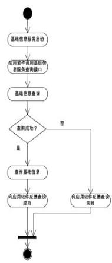
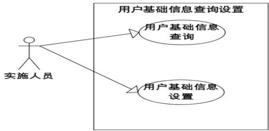
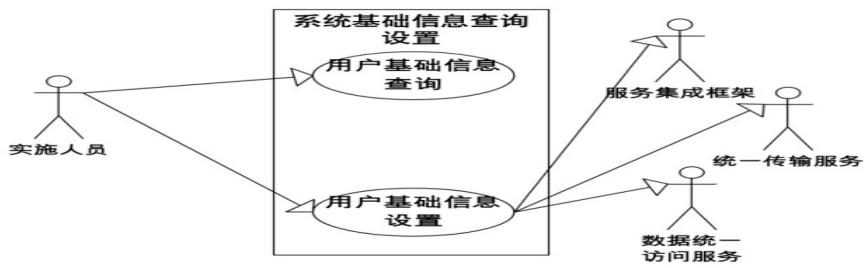
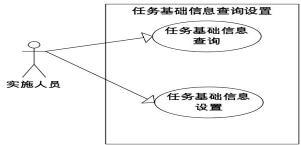

  
图19 系统基础信息查询流程图

基础信息服务启动后，应用软件调用基础信息服务的设置接口进行设查询，若查询成功，基础信息服务查询基础信息，并向应用软件反馈查询成功结果；若查询失败，则向应用软件反馈查询失败结果。

## 3.2.3.1 用户基础信息查询设置（PZXQ-YXZCFW-GN-XTJCXXWH-

$$
\mathsf { Y } \mathsf { H } \mathsf { J } \mathsf { C } \mathsf { X } \mathsf { X } \mathsf { C } \mathsf { X } \mathsf { S } \mathsf { Z } \mathsf { \Lambda }
$$

提供接口支持对当前登录的用户名、用户ID、所属编组、部署车辆等信息进行设置和查询，用例图如图20所示。

3.2.3.1.1 用户基础信息设置（PZXQ-YXZCFW-GN-XTJCXXWH-YHJCXXCXSZ-YHJCXXSZ）  
  
图20 用户基础信息查询设置用例图

用户基础信息查询设置所有能力标识表，见表46所示。

表46 用户基础信息查询设置所有能力能力标识
<table><tr><td rowspan=1 colspan=1>序号</td><td rowspan=1 colspan=1>Usecase 名称</td><td rowspan=1 colspan=1>项目唯一标识符</td><td rowspan=1 colspan=1>需求描述</td><td rowspan=1 colspan=1>需求重用</td><td rowspan=1 colspan=1>方式名称</td><td rowspan=1 colspan=1>运行状态</td><td rowspan=1 colspan=1>对应的任务书功能/性能</td></tr><tr><td rowspan=1 colspan=1>1</td><td rowspan=1 colspan=1>用户基础信息设置</td><td rowspan=1 colspan=1>PZXQ-YXZCFW-GN-XTJCXXWH-YHJCXXCXSZ-YHJCXXSZ</td><td rowspan=1 colspan=1>提供接口支持对当前登录的用户名、用户ID、所属编组、部署车辆等信息进行设置</td><td rowspan=1 colspan=1>新增</td><td rowspan=1 colspan=1>桌面、平板、手持</td><td rowspan=1 colspan=1>运行阶段</td><td rowspan=1 colspan=1>4.1.3 a)</td></tr><tr><td rowspan=1 colspan=1>2</td><td rowspan=1 colspan=1>用户基础信息查询</td><td rowspan=1 colspan=1>PZXQ-YXZCFW-GN-XTJCXXWH-YHJCXXCXSZ-YHJCXXCX</td><td rowspan=1 colspan=1>提供接口支持对当前登录的用户名、用户ID、所属编组、部署车辆等信息进行查询</td><td rowspan=1 colspan=1>新增</td><td rowspan=1 colspan=1>桌面、平板、手持</td><td rowspan=1 colspan=1>运行阶段</td><td rowspan=1 colspan=1>4.1.3 a)</td></tr></table>

用户基础信息设置用例场景，见表47所示。

表47 用户基础信息设置用例描述
<table><tr><td colspan="1" rowspan="1">Use Case 名称:用户基础信息设置</td><td colspan="2" rowspan="1">Actors:实施人员</td></tr><tr><td colspan="3" rowspan="1">概述:本例是检测用户基础信息服务查询功能是否正常。</td></tr><tr><td colspan="3" rowspan="1">前置条件：信息系统正常安装。</td></tr><tr><td colspan="3" rowspan="1">主事件流</td></tr><tr><td colspan="1" rowspan="1">Actor 的动作</td><td colspan="1" rowspan="1">系统的动作</td><td colspan="1" rowspan="1">动作约束</td></tr><tr><td>1.用户调用基础信息服务进行用户名设</td><td></td><td>(性能、可靠性、容错等)</td></tr><tr><td>置；</td><td>2.若基础信息服务启动异常，则执行异 常流E1；若启动正常，则进行信息设 置，将设置结果信息返回至前端界面；</td><td></td></tr><tr><td>3.用户获取调用结果信息；</td><td></td><td></td></tr><tr><td>4.用户调用基础信息服务进行用户ID设 置；</td><td>2.若基础信息服务启动异常，则执行异</td><td></td></tr><tr><td>3.用户获取调用结果信息；</td><td>常流E1；若启动正常，则进行信息设 置，将设置结果信息返回至前端界面；</td><td></td></tr><tr><td>4.用户调用基础信息服务进行用户所属 编组设置；</td><td></td><td></td></tr><tr><td></td><td>2.若基础信息服务启动异常，则执行异 常流E1；若启动正常，则进行信息设</td><td></td></tr><tr><td>3.用户获取调用结果信息；</td><td>置，将设置结果信息返回至前端界面；</td><td></td></tr><tr><td>4.用户调用基础信息服务进行用户部署 车辆设置；</td><td></td><td></td></tr><tr><td></td><td>2.若基础信息服务启动异常，则执行异 常流E1；若启动正常，则进行信息设 置，将设置结果信息返回至前端界面；</td><td></td></tr><tr><td>3.用户获取调用结果信息；</td><td></td><td></td></tr><tr><td>异常流E1：基础信息服务调用失败。</td><td></td><td></td></tr><tr><td>后置条件：无。</td><td></td><td></td></tr><tr><td></td><td></td><td></td></tr><tr><td></td><td></td><td></td></tr><tr><td></td><td></td><td></td></tr><tr><td></td><td></td><td></td></tr><tr><td></td><td></td><td></td></tr><tr><td></td><td></td><td></td></tr><tr><td></td><td></td><td></td></tr><tr><td></td><td></td><td></td></tr><tr><td></td><td></td><td></td></tr></table>

3.2.3.1.2 用户基础信息查询（PZXQ-YXZCFW-GN-XTJCXXWH-YHJCXXCXSZ-YHJCXXCX）

用户基础信息查询用例场景，见表48所示。

表48 用户基础信息查询用例描述
<table><tr><td>Use Case 名称:用户基础信息查询</td><td colspan="2">Actors:实施人员</td></tr><tr><td colspan="3">概述：本例是检测用户基础信息服务查询功能是否正常。 前置条件：信息系统正常安装。</td></tr><tr><td colspan="3">主事件流</td></tr><tr><td>Actor 的动作</td><td>系统的动作</td><td>动作约束 (性能、可靠性、容错等)</td></tr><tr><td>1.用户调用基础信息服务进行用户名查 询；</td><td>2.若基础信息服务启动异常，则执行异 常流E1；若启动正常，则进行信息查 询，将设置结果信息返回至前端界面；</td><td rowspan="3"></td></tr><tr><td>3.用户获取查询结果信息； 4.用户调用基础信息服务进行用户ID查 询；</td><td></td></tr><tr><td>6.用户获取查询结果信息；</td><td>5.若基础信息服务启动异常，则执行异 常流E1；若启动正常，则进行信息查 询，将设置结果信息返回至前端界面；</td></tr><tr><td>7.用户调用基础信息服务进行用户所属 编组查询；</td><td></td><td rowspan="3"></td></tr><tr><td></td><td>8.若基础信息服务启动异常，则执行异 常流E1；若启动正常，则进行信息查 询，将设置结果信息返回至前端界面；</td></tr><tr><td>9.用户获取查询结果信息； 10.用户调用基础信息服务进行用户部署 车辆查询；</td><td></td></tr><tr><td colspan="1" rowspan="1">12.用户获取查询结果信息；</td><td colspan="1" rowspan="1"></td><td colspan="1" rowspan="1"></td></tr><tr><td colspan="2" rowspan="1">异常流E1：应用软件调用失败。</td><td colspan="1" rowspan="1"></td></tr><tr><td colspan="2" rowspan="1">后置条件：无。</td><td colspan="1" rowspan="1"></td></tr></table>

3.2.3.2 系统基础信息查询设置（PZXQ-YXZCFW-GN-XTJCXXWH-XTJCXXCXSZ）

提供接口支持对指挥所内服务器、备份服务器的IP信息，本机的IP信息，本机客户端/服务器标识、操作系统的超级用户密码信息进行查询和设置，用例图如图21所示。

  
图21 系统基础信息查询设置用例图

系统基础信息查询设置所有能力标识表，见表49所示。

表49 系统基础信息查询设置所有能力标识
<table><tr><td colspan="1" rowspan="1">序号</td><td colspan="1" rowspan="1">Usecase名称</td><td colspan="1" rowspan="1">项目唯一标识符</td><td colspan="1" rowspan="1">需求描述</td><td colspan="1" rowspan="1">需求重用</td><td colspan="1" rowspan="1">方式/名称</td><td colspan="1" rowspan="1">对应的任务书功能/性能</td></tr><tr><td colspan="1" rowspan="1">1</td><td colspan="1" rowspan="1">系统基础信息设置</td><td colspan="1" rowspan="1">PZXQ-YXZCFW-GN-XTJCXXWH-XTJCXXCXSZ -XTJCXXSZ</td><td colspan="1" rowspan="1">提供接口支持对指挥所内服务器、备份服务器的IP信息，本机的IP信息，本机客户端/服务器标识、操作系统的超级用户密码信息进行设置</td><td colspan="1" rowspan="1">无</td><td colspan="1" rowspan="1">桌面、平板、手持</td><td colspan="1" rowspan="1">4.1.3 b)</td></tr><tr><td colspan="1" rowspan="1">2</td><td colspan="1" rowspan="1">系统基础信息查询</td><td colspan="1" rowspan="1">PZXQ-YXZCFW-GN-XTJCXXWH-XTJCXXCXSZ-XTJCXXCX</td><td colspan="1" rowspan="1">提供接口支持对指挥所内服务器、备份服务器的IP信息，本机的IP信息，本机客户端/服务器标识、操作系统的超级用</td><td colspan="1" rowspan="1">无</td><td colspan="1" rowspan="1">桌面、平板、手持</td><td colspan="1" rowspan="1">4.1.3 b)</td></tr><tr><td colspan="1" rowspan="1"></td><td colspan="1" rowspan="1"></td><td colspan="1" rowspan="1"></td><td colspan="1" rowspan="1">户密码信息进行查询</td><td colspan="1" rowspan="1"></td><td colspan="1" rowspan="1"></td><td colspan="1" rowspan="1"></td></tr></table>

3.2.3.2.1 系统基础信息设置（PZXQ-YXZCFW-GN-XTJCXXWH-XTJCXXCXSZ-XTJCXXSZ）

系统基础信息设置用例场景，见表50所示。

表50 系统基础信息设置用例描述
<table><tr><td>Use Case 名称:系统基础信息设置</td><td colspan="2">Actors：实施人员、服务集成框架、统一传输服务、数据统一访问服务</td></tr><tr><td colspan="3">概述：本例是检测系统基础信息服务设置功能是否正常。</td></tr><tr><td colspan="3">前置条件：信息系统正常安装。</td></tr><tr><td colspan="3">主事件流</td></tr><tr><td>Actor 的动作</td><td>系统的动作</td><td>动作约束 (性能、可靠性、容错等)</td></tr><tr><td>1.用户调用基础信息服务进行服务器IP 地址设置；</td><td>2.若基础信息服务启动异常，则执行异 常流E1；若启动正常，则进行信息设 置，将设置结果信息返回至前端界面；</td><td></td></tr><tr><td>3.用户获取设置结果信息； 4.用户调用基础信息服务进行备份服务</td><td></td><td></td></tr><tr><td>器IP设置；</td><td>5.若基础信息服务启动异常，则执行异 常流E1；若启动正常，则进行信息设</td><td></td></tr><tr><td>6.用户获取设置结果信息；</td><td>置，将设置结果信息返回至前端界面；</td><td></td></tr><tr><td>7.用户调用基础信息服务进行本级IP地 址设置；</td><td>8.若基础信息服务启动异常，则执行异</td><td></td></tr><tr><td>9.用户获取设置结果信息；</td><td>常流E1；若启动正常，则进行信息设 置，将设置结果信息返回至前端界面；</td><td></td></tr><tr><td>10.用户调用基础信息服务进行本级标识</td><td></td><td></td></tr><tr><td></td><td></td><td></td></tr><tr><td></td><td>常流E1；若启动正常，则进行信息设</td><td></td></tr><tr><td></td><td></td><td></td></tr><tr><td></td><td></td><td></td></tr><tr><td></td><td></td><td></td></tr><tr><td></td><td></td><td></td></tr><tr><td></td><td></td><td></td></tr><tr><td>设置；</td><td></td><td></td></tr><tr><td></td><td></td><td></td></tr><tr><td></td><td></td><td></td></tr><tr><td></td><td></td><td></td></tr><tr><td></td><td></td><td></td></tr><tr><td></td><td></td><td></td></tr><tr><td></td><td></td><td></td></tr><tr><td></td><td></td><td></td></tr><tr><td></td><td></td><td></td></tr><tr><td></td><td></td><td></td></tr><tr><td></td><td></td><td></td></tr><tr><td></td><td></td><td></td></tr><tr><td></td><td></td><td></td></tr><tr><td></td><td></td><td></td></tr><tr><td></td><td></td><td></td></tr><tr><td></td><td></td><td></td></tr><tr><td></td><td></td><td></td></tr><tr><td></td><td></td><td></td></tr><tr><td></td><td></td><td></td></tr><tr><td></td><td>11.若基础信息服务启动异常，则执行异</td><td></td></tr><tr><td></td><td></td><td></td></tr><tr><td></td><td></td><td></td></tr><tr><td></td><td></td><td></td></tr><tr><td></td><td></td><td></td></tr><tr><td></td><td></td><td></td></tr><tr><td></td><td></td><td></td></tr><tr><td></td><td></td><td></td></tr><tr><td></td><td></td><td></td></tr><tr><td></td><td></td><td></td></tr><tr><td></td><td></td><td></td></tr><tr><td></td><td></td><td></td></tr><tr><td></td><td></td><td></td></tr><tr><td></td><td></td><td></td></tr><tr><td colspan="1" rowspan="1">12.用户获取设置结果信息；13.用户调用基础信息服务进行超级用户密码设置；15.用户获取设置结果信息；16.服务集成框架、统一传输服务、数据统一访问服务获取系统基础信息。</td><td colspan="1" rowspan="1">置，将设置结果信息返回至前端界面；14.若基础信息服务启动异常，则执行异常流E1；若启动正常，则进行信息设置，将设置结果信息返回至前端界面；</td><td colspan="1" rowspan="1"></td></tr><tr><td colspan="2" rowspan="1">异常流E1:用户设置失败。</td><td colspan="1" rowspan="1"></td></tr><tr><td colspan="2" rowspan="1">后置条件：无。</td><td colspan="1" rowspan="1"></td></tr></table>

## 3.2.3.2.2 系统基础信息查询（PZXQ-YXZCFW-GN-XTJCXXWH-XTJCXXCXSZ-XTJCXXCX）

系统基础信息查询用例场景，见表51所示。

表51 系统基础信息设置用例描述
<table><tr><td colspan="1" rowspan="1">Use Case 名称:系统基础信息查询</td><td colspan="2" rowspan="1">Actors：实施人员、服务集成框架、统一传输服务、数据统一访问服务</td></tr><tr><td colspan="3" rowspan="1">概述：本例是检测系统基础信息服务查询功能是否正常。</td></tr><tr><td colspan="3" rowspan="1">前置条件：信息系统正常安装。</td></tr><tr><td colspan="3" rowspan="1">主事件流</td></tr><tr><td colspan="1" rowspan="1">Actor 的动作</td><td colspan="1" rowspan="1">系统的动作</td><td colspan="1" rowspan="1">动作约束(性能、可靠性、容错等)</td></tr><tr><td colspan="1" rowspan="1">1.用户调用基础信息服务进行服务器IP地址查询；3.用户获取查询结果信息；4.用户调用基础信息服务备份服务器IP查询接口进行查询；6. 用户获取查询结果信息；7.用户调用基础信息服务本级IP地址查</td><td colspan="1" rowspan="1">2.若基础信息服务启动异常，则执行异常流E1；若启动正常，则进行信息查询，将设置结果信息返回至前端界面；5.若基础信息服务启动异常，则执行异常流E1；若启动正常，则进行信息查询，将设置结果信息返回至前端界面；</td><td colspan="1" rowspan="1"></td></tr><tr><td>询接口进行设置； 9.用户获取查询结果信息；</td><td>8.若基础信息服务启动异常，则执行异 常流E1：若启动正常，则进行信息查 询，将设置结果信息返回至前端界面；</td><td></td></tr><tr><td>接口进行设置； 12.用户获取查询结果信息；</td><td>11.若基础信息服务启动异常，则执行异 常流E1；若启动正常，则进行信息查 询，将设置结果信息返回至前端界面；</td><td></td></tr><tr><td>13.用户调用基础信息服务超级用户密码 查询接口进行设置；</td><td>14.若基础信息服务启动异常，则执行异 常流E1；若启动正常，则进行信息查</td><td></td></tr><tr><td>15.用户获取查询结果信息；</td><td>询，将设置结果信息返回至前端界面；</td><td></td></tr><tr><td>异常流E1：用户查询失败。</td><td></td><td></td></tr><tr><td>后置条件：无。</td><td></td><td></td></tr></table>

## 3.2.3.3 任务基础信息查询设置（PZXQ-YXZCFW-GN-XTJCXXWH-XTJCXXCXSZ）

提供对当前开通的任务数据包信息的查询管理功能，包括任务数据包的任务背景、名称、制作人信息。用例图如图22所示。

图22 任务基础信息查询设置用例图

任务基础信息查询设置所有能力标识表，见表52所示。

表52 任务基础信息查询设置所有能力标识
<table><tr><td rowspan=1 colspan=1>序号</td><td rowspan=1 colspan=1>Usecase名称</td><td rowspan=1 colspan=1>项目唯一标识符</td><td rowspan=1 colspan=1>需求描述</td><td rowspan=1 colspan=1>需求重用</td><td rowspan=1 colspan=1>方式名称</td><td rowspan=1 colspan=1>运行状态</td><td rowspan=1 colspan=1>对应的任务书功能/性能</td></tr><tr><td rowspan=1 colspan=1>1</td><td rowspan=1 colspan=1>任务基础信息设置</td><td rowspan=1 colspan=1>PZXQ-YXZCFW-GN-XTJCXXWH-RWJCXXCXSZ-RWJCXXSZ</td><td rowspan=1 colspan=1>提供对当前开通的任务数据包信息的设置功能，包括任务数据包的任务背景、名称、制作人信息</td><td rowspan=1 colspan=1>新增</td><td rowspan=1 colspan=1>桌面、平板、手持</td><td rowspan=1 colspan=1>运行阶段</td><td rowspan=1 colspan=1>4.1.3 c)</td></tr><tr><td rowspan=1 colspan=1>2</td><td rowspan=1 colspan=1>任务基础信息查询</td><td rowspan=1 colspan=1>PZXQ-YXZCFW-GN-XTJCXXWH-RWJCXXCXSZ-RWJCXXCX</td><td rowspan=1 colspan=1>提供对当前开通的任务数据包信息的查询功能，包括任务数据包的任务背景、名称、制作人信息</td><td rowspan=1 colspan=1>新增</td><td rowspan=1 colspan=1>桌面、平板、手持</td><td rowspan=1 colspan=1>运行阶段</td><td rowspan=1 colspan=1>4.1.3 c)</td></tr></table>

3.2.3.3.1 任务基础信息设置（PZXQ-YXZCFW-GN-XTJCXXWH-

任务基础信息设置用例场景，见表53所示。

表53 任务基础信息设置用例描述
<table><tr><td colspan="1" rowspan="1">Use Case 名称:任务基础信息设置</td><td colspan="2" rowspan="1">Actors:实施人员</td></tr><tr><td colspan="3" rowspan="1">概述：本例是检测任务基础信息服务设置功能是否正常。</td></tr><tr><td colspan="3" rowspan="1">前置条件：信息系统正常安装。</td></tr><tr><td colspan="3" rowspan="1">主事件流</td></tr><tr><td colspan="1" rowspan="1">Actor 的动作</td><td colspan="1" rowspan="1">系统的动作</td><td colspan="1" rowspan="1">动作约束(性能、可靠性、容错等)</td></tr><tr><td colspan="1" rowspan="1">1.用户调用基础信息服务任务数据包任务背景设置接口进行设置；3.用户获取调用结果信息；4.用户调用基础信息服务任务数据包名称设置接口进行设置；</td><td colspan="1" rowspan="1">2.若基础信息服务启动异常，则执行异常流E1；若启动正常，则进行信息设置，将设置结果信息返回至前端界面；</td><td colspan="1" rowspan="1"></td></tr><tr><td colspan="1" rowspan="1">6.用户获取调用结果信息；7.用户调用基础信息服务任务数据包制作人信息设置接口进行设置；9.用户获取调用结果信息；</td><td colspan="1" rowspan="1">5.若基础信息服务启动异常，则执行异常流E1；若启动正常，则进行信息设置，将设置结果信息返回至前端界面；8.若基础信息服务启动异常，则执行异常流E1；若启动正常，则进行信息设置，将设置结果信息返回至前端界面；</td><td colspan="1" rowspan="1"></td></tr><tr><td colspan="2" rowspan="1">异常流E1：用户设置失败。</td><td colspan="1" rowspan="1"></td></tr><tr><td colspan="2" rowspan="1">后置条件：无。</td><td colspan="1" rowspan="1"></td></tr></table>

## 3.2.3.3.2 任务基础信息查询（PZXQ-YXZCFW-GN-XTJCXXWH-RWJCXXCXSZ-RWJCXXCX）

任务基础信息查询用例场景，见表54所示。

表54 任务基础信息设置用例描述
<table><tr><td rowspan=1 colspan=1>Use Case 名称:任务基础信息查询</td><td rowspan=1 colspan=2>Actors：实施人员</td></tr><tr><td rowspan=1 colspan=3>概述：本例是检测任务基础信息服务查询功能是否正常。</td></tr><tr><td rowspan=1 colspan=3>前置条件：信息系统正常安装。</td></tr><tr><td rowspan=1 colspan=3>主事件流</td></tr><tr><td rowspan=1 colspan=1>Actor 的动作</td><td rowspan=1 colspan=1>系统的动作</td><td rowspan=1 colspan=1>动作约束(性能、可靠性、容错等)</td></tr><tr><td rowspan=1 colspan=1>1.用户调用基础信息服务任务数据包任务背景设置接口进行查询；3.用户获取调用结果信息；4.用户调用基础信息服务任务数据包名称查询接口进行设置；</td><td rowspan=1 colspan=1>2.若基础信息服务启动异常，则执行异常流E1；若启动正常，则进行信息查询，将设置结果信息返回至前端界面；5.若基础信息服务启动异常，则执行异</td><td rowspan=1 colspan=1></td></tr></table>