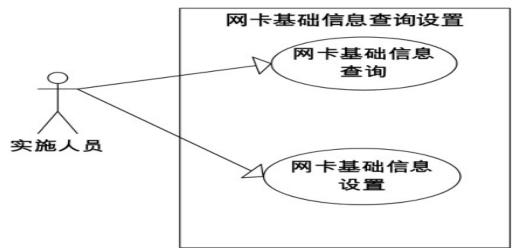
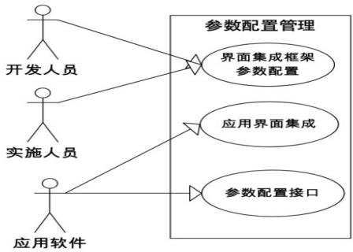
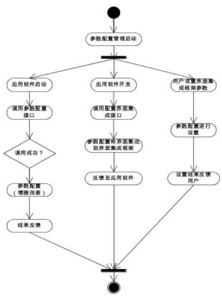
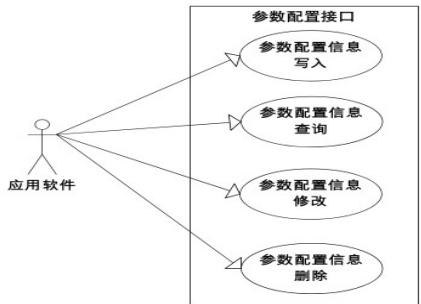

<table><tr><td rowspan=1 colspan=1>6.用户获取调用结果信息；7.用户调用基础信息服务任务数据包制作人信息查询接口进行设置；9.用户获取调用结果信息；</td><td rowspan=1 colspan=1>常流E1；若启动正常，则进行信息设置，将设置结果信息返回至前端界面；8.若基础信息服务启动异常，则执行异常流E1；若启动正常，则进行信息设置，将设置结果信息返回至前端界面；</td><td rowspan=1 colspan=1></td></tr><tr><td rowspan=1 colspan=2>异常流E1：用户查询失败。</td><td rowspan=1 colspan=1></td></tr><tr><td rowspan=1 colspan=2>后置条件：无。</td><td rowspan=1 colspan=1></td></tr></table>

3.2.3.4 网卡基础信息查询设置（PZXQ-YXZCFW-GN-XTJCXXWH-WKJCXXCXSZ）  
提供对当前计算机网卡信息的查询和设置，用例图如图23所示。

  
图23 网卡基础信息查询设置用例图

网卡基础信息查询设置所有能力标识表，见表55所示。

表55 网卡基础信息查询设置所有能力标识
<table><tr><td colspan="1" rowspan="1">序号</td><td colspan="1" rowspan="1">Use case名称</td><td colspan="1" rowspan="1">项目唯一标识符</td><td colspan="1" rowspan="1">需求描述</td><td colspan="1" rowspan="1">需求重用</td><td colspan="1" rowspan="1">方式/名称</td><td colspan="1" rowspan="1">对应的任务书功能/性能</td></tr><tr><td colspan="1" rowspan="1">1</td><td colspan="1" rowspan="1">网卡基础信息设置</td><td colspan="1" rowspan="1">PZXQ-YXZCFW-GN-XTJCXXWH-WKJCXXCXSZ-WKJCXXSZ</td><td colspan="1" rowspan="1">提供对当前计算机网卡信息的设置</td><td colspan="1" rowspan="1">无</td><td colspan="1" rowspan="1">桌面、平板、手持</td><td colspan="1" rowspan="1">4.1.3 d)</td></tr><tr><td colspan="1" rowspan="1">2</td><td colspan="1" rowspan="1">网卡基础信息查询</td><td colspan="1" rowspan="1">PZXQ-YXZCFW-GN-XTJCXXWH-WKJCXXCXSZ-WKJCXXCX</td><td colspan="1" rowspan="1">提供对当前计算机网卡信息的查询</td><td colspan="1" rowspan="1">无</td><td colspan="1" rowspan="1">桌面、平板、手持</td><td colspan="1" rowspan="1">4.1.3 d)</td></tr></table>

3.2.3.4.1 网卡基础信息设置（PZXQ-YXZCFW-GN-XTJCXXWH-WKJCXXCXSZ-WKJCXXSZ）

网卡基础信息设置用例场景，见表56所示。

表56 网卡基础信息设置用例描述
<table><tr><td rowspan=1 colspan=1>Use Case 名称：网卡基础信息设置</td><td rowspan=1 colspan=2>Actors:实施人员</td></tr><tr><td rowspan=1 colspan=3>概述：本例是检测网卡基础信息服务设置功能是否正常。</td></tr><tr><td rowspan=1 colspan=3>前置条件：信息系统正常安装。</td></tr><tr><td rowspan=1 colspan=3>主事件流</td></tr><tr><td rowspan=1 colspan=1>Actor 的动作</td><td rowspan=1 colspan=1>系统的动作</td><td rowspan=1 colspan=1>动作约束(性能、可靠性、容错等)</td></tr><tr><td rowspan=1 colspan=1>1.用户调用基础信息服务内网网卡设置接口进行设置；3.用户获取调用结果信息；4.用户调用基础信息服务外网网卡设置接口进行设置；6.用户获取调用结果信息；</td><td rowspan=1 colspan=1>2.若基础信息服务启动异常，则执行异常流E1；若启动正常，则进行信息设置，将设置结果信息返回至前端界面；5.若基础信息服务启动异常，则执行异常流E1；若启动正常，则进行信息设置，将设置结果信息返回至前端界面；</td><td rowspan=1 colspan=1></td></tr><tr><td rowspan=1 colspan=2>异常流E1：用户设置失败。</td><td rowspan=1 colspan=1></td></tr><tr><td rowspan=1 colspan=2>后置条件：无。</td><td rowspan=1 colspan=1></td></tr></table>

3.2.3.4.2 网卡基础信息查询（PZXQ-YXZCFW-GN-XTJCXXWH-WKJCXXCXSZ-WKJCXXCX）

网卡基础信息查询用例场景，见表57所示。

表57 网卡基础信息查询用例描述

<table><tr><td rowspan=1 colspan=1>Use Case 名称：网卡基础信息查询</td><td rowspan=1 colspan=2>Actors:实施人员</td></tr><tr><td rowspan=1 colspan=3>概述：本例是检测网卡基础信息服务查询功能是否正常。</td></tr><tr><td rowspan=1 colspan=3>前置条件：信息系统正常安装。</td></tr><tr><td rowspan=1 colspan=3>主事件流</td></tr><tr><td rowspan=1 colspan=1>Actor 的动作</td><td rowspan=1 colspan=1>系统的动作</td><td rowspan=1 colspan=1>动作约束(性能、可靠性、容错等)</td></tr><tr><td rowspan=1 colspan=1>1.用户调用基础信息服务内网网卡查询接口进行设置；3.用户获取调用结果信息；4.用户调用基础信息服务外网网卡查询接口进行设置；6.用户获取调用结果信息；</td><td rowspan=1 colspan=1>2.若基础信息服务启动异常，则执行异常流E1；若启动正常，则进行信息查询，将设置结果信息返回至前端界面；5.若基础信息服务启动异常，则执行异常流E1；若启动正常，则进行信息查询，将设置结果信息返回至前端界面；</td><td rowspan=1 colspan=1></td></tr><tr><td rowspan=1 colspan=2>异常流E1：用户查询失败。</td><td rowspan=1 colspan=1></td></tr><tr><td rowspan=1 colspan=2>后置条件：无。</td><td rowspan=1 colspan=1></td></tr></table>

3.2.4 参数配置管理（PZXQ-YXZCFW-GN-CSPZGL）  
参数配置管理功能包括：界面集成框架参数配置、应用界面集成、参数配置接口，其功能用例如图24所示。

  
图24 参数配置管理维护用例图  
参数配置管理所有能力标识表，见表58所示。

表58 参数配置管理所有能力标识
<table><tr><td rowspan=1 colspan=1>序号</td><td rowspan=1 colspan=1>Usecase名称</td><td rowspan=1 colspan=1>项目唯一标识符</td><td rowspan=1 colspan=1>需求描述</td><td rowspan=1 colspan=1>需求重用</td><td rowspan=1 colspan=1>方式名称</td><td rowspan=1 colspan=1>运行状态</td><td rowspan=1 colspan=1>对应的任务书功能/性能</td></tr><tr><td rowspan=1 colspan=1>1</td><td rowspan=1 colspan=1>界面集成框架参数配置</td><td rowspan=1 colspan=1>PZXQ-YXZCFW-GN-XTJCXXWH-JMJCKJCSPZ</td><td rowspan=1 colspan=1>能够对界面集成框架的分屏、字体大小、背景颜色、弹窗切换、设备切换、布局切换参数进行配置</td><td rowspan=1 colspan=1>改进</td><td rowspan=1 colspan=1>桌面、平板、手持</td><td rowspan=1 colspan=1>开发阶段、运行阶段</td><td rowspan=1 colspan=1>4.1.4a)</td></tr><tr><td rowspan=1 colspan=1>2</td><td rowspan=1 colspan=1>应用界面集成</td><td rowspan=1 colspan=1>PZXQ-YXZCFW-GN-XTJCXXWH-YYJMJC</td><td rowspan=1 colspan=1>提供参数配置界面二次开发接口，依据《界面开发规范》开发的配置界面，能够集成到界面集成框架的参数设置界面</td><td rowspan=1 colspan=1>改进</td><td rowspan=1 colspan=1>桌面、平板、手持</td><td rowspan=1 colspan=1>开发阶段、运行阶段</td><td rowspan=1 colspan=1>4.1.4b)</td></tr><tr><td rowspan=1 colspan=1>3</td><td rowspan=1 colspan=1>参数配置接口</td><td rowspan=1 colspan=1>PZXQ-YXZCFW-GN-XTJCXXWH-CSPZJK</td><td rowspan=1 colspan=1>支持应用软件配置信息的写入、查询、删除、修改</td><td rowspan=1 colspan=1>新增</td><td rowspan=1 colspan=1>桌面、平板、手持</td><td rowspan=1 colspan=1>开发阶段、运行阶段</td><td rowspan=1 colspan=1>4.1.4c)</td></tr></table>

参数配置管理流程图如图25所示。

  
图25 参数配置管理设置流程图

应用软件启动后，调用参数配置接口进行配置参数的增加、删除、修改和查询，在开发过程中，调用配置界面集成接口将配置界面集成到界面集成框架中。用户能够进行界面集成框架配置参数的设置。

## 3.2.4.1 界面集成框架参数配置（PZXQ-YXZCFW-GN-CSPZGL-

## JMJCKJCSPZ）

能够对界面集成框架的分屏、字体大小、背景颜色、弹窗切换、设备切换、布局切

换参数进行配置。

界面集成框架参数配置用例场景，见表59所示。

表59 界面集成框架参数配置用例描述
<table><tr><td>Use Case 名称:界面集成框架参数配 置</td><td colspan="2">Actors：开发人员、实施人员、应用软件</td></tr><tr><td colspan="3">概述：本例是检测界面集成框架参数配置功能是否正常。</td></tr><tr><td colspan="3">前置条件：信息系统正常安装。</td></tr><tr><td colspan="3">主事件流</td></tr><tr><td>Actor 的动作 1.用户进入指挥控制系统，登陆界面集</td><td>系统的动作</td><td>动作约束 (性能、可靠性、容错等)</td></tr><tr><td>成框架； 2.用户打开信息系统参数配置；</td><td></td><td></td></tr><tr><td>4.用户设置框架分屏；</td><td>2.若界面集成框架参数配置启动异常. 则执行异常流E1；若界面集成框架参数 配置启动正常，则显示界面配置界面； 5.界面集成框架响应设置信息，进行参</td><td></td></tr><tr><td>6. 用户设置字体大小；</td><td>数调整； 7.界面集成框架响应设置信息，进行参</td><td></td></tr><tr><td>8.用户设置背景颜色；</td><td>数调整； 9.界面集成框架响应设置信息，进行参</td><td></td></tr><tr><td>10.用户进行弹窗切换；</td><td>数调整；</td><td></td></tr><tr><td>12.用户进行设备切换；</td><td>11.界面集成框架响应设置信息，进行参 数调整；</td><td></td></tr><tr><td colspan="1" rowspan="1">14. 用户进行布局切换</td><td colspan="1" rowspan="1">13.界面集成框架响应设置信息，进行参数调整；15.界面集成框架响应设置信息，进行参数调整；</td><td colspan="1" rowspan="1"></td></tr><tr><td colspan="2" rowspan="1">异常流E1:字体大小、背景颜色等界面集成框架参数显示失败。</td><td colspan="1" rowspan="1"></td></tr><tr><td colspan="2" rowspan="1">后置条件：无。</td><td colspan="1" rowspan="1"></td></tr></table>

## 3.2.4.2 应用界面集成（PZXQ-YXZCFW-GN-CSPZGL-YYJMJC）

提供参数配置界面二次开发接口，依据《界面开发规范》开发的配置界面，能够集成到界面集成框架的参数设置界面。

应用界面集成用例场景，见表60所示。

表60 应用界面集成用例描述
<table><tr><td rowspan=1 colspan=1>Use Case 名称:应用界面集成</td><td rowspan=1 colspan=2>Actors：开发人员、实施人员、应用软件</td></tr><tr><td rowspan=1 colspan=3>概述：本例是检测应用界面集成功能是否正常。</td></tr><tr><td rowspan=1 colspan=3>前置条件：信息系统正常安装。</td></tr><tr><td rowspan=1 colspan=3>主事件流</td></tr><tr><td rowspan=1 colspan=1>Actor 的动作</td><td rowspan=1 colspan=1>系统的动作</td><td rowspan=1 colspan=1>动作约束(性能、可靠性、容错等)</td></tr><tr><td rowspan=1 colspan=1>1.应用软件调用应用界面集成接口，将应用界面集成到界面集成框架中；</td><td rowspan=1 colspan=1>2.若应用界面集成异常，则执行异常流E1；若应用界面集成正常，则可查看应用软件的集成信息，如时统配置等；</td><td rowspan=1 colspan=1></td></tr><tr><td rowspan=1 colspan=2>异常流E1：应用配置信息显示异常。</td><td rowspan=1 colspan=1></td></tr><tr><td rowspan=1 colspan=2>后置条件：无。</td><td rowspan=1 colspan=1></td></tr></table>

## 3.2.4.3 参数配置接口（PZXQ-YXZCFW-GN-CSPZGL-CSPZJK）

支持应用软件配置信息的写入、查询、删除、修改，用例图如图26所示。

  
图26 参数配置接口用例图

参数配置接口所有能力标识表，见表61所示。

表61 参数配置接口所有能力标识
<table><tr><td colspan="1" rowspan="1">序号</td><td colspan="1" rowspan="1">Use case名称</td><td colspan="1" rowspan="1">项目唯一标识符</td><td colspan="1" rowspan="1">需求描述</td><td colspan="1" rowspan="1">需求重用</td><td colspan="1" rowspan="1">方式名称</td><td colspan="1" rowspan="1">运行状态</td><td colspan="1" rowspan="1">对应的任务书功能/性能</td></tr><tr><td colspan="1" rowspan="1">1</td><td colspan="1" rowspan="1">参数配置信息写入</td><td colspan="1" rowspan="1">PZXQ-YXZCFW-GN-CSPZGL-CSPZJK-CSPZXXXR</td><td colspan="1" rowspan="1">支持应用软件配置信息的写入</td><td colspan="1" rowspan="1">新增</td><td colspan="1" rowspan="1">桌面、平板、手持</td><td colspan="1" rowspan="1">开发阶段、集成阶段、运行阶段</td><td colspan="1" rowspan="1">4.1.4 b)</td></tr><tr><td colspan="1" rowspan="1">2</td><td colspan="1" rowspan="1">参数配置信息查询</td><td colspan="1" rowspan="1">PZXQ-YXZCFW-GN-CSPZGL-CSPZJK-CSPZXXCX</td><td colspan="1" rowspan="1">支持应用软件配置信息的查询</td><td colspan="1" rowspan="1">新增</td><td colspan="1" rowspan="1">桌面、平板、手持</td><td colspan="1" rowspan="1">开发阶段、集成阶段、运行阶段</td><td colspan="1" rowspan="1">4.1.4 b)</td></tr><tr><td colspan="1" rowspan="1">3</td><td colspan="1" rowspan="1">参数配置信息修改</td><td colspan="1" rowspan="1">PZXQ-YXZCFW-GN-CSPZGL-CSPZJK-CSPZXXXG</td><td colspan="1" rowspan="1">支持应用软件配置信息的修改</td><td colspan="1" rowspan="1">新增</td><td colspan="1" rowspan="1">桌面、平板、手持</td><td colspan="1" rowspan="1">开发阶段、集成阶段、运行阶段</td><td colspan="1" rowspan="1">4.1.4 b)</td></tr><tr><td colspan="1" rowspan="1">4</td><td colspan="1" rowspan="1">参数配置信息删除</td><td colspan="1" rowspan="1">PZXQ-YXZCFW-GN-CSPZGL-CSPZJK-CSPZXXSC</td><td colspan="1" rowspan="1">支持应用软件配置信息的删除</td><td colspan="1" rowspan="1">新增</td><td colspan="1" rowspan="1">桌面、平板、手持</td><td colspan="1" rowspan="1">开发阶段、集成阶段、运</td><td colspan="1" rowspan="1">4.1.4 b)</td></tr><tr><td colspan="1" rowspan="1"></td><td colspan="1" rowspan="1"></td><td colspan="1" rowspan="1"></td><td colspan="1" rowspan="1"></td><td colspan="1" rowspan="1"></td><td colspan="1" rowspan="1"></td><td colspan="1" rowspan="1">行阶段</td><td colspan="1" rowspan="1"></td></tr></table>

3.2.4.3.1 参数配置信息写入（PZXQ-YXZCFW-GN-CSPZGL-CSPZJK-CSPZXXXR）

参数配置信息写入用例场景，见表62所示。

表62 参数配置信息写入用例描述
<table><tr><td rowspan=1 colspan=1>Use Case 名称:参数配置信息写入</td><td rowspan=1 colspan=2>Actors：应用软件</td></tr><tr><td rowspan=1 colspan=3>概述:本例是检测参数配置信息写入功能是否正常。</td></tr><tr><td rowspan=1 colspan=3>前置条件：信息系统正常安装。</td></tr><tr><td rowspan=1 colspan=3>主事件流</td></tr><tr><td rowspan=1 colspan=1>Actor 的动作</td><td rowspan=1 colspan=1>系统的动作</td><td rowspan=1 colspan=1>动作约束(性能、可靠性、容错等)</td></tr><tr><td rowspan=1 colspan=1>1.应用软件调用参数配置接口，若参数配置接口异常，则执行异常流E1；若调用成功，则创建配置键值，选择键值类型，输入键值参数；3.应用软件接收到反馈信息；</td><td rowspan=1 colspan=1>2.参数配置管理将应用软件配置信息写入配置文件，若写入失败，执行异常流E2，若成功，则返回写入成功信息；</td><td rowspan=1 colspan=1></td></tr><tr><td rowspan=1 colspan=2>异常流E1：应用软件调用参数配置接口失败。</td><td rowspan=1 colspan=1></td></tr><tr><td rowspan=1 colspan=2>异常流E2：系统参数配置管理写入配置文件失败。</td><td rowspan=1 colspan=1></td></tr><tr><td rowspan=1 colspan=2>后置条件：无。</td><td rowspan=1 colspan=1></td></tr></table>

## 3.2.4.3.2 参数配置信息查询（PZXQ-YXZCFW-GN-CSPZGL-CSPZJK-CSPZXXCX）

参数配置信息查询用例场景，见表63所示。

表63 参数配置信息查询用例描述
<table><tr><td rowspan=1 colspan=1>Use Case 名称:参数配置信息查询</td><td rowspan=1 colspan=1>Actors：应用软件</td></tr><tr><td rowspan=1 colspan=2>概述：本例是检测参数配置信息查询功能是否正常。</td></tr><tr><td rowspan=1 colspan=2>前置条件：信息系统正常安装。</td></tr><tr><td rowspan=1 colspan=2>主事件流</td></tr></table>

<table><tr><td rowspan=1 colspan=1>Actor 的动作</td><td rowspan=1 colspan=1>系统的动作</td><td rowspan=1 colspan=1>动作约束(性能、可靠性、容错等)</td></tr><tr><td rowspan=1 colspan=1>1.应用软件调用参数配置接口，若参数配置接口异常，则执行异常流E1；若调用成功，则输入配置键值，选择键值类型，查询键值参数；3.应用软件接收到查询信息；</td><td rowspan=1 colspan=1>2.参数配置管理查询配置文件，若查询失败，执行异常流E2，若成功，则返回查询信息；</td><td rowspan=1 colspan=1></td></tr><tr><td rowspan=1 colspan=2>异常流E1:应用软件调用参数配置接口失败。</td><td rowspan=1 colspan=1></td></tr><tr><td rowspan=1 colspan=2>异常流E2:系统参数配置管理查询配置文件失败。</td><td rowspan=1 colspan=1></td></tr><tr><td rowspan=1 colspan=2>后置条件：无。</td><td rowspan=1 colspan=1></td></tr></table>

## 3.2.4.3.3 参数配置信息修改（PZXQ-YXZCFW-GN-CSPZGL-CSPZJK-CSPZXXXG）

参数配置信息修改用例场景，见表64所示。

表64 参数配置信息修改用例描述
<table><tr><td rowspan=1 colspan=1>Use Case 名称:参数配置信息修改</td><td rowspan=1 colspan=2>Actors:应用软件</td></tr><tr><td rowspan=1 colspan=3>概述：本例是检测参数配置信息修改功能是否正常。</td></tr><tr><td rowspan=1 colspan=3>前置条件：信息系统正常安装。</td></tr><tr><td rowspan=1 colspan=3>主事件流</td></tr><tr><td rowspan=1 colspan=1>Actor 的动作</td><td rowspan=1 colspan=1>系统的动作</td><td rowspan=1 colspan=1>动作约束(性能、可靠性、容错等)</td></tr><tr><td rowspan=1 colspan=1>1.应用软件调用参数配置接口，若参数配置接口异常，则执行异常流E1；若调用成功，则修改配置键值，选择键值类型，输入键值参数；3.应用软件接收到修改成功信息；</td><td rowspan=1 colspan=1>2.参数配置管理将应用软件配置信息修改配置文件，若写入失败，执行异常流E2，若成功，则返回修改成功信息；</td><td rowspan=1 colspan=1></td></tr><tr><td rowspan=1 colspan=2>异常流E1：应用软件调用参数配置接口失败。</td><td rowspan=1 colspan=1></td></tr><tr><td rowspan=1 colspan=2>异常流E2:系统参数配置管理修改配置文件失败。</td><td rowspan=1 colspan=1></td></tr></table>