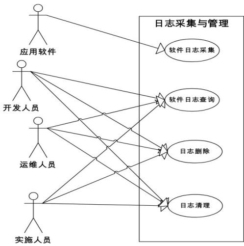
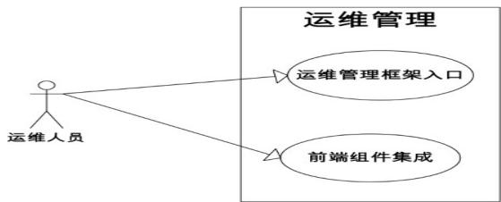
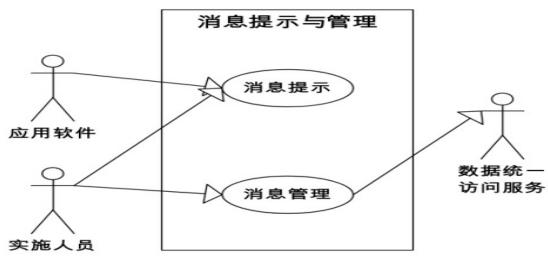
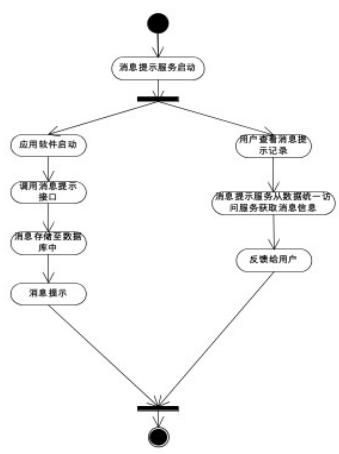

<table><tr><td>后置条件：无。</td><td></td></tr><tr><td>3.2.4.3.4 参数配置信息删除（PZXQ-YXZCFW-GN-CSPZGL-CSPZJK-</td><td></td></tr><tr><td colspan="2">CSPZXXSC)</td></tr></table>

参数配置信息删除用例场景，见表65所示。

表65 参数配置信息删除用例描述
<table><tr><td rowspan=1 colspan=1>Use Case 名称:参数配置信息删除</td><td rowspan=1 colspan=2>Actors：应用软件</td></tr><tr><td rowspan=1 colspan=3>概述：本例是检测参数配置信息删除功能是否正常。</td></tr><tr><td rowspan=1 colspan=3>前置条件：信息系统正常安装。</td></tr><tr><td rowspan=1 colspan=3>主事件流</td></tr><tr><td rowspan=1 colspan=1>Actor 的动作</td><td rowspan=1 colspan=1>系统的动作</td><td rowspan=1 colspan=1>动作约束(性能、可靠性、容错等)</td></tr><tr><td rowspan=1 colspan=1>1.应用软件调用参数配置接口，若参数配置接口异常，则执行异常流E1；若调用成功，则删除配置键值；3.应用软件接收到反馈信息；</td><td rowspan=1 colspan=1>2.参数配置管理在配置文件中删除配置信息，若删除失败，执行异常流E2，若成功，则返回删除成功信息；</td><td rowspan=1 colspan=1></td></tr><tr><td rowspan=1 colspan=2>异常流E1:应用软件调用参数配置接口失败。</td><td rowspan=1 colspan=1></td></tr><tr><td rowspan=1 colspan=2>异常流E2：系统参数配置管理删除配置文件中相关信息失败。</td><td rowspan=1 colspan=1></td></tr><tr><td rowspan=1 colspan=2>后置条件：无。</td><td rowspan=1 colspan=1></td></tr></table>

## 3.2.5 日志采集与管理（PZXQ-YXZCFW-GN-RZCJYGL）

日志采集与管理功能包括：软件日志采集、软件日志查询、日志删除、日志清理，其功能用例如图27所示。

  
图27日志采集与管理用例图

日志采集与管理所有能力标识表，见表66所示。

表66 日志采集与管理所有能力标识
<table><tr><td rowspan=1 colspan=1>序号</td><td rowspan=1 colspan=1>Usecase名称</td><td rowspan=1 colspan=1>项目唯一标识符</td><td rowspan=1 colspan=1>需求描述</td><td rowspan=1 colspan=1>需求重用</td><td rowspan=1 colspan=1>方式名称</td><td rowspan=1 colspan=1>运行状态</td><td rowspan=1 colspan=1>对应的任务书功能/性能</td></tr><tr><td rowspan=1 colspan=1>1</td><td rowspan=1 colspan=1>软件日志采集</td><td rowspan=1 colspan=1>PZXQ-YXZCFW-GN-RZCJYGL-RJRZCJ</td><td rowspan=1 colspan=1>提供软件日志记录接口，支持应用软件记录日志信息。支持日志文件的拆分，当单个日志文件超过50MB时，自动拆分为两个日志文件</td><td rowspan=1 colspan=1>新增</td><td rowspan=1 colspan=1>桌面、平板、手持</td><td rowspan=1 colspan=1>开发阶段、集成阶段、运行阶段</td><td rowspan=1 colspan=1>4.1.6 a)</td></tr><tr><td rowspan=1 colspan=1>2</td><td rowspan=1 colspan=1>软件日志查询</td><td rowspan=1 colspan=1>PZXQ-YXZCFW-GN-RZCJYGL-YHRZCJ</td><td rowspan=1 colspan=1>提供对软件日志文件的查询接口，支持对软件日志文件的查询，包括按照软件名称、日志时间等条件查询日志</td><td rowspan=1 colspan=1>新增</td><td rowspan=1 colspan=1>桌面、平板</td><td rowspan=1 colspan=1>开发阶段、集成阶段、运行阶段</td><td rowspan=1 colspan=1>4.1.6 b)</td></tr><tr><td rowspan=1 colspan=1>3</td><td rowspan=1 colspan=1>日志删除</td><td rowspan=1 colspan=1>PZXQ-YXZCFW-GN-RZCJYGL-RZCX</td><td rowspan=1 colspan=1>提供对软件日志文件的删除功能</td><td rowspan=1 colspan=1>新增</td><td rowspan=1 colspan=1>桌面、平板</td><td rowspan=1 colspan=1>开发阶段、集成阶段、运行阶段</td><td rowspan=1 colspan=1>4.1.6 c)</td></tr><tr><td rowspan=1 colspan=1>4</td><td rowspan=1 colspan=1>日志清理</td><td rowspan=1 colspan=1>PZXQ-YXZCFW-GN-RZCJYGL-RZQL</td><td rowspan=1 colspan=1>支持按照日志记录时间对日志文件进行自动清理</td><td rowspan=1 colspan=1>新增</td><td rowspan=1 colspan=1>桌面、平板</td><td rowspan=1 colspan=1>开发阶段、集成阶段、运行阶段</td><td rowspan=1 colspan=1>4.1.6 d)</td></tr></table>

日志采集与管理流程图如图28所示。

图28 日志采集与管理流程图

应用软件启动后，调用日志采集与记录接口进行软件日志信息的采集记录，用户可以进行查看和管理。

## 3.2.5.1 软件日志采集（PZXQ-YXZCFW-GN-RZCJYGL-RJRZCJ）

提供软件日志记录接口，按照《日志服务二次接口说明》规范的格式要求记录日志信息。支持日志文件的拆分，当单个日志文件超过50MB时，自动拆分为两个日志文件。当记录的日志文件总计达到500MB时，自动清理一般软件的日志文件，关键和重要软件保留最新的日志文件，旧有的文件也进行清理。

软件日志采集用例场景，见表67所示。

表67 软件日志采集用例描述
<table><tr><td colspan="1" rowspan="1">Use Case 名称:软件日志采集</td><td colspan="2" rowspan="1">Actors：应用软件</td></tr><tr><td colspan="3" rowspan="1">概述：本用例提供给信息系统软件运行日志采集的功能</td></tr><tr><td colspan="3" rowspan="1">前置条件：信息系统正常安装。</td></tr><tr><td colspan="3" rowspan="1">主事件流</td></tr><tr><td colspan="1" rowspan="1">Actor 的动作</td><td colspan="1" rowspan="1">系统的动作</td><td colspan="1" rowspan="1">动作约束</td></tr><tr><td colspan="1" rowspan="1"></td><td colspan="1" rowspan="1"></td><td colspan="1" rowspan="1">(性能、可靠性、容错等)</td></tr><tr><td colspan="1" rowspan="1">1.信息系统软件调用日志服务记录接口，输入要记录的日志类型和日志内容，若调用失败，则执行异常流E1；</td><td colspan="1" rowspan="1">2.日志服务接收到软件要记录的日志类型和日志内容，首先判断是否创建该软件的日志文件，若无创建，则先创建日志文件，然后将内容写入到日志文件中；3.当日志文件大于50MB时，日志服务自动将文件进行拆分，拆分为两个文件</td><td colspan="1" rowspan="1"></td></tr><tr><td colspan="2" rowspan="1">异常流E1：日志记录接口调用失败。</td><td colspan="1" rowspan="1"></td></tr><tr><td colspan="2" rowspan="1">后置条件：无。</td><td colspan="1" rowspan="1"></td></tr></table>

## 3.2.5.2 软件日志查询（PZXQ-YXZCFW-GN-RZCJYGL-YHRZCJ）

提供对软件日志文件的查询接口，支持对软件日志文件的查询，包括按照软件名称、日志类别、日志时间等条件查询日志。

软件日志查询用例场景，见表68所示。

表68 软件日志查询用例描述
<table><tr><td>Use Case 名称:软件日志查询</td><td colspan="2">Actors：开发人员、实施人员、运维人员</td></tr><tr><td colspan="3">概述：本用例提供给应用软件运行日志的查询功能</td></tr><tr><td colspan="3">前置条件：信息系统正常安装。</td></tr><tr><td colspan="3"></td></tr><tr><td>Actor 的动作</td><td>主事件流 系统的动作</td><td>动作约束</td></tr><tr><td>1.用户启动系统运行监控，打开日志管 理工具，选择软件日志信息；</td><td>2.若日志服务未正常启动，则执行异常 流E1；若正常启动，则展示当前软件文 件总数、各软件记录的日志文件数量等</td><td>(性能、可靠性、容错等)</td></tr><tr><td>3.用户选择要查看的软件日志；</td><td>信息； 4.日志服务解析该日志文件信息，将详 细信息返回给用户；</td><td></td></tr><tr><td>5.用户按照记录时间、日志类型筛选查 看的日志信息；</td><td>6.日志服务依据用户筛选信息过滤日志 文件，将过滤后的日志文件信息展现给 用户。</td><td></td></tr></table>

<table><tr><td>异常流E1:用户无法查看日志信息、日志管理界面显示异常。</td><td></td></tr><tr><td>后置条件：无。</td><td></td></tr></table>

## 3.2.5.3 日志删除（PZXQ-YXZCFW-GN-RZCJYGL-RZSC）

提供对软件日志文件的删除功能，用例场景见表69所示。

表69 软件日志删除用例描述
<table><tr><td rowspan=1 colspan=1>Use Case 名称:软件日志删除</td><td rowspan=1 colspan=2>Actors：开发人员、实施人员、运维人员</td></tr><tr><td rowspan=1 colspan=3>概述：本用例提供给应用软件日志删除的功能</td></tr><tr><td rowspan=1 colspan=3>前置条件：信息系统正常安装。</td></tr><tr><td rowspan=1 colspan=3>主事件流</td></tr><tr><td rowspan=1 colspan=1>Actor 的动作</td><td rowspan=1 colspan=1>系统的动作</td><td rowspan=1 colspan=1>动作约束(性能、可靠性、容错等)</td></tr><tr><td rowspan=1 colspan=1>1.用户启动系统运行监控，打开日志管理工具，选择软件日志信息；3.用户选择要删除的日志信息；</td><td rowspan=1 colspan=1>2. 若日志服务未正常启动，则执行异常流E1；若正常启动，则展示当前软件总数、各软件的日志文件数量等信息；</td><td rowspan=1 colspan=1></td></tr><tr><td rowspan=1 colspan=2>异常流E1：用户无法查看日志信息、日志管理界面显示异常。</td><td rowspan=1 colspan=1></td></tr><tr><td rowspan=1 colspan=2>后置条件：无。</td><td rowspan=1 colspan=1></td></tr></table>

## 3.2.5.4 日志清理（PZXQ-YXZCFW-GN-RZCJYGL-RZQL）

支持按照日志记录时间、日志大小对日志文件进行自动清理。

日志清理用例场景，见表70所示。

表70 日志清理用例描述
<table><tr><td colspan="1" rowspan="1">Use Case 名称:日志清理</td><td colspan="2" rowspan="1">Actors：开发人员、实施人员、运维人员</td></tr><tr><td colspan="3" rowspan="1">概述：本用例提供给应用软件日志清理的功能</td></tr><tr><td colspan="3" rowspan="1">前置条件：信息系统正常安装。</td></tr><tr><td colspan="3" rowspan="1">主事件流</td></tr><tr><td colspan="1" rowspan="1">Actor 的动作</td><td colspan="1" rowspan="1">系统的动作</td><td colspan="1" rowspan="1">动作约束(性能、可靠性、容错等)</td></tr><tr><td colspan="1" rowspan="1">1.用户启动系统运行监控，打开日志管理工具，选择软件日志信息；</td><td colspan="1" rowspan="1">2. 若日志服务集中日志管理组件未正常启动，则执行异常流E1；若正常启动，则展示当前软件总数、各软件的日志文件数量等信息；</td><td colspan="1" rowspan="1"></td></tr><tr><td colspan="1" rowspan="1">3.用户设置日志清理的参数，包括当日志文件达到多少MB时，自动删除，或日志文件记录时间距离现在多久时，自动删除；</td><td colspan="1" rowspan="1">4.日志服务实时检测系统文件夹内的日志文件，满足条件则进行清理。</td><td colspan="1" rowspan="1"></td></tr><tr><td colspan="2" rowspan="1">异常流E1：用户无法查看日志信息、日志管理界面显示异常。</td><td colspan="1" rowspan="1"></td></tr><tr><td colspan="2" rowspan="1">后置条件：无。</td><td colspan="1" rowspan="1"></td></tr></table>

3.2.6 运维管理（PZXQ-YXZCFW-GN-YWGL）

运维管理功能包括：运维管理框架入口功能、前端组件集成功能，其功能用例如图29所示。

  
图29 运维管理用例图

运维管理所有能力标识表，见表71所示。

表71 运维管理所有能力标识
<table><tr><td colspan="1" rowspan="1">序号</td><td colspan="1" rowspan="1">Usecase名称</td><td colspan="1" rowspan="1">项目唯一标识符</td><td colspan="1" rowspan="1">需求描述</td><td colspan="1" rowspan="1">需求重用</td><td colspan="1" rowspan="1">方式名称</td><td colspan="1" rowspan="1">运行状态</td><td colspan="1" rowspan="1">对应的任务书功能/性能</td></tr><tr><td colspan="1" rowspan="1">1</td><td colspan="1" rowspan="1">运维管理框架入口功能</td><td colspan="1" rowspan="1">PZXQ-YXZCFW-GN-YWGL-YWGLKJRK</td><td colspan="1" rowspan="1">提供运维管理统一集成框架</td><td colspan="1" rowspan="1">新增</td><td colspan="1" rowspan="1">桌面</td><td colspan="1" rowspan="1">运行阶段</td><td colspan="1" rowspan="1">4.1.7 a)</td></tr><tr><td colspan="1" rowspan="1">2</td><td colspan="1" rowspan="1">前端组件集成</td><td colspan="1" rowspan="1">PZXQ-YXZCFW-GN-YWGL-QDZJJC</td><td colspan="1" rowspan="1">能够对用户管理、基础数据维护、地图数据维护、任务数据包管理、</td><td colspan="1" rowspan="1">新增</td><td colspan="1" rowspan="1">桌面</td><td colspan="1" rowspan="1">运行阶段</td><td colspan="1" rowspan="1">4.1.7 b)</td></tr><tr><td></td><td>功能</td><td></td><td>任务数据包开设、任务 系统配置的界面进行显 示和切换</td><td></td><td></td><td></td><td></td></tr></table>

## 3.2.6.1 运维管理框架入口（PZXQ-YXZCFW-GN-YWGL-YWGLKJRK）

提供运维管理统一集成框架。

运维管理框架入口用例场景，见表72所示。

表72 运维管理框架用例描述
<table><tr><td rowspan=1 colspan=1>Use Case 名称：运维管理框架入口</td><td rowspan=1 colspan=2>Actors：运维人员</td></tr><tr><td rowspan=1 colspan=3>概述：本用例是运维管理的扩展用例，描述用户通过运维管理框架入口进入运维管理框架的过程；</td></tr><tr><td rowspan=1 colspan=3>前置条件：系统软件正常安装。</td></tr><tr><td rowspan=1 colspan=3>主事件流</td></tr><tr><td rowspan=1 colspan=1>Actor 的动作</td><td rowspan=1 colspan=1>系统的动作</td><td rowspan=1 colspan=1>动作约束(性能、可靠性、容错等)</td></tr><tr><td rowspan=1 colspan=1>1.用户双击运维管理框架入口；3.用户输入用户名密码；</td><td rowspan=1 colspan=1>2.系统响应用户点击请求，打开运维管理框架；4.系统判断用户名密码的合法性，若非法，则执行异常流E1，若合法，则打开运维管理框架。</td><td rowspan=1 colspan=1></td></tr><tr><td rowspan=1 colspan=2>异常流E1：用户名密码验证失败，退出运维管理框架。</td><td rowspan=1 colspan=1></td></tr><tr><td rowspan=1 colspan=2>后置条件：无。</td><td rowspan=1 colspan=1></td></tr></table>

## 3.2.6.2 前端组件集成（PZXQ-YXZCFW-GN-YWGL-QDZJJC）

能够对用户管理、基础数据维护、地图数据维护、任务数据包管理、任务数据包开设、任务系统配置的界面进行显示和切换。

前端组件集成用例场景，见表73所示。

表73 前端组件集成用例描述
<table><tr><td>Use Case 名称:前端组件集成</td><td colspan="2">Actors：运维人员</td></tr><tr><td colspan="3">概述：本用例是运维管理的扩展用例，描述用户查看运维管理框架前端组件集成的功能；</td></tr><tr><td colspan="3" rowspan="1">前置条件：系统软件正常安装，服务支撑框架正常运行。</td></tr><tr><td colspan="3" rowspan="1">主事件流</td></tr><tr><td colspan="1" rowspan="1">Actor 的动作</td><td colspan="1" rowspan="1">系统的动作</td><td colspan="1" rowspan="1">动作约束(性能、可靠性、容错等)</td></tr><tr><td colspan="1" rowspan="1">1.用户进入运维管理框架；2.用户点击左边功能菜单；</td><td colspan="1" rowspan="1">3.系统响应用户点击请求，若服务转发失败，则执行异常流E1，若服务转发成功，则跳转相关页面；</td><td colspan="1" rowspan="1"></td></tr><tr><td colspan="2" rowspan="1">异常流E1：用户名密码验证失败，退出运维管理框架。</td><td colspan="1" rowspan="1"></td></tr><tr><td colspan="2" rowspan="1">后置条件：无。</td><td colspan="1" rowspan="1"></td></tr></table>

消息提示与管理功能包括：消息提示和消息管理，其功能用例如图30所示。

3.2.7 消息提示与管理（PZXQ-YXZCFW-GN-JBSFYGL）

图30消息提示与管理用例图  
消息提示与管理所有能力标识表，见表74所示。  
表74 消息提示与管理所有能力标识
<table><tr><td colspan="1" rowspan="1">序号</td><td colspan="1" rowspan="1">Usecase名称</td><td colspan="1" rowspan="1">项目唯一标识符</td><td colspan="1" rowspan="1">需求描述</td><td colspan="1" rowspan="1">需求重用</td><td colspan="1" rowspan="1">方式名称</td><td colspan="1" rowspan="1">运行状态</td><td colspan="1" rowspan="1">对应的任务书功能/性能</td></tr><tr><td colspan="1" rowspan="1">1</td><td colspan="1" rowspan="1">消息提示</td><td colspan="1" rowspan="1">PZXQ-YXZCFW-GN-RZCJYGL-XXTS</td><td colspan="1" rowspan="1">提供消息提示功能，支持以弹框的形式对消息进行提示</td><td colspan="1" rowspan="1">改进</td><td colspan="1" rowspan="1">桌面</td><td colspan="1" rowspan="1">运行阶段</td><td colspan="1" rowspan="1">4.1.8 a)</td></tr><tr><td colspan="1" rowspan="1">2</td><td colspan="1" rowspan="1">消息管理</td><td colspan="1" rowspan="1">PZXQ-YXZCFW-GN-RZCJYGL-XXGL</td><td colspan="1" rowspan="1">提供消息的管理能力，支持将消息通过数据统一访问服务存储至数据库中，提供消息查询接口</td><td colspan="1" rowspan="1">改进</td><td colspan="1" rowspan="1">桌面</td><td colspan="1" rowspan="1">运行阶段</td><td colspan="1" rowspan="1">4.1.8 b)</td></tr></table>

消息提示与管理流程图如所示。

  
图31 消息提示与管理流程图

应用软件启动后，调用消息提示服务接口，设置需要提示的消息类型、消息内容以及消息提示音和弹框类型，消息提示服务收到后进行消息提示，并将消息通过数据统一

访问服务存放至数据库中进行保存，用户可以进行查询。

## 3.2.7.1 消息提示（PZXQ-YXZCFW-GN-RZCJYGL-XXTS）

提供消息提示功能，支持以弹框的形式对消息进行提示。

消息提示用例场景，见表75所示。

表75 消息提示用例描述
<table><tr><td rowspan=1 colspan=1>Use Case 名称:消息提示</td><td rowspan=1 colspan=2>Actors：应用软件、实施人员</td></tr><tr><td rowspan=1 colspan=3>概述：本用例是描述本软件能够进行消息提示功能；</td></tr><tr><td rowspan=1 colspan=3>前置条件：系统软件正常安装。</td></tr><tr><td rowspan=1 colspan=3>主事件流</td></tr><tr><td rowspan=1 colspan=1>Actor 的动作</td><td rowspan=1 colspan=1>系统的动作</td><td rowspan=1 colspan=1>动作约束(性能、可靠性、容错等)</td></tr><tr><td rowspan=1 colspan=1>1.应用软件启动后，通过消息发布接口进行订阅，若接口订阅失败，则执行异常流E1；4.用户查看消息提示信息；5.用户查看消息类型信息；7.用户选择消息参数进行设置；9.用户查看设置结果反馈；</td><td rowspan=1 colspan=1>2.应用软件需要进行消息提示时，则将提示的内容和提示等级通过接口发送至消息提示；3.消息提示接收到需要提示的信息后进行处理，调用界面集成框架的弹框服务，若调用失败，则执行异常流E2；调用成功，则进行消息提示；6.若消息提示服务未启动，则执行异常流E3，消息提示服务从数据库中读取消息的类型和消息参数信息，返回至前端界面；8.消息提示服务保存设置信息，并将设置结果返回至前端页面；</td><td rowspan=1 colspan=1></td></tr><tr><td rowspan=1 colspan=2>异常流E1：消息提示接口发布失败。</td><td rowspan=1 colspan=1></td></tr><tr><td rowspan=1 colspan=2>异常流E2:消息弹框调用失败。</td><td rowspan=1 colspan=1></td></tr><tr><td rowspan=1 colspan=2>异常流E3:消息类型查看失败。</td><td rowspan=1 colspan=1></td></tr><tr><td rowspan=1 colspan=2>后置条件：无。</td><td rowspan=1 colspan=1></td></tr></table>

## 3.2.7.2 消息管理（PZXQ-YXZCFW-GN-RZCJYGL-XXGL）

提供消息的管理能力，支持将消息通过数据统一访问服务存储至数据库中，提供消