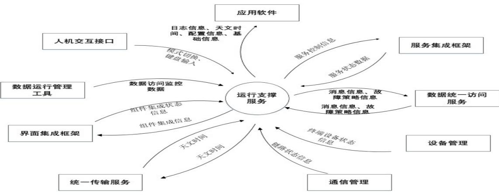
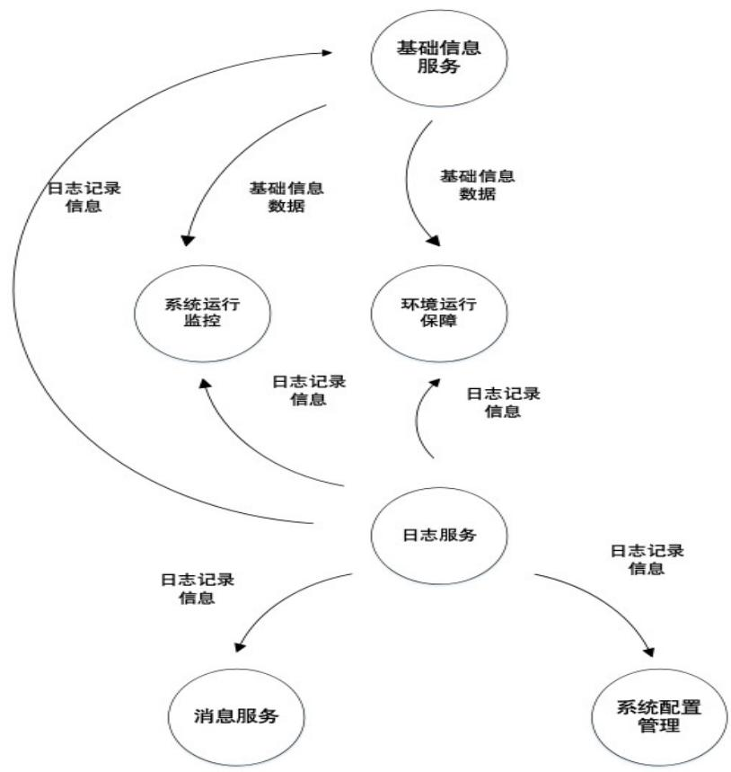

息查询接口。

消息管理用例场景，见表76所示。

表76 消息管理用例描述
<table><tr><td rowspan=1 colspan=1>Use Case 名称:消息管理</td><td rowspan=1 colspan=2>Actors：应用软件</td></tr><tr><td rowspan=1 colspan=3>概述:本用例是描述本软件支持用户进行消息管理的能力；</td></tr><tr><td rowspan=1 colspan=3>前置条件：信息系统软件正常安装。</td></tr><tr><td rowspan=1 colspan=3>主事件流</td></tr><tr><td rowspan=1 colspan=1>Actor 的动作</td><td rowspan=1 colspan=1>系统的动作</td><td rowspan=1 colspan=1>动作约束(性能、可靠性、容错等)</td></tr><tr><td rowspan=1 colspan=1>1.用户启动计算机，通过界面交互框架进入参数配置界面；2.用户查看消息的显示信息；4.用户选择提示消息进行管理；6.用户查看消息管理响应信息。</td><td rowspan=1 colspan=1>3.若消息提示服务未启动，则执行异常流E1，消息提示服务通过数据统一访问服务从数据库中读取消息的类型和消息参数信息，若读取失败，则执行异常流E2；返回至前端界面；5.消息提示服务依据用户选择对消息进行管理，将管理结果返回前端界面；</td><td rowspan=1 colspan=1></td></tr><tr><td rowspan=1 colspan=2>异常流E1：消息信息显示失败。</td><td rowspan=1 colspan=1></td></tr><tr><td rowspan=1 colspan=2>异常流E2：消息信息读取失败。</td><td rowspan=1 colspan=1></td></tr><tr><td rowspan=1 colspan=2>后置条件：无。</td><td rowspan=1 colspan=1></td></tr></table>

## 3.3 CSCI 外部接口需求

## 3.3.1 接口标识和接口图

运行支撑服务软件外部接口需求图，见图32所示。

  
图32 运行支撑服务软件外部接口需求  
运行支撑服务软件外部接口需求表见表77所示。

表77 运行支撑服务软件外部接口需求
<table><tr><td colspan="1" rowspan="1">序号</td><td colspan="1" rowspan="1">接口需求名称</td><td colspan="1" rowspan="1">接口需求标识</td><td colspan="1" rowspan="1">接口类型</td><td colspan="1" rowspan="1">发送方</td><td colspan="1" rowspan="1">接收方</td><td colspan="1" rowspan="1">接口内容</td><td colspan="1" rowspan="1">接口优先级</td></tr><tr><td colspan="1" rowspan="1">1</td><td colspan="1" rowspan="1">人机交互接口</td><td colspan="1" rowspan="1">PZXQ-WBJK-YXZCFW-RJJHJK</td><td colspan="1" rowspan="1">人机接口</td><td colspan="1" rowspan="1">用户</td><td colspan="1" rowspan="1">本软件</td><td colspan="1" rowspan="1">模式切换、键盘输入</td><td colspan="1" rowspan="1">低</td></tr><tr><td colspan="1" rowspan="1">2</td><td colspan="1" rowspan="1">与数据运行管理工具接口</td><td colspan="1" rowspan="1">PZXQ-WBJK-YXZCFW-SJYXGLGJ</td><td colspan="1" rowspan="1">API接口</td><td colspan="1" rowspan="1">数据运行管理工具</td><td colspan="1" rowspan="1">本软件</td><td colspan="1" rowspan="1">数据访问监控信息</td><td colspan="1" rowspan="1">高</td></tr><tr><td colspan="1" rowspan="2">3</td><td colspan="1" rowspan="2">与界面集成框架接口</td><td colspan="1" rowspan="2">PZXQ-WBJK-YXZCFW-JMJCKJ</td><td colspan="1" rowspan="2">API接口</td><td colspan="1" rowspan="1">界面集成框架</td><td colspan="1" rowspan="1">本软件</td><td colspan="1" rowspan="1">组件集成状态信息</td><td colspan="1" rowspan="2">中</td></tr><tr><td colspan="1" rowspan="1">本软件</td><td colspan="1" rowspan="1">界面集成框架</td><td colspan="1" rowspan="1">组件集成信息</td></tr><tr><td colspan="1" rowspan="2">4</td><td colspan="1" rowspan="2">与统一传输服务接口</td><td colspan="1" rowspan="2">PZXQ-WBJK-YXZCFW-TYCSFW</td><td colspan="1" rowspan="2">API接口</td><td colspan="1" rowspan="1">统一传输服务</td><td colspan="1" rowspan="1">本软件</td><td colspan="1" rowspan="1">天文时间</td><td colspan="1" rowspan="2">高</td></tr><tr><td colspan="1" rowspan="1">本软件</td><td colspan="1" rowspan="1">统一传输服务</td><td colspan="1" rowspan="1">天文时间</td></tr><tr><td colspan="1" rowspan="1">5</td><td colspan="1" rowspan="1">与通信管理接口</td><td colspan="1" rowspan="1">PZXQ-WBJK-YXZCFW-TXGL</td><td colspan="1" rowspan="1">API接口</td><td colspan="1" rowspan="1">通信管理</td><td colspan="1" rowspan="1">本软件</td><td colspan="1" rowspan="1">链路状态信息</td><td colspan="1" rowspan="1">低</td></tr><tr><td colspan="1" rowspan="1">6</td><td colspan="1" rowspan="1">与设备管理接口</td><td colspan="1" rowspan="1">PZXQ-WBJK-YXZCFW-SBGL</td><td colspan="1" rowspan="1">API接口</td><td colspan="1" rowspan="1">设备管理</td><td colspan="1" rowspan="1">本软件</td><td colspan="1" rowspan="1">终端设备状态信息</td><td colspan="1" rowspan="1">低</td></tr><tr><td colspan="1" rowspan="2">7</td><td colspan="1" rowspan="2">与数据统一访问服务接口</td><td colspan="1" rowspan="2">PZXQ-WBJK-YXZCFW-SJTYFWFW</td><td colspan="1" rowspan="2">API接口</td><td colspan="1" rowspan="1">数据统一访问服务</td><td colspan="1" rowspan="1">本软件</td><td colspan="1" rowspan="1">消息信息、故障策略信息</td><td colspan="1" rowspan="2">高</td></tr><tr><td colspan="1" rowspan="1">本软件</td><td colspan="1" rowspan="1">数据统一访问服务</td><td colspan="1" rowspan="1">消息信息、故障策略信息</td></tr><tr><td colspan="1" rowspan="2">8</td><td colspan="1" rowspan="2">与服务集成框架接口</td><td colspan="1" rowspan="2">PZXQ-WBJK-YXZCFW-FWJCKJ</td><td colspan="1" rowspan="2">API接口</td><td colspan="1" rowspan="1">服务集成框架</td><td colspan="1" rowspan="1">本软件</td><td colspan="1" rowspan="1">服务状态数据信息</td><td colspan="1" rowspan="2">高</td></tr><tr><td colspan="1" rowspan="1">本软件</td><td colspan="1" rowspan="1">服务集成框架</td><td colspan="1" rowspan="1">服务控制信息</td></tr><tr><td colspan="1" rowspan="1">9</td><td colspan="1" rowspan="1">与应用软件接口</td><td colspan="1" rowspan="1">PZXQ-WBJK-YXZCFW-YYRJ</td><td colspan="1" rowspan="1">API接口</td><td colspan="1" rowspan="1">本软件</td><td colspan="1" rowspan="1">应用软件</td><td colspan="1" rowspan="1">日志信息、天文时间、配置信息、基础信息</td><td colspan="1" rowspan="1">中</td></tr></table>

## 3.3.2 人机交互接口（PZXQ-WBJK-YXZCFW-RJJHJK）

人机交互接口数据元素说明表，见表78所示。

表78 人机交互接口数据元素说明
<table><tr><td rowspan=1 colspan=1>序号</td><td rowspan=1 colspan=1>数据集名称</td><td rowspan=1 colspan=1>数据组成</td><td rowspan=1 colspan=1>数据约束</td><td rowspan=1 colspan=1>数据标准</td></tr><tr><td rowspan=1 colspan=1>1</td><td rowspan=1 colspan=1>模式切换信息</td><td rowspan=1 colspan=1>模式信息</td><td rowspan=1 colspan=1>String</td><td rowspan=1 colspan=1></td></tr><tr><td rowspan=1 colspan=1>2</td><td rowspan=1 colspan=1>键盘输入</td><td rowspan=1 colspan=1>IP地址设置信息、查看筛选信息等</td><td rowspan=1 colspan=1>String</td><td rowspan=1 colspan=1></td></tr></table>

## 3.3.3 与数据运行管理工具接口（PZXQ-WBJK-YXZCFW-SJYXGLGJ）

与数据运行管理工具接口数据元素说明表，见表79所示。

表79 与数据运行管理工具接口数据元素说明
<table><tr><td rowspan=1 colspan=1>序号</td><td rowspan=1 colspan=1>数据集名称</td><td rowspan=1 colspan=1>数据组成</td><td rowspan=1 colspan=1>数据约束</td><td rowspan=1 colspan=1>数据标准</td></tr><tr><td rowspan=1 colspan=1>1</td><td rowspan=1 colspan=1>数据访问状态信息</td><td rowspan=1 colspan=1>数据库连接状态信息、数据库启动信息、数据库连接数信息、单个软件的连接数信息</td><td rowspan=1 colspan=1>String</td><td rowspan=1 colspan=1></td></tr></table>

## 3.3.4 与界面集成框架接口（PZXQ-WBJK-YXZCFW-JMJCKJ）

与界面集成框架接口数据元素说明表，见表80所示。

表80 与界面集成框架接口数据元素说明
<table><tr><td colspan="1" rowspan="1">序号</td><td colspan="1" rowspan="1">数据集名称</td><td colspan="1" rowspan="1">数据组成</td><td colspan="1" rowspan="1">数据约束</td><td colspan="1" rowspan="1">数据标准</td></tr><tr><td colspan="1" rowspan="1">1</td><td colspan="1" rowspan="1">组件集成信息</td><td colspan="1" rowspan="1">组件名称、组件类型、组件位置、组件尺寸信息、组件集成方式</td><td colspan="1" rowspan="1">String</td><td colspan="1" rowspan="1"></td></tr><tr><td colspan="1" rowspan="1">2</td><td colspan="1" rowspan="1">组件集成状态信息</td><td colspan="1" rowspan="1">组件加载状态、组件资源完整状态信息</td><td colspan="1" rowspan="1">String</td><td colspan="1" rowspan="1"></td></tr></table>

## 3.3.5 与统一传输服务接口（PZXQ-WBJK-YXZCFW-TYCSFW）

与统一传输服务接口数据元素说明表，见表81所示。

表81 与统一传输服务接口数据元素说明
<table><tr><td rowspan=1 colspan=1>序号</td><td rowspan=1 colspan=1>数据集名称</td><td rowspan=1 colspan=1>数据组成</td><td rowspan=1 colspan=1>数据约束</td><td rowspan=1 colspan=1>数据标准</td></tr><tr><td rowspan=1 colspan=1>1</td><td rowspan=1 colspan=1>天文时间</td><td rowspan=1 colspan=1>年、月、日、时、分、秒</td><td rowspan=1 colspan=1>String</td><td rowspan=1 colspan=1></td></tr></table>

## 3.3.6 与设备管理接口（PZXQ-WBJK-YXZCFW-SBGL）

与设备管理接口数据元素说明表，见表82所示。

表82 与设备管理接口数据元素说明
<table><tr><td rowspan=1 colspan=1>序号</td><td rowspan=1 colspan=1>数据集名称</td><td rowspan=1 colspan=1>数据组成</td><td rowspan=1 colspan=1>数据约束</td><td rowspan=1 colspan=1>数据标准</td></tr><tr><td rowspan=1 colspan=1>1</td><td rowspan=1 colspan=1>终端设备信息</td><td rowspan=1 colspan=1>终端的在线信息和用户的登陆信息</td><td rowspan=1 colspan=1>String</td><td rowspan=1 colspan=1></td></tr></table>

## 3.3.7 与数据统一访问服务接口（PZXQ-WBJK-YXZCFW-SJTYFWFW）

与数据统一访问服务接口数据元素说明表，见表83所示。

表83 与数据统一访问服务接口数据元素说明
<table><tr><td rowspan=1 colspan=1>序号</td><td rowspan=1 colspan=1>数据集名称</td><td rowspan=1 colspan=1>数据组成</td><td rowspan=1 colspan=1>数据约束</td><td rowspan=1 colspan=1>数据标准</td></tr><tr><td rowspan=1 colspan=1>1</td><td rowspan=1 colspan=1>消息信息</td><td rowspan=1 colspan=1>消息类型、消息内容、消息来源</td><td rowspan=1 colspan=1>String</td><td rowspan=1 colspan=1></td></tr><tr><td rowspan=1 colspan=1>2</td><td rowspan=1 colspan=1>故障库策略信息</td><td rowspan=1 colspan=1>故障ID、故障软件、故障描述、故障策略</td><td rowspan=1 colspan=1>String</td><td rowspan=1 colspan=1></td></tr></table>

## 3.3.8 与服务集成框架接口（PZXQ-WBJK-YXZCFW-SJTYFWFW）

与服务集成框架接口数据元素说明表，见表84所示。

表84 与服务集成框架接口数据元素说明
<table><tr><td rowspan=1 colspan=1>序号</td><td rowspan=1 colspan=1>数据集名称</td><td rowspan=1 colspan=1>数据组成</td><td rowspan=1 colspan=1>数据约束</td><td rowspan=1 colspan=1>数据标准</td></tr><tr><td rowspan=1 colspan=1>1</td><td rowspan=1 colspan=1>服务状态信息</td><td rowspan=1 colspan=1>服务名称、内存占用率、CPU占用率、启动状态</td><td rowspan=1 colspan=1>String</td><td rowspan=1 colspan=1></td></tr><tr><td rowspan=1 colspan=1>2</td><td rowspan=1 colspan=1>服务控制信息</td><td rowspan=1 colspan=1>服务的启动、停止和重启</td><td rowspan=1 colspan=1>String</td><td rowspan=1 colspan=1></td></tr></table>

## 3.3.9 与应用软件接口（PZXQ-WBJK-YXZCFW-YYRJ）

与应用软件接口数据元素说明表，见表85所示。

表85 与应用软件接口数据元素说明
<table><tr><td colspan="1" rowspan="1">序号</td><td colspan="1" rowspan="1">数据集名称</td><td colspan="1" rowspan="1">数据组成</td><td colspan="1" rowspan="1">数据约束</td><td colspan="1" rowspan="1">数据标准</td></tr><tr><td colspan="1" rowspan="1">1</td><td colspan="1" rowspan="1">基础信息数据</td><td colspan="1" rowspan="1">本机IP地址，服务器IP地址、备份服务器IP地址、当前登录用户的ID信息、工作模</td><td colspan="1" rowspan="1">String</td><td colspan="1" rowspan="1"></td></tr><tr><td colspan="1" rowspan="1"></td><td colspan="1" rowspan="1"></td><td colspan="1" rowspan="1">式、当前计算机超级密码、用户部署信息(指挥所/指挥组)、当前系统的工作路径、内网网卡名称、外网网卡名称</td><td colspan="1" rowspan="1"></td><td colspan="1" rowspan="1"></td></tr><tr><td colspan="1" rowspan="1">2</td><td colspan="1" rowspan="1">消息信息</td><td colspan="1" rowspan="1">消息类型、消息内容、消息来源</td><td colspan="1" rowspan="1">String</td><td colspan="1" rowspan="1"></td></tr><tr><td colspan="1" rowspan="1">3</td><td colspan="1" rowspan="1">天文时间</td><td colspan="1" rowspan="1">年、月、日、时、分、秒</td><td colspan="1" rowspan="1">String</td><td colspan="1" rowspan="1"></td></tr><tr><td colspan="1" rowspan="1">4</td><td colspan="1" rowspan="1">配置信息</td><td colspan="1" rowspan="1">配置标识、配置内容</td><td colspan="1" rowspan="1">String</td><td colspan="1" rowspan="1"></td></tr><tr><td colspan="1" rowspan="1">5</td><td colspan="1" rowspan="1">日志信息</td><td colspan="1" rowspan="1">日志类型、日志记录时间、日志记录内容</td><td colspan="1" rowspan="1">String</td><td colspan="1" rowspan="1"></td></tr></table>

## 3.4 CSCI 内部接口需求

## 3.4.1 接口标识和接口图

运行支撑服务软件内部接口需求图，见图 33所示。

3.4.3 基础信息服务与系统运行监控接口（PZXQ-NBJK-YXZCFW-JCXXFWXTYXJKJK）

图 33 运行支撑服务软件内部接口需求

运行支撑服务软件内部接口需求表见表86。

表86 运行支撑服务软件内部接口需求
<table><tr><td rowspan=1 colspan=1>序号</td><td rowspan=1 colspan=1>接口需求名称</td><td rowspan=1 colspan=1>接口需求标识</td><td rowspan=1 colspan=1>接口类型</td><td rowspan=1 colspan=1>发送方</td><td rowspan=1 colspan=1>接收方</td><td rowspan=1 colspan=1>接口内容</td><td rowspan=1 colspan=1>接口优先级</td></tr><tr><td rowspan=1 colspan=1>1</td><td rowspan=1 colspan=1>基础信息服务与日志服务接口</td><td rowspan=1 colspan=1>PZXQ-NBJK-YXZCFW-JCXXFWRZFWJK</td><td rowspan=1 colspan=1>API接口</td><td rowspan=1 colspan=1>日志服务</td><td rowspan=1 colspan=1>基础信息服务</td><td rowspan=1 colspan=1>记录的日志信息</td><td rowspan=1 colspan=1>中</td></tr><tr><td rowspan=1 colspan=1>2</td><td rowspan=1 colspan=1>基础信息服务与系统运行监控接口</td><td rowspan=1 colspan=1>PZXQ-NBJK-YXZCFW-JCXXFWXTYXJKJK</td><td rowspan=1 colspan=1>API接口</td><td rowspan=1 colspan=1>基础信息服务</td><td rowspan=1 colspan=1>系统运行监控</td><td rowspan=1 colspan=1>本机IP地址、服务器IP地址、备份服务器IP地址、工作模式、本机身份、操作系统</td><td rowspan=1 colspan=1>中</td></tr><tr><td rowspan=1 colspan=1>3</td><td rowspan=1 colspan=1>基础信息服务与环境运行保障接口</td><td rowspan=1 colspan=1>PZXQ-NBJK-YXZCFW-JCXXFWHJYXBZJK</td><td rowspan=1 colspan=1>API接口</td><td rowspan=1 colspan=1>基础信息服务</td><td rowspan=1 colspan=1>环境运行保障</td><td rowspan=1 colspan=1>本机IP地址、服务器IP地址、备份服务器IP地址</td><td rowspan=1 colspan=1>中</td></tr><tr><td rowspan=1 colspan=1>4</td><td rowspan=1 colspan=1>系统运行监控与日志服务接口</td><td rowspan=1 colspan=1>PZXQ-NBJK-YXZCFW-XTYXJKRZFWJK</td><td rowspan=1 colspan=1>API接口</td><td rowspan=1 colspan=1>日志服务</td><td rowspan=1 colspan=1>系统运行监控</td><td rowspan=1 colspan=1>日志记录信息</td><td rowspan=1 colspan=1>低</td></tr><tr><td rowspan=1 colspan=1>5</td><td rowspan=1 colspan=1>环境运行保障与日志服务接口</td><td rowspan=1 colspan=1>PZXQ-NBJK-YXZCFW-HJYXBZRZFWJK</td><td rowspan=1 colspan=1>API接口</td><td rowspan=1 colspan=1>日志服务</td><td rowspan=1 colspan=1>环境运行保障</td><td rowspan=1 colspan=1>日志记录信息</td><td rowspan=1 colspan=1>低</td></tr><tr><td rowspan=1 colspan=1>6</td><td rowspan=1 colspan=1>消息服务与日志服务接口</td><td rowspan=1 colspan=1>PZXQ-NBJK-YXZCFW-XXFWRZFWJK</td><td rowspan=1 colspan=1>API接口</td><td rowspan=1 colspan=1>日志服务</td><td rowspan=1 colspan=1>消息服务</td><td rowspan=1 colspan=1>日志记录信息</td><td rowspan=1 colspan=1>低</td></tr><tr><td rowspan=1 colspan=1>7</td><td rowspan=1 colspan=1>系统配置管理与日志服务接口</td><td rowspan=1 colspan=1>PZXQ-NBJK-YXZCFW-XTPZGLRZFWJK</td><td rowspan=1 colspan=1>API接口</td><td rowspan=1 colspan=1>日志服务</td><td rowspan=1 colspan=1>系统配置管理</td><td rowspan=1 colspan=1>日志记录信息</td><td rowspan=1 colspan=1>低</td></tr></table>

3.4.2 基础信息服务与日志服务接口（PZXQ-NBJK-YXZCFW-JCXXFWRZFWJK）  
基础信息服务与日志服务接口数据元素说明表，见表87所示。

表87 基础信息服务与日志服务接口数据元素说明
<table><tr><td rowspan=1 colspan=1>序号</td><td rowspan=1 colspan=1>数据集名称</td><td rowspan=1 colspan=1>数据组成</td><td rowspan=1 colspan=1>数据约束</td><td rowspan=1 colspan=1>数据标准</td></tr><tr><td rowspan=1 colspan=1>1</td><td rowspan=1 colspan=1>日志记录信息</td><td rowspan=1 colspan=1>日志类别、日志时间、日志数据</td><td rowspan=1 colspan=1>String</td><td rowspan=1 colspan=1></td></tr></table>

基础信息服务与日志服务接口数据元素说明表，见表88所示。

表88 基础信息服务与系统运行监控接口数据元素说明
<table><tr><td rowspan=1 colspan=1>序号</td><td rowspan=1 colspan=1>数据集名称</td><td rowspan=1 colspan=1>数据组成</td><td rowspan=1 colspan=1>数据约束</td><td rowspan=1 colspan=1>数据标准</td></tr><tr><td rowspan=1 colspan=1>1</td><td rowspan=1 colspan=1>本机IP地址</td><td rowspan=1 colspan=1>IP地址、子网掩码、默认网关</td><td rowspan=1 colspan=1>String</td><td rowspan=1 colspan=1></td></tr><tr><td rowspan=1 colspan=1>2</td><td rowspan=1 colspan=1>服务器IP地址</td><td rowspan=1 colspan=1>IP地址、子网掩码、默认网关</td><td rowspan=1 colspan=1>String</td><td rowspan=1 colspan=1></td></tr><tr><td rowspan=1 colspan=1>3</td><td rowspan=1 colspan=1>备份服务器IP</td><td rowspan=1 colspan=1>IP地址、子网掩码、默认网关</td><td rowspan=1 colspan=1>String</td><td rowspan=1 colspan=1></td></tr><tr><td rowspan=1 colspan=1>4</td><td rowspan=1 colspan=1>工作模式</td><td rowspan=1 colspan=1>模式类别</td><td rowspan=1 colspan=1>String</td><td rowspan=1 colspan=1></td></tr><tr><td rowspan=1 colspan=1>5</td><td rowspan=1 colspan=1>本机身份</td><td rowspan=1 colspan=1>身份类别</td><td rowspan=1 colspan=1>String</td><td rowspan=1 colspan=1></td></tr><tr><td rowspan=1 colspan=1>6</td><td rowspan=1 colspan=1>操作系统</td><td rowspan=1 colspan=1>操作系统类别</td><td rowspan=1 colspan=1>String</td><td rowspan=1 colspan=1></td></tr></table>

3.4.4 基础信息服务与环境运行保障接口（PZXQ-NBJK-YXZCFW-JCXXFWHJYXBZJK）  
基础信息服务与环境运行保障接口数据元素说明表，见表89所示。

表89 基础信息服务与环境运行保障接口数据元素说明
<table><tr><td rowspan=1 colspan=1>序号</td><td rowspan=1 colspan=1>数据集名称</td><td rowspan=1 colspan=1>数据组成</td><td rowspan=1 colspan=1>数据约束</td><td rowspan=1 colspan=1>数据标准</td></tr><tr><td rowspan=1 colspan=1>1</td><td rowspan=1 colspan=1>本机IP地址</td><td rowspan=1 colspan=1>IP地址、子网掩码、默认网关</td><td rowspan=1 colspan=1>String</td><td rowspan=1 colspan=1></td></tr><tr><td rowspan=1 colspan=1>2</td><td rowspan=1 colspan=1>服务器IP地址</td><td rowspan=1 colspan=1>IP地址、子网掩码、默认网关</td><td rowspan=1 colspan=1>String</td><td rowspan=1 colspan=1></td></tr><tr><td rowspan=1 colspan=1>3</td><td rowspan=1 colspan=1>备份服务器IP</td><td rowspan=1 colspan=1>IP地址、子网掩码、默认网关</td><td rowspan=1 colspan=1>String</td><td rowspan=1 colspan=1></td></tr></table>

## 3.4.5 系统运行监控与日志服务接口（PZXQ-NBJK-YXZCFW-XTYXJKRZFWJK）

系统运行监控与日志服务接口数据元素说明表，见表90所示。

表90 系统运行监控与日志服务接口数据元素说明
<table><tr><td rowspan=1 colspan=1>序号</td><td rowspan=1 colspan=1>数据集名称</td><td rowspan=1 colspan=1>数据组成</td><td rowspan=1 colspan=1>数据约束</td><td rowspan=1 colspan=1>数据标准</td></tr><tr><td rowspan=1 colspan=1>1</td><td rowspan=1 colspan=1>日志记录信息</td><td rowspan=1 colspan=1>日志类别、日志记录时间、日志数据</td><td rowspan=1 colspan=1>String</td><td rowspan=1 colspan=1></td></tr></table>

环境运行保障与日志服务接口数据元素说明表，见表91所示。

表91 环境运行保障与日志服务接口数据元素说明
<table><tr><td rowspan=1 colspan=1>序号</td><td rowspan=1 colspan=1>数据集名称</td><td rowspan=1 colspan=1>数据组成</td><td rowspan=1 colspan=1>数据约束</td><td rowspan=1 colspan=1>数据标准</td></tr><tr><td rowspan=1 colspan=1>1</td><td rowspan=1 colspan=1>日志记录信息</td><td rowspan=1 colspan=1>日志类别、日志记录时间、日志数据</td><td rowspan=1 colspan=1>String</td><td rowspan=1 colspan=1></td></tr></table>

消息服务与日志服务接口数据元素说明表，见表92所示。

表92 消息服务与日志服务接口数据元素说明
<table><tr><td rowspan=1 colspan=1>序号</td><td rowspan=1 colspan=1>数据集名称</td><td rowspan=1 colspan=1>数据组成</td><td rowspan=1 colspan=1>数据约束</td><td rowspan=1 colspan=1>数据标准</td></tr><tr><td rowspan=1 colspan=1>1</td><td rowspan=1 colspan=1>日志记录信息</td><td rowspan=1 colspan=1>日志类别、日志记录时间、日志数据</td><td rowspan=1 colspan=1>String</td><td rowspan=1 colspan=1></td></tr></table>

3.4.8 系统配置管理与日志服务接口（PZXQ-NBJK-YXZCFW-XTPZGLRZFWJK）

系统配置管理与日志服务接口数据元素说明表，见表93所示。

表93 系统配置管理与日志服务接口数据元素说明
<table><tr><td rowspan=1 colspan=1>序号</td><td rowspan=1 colspan=1>数据集名称</td><td rowspan=1 colspan=1>数据组成</td><td rowspan=1 colspan=1>数据约束</td><td rowspan=1 colspan=1>数据标准</td></tr><tr><td rowspan=1 colspan=1>1</td><td rowspan=1 colspan=1>日志记录信息</td><td rowspan=1 colspan=1>日志类别、日志记录时间、日志数据</td><td rowspan=1 colspan=1>String</td><td rowspan=1 colspan=1></td></tr></table>

## 3.5 CSCI 内部数据需求

表94对CSCI所有内部数据元素进行汇总。

表94 运行支撑服务软件内部数据汇总表
<table><tr><td rowspan=1 colspan=1>序号</td><td rowspan=1 colspan=1>数据名称</td><td rowspan=1 colspan=1>数据内容</td><td rowspan=1 colspan=1>相关功能及标识</td><td rowspan=1 colspan=1>备注</td></tr><tr><td rowspan=1 colspan=1>1</td><td rowspan=1 colspan=1>基础信息数据</td><td rowspan=1 colspan=1>本机IP地址，服务器IP地址、备份服务器IP地址、当前登录用户的ID信息、工作模式、当前计算机超级密码、用户部署信息(指挥所/指挥组)、当前系统的工作路径、内网网卡名称、外网网卡名称、操作系统</td><td rowspan=1 colspan=1>系统基础信息维护</td><td rowspan=1 colspan=1></td></tr><tr><td rowspan=1 colspan=1>2</td><td rowspan=1 colspan=1>服务监控数据</td><td rowspan=1 colspan=1>服务名称、CPU占用率、内存占用率、启动状态</td><td rowspan=1 colspan=1>系统运行状态监控</td><td rowspan=1 colspan=1></td></tr><tr><td rowspan=1 colspan=1>3</td><td rowspan=1 colspan=1>数据访问监控数据</td><td rowspan=1 colspan=1>数据库连接状态、最大连接数、当前连接数、每个软件的连接数</td><td rowspan=1 colspan=1>系统运行状态监控</td><td rowspan=1 colspan=1></td></tr><tr><td rowspan=1 colspan=1>4</td><td rowspan=1 colspan=1>系统状态数据</td><td rowspan=1 colspan=1>CPU占用状态、内存占用状态、硬盘占用状态、网络通联状态</td><td rowspan=1 colspan=1>系统运行状态监控</td><td rowspan=1 colspan=1></td></tr><tr><td rowspan=1 colspan=1>5</td><td rowspan=1 colspan=1>链路状态数据</td><td rowspan=1 colspan=1>通联节点名称、通联节点ID、通联方式、通联链路强度</td><td rowspan=1 colspan=1>系统运行状态监控</td><td rowspan=1 colspan=1></td></tr><tr><td rowspan=1 colspan=1>6</td><td rowspan=1 colspan=1>系统配置信息</td><td rowspan=1 colspan=1>配置软件名称、配置键值名称、键值类型、键值数据</td><td rowspan=1 colspan=1>参数配置管理</td><td rowspan=1 colspan=1></td></tr><tr><td rowspan=1 colspan=1>7</td><td rowspan=1 colspan=1>故障信息</td><td rowspan=1 colspan=1>故障ID、故障软件、故障描述、故障策略</td><td rowspan=1 colspan=1>故障预警修复</td><td rowspan=1 colspan=1></td></tr><tr><td rowspan=1 colspan=1>8</td><td rowspan=1 colspan=1>天文时间</td><td rowspan=1 colspan=1>年、月、日、时、分、秒</td><td rowspan=1 colspan=1>时间发布与同步</td><td rowspan=1 colspan=1></td></tr><tr><td rowspan=1 colspan=1>9</td><td rowspan=1 colspan=1>时间设置信息</td><td rowspan=1 colspan=1>时间来源、时间步长</td><td rowspan=1 colspan=1>时间发布与同步</td><td rowspan=1 colspan=1></td></tr></table>

基础信息数据描述表见表95所示。

表95 基础信息数据描述表
<table><tr><td rowspan=1 colspan=1>序号</td><td rowspan=1 colspan=1>数据项</td><td rowspan=1 colspan=1>最大值</td><td rowspan=1 colspan=1>最小值</td><td rowspan=1 colspan=1>精度</td><td rowspan=1 colspan=1>单位</td><td rowspan=1 colspan=1>备注</td></tr><tr><td rowspan=1 colspan=1>1</td><td rowspan=1 colspan=1>本机IP地址</td><td rowspan=1 colspan=1>255.255.255.255</td><td rowspan=1 colspan=1>0.0.0.0</td><td rowspan=1 colspan=1>1</td><td rowspan=1 colspan=1></td><td rowspan=1 colspan=1></td></tr><tr><td rowspan=1 colspan=1>2</td><td rowspan=1 colspan=1>服务器IP地址</td><td rowspan=1 colspan=1>255.255.255.255</td><td rowspan=1 colspan=1>0.0.0.0</td><td rowspan=1 colspan=1></td><td rowspan=1 colspan=1></td><td rowspan=1 colspan=1></td></tr><tr><td rowspan=1 colspan=1>3</td><td rowspan=1 colspan=1>备份服务器IP地址</td><td rowspan=1 colspan=1>255.255.255.255</td><td rowspan=1 colspan=1>0.0.0.0</td><td rowspan=1 colspan=1></td><td rowspan=1 colspan=1></td><td rowspan=1 colspan=1></td></tr><tr><td rowspan=1 colspan=1>4</td><td rowspan=1 colspan=1>当前登录用户的ID信息</td><td rowspan=1 colspan=1></td><td rowspan=1 colspan=1></td><td rowspan=1 colspan=1>1</td><td rowspan=1 colspan=1></td><td rowspan=1 colspan=1></td></tr><tr><td rowspan=1 colspan=1>5</td><td rowspan=1 colspan=1>工作模式</td><td rowspan=1 colspan=1>1</td><td rowspan=1 colspan=1>0</td><td rowspan=1 colspan=1>1</td><td rowspan=1 colspan=1>1</td><td rowspan=1 colspan=1>0代表在线、1代表离线</td></tr><tr><td rowspan=1 colspan=1>6</td><td rowspan=1 colspan=1>当前计算机超级密码</td><td rowspan=1 colspan=1>100</td><td rowspan=1 colspan=1>0</td><td rowspan=1 colspan=1></td><td rowspan=1 colspan=1>字节</td><td rowspan=1 colspan=1></td></tr><tr><td rowspan=1 colspan=1>7</td><td rowspan=1 colspan=1>用户部署信息</td><td rowspan=1 colspan=1>100</td><td rowspan=1 colspan=1>0</td><td rowspan=1 colspan=1>1</td><td rowspan=1 colspan=1>字节</td><td rowspan=1 colspan=1></td></tr><tr><td rowspan=1 colspan=1>8</td><td rowspan=1 colspan=1>内网网卡名称</td><td rowspan=1 colspan=1>100</td><td rowspan=1 colspan=1>0</td><td rowspan=1 colspan=1>1</td><td rowspan=1 colspan=1>字节</td><td rowspan=1 colspan=1></td></tr><tr><td rowspan=1 colspan=1>9</td><td rowspan=1 colspan=1>外网网卡名称</td><td rowspan=1 colspan=1>100</td><td rowspan=1 colspan=1>0</td><td rowspan=1 colspan=1>1</td><td rowspan=1 colspan=1>字节</td><td rowspan=1 colspan=1></td></tr><tr><td rowspan=1 colspan=1>10</td><td rowspan=1 colspan=1>操作系统</td><td rowspan=1 colspan=1>100</td><td rowspan=1 colspan=1>0</td><td rowspan=1 colspan=1>1</td><td rowspan=1 colspan=1>字节</td><td rowspan=1 colspan=1>与适配操作系统保持一致，包括银河麒麟、元心、锐华麒麟</td></tr></table>

服务监控数据信息数据描述表见表96所示。

表96 服务监控数据信息数据描述表
<table><tr><td rowspan=1 colspan=1>序号</td><td rowspan=1 colspan=1>数据项</td><td rowspan=1 colspan=1>最大值</td><td rowspan=1 colspan=1>最小值</td><td rowspan=1 colspan=1>精度</td><td rowspan=1 colspan=1>单位</td><td rowspan=1 colspan=1>备注</td></tr><tr><td rowspan=1 colspan=1>1</td><td rowspan=1 colspan=1>服务名称</td><td rowspan=1 colspan=1>100</td><td rowspan=1 colspan=1>0</td><td rowspan=1 colspan=1>1</td><td rowspan=1 colspan=1>字节</td><td rowspan=1 colspan=1></td></tr><tr><td rowspan=1 colspan=1>2</td><td rowspan=1 colspan=1>CPU 占用率</td><td rowspan=1 colspan=1>100</td><td rowspan=1 colspan=1>0</td><td rowspan=1 colspan=1>1</td><td rowspan=1 colspan=1>百分比（%）</td><td rowspan=1 colspan=1></td></tr><tr><td rowspan=1 colspan=1>3</td><td rowspan=1 colspan=1>内存占用率</td><td rowspan=1 colspan=1>100</td><td rowspan=1 colspan=1>0</td><td rowspan=1 colspan=1>1</td><td rowspan=1 colspan=1>百分比（%）</td><td rowspan=1 colspan=1></td></tr><tr><td rowspan=1 colspan=1>4</td><td rowspan=1 colspan=1>启动状态</td><td rowspan=1 colspan=1>-1</td><td rowspan=1 colspan=1>-1</td><td rowspan=1 colspan=1>1</td><td rowspan=1 colspan=1></td><td rowspan=1 colspan=1>0代表启动，1代表停止、-1代表异常</td></tr></table>

数据访问监控数据描述表见表97所示。

表97 数据访问监控数据描述表
<table><tr><td colspan="1" rowspan="1">序号</td><td colspan="1" rowspan="1">数据项</td><td colspan="1" rowspan="1">最大值</td><td colspan="1" rowspan="1">最小值</td><td colspan="1" rowspan="1">精度</td><td colspan="1" rowspan="1">单位</td><td colspan="1" rowspan="1">备注</td></tr><tr><td colspan="1" rowspan="1">1</td><td colspan="1" rowspan="1">数据库连接</td><td colspan="1" rowspan="1">1</td><td colspan="1" rowspan="1">-1</td><td colspan="1" rowspan="1">1</td><td colspan="1" rowspan="1"></td><td colspan="1" rowspan="1">0代表正常、</td></tr><tr><td colspan="1" rowspan="1"></td><td colspan="1" rowspan="1">状态</td><td colspan="1" rowspan="1"></td><td colspan="1" rowspan="1"></td><td colspan="1" rowspan="1"></td><td colspan="1" rowspan="1"></td><td colspan="1" rowspan="1">1 代表存在非法连接、-1代表异常</td></tr><tr><td colspan="1" rowspan="1">2</td><td colspan="1" rowspan="1">最大连接数</td><td colspan="1" rowspan="1">200</td><td colspan="1" rowspan="1">0</td><td colspan="1" rowspan="1">1</td><td colspan="1" rowspan="1"></td><td colspan="1" rowspan="1">1</td></tr><tr><td colspan="1" rowspan="1">3</td><td colspan="1" rowspan="1">当前连接数</td><td colspan="1" rowspan="1">200</td><td colspan="1" rowspan="1">0</td><td colspan="1" rowspan="1">1</td><td colspan="1" rowspan="1"></td><td colspan="1" rowspan="1">1</td></tr><tr><td colspan="1" rowspan="1">4</td><td colspan="1" rowspan="1">每个软件的连接数</td><td colspan="1" rowspan="1">200</td><td colspan="1" rowspan="1">0</td><td colspan="1" rowspan="1">1</td><td colspan="1" rowspan="1"></td><td colspan="1" rowspan="1"></td></tr></table>

系统状态数据描述表见表98所示。

表98 系统状态数据描述表
<table><tr><td rowspan=1 colspan=1>序号</td><td rowspan=1 colspan=1>数据项</td><td rowspan=1 colspan=1>最大值</td><td rowspan=1 colspan=1>最小值</td><td rowspan=1 colspan=1>精度</td><td rowspan=1 colspan=1>单位</td><td rowspan=1 colspan=1>备注</td></tr><tr><td rowspan=1 colspan=1>1</td><td rowspan=1 colspan=1>CPU 占用状态</td><td rowspan=1 colspan=1>100</td><td rowspan=1 colspan=1>0</td><td rowspan=1 colspan=1>1</td><td rowspan=1 colspan=1>百分比（%）</td><td rowspan=1 colspan=1></td></tr><tr><td rowspan=1 colspan=1>2</td><td rowspan=1 colspan=1>内存占用状态</td><td rowspan=1 colspan=1>100</td><td rowspan=1 colspan=1>0</td><td rowspan=1 colspan=1>1</td><td rowspan=1 colspan=1>百分比（%）</td><td rowspan=1 colspan=1></td></tr><tr><td rowspan=1 colspan=1>3</td><td rowspan=1 colspan=1>硬盘占用状态</td><td rowspan=1 colspan=1>100</td><td rowspan=1 colspan=1>0</td><td rowspan=1 colspan=1>1</td><td rowspan=1 colspan=1>百分比（%）</td><td rowspan=1 colspan=1></td></tr><tr><td rowspan=1 colspan=1>4</td><td rowspan=1 colspan=1>网络通联状态</td><td rowspan=1 colspan=1>1</td><td rowspan=1 colspan=1>-1</td><td rowspan=1 colspan=1>1</td><td rowspan=1 colspan=1></td><td rowspan=1 colspan=1>0代表连接正常、-1代表连接异常</td></tr></table>

链路状态数据描述表见表99所示。

表99 链路状态数据描述表
<table><tr><td rowspan=1 colspan=1>序号</td><td rowspan=1 colspan=1>数据项</td><td rowspan=1 colspan=1>最大值</td><td rowspan=1 colspan=1>最小值</td><td rowspan=1 colspan=1>精度</td><td rowspan=1 colspan=1>单位</td><td rowspan=1 colspan=1>备注</td></tr><tr><td rowspan=1 colspan=1>1</td><td rowspan=1 colspan=1>通联节点名称</td><td rowspan=1 colspan=1>100</td><td rowspan=1 colspan=1>0</td><td rowspan=1 colspan=1>1</td><td rowspan=1 colspan=1>字节</td><td rowspan=1 colspan=1>-</td></tr><tr><td rowspan=1 colspan=1>2</td><td rowspan=1 colspan=1>通联节点ID</td><td rowspan=1 colspan=1>1</td><td rowspan=1 colspan=1>1</td><td rowspan=1 colspan=1></td><td rowspan=1 colspan=1></td><td rowspan=1 colspan=1>1</td></tr><tr><td rowspan=1 colspan=1>3</td><td rowspan=1 colspan=1>通联方式</td><td rowspan=1 colspan=1>0</td><td rowspan=1 colspan=1>2</td><td rowspan=1 colspan=1>1</td><td rowspan=1 colspan=1></td><td rowspan=1 colspan=1>0代表互联网、1代表X链、2代表数据链</td></tr><tr><td rowspan=1 colspan=1>4</td><td rowspan=1 colspan=1>通联链路强度</td><td rowspan=1 colspan=1>100</td><td rowspan=1 colspan=1>0</td><td rowspan=1 colspan=1>1</td><td rowspan=1 colspan=1>百分比（%）</td><td rowspan=1 colspan=1></td></tr></table>

系统配置信息数据描述表见表100所示。

表100 系统配置信息数据描述表
<table><tr><td rowspan=1 colspan=1>序号</td><td rowspan=1 colspan=1>数据项</td><td rowspan=1 colspan=1>最大值</td><td rowspan=1 colspan=1>最小值</td><td rowspan=1 colspan=1>精度</td><td rowspan=1 colspan=1>单位</td><td rowspan=1 colspan=1>备注</td></tr><tr><td rowspan=1 colspan=1>1</td><td rowspan=1 colspan=1>配置软件名称</td><td rowspan=1 colspan=1>100</td><td rowspan=1 colspan=1>0</td><td rowspan=1 colspan=1>1</td><td rowspan=1 colspan=1>字节</td><td rowspan=1 colspan=1>-</td></tr><tr><td rowspan=1 colspan=1>2</td><td rowspan=1 colspan=1>配置键值名称</td><td rowspan=1 colspan=1>100</td><td rowspan=1 colspan=1>0</td><td rowspan=1 colspan=1>1</td><td rowspan=1 colspan=1>字节</td><td rowspan=1 colspan=1>-</td></tr><tr><td rowspan=1 colspan=1>3</td><td rowspan=1 colspan=1>键值类型</td><td rowspan=1 colspan=1></td><td rowspan=1 colspan=1></td><td rowspan=1 colspan=1></td><td rowspan=1 colspan=1></td><td rowspan=1 colspan=1>包括int、double、</td></tr></table>