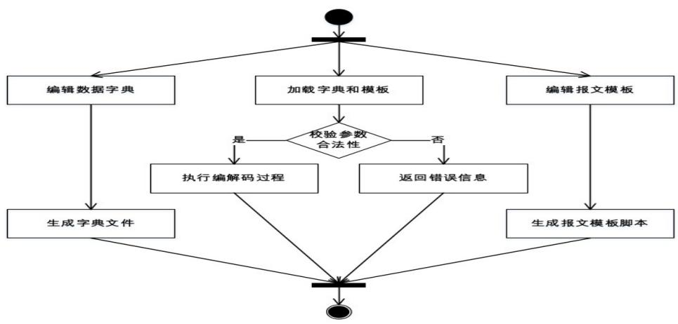
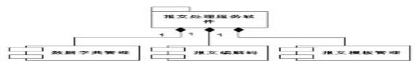
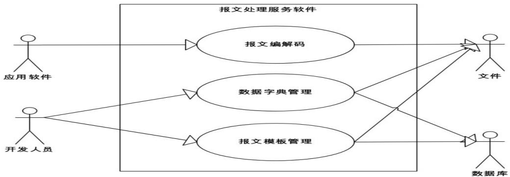
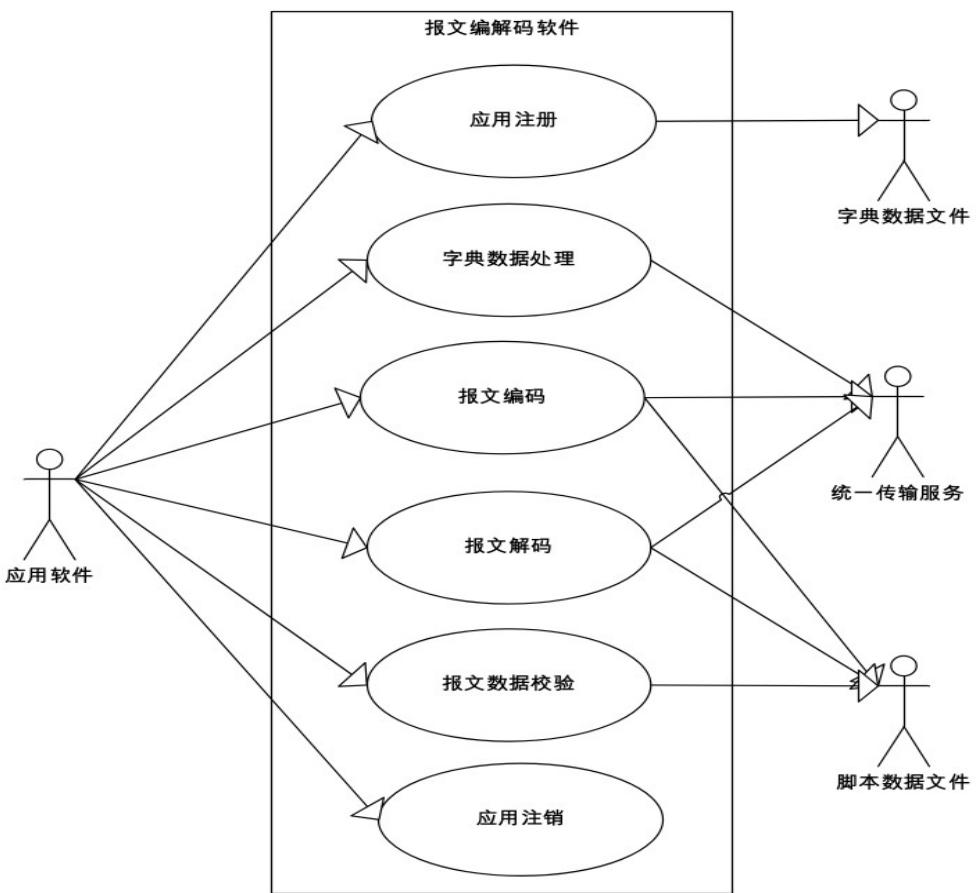
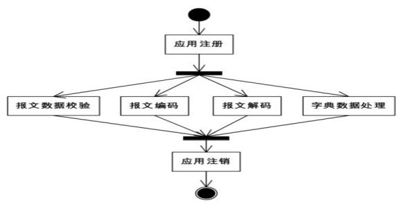

## 目 录

1 范围..  
1.1 标识.  
1.2 系统概述.  
1.2.1 系统和软件的用途....  
1.2.2 统与软件的一般特性.  
1.3 文档概述.  
2 引用文档..  
3 需求. .3  
3.1 要求的状态和方式. .3  
3.1.1 软件活动图. .3  
3.2 CSCI 能力需求. 4  
3.2.1 报文编解码服务（PZXQ-GN-BWBJ）. .5  
3.2.1.1 应用注册（PZXQ-GN-BWBJ-ZC） .7  
3.2.1.2 报文编码（PZXQ-GN-BWBJ-BWBM） ..9  
3.2.1.3 报文解码（PZXQ-GN-BWBJ-BWJM） ..17  
3.2.1.4 报文数据校验（PZXQ-GN-BWBJ-BWJY） ..25  
3.2.1.5 字典数据处理（PZXQ-GN-BWBJ-ZDCL） ..28  
3.2.1.6 应用注销（PZXQ-GN-BWBJ-ZX） ..34  
3.2.2 数据字典管理（PZXQ-GN-SJZD） ...34  
3.2.2.1 数据元素新增（PZXQ-GN-SJZD-XZYS） ..36  
3.2.2.2 数据元素编辑（PZXQ-GN-SJZD-BJYS） ..39  
3.2.2.3 数据元素删除（PZXQ-GN-SJZD-SCYS） ...44  
3.2.2.4 数据字典文件导入（PZXQ-GN-SJZD-WJDR） ..46  
3.2.2.5 数据字典文件导出（PZXQ-GN-SJZD-WJDC）. ...48  
3.2.3 报文模板管理（PZXQ-GN-BWMB）. ..52  
3.2.3.1 用户数据结构导出（PZXQ-GN-BWMB-JGDC） ..53  
3.2.3.2 模板脚本文件导出（PZXQ-GN-BWMB-JBDC） ..54  
3.2.3.3 模板脚本文件导入（PZXQ-GN-BWMB-JBDR） ..55  
3.2.3.4 报文模板新增（PZXQ-GN-BWMB-MBXZ） ..56  
3.2.3.5 报文模板编辑（PZXQ-GN-BWMB-MBBJ） .62  
3.2.3.6 报文模板删除（PZXQ-GN-BWMB-MBSC）. ..71  
3.3 CSCI 外部接口需求.. ..74  
3.3.1 接口标识和接口图. ..74  
3.3.2 人机交互接口（PZXQ-JK-RJJH）. ...75  
3.3.3 报文处理接口（PZXQ-JK-BWCL） ..76  
3.3.4 报文传输接口（PZXQ-JK-BWCS） ..77  
3.3.5 文件接口（PZXQ-JK-BWCS）. ..77  
3.3.6 数据库接口（PZXQ-JK-BWCS） ..78  
3.4 CSCI 内部接口需求. ..78  
3.4.1 接口标识和接口图. ..78  
3.4.2 配置文件接口（PZXQ-JK-PZWJ） ...79  
3.4.3 数据字典接口（PZXQ-JK-SJZD）.. ..79  
3.5 CSCI 内部数据需求. ..79  
3.6 适应性需求. ..80  
3.7 安全性需求. ..81  
3.8 保密性需求... ..81  
3.9 CSCI 环境需求. ...81  
3.9.1 运行环境需求. ...81  
3.9.2 开发环境需求.. ..82  
3.10 计算机资源需求. ..82  
3.10.1 计算机硬件需求.. ..82  
3.10.2 计算机硬件资源利用需求. ..83  
3.10.3 计算机软件需求.. ...83  
3.10.4 计算机通信需求.. ..83  
3.11 软件质量因素... ...83  
3.12 设计和构造的约束. ..84  
3.13 人员需求... ..84  
3.14 培训需求. ..84  
3.15 软件保障需求. ..85  
3.16 其他需求.. ..85  
3.17 验收、交付和包装需求.. ...85  
3.18 需求的优先顺序和关键性. ...85  
4 合格性规定. ..86  
5 需求可追踪性. ..88  
6 注释.... ..91

## 1 范围

## 1.1 标识

a) 本文档已被批准的标识号： ${ \mathsf { A Z } } _ { 6 9 3 } 2$ .490.0110 SRS；

b) 本文档所适用的软件名称为：报文处理服务；

c) 本文档的版本号为：V1.00.04/2020 年 12 月 31 日；

d) 本文档所适用的软件所属系统为：某级信息系统软件。

## 1.2 系统概述

## 1.2.1 系统和软件的用途

某级信息系统软件按照国产自主可控要求，进行基础软件环境选型，以及应用软件的新研和国产化迁移改造，对功能要素分散、流程独立的业务功能进行整合优化，研制适应不同使用需求、使用场景的软件，实现信息系统软件的融合、型谱优化和业务提能，推动某信息系统软件向“国产化、服务化、轻量化”方向发展。

某信息服务环境软件是某信息系统软件的重要组成，是连接底层各类硬件信息基础设施与上层各种应用系统的桥梁，通过基础平台融合汇聚底层资源，规范技术体制、支撑体系运行、促进互通互联等，是支撑构建某信息系统的重要支撑，其软件主要部署运行在各级机构的信息处理设备上，提供系统运维、数据运维、信息传输、信息处理、信息展现等功能，支撑应用软件和用户完成开发、集成、运维、运行全流程的使用。

报文处理服务作为信息服务环境的组成部分，提供桌面、平板、手持版三种形态的软件，为信息系统提供信息格式即时转换能力和报文模板管理能力。其中，报文编解码服务提供桌板、平板、手持版，在开发阶段提供应用程序接口，在运行阶段提供格式报文的编解码处理功能；数据字典管理功能提供桌面版，在开发阶段提供报文数据元素的编辑、管理；报文模板管理功能提供桌面版，在开发阶段，提供对报文模板的编辑、管理。

## 1.2.2 统与软件的一般特性

a) 需方：某单位；

b) 使用方：某单位；

c) 开发方：某单位；

d) 保障机构：某单位；

e) 运行方案：本软件提供调用接口，系统运行过程中，应用软件通过调用报文处理服务提供的接口完成报文编解码功能。

## 1.3 文档概述

在本文档中，第2章列出了本文档中引用的其它文档的信息，第3章详细描述了报文处理服务软件的各种需求以及实现方式，第4章规定了确认第3章各项需求正确实现的合格性验证方法，第5章描述本文档列出的各项需求与相应的系统需求规格说明文档列出的需求的对应关系。其中，第3章是本文档的主要部分。

## 2 引用文档

本文档的引用文档见表1。

表1 引用文档
<table><tr><td rowspan=1 colspan=1>文档编号</td><td rowspan=1 colspan=1>标题</td><td rowspan=1 colspan=1>修订版本</td><td rowspan=1 colspan=1>修订日期</td><td rowspan=1 colspan=1>编写单位</td></tr><tr><td rowspan=1 colspan=1>GJB 438B-2009</td><td rowspan=1 colspan=1>《军用软件开发文档编制规范》</td><td rowspan=1 colspan=1>一</td><td rowspan=1 colspan=1>2009年5月</td><td rowspan=1 colspan=1>总装备部</td></tr><tr><td rowspan=1 colspan=1>GJB 439A-2013</td><td rowspan=1 colspan=1>《军品软件质量保证通用要求》</td><td rowspan=1 colspan=1>一</td><td rowspan=1 colspan=1>2013年7月</td><td rowspan=1 colspan=1>国防科学技术工业委员会</td></tr><tr><td rowspan=1 colspan=1>GJB 450A-2004</td><td rowspan=1 colspan=1>《装备可靠性工作通用要求》</td><td rowspan=1 colspan=1>一</td><td rowspan=1 colspan=1>2004年7月</td><td rowspan=1 colspan=1>总装备部</td></tr><tr><td rowspan=1 colspan=1>GJB 2786A-2009</td><td rowspan=1 colspan=1>《军用软件开发通用要求》</td><td rowspan=1 colspan=1>一</td><td rowspan=1 colspan=1>2009年5月</td><td rowspan=1 colspan=1>总装备部</td></tr><tr><td rowspan=1 colspan=1>GJB 5235-2004</td><td rowspan=1 colspan=1>《军用软件配置管理》</td><td rowspan=1 colspan=1>一</td><td rowspan=1 colspan=1>2004年9月</td><td rowspan=1 colspan=1>总装备部</td></tr><tr><td rowspan=1 colspan=1>GJB/Z 102A-2012</td><td rowspan=1 colspan=1>《军用软件安全性设计指南》</td><td rowspan=1 colspan=1>一</td><td rowspan=1 colspan=1>2012年7月</td><td rowspan=1 colspan=1>总装备部</td></tr><tr><td rowspan=1 colspan=1>总装备部〔2005〕装字第4号</td><td rowspan=1 colspan=1>《军用软件质量管理规定》</td><td rowspan=1 colspan=1></td><td rowspan=1 colspan=1>2005年1月</td><td rowspan=1 colspan=1>总装备部</td></tr></table>

## 3 需求

## 3.1 要求的状态和方式

报文处理服务软件只有一个活动运行状态，无需多个运行状态和运行方式。

## 3.1.1 软件活动图

报文处理服务软件活动图如图1所示。

  
图1 报文处理服务软件活动图

报文处理服务包含数据字典编辑、报文模板编辑、报文编解码三个相对独立的主要流程，如果当前已经提供了需要编解码的报文的脚本文件、头文件及数据字典文件，可以立即进行编解码操作，若当前缺少脚本文件、头文件、数据字典文件中任意一项，可以通过报文模板管理工具以及数据字典管理工具生成相关文件再进行编解码操作。

## 3.2 CSCI 能力需求

报文处理服务软件按照其功能需求，包含报文编解码服务、数据字典管理功能和报文模板管理功能。

报文处理服务软件功能图，如图2所示。

  
图2 报文处理服务软件功能图

报文处理服务软件用例图，如图3所示。

  
图3 报文处理服务软件用例图  
报文处理服务软件所有能力标识表，见表2。

表2 报文处理服务软件所有能力标识
<table><tr><td rowspan=1 colspan=1>序号</td><td rowspan=1 colspan=1>Usecase 名称</td><td rowspan=1 colspan=1>项目唯一标识符</td><td rowspan=1 colspan=1>需求描述</td><td rowspan=1 colspan=1>需求重用</td><td rowspan=1 colspan=1>方式</td><td rowspan=1 colspan=1>运行状态</td><td rowspan=1 colspan=1>对应的任务书功能/性能</td></tr><tr><td rowspan=1 colspan=1>1</td><td rowspan=1 colspan=1>报文编解码服务</td><td rowspan=1 colspan=1>PZXQ-GN-BWBJ</td><td rowspan=1 colspan=1>提供应用程序接口；提供日志记录功能</td><td rowspan=1 colspan=1>沿用</td><td rowspan=1 colspan=1>桌面、平板、手持</td><td rowspan=1 colspan=1>开发、运行</td><td rowspan=1 colspan=1>4.1.14.2</td></tr><tr><td rowspan=1 colspan=1>2</td><td rowspan=1 colspan=1>数据字典管理</td><td rowspan=1 colspan=1>PZXQ-GN-SJZD</td><td rowspan=1 colspan=1>支持数据字典中数据项的增加、删除、修改和查找功能；能够将字典数据导出为数据字典文件，为编解码服务提供支持：能够通过导入数据字典文件来更新字典数据</td><td rowspan=1 colspan=1>沿用</td><td rowspan=1 colspan=1>桌面</td><td rowspan=1 colspan=1>开发</td><td rowspan=1 colspan=1>4.1.2</td></tr><tr><td rowspan=1 colspan=1>3</td><td rowspan=1 colspan=1>报文模板管理</td><td rowspan=1 colspan=1>PZXQ-GN-BWMB</td><td rowspan=1 colspan=1>支持报文模板的编辑功能，能够对报文模板进行增加、删除和修改；能够将模板数据导出为 XML 格式的报文脚本文件和.h 格式的用户数据结构；能够导入 XML 格式的报文脚本文件更新模板数据</td><td rowspan=1 colspan=1>沿用</td><td rowspan=1 colspan=1>桌面</td><td rowspan=1 colspan=1>开发</td><td rowspan=1 colspan=1>4.1.3</td></tr></table>

## 3.2.1 报文编解码服务（PZXQ-GN-BWBJ）

报文编解码服务提供所有面向应用软件的功能，实现应用注册、报文编码、报文解码、字典数据处理、报文数据校验和应用注册等功能和接口，其功能用例如图4所示。

  
图4 报文编解码服务用例图  
报文编解码服务所有能力标识，见表 $. 3 .$

表3 报文编解码服务所有能力能力标识
<table><tr><td colspan="1" rowspan="1">序号</td><td colspan="1" rowspan="1">Usecase 名称</td><td colspan="1" rowspan="1">项目唯一标识符</td><td colspan="1" rowspan="1">需求描述</td><td colspan="1" rowspan="1">需求重用</td><td colspan="1" rowspan="1">方式名称</td><td colspan="1" rowspan="1">运行状态</td><td colspan="1" rowspan="1">对应的任务书功能/性能</td></tr><tr><td colspan="1" rowspan="1">1</td><td colspan="1" rowspan="1">应用注册</td><td colspan="1" rowspan="1">PZXQ-GN-BWBJ-ZC</td><td colspan="1" rowspan="1">程序初始化，加载字典等资源</td><td colspan="1" rowspan="1">沿用</td><td colspan="1" rowspan="1">桌面、平板、手持</td><td colspan="1" rowspan="1">开发、运行</td><td colspan="1" rowspan="1">--</td></tr><tr><td colspan="1" rowspan="1">2</td><td colspan="1" rowspan="1">报文编码</td><td colspan="1" rowspan="1">PZXQ-GN-BWBJ-BWBM</td><td colspan="1" rowspan="1">将符合模板规则的用户数据结构进行编码，返回符合对应协议标准的比特数据或编码错误信息</td><td colspan="1" rowspan="1">沿用</td><td colspan="1" rowspan="1">桌面、平板、手持</td><td colspan="1" rowspan="1">开发、运行</td><td colspan="1" rowspan="1">4.1.14.2</td></tr><tr><td colspan="1" rowspan="1">3</td><td colspan="1" rowspan="1">报文解码</td><td colspan="1" rowspan="1">PZXQ-GN-BWBJ-BWJM</td><td colspan="1" rowspan="1">将符合对应协议标准的比特数据进行解码，返回符合模板规则的用户数据结构或解码错误信息</td><td colspan="1" rowspan="1">沿用</td><td colspan="1" rowspan="1">桌面、平板、手持</td><td colspan="1" rowspan="1">开发、运行</td><td colspan="1" rowspan="1">4.1.14.2</td></tr><tr><td colspan="1" rowspan="1">4</td><td colspan="1" rowspan="1">报文数据校验</td><td colspan="1" rowspan="1">PZXQ-GN-BWBJ-BWJY</td><td colspan="1" rowspan="1">能够检验输入的用户结构数据或比特数据，是否符合与之对应的模板规则或者协议标准</td><td colspan="1" rowspan="1">沿用</td><td colspan="1" rowspan="1">桌面、平板、手持</td><td colspan="1" rowspan="1">开发、运行</td><td colspan="1" rowspan="1">4.1.14.2</td></tr><tr><td colspan="1" rowspan="1">5</td><td colspan="1" rowspan="1">字典数据处理</td><td colspan="1" rowspan="1">PZXQ-GN-BWBJ-ZDCL</td><td colspan="1" rowspan="1">提供基于数据字典规则的数据处理</td><td colspan="1" rowspan="1">沿用</td><td colspan="1" rowspan="1">桌面、平板、手持</td><td colspan="1" rowspan="1">开发、运行</td><td colspan="1" rowspan="1">4.1.14.2</td></tr><tr><td colspan="1" rowspan="1">6</td><td colspan="1" rowspan="1">应用注销</td><td colspan="1" rowspan="1">PZXQ-GN-BWBJ-ZX</td><td colspan="1" rowspan="1">程序退出，释放资源</td><td colspan="1" rowspan="1">沿用</td><td colspan="1" rowspan="1">桌面、平板、手持</td><td colspan="1" rowspan="1">开发、运行</td><td colspan="1" rowspan="1"></td></tr></table>

报文编解码服务处理流程图如图5所示，报文编解码服务面向应用软件通过接口的方式提供数据字典处理和报文处理功能。系统执行注册过程完成资源加载后，应用软件能够调用相应接口实现报文编码、报文解码、报文数据校验三类报文处理功能；应用软件也可以调用相应接口实现字典数据处理功能；程序结束时系统需要执行注销过程，完成资源释放。

  
图5 报文编解码服务流程图

## 3.2.1.1 应用注册（PZXQ-GN-BWBJ-ZC）

应用注册提供应用初始化功能，检测应用提供的名称，加载数据字典数据，返回分配的应用识别码或者错误信息，应用注册处理流程，如图6所示。

  
图6 应用注册流程图

应用软件注册用例场景见表 $4 \textdegree$

表4 应用软件注册用例描述
<table><tr><td>Use Case 名称:应用软件注册</td><td colspan="2">Actors：应用软件、字典数据文件</td></tr><tr><td colspan="3">概述：本用例是应用注册的用例，描述应用软件调用API接口注册应用的过程</td></tr><tr><td colspan="3">前置条件:报文脚本文件、数据字典文件及报文头文件齐全</td></tr><tr><td colspan="3" rowspan="1">主事件流</td></tr><tr><td colspan="1" rowspan="1">Actor 的动作</td><td colspan="1" rowspan="1">系统的动作</td><td colspan="1" rowspan="1">动作约束(性能、可靠性、容错等)</td></tr><tr><td colspan="1" rowspan="1">1.应用软件注册报文处理服务，提供注册标识；4.提供字典数据；8.应用软件获得注册成功信息。</td><td colspan="1" rowspan="1">2.系统将检测注册标识的合法性，如果软件标识不合法，执行异常流E1；3.系统读取数据字典文件；5.系统加载字典数据，如果加载失败执行异常流E1；6.系统校验字典数据，过滤不合法数据；7.系统返回应用注册成功信息；</td><td colspan="1" rowspan="1">校验输入参数的合法性</td></tr><tr><td colspan="2" rowspan="1">异常流E1：系统提示注册失败，返回错误信息，记录日志，用例结束。</td><td colspan="1" rowspan="1"></td></tr><tr><td colspan="2" rowspan="1">后置条件：无。</td><td colspan="1" rowspan="1"></td></tr></table>

## 3.2.1.2 报文编码（PZXQ-GN-BWBJ-BWBM）

报文编码为应用软件提供编码应用程序接口，能够将符合模板规则的用户数据结构进行编码，返回符合对应协议标准的比特数据或编码错误信息，满足不同业务数据协议标准要求的数据处理规则。

## 3.2.1.3 报文解码（PZXQ-GN-BWBJ-BWJM）

报文解码为应用软件提供解码应用程序接口，能够将符合对应协议标准的比特数据进行解码，返回符合模板规则的用户数据结构或解码错误信息，满足不同业务数据协议标准要求的数据处理规则。

## 3.2.1.4 报文数据校验（PZXQ-GN-BWBJ-BWJY）

报文数据校验提供用户数据结构和比特报文的校验接口，能够检验输入的用户数据或比特数据，是否符合与之对应的模板规则或者协议标准，满足不同业务数据协议标准要求的数据处理规则。