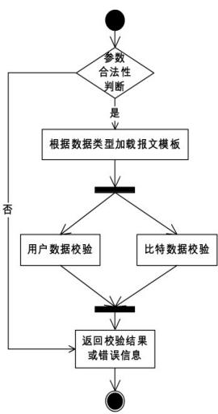
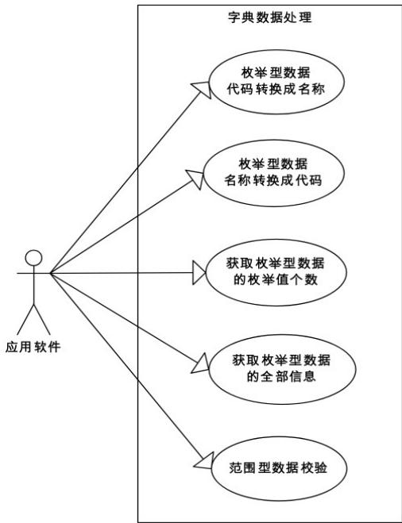
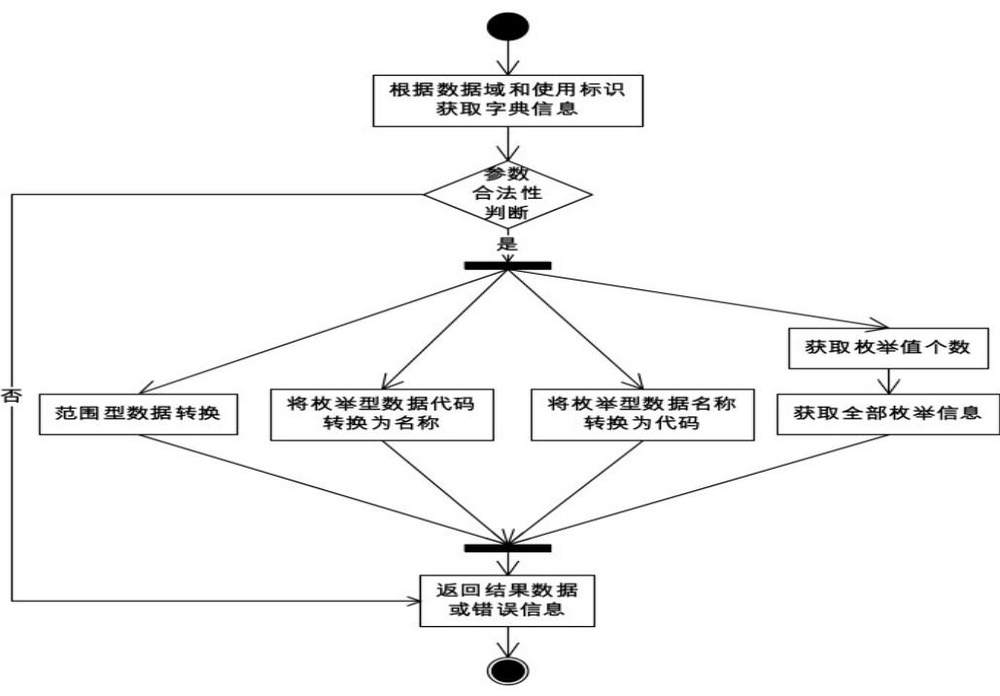

  
图7 报文数据校验功能用例图  
报文数据校验所有能力标识，见表5。

表5 报文数据校验所有能力标识
<table><tr><td rowspan=1 colspan=1>序号</td><td rowspan=1 colspan=1>Usecase名称</td><td rowspan=1 colspan=1>项目唯一标识符</td><td rowspan=1 colspan=1>需求描述</td><td rowspan=1 colspan=1>需求重用</td><td rowspan=1 colspan=1>方式名称</td><td rowspan=1 colspan=1>运行方式</td><td rowspan=1 colspan=1>对应的任务书功能/性能</td></tr><tr><td rowspan=1 colspan=1>1</td><td rowspan=1 colspan=1>用户数据校验</td><td rowspan=1 colspan=1>PZXQ-GN-BWBJ-BWJY-YHSJ</td><td rowspan=1 colspan=1>校验用户数据是否符合模板规则</td><td rowspan=1 colspan=1>沿用</td><td rowspan=1 colspan=1>桌面、平板、手持</td><td rowspan=1 colspan=1>开发、运行</td><td rowspan=1 colspan=1>4.1.1</td></tr><tr><td rowspan=1 colspan=1>2</td><td rowspan=1 colspan=1>比特报文校验</td><td rowspan=1 colspan=1>PZXQ-GN-BWBJ-BWJY-BTBW</td><td rowspan=1 colspan=1>校验比特数据是否符合对应数据协议</td><td rowspan=1 colspan=1>沿用</td><td rowspan=1 colspan=1>桌面、平板、手持</td><td rowspan=1 colspan=1>开发、运行</td><td rowspan=1 colspan=1>4.1.1</td></tr></table>

报文数据校验处理流程，如图8所示。

  
图8 报文数据校验处理流程图

用户数据校验用例场景见表 $6 \text{‰}$

表6 用户数据校验用例描述
<table><tr><td colspan="1" rowspan="1">Use Case 名称:用户数据校验</td><td colspan="2" rowspan="1">Actors：应用软件、模板脚本文件</td></tr><tr><td colspan="3" rowspan="1">概述：本用例描述校验用户报文数据是否符合对应模板规则的过程；</td></tr><tr><td colspan="3" rowspan="1">前置条件：报文编解码服务正常运行，报文脚本文件、数据字典文件及报文头文件齐全。</td></tr><tr><td colspan="3" rowspan="1">主事件流</td></tr><tr><td colspan="1" rowspan="1">Actor 的动作</td><td colspan="1" rowspan="1">系统的动作</td><td colspan="1" rowspan="1">动作约束(性能、可靠性、容错等)</td></tr><tr><td colspan="1" rowspan="1">1. 应用软件提供用户数据、报文格式编号、用户数据长度；</td><td colspan="1" rowspan="1">2.系统检测输入参数是否合法，检测失败执行异常流E1；3.系统根据报文格式编号读取报文模板脚本文件，如果文件读取失败，执行异常流E1；</td><td colspan="1" rowspan="1">校验输入参数的合法性</td></tr><tr><td colspan="1" rowspan="1">4.报文模板脚本文件提供模板数据；9.应用软件获取用户数据校验结果。</td><td colspan="1" rowspan="1">5.系统加载报文模板，如果加载失败，执行异常流E1；6.系统根据报文格式编号进入数据校验过程；7.如果识别到报文格式编号，则进入报文校验过程；8.校验过程中使用字典数据，校验每项用户数据，如果发现不符合项，执行异常流程E1；</td><td colspan="1" rowspan="1"></td></tr><tr><td colspan="2" rowspan="1">异常流E1：系统提示解码失败，返回错误信息，用例结束。</td><td colspan="1" rowspan="1"></td></tr><tr><td colspan="2" rowspan="1">后置条件：无。</td><td colspan="1" rowspan="1"></td></tr></table>

比特报文校验用例场景见表7。

表7 比特报文校验用例描述
<table><tr><td colspan="1" rowspan="1">Use Case 名称:比特报文校验</td><td colspan="2" rowspan="1">Actors:应用软件、模板脚本文件</td></tr><tr><td colspan="3" rowspan="1">概述：本用例描述校验比特报文是否符合对应数据协议的过程；</td></tr><tr><td colspan="3" rowspan="1">前置条件：报文编解码服务正常运行，报文脚本文件、数据字典文件及报文头文件齐全。</td></tr><tr><td colspan="3" rowspan="1">主事件流</td></tr><tr><td colspan="1" rowspan="1">Actor 的动作</td><td colspan="1" rowspan="1">系统的动作</td><td colspan="1" rowspan="1">动作约束(性能、可靠性、容错等)</td></tr><tr><td colspan="1" rowspan="1">1. 应用软件提供比特报文、报文格式编号、比特报文长度；4.报文模板脚本文件提供模板数据；</td><td colspan="1" rowspan="1">2.系统检测输入参数是否合法，检测失败执行异常流E1；3.系统根据报文格式编号读取报文模板脚本文件，如果文件读取失败，执行异常流E1；5.系统加载报文模板，如果加载失败，执行异常流E1；</td><td colspan="1" rowspan="1">校验输入参数的合法性</td></tr><tr><td colspan="1" rowspan="1">9.应用软件获取比特报文校验结果。</td><td colspan="1" rowspan="1">6. 系统根据报文格式编号进入数据校验过程；7.如果识别到报文格式编号，则进入报文校验过程；8.校验过程中根据协议规则使用字典数据，按比特逐位校验，如果发现不符合项，执行异常流程E1；</td><td colspan="1" rowspan="1"></td></tr><tr><td colspan="2" rowspan="1">异常流E1：系统提示解码失败，返回错误信息，用例结束。</td><td colspan="1" rowspan="1"></td></tr><tr><td colspan="2" rowspan="1">后置条件：无。</td><td colspan="1" rowspan="1"></td></tr></table>

## 3.2.1.5 字典数据处理（PZXQ-GN-BWBJ-ZDCL）

字典数据处理基于数据字典提供用户数据处理功能，为应用软件提供接口，能够将枚举型数据的代码转换成名称，能够将枚举型数据的名称转换成代码，能够获得枚举型字段的枚举值个数，能够获得枚举型字段的所有枚举值和相应VMF编码数组，能够检查范围型字段的用户数据是否正确，功能用例如图9所示。

  
图9 字典数据处理功能用例图  
字典数据处理所有能力标识，见表 $8 \text{‰}$

表8 字典数据处理所有能力标识
<table><tr><td colspan="1" rowspan="1">序号</td><td colspan="1" rowspan="1">Use case名称</td><td colspan="1" rowspan="1">项目唯一标识符</td><td colspan="1" rowspan="1">需求描述</td><td colspan="1" rowspan="1">需求重用</td><td colspan="1" rowspan="1">方式名称</td><td colspan="1" rowspan="1">运行状态</td><td colspan="1" rowspan="1">对应的任务书功能/性能</td></tr><tr><td colspan="1" rowspan="1">1</td><td colspan="1" rowspan="1">枚举型数据代码转换成名称</td><td colspan="1" rowspan="1">PZXQ-GN-BWBJ-ZDCL-MZMC</td><td colspan="1" rowspan="1">根据字典数据，将枚举型数据的代码转换为对应名称</td><td colspan="1" rowspan="1">沿用</td><td colspan="1" rowspan="1">桌面、平板、手持</td><td colspan="1" rowspan="1">开发、运行</td><td colspan="1" rowspan="1">4.1.1</td></tr><tr><td colspan="1" rowspan="1">2</td><td colspan="1" rowspan="1">枚举型数据名称转换成代码</td><td colspan="1" rowspan="1">PZXQ-GN-BWBJ-ZDCL-MCZM</td><td colspan="1" rowspan="1">根据字典数据，将枚举型数据的名称转换为对应代码</td><td colspan="1" rowspan="1">沿用</td><td colspan="1" rowspan="1">桌面、平板、手持</td><td colspan="1" rowspan="1">开发、运行</td><td colspan="1" rowspan="1">4.1.1</td></tr><tr><td colspan="1" rowspan="1">3</td><td colspan="1" rowspan="1">获取枚举型数据的枚举值个数</td><td colspan="1" rowspan="1">PZXQ-GN-BWBJ-ZDCL-MJSL</td><td colspan="1" rowspan="1">根据字典数据，获取枚举型数据枚举值数量</td><td colspan="1" rowspan="1">沿用</td><td colspan="1" rowspan="1">桌面、平板、手持</td><td colspan="1" rowspan="1">开发、运行</td><td colspan="1" rowspan="1">4.1.1</td></tr><tr><td colspan="1" rowspan="1">4</td><td colspan="1" rowspan="1">获取枚举型数据的全部信息</td><td colspan="1" rowspan="1">PZXQ-GN-BWBJ-ZDCL-MJXX</td><td colspan="1" rowspan="1">根据字典数据，获取枚举型数据的全部数据</td><td colspan="1" rowspan="1">沿用</td><td colspan="1" rowspan="1">桌面、平板、手持</td><td colspan="1" rowspan="1">开发、运行</td><td colspan="1" rowspan="1">4.1.1</td></tr><tr><td colspan="1" rowspan="1">5</td><td colspan="1" rowspan="1">范围型数据校验</td><td colspan="1" rowspan="1">PZXQ-GN-BWBJ-ZDCL-FWJY</td><td colspan="1" rowspan="1">根据字典数据，校验范围型数据是否符合协议，并返回编码值</td><td colspan="1" rowspan="1">沿用</td><td colspan="1" rowspan="1">桌面、平板、手持</td><td colspan="1" rowspan="1">开发、运行</td><td colspan="1" rowspan="1">4.1.1</td></tr></table>

字典数据处理的流程，如图10所示。字典数据处理是指可以完全依据字典数据实现的部分功能，为业务提供枚举型数据信息的获取和范围型数据的校验。

  
图10 字典数据处理流程图  
枚举型数据代码转换成名称用例场景见表9。

表9 枚举型数据代码转换成名称用例描述
<table><tr><td colspan="1" rowspan="1">Use Case 名称:枚举型代码转换成名称</td><td colspan="2" rowspan="1">Actors:应用软件</td></tr><tr><td colspan="3" rowspan="1">概述：本用例描述根据字典数据将枚举型数据的代码转换成名称的过程</td></tr><tr><td colspan="3" rowspan="1">前置条件：报文编解码服务运行正常运行正常</td></tr><tr><td colspan="3" rowspan="1">主事件流</td></tr><tr><td colspan="1" rowspan="1">Actor的动作</td><td colspan="1" rowspan="1">系统的动作</td><td colspan="1" rowspan="1">动作约束(性能、可靠性、容错等)</td></tr><tr><td colspan="1" rowspan="1">1.应用软件输入或者使用请求响应接口推送数据域标识DFI编号、数据使用标识DUI编号、枚举型数据的代码以及代码所对应名称的存储地址</td><td colspan="1" rowspan="1"></td><td colspan="1" rowspan="1">校验输入参数的合法性</td></tr><tr><td colspan="1" rowspan="1">5.应用软件获取枚举代码对应的名称或者错误信息。</td><td colspan="1" rowspan="1">2.系统根据 DFI 和 DUI 检索到数据项的规则，检索失败执行异常流E1；3.系统检查输入输出参数是否合法，如果参数非法执行异常流E1；4.系统依据数据字典中数据项的规则，找到枚举代码对应的枚举名称。如果转换失败，执行异常流E1。</td><td colspan="1" rowspan="1"></td></tr><tr><td colspan="2" rowspan="1">异常流E1：系统提示转换失败，返回错误信息，用例结束。</td><td colspan="1" rowspan="1"></td></tr><tr><td colspan="2" rowspan="1">后置条件：无。</td><td colspan="1" rowspan="1"></td></tr></table>

枚举型数据名称转换成代码用例场景见表10。

表10 枚举型数据名称转换成代码用例描述
<table><tr><td colspan="1" rowspan="1">Use Case 名称：枚举型数据名称转换成代码</td><td colspan="2" rowspan="1">Actors:应用软件</td></tr><tr><td colspan="3" rowspan="1">概述：本用例描述根据字典数据将枚举型数据的名称转换成代码的过程</td></tr><tr><td colspan="3" rowspan="1">前置条件：报文编解码服务运行正常运行正常</td></tr><tr><td colspan="3" rowspan="1">主事件流</td></tr><tr><td colspan="1" rowspan="1">Actor 的动作</td><td colspan="1" rowspan="1">系统的动作</td><td colspan="1" rowspan="1">动作约束(性能、可靠性、容错等)</td></tr><tr><td colspan="1" rowspan="1">1. 应用软件提供数据域标识 DFI编号、数据使用标识DUI编号、枚举型数据的名称以及名称所对应代码的存储地址；5.应用软件获取枚举名称对应的代码或者错误信息。</td><td colspan="1" rowspan="1">2.系统根据 DFI 和 DUI 检索到数据项的规则，检索失败执行异常流E1；3.系统检查输入输出参数是否合法，如果参数非法执行异常流E1；4.系统依据数据字典中数据项的规则，找到枚举名称对应的枚举代码。如果转换失败，执行异常流E1。</td><td colspan="1" rowspan="1">校验输入参数的合法性</td></tr><tr><td colspan="2" rowspan="1">异常流E1：系统提示转换失败，返回错误信息，用例结束。</td><td colspan="1" rowspan="1"></td></tr><tr><td colspan="2">后置条件：无。</td><td></td></tr></table>

获取枚举型数据的枚举值个数用例场景见表11。

表11 获取枚举型数据的枚举值个数用例描述
<table><tr><td rowspan=1 colspan=1>Use Case 名称:获取枚举型数据的枚举值个数</td><td rowspan=1 colspan=2>Actors:应用软件</td></tr><tr><td rowspan=1 colspan=3>概述：本用例描述应用软件使用数据域和使用标识获取枚举型数据的枚举个数的过程</td></tr><tr><td rowspan=1 colspan=3>前置条件：报文编解码服务软件运行正常</td></tr><tr><td rowspan=1 colspan=3>主事件流</td></tr><tr><td rowspan=1 colspan=1>Actor 的动作</td><td rowspan=1 colspan=1>系统的动作</td><td rowspan=1 colspan=1>动作约束(性能、可靠性、容错等)</td></tr><tr><td rowspan=1 colspan=1>1. 应用软件提供数据域标识DFI编号、数据使用标识DUI编号；5.应用软件获取枚举型数据的枚举个数。</td><td rowspan=1 colspan=1>2.系统根据 DFI 和 DUI检索到数据项的规则，检索失败执行异常流E1；3.系统检查输入输出参数是否合法，如果参数非法执行异常流E1；4.系统依据数据字典中数据项的信息，获取枚举值的总数。如果获取失败，执行异常流E1。</td><td rowspan=1 colspan=1>校验输入参数的合法性</td></tr><tr><td rowspan=1 colspan=2>异常流E1：系统提示转换失败，返回错误信息，用例结束。</td><td rowspan=1 colspan=1></td></tr><tr><td rowspan=1 colspan=2>后置条件：无。</td><td rowspan=1 colspan=1></td></tr></table>

获取枚举型数据全部信息用例场景见表12。

表12 获取枚举型数据全部信息用例描述
<table><tr><td colspan="1" rowspan="1">Use Case 名称:获取枚举型数据全部信息</td><td colspan="2" rowspan="1">Actors:应用软件</td></tr><tr><td colspan="3" rowspan="1">概述:本用例描述应用软件获取枚举型数据的全部枚举信息的过程</td></tr><tr><td colspan="3" rowspan="1">前置条件：报文编解码服务运行正常运行正常</td></tr><tr><td colspan="3" rowspan="1">主事件流</td></tr><tr><td colspan="1" rowspan="1">Actor 的动作</td><td colspan="1" rowspan="1">系统的动作</td><td colspan="1" rowspan="1">动作约束(性能、可靠性、容错等)</td></tr><tr><td colspan="1" rowspan="1">1. 应用软件提供数据域标识 DFI编号、数据使用标识 DUI 编号；</td><td colspan="1" rowspan="1"></td><td colspan="1" rowspan="1">校验输入参数的合法性</td></tr><tr><td>5.应用软件获取枚举型数据的枚举个 数； 6.应用软件输入或者使用请求响应接口 推送数据域标识DFI编号、数据使用标 识DUI编号、枚举个数、枚举信息的存 储地址及长度；</td><td>2.系统根据 DFI 和 DUI检索到数据项的 规则，检索失败执行异常流E1； 3.系统检查输入输出参数是否合法，如 果参数非法执行异常流E1； 4.系统依据数据字典中数据项的信息， 获取枚举值的总数。如果获取失败，执 行异常流E1。 7.系统根据 DFI 和 DUI 检索到数据项的 规则，检索失败执行异常流E1； 8.系统检查输入输出参数是否合法，如 果参数非法执行异常流E1； 9.系统依据数据字典中数据项的信息， 返回全部枚举对应关系的信息。如果获 取失败，执行异常流E1；</td><td></td></tr><tr><td colspan="2">10.应用软件获取全部枚举信息或者错误 信息。</td><td></td></tr><tr><td colspan="2">异常流E1：系统提示转换失败，返回错误信息，用例结束。</td><td></td></tr><tr><td colspan="2">后置条件：无。</td><td></td></tr></table>

范围型数据校验用例场景见表13。

表13 范围型数据校验用例描述
<table><tr><td rowspan=1 colspan=1>Use Case 名称:范围型数据校验</td><td rowspan=1 colspan=2>Actors：应用软件</td></tr><tr><td rowspan=1 colspan=3>概述：本用例描述依据数据字典检验范围型数据是否合法，并返回编码值的过程</td></tr><tr><td rowspan=1 colspan=3>前置条件：报文编解码服务运行正常</td></tr><tr><td rowspan=1 colspan=3>主事件流</td></tr><tr><td rowspan=1 colspan=1>Actor 的动作</td><td rowspan=1 colspan=1>系统的动作</td><td rowspan=1 colspan=1>动作约束</td></tr></table>