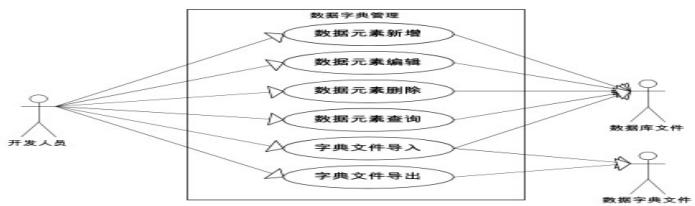
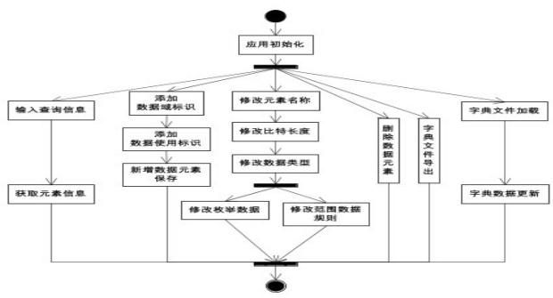
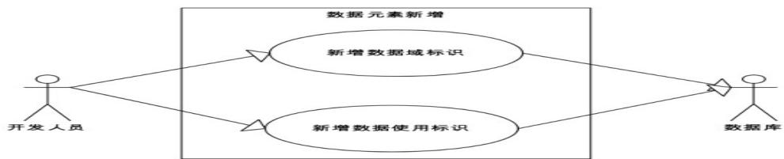
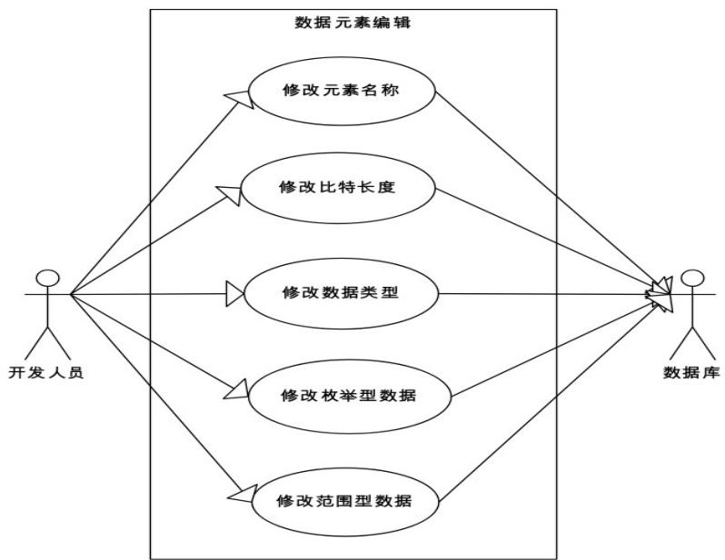
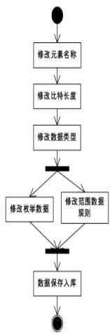

<table><tr><td></td><td></td><td>(性能、可靠性、容错等)</td></tr><tr><td>1. 应用软件提供范围型数据的数据域标 识DFI编号、数据使用标识DUI编号、 范围型数据用户使用值；</td><td>2.系统根据 DFI 和 DUI 检索到数据项的 规则，检索失败执行异常流E1； 3.系统检查输入输出参数是否合法，如 果参数非法执行异常流E1； 4.系统依据数据字典中数据项的规则， 将用户值转换为编码值。如果转失败， 执行异常流E1。</td><td>校验输入参数的合法性</td></tr><tr><td>5.应用软件范围型数据的编码值，或者 错误信息。</td><td></td><td></td></tr><tr><td>异常流E1：系统提示转换失败，返回错误信息，用例结束。</td><td></td><td></td></tr><tr><td>后置条件：无。</td><td></td><td></td></tr></table>

3.2.1.6 应用注销（PZXQ-GN-BWBJ-ZX）  
应用注销提供服务资源释放的功能，处理流程，如图11所示。

  
图11 应用注销流程图

应用软件注销用例场景见表14。

表14 应用软件注销用例描述
<table><tr><td rowspan=1 colspan=1>Use Case 名称：应用软件注销</td><td rowspan=1 colspan=1>Actors：应用软件</td></tr><tr><td rowspan=1 colspan=2>概述：本用例描述应用软件显示调用注销接口释放资源的过程</td></tr><tr><td rowspan=1 colspan=2>前置条件：报文编解码服务运行正常</td></tr><tr><td rowspan=1 colspan=2>主事件流</td></tr></table>

<table><tr><td rowspan=1 colspan=1>Actor 的动作</td><td rowspan=1 colspan=1>系统的动作</td><td rowspan=1 colspan=1>动作约束(性能、可靠性、容错等)</td></tr><tr><td rowspan=1 colspan=1>1.应用软件调用注销接口；</td><td rowspan=1 colspan=1>2.系统释放共享内存、字典数据、模板数据等资源数据。</td><td rowspan=1 colspan=1></td></tr><tr><td rowspan=1 colspan=2>异常流E1：无。</td><td rowspan=1 colspan=1></td></tr><tr><td rowspan=1 colspan=2>后置条件：无。</td><td rowspan=1 colspan=1></td></tr></table>

## 3.2.2 数据字典管理（PZXQ-GN-SJZD）

数据字典管理具有人机交互界面，为开发人员提供报文数据元素的管理能功，能够导出报文数据字典文件供报文编解码服务使用，能够导入数据字典文件更新数据库，能够新增数据元素，能够修改数据元素，能够删除数据元素，能够查询数据元素，其功能用例如图12所示。

  
图12 数据字典管理用例图

数据字典管理所有能力标识，见表15。

表15 数据字典管理所有能力能力标识
<table><tr><td colspan="1" rowspan="1">序号</td><td colspan="1" rowspan="1">Use case名称</td><td colspan="1" rowspan="1">项目唯一标识符</td><td colspan="1" rowspan="1">需求描述</td><td colspan="1" rowspan="1">需求重用</td><td colspan="1" rowspan="1">方式名称</td><td colspan="1" rowspan="1">运行状态</td><td colspan="1" rowspan="1">对应的任务书功能/性能</td></tr><tr><td colspan="1" rowspan="1">1</td><td colspan="1" rowspan="1">数据元素新增</td><td colspan="1" rowspan="1">PZXQ-GN-SJZD-XZYS</td><td colspan="1" rowspan="1">支持开发人员根据数据协议新增数据元素</td><td colspan="1" rowspan="1">沿用</td><td colspan="1" rowspan="1">桌面</td><td colspan="1" rowspan="1">运行</td><td colspan="1" rowspan="1">4.1.2</td></tr><tr><td colspan="1" rowspan="1">2</td><td colspan="1" rowspan="1">数据元素编辑</td><td colspan="1" rowspan="1">PZXQ-GN-SJZD-BJYS</td><td colspan="1" rowspan="1">支持开发人员根据数据协议修改已存在的数据元素</td><td colspan="1" rowspan="1">沿用</td><td colspan="1" rowspan="1">桌面</td><td colspan="1" rowspan="1">运行</td><td colspan="1" rowspan="1">4.1.2</td></tr><tr><td colspan="1" rowspan="1">3</td><td colspan="1" rowspan="1">数据元素删除</td><td colspan="1" rowspan="1">PZXQ-GN-SJZD-SCYS</td><td colspan="1" rowspan="1">支持开发人员删除已存在的数据元素</td><td colspan="1" rowspan="1">沿用</td><td colspan="1" rowspan="1">桌面</td><td colspan="1" rowspan="1">运行</td><td colspan="1" rowspan="1">4.1.2</td></tr><tr><td colspan="1" rowspan="1">4</td><td colspan="1" rowspan="1">字典文件导入</td><td colspan="1" rowspan="1">PZXQ-GN-SJZD-WJDR</td><td colspan="1" rowspan="1">能够通过导入数据字典文件来更新数据库</td><td colspan="1" rowspan="1">沿用</td><td colspan="1" rowspan="1">桌面</td><td colspan="1" rowspan="1">运行</td><td colspan="1" rowspan="1">4.1.2</td></tr><tr><td colspan="1" rowspan="1">5</td><td colspan="1" rowspan="1">字典文件导出</td><td colspan="1" rowspan="1">PZXQ-GN-SJZD-WJDC</td><td colspan="1" rowspan="1">能够根据数据库中的内容导出对应的数据字典文件</td><td colspan="1" rowspan="1">沿用</td><td colspan="1" rowspan="1">桌面</td><td colspan="1" rowspan="1">运行</td><td colspan="1" rowspan="1">4.1.2</td></tr><tr><td colspan="1" rowspan="1">6</td><td colspan="1" rowspan="1">数据元素查找</td><td colspan="1" rowspan="1">PZXQ-GN-SJZD-YSCZ</td><td colspan="1" rowspan="1">能够根据 DFI、DUI 或者 DUI名称查找数据元素</td><td colspan="1" rowspan="1">沿用</td><td colspan="1" rowspan="1">桌面</td><td colspan="1" rowspan="1">运行</td><td colspan="1" rowspan="1">4.1.2</td></tr></table>

数据字典管理流程如图13所示。

  
图13 数据字典管理流程图

## 3.2.2.1 数据元素新增（PZXQ-GN-SJZD-XZYS）

数据元素新增提供用户向数据字典中添加数据元素的手段，主要包括新增数据域标识和数据使用标识功能，其功能用例如图14所示。

  
图14 数据元素新增用例图  
数据元素新增所有能力标识，见表16。

表16 数据元素新增所有能力标识
<table><tr><td rowspan=1 colspan=1>序号</td><td rowspan=1 colspan=1>Use case 名称</td><td rowspan=1 colspan=1>项目唯一标识符</td><td rowspan=1 colspan=1>需求描述</td><td rowspan=1 colspan=1>需求重用</td><td rowspan=1 colspan=1>方式名称</td><td rowspan=1 colspan=1>运行状态</td><td rowspan=1 colspan=1>对应的任务书功能/性能</td></tr><tr><td rowspan=1 colspan=1>1</td><td rowspan=1 colspan=1>新增数据域标识</td><td rowspan=1 colspan=1>PZXQ-GN-SJZD-XZYS-YBZ</td><td rowspan=1 colspan=1>向数据字典中添加数据域标识</td><td rowspan=1 colspan=1>沿用</td><td rowspan=1 colspan=1>桌面</td><td rowspan=1 colspan=1>开发</td><td rowspan=1 colspan=1>4.1.2</td></tr><tr><td rowspan=1 colspan=1>2</td><td rowspan=1 colspan=1>新增数据使用标识</td><td rowspan=1 colspan=1>PZXQ-GN-SJZD-XZYS-SYBZ</td><td rowspan=1 colspan=1>向数据字典中添加数据使用标识</td><td rowspan=1 colspan=1>沿用</td><td rowspan=1 colspan=1>桌面</td><td rowspan=1 colspan=1>开发</td><td rowspan=1 colspan=1>4.1.2</td></tr></table>

数据元素新增流程，如图15所示。

  
图15 数据元素新增流程图  
新增数据域标识用例场景见表17。

表17 新增数据域标识用例描述
<table><tr><td rowspan=1 colspan=1>Use Case 名称：新增数据域标识</td><td rowspan=1 colspan=2>Actors：用户、数据库</td></tr><tr><td rowspan=1 colspan=3>概述：本用例描述用户通过数据字典管理工具添加数据域标识的过程</td></tr><tr><td rowspan=1 colspan=3>前置条件：数据字典管理工具软件运行正常，报文处理数据库运行正常</td></tr><tr><td rowspan=1 colspan=3>主事件流</td></tr><tr><td rowspan=1 colspan=1>Actor 的动作</td><td rowspan=1 colspan=1>系统的动作</td><td rowspan=1 colspan=1>动作约束(性能、可靠性、容错等)</td></tr><tr><td rowspan=1 colspan=1>1.用户输入数据域标识；5.数据库将数据域标识保存到数据字典中；7.用户得到处理完成的信息反馈。</td><td rowspan=1 colspan=1>2.系统检测输入标识的合法性，如果输入标识不合法，执行异常流E1；3.系统检查输入的数据域标识是否已经存在，如果已经存在执行异常流E1；4.系统将数据域标识保存入库，如果入库失败，执行异常流E1；6.系统完成数据域标识入库过程；</td><td rowspan=1 colspan=1>校验输入参数的合法性</td></tr><tr><td rowspan=1 colspan=2>异常流E1：系统给出提示信息，用户根据提示信息继续执行。</td><td rowspan=1 colspan=1></td></tr><tr><td rowspan=1 colspan=2>后置条件：无。</td><td rowspan=1 colspan=1></td></tr></table>

新增数据使用标识用例场景表18。

表18 新增数据使用标识用例描述
<table><tr><td colspan="1" rowspan="1">Use Case 名称：新增数据使用标识</td><td colspan="2" rowspan="1">Actors：用户、数据库</td></tr><tr><td colspan="3" rowspan="1">概述：本用例描述用户通过数据字典管理工具添加数据使用标识的过程</td></tr><tr><td colspan="3" rowspan="1">前置条件：数据字典管理工具软件运行正常，报文处理数据库运行正常</td></tr><tr><td colspan="3" rowspan="1">主事件流</td></tr><tr><td colspan="1" rowspan="1">Actor 的动作</td><td colspan="1" rowspan="1">系统的动作</td><td colspan="1" rowspan="1">动作约束(性能、可靠性、容错等)</td></tr><tr><td colspan="1" rowspan="1">1.用户选择数据域标识，为其添加数据使用标识；</td><td colspan="1" rowspan="1">2.系统检测输入的数据使用标识的合法</td><td colspan="1" rowspan="1">校验输入参数的合法性</td></tr><tr><td>5.数据库将数据使用标识保存到数据字 典中；</td><td>性，如果输入标识不合法，执行异常流 E1; 3.系统检查输入的数据使用标识是否已 经存在，如果已经存在执行异常流E1； 4.系统将数据域标识保存入库，如果入 库失败，执行异常流E1；</td><td></td></tr><tr><td colspan="2">7.用户得到处理完成的信息反馈。 异常流E1：系统给出提示信息，用户根据提示信息继续执行。</td><td>6.系统完成数据使用标识入库过程；</td></tr><tr><td colspan="2">后置条件：无。</td><td></td></tr></table>

## 3.2.2.2 数据元素编辑（PZXQ-GN-SJZD-BJYS）

数据元素编辑提供用户修改数据元素内容的手段，主要包括修改元素名称、修改比特长度、修改数据类型、修改枚举型数据、修改范围型数据等功能，功能用例见图16。

图16 数据元素编辑功能用例图

数据元素编辑所有能力标识，见表19。

表19 数据元素编辑所有能力标识
<table><tr><td rowspan=1 colspan=1>序号</td><td rowspan=1 colspan=1>Use case名称</td><td rowspan=1 colspan=1>项目唯一标识符</td><td rowspan=1 colspan=1>需求描述</td><td rowspan=1 colspan=1>需求重用</td><td rowspan=1 colspan=1>方式名称</td><td rowspan=1 colspan=1>运行状态</td><td rowspan=1 colspan=1>对应的任务书功能/性能</td></tr><tr><td rowspan=1 colspan=1>1</td><td rowspan=1 colspan=1>修改数据元素名称</td><td rowspan=1 colspan=1>PZXQ-GN-SJZD-BJYS-MCXG</td><td rowspan=1 colspan=1>修改数据元素名称和变量名称</td><td rowspan=1 colspan=1>沿用</td><td rowspan=1 colspan=1>桌面</td><td rowspan=1 colspan=1>开发</td><td rowspan=1 colspan=1>4.1.2</td></tr><tr><td rowspan=1 colspan=1>2</td><td rowspan=1 colspan=1>修改比特长度</td><td rowspan=1 colspan=1>PZXQ-GN-SJZD-BJYS-CDXG</td><td rowspan=1 colspan=1>按照数据协议，修改数据元素的比特长度</td><td rowspan=1 colspan=1>沿用</td><td rowspan=1 colspan=1>桌面</td><td rowspan=1 colspan=1>开发</td><td rowspan=1 colspan=1>4.1.2</td></tr><tr><td rowspan=1 colspan=1>3</td><td rowspan=1 colspan=1>修改数据类型</td><td rowspan=1 colspan=1>PZXQ-GN-SJZD-BJYS-LXXG</td><td rowspan=1 colspan=1>修改数据元素的用户数据类型</td><td rowspan=1 colspan=1>沿用</td><td rowspan=1 colspan=1>桌面</td><td rowspan=1 colspan=1>开发</td><td rowspan=1 colspan=1>4.1.2</td></tr><tr><td rowspan=1 colspan=1>4</td><td rowspan=1 colspan=1>修改枚举型数据</td><td rowspan=1 colspan=1>PZXQ-GN-SJZD-BJYS-MJXG</td><td rowspan=1 colspan=1>修改枚举型数据的枚举信息</td><td rowspan=1 colspan=1>沿用</td><td rowspan=1 colspan=1>桌面</td><td rowspan=1 colspan=1>开发</td><td rowspan=1 colspan=1>4.1.2</td></tr><tr><td rowspan=1 colspan=1>5</td><td rowspan=1 colspan=1>修改范围型数据</td><td rowspan=1 colspan=1>PZXQ-GN-SJZD-BJYS-FWXG</td><td rowspan=1 colspan=1>修改范围型数据的数据规则</td><td rowspan=1 colspan=1>沿用</td><td rowspan=1 colspan=1>桌面</td><td rowspan=1 colspan=1>开发</td><td rowspan=1 colspan=1>4.1.2</td></tr></table>

数据元素编辑的流程，如图17所示。

  
图17 数据元素编辑流程图

## 修改元素名称用例场景见表20。

表20 修改元素名称用例描述
<table><tr><td rowspan=1 colspan=1>Use Case 名称：修改元素名称</td><td rowspan=1 colspan=2>Actors：用户、数据库</td></tr><tr><td rowspan=1 colspan=3>概述：本用例描述用户通过数据字典管理工具修改数据元素名称的过程</td></tr><tr><td rowspan=1 colspan=3>前置条件：数据字典管理工具软件运行正常，报文处理数据库运行正常</td></tr><tr><td rowspan=1 colspan=3>主事件流</td></tr><tr><td rowspan=1 colspan=1>Actor 的动作</td><td rowspan=1 colspan=1>系统的动作</td><td rowspan=1 colspan=1>动作约束(性能、可靠性、容错等)</td></tr><tr><td rowspan=1 colspan=1>1.用户选择数据使用标识，进入数据元素编辑模式；3.用户修改数据元素名称；5.用户修改数据属性名称；7.数据库将元素名称信息保存到数据字典中；9.用户得到处理完成的信息反馈。</td><td rowspan=1 colspan=1>2.系统接收用户操作，显示数据元素编辑状态；4.系统检查输入的元素名称是否合法，如果不合法执行异常流E1；6.系统检查输入的属性名称是否合法，如果不合法，执行异常流E1；8.系统完成数据信息入库过程；</td><td rowspan=1 colspan=1>校验输入参数的合法性</td></tr><tr><td rowspan=1 colspan=2>异常流E1：系统给出提示信息，用户根据提示信息继续执行。</td><td rowspan=1 colspan=1></td></tr><tr><td rowspan=1 colspan=2>后置条件：无。</td><td rowspan=1 colspan=1></td></tr></table>

修改比特长度用例场景见表21。

表21 修改比特长度用例描述
<table><tr><td>Use Case 名称:修改比特长度</td><td colspan="2">Actors:用户、数据库</td></tr><tr><td colspan="3">概述：本用例描述用户通过数据字典管理工具修改数据元素比特长度的过程</td></tr><tr><td colspan="3">前置条件:数据字典管理工具软件运行正常，报文处理数据库运行正常</td></tr><tr><td colspan="3">主事件流</td></tr><tr><td>Actor 的动作</td><td>系统的动作</td><td>动作约束 (性能、可靠性、容错等)</td></tr><tr><td>1.用户选择数据使用标识，进入数据元 素编辑模式；</td><td>2.系统接收用户操作，显示数据元素编 辑状态；</td><td rowspan="3">校验输入参数的合法性</td></tr><tr><td>3.用户根据协议规定修改数据元素的比 特长度；</td><td>4.系统检查输入的长度值是否合法，如</td></tr><tr><td>5.数据库将元素名称信息保存到数据字 典中；</td><td>果不合法执行异常流E1； 6.系统完成数据信息入库过程：</td></tr><tr><td colspan="2">7.用户得到处理完成的信息反馈。</td><td></td></tr><tr><td colspan="2">异常流E1：系统给出提示信息，用户根据提示信息继续执行。</td><td></td></tr></table>

修改数据类型用例场景见表22。

表22 修改数据类型用例描述
<table><tr><td rowspan=1 colspan=1>Use Case 名称:修改数据类型</td><td rowspan=1 colspan=2>Actors：用户、数据库</td></tr><tr><td rowspan=1 colspan=3>概述：本用例描述用户通过数据字典管理工具修改数据元素用户数据类型的过程</td></tr><tr><td rowspan=1 colspan=3>前置条件：数据字典管理工具软件运行正常，报文处理数据库运行正常</td></tr><tr><td rowspan=1 colspan=3>主事件流</td></tr><tr><td rowspan=1 colspan=1>Actor 的动作</td><td rowspan=1 colspan=1>系统的动作</td><td rowspan=1 colspan=1>动作约束(性能、可靠性、容错等)</td></tr><tr><td rowspan=1 colspan=1>1.用户选择数据使用标识，进入数据元素编辑模式；3.用户根据协议规定修改数据元素的数据类型；</td><td rowspan=1 colspan=1>2.系统接收用户操作，显示数据元素编辑状态；</td><td rowspan=1 colspan=1>校验输入参数的合法性</td></tr></table>