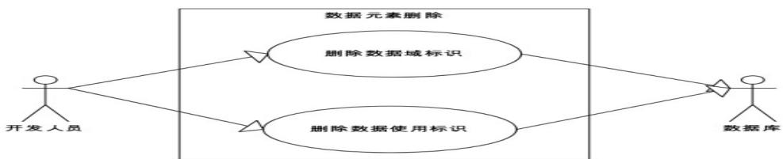
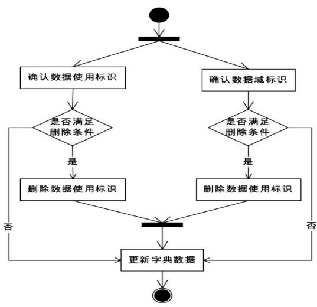
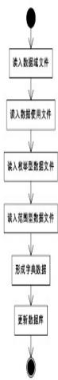
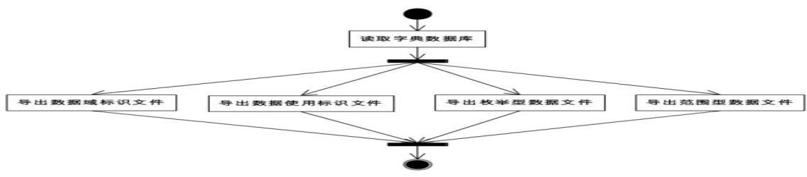
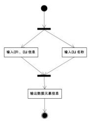

<table><tr><td rowspan=1 colspan=1>5.数据库将数据类型保存到数据字典中；7.用户得到处理完成的信息反馈。</td><td rowspan=1 colspan=1>4.系统保存数据类型，根据数据类型更新元素可编辑项；6.系统完成数据信息入库过程：</td><td rowspan=1 colspan=1></td></tr><tr><td rowspan=1 colspan=2>异常流E1：系统给出提示信息，用户根据提示信息继续执行。</td><td rowspan=1 colspan=1></td></tr><tr><td rowspan=1 colspan=2>后置条件：无。</td><td rowspan=1 colspan=1></td></tr></table>

修改枚举型数据用例场景见表23。

表23 修改枚举型数据用例描述
<table><tr><td>Use Case 名称:修改枚举型数据</td><td colspan="2">Actors：用户、数据库</td></tr><tr><td colspan="3">概述：本用例描述用户通过数据字典管理工具修改枚举型数据枚举值的过程</td></tr><tr><td colspan="3">前置条件：数据字典管理工具软件运行正常，报文处理数据库运行正常</td></tr><tr><td colspan="4">主事件流</td></tr><tr><td>Actor 的动作</td><td>系统的动作</td><td>动作约束 (性能、可靠性、容错等)</td></tr><tr><td>1.用户选择数据使用标识，进入数据元 素编辑模式；</td><td>2.系统接收用户操作，显示数据元素编 辑状态；</td><td></td></tr><tr><td>3.用户确认当前数据元素为枚举型数 据； 4.用户选择进入枚举型数据编辑状态； 6.用户输入枚举代码和枚举名称：</td><td>5.系统接收用户操作，显示枚举数据编 辑状态；</td><td>校验输入参数的合法性</td></tr><tr><td></td><td>7.系统检查输入合法性，并保存数据， 不合法则执行异常流E1；</td><td></td></tr><tr><td>8.数据库将枚举数据信息保存到数据字 典；</td><td></td><td></td></tr><tr><td colspan="1" rowspan="1">10.用户得到处理完成的信息反馈。</td><td colspan="1" rowspan="1">9.系统完成数据信息入库过程；</td><td colspan="1" rowspan="1"></td></tr><tr><td colspan="2" rowspan="1">异常流E1：系统给出提示信息，用户根据提示信息继续执行。</td><td colspan="2" rowspan="1"></td></tr><tr><td colspan="2" rowspan="1">后置条件：无。</td><td colspan="2" rowspan="1"></td></tr></table>

修改范围型数据用例场景见表24。

表24 修改范围型数据用例描述
<table><tr><td>Use Case 名称:修改范围型数据</td><td colspan="2">Actors：用户、数据库</td></tr><tr><td colspan="3">概述：本用例描述用户通过数据字典管理工具修改范围型数据元素的数据处理规则的过程</td></tr><tr><td colspan="3">前置条件：数据字典管理工具软件运行正常，报文处理数据库运行正常</td></tr><tr><td colspan="3">主事件流</td></tr><tr><td>Actor 的动作</td><td>系统的动作</td><td>动作约束 (性能、可靠性、容错等)</td></tr><tr><td>1.用户选择数据使用标识，进入数据元 素编辑模式；</td><td>2.系统接收用户操作，显示数据元素编 辑状态；</td><td></td></tr><tr><td>3.用户确认当前数据元素为范围型数 据；</td><td></td><td></td></tr><tr><td>4.用户选择进入范围型数据编辑状态；</td><td>5.系统接收用户操作，显示范围型数据 规则编辑状态；</td><td>校验输入参数的合法性</td></tr><tr><td>6.用户输入范围型数据的处理规则；</td><td>7.系统检查输入合法性，并保存数据， 不合法则执行异常流E1；</td><td></td></tr><tr><td>8.数据库将范围型数据规则保存到数据 字典；</td><td>9.系统完成数据信息入库过程；</td><td></td></tr><tr><td colspan="2">10.用户得到处理完成的信息反馈。 异常流E1：系统给出提示信息，用户根据提示信息继续执行。</td><td></td></tr><tr><td colspan="2"></td><td></td></tr><tr><td colspan="2"></td><td></td></tr></table>

## 3.2.2.3 数据元素删除（PZXQ-GN-SJZD-SCYS）

数据元素删除提供用户从字典中删除数据元素的手段，支持删除数据域标识和删除数据使用标识操作，其功能用例如图18所示。

  
图18 数据元素删除用例图  
数据元素删除所有能力标识，见表25。

表25 数据元素删除所有能力标识
<table><tr><td rowspan=1 colspan=1>序号</td><td rowspan=1 colspan=1>Usecase名称</td><td rowspan=1 colspan=1>项目唯一标识符</td><td rowspan=1 colspan=1>需求描述</td><td rowspan=1 colspan=1>需求重用</td><td rowspan=1 colspan=1>方式</td><td rowspan=1 colspan=1>运行状态</td><td rowspan=1 colspan=1>对应的任务书功能/性能</td></tr><tr><td rowspan=1 colspan=1>1</td><td rowspan=1 colspan=1>删除数据域标识</td><td rowspan=1 colspan=1>PZXQ-GN-SJZD-XZYS-YBZ</td><td rowspan=1 colspan=1>用户使用数据字典管理工具从数据字典中删除数据域标识的过程</td><td rowspan=1 colspan=1>沿用</td><td rowspan=1 colspan=1>桌面版</td><td rowspan=1 colspan=1>开发</td><td rowspan=1 colspan=1>4.1.2</td></tr><tr><td rowspan=1 colspan=1>2</td><td rowspan=1 colspan=1>删除数据使用标识</td><td rowspan=1 colspan=1>PZXQ-GN-SJZD-XZYS-SYBZ</td><td rowspan=1 colspan=1>用户使用数据字典管理工具从数据字典中删除数据使用标识的过程</td><td rowspan=1 colspan=1>沿用</td><td rowspan=1 colspan=1>桌面版</td><td rowspan=1 colspan=1>开发</td><td rowspan=1 colspan=1>4.1.2</td></tr></table>

数据元素删除流程，如图19所示。

  
图19 数据元素删除流程图  
删除数据域标识用例场景见表26。

表26 删除数据域标识用例描述
<table><tr><td colspan="1" rowspan="1">Use Case 名称：删除数据域标识</td><td colspan="2" rowspan="1">Actors：用户、数据库</td></tr><tr><td colspan="3" rowspan="1">概述：本用例描述用户通过数据字典管理工具删除数据域标识的过程</td></tr><tr><td colspan="3" rowspan="1">前置条件：数据字典管理工具软件运行正常，报文处理数据库运行正常</td></tr><tr><td colspan="3" rowspan="1">主事件流</td></tr><tr><td colspan="1" rowspan="1">Actor 的动作</td><td colspan="1" rowspan="1">系统的动作</td><td colspan="1" rowspan="1">动作约束(性能、可靠性、容错等)</td></tr><tr><td colspan="1" rowspan="1">1.用户确定需要删除的数据域标识，提交至系统处理；</td><td colspan="1" rowspan="1">2.系统确认数据域标识，查询数据域标识是否有使用使用标识隶属于它，如果有数据使用标识数据该数据域执行异常流E1;3.系统删除数据域标识，删除失败执行异常流E1；</td><td colspan="1" rowspan="1">校验输入参数的合法性</td></tr><tr><td colspan="1" rowspan="1">4.数据库将数据域标识从数据字典中清除；6.用户得到处理完成的信息反馈。</td><td colspan="1" rowspan="1">5.完成数据删除更过程；</td><td colspan="1" rowspan="1"></td></tr><tr><td colspan="2" rowspan="1">异常流E1：系统给出提示信息，用户根据提示信息继续执行。</td><td colspan="1" rowspan="1"></td></tr><tr><td colspan="2" rowspan="1">后置条件：无。</td><td colspan="1" rowspan="1"></td></tr></table>

删除数据使用标识用例场景见表27。

表27 删除数据使用标识用例描述
<table><tr><td rowspan=1 colspan=1>Use Case 名称：删除数据使用标识</td><td rowspan=1 colspan=2>Actors：用户、数据库</td></tr><tr><td rowspan=1 colspan=3>概述：本用例描述用户通过数据字典管理工具添加数据使用标识的过程</td></tr><tr><td rowspan=1 colspan=3>前置条件：数据字典管理工具软件运行正常，报文处理数据库运行正常</td></tr><tr><td rowspan=1 colspan=3>主事件流</td></tr><tr><td rowspan=1 colspan=1>Actor 的动作</td><td rowspan=1 colspan=1>系统的动作</td><td rowspan=1 colspan=1>动作约束(性能、可靠性、容错等)</td></tr><tr><td rowspan=1 colspan=1>1.用户确定需要删除的数据使用标识，提交至系统处理；4.数据库将数据使用标识从数据字典中清除；6.用户得到处理完成的信息反馈。</td><td rowspan=1 colspan=1>2.系统确认数据使用标识，查询是否有报文模板依赖该数据元素，如果有，则执行异常流E1；3.系统删除数据使用标识，删除失败执行异常流E1；5.完成数据删除更过程；</td><td rowspan=1 colspan=1>校验输入参数的合法性</td></tr><tr><td rowspan=1 colspan=2>异常流E1：系统给出提示信息，用户根据提示信息继续执行。</td><td rowspan=1 colspan=1></td></tr><tr><td rowspan=1 colspan=2>后置条件：无。</td><td rowspan=1 colspan=1></td></tr></table>

## 3.2.2.4 数据字典文件导入（PZXQ-GN-SJZD-WJDR）

数据字典文件导入提供用户使用现有数据字典文件更新字典数据库的手段，用户选择已有的符合导出格式数据域标识文件、数据使用标识文件、枚举数据文件、范围数据文件执行导入过程，系统将读取文件数据转换为字典数据信息，更新字典数据库，导入流

程，如图20所示。

  
图20 数据字典文件导入流程图

数据字典文件导入用标识用例场景见表28。

表28 数据字典文件导入用例描述
<table><tr><td>Use Case 名称：数据字典文件导入</td><td colspan="2">Actors：用户、数据库、数据字典文件</td></tr><tr><td colspan="3">概述：本用例描述使用现有数据字典文件更新字典数据库的过程</td></tr><tr><td colspan="3">前置条件：数据字典管理工具软件运行正常，报文处理数据库运行正常</td></tr><tr><td colspan="4">主事件流</td></tr><tr><td>Actor 的动作</td><td>系统的动作</td><td>动作约束 (性能、可靠性、容错等)</td><td></td></tr><tr><td>1.用户选择数据字典文件，启动数据字 典文件导入过程；</td><td colspan="2">2.系统确认导入操作，读取数据字典文 件； 3.系统读取数据域标识文件，如果读取 文件失败，执行异常流E1；</td><td>校验输入参数的合法性</td></tr><tr><td>4.数据字典文件提供文件数据；</td><td></td><td></td><td></td></tr></table>

<table><tr><td>7.数据字典文件提供文件数据；</td><td>5.系统组织文件信息形成字典数据： 6.系统读取数据使用标识文件，如果读 取文件失败，执行异常流E1； 8.系统组织文件信息形成字典数据；</td><td></td></tr><tr><td>10.数据字典文件提供文件数据；</td><td>9.系统读取枚举型数据文件，如果读取 文件失败，执行异常流E1； 11.系统组织文件信息形成字典数据；</td><td rowspan="3"></td></tr><tr><td></td><td>12.系统读取范围型数据文件，如果读取 文件失败，执行异常流E1；</td></tr><tr><td>13.数据字典文件提供文件数据；</td><td>14.系统组织文件信息形成字典数据； 15.系统执行数据库更新操作；</td></tr><tr><td>16.数据库更新数据；</td><td>17.系统完成数据更新；</td><td></td></tr><tr><td>18.用户得到处理完成的信息反馈。 异常流E1：系统给出提示信息，用户根据提示信息继续执行。</td><td></td><td></td></tr><tr><td>后置条件：无。</td><td></td><td></td></tr></table>

## 3.2.2.5 数据字典文件导出（PZXQ-GN-SJZD-WJDC）

报文编解码服务必须依赖数据字典文件才能运行，数据字典文件导出提供用户界面友好的数据字典文件导出操作。用户启动导出过程后，系统能够将当前字典数据导出为数据域标识文件、数据使用标识文件、枚举数据文件、范围数据文件四个数据字典文件，导出流程，如图21所示。

  
图21 数据字典文件导出流程图

数据字典文件导出用例场景见表29。

表29 数据字典文件导出用例描述
<table><tr><td colspan="1" rowspan="1">Use Case 名称:数据字典文件导出</td><td colspan="2" rowspan="1">Actors：用户、数据库、数据字典文件</td></tr><tr><td colspan="3" rowspan="1">概述：本用例描述用户使用数据字典管理工具导出数据字典文件的过程</td></tr><tr><td colspan="3" rowspan="1">前置条件：数据字典管理工具软件运行正常，报文处理数据库运行正常</td></tr><tr><td colspan="3" rowspan="1">主事件流</td></tr><tr><td colspan="1" rowspan="1">Actor 的动作</td><td colspan="1" rowspan="1">系统的动作</td><td colspan="1" rowspan="1">动作约束(性能、可靠性、容错等)</td></tr><tr><td colspan="1" rowspan="1">1.用户启动数据字典文件导出过程；4.数据库提供字典数据；</td><td colspan="1" rowspan="1">2.系统确认导出操作，连接字典数据库，如果连接失败执行异常流E1；3.系统读取数据域标识数据，如果读取数据库失败，执行异常流E1；5.系统组织处理字典数据，输出数据域标识数据到文件，如果写入文件失败，执行异常流E1；6.系统读取数据使用标识数据，如果读取数据库失败，执行异常流E1</td><td colspan="1" rowspan="1">校验输入参数的合法性</td></tr><tr><td>7.数据库提供字典数据； 10.数据库提供字典数据；</td><td>8.系统组织处理字典数据，输出数据使 用标识数据到文件，如果写入文件失 败，执行异常流E1； 9.系统读取枚举型数据，如果读取数据 库失败，执行异常流E1 11.系统组织处理字典数据，输出枚举型 数据到文件，如果写入文件失败，执行</td><td></td></tr><tr><td colspan="2"></td><td></td></tr><tr><td rowspan="3">13.数据库提供字典数据；</td><td>异常流E1； 12.系统读取范围型数据，如果读取数据</td><td></td></tr><tr><td>库失败，执行异常流E1；</td><td></td></tr><tr><td>14. 系统组织处理字典数据，输出范围型 数据到文件，如果写入文件失败，执行 异常流E1； 15.系统完成数据文件导出操作；</td><td></td></tr><tr><td colspan="2">16.用户得到处理完成的信息反馈。 异常流E1：系统给出提示信息，用户根据提示信息继续执行。</td><td></td></tr><tr><td colspan="2">后置条件：无。</td><td></td></tr></table>

## 3.2.2.6 数据元素查找（PZXQ-GN-SJZD-YSCZ）

数据字典管理工具为二次开发人员提供了数据元素查找功能，能够用 DFI、DUI索引值查找数据元素，能够用DUI名称查找数据元素，如图22所示。

图22 数据元素查询流程图  
数据元素查询用例场景见表30。  
表30 数据元素查询用例描述
<table><tr><td rowspan=1 colspan=1>Use Case 名称：数据字典文件导出</td><td rowspan=1 colspan=2>Actors：用户、数据库、数据字典文件</td></tr><tr><td rowspan=1 colspan=3>概述：本用例描述用户使用数据字典管理工具查询数据元素的过程</td></tr><tr><td rowspan=1 colspan=3>前置条件：数据字典管理工具软件运行正常，报文处理数据库运行正常</td></tr><tr><td rowspan=1 colspan=3>主事件流</td></tr><tr><td rowspan=1 colspan=1>Actor 的动作</td><td rowspan=1 colspan=1>系统的动作</td><td rowspan=1 colspan=1>动作约束(性能、可靠性、容错等)</td></tr><tr><td rowspan=1 colspan=1>1.用户输入 DFI、DUI信息，启动查询过程；3.数据库提供字典数据；</td><td rowspan=1 colspan=1>2.系统确认查询操作，读取数据库，如果读取数据库失败，执行异常流E1；4.系统组织处理数据元素信息，为用户显示数据元素；</td><td rowspan=1 colspan=1>校验输入参数的合法性</td></tr></table>