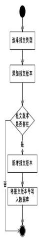
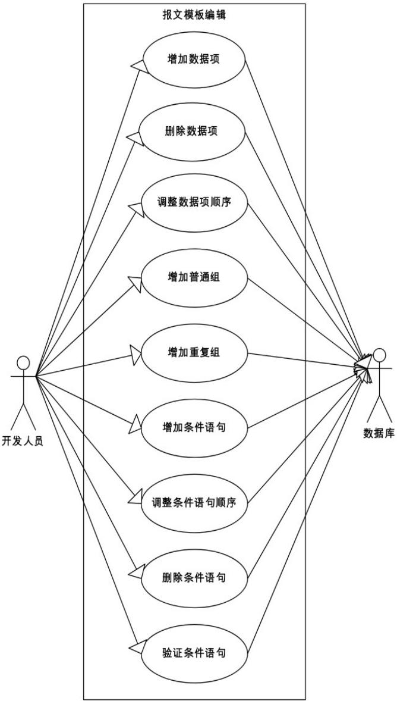
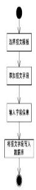
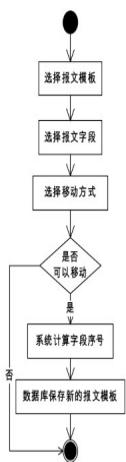
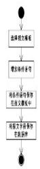
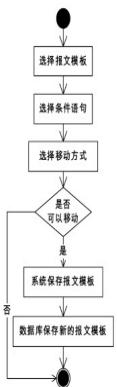
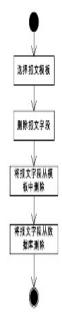

<table><tr><td rowspan=1 colspan=1>1.用户选择报文类型，选择报文功能域，并添加报文编号；4.数据库保存报文编号；6.用户得到指定报文类型下的报文空白模板；</td><td rowspan=1 colspan=1>2.系统判断报文编号合法性，如果输入类型不合法，执行异常流E1；3.系统创建新的报文空白模板；5.系统完成报文空白模板创建；</td><td rowspan=1 colspan=1></td></tr><tr><td rowspan=1 colspan=2>异常流E1：系统给出提示信息，用户根据提示信息继续执行。</td><td rowspan=1 colspan=1></td></tr><tr><td rowspan=1 colspan=2>后置条件：无。</td><td rowspan=1 colspan=1></td></tr></table>

报文版本新增流程如图31所示。

  
图31 报文版本新增流程图

报文版本新增用例场景见表39。

表39 报文版本新增用例描述
<table><tr><td></td><td></td></tr><tr><td>Use Case 名称:报文版本新增</td><td>Actors：用户、数据库</td></tr></table>

<table><tr><td rowspan=1 colspan=3>概述：本用例描述用户通过报文模板管理工具添加报文版本的过程</td></tr><tr><td rowspan=1 colspan=3>前置条件：报文模板管理工具软件运行正常，报文处理数据库运行正常</td></tr><tr><td rowspan=1 colspan=3>主事件流</td></tr><tr><td rowspan=1 colspan=1>Actor 的动作</td><td rowspan=1 colspan=1>系统的动作</td><td rowspan=1 colspan=1>动作约束(性能、可靠性、容错等)</td></tr><tr><td rowspan=1 colspan=1>1.用户选择报文类型，添加报文版本号；4.数据库保存版本号；6.用户得到指定报文类型下的报文版本；</td><td rowspan=1 colspan=1>2.系统判断报文版本号合法性，如果输入类型不合法，执行异常流E1；3.系统创建新的报文版本；5.系统完成报文版本创建；</td><td rowspan=1 colspan=1></td></tr><tr><td rowspan=1 colspan=2>异常流E1：系统给出提示信息，用户根据提示信息继续执行。</td><td rowspan=1 colspan=1></td></tr><tr><td rowspan=1 colspan=2>后置条件：无。</td><td rowspan=1 colspan=1></td></tr></table>

## 3.2.3.5 报文模板编辑（PZXQ-GN-BWMB-MBBJ）

报文模板编辑支持增加数据项、删除已有数据项和针对已有数据项进行顺序调整等操作，功能用例见图32。

  
图32 报文模板编辑用例图

报文模板编辑所有能力标识，见表40。

表40 报文模板编辑所有能力标识
<table><tr><td colspan="1" rowspan="1">序号</td><td colspan="1" rowspan="1">Use case名称</td><td colspan="1" rowspan="1">项目唯一标识符</td><td colspan="1" rowspan="1">需求描述</td><td colspan="1" rowspan="1">需求重用</td><td colspan="1" rowspan="1">方式名称</td><td colspan="1" rowspan="1">运行状态</td><td colspan="1" rowspan="1">对应的任务书功能/性能</td></tr><tr><td colspan="1" rowspan="1">1</td><td colspan="1" rowspan="1">增加数据项</td><td colspan="1" rowspan="1">PZXQ-GN-SJZD-MBBJ-ZJSJ</td><td colspan="1" rowspan="1">在报文模板中增加数据项</td><td colspan="1" rowspan="1">沿用</td><td colspan="1" rowspan="1">桌面</td><td colspan="1" rowspan="1">开发</td><td colspan="1" rowspan="1">4.1.3</td></tr><tr><td colspan="1" rowspan="1">2</td><td colspan="1" rowspan="1">删除数据项</td><td colspan="1" rowspan="1">PZXQ-GN-SJZD-MBBJ-SCSJ</td><td colspan="1" rowspan="1">从报文模板中删除已存在的数据项</td><td colspan="1" rowspan="1">沿用</td><td colspan="1" rowspan="1">桌面</td><td colspan="1" rowspan="1">开发</td><td colspan="1" rowspan="1">4.1.3</td></tr><tr><td colspan="1" rowspan="1">3</td><td colspan="1" rowspan="1">调整数据项顺序</td><td colspan="1" rowspan="1">PZXQ-GN-SJZD-MBBJ-TZSJ</td><td colspan="1" rowspan="1">调整已存在数据项的顺序</td><td colspan="1" rowspan="1">沿用</td><td colspan="1" rowspan="1">桌面</td><td colspan="1" rowspan="1">开发</td><td colspan="1" rowspan="1">4.1.3</td></tr><tr><td colspan="1" rowspan="1">4</td><td colspan="1" rowspan="1">增加普通组</td><td colspan="1" rowspan="1">PZXQ-GN-SJZD-MBBJ-PTZ</td><td colspan="1" rowspan="1">在报文模板中增加普通组</td><td colspan="1" rowspan="1">沿用</td><td colspan="1" rowspan="1">桌面</td><td colspan="1" rowspan="1">开发</td><td colspan="1" rowspan="1">4.1.3</td></tr><tr><td colspan="1" rowspan="1">5</td><td colspan="1" rowspan="1">增加重复组</td><td colspan="1" rowspan="1">PZXQ-GN-SJZD-MBBJ-CFZ</td><td colspan="1" rowspan="1">在报文模板中增加重复组</td><td colspan="1" rowspan="1">沿用</td><td colspan="1" rowspan="1">桌面</td><td colspan="1" rowspan="1">开发</td><td colspan="1" rowspan="1">4.1.3</td></tr><tr><td colspan="1" rowspan="1">6</td><td colspan="1" rowspan="1">增加条件语句</td><td colspan="1" rowspan="1">PZXQ-GN-SJZD-MBBJ-ZJTJ</td><td colspan="1" rowspan="1">为报文增加条件语句</td><td colspan="1" rowspan="1">沿用</td><td colspan="1" rowspan="1">桌面</td><td colspan="1" rowspan="1">开发</td><td colspan="1" rowspan="1">4.1.3</td></tr><tr><td colspan="1" rowspan="1">7</td><td colspan="1" rowspan="1">调整条件语句顺序</td><td colspan="1" rowspan="1">PZXQ-GN-SJZD-MBBJ-TZTJ</td><td colspan="1" rowspan="1">调整条件语句中字段的顺序</td><td colspan="1" rowspan="1">沿用</td><td colspan="1" rowspan="1">桌面</td><td colspan="1" rowspan="1">开发</td><td colspan="1" rowspan="1">4.1.3</td></tr><tr><td colspan="1" rowspan="1">8</td><td colspan="1" rowspan="1">删除条件语句</td><td colspan="1" rowspan="1">PZXQ-GN-SJZD-MBBJ-SCTJ</td><td colspan="1" rowspan="1">删除已存在的条件语句</td><td colspan="1" rowspan="1">沿用</td><td colspan="1" rowspan="1">桌面</td><td colspan="1" rowspan="1">开发</td><td colspan="1" rowspan="1">4.1.3</td></tr><tr><td colspan="1" rowspan="1">9</td><td colspan="1" rowspan="1">验证条件语句</td><td colspan="1" rowspan="1">PZXQ-GN-SJZD-MBBJ-YZTJ</td><td colspan="1" rowspan="1">验证条件语句是否合法</td><td colspan="1" rowspan="1">沿用</td><td colspan="1" rowspan="1">桌面</td><td colspan="1" rowspan="1">开发</td><td colspan="1" rowspan="1">4.1.3</td></tr></table>

增加数据项的流程，如图33所示。

  
图33增加数据项流程图

增加数据项用例场景见表41。

表41 增加数据项用例描述
<table><tr><td rowspan=1 colspan=1>Use Case 名称:增加数据项</td><td rowspan=1 colspan=2>Actors：用户、数据库</td></tr><tr><td rowspan=1 colspan=3>概述：本用例描述用户通过管理工具为报文模板增加数据项的过程</td></tr><tr><td rowspan=1 colspan=3>前置条件：报文模板管理工具软件运行正常，报文处理数据库运行正常</td></tr><tr><td rowspan=1 colspan=3>主事件流</td></tr><tr><td rowspan=1 colspan=1>Actor 的动作</td><td rowspan=1 colspan=1>系统的动作</td><td rowspan=1 colspan=1>动作约束(性能、可靠性、容错等)</td></tr><tr><td rowspan=1 colspan=1>1.用户选择报文模板，并选择字段信息；4.数据库保存报文字段；6.用户得到新的报文模板；</td><td rowspan=1 colspan=1>2.系统判断填写信息合法性，如果输入类型不合法，执行异常流E1；3.系统将报文字段添加至模板中；5.系统完成报文字段创建；</td><td rowspan=1 colspan=1>校验输入参数的合法性</td></tr><tr><td rowspan=1 colspan=2>异常流E1：系统给出提示信息，用户根据提示信息继续执行。</td><td rowspan=1 colspan=1></td></tr><tr><td rowspan=1 colspan=2>后置条件：无。</td><td rowspan=1 colspan=1></td></tr></table>

删除数据项的流程，如图34所示。

图34删除数据项流程图  
删除数据项用例场景见表42。  
表42 删除数据项用例描述
<table><tr><td rowspan=1 colspan=1>Use Case 名称:删除数据项</td><td rowspan=1 colspan=2>Actors：用户、数据库</td></tr><tr><td rowspan=1 colspan=3>概述：本用例描述用户通过报文模板管理工具删除模板中数据项的过程</td></tr><tr><td rowspan=1 colspan=3>前置条件：报文模板管理工具软件运行正常，报文处理数据库运行正常</td></tr><tr><td rowspan=1 colspan=3>主事件流</td></tr><tr><td rowspan=1 colspan=1>Actor 的动作</td><td rowspan=1 colspan=1>系统的动作</td><td rowspan=1 colspan=1>动作约束(性能、可靠性、容错等)</td></tr><tr><td rowspan=1 colspan=1>1.用户选择报文模板，删除报文字段；3.数据库删除报文字段；5.用户得到报文模板：</td><td rowspan=1 colspan=1>2.系统将字段从报文模板中删除；4.系统完成报文字段删除；</td><td rowspan=1 colspan=1></td></tr><tr><td rowspan=1 colspan=2>异常流E1：无。</td><td rowspan=1 colspan=1></td></tr><tr><td rowspan=1 colspan=2>后置条件：无。</td><td rowspan=1 colspan=1></td></tr></table>

调整数据项顺序的流程，如图35所示。

  
图35调整数据项顺序流程图  
调整数据项顺序用例场景见表43。

表43 调整数据项顺序用例描述
<table><tr><td colspan="1" rowspan="1">Use Case 名称:调整数据项顺序</td><td colspan="2" rowspan="1">Actors：用户、数据库</td></tr><tr><td colspan="3" rowspan="1">概述:本用例描述用户通过报文模板管理工具调整模板中已存在数据项顺序的过程</td></tr><tr><td colspan="3" rowspan="1">前置条件：报文模板管理工具软件运行正常，报文处理数据库运行正常</td></tr><tr><td colspan="3" rowspan="1">主事件流</td></tr><tr><td colspan="1" rowspan="1">Actor 的动作</td><td colspan="1" rowspan="1">系统的动作</td><td colspan="1" rowspan="1">动作约束(性能、可靠性、容错等)</td></tr><tr><td colspan="1" rowspan="1">1.用户选择报文模板；3.用户选择报文字段，选择上下移功能；6.数据库保存新的字段序号及新的报文</td><td colspan="1" rowspan="1">2.系统显示报文信息；4.系统判断是否可以移动，如果不可移动，执行异常流E1；；5.系统计算字段序号；</td><td colspan="1" rowspan="1">校验输入参数的合法性</td></tr><tr><td colspan="1" rowspan="1">模板；8.用户得到报文模板；</td><td colspan="1" rowspan="1">7.系统刷新报文模板；</td><td colspan="1" rowspan="1"></td></tr><tr><td colspan="2" rowspan="1">异常流E1：系统给出提示信息，用户根据提示信息继续执行。</td><td colspan="1" rowspan="1"></td></tr><tr><td colspan="2" rowspan="1">后置条件：无。</td><td colspan="1" rowspan="1"></td></tr></table>

增加条件语句的流程，如图36所示。

  
图36增加条件语句流程图

增加条件语句用例场景见表44。

表44 增加条件语句用例描述
<table><tr><td colspan="1" rowspan="1">Use Case 名称:增加条件语句</td><td colspan="2" rowspan="1">Actors：用户、数据库</td></tr><tr><td colspan="3" rowspan="1">概述:本用例描述用户通过管理工具为报文模板增加条件语句的过程</td></tr><tr><td colspan="3" rowspan="1">前置条件：报文模板管理工具软件运行正常，报文处理数据库运行正常</td></tr><tr><td colspan="3" rowspan="1">主事件流</td></tr><tr><td colspan="1" rowspan="1">Actor 的动作</td><td colspan="1" rowspan="1">系统的动作</td><td colspan="1" rowspan="1">动作约束(性能、可靠性、容错等)</td></tr><tr><td colspan="1" rowspan="1">1.用户选择报文模板，并选择增加条件语句信息；</td><td colspan="1" rowspan="1">2.系统判断填写信息合法性，如果输入类型不合法，执行异常流E1；3.系统将报文条件语句添加至模板中；</td><td colspan="1" rowspan="1">校验输入参数的合法性</td></tr><tr><td colspan="1" rowspan="1">4.数据库保存报文模板；6.用户得到新的报文模板；</td><td colspan="1" rowspan="1">5.系统完成报文条件语句增加</td><td colspan="1" rowspan="1"></td></tr><tr><td colspan="2" rowspan="1">异常流E1：系统给出提示信息，用户根据提示信息继续执行。</td><td colspan="1" rowspan="1"></td></tr><tr><td colspan="2" rowspan="1">后置条件：无。</td><td colspan="1" rowspan="1"></td></tr></table>

调整条件语句顺序的流程，如图37所示。

图37调整条件语句顺序流程图  
调整条件语句顺序用例场景见表45。  
表45 调整条件语句顺序用例描述
<table><tr><td colspan="1" rowspan="1">Use Case 名称：调整条件语句顺序</td><td colspan="2" rowspan="1">Actors：用户、数据库</td></tr><tr><td colspan="3" rowspan="1">概述：本用例描述用户通过报文模板管理工具调整模板中已存在数据项顺序的过程</td></tr><tr><td colspan="3" rowspan="1">前置条件：报文模板管理工具软件运行正常，报文处理数据库运行正常</td></tr><tr><td colspan="3" rowspan="1">主事件流</td></tr><tr><td colspan="1" rowspan="1">Actor 的动作</td><td colspan="1" rowspan="1">系统的动作</td><td colspan="1" rowspan="1">动作约束(性能、可靠性、容错等)</td></tr><tr><td colspan="1" rowspan="1">1.用户选择报文模板；3.用户选择报文条件语句，选择上下移功能；</td><td colspan="1" rowspan="1">2.系统显示报文信息；</td><td colspan="1" rowspan="1"></td></tr><tr><td colspan="1" rowspan="1">5.数据库保存新的条件语句及新的报文模板；7.用户得到报文模板；</td><td colspan="1" rowspan="1">4.系统判断是否可以移动，如果不可移动，执行异常流E1；；6.系统刷新报文模板；</td><td colspan="1" rowspan="1"></td></tr><tr><td colspan="2" rowspan="1">异常流E1：系统给出提示信息，用户根据提示信息继续执行。</td><td colspan="1" rowspan="1"></td></tr><tr><td colspan="2" rowspan="1">后置条件：无。</td><td colspan="1" rowspan="1"></td></tr></table>

删除条件语句的流程，如图38所示。

  
图38删除条件语句流程图

删除条件语句用例场景见表46。

表46 删除条件语句用例描述
<table><tr><td rowspan=1 colspan=1>Use Case 名称：删除条件语句</td><td rowspan=1 colspan=2>Actors：用户、数据库</td></tr><tr><td rowspan=1 colspan=3>概述:本用例描述用户通过报文模板管理工具删除模板中条件语句的过程</td></tr><tr><td rowspan=1 colspan=3>前置条件：报文模板管理工具软件运行正常，报文处理数据库运行正常</td></tr><tr><td rowspan=1 colspan=3>主事件流</td></tr><tr><td rowspan=1 colspan=1>Actor 的动作</td><td rowspan=1 colspan=1>系统的动作</td><td rowspan=1 colspan=1>动作约束(性能、可靠性、容错等)</td></tr><tr><td rowspan=1 colspan=1>1.用户选择报文模板，删除报文条件语句；</td><td rowspan=1 colspan=1></td><td rowspan=1 colspan=1></td></tr></table>