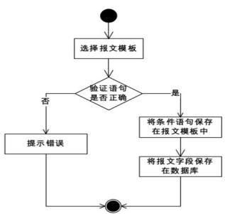
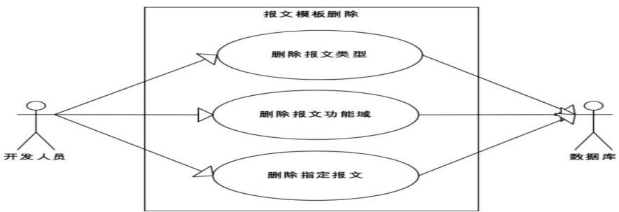
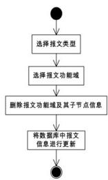
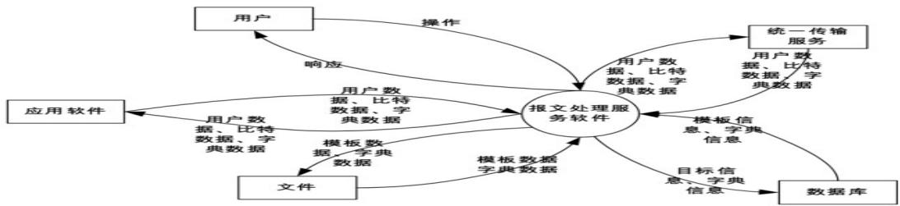
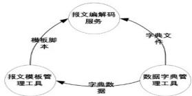

<table><tr><td rowspan=1 colspan=1>3.数据库删除报文条件语句；5.用户得到报文模板；</td><td rowspan=1 colspan=1>2.系统将条件语句从报文模板中删除；4.系统完成报文条件语句删除；</td><td rowspan=1 colspan=1></td></tr><tr><td rowspan=1 colspan=2>异常流E1：无。</td><td rowspan=1 colspan=1></td></tr><tr><td rowspan=1 colspan=2>后置条件：无。</td><td rowspan=1 colspan=1></td></tr></table>

验证条件语句的流程，如图39所示。

  
图39验证条件语句流程图

验证条件语句用例场景见表47。

表47 验证条件语句用例描述
<table><tr><td colspan="1" rowspan="1">Use Case 名称：验证条件语句</td><td colspan="2" rowspan="1">Actors：用户、数据库</td></tr><tr><td colspan="3" rowspan="1">概述:本用例描述用户通过报文模板管理工具验证模板中条件语句的过程</td></tr><tr><td colspan="3" rowspan="1">前置条件：报文模板管理工具软件运行正常，报文处理数据库运行正常</td></tr><tr><td colspan="3" rowspan="1">主事件流</td></tr><tr><td colspan="1" rowspan="1">Actor的动作</td><td colspan="1" rowspan="1">系统的动作</td><td colspan="1" rowspan="1">动作约束(性能、可靠性、容错等)</td></tr><tr><td colspan="1" rowspan="1">1.用户选择报文模板，报文条件语句；</td><td colspan="1" rowspan="1">2.系统将条件语句进行验证；如果条件语句不合法，执行异常流E1；</td><td colspan="1" rowspan="1"></td></tr><tr><td colspan="1" rowspan="1">3.数据库保存报文条件语句：5.用户得到报文模板；</td><td colspan="1" rowspan="1">4.系统完成报文条件语句验证；</td><td colspan="1" rowspan="1"></td></tr><tr><td colspan="2" rowspan="1">异常流E1：系统给出提示信息，用户根据提示信息继续执行。</td><td colspan="1" rowspan="1"></td></tr><tr><td colspan="2" rowspan="1">后置条件：无。</td><td colspan="1" rowspan="1"></td></tr></table>

## 3.2.3.6 报文模板删除（PZXQ-GN-BWMB-MBSC）

报文模板删除支持用户使用报文模板管理工具删除旧的报文模板、报文种类、报文功能域等，报文模板删除功能的用例图见图40。

  
图40 报文模板删除功能用例图  
报文模板删除所有能力标识，见表48。

表48 报文模板删除所有能力标识
<table><tr><td rowspan=1 colspan=1>序号</td><td rowspan=1 colspan=1>Usecase名称</td><td rowspan=1 colspan=1>项目唯一标识符</td><td rowspan=1 colspan=1>需求描述</td><td rowspan=1 colspan=1>需求重用</td><td rowspan=1 colspan=1>方式名称</td><td rowspan=1 colspan=1>运行状态</td><td rowspan=1 colspan=1>对应的任务书功能/性能</td></tr><tr><td rowspan=1 colspan=1>1</td><td rowspan=1 colspan=1>删除报文类型</td><td rowspan=1 colspan=1>PZXQ-GN-BWMB-MBSC-BWLX</td><td rowspan=1 colspan=1>根据用户需求删除报文类型。</td><td rowspan=1 colspan=1>沿用</td><td rowspan=1 colspan=1>桌面</td><td rowspan=1 colspan=1>开发</td><td rowspan=1 colspan=1>4.1.3</td></tr><tr><td rowspan=1 colspan=1>2</td><td rowspan=1 colspan=1>删除报文功能域</td><td rowspan=1 colspan=1>PZXQ-GN-BWMB-MBSC-GNY</td><td rowspan=1 colspan=1>在指定报文类型下删除指定报文功能域。</td><td rowspan=1 colspan=1>沿用</td><td rowspan=1 colspan=1>桌面</td><td rowspan=1 colspan=1>开发</td><td rowspan=1 colspan=1>4.1.3</td></tr><tr><td rowspan=1 colspan=1>3</td><td rowspan=1 colspan=1>删除指定报文</td><td rowspan=1 colspan=1>PZXQ-GN-BWMB-MBSC-BWMB</td><td rowspan=1 colspan=1>在指定报文类型、指定报文功能域下删除指定报文。</td><td rowspan=1 colspan=1>沿用</td><td rowspan=1 colspan=1>桌面</td><td rowspan=1 colspan=1>开发</td><td rowspan=1 colspan=1>4.1.3</td></tr></table>

删除报文类型的流程，如图41所示。

图41 删除报文类型流程图

删除报文类型用例场景见表49。

表49 删除报文类型用例描述
<table><tr><td rowspan=1 colspan=1>Use Case 名称:删除报文类型</td><td rowspan=1 colspan=2>Actors：用户、数据库</td></tr><tr><td rowspan=1 colspan=3>概述:本用例描述用户通过报文模板管理工具删除报文类型的过程</td></tr><tr><td rowspan=1 colspan=3>前置条件：报文模板管理工具软件运行正常，报文处理数据库运行正常</td></tr><tr><td rowspan=1 colspan=3>主事件流</td></tr><tr><td rowspan=1 colspan=1>Actor 的动作</td><td rowspan=1 colspan=1>系统的动作</td><td rowspan=1 colspan=1>动作约束(性能、可靠性、容错等)</td></tr><tr><td rowspan=1 colspan=1>1.用户选择删除报文类型；4.数据库更新数据；</td><td rowspan=1 colspan=1>2.系统删除指定报文类型及其子节点信息；3.系统更新的报文模板页面；5.系统完成报文类型删除；</td><td rowspan=1 colspan=1></td></tr><tr><td rowspan=1 colspan=2>异常流E1：无。</td><td rowspan=1 colspan=1></td></tr><tr><td rowspan=1 colspan=2>后置条件：无。</td><td rowspan=1 colspan=1></td></tr></table>

删除报文功能域的流程，如图42所示。

图42 删除报文功能域流程图  
删除报文功能域用例场景见表50。  
表50 删除报文功能域用例描述
<table><tr><td rowspan=1 colspan=1>Use Case 名称:删除报文功能域</td><td rowspan=1 colspan=2>Actors:用户、数据库</td></tr><tr><td rowspan=1 colspan=3>概述：本用例描述用户通过报文模板管理工具删除报文功能域的过程</td></tr><tr><td rowspan=1 colspan=3>前置条件：报文模板管理工具软件运行正常，报文处理数据库运行正常</td></tr><tr><td rowspan=1 colspan=3>主事件流</td></tr><tr><td rowspan=1 colspan=1>Actor 的动作</td><td rowspan=1 colspan=1>系统的动作</td><td rowspan=1 colspan=1>动作约束(性能、可靠性、容错等)</td></tr><tr><td rowspan=1 colspan=1>1.用户选择删除报文功能域；4.数据库更新数据；</td><td rowspan=1 colspan=1>2.系统删除指定报文功能域及其子节点信息；3.系统更新的报文模板页面；5.系统完成报文功能域删除；</td><td rowspan=1 colspan=1></td></tr><tr><td rowspan=1 colspan=2>异常流E1：无。</td><td rowspan=1 colspan=1></td></tr><tr><td rowspan=1 colspan=2>后置条件：无。</td><td rowspan=1 colspan=1></td></tr></table>

删除指定报文的流程，如图43所示。

  
图43 删除指定报文流程图

删除指定报文用例场景见表51。

表51 删除指定报文用例描述
<table><tr><td rowspan=1 colspan=1>Use Case 名称:删除指定报文</td><td rowspan=1 colspan=2>Actors：用户、数据库</td></tr><tr><td rowspan=1 colspan=3>概述：本用例描述用户通过报文模板管理工具删除指定报文的过程</td></tr><tr><td rowspan=1 colspan=3>前置条件：报文模板管理工具软件运行正常，报文处理数据库运行正常</td></tr><tr><td rowspan=1 colspan=3>主事件流</td></tr><tr><td rowspan=1 colspan=1>Actor 的动作</td><td rowspan=1 colspan=1>系统的动作</td><td rowspan=1 colspan=1>动作约束(性能、可靠性、容错等)</td></tr><tr><td rowspan=1 colspan=1>1.用户选择要删除的报文编号；4.数据库更新数据；</td><td rowspan=1 colspan=1>2.系统删除指定报文；3.系统更新的报文模板页面；5.系统完成指定报文删除；</td><td rowspan=1 colspan=1></td></tr><tr><td rowspan=1 colspan=2>异常流E1：无。</td><td rowspan=1 colspan=1></td></tr><tr><td rowspan=1 colspan=2>后置条件：无。</td><td rowspan=1 colspan=1></td></tr></table>

## 3.3 CSCI 外部接口需求

## 3.3.1 接口标识和接口图

报文处理服务软件外部接口需求见图44所示。

  
图44 报文处理服务软件接口需求

报文处理服务软件外部接口包括：人机交互接口、报文处理接口、报文传输接口、文件接口、数据库接口，报文处理服务软件外部接口需求表见表52所示。

表52 报文处理服务软件外部接口需求
<table><tr><td rowspan=1 colspan=1>序号</td><td rowspan=1 colspan=1>接口需求名称</td><td rowspan=1 colspan=1>接口需求标识</td><td rowspan=1 colspan=1>接口类型</td><td rowspan=1 colspan=1>发送方</td><td rowspan=1 colspan=1>接收方</td><td rowspan=1 colspan=1>接口内容</td><td rowspan=1 colspan=1>接口优先级</td></tr><tr><td rowspan=2 colspan=1>1</td><td rowspan=2 colspan=1>人机交互接口</td><td rowspan=2 colspan=1>PZXQ-JK-RJJH</td><td rowspan=2 colspan=1>人机接口</td><td rowspan=1 colspan=1>用户</td><td rowspan=1 colspan=1>本软件</td><td rowspan=2 colspan=1>事件操作及响应</td><td rowspan=2 colspan=1>中</td></tr><tr><td rowspan=1 colspan=1>本软件</td><td rowspan=1 colspan=1>用户</td></tr><tr><td rowspan=2 colspan=1>2</td><td rowspan=2 colspan=1>报文处理接口</td><td rowspan=2 colspan=1>PZXQ-JK-BWCL</td><td rowspan=2 colspan=1>API接口</td><td rowspan=1 colspan=1>应用软件</td><td rowspan=1 colspan=1>本软件</td><td rowspan=2 colspan=1>格式化报文信息</td><td rowspan=2 colspan=1>高</td></tr><tr><td rowspan=1 colspan=1>本软件</td><td rowspan=1 colspan=1>应用软件</td></tr><tr><td rowspan=2 colspan=1>3</td><td rowspan=2 colspan=1>报文传输接口</td><td rowspan=2 colspan=1>PZXQ-JK-BWCS</td><td rowspan=2 colspan=1>API接口</td><td rowspan=1 colspan=1>应用软件</td><td rowspan=1 colspan=1>本软件</td><td rowspan=2 colspan=1>格式化报文信息、报文描述信息</td><td rowspan=2 colspan=1>高</td></tr><tr><td rowspan=1 colspan=1>本软件</td><td rowspan=1 colspan=1>应用软件</td></tr><tr><td rowspan=2 colspan=1>4</td><td rowspan=2 colspan=1>文件接口</td><td rowspan=2 colspan=1>PZXQ-JK-BWCS</td><td rowspan=2 colspan=1>API接口</td><td rowspan=1 colspan=1>业务文件</td><td rowspan=1 colspan=1>本软件</td><td rowspan=2 colspan=1>字典文件、模板脚本文件、配置文件</td><td rowspan=2 colspan=1>高</td></tr><tr><td rowspan=1 colspan=1>本软件</td><td rowspan=1 colspan=1>业务文件</td></tr><tr><td rowspan=2 colspan=1>5</td><td rowspan=2 colspan=1>数据库接口</td><td rowspan=2 colspan=1>PZXQ-JK-BWCS</td><td rowspan=2 colspan=1>API接口</td><td rowspan=1 colspan=1>数据库</td><td rowspan=1 colspan=1>本软件</td><td rowspan=2 colspan=1>字典数据、报文模板数据</td><td rowspan=2 colspan=1>中</td></tr><tr><td rowspan=1 colspan=1>本软件</td><td rowspan=1 colspan=1>数据库</td></tr></table>

## 3.3.2 人机交互接口（PZXQ-JK-RJJH）

人机交互接口数据元素说明见表53。

表53 人机交互接口数据元素说明
<table><tr><td rowspan=1 colspan=1>序号</td><td rowspan=1 colspan=1>数据集名称</td><td rowspan=1 colspan=1>数据组成</td><td rowspan=1 colspan=1>数据约束</td><td rowspan=1 colspan=1>数据标准</td></tr><tr><td rowspan=12 colspan=1>1</td><td rowspan=12 colspan=1>人机交互信息</td><td rowspan=1 colspan=1>报文编号</td><td rowspan=1 colspan=1>界面输入字符</td><td rowspan=1 colspan=1></td></tr><tr><td rowspan=1 colspan=1>报文结构</td><td rowspan=1 colspan=1>界面输入字符</td><td rowspan=1 colspan=1></td></tr><tr><td rowspan=1 colspan=1>报文字段</td><td rowspan=1 colspan=1>界面输入字符</td><td rowspan=1 colspan=1></td></tr><tr><td rowspan=1 colspan=1>标签字段</td><td rowspan=1 colspan=1>界面输入字符</td><td rowspan=1 colspan=1></td></tr><tr><td rowspan=1 colspan=1>数据名称</td><td rowspan=1 colspan=1>界面输入字符</td><td rowspan=1 colspan=1></td></tr><tr><td rowspan=1 colspan=1>DFI编号</td><td rowspan=1 colspan=1>界面输入字符</td><td rowspan=1 colspan=1></td></tr><tr><td rowspan=1 colspan=1>DUI编号</td><td rowspan=1 colspan=1>界面输入字符</td><td rowspan=1 colspan=1></td></tr><tr><td rowspan=1 colspan=1>数据类型</td><td rowspan=1 colspan=1>界面输入字符</td><td rowspan=1 colspan=1></td></tr><tr><td rowspan=1 colspan=1>数据长度</td><td rowspan=1 colspan=1>界面输入字符</td><td rowspan=1 colspan=1></td></tr><tr><td rowspan=1 colspan=1>存取名称</td><td rowspan=1 colspan=1>界面输入字符</td><td rowspan=1 colspan=1></td></tr><tr><td rowspan=1 colspan=1>枚举型信息</td><td rowspan=1 colspan=1>界面输入字符</td><td rowspan=1 colspan=1></td></tr><tr><td rowspan=1 colspan=1>数字型信息</td><td rowspan=1 colspan=1>界面输入字符</td><td rowspan=1 colspan=1></td></tr></table>

## 3.3.3 报文处理接口（PZXQ-JK-BWCL）

报文处理接口数据元素说明表，见表54所示。

表54 报文处理接口数据元素说明
<table><tr><td colspan="1" rowspan="1">序号</td><td colspan="1" rowspan="1">数据集名称</td><td colspan="1" rowspan="1">数据组成</td><td colspan="1" rowspan="1">数据约束</td><td colspan="1" rowspan="1">数据标准</td></tr><tr><td colspan="1" rowspan="1">1</td><td colspan="1" rowspan="6">报文编码数据信息</td><td colspan="1" rowspan="1">应用标识</td><td colspan="1" rowspan="1">long</td><td colspan="1" rowspan="1"></td></tr><tr><td colspan="1" rowspan="1">2</td><td colspan="1" rowspan="1">报文格式编号</td><td colspan="1" rowspan="1">char[]</td><td colspan="1" rowspan="1"></td></tr><tr><td colspan="1" rowspan="1">3</td><td colspan="1" rowspan="1">用户数据地址</td><td colspan="1" rowspan="1">const char*</td><td colspan="1" rowspan="1"></td></tr><tr><td colspan="1" rowspan="1">4</td><td colspan="1" rowspan="1">用户数据长度</td><td colspan="1" rowspan="1">unsigned long</td><td colspan="1" rowspan="1"></td></tr><tr><td colspan="1" rowspan="1">5</td><td colspan="1" rowspan="1">比特数据地址</td><td colspan="1" rowspan="1">const char*</td><td colspan="1" rowspan="1"></td></tr><tr><td colspan="1" rowspan="1">6</td><td colspan="1" rowspan="1">比特数据预留长度</td><td colspan="1" rowspan="1">unsigned long*</td><td colspan="1" rowspan="1"></td></tr><tr><td colspan="1" rowspan="1">7</td><td colspan="1" rowspan="5">报文解码数据信息</td><td colspan="1" rowspan="1">应用标识</td><td colspan="1" rowspan="1">long</td><td colspan="1" rowspan="1"></td></tr><tr><td colspan="1" rowspan="1">8</td><td colspan="1" rowspan="1">报文格式编号</td><td colspan="1" rowspan="1">char[]</td><td colspan="1" rowspan="1"></td></tr><tr><td colspan="1" rowspan="1">9</td><td colspan="1" rowspan="1">比特数据地址</td><td colspan="1" rowspan="1">const char*</td><td colspan="1" rowspan="1"></td></tr><tr><td colspan="1" rowspan="1">10</td><td colspan="1" rowspan="1">比特数据长度</td><td colspan="1" rowspan="1">unsigned long</td><td colspan="1" rowspan="1"></td></tr><tr><td colspan="1" rowspan="1">11</td><td colspan="1" rowspan="1">用户数据地址</td><td colspan="1" rowspan="1">const char*</td><td colspan="1" rowspan="1"></td></tr><tr><td colspan="1" rowspan="1">12</td><td colspan="1" rowspan="1"></td><td colspan="1" rowspan="1">用户数据最大长度</td><td colspan="1" rowspan="1">unsigned long*</td><td colspan="1" rowspan="1"></td></tr><tr><td colspan="1" rowspan="1">13</td><td colspan="1" rowspan="3">错误获取信息</td><td colspan="1" rowspan="1">应用标识</td><td colspan="1" rowspan="1">long</td><td colspan="1" rowspan="1"></td></tr><tr><td colspan="1" rowspan="1">14</td><td colspan="1" rowspan="1">错误信息地址</td><td colspan="1" rowspan="1">char*</td><td colspan="1" rowspan="1"></td></tr><tr><td colspan="1" rowspan="1">15</td><td colspan="1" rowspan="1">错误信息最大长度</td><td colspan="1" rowspan="1">long</td><td colspan="1" rowspan="1"></td></tr><tr><td colspan="1" rowspan="1">16</td><td colspan="1" rowspan="9">字典信息</td><td colspan="1" rowspan="1">数据域标识</td><td colspan="1" rowspan="1">const char*</td><td colspan="1" rowspan="1"></td></tr><tr><td colspan="1" rowspan="1">17</td><td colspan="1" rowspan="1">数据使用标识</td><td colspan="1" rowspan="1">const char*</td><td colspan="1" rowspan="1"></td></tr><tr><td colspan="1" rowspan="1">18</td><td colspan="1" rowspan="1">枚举数据代码</td><td colspan="1" rowspan="1">char*</td><td colspan="1" rowspan="1"></td></tr><tr><td colspan="1" rowspan="1">19</td><td colspan="1" rowspan="1">枚举数据名称</td><td colspan="1" rowspan="1">char*</td><td colspan="1" rowspan="1"></td></tr><tr><td colspan="1" rowspan="1">20</td><td colspan="1" rowspan="1">枚举值总数</td><td colspan="1" rowspan="1">long</td><td colspan="1" rowspan="1"></td></tr><tr><td colspan="1" rowspan="1">21</td><td colspan="1" rowspan="1">枚举信息地址</td><td colspan="1" rowspan="1">const char*</td><td colspan="1" rowspan="1"></td></tr><tr><td colspan="1" rowspan="1">22</td><td colspan="1" rowspan="1">枚举信息最大长度</td><td colspan="1" rowspan="1">long</td><td colspan="1" rowspan="1"></td></tr><tr><td colspan="1" rowspan="1">23</td><td colspan="1" rowspan="1">用户数据值</td><td colspan="1" rowspan="1">const char*</td><td colspan="1" rowspan="1"></td></tr><tr><td colspan="1" rowspan="1">24</td><td colspan="1" rowspan="1">比特编码值</td><td colspan="1" rowspan="1">double</td><td colspan="1" rowspan="1"></td></tr></table>

## 3.3.4 报文传输接口（PZXQ-JK-BWCS）

报文传输接口数据元素说明表，见表55所示。

表55 报文传输接口数据元素说明
<table><tr><td rowspan=1 colspan=1>序号</td><td rowspan=1 colspan=1>数据集名称</td><td rowspan=1 colspan=1>数据组成</td><td rowspan=1 colspan=1>数据约束</td><td rowspan=1 colspan=1>数据标准</td></tr><tr><td rowspan=1 colspan=1>1</td><td rowspan=3 colspan=1>报文数据处理信息</td><td rowspan=1 colspan=1>报文格式编号</td><td rowspan=1 colspan=1>字符串</td><td rowspan=1 colspan=1></td></tr><tr><td rowspan=1 colspan=1>2</td><td rowspan=1 colspan=1>用户数据结构</td><td rowspan=1 colspan=1> $\mathsf { c h a r } ^ { \star }$ </td><td rowspan=1 colspan=1></td></tr><tr><td rowspan=1 colspan=1>3</td><td rowspan=1 colspan=1>数据结构长度</td><td rowspan=1 colspan=1>long</td><td rowspan=1 colspan=1></td></tr><tr><td rowspan=1 colspan=1>4</td><td rowspan=3 colspan=1>字典数据处理信息</td><td rowspan=1 colspan=1>报文格式编号</td><td rowspan=1 colspan=1>字符串</td><td rowspan=1 colspan=1></td></tr><tr><td rowspan=1 colspan=1>5</td><td rowspan=1 colspan=1>比特报文长度</td><td rowspan=1 colspan=1>char*</td><td rowspan=1 colspan=1></td></tr><tr><td rowspan=1 colspan=1>6</td><td rowspan=1 colspan=1>比特报文</td><td rowspan=1 colspan=1>long</td><td rowspan=1 colspan=1></td></tr></table>

## 3.3.5 文件接口（PZXQ-JK-BWCS）

文件接口数据元素说明见表56。

表56 文件接口数据元素说明
<table><tr><td colspan="1" rowspan="1">序号</td><td colspan="1" rowspan="1">数据集名称</td><td colspan="1" rowspan="1">数据组成</td><td colspan="1" rowspan="1">数据约束</td><td colspan="1" rowspan="1">数据标准</td></tr><tr><td colspan="1" rowspan="1">1</td><td colspan="1" rowspan="1">模板腳本文件</td><td colspan="1" rowspan="1">报文模板数据流</td><td colspan="1" rowspan="1">字符串</td><td colspan="1" rowspan="1"></td></tr><tr><td colspan="1" rowspan="1">2</td><td colspan="1" rowspan="1">数据字典文件</td><td colspan="1" rowspan="1">字典信息</td><td colspan="1" rowspan="1">字符串</td><td colspan="1" rowspan="1"></td></tr><tr><td colspan="1" rowspan="1">3</td><td colspan="1" rowspan="1">用户数据结构文件</td><td colspan="1" rowspan="1">用户结构信息</td><td colspan="1" rowspan="1">字符串</td><td colspan="1" rowspan="1"></td></tr></table>

## 3.3.6 数据库接口（PZXQ-JK-BWCS）

数据库接口数据元素说明表，见表57所示。

表57 数据库接口数据元素说明
<table><tr><td rowspan=1 colspan=1>序号</td><td rowspan=1 colspan=1>数据集名称</td><td rowspan=1 colspan=1>数据组成</td><td rowspan=1 colspan=1>数据约束</td><td rowspan=1 colspan=1>数据标准</td></tr><tr><td rowspan=1 colspan=1>1</td><td rowspan=2 colspan=1>数据库接口</td><td rowspan=1 colspan=1>报文模板信息</td><td rowspan=1 colspan=1>满足数据库要求</td><td rowspan=2 colspan=1></td></tr><tr><td rowspan=1 colspan=1>2</td><td rowspan=1 colspan=1>数据字典信息</td><td rowspan=1 colspan=1>满足数据库要求</td></tr></table>

## 3.4 CSCI 内部接口需求

## 3.4.1 接口标识和接口图

报文处理服务软件内部接口需求如图45所示。

  
图45 报文处理服务软件接口需求

报文处理服务软件内部接口需求表见表58。

表58 报文处理服务软件内部接口需求
<table><tr><td rowspan=1 colspan=1>序号</td><td rowspan=1 colspan=1>接口需求名称</td><td rowspan=1 colspan=1>接口需求标识</td><td rowspan=1 colspan=1>接口类型</td><td rowspan=1 colspan=1>发送方</td><td rowspan=1 colspan=1>接收方</td><td rowspan=1 colspan=1>接口内容</td><td rowspan=1 colspan=1>接口优先级</td></tr><tr><td rowspan=2 colspan=1>1</td><td rowspan=2 colspan=1>配置文件接口</td><td rowspan=2 colspan=1>PZXQ-JK-PZWJ</td><td rowspan=2 colspan=1>文件接口</td><td rowspan=1 colspan=1>报文模板管理工具</td><td rowspan=1 colspan=1>报文编解码服务</td><td rowspan=1 colspan=1>报文模板脚本文件</td><td rowspan=2 colspan=1>高</td></tr><tr><td rowspan=1 colspan=1>数据字典管理工具</td><td rowspan=1 colspan=1>报文编解码服务</td><td rowspan=1 colspan=1>数据字典文件</td></tr><tr><td rowspan=1 colspan=1>2</td><td rowspan=1 colspan=1>数据字典接口</td><td rowspan=1 colspan=1>PZXQ-JK-SJZD</td><td rowspan=1 colspan=1>数据库接口</td><td rowspan=1 colspan=1>数据字典管理工具</td><td rowspan=1 colspan=1>报文模板管理工具</td><td rowspan=1 colspan=1>数据元素信息</td><td rowspan=1 colspan=1>中</td></tr></table>

## 3.4.2 配置文件接口（PZXQ-JK-PZWJ）

## 配置文件接口数据元素说明表，见表59所示。

表59 配置文件接口数据元素说明
<table><tr><td rowspan=1 colspan=1>序号</td><td rowspan=1 colspan=1>数据集名称</td><td rowspan=1 colspan=1>数据组成</td><td rowspan=1 colspan=1>数据约束</td><td rowspan=1 colspan=1>数据标准</td></tr><tr><td rowspan=1 colspan=1>1</td><td rowspan=1 colspan=1>报文模板脚本文件</td><td rowspan=1 colspan=1>针对每种用户数据提供一份模板文件，其中说明了数据报文的组织方式和用户数据元素在字典中的索引值</td><td rowspan=1 colspan=1>XML 文件</td><td rowspan=1 colspan=1></td></tr><tr><td rowspan=1 colspan=1>2</td><td rowspan=4 colspan=1>数据字典文件</td><td rowspan=1 colspan=1>数据域标识描述文件</td><td rowspan=1 colspan=1>文本文件</td><td rowspan=1 colspan=1></td></tr><tr><td rowspan=1 colspan=1>3</td><td rowspan=1 colspan=1>数据使用标识描述文件</td><td rowspan=1 colspan=1>文本文件</td><td rowspan=1 colspan=1></td></tr><tr><td rowspan=1 colspan=1>4</td><td rowspan=1 colspan=1>枚举型数据描述文件</td><td rowspan=1 colspan=1>文本文件</td><td rowspan=1 colspan=1></td></tr><tr><td rowspan=1 colspan=1>5</td><td rowspan=1 colspan=1>范围型数据描述文件</td><td rowspan=1 colspan=1>文本文件</td><td rowspan=1 colspan=1></td></tr></table>

## 3.4.3 数据字典接口（PZXQ-JK-SJZD）

数据字典接口数据元素说明表，见表60所示。

表60 数据字典接口数据元素说明
<table><tr><td rowspan=1 colspan=1>序号</td><td rowspan=1 colspan=1>数据集名称</td><td rowspan=1 colspan=1>数据组成</td><td rowspan=1 colspan=1>数据约束</td><td rowspan=1 colspan=1>数据标准</td></tr><tr><td rowspan=1 colspan=1>1</td><td rowspan=8 colspan=1>数据元素信息</td><td rowspan=1 colspan=1>DFI编号</td><td rowspan=1 colspan=1>int</td><td rowspan=1 colspan=1></td></tr><tr><td rowspan=1 colspan=1>2</td><td rowspan=1 colspan=1>DFI名称</td><td rowspan=1 colspan=1>varchar</td><td rowspan=1 colspan=1></td></tr><tr><td rowspan=1 colspan=1>3</td><td rowspan=1 colspan=1>DUI编号</td><td rowspan=1 colspan=1>int</td><td rowspan=1 colspan=1></td></tr><tr><td rowspan=1 colspan=1>45</td><td rowspan=1 colspan=1>DUI名称</td><td rowspan=1 colspan=1>varchar</td><td rowspan=1 colspan=1></td></tr><tr><td rowspan=1 colspan=1>6</td><td rowspan=1 colspan=1>比特长度</td><td rowspan=1 colspan=1>int</td><td rowspan=1 colspan=1></td></tr><tr><td rowspan=1 colspan=1>7</td><td rowspan=1 colspan=1>数据类型</td><td rowspan=1 colspan=1>int</td><td rowspan=1 colspan=1></td></tr><tr><td rowspan=1 colspan=1>8</td><td rowspan=1 colspan=1>DUI 存取名称</td><td rowspan=1 colspan=1>varchar</td><td rowspan=1 colspan=1></td></tr><tr><td rowspan=1 colspan=1>9</td><td rowspan=1 colspan=1>DUI 说明</td><td rowspan=1 colspan=1>varchar</td><td rowspan=1 colspan=1></td></tr></table>

## 3.5 CSCI 内部数据需求

表61对CSCI所有内部数据元素进行汇总。

表61 报文处理服务软件内部数据汇总表
<table><tr><td rowspan=1 colspan=1>序号</td><td rowspan=1 colspan=1>数据名称</td><td rowspan=1 colspan=1>数据内容</td><td rowspan=1 colspan=1>相关功能及标识</td><td rowspan=1 colspan=1>备注</td></tr><tr><td rowspan=1 colspan=1>1</td><td rowspan=1 colspan=1>报文模板数据</td><td rowspan=1 colspan=1>报文编号、用户数据报文组织结构、用户数据的 DFI和 DUI编号</td><td rowspan=1 colspan=1>报文编码(PZXQ-GN-BWBJ-BWBM)、报文解码(PZXQ-GN-BWBJ-BWJM)、报文数据校验(PZXQ-GN-BWBJ-BWJY)、</td><td rowspan=1 colspan=1></td></tr></table>