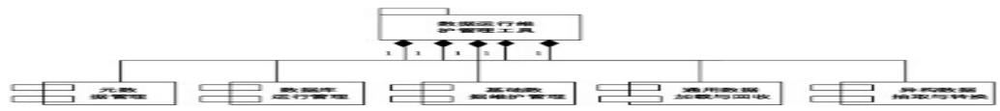
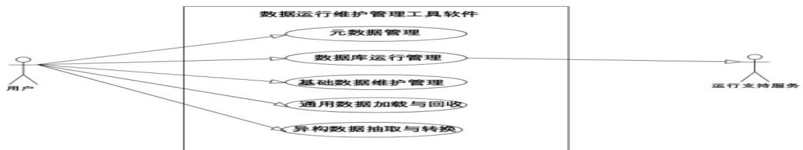
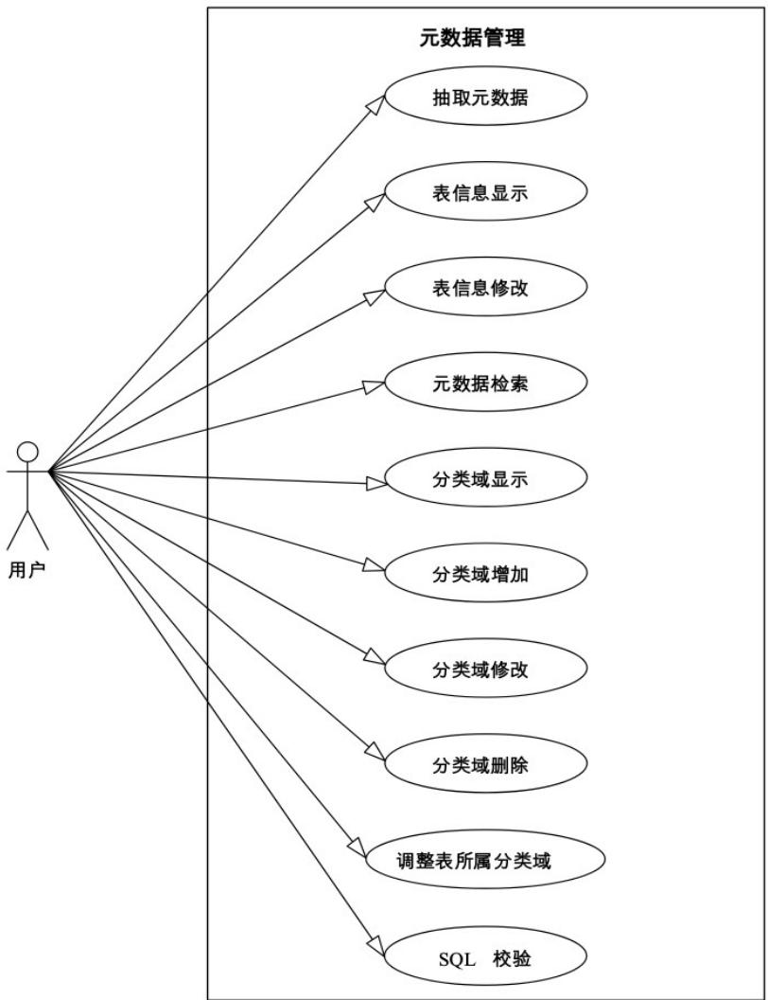

## 目 录

1 范围.  
1.1 标识.  
1.2 系统概述.  
1.2.1 系统和软件的用途..  
1.2.2 系统和软件的一般特性...  
1.3 文档概述..  
2 引用文档. .2  
3 需求....... ..2  
3.1 要求的状态和方式. ..2  
3.2 CSCI 能力需求.. ..2  
3.2.1 元数据管理（PZXQ-GN-YSJGL）.. . 4  
3.2.2 数据库运行管理（PZXQ-GN-SJKYXGL）. ..11  
3.2.3 基础数据维护（PZXQ-GN-JCSJWH） ..14  
3.2.4 数据加载回收（PZXQ-GN-SJJZHS） ..41  
3.2.5 数据抽取转换（PZXQ-GN-SJCQZH）.. ..48  
3.3 CSCI 外部接口需求... ..52  
3.3.1 接口标识和接口图.. ..52  
3.3.2 人机交互接口（PZXQ-WBJK-SJYXWHGL-RJJH）. ..53  
3.3.3 与服务集成框架接口（PZXQ-WBJK-SJYXWHGL-FWJC） ..53  
3.3.4 与软件部署管理接口（PZXQ-WBJK-SJYXWHGL-BSGL）. ..54  
3.3.5 与运行支撑服务接口（PZXQ-WBJK-SJYXWHGL-YXZC）. ..54  
3.3.6 与数据统一访问服务接口（PZXQ-WBJK-SJYXWHGL-TYFW）. ...55  
3.4 CSCI 内部接口需求. ..56  
3.4.1 接口标识和接口图. ..56  
3.4.2 元数据管理与数据库运行管理接口（PZXQ-NBJK-YSJGL-YXGL）. ..57  
3.4.3 基础数据维护与数据库运行管理接口（PZXQ-NBJK-JCSJWH-YXGL）. ..57  
3.4.4 数据加载回收与数据库运行管理接口（PZXQ-NBJK-SJJZHS-YXGL）...... .......58  
3.4.5 数据抽取转换与数据库运行管理接口（PZXQ-NBJK-SJCQZH-YXGL）................58  
3.4.6 数据抽取转换与数据加载回收接口（PZXQ-NBJK-SJCQZH-SJJZHS）. ......58  
3.4.7 数据加载回收与基础数据维护接口（PZXQ-NBJK-SJJZHS-JCSJWH）....... .....59  
3.4.8 基础数据维护与数据加载回收接口（PZXQ-NBJK-JCSJWH-SJJZHS）. .....59  
3.5 CSCI 内部数据需求. ..60  
3.6 适应性需求.. ..62  
3.7 安全性需求. ..62  
3.8 保密性需求... ..62  
3.9 CSCI 环境需求. ..63  
3.9.1 运行环境需求. ..63  
3.9.2 开发环境需求. ..63  
3.10 计算机资源需求.. ..63  
3.10.1 计算机硬件需求. .63  
3.10.2 计算机硬件资源利用需求.. ..64  
3.10.3 计算机软件需求. ..64  
3.10.4 计算机通信需求. .65  
3.11 软件质量因素.. ..65  
3.12 设计和构造的约束.. ..65  
3.13 人员需求. ..65  
3.14 培训需求.. ..66  
3.15 软件保障需求. ..66  
3.16 其他需求.. ..66  
3.17 验收、交付和包装需求. ..66  
3.18 需求的优先顺序和关键性.. ..67  
4 合格性规定. ..67  
5 需求可追踪性.. ..69  
6 注释... ...74

## 1 范围

## 1.1 标识

a) 本文档已被批准的标识号：AZ6932.490.0108 SRS

b) 本文档所适用的软件名称为：数据运行维护管理工具；

c) 本文档的版本号为：V1.00.03/2020 年 06 月 25 日；

d) 本文档所适用的软件所属系统为：某级信息系统软件。

## 1.2 系统概述

## 1.2.1 系统和软件的用途

某级信息系统软件按照国产自主可控要求，进行基础软件环境选型，以及应用软件的新研和国产化迁移改造，对功能要素分散、流程独立的业务功能进行整合优化，研制适应不同使用需求、使用场景的软件，实现信息系统软件的融合、型谱优化和业务提能，推动某信息系统软件向“国产化、服务化、轻量化”方向发展。

某信息服务环境软件是某信息系统软件的重要组成，是连接底层各类硬件信息基础设施与上层各种应用系统的桥梁，通过基础平台融合汇聚底层资源，规范技术体制、支撑体系运行、促进互通互联等，是支撑构建某信息系统的重要支撑，其软件主要部署运行在各级机构的信息处理设备上，提供系统运维、数据运维、信息传输、信息处理、信息展现等功能，支撑应用软件和用户完成开发、集成、运维、运行全流程的使用。

数据运行维护管理工具完成信息服务环境软件功能域数据维护管理的功能，在信息服务环境分系统的开发、集成、运行阶段提供可视化的数据运行维护管理界面，其中在开发阶段提供元数据管理维护功能，支持抽取目标数据库形成元数据库；集成阶段提供基础数据维护管理功能，支持对数据库表数据的增加、删除、修改、查询；数据加载和回收功能，支持将平时维护的数据加载至作战系统中，支持回收过程数据；异构数据抽取转换功能，支持国产数据库(达梦数据库)到轻量数据库(sqlite3)的数据库表抽取转换；运行阶段提供数据库运行过程监控管理功能，支持包括监控数据库运行时的各类状态信息。

## 1.2.2 系统和软件的一般特性

a) 需方：某单位；

b) 使用方：某单位；

c) 开发方：某单位；

d) 保障机构：某单位；

e) 运行方案：系统开机后，进入系统运维，切换至本软件的相关功能菜单；

## 1.3 文档概述

在本文档中，第2章列出了本文档中引用的其它文档的信息，第3章详细描述了数据同步共享服务的各种需求以及实现方式，第4章规定了确认第3章各项需求正确实现的合格性验证方法，第5章描述本文档列出的各项需求与相应的系统需求规格说明文档列出的需求的对应关系。其中，第3章是本文档的主要部分。

## 2 引用文档

本软件引用的文档主要包括国家相关军用标准以及本工程内部的指导性文件，凡不注明日期或版次的标准其最新文档适用于本文档。本文档中的引用文档参见表 1。

表 1引用文档表
<table><tr><td rowspan=1 colspan=1>文档编号</td><td rowspan=1 colspan=1>标题</td><td rowspan=1 colspan=1>修订版本</td><td rowspan=1 colspan=1>修订日期</td><td rowspan=1 colspan=1>编写单位</td></tr><tr><td rowspan=1 colspan=1>GJB 438B-2009</td><td rowspan=1 colspan=1>《军用软件开发文档通用要求》</td><td rowspan=1 colspan=1>一</td><td rowspan=1 colspan=1>2009年5月</td><td rowspan=1 colspan=1>总装备部</td></tr><tr><td rowspan=1 colspan=1>GJB 439A-2013</td><td rowspan=1 colspan=1>《军品软件质量保证通用要求》</td><td rowspan=1 colspan=1></td><td rowspan=1 colspan=1>2013年7月</td><td rowspan=1 colspan=1>国防科学技术工业委员会</td></tr><tr><td rowspan=1 colspan=1>GJB/Z102A-2012</td><td rowspan=1 colspan=1>《军用软件安全性设计指南》</td><td rowspan=1 colspan=1></td><td rowspan=1 colspan=1>2012年7月</td><td rowspan=1 colspan=1>总装备部</td></tr><tr><td rowspan=1 colspan=1>GJB 1267-1991</td><td rowspan=1 colspan=1>《军用软件维护》</td><td rowspan=1 colspan=1></td><td rowspan=1 colspan=1>1991年10月</td><td rowspan=1 colspan=1>国防科学技术工业委员会</td></tr><tr><td rowspan=1 colspan=1>GJB 2786A-2009</td><td rowspan=1 colspan=1>《军用软件开发通用要求》</td><td rowspan=1 colspan=1></td><td rowspan=1 colspan=1>2009年5月</td><td rowspan=1 colspan=1>总装备部</td></tr><tr><td rowspan=1 colspan=1>GJB 1268A-2004</td><td rowspan=1 colspan=1>《军用软件验收要求》</td><td rowspan=1 colspan=1>一</td><td rowspan=1 colspan=1>2004年9月</td><td rowspan=1 colspan=1>总装备部</td></tr><tr><td rowspan=1 colspan=1>GJB 5235-2004</td><td rowspan=1 colspan=1>《军用软件配置管理》</td><td rowspan=1 colspan=1></td><td rowspan=1 colspan=1>2004年9月</td><td rowspan=1 colspan=1>总装备部</td></tr><tr><td rowspan=1 colspan=1>AZ6932.490.0108SDTD</td><td rowspan=1 colspan=1>《试点建设装备配套科研旅信息系统软件数据运行维护管理工具软件研制任务书》</td><td rowspan=1 colspan=1>V1.00.03/2019年12月25 日</td><td rowspan=1 colspan=1>2019年12月</td><td rowspan=1 colspan=1></td></tr></table>

## 3 需求

## 3.1 要求的状态和方式

数据运行维护管理工具只有一个部署运行状态，无需多个运行状态和运行方式。

## 3.2 CSCI 能力需求

数据运行维护管理工具由元数据管理、数据库运行管理、基础数据维护管理、通用数据加载回收、异构数据抽取转换。

数据运行维护管理工具组件图如图 1所示。

  
图 1数据运行维护管理工具组件图  
数据运行维护管理工具用例图，如图2所示。

图2 数据运行维护管理工具用例图  
数据运行维护管理工具所有能力标识表，见表 2所示。  
表 2数据运行维护管理工具所有能力标识
<table><tr><td colspan="1" rowspan="1">序号</td><td colspan="1" rowspan="1">Usecase 名称</td><td colspan="1" rowspan="1">项目唯一标识符</td><td colspan="1" rowspan="1">需求描述</td><td colspan="1" rowspan="1">需求重用</td><td colspan="1" rowspan="1">方式名称</td><td colspan="1" rowspan="1">运行状态</td><td colspan="1" rowspan="1">对应的任务书功能/性能</td></tr><tr><td colspan="1" rowspan="1">1</td><td colspan="1" rowspan="1">元数据管理</td><td colspan="1" rowspan="1">PZXQ-GN-YSJGL</td><td colspan="1" rowspan="1">提取指定数据库形成元数据库、支持维护库表信息、支持元数据检索功能、进行SQL校验功能</td><td colspan="1" rowspan="1">沿用</td><td colspan="1" rowspan="1">桌面</td><td colspan="1" rowspan="1">开发阶段</td><td colspan="1" rowspan="1">4.1.1</td></tr><tr><td colspan="1" rowspan="1">2</td><td colspan="1" rowspan="1">数据库运行管理</td><td colspan="1" rowspan="1">PZXQ-GN-SJKYXGL</td><td colspan="1" rowspan="1">支持数据库信息监控例如：监控会话、资源、表空间、连接数等</td><td colspan="1" rowspan="1">沿用</td><td colspan="1" rowspan="1">桌面</td><td colspan="1" rowspan="1">运行阶段</td><td colspan="1" rowspan="1">4.1.2</td></tr><tr><td colspan="1" rowspan="1">3</td><td colspan="1" rowspan="1">基础数据维护</td><td colspan="1" rowspan="1">PZXQ-GN-JCSJWH</td><td colspan="1" rowspan="1">提供数据库中基础数据维护管理、模板管理、动态页面配置、知识管理、数据导入导出功能</td><td colspan="1" rowspan="1">沿用、新研</td><td colspan="1" rowspan="1">桌面、平板</td><td colspan="1" rowspan="1">集成阶段</td><td colspan="1" rowspan="1">4.1.3</td></tr><tr><td colspan="1" rowspan="1">4</td><td colspan="1" rowspan="1">数据加载回收</td><td colspan="1" rowspan="1">PZXQ-GN-SJJZHS</td><td colspan="1" rowspan="1">提供数据库段的安装卸载功能、数据库备份恢复、清空销毁、按需切分、SQL与 DMP格式导入导出，日志管理</td><td colspan="1" rowspan="1">沿用</td><td colspan="1" rowspan="1">桌面、平板、手持</td><td colspan="1" rowspan="1">集成阶段</td><td colspan="1" rowspan="1">4.1.5</td></tr><tr><td colspan="1" rowspan="1">5</td><td colspan="1" rowspan="1">数据抽取转换</td><td colspan="1" rowspan="1">PZXQ-GN-SJCQZH</td><td colspan="1" rowspan="1">提供达梦到 SQLITE3 的数据抽取转换功能，日志记录</td><td colspan="1" rowspan="1">沿用</td><td colspan="1" rowspan="1">桌面</td><td colspan="1" rowspan="1">集成阶段</td><td colspan="1" rowspan="1">4.1.6</td></tr></table>

## 3.2.1 元数据管理（PZXQ-GN-YSJGL）

元数据管理功能包括：抽取元数据、表信息显示、表信息修改、元数据检索、分类域显示、分类域增加、分类域修改、分类域删除、调整表所属分类域、SQL校验，其功能用例如图 3所示。

  
图 3元数据管理用例图

元数据管理能力标识表，见表 3所示。  
表 3元数据管理能力能力标识
<table><tr><td colspan="1" rowspan="1">序号</td><td colspan="1" rowspan="1">Use case名称</td><td colspan="1" rowspan="1">项目唯一标识符</td><td colspan="1" rowspan="1">需求描述</td><td colspan="1" rowspan="1">需求重用</td><td colspan="1" rowspan="1">方式名称</td><td colspan="1" rowspan="1">运行状态</td><td colspan="1" rowspan="1">对应的任务书功能/性能</td></tr><tr><td colspan="1" rowspan="1">1</td><td colspan="1" rowspan="1">抽取元数据</td><td colspan="1" rowspan="1">PZXQ-GN-YSJGL-CQYSJ</td><td colspan="1" rowspan="1">抽取目标数据库形成元数据库</td><td colspan="1" rowspan="1">新研</td><td colspan="1" rowspan="1">桌面</td><td colspan="1" rowspan="1">开发阶段</td><td colspan="1" rowspan="1">4.1.1 a)</td></tr><tr><td colspan="1" rowspan="1">2</td><td colspan="1" rowspan="1">表信息显示</td><td colspan="1" rowspan="1">PZXQ-GN-YSJGL-BXXXS</td><td colspan="1" rowspan="1">查看数据库指定表信息</td><td colspan="1" rowspan="1">新研</td><td colspan="1" rowspan="1">桌面</td><td colspan="1" rowspan="1">开发阶段</td><td colspan="1" rowspan="1">4.1.1 b)</td></tr><tr><td colspan="1" rowspan="1">3</td><td colspan="1" rowspan="1">表信息修改</td><td colspan="1" rowspan="1">PZXQ-GN-YSJGL-BXXXG</td><td colspan="1" rowspan="1">修改数据库指定表信息</td><td colspan="1" rowspan="1">新研</td><td colspan="1" rowspan="1">桌面</td><td colspan="1" rowspan="1">开发阶段</td><td colspan="1" rowspan="1">4.1.1 b)</td></tr><tr><td colspan="1" rowspan="1">4</td><td colspan="1" rowspan="1">元数据检索</td><td colspan="1" rowspan="1">PZXQ-GN-YSJGL-YSJJS</td><td colspan="1" rowspan="1">对元数据信息的检索</td><td colspan="1" rowspan="1">新研</td><td colspan="1" rowspan="1">桌面</td><td colspan="1" rowspan="1">开发阶段</td><td colspan="1" rowspan="1">4.1.1 c)</td></tr><tr><td colspan="1" rowspan="1">5</td><td colspan="1" rowspan="1">分类域显示</td><td colspan="1" rowspan="1">PZXQ-GN-YSJGL-FLYXS</td><td colspan="1" rowspan="1">对表分类域的查看显示功能</td><td colspan="1" rowspan="1">新研</td><td colspan="1" rowspan="1">桌面</td><td colspan="1" rowspan="1">开发阶段</td><td colspan="1" rowspan="1">4.1.1 d)</td></tr><tr><td colspan="1" rowspan="1">6</td><td colspan="1" rowspan="1">分类域增加</td><td colspan="1" rowspan="1">PZXQ-GN-YSJGL-FLYZJ</td><td colspan="1" rowspan="1">增加表分类域功能</td><td colspan="1" rowspan="1">新研</td><td colspan="1" rowspan="1">桌面</td><td colspan="1" rowspan="1">开发阶段</td><td colspan="1" rowspan="1">4.1.1 d)</td></tr><tr><td colspan="1" rowspan="1">7</td><td colspan="1" rowspan="1">分类域修改</td><td colspan="1" rowspan="1">PZXQ-GN-YSJGL-FLYXG</td><td colspan="1" rowspan="1">修改表分类域功能</td><td colspan="1" rowspan="1">新研</td><td colspan="1" rowspan="1">桌面</td><td colspan="1" rowspan="1">开发阶段</td><td colspan="1" rowspan="1">4.1.1 d)</td></tr><tr><td colspan="1" rowspan="1">8</td><td colspan="1" rowspan="1">分类域删除</td><td colspan="1" rowspan="1">PZXQ-GN-YSJGL-FLYSC</td><td colspan="1" rowspan="1">删除表分类域功能</td><td colspan="1" rowspan="1">新研</td><td colspan="1" rowspan="1">桌面</td><td colspan="1" rowspan="1">开发阶段</td><td colspan="1" rowspan="1">4.1.1 d)</td></tr><tr><td colspan="1" rowspan="1">9</td><td colspan="1" rowspan="1">调整表所属分类域</td><td colspan="1" rowspan="1">PZXQ-GN-YSJGL-TZBSSFLY</td><td colspan="1" rowspan="1">调整表所属分类域</td><td colspan="1" rowspan="1">新研</td><td colspan="1" rowspan="1">桌面</td><td colspan="1" rowspan="1">开发阶段</td><td colspan="1" rowspan="1">4.1.1 d)</td></tr><tr><td colspan="1" rowspan="1">10</td><td colspan="1" rowspan="1">SQL 校验</td><td colspan="1" rowspan="1">PZXQ-GN-YSJGL-SQLJY</td><td colspan="1" rowspan="1">提供对建表 SQL 语句是否满足约束的 SQL 校验</td><td colspan="1" rowspan="1">新研</td><td colspan="1" rowspan="1">桌面</td><td colspan="1" rowspan="1">开发阶段</td><td colspan="1" rowspan="1">4.1.1 e)</td></tr></table>

## 3.2.1.1 抽取元数据（PZXQ-GN-YSJGL-CQYSJ）

抽取元数据用例场景，见表4所示。

表4 抽取元数据用例描述
<table><tr><td colspan="1" rowspan="1">Use Case 名称:抽取元数据</td><td colspan="2" rowspan="1">Actors：用户</td></tr><tr><td colspan="3" rowspan="1">概述：本用例是元数据管理的扩展用例，描述抽取元数据的过程；</td></tr><tr><td colspan="3" rowspan="1">前置条件：元数据库连接成功。</td></tr><tr><td colspan="3" rowspan="1">主事件流</td></tr><tr><td colspan="1" rowspan="1">Actor 的动作</td><td colspan="1" rowspan="1">系统的动作</td><td colspan="1" rowspan="1">动作约束(性能、可靠性、容错等)</td></tr><tr><td colspan="1" rowspan="1">1.选择“元数据管理”标签页；</td><td colspan="1" rowspan="1"></td><td colspan="1" rowspan="1">输入信息合法性校验，并在错误发生时，提供详细的错误信息提</td></tr><tr><td colspan="1" rowspan="1">2.点击“增加元数据库”进行增加数据库操作；3.输入待抽取数据库的IP、用户名、密码等信息，点击确定进行抽取；</td><td colspan="1" rowspan="1">4.如果用户名、密码、IP地址连接数据库失败，则执行异常流E1；5、系统查询数据库、表、视图、字段等信息，将查询到的信息插入元数据相关表中。</td><td colspan="1" rowspan="1">示</td></tr><tr><td colspan="2" rowspan="1">异常流E1：连接数据库失败，用例结束。</td><td colspan="1" rowspan="1"></td></tr><tr><td colspan="2" rowspan="1">后置条件：无。</td><td colspan="1" rowspan="1"></td></tr></table>

## 3.2.1.2 表信息显示（PZXQ-GN-YSJGL-BXXXS）

表信息显示用例场景，见表5所示。

表5 表信息显示用例描述
<table><tr><td>Use Case 名称:表信息显示</td><td colspan="2">Actors：用户</td></tr><tr><td colspan="3">概述：本用例是元数据管理的扩展用例，描述表信息显示的过程；</td></tr><tr><td colspan="3">前置条件：元数据服务正常。</td></tr><tr><td colspan="4">主事件流</td></tr><tr><td>Actor 的动作</td><td>系统的动作</td><td>动作约束 (性能、可靠性、容错等)</td></tr><tr><td rowspan="4">1. 选择“元数据管理”标签页； 3.在左侧层次节点中点击某个表节 点； 异常流E1：表信息查询失败，结束用例。</td><td>2.系统查询出元数据库下的所有的库及 表信息，并将数据按库、分类域、表名 (注释)的三级层次节点展示到浏览 器；</td><td></td></tr><tr><td>4.系统右侧页面显示表的所有字段名、 表基本信息（中文名称、所属数据库、 表名、类型、显示方式）和表层次结构 信息（内码字段、名称字段、序号字</td><td>交互信息正确性校验，并在错误 发生时，提供详细的错误信息提 示</td></tr><tr><td>段、显示类型)，如果没有显示，执行 异常流E1。</td><td></td></tr><tr><td></td><td></td></tr><tr><td></td><td></td></tr><tr><td></td><td></td></tr></table>

## 3.2.1.3 表信息修改（PZXQ-GN-YSJGL-BXXXG）

表信息修改用例场景，见表6所示。

表6 表信息修改用例描述
<table><tr><td>Use Case 名称:表信息修改</td><td colspan="2">Actors:用户</td></tr><tr><td colspan="3">概述：本用例是元数据管理的扩展用例，描述表信息修改的过程；</td></tr><tr><td colspan="3">前置条件：元数据服务正常。</td></tr><tr><td colspan="3">主事件流</td></tr><tr><td>Actor 的动作</td><td>系统的动作</td><td>动作约束 (性能、可靠性、容错等)</td></tr><tr><td>1.在“元数据管理”标签页点击左侧表节 点，在页面中间展示的字段列表中点击 某个字段节点，点击修改字段；</td><td>2.弹窗对该字段的相关信息进行修改；</td><td></td></tr><tr><td rowspan="5">改，完成后点击确定； 5.在“元数据管理”标签页点击左侧表节 点，在页面中间展示的字段列表中点击 某个字段节点，点击修改字段；</td><td>3.在弹出的窗口中进行字段信息的修 4.系统将元数据库中该字段的信息进行</td><td></td></tr><tr><td>更新，将更新后的字段信息展示到页面 中，如果更新失败，提示用户更新失 败，执行异常流E1；</td><td>交互信息正确性校验，并在错误</td></tr><tr><td>6.系统将元数据库中该字段的信息删</td><td>发生时，提供详细的错误信息提 示</td></tr><tr><td>除，更新删除删除字段后的页面信息， 如果删除失败，提示用户删除失败，执 行异常流E2； 7.在“元数据管理”标签页点击左侧表节</td><td></td></tr><tr><td>8.系统通过对比元数据库与抽取前的数 据库下相同表的信息，获取到元数据库 中缺少的字段信息，并以弹窗形式展示</td><td></td></tr></table>