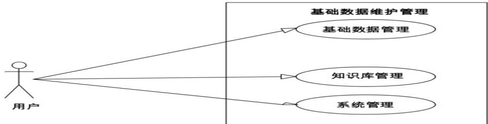
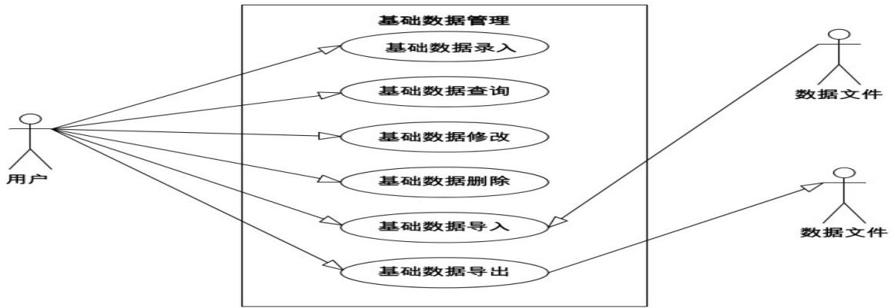

<table><tr><td rowspan=1 colspan=1>9.选择需要增加的字段，点击确定；</td><td rowspan=1 colspan=1>10.系统将选定的字段信息插入到元数据库中，更新增加字段信息后的页面信息，如果插入失败，执行异常流E3。</td><td rowspan=1 colspan=1></td></tr><tr><td rowspan=1 colspan=2>异常流E1：更新表信息失败，用例结束。</td><td rowspan=1 colspan=1></td></tr><tr><td rowspan=1 colspan=2>异常流E2：删除表信息失败，用例结束。</td><td rowspan=1 colspan=1></td></tr><tr><td rowspan=1 colspan=2>异常流E3:插入表信息失败，用例结束。</td><td rowspan=1 colspan=1></td></tr><tr><td rowspan=1 colspan=2>后置条件：无。</td><td rowspan=1 colspan=1></td></tr></table>

## 3.2.1.4 元数据检索（PZXQ-GN-YSJGL-YSJJS）

元数据检索用例场景，见表7所示。

表7 元数据检索用例描述
<table><tr><td rowspan=1 colspan=1>Use Case 名称:元数据检索</td><td rowspan=1 colspan=2>Actors：用户</td></tr><tr><td rowspan=1 colspan=3>概述：本用例是元数据管理的扩展用例，描述元数据检索的过程；</td></tr><tr><td rowspan=1 colspan=3>前置条件：元数据服务正常。</td></tr><tr><td rowspan=1 colspan=3>主事件流</td></tr><tr><td rowspan=1 colspan=1>Actor 的动作</td><td rowspan=1 colspan=1>系统的动作</td><td rowspan=1 colspan=1>动作约束(性能、可靠性、容错等)</td></tr><tr><td rowspan=1 colspan=1>1. 点击“字段检索”标签页；3.从字段类型、定义域、分类域、中文名称、代码定义下拉框中选择待检索的条件，点击“查询”；</td><td rowspan=1 colspan=1>2.系统从元数据库中获取所有字段的字段类型、分类域、定义域、中文名称、代码定义等信息，作为前台检索的条件值；4.系统从元数据表中根据检索条件进行条件查询，将查询出的字段信息展示到浏览器。</td><td rowspan=1 colspan=1></td></tr><tr><td rowspan=1 colspan=2>异常流E1：元数据库服务终止。</td><td rowspan=1 colspan=1></td></tr><tr><td rowspan=1 colspan=2>后置条件：无。</td><td rowspan=1 colspan=1></td></tr></table>

## 3.2.1.5 分类域显示（PZXQ-GN-YSJGL-FLYXS）

分类域显示用例场景，见表8所示。

表8 分类域显示用例描述
<table><tr><td rowspan=1 colspan=1>Use Case 名称:分类域显示</td><td rowspan=1 colspan=2>Actors：用户</td></tr><tr><td rowspan=1 colspan=3>概述：本用例是元数据管理的扩展用例，描述分类域显示的过程；</td></tr><tr><td rowspan=1 colspan=3>前置条件：元数据服务正常。</td></tr><tr><td rowspan=1 colspan=3>主事件流</td></tr><tr><td rowspan=1 colspan=1>Actor 的动作</td><td rowspan=1 colspan=1>系统的动作</td><td rowspan=1 colspan=1>动作约束(性能、可靠性、容错等)</td></tr><tr><td rowspan=1 colspan=1>1.点击“数据审查”标签页；</td><td rowspan=1 colspan=1>2.系统从分类域表查询出所有的分类域以及该分类域下面的表，推送至前端界面；3.前端以分类域、表的二级树节点展示所有信息。</td><td rowspan=1 colspan=1></td></tr><tr><td rowspan=1 colspan=2>异常流E1：元数据库服务终止。</td><td rowspan=1 colspan=1></td></tr><tr><td rowspan=1 colspan=2>后置条件：无。</td><td rowspan=1 colspan=1></td></tr></table>

## 3.2.1.6 分类域增加（PZXQ-GN-YSJGL-FLYZJ）

分类域增加用例场景，见表9所示。

表9 分类域增加用例描述
<table><tr><td colspan="1" rowspan="1">Use Case 名称:分类域增加</td><td colspan="2" rowspan="1">Actors：用户</td></tr><tr><td colspan="3" rowspan="1">概述：本用例是元数据管理的扩展用例，描述分类域增加的过程；</td></tr><tr><td colspan="3" rowspan="1">前置条件：元数据服务正常。</td></tr><tr><td colspan="3" rowspan="1">主事件流</td></tr><tr><td colspan="1" rowspan="1">Actor 的动作</td><td colspan="1" rowspan="1">系统的动作</td><td colspan="1" rowspan="1">动作约束(性能、可靠性、容错等)</td></tr><tr><td colspan="1" rowspan="1">1.进入“数据审查”标签页。在分类域列表上，点击右键，选择“新增”；3.在弹框输入新的分类域名称，点击确定；</td><td colspan="1" rowspan="1">2.系统弹框供用户输入新的分类域名；4.系统向分类域表中插入新的分类域；</td><td colspan="1" rowspan="1">输入信息合法性校验，并在错误发生时，提供详细的错误信息提示</td></tr><tr><td colspan="1" rowspan="1"></td><td colspan="1" rowspan="1">5.前端自动刷新，将新增的分类域展示出来。</td><td colspan="1" rowspan="1"></td></tr><tr><td colspan="2" rowspan="1">异常流E1:元数据库服务终止。</td><td colspan="1" rowspan="1"></td></tr><tr><td colspan="2" rowspan="1">后置条件：无。</td><td colspan="1" rowspan="1"></td></tr></table>

## 3.2.1.7 分类域修改（PZXQ-GN-YSJGL-FLYXG）

分类域修改用例场景，见表10所示。

表10 抽取元数据用例描述
<table><tr><td rowspan=1 colspan=1>Use Case 名称:分类域修改</td><td rowspan=1 colspan=2>Actors：用户</td></tr><tr><td rowspan=1 colspan=3>概述：本用例是元数据管理的扩展用例，描述分类域修改的过程；</td></tr><tr><td rowspan=1 colspan=3>前置条件：元数据服务正常。</td></tr><tr><td rowspan=1 colspan=3>主事件流</td></tr><tr><td rowspan=1 colspan=1>Actor 的动作</td><td rowspan=1 colspan=1>系统的动作</td><td rowspan=1 colspan=1>动作约束(性能、可靠性、容错等)</td></tr><tr><td rowspan=1 colspan=1>1.进入“数据审查”标签页。在分类域列表上，在某个分类域上点击右键，选择“修改”；3. 在弹框输入新的分类域名称，点击确定；</td><td rowspan=1 colspan=1>2.系统弹框供用户输入新的分类域名；4.系统在分类域表中将选中的分类域修改为新值；5.前端自动刷新，将修改后的分类域展示出来。</td><td rowspan=1 colspan=1>输入信息合法性校验，并在错误发生时，提供详细的错误信息提示</td></tr><tr><td rowspan=1 colspan=2>异常流E1：元数据库服务终止。</td><td rowspan=1 colspan=1></td></tr><tr><td rowspan=1 colspan=2>后置条件：无。</td><td rowspan=1 colspan=1></td></tr></table>

## 3.2.1.8 分类域删除（PZXQ-GN-YSJGL-FLYSC）

分类域删除用例场景，见表11所示。

表11 分类域删除用例描述
<table><tr><td>Use Case 名称:分类域删除</td><td colspan="2">Actors：用户</td></tr><tr><td colspan="3">概述：本用例是元数据管理的扩展用例，描述分类域删除的过程；</td></tr><tr><td colspan="3" rowspan="1">前置条件：元数据服务正常。</td></tr><tr><td colspan="3" rowspan="1">主事件流</td></tr><tr><td colspan="1" rowspan="1">Actor 的动作</td><td colspan="1" rowspan="1">系统的动作</td><td colspan="1" rowspan="1">动作约束(性能、可靠性、容错等)</td></tr><tr><td colspan="1" rowspan="1">1. 进入“数据审查”标签页；在分类域列表上，在某个分类域上点击右键，选择“删除”；3. 在确认弹框点击确定；</td><td colspan="1" rowspan="1">2.系统弹框提示用户是否确认操作；4.前端自动刷新，将删除该分类域后的分类域列表重新推送至前端界面。</td><td colspan="1" rowspan="1">交互信息正确性校验，并在错误发生时，提供详细的错误信息提示</td></tr><tr><td colspan="2" rowspan="1">异常流E1：元数据库服务终止。</td><td colspan="1" rowspan="1"></td></tr><tr><td colspan="2" rowspan="1">后置条件：无。</td><td colspan="1" rowspan="1"></td></tr></table>

## 3.2.1.9 调整表所属分类域（PZXQ-GN-YSJGL-TZBSSFLY）

调整表所属分类域用例场景，见表12所示。

表12调整表所属分类域用例描述
<table><tr><td rowspan=1 colspan=1>Use Case 名称:分类域删除</td><td rowspan=1 colspan=2>Actors：用户</td></tr><tr><td rowspan=1 colspan=3>概述：本用例是元数据管理的扩展用例，描述调整表所属分类域的过程；</td></tr><tr><td rowspan=1 colspan=3>前置条件：元数据服务正常。</td></tr><tr><td rowspan=1 colspan=3>主事件流</td></tr><tr><td rowspan=1 colspan=1>Actor 的动作</td><td rowspan=1 colspan=1>系统的动作</td><td rowspan=1 colspan=1>动作约束(性能、可靠性、容错等)</td></tr><tr><td rowspan=1 colspan=1>1. 进入“数据审查”标签页。在分类域列表上，点击分类域树节点，在展开的表名列表中拖动某个表至其他分类域上：</td><td rowspan=1 colspan=1>2.系统将指定表的分类域修改为新的分类域；3.前端自动刷新，将表名刷新到新分类域的树节点下。</td><td rowspan=1 colspan=1>交互信息正确性校验，并在错误发生时，提供详细的错误信息提示</td></tr><tr><td rowspan=1 colspan=2>异常流E1:元数据库服务终止。</td><td rowspan=1 colspan=1></td></tr><tr><td rowspan=1 colspan=2>后置条件：无。</td><td rowspan=1 colspan=1></td></tr></table>

## 3.2.1.10 SQL 校验（PZXQ-GN-YSJGL-SQLJY）

SQL 校验用例场景，见表13所示。

表13 SQL校验用例描述
<table><tr><td rowspan=1 colspan=1>Use Case 名称:SQL 校验</td><td rowspan=1 colspan=2>Actors：用户</td></tr><tr><td rowspan=1 colspan=3>概述：本用例是元数据管理的扩展用例，描述SQL校验的过程；</td></tr><tr><td rowspan=1 colspan=3>前置条件：元数据服务正常。</td></tr><tr><td rowspan=1 colspan=3>主事件流</td></tr><tr><td rowspan=1 colspan=1>Actor 的动作</td><td rowspan=1 colspan=1>系统的动作</td><td rowspan=1 colspan=1>动作约束(性能、可靠性、容错等)</td></tr><tr><td rowspan=1 colspan=1>1. 进入“数据审查”标签页。在“请输入建表语句”下的文本域中输入待检测的建表语句。点击检测SQL并提交；3.在下方显示框中查看校验结果；</td><td rowspan=1 colspan=1>2.系统通过查询元数据库中的相关表及字段信息，判断用户输入的 DDL语句是否合法，以及数据信息是否与元数据相符，将检测结果展示到浏览器；4.如果校验成功，系统会提交该表信息，将新建的表名添加至“其他”分类域，以供用户维护其分类域信息。如果提交失败会到异常流E2。</td><td rowspan=1 colspan=1>交互信息正确性校验，并在错误发生时，提供详细的错误信息提示</td></tr><tr><td rowspan=1 colspan=2>异常流E1：元数据库服务终止，用例终止。</td><td rowspan=1 colspan=1></td></tr><tr><td rowspan=1 colspan=2>异常流E2：SQL语句提交失败，用例终止。</td><td rowspan=1 colspan=1></td></tr><tr><td rowspan=1 colspan=2>后置条件：无。</td><td rowspan=1 colspan=1></td></tr></table>

## 3.2.2 数据库运行管理（PZXQ-GN-SJKYXGL）

数据库运行监控能力包括：数据库会话监控、数据库资源监控、数据库表空间监控、连接数据监控，其功能用例如图 4所示。

  
图 4据库运行管理用例图  
数据库运行监控能力标识表，见表14所示。

表14 数据库运行监控能力能力标识
<table><tr><td rowspan=1 colspan=1>序号</td><td rowspan=1 colspan=1>Use case 名称</td><td rowspan=1 colspan=1>项目唯一标识符</td><td rowspan=1 colspan=1>需求描述</td><td rowspan=1 colspan=1>需求重用</td><td rowspan=1 colspan=1>方式名称</td><td rowspan=1 colspan=1>运行状态</td><td rowspan=1 colspan=1>对应的任务书功能/性能</td></tr><tr><td rowspan=1 colspan=1>1</td><td rowspan=1 colspan=1>数据库会话监控</td><td rowspan=1 colspan=1>PZXQ-GN-SJKYXGL-HHJK</td><td rowspan=1 colspan=1>提供数据库会话的监控</td><td rowspan=1 colspan=1>沿用</td><td rowspan=1 colspan=1>桌面</td><td rowspan=1 colspan=1>运行阶段</td><td rowspan=1 colspan=1>4.1.2 a)</td></tr><tr><td rowspan=1 colspan=1>2</td><td rowspan=1 colspan=1>数据库资源监控</td><td rowspan=1 colspan=1>PZXQ-GN-SJKYXGL-ZYJK</td><td rowspan=1 colspan=1>提供数据库资源的监控能力</td><td rowspan=1 colspan=1>沿用</td><td rowspan=1 colspan=1>桌面</td><td rowspan=1 colspan=1>运行阶段</td><td rowspan=1 colspan=1>4.1.2 b)</td></tr><tr><td rowspan=1 colspan=1>3</td><td rowspan=1 colspan=1>数据库表空间监控</td><td rowspan=1 colspan=1>PZXQ-GN-SJKYXGL-BKJJK</td><td rowspan=1 colspan=1>提供数据库表空间的监控能力</td><td rowspan=1 colspan=1>沿用</td><td rowspan=1 colspan=1>桌面</td><td rowspan=1 colspan=1>运行阶段</td><td rowspan=1 colspan=1>4.1.2 c)</td></tr><tr><td rowspan=1 colspan=1>4</td><td rowspan=1 colspan=1>连接数监控</td><td rowspan=1 colspan=1>PZXQ-GN-SJKYXGL-LJSJK</td><td rowspan=1 colspan=1>提供数据库连接数监控能力</td><td rowspan=1 colspan=1>沿用</td><td rowspan=1 colspan=1>桌面</td><td rowspan=1 colspan=1>运行阶段</td><td rowspan=1 colspan=1>4.1.2 d,e)</td></tr></table>

## 3.2.2.1 会话监控（PZXQ-GN-SJKYXGL-HHJK）

会话监控用例场景，见表15所示。

表15 数据库回话监控用例描述
<table><tr><td colspan="1" rowspan="1">Use Case 名称：数据库会话监控</td><td colspan="2" rowspan="1">Actors：用户、运行支撑服务</td></tr><tr><td colspan="3" rowspan="1">概述：本用例是数据库运行管理的扩展用例，描述数据库会话监控的过程；</td></tr><tr><td colspan="3" rowspan="1">前置条件：Redis服务正常，运维框架正常运行，达梦数据库服务正常</td></tr><tr><td colspan="3" rowspan="1">主事件流</td></tr><tr><td colspan="1" rowspan="1">Actor 的动作</td><td colspan="1" rowspan="1">系统的动作</td><td colspan="1" rowspan="1">动作约束(性能、可靠性、容错等)</td></tr><tr><td colspan="1" rowspan="1">1.启动数据库运行管理服务，轮询获取数据库会话状态信息，暂存于共享数据库中；</td><td colspan="1" rowspan="1">2.系统获取共享数据库会话信息，轮询展示于运行支撑服务页面中，如果会话信息没有正常显示，执行异常流E1。</td><td colspan="1" rowspan="1"></td></tr><tr><td colspan="2" rowspan="1">异常流E1：会话信息查询失败，用例结束。</td><td colspan="1" rowspan="1"></td></tr><tr><td colspan="2" rowspan="1">后置条件：无。</td><td colspan="1" rowspan="1"></td></tr></table>

## 3.2.2.2 资源监控（PZXQ-GN-SJKYXGL-ZYJK）

资源监控用例场景，见表16所示。

表16 数据库资源监控用例描述
<table><tr><td rowspan=1 colspan=1>Use Case 名称:资源监控</td><td rowspan=1 colspan=2>Actors：用户、运行支撑服务</td></tr><tr><td rowspan=1 colspan=3>概述：本用例是数据库运行管理的扩展用例，描述数据库资源监控的过程；</td></tr><tr><td rowspan=1 colspan=3>前置条件：Redis服务正常，运维框架正常运行，达梦数据库服务正常</td></tr><tr><td rowspan=1 colspan=3>主事件流</td></tr><tr><td rowspan=1 colspan=1>Actor 的动作</td><td rowspan=1 colspan=1>系统的动作</td><td rowspan=1 colspan=1>动作约束(性能、可靠性、容错等)</td></tr><tr><td rowspan=1 colspan=1>1.启动数据库运行管理服务，轮询获取数据库资源状态信息，暂存于共享数据库中；</td><td rowspan=1 colspan=1>2.系统获取共享数据库资源信息，轮询展示于运行支撑服务页面中，如果数据库资源信息没有正常显示，执行异常流E1。</td><td rowspan=1 colspan=1></td></tr><tr><td rowspan=1 colspan=2>异常流E1:数据库资源信息查询失败，用例结束。</td><td rowspan=1 colspan=1></td></tr><tr><td rowspan=1 colspan=2>后置条件：无。</td><td rowspan=1 colspan=1></td></tr></table>

## 3.2.2.3 表空间监控（PZXQ-GN-SJKYXGL-BKJJK）

表空间监控用例场景，见表17所示。

表17 数据库表空间用例描述
<table><tr><td rowspan=1 colspan=1>Use Case 名称:数据库表空间监控</td><td rowspan=1 colspan=1>Actors：用户、运行支撑服务</td></tr><tr><td rowspan=1 colspan=2>概述：本用例是数据库运行管理的扩展用例，描述数据库表空间监控的过程；</td></tr><tr><td rowspan=1 colspan=2>前置条件：Redis服务正常，运维框架正常运行，达梦数据库服务正常</td></tr><tr><td rowspan=1 colspan=2>主事件流</td></tr></table>

<table><tr><td rowspan=1 colspan=1>Actor的动作</td><td rowspan=1 colspan=1>系统的动作</td><td rowspan=1 colspan=1>动作约束(性能、可靠性、容错等)</td></tr><tr><td rowspan=1 colspan=1>1.启动数据库运行管理服务，轮询获取数据库表空间状态信息，暂存于共享数据库中；</td><td rowspan=1 colspan=1>2.系统获取共享数据库表空间信息，轮询展示于运行支撑服务页面中，如果数据库表空间信息没有正常显示，执行异常流E1。</td><td rowspan=1 colspan=1></td></tr><tr><td rowspan=1 colspan=2>异常流E1：数据库表空间信息查询失败，用例结束。</td><td rowspan=1 colspan=1></td></tr><tr><td rowspan=1 colspan=2>后置条件：无。</td><td rowspan=1 colspan=1></td></tr></table>

## 3.2.2.4 连接数监控（PZXQ-GN-SJKYXGL-LJSJK）

连接数监控用例场景，见表18所示。

表18连接数监控用例描述
<table><tr><td rowspan=1 colspan=1>Use Case 名称:连接数监控</td><td rowspan=1 colspan=2>Actors：用户、运行支撑服务</td></tr><tr><td rowspan=1 colspan=3>概述：本用例是数据库运行管理的扩展用例，描述连接数监控的过程；</td></tr><tr><td rowspan=1 colspan=3>前置条件：Redis服务正常，运维框架正常运行，达梦数据库服务正常</td></tr><tr><td rowspan=1 colspan=3>主事件流</td></tr><tr><td rowspan=1 colspan=1>Actor 的动作</td><td rowspan=1 colspan=1>系统的动作</td><td rowspan=1 colspan=1>动作约束(性能、可靠性、容错等)</td></tr><tr><td rowspan=1 colspan=1>1.启动数据库运行管理服务，轮询获取数据库连接数状态信息，暂存于共享数据库中；</td><td rowspan=1 colspan=1>2.系统获取共享数据库连接数信息，轮询展示于运行支撑服务页面中，如果数据库连接数信息没有正常显示，执行异常流E1。</td><td rowspan=1 colspan=1></td></tr><tr><td rowspan=1 colspan=2>异常流E1:数据库连接数信息查询失败，用例结束。</td><td rowspan=1 colspan=1></td></tr><tr><td rowspan=1 colspan=2>后置条件：无。</td><td rowspan=1 colspan=1></td></tr></table>

## 3.2.3 基础数据维护（PZXQ-GN-JCSJWH）

基础数据维护管理包括：基础数据管理、知识库管理、模板管理、系统管理，其功能用例如图 5所示。

  
图 5基础数据维护管理用例图

基础数据维护管理能力标识表，见表19所示。

表19基础数据维护管理能力能力标识
<table><tr><td rowspan=1 colspan=1>序号</td><td rowspan=1 colspan=1>Usecase名称</td><td rowspan=1 colspan=1>项目唯一标识符</td><td rowspan=1 colspan=1>需求描述</td><td rowspan=1 colspan=1>需求重用</td><td rowspan=1 colspan=1>方式名称</td><td rowspan=1 colspan=1>运行状态</td><td rowspan=1 colspan=1>对应的任务书功能/性能</td></tr><tr><td rowspan=1 colspan=1>1</td><td rowspan=1 colspan=1>基础数据管理</td><td rowspan=1 colspan=1>PZXQ-GN-JCSJWH-JCSJGL</td><td rowspan=1 colspan=1>提供对数据库的数据增删改查功能，对基础数据的导入导出管理</td><td rowspan=1 colspan=1>沿用</td><td rowspan=1 colspan=1>桌面、平板</td><td rowspan=1 colspan=1>集成阶段</td><td rowspan=1 colspan=1>4.1.3</td></tr><tr><td rowspan=1 colspan=1>2</td><td rowspan=1 colspan=1>知识库管理</td><td rowspan=1 colspan=1>PZXQ-GN-JCSJWH-ZSKGL</td><td rowspan=1 colspan=1>提供对知识库的存储，查询，检索，关联的功能</td><td rowspan=1 colspan=1>新研</td><td rowspan=1 colspan=1>桌面、平板</td><td rowspan=1 colspan=1>集成阶段</td><td rowspan=1 colspan=1>4.1.3</td></tr><tr><td rowspan=1 colspan=1>3</td><td rowspan=1 colspan=1>模板管理</td><td rowspan=1 colspan=1>PZXQ-GN-JCSJWH-MBGL</td><td rowspan=1 colspan=1>提供对模板数据的增删改查和导入导出管理</td><td rowspan=1 colspan=1>沿用</td><td rowspan=1 colspan=1>桌面、平板</td><td rowspan=1 colspan=1>集成阶段</td><td rowspan=1 colspan=1>4.1.3</td></tr><tr><td rowspan=1 colspan=1>4</td><td rowspan=1 colspan=1>系统管理</td><td rowspan=1 colspan=1>PZXQ-GN-JCSJWH-XTGL</td><td rowspan=1 colspan=1>提供连接数据库时对用户输入的用户名和口令进行验证，并返回验证结果；具备断开数据库连接的功能；提供动态配置软件界面、支持生成表及表之间的约束关系</td><td rowspan=1 colspan=1>沿用</td><td rowspan=1 colspan=1>桌面、平板</td><td rowspan=1 colspan=1>集成阶段</td><td rowspan=1 colspan=1>4.1.3</td></tr></table>

## 3.2.3.1 基础数据维护-基础数据管理（PZXQ-GN-JCSJWH-JCSJGL）

基础数据维护能力包括：基础数据录入、基础数据查询、基础数据修改、基础数据删除、基础数据导入、基础数据导出，其功能用例如图 6所示。

  
图 6基础数据管理用例图  
基础数据维护能力标识表，见表20所示。

表20基础数据维护能力能力标识
<table><tr><td rowspan=1 colspan=1>序号</td><td rowspan=1 colspan=1>Usecase名称</td><td rowspan=1 colspan=1>项目唯一标识符</td><td rowspan=1 colspan=1>需求描述</td><td rowspan=1 colspan=1>需求重用</td><td rowspan=1 colspan=1>方式名称</td><td rowspan=1 colspan=1>运行状态</td><td rowspan=1 colspan=1>对应的任务书功能/性能</td></tr><tr><td rowspan=1 colspan=1>1</td><td rowspan=1 colspan=1>基础数据录入</td><td rowspan=1 colspan=1>PZXQ-GN-JCSJWHGL-JCSJGL-JCSJLR</td><td rowspan=1 colspan=1>提供对数据库的数据插入功能</td><td rowspan=1 colspan=1>沿用</td><td rowspan=1 colspan=1>桌面、平板</td><td rowspan=1 colspan=1>集成阶段</td><td rowspan=1 colspan=1>4.1.3 b、c、d、e、f、i、j)</td></tr><tr><td rowspan=1 colspan=1>2</td><td rowspan=1 colspan=1>基础数据查询</td><td rowspan=1 colspan=1>PZXQ-GN-JCSJWHGL-JCSJGL-JCSJCX</td><td rowspan=1 colspan=1>提供对数据库的数据查询功能</td><td rowspan=1 colspan=1>沿用</td><td rowspan=1 colspan=1>桌面、平板</td><td rowspan=1 colspan=1>集成阶段</td><td rowspan=1 colspan=1>4.1.3 b、c、d、e、f、i、j)</td></tr><tr><td rowspan=1 colspan=1>3</td><td rowspan=1 colspan=1>基础数据修改</td><td rowspan=1 colspan=1>PZXQ-GN-JCSJWHGL-JCSJGL-JCSJXG</td><td rowspan=1 colspan=1>提供对数据库的数据修改功能</td><td rowspan=1 colspan=1>沿用</td><td rowspan=1 colspan=1>桌面、平板</td><td rowspan=1 colspan=1>集成阶段</td><td rowspan=1 colspan=1>4.1.3 b、c、d、e、f、i、j)</td></tr><tr><td rowspan=1 colspan=1>4</td><td rowspan=1 colspan=1>基础数据删除</td><td rowspan=1 colspan=1>PZXQ-GN-JCSJWHGL-JCSJGL-JCSJSC</td><td rowspan=1 colspan=1>提供对数据库的数据删除功能</td><td rowspan=1 colspan=1>沿用</td><td rowspan=1 colspan=1>桌面、平板</td><td rowspan=1 colspan=1>集成阶段</td><td rowspan=1 colspan=1>4.1.3 b、c、d、e、f、i、j)</td></tr></table>