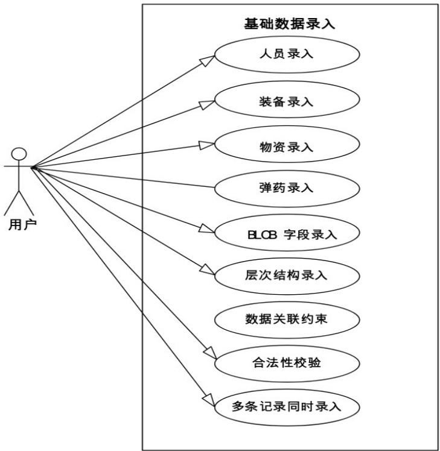
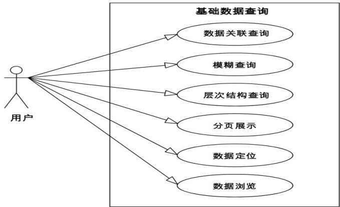

<table><tr><td rowspan=1 colspan=1>序号</td><td rowspan=1 colspan=1>Usecase名称</td><td rowspan=1 colspan=1>项目唯一标识符</td><td rowspan=1 colspan=1>需求描述</td><td rowspan=1 colspan=1>需求重用</td><td rowspan=1 colspan=1>方式名称</td><td rowspan=1 colspan=1>运行状态</td><td rowspan=1 colspan=1>对应的任务书功能/性能</td></tr><tr><td rowspan=1 colspan=1>5</td><td rowspan=1 colspan=1>基础数据导入</td><td rowspan=1 colspan=1>PZXQ-GN-JCSJWHGL-JCSJGL-JCSJDR</td><td rowspan=1 colspan=1>提供批量数据导入功能，提供SQL数据导入功能，支持单表、多表的导入；提供EXCEL数据导入功能，支持EXCEL数据的在线修改、删除和显示；提供DMP文件导入功能。</td><td rowspan=1 colspan=1>沿用</td><td rowspan=1 colspan=1>桌面、平板</td><td rowspan=1 colspan=1>集成阶段</td><td rowspan=1 colspan=1>4.1.3 b、c、d、e、f、i、j)</td></tr><tr><td rowspan=1 colspan=1>6</td><td rowspan=1 colspan=1>基础数据导出</td><td rowspan=1 colspan=1>PZXQ-GN-JCSJWHGL-JCSJGL-JCSJDC</td><td rowspan=1 colspan=1>提供批量数据导出功能，提供SQL文件导出功能，支持单表、多表导出、支持按分类域导出、支持按组织机构导出数据；提供 DMP件导出功能，支持单表、多表导出、支持按分类域导出；提供全库导出功能。</td><td rowspan=1 colspan=1>沿用</td><td rowspan=1 colspan=1>桌面、平板</td><td rowspan=1 colspan=1>集成阶段</td><td rowspan=1 colspan=1>4.1.3 b、c、d、e、f、i、j)</td></tr></table>

3.2.3.1.1 基础数据录入（PZXQ-GN-JCSJWH-JCSJGL-JCSJLR）

基础数据录入能力包括：人员录入、装备录入、物资录入、弹药录入、BLOB字段录入、层次结构录入、数据关联约束、合法性校验、多条记录同时录入，其功能用例如图 7所示。

  
图 7基础数据录入用例图  
基础数据录入能力标识表，见表 21所示。

表 21数据库运行监控能力能力标识
<table><tr><td colspan="1" rowspan="1">序号</td><td colspan="1" rowspan="1">Use case名称</td><td colspan="1" rowspan="1">项目唯一标识符</td><td colspan="1" rowspan="1">需求描述</td><td colspan="1" rowspan="1">需求重用</td><td colspan="1" rowspan="1">方式名称</td><td colspan="1" rowspan="1">运行状态</td><td colspan="1" rowspan="1">对应的任务书功能/性能</td></tr><tr><td colspan="1" rowspan="1">1</td><td colspan="1" rowspan="1">人员录入</td><td colspan="1" rowspan="1">PZXQ-GN-JCSJWHGL-JCSJGL-RYLR</td><td colspan="1" rowspan="1">提供人员基础数据的录入功能</td><td colspan="1" rowspan="1">沿用</td><td colspan="1" rowspan="1">桌面、平板</td><td colspan="1" rowspan="1">集成阶段</td><td colspan="1" rowspan="1">4.1.3 c )</td></tr><tr><td colspan="1" rowspan="1">2</td><td colspan="1" rowspan="1">装备录入</td><td colspan="1" rowspan="1">PZXQ-GN-JCSJWHGL-JCSJGL-ZBLR</td><td colspan="1" rowspan="1">提供装备基础数据的录入功能</td><td colspan="1" rowspan="1">沿用</td><td colspan="1" rowspan="1">桌面、平板</td><td colspan="1" rowspan="1">集成阶段</td><td colspan="1" rowspan="1">4.1.3 c )</td></tr><tr><td colspan="1" rowspan="1">3</td><td colspan="1" rowspan="1">物资录入</td><td colspan="1" rowspan="1">PZXQ-GN-JCSJWHGL-JCSJGL-WZLR</td><td colspan="1" rowspan="1">提供物资基础数据的录入功能</td><td colspan="1" rowspan="1">沿用</td><td colspan="1" rowspan="1">桌面、平板</td><td colspan="1" rowspan="1">集成阶段</td><td colspan="1" rowspan="1">4.1.3 c )</td></tr><tr><td colspan="1" rowspan="1">4</td><td colspan="1" rowspan="1">弹药录入</td><td colspan="1" rowspan="1">PZXQ-GN-JCSJWHGL-JCSJGL-DYLR</td><td colspan="1" rowspan="1">提供弹药基础数据的录入功能</td><td colspan="1" rowspan="1">沿用</td><td colspan="1" rowspan="1">桌面、</td><td colspan="1" rowspan="1">集成阶段</td><td colspan="1" rowspan="1">4.1.3 c )</td></tr><tr><td colspan="1" rowspan="1"></td><td colspan="1" rowspan="1"></td><td colspan="1" rowspan="1"></td><td colspan="1" rowspan="1"></td><td colspan="1" rowspan="1"></td><td colspan="1" rowspan="1">平板</td><td colspan="1" rowspan="1"></td><td colspan="1" rowspan="1"></td></tr><tr><td colspan="1" rowspan="1">5</td><td colspan="1" rowspan="1">BLOB 字段录入</td><td colspan="1" rowspan="1">PZXQ-GN-JCSJWHGL-JCSJGL-BLOBLR</td><td colspan="1" rowspan="1">提供媒体图片功能的录入功能</td><td colspan="1" rowspan="1">沿用</td><td colspan="1" rowspan="1">桌面、平板</td><td colspan="1" rowspan="1">集成阶段</td><td colspan="1" rowspan="1">4.1.3 c )</td></tr><tr><td colspan="1" rowspan="1">6</td><td colspan="1" rowspan="1">层次结构录入</td><td colspan="1" rowspan="1">PZXQ-GN-JCSJWHGL-JCSJGL-CCJGLR</td><td colspan="1" rowspan="1">提供对层次结构数据录入功能</td><td colspan="1" rowspan="1">沿用</td><td colspan="1" rowspan="1">桌面、平板</td><td colspan="1" rowspan="1">集成阶段</td><td colspan="1" rowspan="1">4.1.3 c )</td></tr><tr><td colspan="1" rowspan="1">7</td><td colspan="1" rowspan="1">数据关联约束</td><td colspan="1" rowspan="1">PZXQ-GN-JCSJWHGL-JCSJGL-SJGLYS</td><td colspan="1" rowspan="1">提供关联性数据录入功能</td><td colspan="1" rowspan="1">沿用</td><td colspan="1" rowspan="1">桌面、平板</td><td colspan="1" rowspan="1">集成阶段</td><td colspan="1" rowspan="1">4.1.3 c )</td></tr><tr><td colspan="1" rowspan="1">8</td><td colspan="1" rowspan="1">合法性校验</td><td colspan="1" rowspan="1">PZXQ-GN-JCSJWHGL-JCSJGL-HFXJY</td><td colspan="1" rowspan="1">对录入数据进行合法性校验功能</td><td colspan="1" rowspan="1">沿用</td><td colspan="1" rowspan="1">桌面、平板</td><td colspan="1" rowspan="1">集成阶段</td><td colspan="1" rowspan="1">4.1.3 c )</td></tr><tr><td colspan="1" rowspan="1">9</td><td colspan="1" rowspan="1">多条记录录入功能</td><td colspan="1" rowspan="1">PZXQ-GN-JCSJWHGL-JCSJGL-DTJLLR</td><td colspan="1" rowspan="1">提供同时录入多条记录功能</td><td colspan="1" rowspan="1">沿用</td><td colspan="1" rowspan="1">桌面、平板</td><td colspan="1" rowspan="1">集成阶段</td><td colspan="1" rowspan="1">4.1.3 c )</td></tr></table>

基础数据管理录入中人员录入用例场景见表 22所示。

表 22人员数据录入用例描述
<table><tr><td rowspan=1 colspan=1>Use Case 名称:人员数据录入</td><td rowspan=1 colspan=2>Actors：用户</td></tr><tr><td rowspan=1 colspan=3>概述：本用例主要实现基础数据管理中人员信息的录入功能</td></tr><tr><td rowspan=1 colspan=3>前置条件：达梦数据库连接正常。</td></tr><tr><td rowspan=1 colspan=3>主事件流</td></tr><tr><td rowspan=1 colspan=1>Actor 的动作</td><td rowspan=1 colspan=1>系统的动作</td><td rowspan=1 colspan=1>动作约束(性能、可靠性、容错等)</td></tr><tr><td rowspan=1 colspan=1>1.用户在组织机构树中选择需要添加人员所在的部队节点；3.编辑添加人员的信息，包括人员类型，数量等信息；5.人员数据录入结束。</td><td rowspan=1 colspan=1>2.在前台界面中点击添加人员按钮：4、编辑好添加人员信息后，点击确定；</td><td rowspan=1 colspan=1>1.交互信息正确性校验，并在错误发生时，提供详细的错误信息提示2.输入信息合法性校验，并在错误发生时，提供详细的错误信息提示</td></tr><tr><td rowspan=1 colspan=2>异常流E1：系统提示失败，用例结束。</td><td rowspan=1 colspan=1></td></tr><tr><td rowspan=1 colspan=2>后置条件：无。</td><td rowspan=1 colspan=1></td></tr></table>

基础数据录入中装备录入用例场景见表 23所示。  
表 23装备数据录入用例描述
<table><tr><td rowspan=1 colspan=1>Use Case 名称:装备数据录入</td><td rowspan=1 colspan=2>Actors：用户</td></tr><tr><td rowspan=1 colspan=3>概述：本用例主要实现基础数据中装备信息的录入功能</td></tr><tr><td rowspan=1 colspan=3>前置条件：达梦数据库连接正常。</td></tr><tr><td rowspan=1 colspan=3>主事件流</td></tr><tr><td rowspan=1 colspan=1>Actor 的动作</td><td rowspan=1 colspan=1>系统的动作</td><td rowspan=1 colspan=1>动作约束(性能、可靠性、容错等)</td></tr><tr><td rowspan=1 colspan=1>1.用户在组织机构树中选择需要添加装备所在的部队节点；3.编辑添加装备的信息，包括装备编号，数量等信息；5.装备数据录入结束。</td><td rowspan=1 colspan=1>2.在前台界面中点击添加装备按钮；4、编辑好添加装备信息后，点击确定；</td><td rowspan=1 colspan=1>1.交互信息正确性校验，并在错误发生时，提供详细的错误信息提示2.输入信息合法性校验，并在错误发生时，提供详细的错误信息提示</td></tr><tr><td rowspan=1 colspan=2>异常流E1：系统提示失败，用例结束。</td><td rowspan=1 colspan=1></td></tr><tr><td rowspan=1 colspan=2>后置条件：无。</td><td rowspan=1 colspan=1></td></tr></table>

基础数据录入中物资录入用例场景见表 24所示。

表 24物资数据录入用例描述
<table><tr><td colspan="1" rowspan="1">Use Case 名称：物资数据录入</td><td colspan="2" rowspan="1">Actors：用户</td></tr><tr><td colspan="3" rowspan="1">概述：本用例主要实现基础数据中物资信息的录入功能</td></tr><tr><td colspan="3" rowspan="1">前置条件：达梦数据库连接正常。</td></tr><tr><td colspan="3" rowspan="1">主事件流</td></tr><tr><td colspan="1" rowspan="1">Actor 的动作</td><td colspan="1" rowspan="1">系统的动作</td><td colspan="1" rowspan="1">动作约束(性能、可靠性、容错等)</td></tr><tr><td colspan="1" rowspan="1">1.用户在组织机构树中选择需要添加物资所在的部队节点；3.编辑添加物资的信息，包括物资编号，数量等信息。</td><td colspan="1" rowspan="1">2.在前台界面中点击添加物资按钮；</td><td colspan="1" rowspan="1">1.交互信息正确性校验，并在错误发生时，提供详细的错误信息提示2.输入信息合法性校验，并在错误发生时，提供详细的错误信息提示</td></tr><tr><td>5.物资数据录入结束。</td><td>4、编辑好添加物资信息后，点击确定。</td><td></td></tr><tr><td>异常流E1：系统提示失败，用例结束。</td><td></td><td></td></tr><tr><td>后置条件：无。</td><td></td><td></td></tr></table>

基础数据录入中弹药录入用例场景见表 25所示。

表 25弹药数据录入用例描述
<table><tr><td rowspan=1 colspan=1>Use Case 名称:弹药数据录入</td><td rowspan=1 colspan=2>Actors：用户</td></tr><tr><td rowspan=1 colspan=3>概述：本用例主要实现基础数据中弹药信息的录入功能</td></tr><tr><td rowspan=1 colspan=3>前置条件：达梦数据库连接正常。</td></tr><tr><td rowspan=1 colspan=3>主事件流</td></tr><tr><td rowspan=1 colspan=1>Actor 的动作</td><td rowspan=1 colspan=1>系统的动作</td><td rowspan=1 colspan=1>动作约束(性能、可靠性、容错等)</td></tr><tr><td rowspan=1 colspan=1>1.用户在组织机构树中选择需要添加弹药所在的部队节点；3.编辑添加弹药的信息，包括弹药编号，数量等信息。5.弹药数据录入结束。</td><td rowspan=1 colspan=1>2.在前台界面中点击添加弹药按钮；4、编辑好添加弹药信息后，点击确定。</td><td rowspan=1 colspan=1>1.交互信息正确性校验，并在错误发生时，提供详细的错误信息提示2.输入信息合法性校验，并在错误发生时，提供详细的错误信息提示</td></tr><tr><td rowspan=1 colspan=2>异常流E1：系统提示失败，用例结束。</td><td rowspan=1 colspan=1></td></tr><tr><td rowspan=1 colspan=2>后置条件：无。</td><td rowspan=1 colspan=1></td></tr></table>

基础数据录入中 BLOB 字段录入用例场景见表 26所示。

表 26 BLOB数据录入用例描述
<table><tr><td colspan="1" rowspan="1">Use Case 名称：BLOB 数据录入</td><td colspan="2" rowspan="1">Actors：用户</td></tr><tr><td colspan="3" rowspan="1">概述：本用例主要实现基础数据中BLOB字段的录入功能</td></tr><tr><td colspan="3" rowspan="1">前置条件：达梦数据库连接正常。</td></tr><tr><td colspan="3" rowspan="1">主事件流</td></tr><tr><td colspan="1" rowspan="1">Actor 的动作</td><td colspan="1" rowspan="1">系统的动作</td><td colspan="1" rowspan="1">动作约束(性能、可靠性、容错等)</td></tr><tr><td>1.用户在组织机构树中选择需要添加部 队媒体所在的部队节点； 3.编辑添加媒体的信息，包括媒体标 题、媒体资源等信息；</td><td>2.在前台界面中点击添加部队媒体按 钮；</td><td>1.交互信息正确性校验，并在错 误发生时，提供详细的错误信息 提示 2.输入信息合法性校验，并在错 误发生时，提供详细的错误信息 提示</td></tr><tr><td>5.BLOB 数据录入结束。 异常流E1：系统提示失败，用例结束。</td><td>4、编辑好添加的媒体信息后，点击确 定；</td><td></td></tr><tr><td colspan="2">后置条件：无。</td><td></td></tr></table>

基础数据录入中层次结构录入用例场景见表 27所示。

表 27 层次结构录入用例描述
<table><tr><td rowspan=1 colspan=1>Use Case 名称:层次结构录入</td><td rowspan=1 colspan=2>Actors：用户</td></tr><tr><td rowspan=1 colspan=3>概述：本用例主要实现基础数据中层次机构的录入功能</td></tr><tr><td rowspan=1 colspan=3>前置条件：达梦数据库连接正常。</td></tr><tr><td rowspan=1 colspan=3>主事件流</td></tr><tr><td rowspan=1 colspan=1>Actor 的动作</td><td rowspan=1 colspan=1>系统的动作</td><td rowspan=1 colspan=1>动作约束(性能、可靠性、容错等)</td></tr><tr><td rowspan=1 colspan=1>1.用户在组织机构树中选择需要添加下级部队所在的部队节点；3.编辑添加部队节点的信息，包括部队内码、部队番号等信息；5.下级部队节点信息录入结束。</td><td rowspan=1 colspan=1>2.在前台界面中点击添加下级节点按钮；4、编辑好添加的部队节点信息后，点击确定；</td><td rowspan=1 colspan=1>1.交互信息正确性校验，并在错误发生时，提供详细的错误信息提示2.输入信息合法性校验，并在错误发生时，提供详细的错误信息提示</td></tr><tr><td rowspan=1 colspan=2>异常流E1：系统提示失败，用例结束。</td><td rowspan=1 colspan=1></td></tr><tr><td rowspan=1 colspan=2>后置条件：无。</td><td rowspan=1 colspan=1></td></tr></table>

基础数据数据关联用例场景见表 28所示。

表 28 数据关联用例描述
<table><tr><td rowspan=1 colspan=1>Use Case 名称:数据关联</td><td rowspan=1 colspan=2>Actors：用户</td></tr><tr><td rowspan=1 colspan=3>概述：本用例主要实现基础数据中带有外键的字段产生数据选择界面功能</td></tr><tr><td rowspan=1 colspan=3>前置条件：达梦数据库连接正常。</td></tr><tr><td rowspan=1 colspan=3>主事件流</td></tr><tr><td rowspan=1 colspan=1>Actor 的动作</td><td rowspan=1 colspan=1>系统的动作</td><td rowspan=1 colspan=1>动作约束(性能、可靠性、容错等)</td></tr><tr><td rowspan=1 colspan=1>1.用户在组织机构树中选择需要添加下级部队所在的部队节点；3.编辑添加部队节点的信息，包括部队内码、部队番号等信息，在选择部队类别时，能够产生部队类别的参考数值选项；5.下级部队节点信息录入结束。</td><td rowspan=1 colspan=1>2.在前台界面中点击添加下级节点按钮；4、编辑好添加的部队节点信息后，点击确定；</td><td rowspan=1 colspan=1>1.交互信息正确性校验，并在错误发生时，提供详细的错误信息提示2.输入信息合法性校验，并在错误发生时，提供详细的错误信息提示</td></tr><tr><td rowspan=1 colspan=2>异常流E1：系统提示失败，用例结束。</td><td rowspan=1 colspan=1></td></tr><tr><td rowspan=1 colspan=2>后置条件：无。</td><td rowspan=1 colspan=1></td></tr></table>

基础数据合法性检验用例场景见表 29所示。

表 29 合法性检验用例描述
<table><tr><td colspan="1" rowspan="1">Use Case 名称:合法性检验</td><td colspan="2" rowspan="1">Actors：用户</td></tr><tr><td colspan="3" rowspan="1">概述：本用例主要实现基础数据中数据的合法性检验</td></tr><tr><td colspan="3" rowspan="1">前置条件：达梦数据库连接正常。</td></tr><tr><td colspan="3" rowspan="1">主事件流</td></tr><tr><td colspan="1" rowspan="1">Actor 的动作</td><td colspan="1" rowspan="1">系统的动作</td><td colspan="1" rowspan="1">动作约束(性能、可靠性、容错等)</td></tr><tr><td colspan="1" rowspan="1">1.用户在组织机构树中选择需要添加部署信息的部队节点；</td><td colspan="1" rowspan="1">2.在前台界面中点击添加部署按钮；</td><td colspan="1" rowspan="1">1.交互信息正确性校验，并在错误发生时，提供详细的错误信息提示2.输入信息合法性校验，并在错误发生时，提供详细的错误信息</td></tr><tr><td colspan="1" rowspan="1">3.编辑添加部队部署的信息，包括部队内码、经纬度等信息，在添加经纬度信息后，系统将检验经纬度格式是否合法；5.部队部署信息录入结束。</td><td colspan="1" rowspan="1">4、编辑好添加的部队部署信息后，点击确定；</td><td colspan="1" rowspan="1">提示</td></tr><tr><td colspan="2" rowspan="1">异常流E1：系统提示失败，用例结束。</td><td colspan="1" rowspan="1"></td></tr><tr><td colspan="2" rowspan="1">后置条件：无。</td><td colspan="1" rowspan="1"></td></tr></table>

基础数据多条记录录入用例场景见表 30所示。

表 30 多条记录录入用例描述
<table><tr><td rowspan=1 colspan=1>Use Case 名称:多条记录录入</td><td rowspan=1 colspan=2>Actors：用户</td></tr><tr><td rowspan=1 colspan=3>概述：本用例主要实现基础数据中一次性批量录入多条记录的功能</td></tr><tr><td rowspan=1 colspan=3>前置条件：达梦数据库连接正常。</td></tr><tr><td rowspan=1 colspan=3>主事件流</td></tr><tr><td rowspan=1 colspan=1>Actor 的动作</td><td rowspan=1 colspan=1>系统的动作</td><td rowspan=1 colspan=1>动作约束(性能、可靠性、容错等)</td></tr><tr><td rowspan=1 colspan=1>1.用户在组织机构树中选择需要添加人员信息的部队节点；3.编辑添加人员的信息，包括人员类别、个数等信息息，在页面中可以一次性编辑多种人员类别记录信息；5.人员信息录入结束。</td><td rowspan=1 colspan=1>2.在前台界面中点击添加多条记录按钮；4、编辑好添加的人员信息后，点击确定；</td><td rowspan=1 colspan=1>1.交互信息正确性校验，并在错误发生时，提供详细的错误信息提示2.输入信息合法性校验，并在错误发生时，提供详细的错误信息提示</td></tr><tr><td rowspan=1 colspan=2>异常流E1：系统提示失败，用例结束。</td><td rowspan=1 colspan=1></td></tr><tr><td rowspan=1 colspan=2>后置条件：无。</td><td rowspan=1 colspan=1></td></tr></table>

## 3.2.3.1.2 基础数据查询（PZXQ-GN-JCSJWH-JCSJGL-JCSJCX）

基础数据检索能力包括：数据关联查询、模糊查询、层次结构查询、分页展示、数据定位、数据浏览，其功能用例如图 8所示。

  
图 8 基础数据管理用例图  
基础数据维护查询能力标识表，见表 31所示。

表 31基础数据维护查询能力标识
<table><tr><td rowspan=1 colspan=1>序号</td><td rowspan=1 colspan=1>Usecase 名称</td><td rowspan=1 colspan=1>项目唯一标识符</td><td rowspan=1 colspan=1>需求描述</td><td rowspan=1 colspan=1>需求重用</td><td rowspan=1 colspan=1>方式名称</td><td rowspan=1 colspan=1>运行状态</td><td rowspan=1 colspan=1>对应的任务书功能/性能</td></tr><tr><td rowspan=1 colspan=1>1</td><td rowspan=1 colspan=1>数据关联查询</td><td rowspan=1 colspan=1>PZXQ-GN-JCSJWHGL-JCSJGL-JCSJCX-SJGLCX</td><td rowspan=1 colspan=1>提供数据关联查询功能</td><td rowspan=1 colspan=1>沿用</td><td rowspan=1 colspan=1>桌面平板</td><td rowspan=1 colspan=1>集成阶段</td><td rowspan=1 colspan=1>4.1.3 a )</td></tr><tr><td rowspan=1 colspan=1>2</td><td rowspan=1 colspan=1>模糊查询</td><td rowspan=1 colspan=1>PZXQ-GN-JCSJWHGL-JCSJGL-JCSJCX-MHCX</td><td rowspan=1 colspan=1>提供数据模糊查询功能</td><td rowspan=1 colspan=1>沿用</td><td rowspan=1 colspan=1>桌面平板</td><td rowspan=1 colspan=1>集成阶段</td><td rowspan=1 colspan=1>4.1.3 a )</td></tr><tr><td rowspan=1 colspan=1>3</td><td rowspan=1 colspan=1>层次结构查询</td><td rowspan=1 colspan=1>PZXQ-GN-JCSJWHGL-JCSJGL-JCSJCX-CCJGCX</td><td rowspan=1 colspan=1>提供对层次结构数据的综合查询功能</td><td rowspan=1 colspan=1>沿用</td><td rowspan=1 colspan=1>桌面平板</td><td rowspan=1 colspan=1>集成阶段</td><td rowspan=1 colspan=1>4.1.3 a )</td></tr><tr><td rowspan=1 colspan=1>4</td><td rowspan=1 colspan=1>分页展示</td><td rowspan=1 colspan=1>PZXQ-GN-JCSJWHGL-JCSJGL-JCSJCX-FYZS</td><td rowspan=1 colspan=1>数据分页显示功能</td><td rowspan=1 colspan=1>沿用</td><td rowspan=1 colspan=1>桌面平板</td><td rowspan=1 colspan=1>集成阶段</td><td rowspan=1 colspan=1>4.1.3 a )</td></tr><tr><td rowspan=1 colspan=1>5</td><td rowspan=1 colspan=1>数据定位</td><td rowspan=1 colspan=1>PZXQ-GN-JCSJWHGL-JCSJGL-JCSJCX-SJDY</td><td rowspan=1 colspan=1>提供数据定位功能</td><td rowspan=1 colspan=1>沿用</td><td rowspan=1 colspan=1>桌面平板</td><td rowspan=1 colspan=1>集成阶段</td><td rowspan=1 colspan=1>4.1.3 a )</td></tr><tr><td rowspan=1 colspan=1>6</td><td rowspan=1 colspan=1>数据浏览</td><td rowspan=1 colspan=1>PZXQ-GN-JCSJWHGL-JCSJGL-JCSJCX-SJLL</td><td rowspan=1 colspan=1>提供详细浏览数据功能</td><td rowspan=1 colspan=1>沿用</td><td rowspan=1 colspan=1>桌面平板</td><td rowspan=1 colspan=1>集成阶段</td><td rowspan=1 colspan=1>4.1.3 a )</td></tr></table>

基础数据数据关联查询用例场景见表 32所示。

表 32 数据关联查询用例描述
<table><tr><td>Use Case 名称:数据关联查询</td><td>Actors：用户</td></tr></table>

<table><tr><td rowspan=1 colspan=3>概述：本用例主要实现基础数据中可以自定义关联查询表数据的功能</td></tr><tr><td rowspan=1 colspan=3>前置条件：达梦数据库连接正常。</td></tr><tr><td rowspan=1 colspan=3>主事件流</td></tr><tr><td rowspan=1 colspan=1>Actor 的动作</td><td rowspan=1 colspan=1>系统的动作</td><td rowspan=1 colspan=1>动作约束(性能、可靠性、容错等)</td></tr><tr><td rowspan=1 colspan=1>1.用户在组织机构树中选择需要查询数字化车辆信息的部队节点；3.在页面中可以查看到数字化车辆武器装备编号、北斗卡号等不同数据表中的描述信息；</td><td rowspan=1 colspan=1>2.在前台界面中点击查询数字化车辆按钮；4.数据关联查询结束。</td><td rowspan=1 colspan=1>交互信息正确性校验，并在错误发生时，提供详细的错误信息提示</td></tr><tr><td rowspan=1 colspan=2>异常流E1：系统提示失败，用例结束。</td><td rowspan=1 colspan=1></td></tr><tr><td rowspan=1 colspan=2>后置条件：无。</td><td rowspan=1 colspan=1></td></tr></table>

基础数据模糊查询用例场景见表 33所示。

表 33 模糊查询用例描述
<table><tr><td rowspan=1 colspan=1>Use Case 名称:模糊查询</td><td rowspan=1 colspan=2>Actors：用户</td></tr><tr><td rowspan=1 colspan=3>概述：本用例主要实现基础数据中模糊查询树节点名称、表数据的功能</td></tr><tr><td rowspan=1 colspan=3>前置条件：达梦数据库连接正常。</td></tr><tr><td rowspan=1 colspan=3>主事件流</td></tr><tr><td rowspan=1 colspan=1>Actor 的动作</td><td rowspan=1 colspan=1>系统的动作</td><td rowspan=1 colspan=1>动作约束(性能、可靠性、容错等)</td></tr><tr><td rowspan=1 colspan=1>1.用户在组织机构页面中按照使用说明在搜索框中输入字符串“%一旅”；3.在页面中可以查看到系统模糊匹配成功的树节点列表；</td><td rowspan=1 colspan=1>2.点击搜索按钮；4.模糊查询结束。</td><td rowspan=1 colspan=1>交互信息正确性校验，并在错误发生时，提供详细的错误信息提示</td></tr><tr><td rowspan=1 colspan=2>异常流E1：系统提示失败，用例结束。</td><td rowspan=1 colspan=1></td></tr><tr><td rowspan=1 colspan=2>后置条件：无。</td><td rowspan=1 colspan=1></td></tr></table>