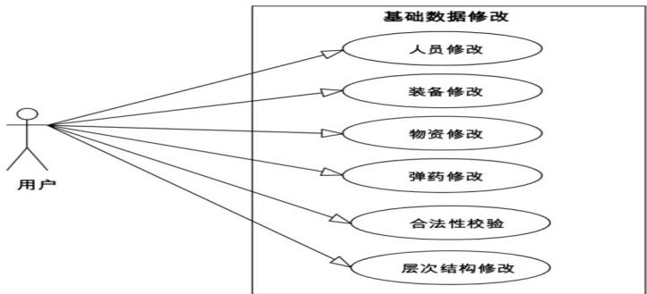
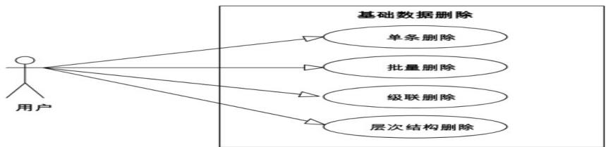

基础数据层次结构查询用例场景见表 34所示。

表 34 层次结构查询用例描述
<table><tr><td rowspan=1 colspan=1>Use Case 名称:层次结构查询</td><td rowspan=1 colspan=2>Actors：用户</td></tr><tr><td rowspan=1 colspan=3>概述：本用例主要实现基础数据中查询层次结构数据表数据的功能</td></tr><tr><td rowspan=1 colspan=3>前置条件：达梦数据库连接正常，层次结构数据表数据完善。</td></tr><tr><td rowspan=1 colspan=3>主事件流</td></tr><tr><td rowspan=1 colspan=1>Actor 的动作</td><td rowspan=1 colspan=1>系统的动作</td><td rowspan=1 colspan=1>动作约束(性能、可靠性、容错等)</td></tr><tr><td rowspan=1 colspan=1>1.用户在配置文件中配置好需要层次显示的数据表名称、层次码、唯一标识内码、显示名称；3.点击按钮，查询层次结构显示正常；</td><td rowspan=1 colspan=1>2.在前台界面中配置按钮点击后查询的数据表；4.层次结构查询结束。</td><td rowspan=1 colspan=1>交互信息正确性校验，并在错误发生时，提供详细的错误信息提示</td></tr><tr><td rowspan=1 colspan=2>异常流E1:系统提示失败，用例结束。</td><td rowspan=1 colspan=1></td></tr><tr><td rowspan=1 colspan=2>后置条件：无。</td><td rowspan=1 colspan=1></td></tr></table>

基础数据分页展示用例场景见表 35所示。

表 35 分页展示用例描述
<table><tr><td colspan="1" rowspan="1">Use Case 名称:分页展示</td><td colspan="2" rowspan="1">Actors：用户</td></tr><tr><td colspan="3" rowspan="1">概述：本用例主要实现基础数据中数据的分页展示功能</td></tr><tr><td colspan="3" rowspan="1">前置条件：达梦数据库连接正常。</td></tr><tr><td colspan="3" rowspan="1">主事件流</td></tr><tr><td colspan="1" rowspan="1">Actor 的动作</td><td colspan="1" rowspan="1">系统的动作</td><td colspan="1" rowspan="1">动作约束(性能、可靠性、容错等)</td></tr><tr><td colspan="1" rowspan="1">1.用户在组织机构树中选择查询人员动态情况的部队节点；3.人员动态情况显示正常，可查看到记录总条数，分页数，可以点击上一页、下一页进行分页显示，也可以进行自定义页面显示条数进行分页显示；</td><td colspan="1" rowspan="1">2.在前台界面中点击查询人员动态情况；</td><td colspan="1" rowspan="1">交互信息正确性校验，并在错误发生时，提供详细的错误信息提示</td></tr><tr><td colspan="1" rowspan="1"></td><td colspan="1" rowspan="1">4.分页展示结束。</td><td colspan="1" rowspan="1"></td></tr><tr><td colspan="2" rowspan="1">异常流E1：系统提示失败，用例结束。</td><td colspan="1" rowspan="1"></td></tr><tr><td colspan="2" rowspan="1">后置条件：无。</td><td colspan="1" rowspan="1"></td></tr></table>

基础数据数据定位用例场景见表 36所示。

表 36 数据定位用例描述
<table><tr><td rowspan=1 colspan=1>Use Case 名称:数据定位</td><td rowspan=1 colspan=2>Actors：用户</td></tr><tr><td rowspan=1 colspan=3>概述：本用例主要实现基础数据中数据的定位功能</td></tr><tr><td rowspan=1 colspan=3>前置条件：达梦数据库连接正常。</td></tr><tr><td rowspan=1 colspan=3>主事件流</td></tr><tr><td rowspan=1 colspan=1>Actor 的动作</td><td rowspan=1 colspan=1>系统的动作</td><td rowspan=1 colspan=1>动作约束(性能、可靠性、容错等)</td></tr><tr><td rowspan=1 colspan=1>1.用户在组织机构树中选择查询人员动态情况的非叶子部队节点；3.人员动态情况显示正常，右击选择定位到树中节点。5.数据定位结束。</td><td rowspan=1 colspan=1>2.在前台界面中点击查询人员动态情况；4.成功定位到人员动态情况记录所在的部队节点。</td><td rowspan=1 colspan=1>交互信息正确性校验，并在错误发生时，提供详细的错误信息提示</td></tr><tr><td rowspan=1 colspan=2>异常流E1：系统提示失败，用例结束。</td><td rowspan=1 colspan=1></td></tr><tr><td rowspan=1 colspan=2>后置条件：无。</td><td rowspan=1 colspan=1></td></tr></table>

基础数据数据浏览用例场景见表 37所示。

表 37 数据浏览用例描述
<table><tr><td colspan="1" rowspan="1">Use Case 名称:数据浏览</td><td colspan="2" rowspan="1">Actors：用户</td></tr><tr><td colspan="3" rowspan="1">概述：本用例主要实现基础数据中浏览数据详细信息功能</td></tr><tr><td colspan="3" rowspan="1">前置条件：达梦数据库连接正常。</td></tr><tr><td colspan="3" rowspan="1">主事件流</td></tr><tr><td colspan="1" rowspan="1">Actor 的动作</td><td colspan="1" rowspan="1">系统的动作</td><td colspan="1" rowspan="1">动作约束(性能、可靠性、容错等)</td></tr><tr><td colspan="1" rowspan="1">1.用户在组织机构树中选择查询人员动</td><td colspan="1" rowspan="1"></td><td colspan="1" rowspan="1">交互信息正确性校验，并在错误</td></tr><tr><td colspan="1" rowspan="1">态情况的部队节点；3.人员动态情况显示正常，选中某条记录后双击查看该记录的详细信息；</td><td colspan="1" rowspan="1">2.在前台界面中点击查询人员动态情况；4.数据浏览功能结束。</td><td colspan="1" rowspan="1">发生时，提供详细的错误信息提示</td></tr><tr><td colspan="2" rowspan="1">异常流E1：系统提示失败，用例结束。</td><td colspan="1" rowspan="1"></td></tr><tr><td colspan="2" rowspan="1">后置条件：无。</td><td colspan="1" rowspan="1"></td></tr></table>

3.2.3.1.3 基础数据修改（PZXQ-GN-JCSJWH-JCSJGL-JCSJXG）

基础数据修改能力包括：人员修改、装备修改、物资修改、弹药修改、合法性校验、层次结构修改，其功能用例如图 9所示。

  
图 9基础数据修改用例图

基础数据维护能力标识表，见表 38所示。

表 38基础数据维护能力标识
<table><tr><td colspan="1" rowspan="1">序号</td><td colspan="1" rowspan="1">Usecase 名称</td><td colspan="1" rowspan="1">项目唯一标识符</td><td colspan="1" rowspan="1">需求描述</td><td colspan="1" rowspan="1">需求重用</td><td colspan="1" rowspan="1">方式名称</td><td colspan="1" rowspan="1">运行状态</td><td colspan="1" rowspan="1">对应的任务书功能/性能</td></tr><tr><td colspan="1" rowspan="1">1</td><td colspan="1" rowspan="1">人员修改</td><td colspan="1" rowspan="1">PZXQ-GN-JCSJWHGL-JCSJGL-JCSJXG-RYXG</td><td colspan="1" rowspan="1">提供人员基础数据的修改功能</td><td colspan="1" rowspan="1">沿用</td><td colspan="1" rowspan="1">桌面、平板</td><td colspan="1" rowspan="1">集成阶段</td><td colspan="1" rowspan="1">4.1.3 e )</td></tr><tr><td colspan="1" rowspan="1">2</td><td colspan="1" rowspan="1">装备修改</td><td colspan="1" rowspan="1">PZXQ-GN-JCSJWHGL-JCSJGL-JCSJXG-ZBXG</td><td colspan="1" rowspan="1">提供装备基础数据的修改功能</td><td colspan="1" rowspan="1">沿用</td><td colspan="1" rowspan="1">桌面、</td><td colspan="1" rowspan="1">集成阶段</td><td colspan="1" rowspan="1">4.1.3 e )</td></tr><tr><td colspan="1" rowspan="1"></td><td colspan="1" rowspan="1"></td><td colspan="1" rowspan="1"></td><td colspan="1" rowspan="1"></td><td colspan="1" rowspan="1"></td><td colspan="1" rowspan="1">平板</td><td colspan="1" rowspan="1"></td><td colspan="1" rowspan="1"></td></tr><tr><td colspan="1" rowspan="1">3</td><td colspan="1" rowspan="1">物资修改</td><td colspan="1" rowspan="1">PZXQ-GN-JCSJWHGL-JCSJGL-JCSJXG-WZXG</td><td colspan="1" rowspan="1">提供物资基础数据的修改功能</td><td colspan="1" rowspan="1">沿用</td><td colspan="1" rowspan="1">桌面、平板</td><td colspan="1" rowspan="1">集成阶段</td><td colspan="1" rowspan="1">4.1.3 e )</td></tr><tr><td colspan="1" rowspan="1">4</td><td colspan="1" rowspan="1">弹药修改</td><td colspan="1" rowspan="1">PZXQ-GN-JCSJWHGL-JCSJGL-JCSJXG-DYXG</td><td colspan="1" rowspan="1">提供弹药基础数据的修改功能</td><td colspan="1" rowspan="1">沿用</td><td colspan="1" rowspan="1">桌面、平板</td><td colspan="1" rowspan="1">集成阶段</td><td colspan="1" rowspan="1">4.1.3 e )</td></tr><tr><td colspan="1" rowspan="1">5</td><td colspan="1" rowspan="1">合法性校验</td><td colspan="1" rowspan="1">PZXQ-GN-JCSJWHGL-JCSJGL-JCSJXG-HFXJY</td><td colspan="1" rowspan="1">提供修改数据时的数据合法性校验功能</td><td colspan="1" rowspan="1">沿用</td><td colspan="1" rowspan="1">桌面、平板</td><td colspan="1" rowspan="1">集成阶段</td><td colspan="1" rowspan="1">4.1.3 e )</td></tr><tr><td colspan="1" rowspan="1">6</td><td colspan="1" rowspan="1">层次结构修改</td><td colspan="1" rowspan="1">PZXQ-GN-JCSJWHGL-JCSJGL-JCSJXG-CCJGXG</td><td colspan="1" rowspan="1">提供对层次结构数据的修改能</td><td colspan="1" rowspan="1">沿用</td><td colspan="1" rowspan="1">桌面、平板</td><td colspan="1" rowspan="1">集成阶段</td><td colspan="1" rowspan="1">4.1.3 e )</td></tr></table>

基础数据修改中人员修改用例场景见表 39所示。

表 39人员数据修改用例描述
<table><tr><td rowspan=1 colspan=1>Use Case 名称：人员数据修改</td><td rowspan=1 colspan=2>Actors：用户</td></tr><tr><td rowspan=1 colspan=3>概述：本用例主要实现基础数据中人员信息的修改功能</td></tr><tr><td rowspan=1 colspan=3>前置条件：达梦数据库连接正常。</td></tr><tr><td rowspan=1 colspan=3>主事件流</td></tr><tr><td rowspan=1 colspan=1>Actor 的动作</td><td rowspan=1 colspan=1>系统的动作</td><td rowspan=1 colspan=1>动作约束(性能、可靠性、容错等)</td></tr><tr><td rowspan=1 colspan=1>1.用户在组织机构树中选择需要添加人员所在的部队节点；3.编辑修改人员的信息，包括人员类型，数量等信息；5.人员数据修改结束。</td><td rowspan=1 colspan=1>2.在前台界面中选中某条人员记录进行修改；4、编辑好修改人员信息后，点击确定；</td><td rowspan=1 colspan=1>1.交互信息正确性校验，并在错误发生时，提供详细的错误信息提示2.输入信息合法性校验，并在错误发生时，提供详细的错误信息提示</td></tr><tr><td rowspan=1 colspan=2>异常流E1：系统提示失败，用例结束。</td><td rowspan=1 colspan=1></td></tr><tr><td rowspan=1 colspan=2>后置条件：无。</td><td rowspan=1 colspan=1></td></tr></table>

基础数据修改中装备修改用例场景见表 40所示。  
表 40装备数据修改用例描述
<table><tr><td rowspan=1 colspan=1>Use Case 名称:装备数据修改</td><td rowspan=1 colspan=2>Actors：用户</td></tr><tr><td rowspan=1 colspan=3>概述：本用例主要实现基础数据中装备信息的修改功能</td></tr><tr><td rowspan=1 colspan=3>前置条件：达梦数据库连接正常。</td></tr><tr><td rowspan=1 colspan=3>主事件流</td></tr><tr><td rowspan=1 colspan=1>Actor 的动作</td><td rowspan=1 colspan=1>系统的动作</td><td rowspan=1 colspan=1>动作约束(性能、可靠性、容错等)</td></tr><tr><td rowspan=1 colspan=1>1.用户在组织机构树中选择需要修改装备所在的部队节点；3.编辑修改装备的信息，包括装备编号，数量等信息；5.装备数据修改结束。</td><td rowspan=1 colspan=1>2.在前台界面中选中某条装备记录进行修改；4、编辑好修改装备信息后，点击确定；</td><td rowspan=1 colspan=1>1.交互信息正确性校验，并在错误发生时，提供详细的错误信息提示2.输入信息合法性校验，并在错误发生时，提供详细的错误信息提示</td></tr><tr><td rowspan=1 colspan=2>异常流E1：系统提示失败，用例结束。</td><td rowspan=1 colspan=1></td></tr><tr><td rowspan=1 colspan=2>后置条件：无。</td><td rowspan=1 colspan=1></td></tr></table>

基础数据修改中物资修改用例场景见表 41所示。

表 41物资数据修改用例描述
<table><tr><td colspan="1" rowspan="1">Use Case 名称：物资数据修改</td><td colspan="2" rowspan="1">Actors：用户</td></tr><tr><td colspan="3" rowspan="1">概述：本用例主要实现基础数据中物资信息的修改功能</td></tr><tr><td colspan="3" rowspan="1">前置条件：达梦数据库连接正常。</td></tr><tr><td colspan="3" rowspan="1">主事件流</td></tr><tr><td colspan="1" rowspan="1">Actor 的动作</td><td colspan="1" rowspan="1">系统的动作</td><td colspan="1" rowspan="1">动作约束(性能、可靠性、容错等)</td></tr><tr><td colspan="1" rowspan="1">1.用户在组织机构树中选择需要修改物资所在的部队节点；3.编辑修改物资的信息，包括物资编</td><td colspan="1" rowspan="1">2.在前台界面中选中某条物资记录进行修改；</td><td colspan="1" rowspan="1">1.交互信息正确性校验，并在错误发生时，提供详细的错误信息提示2.输入信息合法性校验，并在错误发生时，提供详细的错误信息提示</td></tr><tr><td colspan="1" rowspan="1">号，数量等信息；5.物资数据修改结束。</td><td colspan="1" rowspan="1">4、编辑好修改物资信息后，点击确定；</td><td colspan="1" rowspan="1"></td></tr><tr><td colspan="2" rowspan="1">异常流E1：系统提示失败，用例结束。</td><td colspan="1" rowspan="1"></td></tr><tr><td colspan="2" rowspan="1">后置条件：无。</td><td colspan="1" rowspan="1"></td></tr></table>

基础数据修改中弹药修改用例场景见表 42所示。

表 42弹药数据修改用例描述
<table><tr><td rowspan=1 colspan=1>Use Case 名称:弹药数据修改</td><td rowspan=1 colspan=2>Actors：用户</td></tr><tr><td rowspan=1 colspan=3>概述：本用例主要实现基础数据中弹药信息的修改功能</td></tr><tr><td rowspan=1 colspan=3>前置条件：达梦数据库连接正常。</td></tr><tr><td rowspan=1 colspan=3>主事件流</td></tr><tr><td rowspan=1 colspan=1>Actor 的动作</td><td rowspan=1 colspan=1>系统的动作</td><td rowspan=1 colspan=1>动作约束(性能、可靠性、容错等)</td></tr><tr><td rowspan=1 colspan=1>1.用户在组织机构树中选择需要修改弹药所在的部队节点；3.编辑修改弹药的信息，包括弹药编号，数量等信息；5.弹药数据修改结束。</td><td rowspan=1 colspan=1>2.在前台界面中选中某条弹药记录进行修改；4、编辑好修改弹药信息后，点击确定；</td><td rowspan=1 colspan=1>1.交互信息正确性校验，并在错误发生时，提供详细的错误信息提示2.输入信息合法性校验，并在错误发生时，提供详细的错误信息提示</td></tr><tr><td rowspan=1 colspan=2>异常流E1：系统提示失败，用例结束。</td><td rowspan=1 colspan=1></td></tr><tr><td rowspan=1 colspan=2>后置条件：无。</td><td rowspan=1 colspan=1></td></tr></table>

基础数据修改中合法性检验用例场景见表 43所示。

表 43 合法性检验用例描述
<table><tr><td colspan="1" rowspan="1">Use Case 名称：合法性检验</td><td colspan="2" rowspan="1">Actors：用户</td></tr><tr><td colspan="3" rowspan="1">概述：本用例主要实现基础数据修改数据时合法性检验功能</td></tr><tr><td colspan="3" rowspan="1">前置条件：达梦数据库连接正常。</td></tr><tr><td colspan="3" rowspan="1">主事件流</td></tr><tr><td colspan="1" rowspan="1">Actor 的动作</td><td colspan="1" rowspan="1">系统的动作</td><td colspan="1" rowspan="1">动作约束(性能、可靠性、容错等)</td></tr><tr><td colspan="1" rowspan="1">1.用户在组织机构树中选择需要修改部</td><td colspan="1" rowspan="1"></td><td colspan="1" rowspan="1">1.交互信息正确性校验，并在错</td></tr><tr><td colspan="1" rowspan="1">署信息的部队节点；3.编辑修改部队部署的信息，包括部队内码、经纬度等信息，在修改经纬度信息时，系统将检验经纬度格式是否合法。5.部队部署信息修改结束。</td><td colspan="1" rowspan="1">2.在前台界面中选中某条部署记录进行修改；4、编辑好修改的部队部署信息后，点击确定。</td><td colspan="1" rowspan="1">误发生时，提供详细的错误信息提示2.输入信息合法性校验，并在错误发生时，提供详细的错误信息提示</td></tr><tr><td colspan="2" rowspan="1">异常流E1：系统提示失败，用例结束。</td><td colspan="1" rowspan="1"></td></tr><tr><td colspan="2" rowspan="1">后置条件：无。</td><td colspan="1" rowspan="1"></td></tr></table>

基础数据录入中层次结构修改用例场景见表 44所示。

表 44 层次结构修改用例描述
<table><tr><td rowspan=1 colspan=1>Use Case 名称：层次结构修改</td><td rowspan=1 colspan=2>Actors：用户</td></tr><tr><td rowspan=1 colspan=3>概述：本用例主要实现基础数据中层次机构的修改功能</td></tr><tr><td rowspan=1 colspan=3>前置条件：达梦数据库连接正常。</td></tr><tr><td rowspan=1 colspan=3>主事件流</td></tr><tr><td rowspan=1 colspan=1>Actor 的动作</td><td rowspan=1 colspan=1>系统的动作</td><td rowspan=1 colspan=1>动作约束(性能、可靠性、容错等)</td></tr><tr><td rowspan=1 colspan=1>1.用户在组织机构树中选择需要修改部队所在的部队节点；3.上移成功后，该部队节点上移到指定位置；</td><td rowspan=1 colspan=1>2.在前台界面中点击上移部队节点按钮；4.层次结构修改结束。</td><td rowspan=1 colspan=1>1.交互信息正确性校验，并在错误发生时，提供详细的错误信息提示2.输入信息合法性校验，并在错误发生时，提供详细的错误信息提示</td></tr><tr><td rowspan=1 colspan=2>异常流E1：系统提示失败，用例结束。</td><td rowspan=1 colspan=1></td></tr><tr><td rowspan=1 colspan=2>后置条件：无。</td><td rowspan=1 colspan=1></td></tr></table>

3.2.3.1.4 基础数据删除（PZXQ-GN-JCSJWH-JCSJGL-JCSJSC）  
基础数据删除能力包括：单条删除、批量删除、级联删除、层次结构删除，其功能用

  
图 10基础数据删除用例图

基础数据删除能力标识表，见表 45所示。

表 45基础数据维护能力标识
<table><tr><td rowspan=1 colspan=1>序号</td><td rowspan=1 colspan=1>Usecase名称</td><td rowspan=1 colspan=1>项目唯一标识符</td><td rowspan=1 colspan=1>需求描述</td><td rowspan=1 colspan=1>需求重用</td><td rowspan=1 colspan=1>方式名称</td><td rowspan=1 colspan=1>运行状态</td><td rowspan=1 colspan=1>对应的任务书功能/性能</td></tr><tr><td rowspan=1 colspan=1>1</td><td rowspan=1 colspan=1>单条删除</td><td rowspan=1 colspan=1>PZXQ-GN-JCSJWHGL-JCSJGL-JCSJSC-DTSC</td><td rowspan=1 colspan=1>提供对录入的基础数据单条删除功能</td><td rowspan=1 colspan=1>沿用</td><td rowspan=1 colspan=1>桌面、平板</td><td rowspan=1 colspan=1>集成阶段</td><td rowspan=1 colspan=1>4.1.3 d )</td></tr><tr><td rowspan=1 colspan=1>2</td><td rowspan=1 colspan=1>批量删除</td><td rowspan=1 colspan=1>PZXQ-GN-JCSJWHGL-JCSJGL-JCSJSC-PLSC</td><td rowspan=1 colspan=1>提供对录入的基础数据批量删除功能</td><td rowspan=1 colspan=1>沿用</td><td rowspan=1 colspan=1>桌面、平板</td><td rowspan=1 colspan=1>集成阶段</td><td rowspan=1 colspan=1>4.1.3 d )</td></tr><tr><td rowspan=1 colspan=1>3</td><td rowspan=1 colspan=1>级联删除</td><td rowspan=1 colspan=1>PZXQ-GN-JCSJWHGL-JCSJGL-JCSJSC-JLSC</td><td rowspan=1 colspan=1>提供级联删除数据功能</td><td rowspan=1 colspan=1>沿用</td><td rowspan=1 colspan=1>桌面、平板</td><td rowspan=1 colspan=1>集成阶段</td><td rowspan=1 colspan=1>4.1.3 d )</td></tr><tr><td rowspan=1 colspan=1>4</td><td rowspan=1 colspan=1>层次结构删除</td><td rowspan=1 colspan=1>PZXQ-GN-JCSJWHGL-JCSJGL-JCSJSC-CCJGSC</td><td rowspan=1 colspan=1>提供删除层次结构数据功能</td><td rowspan=1 colspan=1>沿用</td><td rowspan=1 colspan=1>桌面、平板</td><td rowspan=1 colspan=1>集成阶段</td><td rowspan=1 colspan=1>4.1.3 d )</td></tr></table>

基础数据删除中单条数据删除用例场景见表 46所示。

表 46 单条数据删除用例描述
<table><tr><td>Use Case 名称:单条数据删除</td><td colspan="2">Actors：用户</td></tr><tr><td colspan="3">概述：本用例主要实现基础数据中单条数据删除功能</td></tr><tr><td colspan="3">前置条件：达梦数据库连接正常。</td></tr><tr><td colspan="3" rowspan="1">主事件流</td></tr><tr><td colspan="1" rowspan="1">Actor 的动作</td><td colspan="1" rowspan="1">系统的动作</td><td colspan="1" rowspan="1">动作约束(性能、可靠性、容错等)</td></tr><tr><td colspan="1" rowspan="1">1.用户在组织机构树中选择需要删除人员动态情况所在的部队节点；3.确认删除后，该人员动态记录删除成功。</td><td colspan="1" rowspan="1">2.在前台界面中选中某条人员动态情况记录，点击删除本条记录按钮；4.单条数据删除结束。</td><td colspan="1" rowspan="1">交互信息正确性校验，并在错误发生时，提供详细的错误信息提示</td></tr><tr><td colspan="2" rowspan="1">异常流E1：系统提示失败，用例结束。</td><td colspan="1" rowspan="1"></td></tr><tr><td colspan="2" rowspan="1">后置条件：无。</td><td colspan="1" rowspan="1"></td></tr></table>

基础数据删除中批量数据删除用例场景见表 47所示。

表 47 批量数据删除用例描述
<table><tr><td rowspan=1 colspan=1>Use Case 名称:批量数据删除</td><td rowspan=1 colspan=2>Actors：用户</td></tr><tr><td rowspan=1 colspan=3>概述：本用例主要实现基础数据中批量数据的删除功能</td></tr><tr><td rowspan=1 colspan=3>前置条件：达梦数据库连接正常。</td></tr><tr><td rowspan=1 colspan=3>主事件流</td></tr><tr><td rowspan=1 colspan=1>Actor 的动作</td><td rowspan=1 colspan=1>系统的动作</td><td rowspan=1 colspan=1>动作约束(性能、可靠性、容错等)</td></tr><tr><td rowspan=1 colspan=1>1.用户在组织机构树中选择需要删除人员动态情况所在的部队节点；3.确认删除后，该人员动态记录删除成功。</td><td rowspan=1 colspan=1>2.在前台界面中勾选多条人员动态情况记录，点击删除记录按钮；4.多条数据删除结束。</td><td rowspan=1 colspan=1>交互信息正确性校验，并在错误发生时，提供详细的错误信息提示</td></tr><tr><td rowspan=1 colspan=2>异常流E1：系统提示失败，用例结束。</td><td rowspan=1 colspan=1></td></tr><tr><td rowspan=1 colspan=2>后置条件：无。</td><td rowspan=1 colspan=1></td></tr></table>

基础数据删除中级联删除用例场景见表 48所示。

表 48 级联删除用例描述

<table><tr><td rowspan=1 colspan=1>Use Case 名称:级联删除</td><td rowspan=1 colspan=2>Actors：用户</td></tr><tr><td rowspan=1 colspan=3>概述：本用例主要实现基础数据中级联删除功能</td></tr><tr><td rowspan=1 colspan=3>前置条件：达梦数据库连接正常。</td></tr><tr><td rowspan=1 colspan=3>主事件流</td></tr><tr><td rowspan=1 colspan=1>Actor 的动作</td><td rowspan=1 colspan=1>系统的动作</td><td rowspan=1 colspan=1>动作约束(性能、可靠性、容错等)</td></tr><tr><td rowspan=1 colspan=1>1.用户在兵员管理中选择需要删除的兵员信息所在的部队节点；3.删除成功后，该兵员信息删除成功；</td><td rowspan=1 colspan=1>2.在前台界面中选中某条兵员记录，点击删除记录按钮；4.级联删除结束。</td><td rowspan=1 colspan=1>交互信息正确性校验，并在错误发生时，提供详细的错误信息提示</td></tr><tr><td rowspan=1 colspan=2>异常流E1：系统提示失败，用例结束。</td><td rowspan=1 colspan=1></td></tr><tr><td rowspan=1 colspan=2>后置条件：无。</td><td rowspan=1 colspan=1></td></tr></table>

基础数据删除中层次结构删除用例场景见表 49所示。

表 49 层次结构删除用例描述
<table><tr><td rowspan=1 colspan=1>Use Case 名称:层次结构删除</td><td rowspan=1 colspan=2>Actors：用户</td></tr><tr><td rowspan=1 colspan=3>概述：本用例主要实现基础数据中层次机构的删除功能</td></tr><tr><td rowspan=1 colspan=3>前置条件：达梦数据库连接正常。</td></tr><tr><td rowspan=1 colspan=3>主事件流</td></tr><tr><td rowspan=1 colspan=1>Actor 的动作</td><td rowspan=1 colspan=1>系统的动作</td><td rowspan=1 colspan=1>动作约束(性能、可靠性、容错等)</td></tr><tr><td rowspan=1 colspan=1>1.用户在组织机构树中选择需要删除部队所在的部队节点；3.删除成功后，该部队节点被成功删除；</td><td rowspan=1 colspan=1>2.在前台界面中点击删除部队节点按钮；4.层次结构删除结束。</td><td rowspan=1 colspan=1>交互信息正确性校验，并在错误发生时，提供详细的错误信息提示</td></tr><tr><td rowspan=1 colspan=2>异常流E1：系统提示失败，用例结束。</td><td rowspan=1 colspan=1></td></tr><tr><td rowspan=1 colspan=2>后置条件：无。</td><td rowspan=1 colspan=1></td></tr></table>