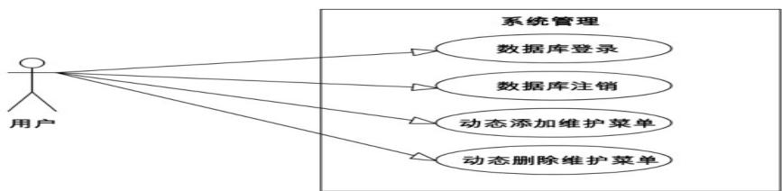
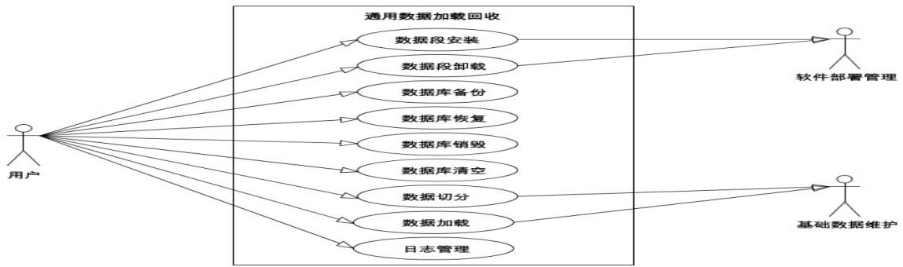

## 3.2.3.1.5 基础数据导入（PZXQ-GN-JCSJWH-JCSJGL-JCSJDR）

基础数据导入能力支持EXCEL格式批量导入，其功能用例如图所示。

图11基础数据导入用例图  
基础数据导入能力标识表，见表 50所示。  
表 50 基础数据导入能力标识
<table><tr><td rowspan=1 colspan=1>序号</td><td rowspan=1 colspan=1>Use case名称</td><td rowspan=1 colspan=1>项目唯一标识符</td><td rowspan=1 colspan=1>需求描述</td><td rowspan=1 colspan=1>需求重用</td><td rowspan=1 colspan=1>方式名称</td><td rowspan=1 colspan=1>运行状态</td><td rowspan=1 colspan=1>对应的任务书功能/性能</td></tr><tr><td rowspan=1 colspan=1>1</td><td rowspan=1 colspan=1>EXCELE格式批量导入</td><td rowspan=1 colspan=1>PZXQ-GN-JCSJWHGL-JCSJGL-JCSJDR-EXCPLDR</td><td rowspan=1 colspan=1>提供基于EXCELE格式的批量数据录入功能</td><td rowspan=1 colspan=1>沿用</td><td rowspan=1 colspan=1>桌面、平板</td><td rowspan=1 colspan=1>集成阶段</td><td rowspan=1 colspan=1>4.1.3 i)</td></tr></table>

基础数据导入中EXCEL文件批量导入用例场景见表 51所示。

表 51 EXCEL文件批量导入用例描述
<table><tr><td>Use Case 名称:EXCEL 文件批量导 入</td><td colspan="2">Actors：用户、文件</td></tr><tr><td colspan="3">概述：本用例主要实现基础数据导入中EXCEL数据的批量导入功能</td></tr><tr><td colspan="3">前置条件：达梦数据库连接正常。</td></tr><tr><td colspan="4">主事件流</td></tr><tr><td>Actor 的动作</td><td>系统的动作</td><td>动作约束 (性能、可靠性、容错等)</td></tr><tr><td>1.用户在批量数据导入中选择需要导入 的数据表；</td><td>2.在 EXCEL导入栏中选择好对应数据 表的 EXCEL 文件；</td><td>1.批量数据导入合法性校验，并 在发生错误时，给出详细日志记 录 2.文件格式校验，并在发生错误 时，给出错误提示 3.文件大小约束：单EXCEL表</td></tr><tr><td>3.导入EXCEL文件后，对数据进行修 改、删除后，点击批量入库；</td><td>4.批量入库成功后，EXCEL 批量导入成 功。</td><td>文件小于2兆，数据记录小于 20000条</td></tr><tr><td colspan="3">异常流E1：系统提示失败，用例结束。</td></tr></table>

<table><tr><td>后置条件：无。</td><td></td></tr></table>

## 3.2.3.1.6 基础数据导出（PZXQ-GN-JCSJWH-JCSJGL-JCSJDC）

基础数据导出能力支持EXCEL文件批量导出，其功能用例如图12所示。

图12基础数据导出用例图

基础数据导出能力标识表，见表 52所示。

表 52基础数据维护能力标识
<table><tr><td rowspan=1 colspan=1>序号</td><td rowspan=1 colspan=1>Use case名称</td><td rowspan=1 colspan=1>项目唯一标识符</td><td rowspan=1 colspan=1>需求描述</td><td rowspan=1 colspan=1>需求重用</td><td rowspan=1 colspan=1>方式名称</td><td rowspan=1 colspan=1>运行状态</td><td rowspan=1 colspan=1>对应的任务书功能/性能</td></tr><tr><td rowspan=1 colspan=1>1</td><td rowspan=1 colspan=1>EXCELE格式批量导出</td><td rowspan=1 colspan=1>PZXQ-GN-JCSJWHGL-JCSJGL-JCSJDC-EXCPLDC</td><td rowspan=1 colspan=1>提供基于 EXCELE 格式的批量数据导出功能</td><td rowspan=1 colspan=1>沿用</td><td rowspan=1 colspan=1>桌面、平板</td><td rowspan=1 colspan=1>集成阶段</td><td rowspan=1 colspan=1>4.1.3j)</td></tr></table>

基础数据导出中EXCEL文件批量导出用例场景见表 53所示。

表 53 EXCEL文件批量导出用例描述
<table><tr><td rowspan=1 colspan=1>Use Case 名称:EXCEL 文件批量导出</td><td rowspan=1 colspan=2>Actors：用户、文件</td></tr><tr><td rowspan=1 colspan=3>概述：本用例主要实现基础数据导出中EXCEL数据的批量导出功能</td></tr><tr><td rowspan=1 colspan=3>前置条件：达梦数据库连接正常。</td></tr><tr><td rowspan=1 colspan=3>主事件流</td></tr><tr><td rowspan=1 colspan=1>Actor 的动作</td><td rowspan=1 colspan=1>系统的动作</td><td rowspan=1 colspan=1>动作约束(性能、可靠性、容错等)</td></tr><tr><td rowspan=1 colspan=1>1.用户在批量数据导出中选择需要导出的部队和数据表；3.EXCEL文件导出成功后，流程结束。</td><td rowspan=1 colspan=1>2.在 EXCEL 导出栏中选择 EXCEL 文件导出；</td><td rowspan=1 colspan=1>1.批量数据导出合法性校验，并在发生错误时，给出详细日志记录2.文件格式校验，并在发生错误时，给出错误提示</td></tr><tr><td rowspan=1 colspan=2>异常流E1：系统提示失败，用例结束。</td><td rowspan=1 colspan=1></td></tr><tr><td rowspan=1 colspan=2>后置条件：无。</td><td rowspan=1 colspan=1></td></tr></table>

## 3.2.3.2 基础数据维护-知识库管理（PZXQ-GN-JCSJWH-ZSKGL）

知识库管理能力包括：知识分类存储、知识检索、知识关联、知识查询，其功能用例如图14所示。

  
图 14 知识库管理用例图

知识库管理能力标识表，见表 54所示。

表 54知识库管理能力标识
<table><tr><td rowspan=1 colspan=1>序号</td><td rowspan=1 colspan=1>Use case名称</td><td rowspan=1 colspan=1>项目唯一标识符</td><td rowspan=1 colspan=1>需求描述</td><td rowspan=1 colspan=1>需求重用</td><td rowspan=1 colspan=1>方式名称</td><td rowspan=1 colspan=1>运行状态</td><td rowspan=1 colspan=1>对应的任务书功能/性能</td></tr><tr><td rowspan=1 colspan=1>1</td><td rowspan=1 colspan=1>知识分类存储</td><td rowspan=1 colspan=1>PZXQ-GN-JCSJWH-ZSKGL-ZSFLCC</td><td rowspan=1 colspan=1>提供对知识的分类存储功能</td><td rowspan=1 colspan=1>新研</td><td rowspan=1 colspan=1>桌面、平板</td><td rowspan=1 colspan=1>集成阶段</td><td rowspan=1 colspan=1>4.1.31)</td></tr><tr><td rowspan=1 colspan=1>2</td><td rowspan=1 colspan=1>知识检索</td><td rowspan=1 colspan=1>PZXQ-GN-JCSJWH-ZSKGL-ZSJS</td><td rowspan=1 colspan=1>提供对知识的检索功能</td><td rowspan=1 colspan=1>新研</td><td rowspan=1 colspan=1>桌面、平板</td><td rowspan=1 colspan=1>集成阶段</td><td rowspan=1 colspan=1>4.1.31)</td></tr><tr><td rowspan=1 colspan=1>3</td><td rowspan=1 colspan=1>知识关联</td><td rowspan=1 colspan=1>PZXQ-GN-JCSJWH-ZSKGL-ZSGL</td><td rowspan=1 colspan=1>提供知识的关联查询功能</td><td rowspan=1 colspan=1>新研</td><td rowspan=1 colspan=1>桌面、平板</td><td rowspan=1 colspan=1>集成阶段</td><td rowspan=1 colspan=1>4.1.31)</td></tr><tr><td rowspan=1 colspan=1>4</td><td rowspan=1 colspan=1>知识查询</td><td rowspan=1 colspan=1>PZXQ-GN-JCSJWH-ZSKGL-ZSCX</td><td rowspan=1 colspan=1>提供对知识内容的综合查询功能</td><td rowspan=1 colspan=1>新研</td><td rowspan=1 colspan=1>桌面、平板</td><td rowspan=1 colspan=1>集成阶段</td><td rowspan=1 colspan=1>4.1.31)</td></tr></table>

## 3.2.3.2.1 知识查询（PZXQ-GN-JCSJWH-ZSKGL-ZSCX）

基础数据知识库管理中知识查询用例场景见表 55所示。

表 55 知识管理中知识查询用例描述
<table><tr><td colspan="1" rowspan="1">Use Case 名称：知识查询</td><td colspan="2" rowspan="1">Actors：用户</td></tr><tr><td colspan="3" rowspan="1">概述：本用例主要实现基础数据知识管理中的知识查询功能</td></tr><tr><td colspan="3" rowspan="1">前置条件：达梦数据库连接正常。</td></tr><tr><td colspan="3" rowspan="1">主事件流</td></tr><tr><td colspan="1" rowspan="1">Actor 的动作</td><td colspan="1" rowspan="1">系统的动作</td><td colspan="1" rowspan="1">动作约束(性能、可靠性、容错等)</td></tr><tr><td colspan="1" rowspan="1">1.进入到知识管理系统中，登录到个人</td><td colspan="1" rowspan="1"></td><td colspan="1" rowspan="1">交互信息正确性校验，并在错误</td></tr><tr><td colspan="1" rowspan="1">首页；3.选中某个知识分类，可以在知识浏览页面中，查看到本知识分类下的知识预览；5.知识查询流程结束。</td><td colspan="1" rowspan="1">2.在左侧知识分类中.可以查看到系统中的知识分类类别；4.在知识浏览页面中，选中某知识后点击，进入到知识详情页面，可以在此页面中查看到此知识的详情信息，包括标题、作者、标签、内容、评论等；</td><td colspan="1" rowspan="1">发生时，提供详细的错误信息提示</td></tr><tr><td colspan="2" rowspan="1">异常流E1：系统提示失败，用例结束。</td><td colspan="1" rowspan="1"></td></tr><tr><td colspan="2" rowspan="1">后置条件：无。</td><td colspan="1" rowspan="1"></td></tr></table>

3.2.3.2.2 知识分类存储（PZXQ-GN-JCSJWH-ZSKGL-ZSFLCC）

基础数据知识库管理中知识分类存储用例场景见表 56所示。  
表 56 知识管理中知识分类存储用例描述
<table><tr><td rowspan=1 colspan=1>Use Case 名称:知识分类存储</td><td rowspan=1 colspan=2>Actors：用户</td></tr><tr><td rowspan=1 colspan=3>概述：本用例主要实现基础数据知识管理中的知识分类存储功能</td></tr><tr><td rowspan=1 colspan=3>前置条件：达梦数据库连接正常。</td></tr><tr><td rowspan=1 colspan=3>主事件流</td></tr><tr><td rowspan=1 colspan=1>Actor 的动作</td><td rowspan=1 colspan=1>系统的动作</td><td rowspan=1 colspan=1>动作约束(性能、可靠性、容错等)</td></tr><tr><td rowspan=1 colspan=1>1.进入到知识管理系统中，登录到个人首页；3.选中某个知识分类，可以在知识浏览页面中，查看到本知识分类下的知识预览；5.在添加知识中编辑完善后，点击提交按钮；</td><td rowspan=1 colspan=1>2.在左侧知识分类中，可以查看到系统中的知识分类类别；4.点击添加知识按钮，编辑好知识标题、标签等信息，可以选择本创建知识所在的分类；6.在某知识分类下添加知识流程结束。</td><td rowspan=1 colspan=1>1.输入信息合法性校验，并在错误发生时，提供详细的错误信息提示2.交互信息正确性校验，并在错误发生时，提供详细的错误信息提示</td></tr><tr><td rowspan=1 colspan=2>异常流E1：系统提示失败，用例结束。</td><td rowspan=1 colspan=1></td></tr><tr><td rowspan=1 colspan=2>后置条件：无。</td><td rowspan=1 colspan=1></td></tr></table>

3.2.3.2.3 知识检索（PZXQ-GN-JCSJWH-ZSKGL-ZSJS）

基础数据知识库管理中知识检索用例场景见表 57所示。  
表 57 知识管理中知识检索用例描述
<table><tr><td rowspan=1 colspan=1>Use Case 名称:知识检索</td><td rowspan=1 colspan=2>Actors：用户</td></tr><tr><td rowspan=1 colspan=3>概述：本用例主要实现基础数据知识管理中的知识检索功能</td></tr><tr><td rowspan=1 colspan=3>前置条件：达梦数据库连接正常。</td></tr><tr><td rowspan=1 colspan=3>主事件流</td></tr><tr><td rowspan=1 colspan=1>Actor 的动作</td><td rowspan=1 colspan=1>系统的动作</td><td rowspan=1 colspan=1>动作约束(性能、可靠性、容错等)</td></tr><tr><td rowspan=1 colspan=1>1.进入到知识管理系统中，登录到个人首页；3.在搜索范围中，可以选择全部、标题、作者、标签、分类其中的一项进行搜索；5.知识检索流程结束。</td><td rowspan=1 colspan=1>2.在知识管理平台中，输入搜索关键词；4.点击搜索按钮，搜索结果在知识浏览页面中显示，匹配成功的关键词以红色标注；</td><td rowspan=1 colspan=1>交互信息正确性校验，并在错误发生时，提供详细的错误信息提示</td></tr><tr><td rowspan=1 colspan=2>异常流E1：系统提示失败，用例结束。</td><td rowspan=1 colspan=1></td></tr><tr><td rowspan=1 colspan=2>后置条件：无。</td><td rowspan=1 colspan=1></td></tr></table>

3.2.3.2.4 知识关联（PZXQ-GN-JCSJWH-ZSKGL-ZSGL）

基础数据知识库管理中知识关联用例场景见表 58所示。  
表 58 知识管理中知识关联用例描述
<table><tr><td colspan="1" rowspan="1">Use Case 名称：知识关联</td><td colspan="2" rowspan="1">Actors：用户</td></tr><tr><td colspan="3" rowspan="1">概述：本用例主要实现基础数据知识管理中的知识关联功能</td></tr><tr><td colspan="3" rowspan="1">前置条件：达梦数据库连接正常。</td></tr><tr><td colspan="3" rowspan="1">主事件流</td></tr><tr><td colspan="1" rowspan="1">Actor 的动作</td><td colspan="1" rowspan="1">系统的动作</td><td colspan="1" rowspan="1">动作约束(性能、可靠性、容错等)</td></tr><tr><td colspan="1" rowspan="1">1.进入到知识管理系统中，登录到个人首页；3.点击添加知识按钮，编辑好知识标</td><td colspan="1" rowspan="1">2.在知识浏览页面中，选中某知识后点击，进入到知识详情页面，可以在此页面中浏览到此知识的相关联知识；</td><td colspan="1" rowspan="1">交互信息正确性校验，并在错误发生时，提供详细的错误信息提示</td></tr><tr><td>题、标签等信息，可以选择本创建知识 与之相关联的知识；</td><td>4.在添加知识中编辑完善后，点击提交 按钮；</td><td></td></tr><tr><td colspan="3">5.为知识添加关联知识流程结束。</td></tr><tr><td colspan="2">异常流E1：系统提示失败，用例结束。</td><td></td></tr><tr><td colspan="3">后置条件：无。</td></tr></table>

## 3.2.3.3 基础数据维护-系统管理（PZXQ-GN-JCSJWH-XTGL）

系统管理能力包括：数据库登陆、数据库注销、动态添加维护菜单、动态删除维护菜单，其功能用例如图15所示。

  
图 15 系统管理用例图

基础数据中系统管理能力标识表，见表 59所示。

表 59基础数据维护中系统管理能力标识
<table><tr><td rowspan=1 colspan=1>序号</td><td rowspan=1 colspan=1>Use case 名称</td><td rowspan=1 colspan=1>项目唯一标识符</td><td rowspan=1 colspan=1>需求描述</td><td rowspan=1 colspan=1>需求重用</td><td rowspan=1 colspan=1>方式名称</td><td rowspan=1 colspan=1>运行状态</td><td rowspan=1 colspan=1>对应的任务书功能/性能</td></tr><tr><td rowspan=1 colspan=1>1</td><td rowspan=1 colspan=1>数据库登录</td><td rowspan=1 colspan=1>PZXQ-GN-JCSJWH-XTGL-SJKDL</td><td rowspan=1 colspan=1>提供登录数据库的功能</td><td rowspan=1 colspan=1>沿用</td><td rowspan=1 colspan=1>桌面、平板</td><td rowspan=1 colspan=1>集成阶段</td><td rowspan=1 colspan=1>4.1.3 a,k )</td></tr><tr><td rowspan=1 colspan=1>2</td><td rowspan=1 colspan=1>数据库注销</td><td rowspan=1 colspan=1>PZXQ-GN-JCSJWH-XTGL-SJKZX</td><td rowspan=1 colspan=1>提供注销数据库的功能</td><td rowspan=1 colspan=1>沿用</td><td rowspan=1 colspan=1>桌面、平板</td><td rowspan=1 colspan=1>集成阶段</td><td rowspan=1 colspan=1>4.1.3 a,k )</td></tr><tr><td rowspan=1 colspan=1>3</td><td rowspan=1 colspan=1>动态添加维护菜单</td><td rowspan=1 colspan=1>PZXQ-GN-JCSJWH-XTGL-DTTJWHCD</td><td rowspan=1 colspan=1>动态添加维护功能菜单</td><td rowspan=1 colspan=1>沿用</td><td rowspan=1 colspan=1>桌面、平板</td><td rowspan=1 colspan=1>集成阶段</td><td rowspan=1 colspan=1>4.1.3 a,k )</td></tr><tr><td rowspan=1 colspan=1>4</td><td rowspan=1 colspan=1>动态删除维护菜单</td><td rowspan=1 colspan=1>PZXQ-GN-JCSJWH-XTGL-DTSCWHCD</td><td rowspan=1 colspan=1>动态删除维护功能菜单</td><td rowspan=1 colspan=1>沿用</td><td rowspan=1 colspan=1>桌面、平板</td><td rowspan=1 colspan=1>集成阶段</td><td rowspan=1 colspan=1>4.1.3 a,k )</td></tr></table>

## 3.2.3.3.1 数据库登录（PZXQ-GN-JCSJWH-XTGL-SJKDL）

## 基础数据系统管理中数据库登录用例场景见表 60所示。

表 60 系统管理中数据库登录用例描述
<table><tr><td rowspan=1 colspan=1>Use Case 名称:数据库登录</td><td rowspan=1 colspan=2>Actors：用户</td></tr><tr><td rowspan=1 colspan=3>概述：本用例主要实现基础数据系统管理中的数据库登录功能</td></tr><tr><td rowspan=1 colspan=3>前置条件：基础数据维护工具后台服务启动正常。</td></tr><tr><td rowspan=1 colspan=3>主事件流</td></tr><tr><td rowspan=1 colspan=1>Actor 的动作</td><td rowspan=1 colspan=1>系统的动作</td><td rowspan=1 colspan=1>动作约束(性能、可靠性、容错等)</td></tr><tr><td rowspan=1 colspan=1>1.在浏览器中输入服务器ip地址和端口号，进入到基础数据维护管理工具页面；3.输入数据库用户名、密码、连接数据库IP地址后，点击登录；</td><td rowspan=1 colspan=1>2.在登录栏中，点击连接数据库按钮；4.登录成功后，登录流程结束。</td><td rowspan=1 colspan=1>1.输入信息合法性校验，并在错误发生时，提供详细的错误信息提示2.交互信息正确性校验，并在错误发生时，提供详细的错误信息提示</td></tr><tr><td rowspan=1 colspan=2>异常流E1：系统提示失败，用例结束。</td><td rowspan=1 colspan=1></td></tr><tr><td rowspan=1 colspan=2>后置条件：无。</td><td rowspan=1 colspan=1></td></tr></table>

## 3.2.3.3.2 数据库注销（PZXQ-GN-JCSJWH-XTGL-SJKZX）

基础数据系统管理中数据库注销用例场景见表 61所示。  
表 61 系统管理中数据库注销用例描述
<table><tr><td rowspan=1 colspan=1>Use Case 名称：数据库注销</td><td rowspan=1 colspan=2>Actors：用户</td></tr><tr><td rowspan=1 colspan=3>概述：本用例主要实现基础数据系统管理中的数据库注销功能</td></tr><tr><td rowspan=1 colspan=3>前置条件：基础数据维护工具后台服务启动正常，数据库已经登录成功。</td></tr><tr><td rowspan=1 colspan=3>主事件流</td></tr><tr><td rowspan=1 colspan=1>Actor 的动作</td><td rowspan=1 colspan=1>系统的动作</td><td rowspan=1 colspan=1>动作约束(性能、可靠性、容错等)</td></tr><tr><td rowspan=1 colspan=1>1.点击断开数据库按钮；3.数据库注销流程结束。</td><td rowspan=1 colspan=1>2.在弹出的确认退出数据库框中，选择确认，成功退出数据库；</td><td rowspan=1 colspan=1>交互信息正确性校验，并在错误发生时，提供详细的错误信息提示</td></tr><tr><td rowspan=1 colspan=2>异常流E1：系统提示失败，用例结束。</td><td rowspan=1 colspan=1></td></tr><tr><td rowspan=1 colspan=2>后置条件：无。</td><td rowspan=1 colspan=1></td></tr></table>

## 3.2.3.3.3 动态添加维护菜单（PZXQ-GN-JCSJWH-XTGL-DTTJWHCD）

基础数据系统管理中动态添加维护菜单用例场景见表 62所示。

表 62 系统管理中动态添加维护菜单用例描述

<table><tr><td rowspan=1 colspan=1>Use Case 名称：动态添加维护菜单</td><td rowspan=1 colspan=2>Actors：用户</td></tr><tr><td rowspan=1 colspan=3>概述：本用例主要实现基础数据系统管理中的动态添加维护菜单功能</td></tr><tr><td rowspan=1 colspan=3>前置条件：达梦数据库连接正常。</td></tr><tr><td rowspan=1 colspan=3>主事件流</td></tr><tr><td rowspan=1 colspan=1>Actor 的动作</td><td rowspan=1 colspan=1>系统的动作</td><td rowspan=1 colspan=1>动作约束(性能、可靠性、容错等)</td></tr><tr><td rowspan=1 colspan=1>1.在基础数据维护工具首页，点击配置菜单项按钮，进入配置菜单项页面；3.在增加导航标签页中输入标签页名称；5.在配置菜单项页面上，点击保存配置按钮，将更改结果保存成功；7.点击基础数据管理按钮，进入到基础数据维护页面，可以查看增加同级节点结果，页面显示正常；</td><td rowspan=1 colspan=1>2.在左侧菜单项页面中，选中某标签页，右击选择增加同级节点；4. 点击确定；6.在配置菜单项页面上，点击回到首页按钮，回到基础数据维护工具首页面；8.动态添加维护菜单流程结束。</td><td rowspan=1 colspan=1>1.输入信息合法性校验，并在错误发生时，提供详细的错误信息提示2.交互信息正确性校验，并在错误发生时，提供详细的错误信息提示</td></tr><tr><td rowspan=1 colspan=2>异常流E1：系统提示失败，用例结束。</td><td rowspan=1 colspan=1></td></tr><tr><td rowspan=1 colspan=2>后置条件：无。</td><td rowspan=1 colspan=1></td></tr></table>

基础数据系统管理中动态删除维护菜单用例场景见表68所示。

表 63 系统管理中动态删除维护菜单用例描述
<table><tr><td colspan="1" rowspan="1">Use Case 名称:动态删除维护菜单</td><td colspan="2" rowspan="1">Actors：用户</td></tr><tr><td colspan="3" rowspan="1">概述：本用例主要实现基础数据系统管理中的动态删除维护菜单功能</td></tr><tr><td colspan="3" rowspan="1">前置条件：达梦数据库连接正常。</td></tr><tr><td colspan="3" rowspan="1">主事件流</td></tr><tr><td colspan="1" rowspan="1">Actor 的动作</td><td colspan="1" rowspan="1">系统的动作</td><td colspan="1" rowspan="1">动作约束(性能、可靠性、容错等)</td></tr><tr><td colspan="1" rowspan="1">1.在基础数据维护工具首页，点击配置菜单项按钮，进入配置菜单项页面；</td><td colspan="1" rowspan="1"></td><td colspan="1" rowspan="1">交互信息正确性校验，并在错误发生时，提供详细的错误信息提示</td></tr><tr><td colspan="1" rowspan="1">3.在弹出的删除确认框中，选择确认；5.在配置菜单项页面上，点击保存配置按钮，将更改结果保存成功；7.点击基础数据管理按钮，进入到基础数据维护页面，可以查看删除导航标签结果，页面显示正常；</td><td colspan="1" rowspan="1">2.在左侧菜单项页面中，选中某标签页，右击选择删除当前节点；4.动态删除维护菜单成功；6.在配置菜单项页面上，点击回到首页按钮，回到基础数据维护工具首页面；8.动态删除维护菜单流程结束。</td><td colspan="1" rowspan="1"></td></tr><tr><td colspan="2" rowspan="1">异常流E1：系统提示失败，用例结束。</td><td colspan="1" rowspan="1"></td></tr><tr><td colspan="2" rowspan="1">后置条件：无。</td><td colspan="1" rowspan="1"></td></tr></table>

## 3.2.4 数据加载回收（PZXQ-GN-SJJZHS）

通用数据加载与回收能力包括：数据库段安装、数据库段卸载、数据库备份、数据库恢复、数据库销毁、数据库清空、数据切分、数据加载、日志管理，其功能用例如图16 所示。

  
图 16 通用数据加载与回收用例图

通用数据加载与回收能力标识表，见表 64所示。

表 64 通用数据加载与回收能力标识
<table><tr><td rowspan=1 colspan=1>序号</td><td rowspan=1 colspan=1>Use case名称</td><td rowspan=1 colspan=1>项目唯一标识符</td><td rowspan=1 colspan=1>需求描述</td><td rowspan=1 colspan=1>需求重用</td><td rowspan=1 colspan=1>方式名称</td><td rowspan=1 colspan=1>运行状态</td><td rowspan=1 colspan=1>对应的任务书功能/性能</td></tr><tr><td rowspan=1 colspan=1>1</td><td rowspan=1 colspan=1>数据段安装</td><td rowspan=1 colspan=1>PZXQ-GN-SJJZHS-SJDAZ</td><td rowspan=1 colspan=1>提供数据库段安装功能</td><td rowspan=1 colspan=1>沿用</td><td rowspan=1 colspan=1>桌面、手持、平板</td><td rowspan=1 colspan=1>集成阶段</td><td rowspan=1 colspan=1>4.1.5 a)</td></tr><tr><td rowspan=1 colspan=1>2</td><td rowspan=1 colspan=1>数据段卸载</td><td rowspan=1 colspan=1>PZXQ-GN-SJJZHS-SJDXZ</td><td rowspan=1 colspan=1>提供数据库段卸载功能</td><td rowspan=1 colspan=1>沿用</td><td rowspan=1 colspan=1>桌面、手持、平板</td><td rowspan=1 colspan=1>集成阶段</td><td rowspan=1 colspan=1>4.1.5 a)</td></tr><tr><td rowspan=1 colspan=1>3</td><td rowspan=1 colspan=1>数据库备份</td><td rowspan=1 colspan=1>PZXQ-GN-SJJZHS-SJKBF</td><td rowspan=1 colspan=1>提供数据库备份功能</td><td rowspan=1 colspan=1>沿用</td><td rowspan=1 colspan=1>桌面、平板</td><td rowspan=1 colspan=1>集成阶段</td><td rowspan=1 colspan=1>4.1.5 b)</td></tr><tr><td rowspan=1 colspan=1>4</td><td rowspan=1 colspan=1>数据库恢复</td><td rowspan=1 colspan=1>PZXQ-GN-SJJZHS-SJKHF</td><td rowspan=1 colspan=1>提供数据库恢复功能</td><td rowspan=1 colspan=1>沿用</td><td rowspan=1 colspan=1>桌面、平板</td><td rowspan=1 colspan=1>集成阶段</td><td rowspan=1 colspan=1>4.1.5 c)</td></tr><tr><td rowspan=1 colspan=1>5</td><td rowspan=1 colspan=1>数据库销毁</td><td rowspan=1 colspan=1>PZXQ-GN-SJJZHS-SJKXH</td><td rowspan=1 colspan=1>提供数据库销毁功能</td><td rowspan=1 colspan=1>沿用</td><td rowspan=1 colspan=1>桌面、平板</td><td rowspan=1 colspan=1>集成阶段</td><td rowspan=1 colspan=1>4.1.5 d)</td></tr><tr><td rowspan=1 colspan=1>6</td><td rowspan=1 colspan=1>数据库清空</td><td rowspan=1 colspan=1>PZXQ-GN-SJJZHS-SJKQK</td><td rowspan=1 colspan=1>提供数据库清空功能</td><td rowspan=1 colspan=1>沿用</td><td rowspan=1 colspan=1>桌面、平板</td><td rowspan=1 colspan=1>集成阶段</td><td rowspan=1 colspan=1>4.1.5 e)</td></tr><tr><td rowspan=1 colspan=1>7</td><td rowspan=1 colspan=1>数据切分</td><td rowspan=1 colspan=1>PZXQ-GN-SJJZHS-SJQF</td><td rowspan=1 colspan=1>提供数据按需切分功能</td><td rowspan=1 colspan=1>沿用</td><td rowspan=1 colspan=1>桌面、平板</td><td rowspan=1 colspan=1>集成阶段</td><td rowspan=1 colspan=1>4.1.5 f)</td></tr><tr><td rowspan=1 colspan=1>8</td><td rowspan=1 colspan=1>数据加载</td><td rowspan=1 colspan=1>PZXQ-GN-SJJZHS-SJJZ</td><td rowspan=1 colspan=1>提供数据按需加载功能</td><td rowspan=1 colspan=1>沿用</td><td rowspan=1 colspan=1>桌面、手持、平板</td><td rowspan=1 colspan=1>集成阶段</td><td rowspan=1 colspan=1>4.1.5 g)</td></tr><tr><td rowspan=1 colspan=1>9</td><td rowspan=1 colspan=1>日志管理</td><td rowspan=1 colspan=1>PZXQ-GN-SJJZHS-RZGL</td><td rowspan=1 colspan=1>提供统一日志管理功能</td><td rowspan=1 colspan=1>沿用</td><td rowspan=1 colspan=1>桌面、平板</td><td rowspan=1 colspan=1>集成阶段</td><td rowspan=1 colspan=1>4.1.5 h)</td></tr></table>

## 3.2.4.1 数据段安装（PZXQ-GN-SJJZHS-SJDAZ）

数据段安装用例场景，见表 65所示。

表 65数据段安装用例描述
<table><tr><td>Use Case 名称:数据段安装</td><td>Actors:用户、软件部署管理</td></tr><tr><td colspan="2">概述：本用例通用数据加载与回收扩展用例，用于安装数据库段的活动；</td></tr></table>