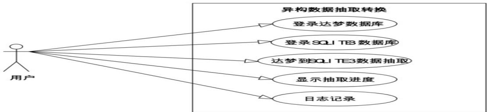
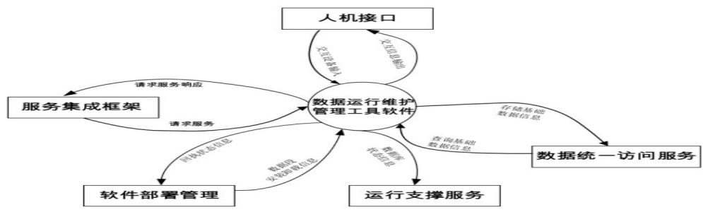

<table><tr><td rowspan=1 colspan=3>前置条件：数据库安装正常。</td></tr><tr><td rowspan=1 colspan=3>主事件流</td></tr><tr><td rowspan=1 colspan=1>Actor 的动作</td><td rowspan=1 colspan=1>系统的动作</td><td rowspan=1 colspan=1>动作约束(性能、可靠性、容错等)</td></tr><tr><td rowspan=1 colspan=1>1.用户输入数据段路径，调用数据段安装接口3.用户登录数据库查看数据段安装后的信息。</td><td rowspan=1 colspan=1>2.系统将根据用户输入信息进行数据段安装，如果安装成功系统给出成功提示标识，如果安装失败，执行异常流E1，安装过程中输出安装日志信息。</td><td rowspan=1 colspan=1>输入信息合法性校验，并在错误发生时，提供详细的错误信息提示</td></tr><tr><td rowspan=1 colspan=2>异常流E1：系统提示安装失败，输出安装失败信息，用例结束。</td><td rowspan=1 colspan=1></td></tr><tr><td rowspan=1 colspan=2>后置条件：无。</td><td rowspan=1 colspan=1></td></tr></table>

## 3.2.4.2 数据段卸载（PZXQ-GN-SJJZHS-SJDXZ）

数据段卸载用例场景，见表 66所示。

表 66数据段卸载用例描述
<table><tr><td colspan="1" rowspan="1">Use Case 名称:数据段卸载</td><td colspan="2" rowspan="1">Actors：用户、软件部署管理</td></tr><tr><td colspan="3" rowspan="1">概述：本用例通用数据加载与回收扩展用例，用于卸载数据库段的活动；</td></tr><tr><td colspan="3" rowspan="1">前置条件：数据库安装正常。</td></tr><tr><td colspan="3" rowspan="1">主事件流</td></tr><tr><td colspan="1" rowspan="1">Actor 的动作</td><td colspan="1" rowspan="1">系统的动作</td><td colspan="1" rowspan="1">动作约束(性能、可靠性、容错等)</td></tr><tr><td colspan="1" rowspan="1">1.用户输入数据段路径，调用数据段安装接口；3.用户登录数据库查看数据段卸载后的</td><td colspan="1" rowspan="1">2.系统将根据用户输入信息进行数据段卸载，如果卸载成功系统给出成功提示标识，如果卸载失败，执行异常流E1，卸载过程中输出卸载日志信息。</td><td colspan="1" rowspan="1">输入信息合法性校验，并在错误发生时，提供详细的错误信息提示</td></tr><tr><td colspan="1" rowspan="1">信息。</td><td colspan="1" rowspan="1"></td><td colspan="1" rowspan="1"></td></tr><tr><td colspan="2" rowspan="1">异常流E1：系统提示卸载失败，输出卸载失败信息，用例结束。</td><td colspan="1" rowspan="1"></td></tr><tr><td colspan="2" rowspan="1">后置条件：无。</td><td colspan="1" rowspan="1"></td></tr></table>

## 3.2.4.3 数据库备份（PZXQ-GN-SJJZHS-SJKBF）

数据库备份用例场景，见表 67所示。

表 67数据库备份用例描述
<table><tr><td rowspan=1 colspan=1>Use Case 名称:数据库备份</td><td rowspan=1 colspan=2>Actors：用户</td></tr><tr><td rowspan=1 colspan=3>概述：本用例通用数据加载与回收扩展用例，用于备份数据库的活动；</td></tr><tr><td rowspan=1 colspan=3>前置条件：数据库连接正常。</td></tr><tr><td rowspan=1 colspan=3>主事件流</td></tr><tr><td rowspan=1 colspan=1>Actor 的动作</td><td rowspan=1 colspan=1>系统的动作</td><td rowspan=1 colspan=1>动作约束(性能、可靠性、容错等)</td></tr><tr><td rowspan=1 colspan=1>1.用户登录需要备份的数据库系统，点击“备份”按钮进行数据库内容的备份；3.用户点击“下载”下载备份的数据库文件。</td><td rowspan=1 colspan=1>2.系统提示出进度百分比显示框，进行数据库备份，如果备份失败，执行异常流E1，如果备份成功，系统给出备份文件下载路径；</td><td rowspan=1 colspan=1>交互信息正确性校验，并在错误发生时，提供详细的错误信息提示</td></tr><tr><td rowspan=1 colspan=2>异常流E1：用户提示备份失败，用例结束。</td><td rowspan=1 colspan=1></td></tr><tr><td rowspan=1 colspan=2>后置条件：无。</td><td rowspan=1 colspan=1></td></tr></table>

## 3.2.4.4 数据库恢复（PZXQ-GN-SJJZHS-SJKHF）

数据库恢复用例场景，见表 68所示。

表 68数据库恢复用例描述
<table><tr><td colspan="1" rowspan="1">Use Case 名称:数据库恢复</td><td colspan="2" rowspan="1">Actors：用户</td></tr><tr><td colspan="3" rowspan="1">概述：本用例通用数据加载与回收扩展用例，用于数据库恢复的活动；</td></tr><tr><td colspan="3" rowspan="1">前置条件：数据库连接正常。</td></tr><tr><td colspan="3" rowspan="1">主事件流</td></tr><tr><td colspan="1" rowspan="1">Actor 的动作</td><td colspan="1" rowspan="1">系统的动作</td><td colspan="1" rowspan="1">动作约束(性能、可靠性、容错等)</td></tr><tr><td colspan="1" rowspan="1">1.用户点击“备份恢复”进入数据库备份恢复页面，点击“恢复”按钮进行数据库恢</td><td colspan="1" rowspan="1"></td><td colspan="1" rowspan="1">交互信息正确性校验，并在错误发生时，提供详细的错误信息提</td></tr><tr><td colspan="1" rowspan="1">复；3.用户选择需要恢复的数据文件，选择文件类型：(SQL/DMP)点击“确定”；</td><td colspan="1" rowspan="1">2.系统弹出“选择文件”弹出框；4.系统提示出进度百分比显示框，进行数据库恢复，如果恢复失败，执行异常流E1，如果恢复成功，系统给出恢复成功的信息。</td><td colspan="1" rowspan="1">示</td></tr><tr><td colspan="2" rowspan="1">异常流E1：用户提示恢复失败，用例结束。</td><td colspan="1" rowspan="1"></td></tr><tr><td colspan="2" rowspan="1">后置条件：无。</td><td colspan="1" rowspan="1"></td></tr></table>

## 3.2.4.5 数据库销毁（PZXQ-GN-SJJZHS-SJKXH）

数据库销毁用例场景，见表 69所示。

表 69数据库销毁用例描述
<table><tr><td>Use Case 名称:数据库销毁</td><td colspan="2">Actors：用户</td></tr><tr><td colspan="3">概述：本用例通用数据加载与回收扩展用例，用于数据库销毁的活动；</td></tr><tr><td colspan="3">前置条件：数据库连接正常。</td></tr><tr><td></td><td>主事件流</td><td></td></tr><tr><td>Actor 的动作 1.用户点击“清空销毁”进入数据库清空销</td><td>系统的动作</td><td>动作约束 (性能、可靠性、容错等)</td></tr><tr><td>毁页面，点击“数据库销毁”按钮进行数 据库销毁；</td><td>2.系统弹出“二次密码”弹出框；</td><td>1.输入信息合法性校验，并在错</td></tr><tr><td>3.用户二次输入密码进行销毁确认； 5.用户点击“确认”按钮，进行数据库销</td><td>4.系统提示密码校验成功，进入确认是 否销毁选项，密码校验失败，执行异常 流E1;</td><td>误发生时，提供详细的错误信息 提示 2.交互信息正确性校验，并在错 误发生时，提供详细的错误信息 提示</td></tr><tr><td>毁；</td><td>6.用户点击“确认”按钮，进行数据库销 毁，销毁成功，提示用户销毁成功，如果 销毁失败，执行异常流E2；</td><td></td></tr></table>

<table><tr><td rowspan=1 colspan=1>异常流E1：系统提示密码验证失败,请检查!，用例结束。</td><td rowspan=1 colspan=1></td></tr><tr><td rowspan=1 colspan=1>异常流E2：系统提示数据库销毁失败，用例结束。</td><td rowspan=1 colspan=1></td></tr><tr><td rowspan=1 colspan=1>后置条件：无。</td><td rowspan=1 colspan=1></td></tr></table>

## 3.2.4.6 数据库清空（PZXQ-GN-SJJZHS-SJKQK）

数据库清空用例场景，见表 70所示。

表 70数据库清空用例描述
<table><tr><td rowspan=1 colspan=1>Use Case 名称:数据库清空</td><td rowspan=1 colspan=2>Actors：用户</td></tr><tr><td rowspan=1 colspan=3>概述：本用例通用数据加载与回收扩展用例，用于数据库清空的活动；</td></tr><tr><td rowspan=1 colspan=3>前置条件：数据库连接正常。</td></tr><tr><td rowspan=1 colspan=3>主事件流</td></tr><tr><td rowspan=1 colspan=1>Actor 的动作</td><td rowspan=1 colspan=1>系统的动作</td><td rowspan=1 colspan=1>动作约束(性能、可靠性、容错等)</td></tr><tr><td rowspan=1 colspan=1>1.用户点击“清空销毁”进入数据库清空销毁页面，选择需要清空的表集合，选择清空选项(级联/非级联)，点击“数据清空”按钮；3.用户根据成功提示，登录数据库查看是否还有数据记录。</td><td rowspan=1 colspan=1>2.系统弹出清空进度百分比显示框，清空成功，给出日志提示，清空失败执行异常流E1；</td><td rowspan=1 colspan=1>交互信息正确性校验，并在错误发生时，提供详细的错误信息提示</td></tr><tr><td rowspan=1 colspan=2>异常流E1：系统提示清空失败，用例结束。</td><td rowspan=1 colspan=1></td></tr><tr><td rowspan=1 colspan=2>后置条件：无。</td><td rowspan=1 colspan=1></td></tr></table>

## 3.2.4.7 数据切分（PZXQ-GN-SJJZHS-SJQF）

数据切分用例场景，见表 71所示。

表 71数据切分用例描述
<table><tr><td>Use Case 名称:数据切分</td><td colspan="2">Actors：用户、基础数据维护</td></tr><tr><td colspan="3">概述：本用例通用数据加载与回收扩展用例，用于数据切分的活动；</td></tr><tr><td colspan="3">前置条件：数据库连接正常。</td></tr><tr><td></td><td>主事件流</td><td></td></tr><tr><td>Actor 的动作</td><td>系统的动作</td><td>动作约束 (性能、可靠性、容错等)</td></tr><tr><td colspan="1" rowspan="1">1.用户点击“数据切分”进入数据切分页面，选择需要切分的表集合，选择切分选项（选项1：删除/不删除；选项2：表数据/表结构；选项3：级联/非级联；选项4:SQL格式/DMP格式)，点击“切分”按钮；3.用户点击“导出文件下载”超链接下载切分文件。</td><td colspan="1" rowspan="1">2.系统弹出切分进度百分比显示框，数据切分成功，给出日志提示和切分出的文件下载路径，数据切分失败执行异常流E1;</td><td colspan="1" rowspan="1">交互信息正确性校验，并在错误发生时，提供详细的错误信息提示</td></tr><tr><td colspan="2" rowspan="1">异常流E1：系统提示数据切分失败，用例结束。</td><td colspan="1" rowspan="1"></td></tr><tr><td colspan="2" rowspan="1">后置条件：无。</td><td colspan="1" rowspan="1"></td></tr></table>

## 3.2.4.8 数据加载（PZXQ-GN-SJJZHS-SJJZ）

数据加载用例场景，见表 72所示。

表 72数据加载用例描述
<table><tr><td colspan="1" rowspan="1">Use Case 名称:数据加载</td><td colspan="2" rowspan="1">Actors：用户、基础数据维护</td></tr><tr><td colspan="3" rowspan="1">概述：本用例通用数据加载与回收扩展用例，用于数据加载的活动；</td></tr><tr><td colspan="3" rowspan="1">前置条件：数据库连接正常。</td></tr><tr><td colspan="3" rowspan="1">主事件流</td></tr><tr><td colspan="1" rowspan="1">Actor 的动作</td><td colspan="1" rowspan="1">系统的动作</td><td colspan="1" rowspan="1">动作约束(性能、可靠性、容错等)</td></tr><tr><td colspan="1" rowspan="1">1.用户登录需要进行数据加载的“目标数据库”，点击“下一步”按钮；3.用户选择需要恢复的数据文件，选择文件类型：（SQL/DMP)点击“确定”；</td><td colspan="1" rowspan="1">2.系统弹出“选择文件”弹出框；4.系统提示出进度百分比显示框，进行数据库恢复，如果恢复失败，执行异常流E1，如果恢复成功，系统给出恢复成功的信息。</td><td colspan="1" rowspan="1">交互信息正确性校验，并在错误发生时，提供详细的错误信息提示</td></tr><tr><td colspan="2" rowspan="1">异常流E1：用户提示加载失败，用例结束。</td><td colspan="1" rowspan="1"></td></tr><tr><td colspan="2"></td><td></td></tr><tr><td colspan="2"></td><td></td></tr></table>

## 3.2.4.9 日志管理（PZXQ-GN-SJJZHS-RZGL）

日志管理用例场景，见表 73所示。

表 73日志管理用例描述
<table><tr><td rowspan=1 colspan=1>Use Case 名称:日志管理</td><td rowspan=1 colspan=2>Actors：用户</td></tr><tr><td rowspan=1 colspan=3>概述：本用例通用数据加载与回收扩展用例，用于日志管理的活动；</td></tr><tr><td rowspan=1 colspan=3>前置条件：数据库连接正常。</td></tr><tr><td rowspan=1 colspan=3>主事件流</td></tr><tr><td rowspan=1 colspan=1>Actor 的动作</td><td rowspan=1 colspan=1>系统的动作</td><td rowspan=1 colspan=1>动作约束(性能、可靠性、容错等)</td></tr><tr><td rowspan=1 colspan=1>1.用户点击“日志管理”进入日志管理页面，用户选择日志分类类别，点击“搜索”按钮进行日志按分类检索；3. 用户输入日志主题名，点击“搜索”按钮进行日志按主题名进行检索；5. 用户选择日期起止时间，点击“搜索”按钮进行日志时间戳进行检索；7. 用户勾选日志记录，点击“批量删除”按钮进行日志记录的删除；</td><td rowspan=1 colspan=1>2.系统搜索完成，搜索异常执行异常流E1，成功向用户分页显示日志检索结果集；4.系统搜索完成，搜索异常执行异常流E1，成功向用户分页显示日志检索结果集；6.系统搜索完成，搜索异常执行异常流E1，成功向用户分页显示日志检索结果集；8.系统删除成功，提示用户删除成功信息，删除失败执行异常流E2。</td><td rowspan=1 colspan=1>交互信息正确性校验，并在错误发生时，提供详细的错误信息提示</td></tr><tr><td rowspan=1 colspan=2>异常流E1：系统检索失败，用例结束。</td><td rowspan=1 colspan=1></td></tr><tr><td rowspan=1 colspan=2>异常流E2：系统提示删除失败，用例结束。</td><td rowspan=1 colspan=1></td></tr><tr><td rowspan=1 colspan=2>后置条件：无。</td><td rowspan=1 colspan=1></td></tr></table>

## 3.2.5 数据抽取转换（PZXQ-GN-SJCQZH）

数据抽取转换能力包括：登陆达梦数据库、登陆SQLITE3数据库、达梦到SQLITE3

数据抽取、显示抽取进度、日志记录，其功能用例如图 17 所示。

  
图17异构数据抽取转换用例图  
数据抽取转换能力标识表，见表 74所示。

表 74数据抽取转换能力标识
<table><tr><td rowspan=1 colspan=1>序号</td><td rowspan=1 colspan=1>Use case 名称</td><td rowspan=1 colspan=1>项目唯一标识符</td><td rowspan=1 colspan=1>需求描述</td><td rowspan=1 colspan=1>需求重用</td><td rowspan=1 colspan=1>方式名称</td><td rowspan=1 colspan=1>运行状态</td><td rowspan=1 colspan=1>对应的任务书功能/性能</td></tr><tr><td rowspan=1 colspan=1>1</td><td rowspan=1 colspan=1>登录达梦数据库</td><td rowspan=1 colspan=1>PZXQ-GN-SJCQZH-DLDMSJK</td><td rowspan=1 colspan=1>提供界面异步抽取装换的达梦数据库登录功能</td><td rowspan=1 colspan=1>沿用</td><td rowspan=1 colspan=1>桌面、平板</td><td rowspan=1 colspan=1>集成阶段</td><td rowspan=1 colspan=1>4.1.6 a)</td></tr><tr><td rowspan=1 colspan=1>2</td><td rowspan=1 colspan=1>登录SQLITE3 数据库</td><td rowspan=1 colspan=1>PZXQ-GN-SJCQZH-DLSQLITESJK</td><td rowspan=1 colspan=1>提供界面异步抽取装换的 SQLITE3 数据库登录功能</td><td rowspan=1 colspan=1>沿用</td><td rowspan=1 colspan=1>桌面、平板</td><td rowspan=1 colspan=1>集成阶段</td><td rowspan=1 colspan=1>4.1.6 a)</td></tr><tr><td rowspan=1 colspan=1>3</td><td rowspan=1 colspan=1>达梦到SQLITE3 数据抽取</td><td rowspan=1 colspan=1>PZXQ-GN-SJCQZH-DMDSQLITECQ</td><td rowspan=1 colspan=1>提供达梦数据库到SQLITE3数据库之间的数据抽取转换</td><td rowspan=1 colspan=1>沿用</td><td rowspan=1 colspan=1>桌面、平板</td><td rowspan=1 colspan=1>集成阶段</td><td rowspan=1 colspan=1>4.1.6 c)</td></tr><tr><td rowspan=1 colspan=1>4</td><td rowspan=1 colspan=1>显示抽取进度</td><td rowspan=1 colspan=1>PZXQ-GN-SJCQZH-XSCQJD</td><td rowspan=1 colspan=1>界面显示抽取进度</td><td rowspan=1 colspan=1>沿用</td><td rowspan=1 colspan=1>桌面、平板</td><td rowspan=1 colspan=1>集成阶段</td><td rowspan=1 colspan=1>4.1.6 c)</td></tr><tr><td rowspan=1 colspan=1>5</td><td rowspan=1 colspan=1>日志记录</td><td rowspan=1 colspan=1>PZXQ-GN-SJCQZH-RZJL</td><td rowspan=1 colspan=1>提供抽取日志记录功能</td><td rowspan=1 colspan=1>沿用</td><td rowspan=1 colspan=1>桌面、平板</td><td rowspan=1 colspan=1>集成阶段</td><td rowspan=1 colspan=1>4.1.6 b)</td></tr></table>

3.2.5.1 登录达梦数据库（PZXQ-GN-SJCQZH-DLDMSJK）  
登录达梦数据库用例场景，见表 75所示。  
表 75登录达梦数据库用例描述

<table><tr><td rowspan=1 colspan=1>Use Case 名称:登录达梦数据库</td><td rowspan=1 colspan=2>Actors：用户</td></tr><tr><td rowspan=1 colspan=3>概述：本用例异构数据抽取与转换扩展子用例，用于登录达梦数据库的活动；</td></tr><tr><td rowspan=1 colspan=3>前置条件：数据库安装正常，共享数据库段安装正常。</td></tr><tr><td rowspan=1 colspan=3>主事件流</td></tr><tr><td rowspan=1 colspan=1>Actor 的动作</td><td rowspan=1 colspan=1>系统的动作</td><td rowspan=1 colspan=1>动作约束(性能、可靠性、容错等)</td></tr><tr><td rowspan=1 colspan=1>1.用户输入用户名、密码、IP地址，点击“登录”；3.登录成功进入点击“下一步”。</td><td rowspan=1 colspan=1>2.系统提示：如果登录成功，提示用户登录成功，如果登录失败，提示用户登录失败，执行异常流E1</td><td rowspan=1 colspan=1>1.输入信息合法性校验，并在错误发生时，提供详细的错误信息提示2.交互信息正确性校验，并在错误发生时，提供详细的错误信息提示</td></tr><tr><td rowspan=1 colspan=2>异常流E1：数据库连接失败!，用例结束。</td><td rowspan=1 colspan=1></td></tr><tr><td rowspan=1 colspan=2>后置条件：无。</td><td rowspan=1 colspan=1></td></tr></table>

## 3.2.5.2 登录 SQLITE3 数据库（PZXQ-GN-SJCQZH-DLSQLITESJK）

登录SQLITE3数据库用例场景，见表 76所示。

表 76登录 SQLITE3 数据库用例描述
<table><tr><td rowspan=1 colspan=1>Use Case 名称:登录 SQLITE3 数据库</td><td rowspan=1 colspan=2>Actors：用户</td></tr><tr><td rowspan=1 colspan=3>概述：本用例异构数据抽取与转换扩展子用例，用于登录登录SQLITE3数据库的活动；</td></tr><tr><td rowspan=1 colspan=3>前置条件：数据库安装正常，共享数据库段安装正常。</td></tr><tr><td rowspan=1 colspan=3>主事件流</td></tr><tr><td rowspan=1 colspan=1>Actor 的动作</td><td rowspan=1 colspan=1>系统的动作</td><td rowspan=1 colspan=1>动作约束(性能、可靠性、容错等)</td></tr><tr><td rowspan=1 colspan=1>1.用户输入DB文件路径，点击“登录”；3.登录成功进入点击“下一步”。</td><td rowspan=1 colspan=1>2.系统提示：如果登录成功，提示用户登录成功，如果登录失败，提示用户登录失败，执行异常流E1</td><td rowspan=1 colspan=1>1.输入信息合法性校验，并在错误发生时，提供详细的错误信息提示2.交互信息正确性校验，并在错误发生时，提供详细的错误信息提示</td></tr><tr><td rowspan=1 colspan=2>异常流E1:数据库连接失败!，用例结束。</td><td rowspan=1 colspan=1></td></tr><tr><td rowspan=1 colspan=2>后置条件：无。</td><td rowspan=1 colspan=1></td></tr></table>

## 3.2.5.3 达 梦 到 SQLITE3 数 据 抽 取 （ PZXQ-GN-SJCQZH-DMDSQLITECQ）

达梦到SQLITE3数据抽取用例场景，见表 77所示。

表 77达梦到SQLITE3数据抽取用例描述
<table><tr><td rowspan=1 colspan=1>Use Case 名称:达梦到 SQLITE3 数据抽取</td><td rowspan=1 colspan=2>Actors：用户</td></tr><tr><td rowspan=1 colspan=3>概述：本用例异构数据抽取与转换扩展子用例，用于达梦到SQLITE3数据抽取的活动；</td></tr><tr><td rowspan=1 colspan=3>前置条件：数据库连接正常。</td></tr><tr><td rowspan=1 colspan=3>主事件流</td></tr><tr><td rowspan=1 colspan=1>Actor 的动作</td><td rowspan=1 colspan=1>系统的动作</td><td rowspan=1 colspan=1>动作约束(性能、可靠性、容错等)</td></tr><tr><td rowspan=1 colspan=1>1.用户选择需要抽取转换的表集合，点击“下一步”；</td><td rowspan=1 colspan=1>2.系统给出抽取转换的状态信息，如果抽取转换成功，给出记录，如果失败，执行异常流E1。</td><td rowspan=1 colspan=1>交互信息正确性校验，并在错误发生时，提供详细的错误信息提示</td></tr><tr><td rowspan=1 colspan=2>异常流E1：系统提示抽取转换失败，用例结束。</td><td rowspan=1 colspan=1></td></tr><tr><td rowspan=1 colspan=2>后置条件：无。</td><td rowspan=1 colspan=1></td></tr></table>

## 3.2.5.4 显示抽取进度（PZXQ-GN-SJCQZH-XSCQJD）

显示抽取进度用例场景，见表 78所示。

表 78显示抽取进度用例描述
<table><tr><td rowspan=1 colspan=1>Use Case 名称:显示抽取进度</td><td rowspan=1 colspan=2>Actors：用户</td></tr><tr><td rowspan=1 colspan=3>概述：本用例异构数据抽取与转换扩展子用例，用于达梦到SQLITE3数据抽取进度信息显示的活动；</td></tr><tr><td rowspan=1 colspan=3>前置条件：数据库连接正常，抽取转换任务正常。</td></tr><tr><td rowspan=1 colspan=3>主事件流</td></tr><tr><td rowspan=1 colspan=1>Actor 的动作</td><td rowspan=1 colspan=1>系统的动作</td><td rowspan=1 colspan=1>动作约束(性能、可靠性、容错等)</td></tr><tr><td rowspan=1 colspan=1>1.用户输入/选择任务进行数据抽取转换；</td><td rowspan=1 colspan=1>2.系统弹出抽取转换进度状态进行，如果抽取成功，进度信息正常显示，如果失败执行异常流E1。</td><td rowspan=1 colspan=1>交互信息正确性校验，并在错误发生时，提供详细的错误信息提示</td></tr><tr><td rowspan=1 colspan=2>异常流E1：系统提示抽取转换失败，用例结束。</td><td rowspan=1 colspan=1></td></tr><tr><td rowspan=1 colspan=2>后置条件：无。</td><td rowspan=1 colspan=1></td></tr></table>

## 3.2.5.5 日志记录（PZXQ-GN-SJCQZH-RZJL）

日志记录用例场景，见表 79所示。

表 79日志记录用例描述
<table><tr><td rowspan=1 colspan=1>Use Case 名称：日志记录</td><td rowspan=1 colspan=2>Actors：用户</td></tr><tr><td rowspan=1 colspan=3>概述：本用例异构数据抽取与转换扩展子用例，用于抽取转换日志记录的活动；</td></tr><tr><td rowspan=1 colspan=3>前置条件：数据库连接正常，抽取转换任务正常。</td></tr><tr><td rowspan=1 colspan=3>主事件流</td></tr><tr><td rowspan=1 colspan=1>Actor 的动作</td><td rowspan=1 colspan=1>系统的动作</td><td rowspan=1 colspan=1>动作约束(性能、可靠性、容错等)</td></tr><tr><td rowspan=1 colspan=1>1.用户进行通过抽取转换页面，执行抽取转换任务；</td><td rowspan=1 colspan=1>2.系统按照提示与用户交互进行抽取转换任务，如果任务执行成功，保留用户抽取转换日志信息，如果失败，执行异常流E1。</td><td rowspan=1 colspan=1>交互信息正确性校验，并在错误发生时，提供详细的错误信息提示</td></tr><tr><td rowspan=1 colspan=2>异常流E1：系统提示任务失败，用例结束。</td><td rowspan=1 colspan=1></td></tr><tr><td rowspan=1 colspan=2>后置条件：无。</td><td rowspan=1 colspan=1></td></tr></table>

## 3.3 CSCI 外部接口需求

## 3.3.1 接口标识和接口图

数据运行维护管理工具外部接口如图18所示。

  
图18数据运行维护管理工具外部接口需求

数据运行维护管理工具外部接口包括：人机交互接口、与服务集成框架接口、与软