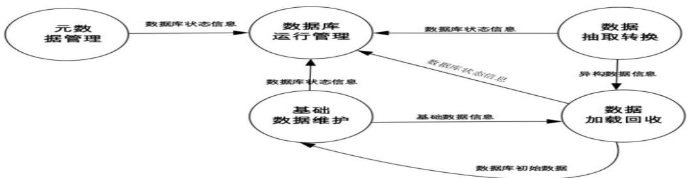

件部署管理接口、与运行支撑服务接口、与数据统一访问服务接口。

数据运行维护管理工具外部接口需求表见表80所示。

表80 数据运行维护管理工具外部接口需求
<table><tr><td rowspan=1 colspan=1>序号</td><td rowspan=1 colspan=1>接口需求名称</td><td rowspan=1 colspan=1>接口需求标识</td><td rowspan=1 colspan=1>接口类型</td><td rowspan=1 colspan=1>发送方</td><td rowspan=1 colspan=1>接收方</td><td rowspan=1 colspan=1>接口内容</td><td rowspan=1 colspan=1>接口优先级</td></tr><tr><td rowspan=2 colspan=1>1</td><td rowspan=2 colspan=1>人机交互接口</td><td rowspan=2 colspan=1>PZXQ-WBJK-SJYXWHGL-RJJH</td><td rowspan=2 colspan=1>人机</td><td rowspan=1 colspan=1>本系统</td><td rowspan=1 colspan=1>用户</td><td rowspan=1 colspan=1>交互信息输出</td><td rowspan=1 colspan=1>低</td></tr><tr><td rowspan=1 colspan=1>用户</td><td rowspan=1 colspan=1>本系统</td><td rowspan=1 colspan=1>交互设备输入</td><td rowspan=1 colspan=1>低</td></tr><tr><td rowspan=2 colspan=1>2</td><td rowspan=2 colspan=1>数据运行维护管理工具与服务集成框架接口</td><td rowspan=2 colspan=1>PZXQ-WBJK-SJYXWHGL-FWJC</td><td rowspan=2 colspan=1>API</td><td rowspan=1 colspan=1>本系统</td><td rowspan=1 colspan=1>服务集成框架</td><td rowspan=1 colspan=1>数据服务响应</td><td rowspan=1 colspan=1>低</td></tr><tr><td rowspan=1 colspan=1>服务集成框架</td><td rowspan=1 colspan=1>本系统</td><td rowspan=1 colspan=1>数据服务请求</td><td rowspan=1 colspan=1>低</td></tr><tr><td rowspan=2 colspan=1>3</td><td rowspan=2 colspan=1>数据运行维护管理工具与软件部署管理接口</td><td rowspan=2 colspan=1>PZXQ-WBJK-SJYXWHGL-BSGL</td><td rowspan=2 colspan=1>API</td><td rowspan=1 colspan=1>本系统</td><td rowspan=1 colspan=1>软件部署管理</td><td rowspan=1 colspan=1>状态信息</td><td rowspan=1 colspan=1>低</td></tr><tr><td rowspan=1 colspan=1>软件部署管理</td><td rowspan=1 colspan=1>本系统</td><td rowspan=1 colspan=1>数据段安装卸载信息</td><td rowspan=1 colspan=1>低</td></tr><tr><td rowspan=1 colspan=1>4</td><td rowspan=1 colspan=1>数据运行维护管理工具与运行支撑服务接口</td><td rowspan=1 colspan=1>PZXQ-WBJK-SJYXWHGL-YXZC</td><td rowspan=1 colspan=1>API</td><td rowspan=1 colspan=1>本系统</td><td rowspan=1 colspan=1>运行支撑服务</td><td rowspan=1 colspan=1>数据库监控信息</td><td rowspan=1 colspan=1>低</td></tr><tr><td rowspan=2 colspan=1>5</td><td rowspan=2 colspan=1>数据运行维护管理工具与数据统一访问服务接口</td><td rowspan=2 colspan=1>PZXQ-WBJK-SJYXWHGL-TYFW</td><td rowspan=2 colspan=1>网络</td><td rowspan=1 colspan=1>本系统</td><td rowspan=1 colspan=1>数据统一访问服务</td><td rowspan=1 colspan=1>存储数据</td><td rowspan=1 colspan=1>低</td></tr><tr><td rowspan=1 colspan=1>数据统一访问服务</td><td rowspan=1 colspan=1>本系统</td><td rowspan=1 colspan=1>读取数据</td><td rowspan=1 colspan=1>低</td></tr></table>

## 3.3.2 人机交互接口（PZXQ-WBJK-SJYXWHGL-RJJH）

人机交互接口数据元素说明表，见表 81所示。

表 81人机交互接口数据元素说明
<table><tr><td rowspan=1 colspan=1>序号</td><td rowspan=1 colspan=1>数据集名称</td><td rowspan=1 colspan=1>数据组成</td><td rowspan=1 colspan=1>数据约束</td><td rowspan=1 colspan=1>数据标准</td></tr><tr><td rowspan=3 colspan=1>1</td><td rowspan=3 colspan=1>交互设备输入</td><td rowspan=1 colspan=1>鼠标单击</td><td rowspan=1 colspan=1>1</td><td rowspan=1 colspan=1>1</td></tr><tr><td rowspan=1 colspan=1>鼠标双击</td><td rowspan=1 colspan=1>1</td><td rowspan=1 colspan=1>1</td></tr><tr><td rowspan=1 colspan=1>键盘输入</td><td rowspan=1 colspan=1>字符串</td><td rowspan=1 colspan=1></td></tr><tr><td rowspan=3 colspan=1>2</td><td rowspan=3 colspan=1>交互信息输出</td><td rowspan=1 colspan=1>鼠标单击提示信息</td><td rowspan=1 colspan=1>字符串</td><td rowspan=1 colspan=1></td></tr><tr><td rowspan=1 colspan=1>鼠标双击提示信息</td><td rowspan=1 colspan=1>字符串</td><td rowspan=1 colspan=1></td></tr><tr><td rowspan=1 colspan=1>键盘输入交互信息</td><td rowspan=1 colspan=1>字符串</td><td rowspan=1 colspan=1></td></tr></table>

3.3.3 与服务集成框架接口（PZXQ-WBJK-SJYXWHGL-FWJC）与服务集成框架接口数据元素说明表，见表82所示。

表82与服务集成框架接口数据元素说明
<table><tr><td rowspan=1 colspan=1>序号</td><td rowspan=1 colspan=1>数据集名称</td><td rowspan=1 colspan=1>数据组成</td><td rowspan=1 colspan=1>数据约束</td><td rowspan=1 colspan=1>数据标准</td></tr><tr><td rowspan=8 colspan=1>1</td><td rowspan=8 colspan=1>请求服务</td><td rowspan=1 colspan=1>服务协议</td><td rowspan=1 colspan=1>字符串</td><td rowspan=8 colspan=1></td></tr><tr><td rowspan=1 colspan=1>服务地址</td><td rowspan=1 colspan=1>字符串</td></tr><tr><td rowspan=1 colspan=1>服务端口号</td><td rowspan=1 colspan=1>整型</td></tr><tr><td rowspan=1 colspan=1>资源路径</td><td rowspan=1 colspan=1>字符串</td></tr><tr><td rowspan=1 colspan=1>服务请求参数</td><td rowspan=1 colspan=1>字符串</td></tr><tr><td rowspan=1 colspan=1>服务请求数据（表单内容）</td><td rowspan=1 colspan=1>字符串</td></tr><tr><td rowspan=1 colspan=1>服务请求数据（媒体类型）</td><td rowspan=1 colspan=1>媒体</td></tr><tr><td rowspan=1 colspan=1>服务请求方法</td><td rowspan=1 colspan=1>字符串</td></tr><tr><td rowspan=5 colspan=1>2</td><td rowspan=5 colspan=1>请求服务响应</td><td rowspan=1 colspan=1>响应协议</td><td rowspan=1 colspan=1>字符串</td><td rowspan=5 colspan=1></td></tr><tr><td rowspan=1 colspan=1>响应数据类型</td><td rowspan=1 colspan=1>字符串</td></tr><tr><td rowspan=1 colspan=1>响应数据</td><td rowspan=1 colspan=1>字符串</td></tr><tr><td rowspan=1 colspan=1>响应数据长度</td><td rowspan=1 colspan=1>整型</td></tr><tr><td rowspan=1 colspan=1>通道标识</td><td rowspan=1 colspan=1>整型</td></tr><tr><td rowspan=1 colspan=2></td><td rowspan=1 colspan=1>响应文件资源</td><td rowspan=1 colspan=1>媒体</td><td rowspan=1 colspan=1></td></tr></table>

3.3.4 与软件部署管理接口（PZXQ-WBJK-SJYXWHGL-BSGL）与软件部署管理接口数据元素说明表，见表83所示。

表83与软件部署管理接口数据元素说明
<table><tr><td colspan="1" rowspan="1">序号</td><td colspan="1" rowspan="1">数据集名称</td><td colspan="1" rowspan="1">数据组成</td><td colspan="1" rowspan="1">数据约束</td><td colspan="1" rowspan="1">数据标准</td></tr><tr><td colspan="1" rowspan="8">1</td><td colspan="1" rowspan="8">数据段安装卸载信息</td><td colspan="1" rowspan="1">数据库段安装 SQL/DMP 文件</td><td colspan="1" rowspan="1">文件/媒体</td><td colspan="1" rowspan="1">1</td></tr><tr><td colspan="1" rowspan="1">数据库段卸载 SQL/DMP 文件</td><td colspan="1" rowspan="1">文件/媒体</td><td colspan="1" rowspan="1"></td></tr><tr><td colspan="1" rowspan="1">数据库段安装脚本</td><td colspan="1" rowspan="1">文件</td><td colspan="1" rowspan="1"></td></tr><tr><td colspan="1" rowspan="1">数据库段卸载腳本</td><td colspan="1" rowspan="1">文件</td><td colspan="1" rowspan="1"></td></tr><tr><td colspan="1" rowspan="1">数据库段安装路径</td><td colspan="1" rowspan="1">字符串</td><td colspan="1" rowspan="1"></td></tr><tr><td colspan="1" rowspan="1">数据库段卸载路径</td><td colspan="1" rowspan="1">字符串</td><td colspan="1" rowspan="1"></td></tr><tr><td colspan="1" rowspan="1">数据库段安装方法</td><td colspan="1" rowspan="1">字符串</td><td colspan="1" rowspan="1"></td></tr><tr><td colspan="1" rowspan="1">数据库段卸载方法</td><td colspan="1" rowspan="1">字符串</td><td colspan="1" rowspan="1"></td></tr><tr><td colspan="1" rowspan="4">2</td><td colspan="1" rowspan="4">回执状态信息</td><td colspan="1" rowspan="1">数据库段安装成功信息</td><td colspan="1" rowspan="1">字符串</td><td colspan="1" rowspan="1">1</td></tr><tr><td colspan="1" rowspan="1">数据库段卸载成功信息</td><td colspan="1" rowspan="1">字符串</td><td colspan="1" rowspan="1">1</td></tr><tr><td colspan="1" rowspan="1">数据库段安装失败信息</td><td colspan="1" rowspan="1">字符串</td><td colspan="1" rowspan="1"></td></tr><tr><td colspan="1" rowspan="1">数据库段卸载失败信息</td><td colspan="1" rowspan="1">字符串</td><td colspan="1" rowspan="1"></td></tr></table>

## 3.3.5 与运行支撑服务接口（PZXQ-WBJK-SJYXWHGL-YXZC）

与运行支撑服务接口数据元素说明表，见表84所示。

表84与运行支撑服务接口数据元素说明
<table><tr><td rowspan=1 colspan=1>序号</td><td rowspan=1 colspan=1>数据集名称</td><td rowspan=1 colspan=1>数据组成</td><td rowspan=1 colspan=1>数据约束</td><td rowspan=1 colspan=1>数据标准</td></tr><tr><td rowspan=15 colspan=2>1        数据库状态信息</td><td rowspan=1 colspan=1>数据库会话信息</td><td rowspan=1 colspan=1>字符串</td><td rowspan=15 colspan=1></td></tr><tr><td rowspan=1 colspan=1>创建会话时间</td><td rowspan=1 colspan=1>字符串</td></tr><tr><td rowspan=1 colspan=1>创建会话应用名称</td><td rowspan=1 colspan=1>字符串</td></tr><tr><td rowspan=1 colspan=1>会话状态</td><td rowspan=1 colspan=1>字符串</td></tr><tr><td rowspan=1 colspan=1>IP信息</td><td rowspan=1 colspan=1>字符串</td></tr><tr><td rowspan=1 colspan=1>数据库进程 CPU 占有率</td><td rowspan=1 colspan=1>字符串</td></tr><tr><td rowspan=1 colspan=1>数据库配置信息</td><td rowspan=1 colspan=1>字符串</td></tr><tr><td rowspan=1 colspan=1>表空间大小</td><td rowspan=1 colspan=1>字符串</td></tr><tr><td rowspan=1 colspan=1>表空间占有率</td><td rowspan=1 colspan=1>字符串</td></tr><tr><td rowspan=1 colspan=1>表空间存储文件路径信息</td><td rowspan=1 colspan=1>字符串</td></tr><tr><td rowspan=1 colspan=1>会话连接数</td><td rowspan=1 colspan=1>字符串</td></tr><tr><td rowspan=1 colspan=1>连接程序名</td><td rowspan=1 colspan=1>字符串</td></tr><tr><td rowspan=1 colspan=1>连接时间</td><td rowspan=1 colspan=1>字符串</td></tr><tr><td rowspan=1 colspan=1>当前连接数</td><td rowspan=1 colspan=1>字符串</td></tr><tr><td rowspan=1 colspan=1>最大连接数</td><td rowspan=1 colspan=1>字符串</td></tr></table>

## 3.3.6 与 数 据 统 一 访 问 服 务 接 口 （ PZXQ-WBJK-SJYXWHGL-TYFW）

与数据统一访问服务接口数据元素说明表，见表85所示。

表85与数据统一访问服务接口数据元素说明
<table><tr><td colspan="1" rowspan="1">序号</td><td colspan="1" rowspan="1">数据集名称</td><td colspan="1" rowspan="1">数据组成</td><td colspan="1" rowspan="1">数据约束</td><td colspan="1" rowspan="1">数据标准</td></tr><tr><td colspan="1" rowspan="1">1</td><td colspan="1" rowspan="1">存储基础数据信息</td><td colspan="1" rowspan="1">初始化数据库连接句柄</td><td colspan="1" rowspan="1">字符串</td><td colspan="1" rowspan="1"></td></tr><tr><td colspan="1" rowspan="2"></td><td colspan="1" rowspan="7"></td><td colspan="1" rowspan="1">连接数据库用户名</td><td colspan="1" rowspan="1">字符串</td><td colspan="1" rowspan="11"></td></tr><tr><td colspan="1" rowspan="1">连接数据库密码</td><td colspan="1" rowspan="1">字符串</td></tr><tr><td colspan="1" rowspan="9"></td><td colspan="1" rowspan="1">连接数据库服务地址</td><td colspan="1" rowspan="1">字符串</td></tr><tr><td colspan="1" rowspan="1">SQL 文本数据插入</td><td colspan="1" rowspan="1">字符串</td></tr><tr><td colspan="1" rowspan="1">BLOB 字段插入</td><td colspan="1" rowspan="1">媒体</td></tr><tr><td colspan="1" rowspan="1">配置文件存储</td><td colspan="1" rowspan="1">文件</td></tr><tr><td colspan="1" rowspan="1">INT类型数据插入</td><td colspan="1" rowspan="1">整型</td></tr><tr><td colspan="1" rowspan="4"></td><td colspan="1" rowspan="1">FLOAT类型数据插入</td><td colspan="1" rowspan="1">浮点型</td></tr><tr><td colspan="1" rowspan="1">String 类型数据插入</td><td colspan="1" rowspan="1">字符串</td></tr><tr><td colspan="1" rowspan="1">Date 类型数据插入</td><td colspan="1" rowspan="1">日期</td></tr><tr><td colspan="1" rowspan="1">Json 类型数据插入</td><td colspan="1" rowspan="1">字符串</td></tr><tr><td colspan="2" rowspan="13">2       查询基础数据信息</td><td colspan="1" rowspan="1">初始化数据库连接句柄</td><td colspan="1" rowspan="1">字符串</td><td colspan="1" rowspan="13"></td></tr><tr><td colspan="1" rowspan="1">连接数据库用户名</td><td colspan="1" rowspan="1">字符串</td></tr><tr><td colspan="1" rowspan="1">连接数据库密码</td><td colspan="1" rowspan="1">字符串</td></tr><tr><td colspan="1" rowspan="1">连接数据库服务地址</td><td colspan="1" rowspan="1">字符串</td></tr><tr><td colspan="1" rowspan="1">SQL 数据查询</td><td colspan="1" rowspan="1">字符串</td></tr><tr><td colspan="1" rowspan="1">BLOB 字段查询</td><td colspan="1" rowspan="1">媒体</td></tr><tr><td colspan="1" rowspan="1">配置文件读取</td><td colspan="1" rowspan="1">字符串</td></tr><tr><td colspan="1" rowspan="1">INT类型数据查询</td><td colspan="1" rowspan="1">整型</td></tr><tr><td colspan="1" rowspan="1">FLOAT 类型数据查询</td><td colspan="1" rowspan="1">浮点型</td></tr><tr><td colspan="1" rowspan="1">String 类型数据查询</td><td colspan="1" rowspan="1">字符串</td></tr><tr><td colspan="1" rowspan="1">Date 类型数据查询</td><td colspan="1" rowspan="1">日期</td></tr><tr><td colspan="1" rowspan="1">Json 类型数据查询</td><td colspan="1" rowspan="1">字符串</td></tr><tr><td colspan="1" rowspan="1">SQL 文本数据导出</td><td colspan="1" rowspan="1">文件</td></tr></table>

## 3.4 CSCI 内部接口需求

## 3.4.1 接口标识和接口图

数据运行维护管理工具内部接口如图19所示。

  
图19数据运行维护管理工具内部接口需求  
数据运行维护管理工具内部接口需求表见表86所示。

表86 数据运行维护管理工具内部接口需求
<table><tr><td rowspan=1 colspan=1>序号</td><td rowspan=1 colspan=1>接口需求名称</td><td rowspan=1 colspan=1>接口需求标识</td><td rowspan=1 colspan=1>接口类型</td><td rowspan=1 colspan=1>发送方</td><td rowspan=1 colspan=1>接收方</td><td rowspan=1 colspan=1>接口内容</td><td rowspan=1 colspan=1>接口优先级</td></tr><tr><td rowspan=1 colspan=1>1</td><td rowspan=1 colspan=1>元数据管理与数据库运行管理接口</td><td rowspan=1 colspan=1>PZXQ-NBJK-YSJGL-YXGL</td><td rowspan=1 colspan=1>API</td><td rowspan=1 colspan=1>元数据管理</td><td rowspan=1 colspan=1>数据库运行管理</td><td rowspan=1 colspan=1>数据库状态信息</td><td rowspan=1 colspan=1>低</td></tr><tr><td rowspan=1 colspan=1>2</td><td rowspan=1 colspan=1>基础数据维护与数据库运行管理接口</td><td rowspan=1 colspan=1>PZXQ-NBJK-JCSJWH-YXGL</td><td rowspan=1 colspan=1>API</td><td rowspan=1 colspan=1>基础数据维护</td><td rowspan=1 colspan=1>数据库运行管理</td><td rowspan=1 colspan=1>数据库状态信息</td><td rowspan=1 colspan=1>低</td></tr><tr><td rowspan=1 colspan=1>3</td><td rowspan=1 colspan=1>数据加载回收与数据库运行管理接口</td><td rowspan=1 colspan=1>PZXQ-NBJK-SJJZHS-YXGL</td><td rowspan=1 colspan=1>API</td><td rowspan=1 colspan=1>数据加载回收</td><td rowspan=1 colspan=1>数据库运行管理</td><td rowspan=1 colspan=1>数据库状态信息</td><td rowspan=1 colspan=1>低</td></tr><tr><td rowspan=1 colspan=1>4</td><td rowspan=1 colspan=1>数据抽取转换与数据库运行管理接口</td><td rowspan=1 colspan=1>PZXQ-NBJK-SJCQZH-YXGL</td><td rowspan=1 colspan=1>API</td><td rowspan=1 colspan=1>数据抽取转换</td><td rowspan=1 colspan=1>数据库运行管理</td><td rowspan=1 colspan=1>数据库状态信息</td><td rowspan=1 colspan=1>低</td></tr><tr><td rowspan=1 colspan=1>5</td><td rowspan=1 colspan=1>数据抽取转换与数据加载回收接口</td><td rowspan=1 colspan=1>PZXQ-NBJK-SJCQZH-SJJZHS</td><td rowspan=1 colspan=1>API</td><td rowspan=1 colspan=1>数据抽取转换</td><td rowspan=1 colspan=1>数据加载回收</td><td rowspan=1 colspan=1>异构数据</td><td rowspan=1 colspan=1>低</td></tr><tr><td rowspan=1 colspan=1>6</td><td rowspan=1 colspan=1>数据加载回收与基础数据维护接口</td><td rowspan=1 colspan=1>PZXQ-NBJK-SJJZHS-JCSJWH</td><td rowspan=1 colspan=1>API</td><td rowspan=1 colspan=1>数据加载回收</td><td rowspan=1 colspan=1>基础数据维护</td><td rowspan=1 colspan=1>初始化系统数据</td><td rowspan=1 colspan=1>低</td></tr><tr><td rowspan=1 colspan=1>7</td><td rowspan=1 colspan=1>基础数据维护与数据加载回收接口</td><td rowspan=1 colspan=1>PZXQ-NBJK-JCSJWH-SJJZHS</td><td rowspan=1 colspan=1>API</td><td rowspan=1 colspan=1>基础数据维护</td><td rowspan=1 colspan=1>数据加载回收</td><td rowspan=1 colspan=1>基础数据</td><td rowspan=1 colspan=1>低</td></tr></table>

## 3.4.2 元数据管理与数据库运行管理接口（ PZXQ-NBJK-YSJGL-YXGL）

元数据管理与数据库运行管理数据元素说明表，见表 87所示。

表 87元数据管理与数据库运行管理数据元素说明
<table><tr><td rowspan=1 colspan=1>序号</td><td rowspan=1 colspan=1>数据集名称</td><td rowspan=1 colspan=1>数据组成</td><td rowspan=1 colspan=1>数据约束</td><td rowspan=1 colspan=1>数据标准</td></tr><tr><td rowspan=7 colspan=1>1</td><td rowspan=7 colspan=1>数据库监控信息</td><td rowspan=1 colspan=1>数据库会话信息</td><td rowspan=1 colspan=1>字符串</td><td rowspan=1 colspan=1></td></tr><tr><td rowspan=1 colspan=1>创建会话时间</td><td rowspan=1 colspan=1>字符串</td><td rowspan=1 colspan=1></td></tr><tr><td rowspan=1 colspan=1>创建会话应用名称</td><td rowspan=1 colspan=1>字符串</td><td rowspan=1 colspan=1></td></tr><tr><td rowspan=1 colspan=1>会话状态</td><td rowspan=1 colspan=1>字符串</td><td rowspan=1 colspan=1></td></tr><tr><td rowspan=1 colspan=1>IP信息</td><td rowspan=1 colspan=1>字符串</td><td rowspan=1 colspan=1></td></tr><tr><td rowspan=1 colspan=1>数据库操作 SQL 语句</td><td rowspan=1 colspan=1>字符串</td><td rowspan=1 colspan=1></td></tr><tr><td rowspan=1 colspan=1>数据库连接数</td><td rowspan=1 colspan=1>整型</td><td rowspan=1 colspan=1></td></tr></table>

## 3.4.3 基础数据维护与数据库运行管理接口（PZXQ-NBJK-JCSJWH-YXGL）

基础数据维护与数据库运行管理数据元素说明表，见表88所示。

表88基础数据维护与数据库运行管理数据元素说明
<table><tr><td rowspan=1 colspan=1>序号</td><td rowspan=1 colspan=1>数据集名称</td><td rowspan=1 colspan=1>数据组成</td><td rowspan=1 colspan=1>数据约束</td><td rowspan=1 colspan=1>数据标准</td></tr><tr><td rowspan=7 colspan=1>1</td><td rowspan=7 colspan=1>数据库监控信息</td><td rowspan=1 colspan=1>数据库会话信息</td><td rowspan=1 colspan=1>字符串</td><td rowspan=1 colspan=1></td></tr><tr><td rowspan=1 colspan=1>创建会话时间</td><td rowspan=1 colspan=1>字符串</td><td rowspan=1 colspan=1></td></tr><tr><td rowspan=1 colspan=1>创建会话应用名称</td><td rowspan=1 colspan=1>字符串</td><td rowspan=1 colspan=1></td></tr><tr><td rowspan=1 colspan=1>会话状态</td><td rowspan=1 colspan=1>字符串</td><td rowspan=1 colspan=1></td></tr><tr><td rowspan=1 colspan=1>IP信息</td><td rowspan=1 colspan=1>字符串</td><td rowspan=1 colspan=1></td></tr><tr><td rowspan=1 colspan=1>数据库操作 SQL 语句</td><td rowspan=1 colspan=1>字符串</td><td rowspan=1 colspan=1></td></tr><tr><td rowspan=1 colspan=1>数据库连接数</td><td rowspan=1 colspan=1>整型</td><td rowspan=1 colspan=1></td></tr></table>

## 3.4.4 数据加载回收与数据库运行管理接口（PZXQ-NBJK-SJJZHS-YXGL）

数据加载回收与数据库运行管理数据元素说明表，见表89所示。

表89数据加载回收与数据库运行管理数据元素说明
<table><tr><td colspan="1" rowspan="1">序号</td><td colspan="1" rowspan="1">数据集名称</td><td colspan="1" rowspan="1">数据组成</td><td colspan="1" rowspan="1">数据约束</td><td colspan="1" rowspan="1">数据标准</td></tr><tr><td colspan="1" rowspan="3">1</td><td colspan="1" rowspan="3">数据库监控信息</td><td colspan="1" rowspan="1">数据库会话信息</td><td colspan="1" rowspan="1">字符串</td><td colspan="1" rowspan="1"></td></tr><tr><td colspan="1" rowspan="1">创建会话时间</td><td colspan="1" rowspan="1">字符串</td><td colspan="1" rowspan="1"></td></tr><tr><td colspan="1" rowspan="1">创建会话应用名称</td><td colspan="1" rowspan="1">字符串</td><td colspan="1" rowspan="1"></td></tr><tr><td colspan="1" rowspan="4"></td><td colspan="1" rowspan="4"></td><td colspan="1" rowspan="1">会话状态</td><td colspan="1" rowspan="1">字符串</td><td colspan="1" rowspan="1"></td></tr><tr><td colspan="1" rowspan="1">IP信息</td><td colspan="1" rowspan="1">字符串</td><td colspan="1" rowspan="1"></td></tr><tr><td colspan="1" rowspan="1">数据库操作 SQL 语句</td><td colspan="1" rowspan="1">字符串</td><td colspan="1" rowspan="1"></td></tr><tr><td colspan="1" rowspan="1">数据库连接数</td><td colspan="1" rowspan="1">整型</td><td colspan="1" rowspan="1"></td></tr></table>

## 3.4.5 数据抽取转换与数据库运行管理接口（PZXQ-NBJK-SJCQZH-YXGL）

数据抽取转换与数据库运行管理数据元素说明表，见表90所示。

表90数据抽取转换与数据库运行管理数据元素说明
<table><tr><td rowspan=1 colspan=1>序号</td><td rowspan=1 colspan=1>数据集名称</td><td rowspan=1 colspan=1>数据组成</td><td rowspan=1 colspan=1>数据约束</td><td rowspan=1 colspan=1>数据标准</td></tr><tr><td rowspan=7 colspan=1>1</td><td rowspan=7 colspan=1>数据库监控信息</td><td rowspan=1 colspan=1>数据库会话信息</td><td rowspan=1 colspan=1>字符串</td><td rowspan=1 colspan=1></td></tr><tr><td rowspan=1 colspan=1>创建会话时间</td><td rowspan=1 colspan=1>字符串</td><td rowspan=1 colspan=1></td></tr><tr><td rowspan=1 colspan=1>创建会话应用名称</td><td rowspan=1 colspan=1>字符串</td><td rowspan=1 colspan=1></td></tr><tr><td rowspan=1 colspan=1>会话状态</td><td rowspan=1 colspan=1>字符串</td><td rowspan=1 colspan=1></td></tr><tr><td rowspan=1 colspan=1>IP信息</td><td rowspan=1 colspan=1>字符串</td><td rowspan=1 colspan=1></td></tr><tr><td rowspan=1 colspan=1>数据库操作 SQL 语句</td><td rowspan=1 colspan=1>字符串</td><td rowspan=1 colspan=1></td></tr><tr><td rowspan=1 colspan=1>数据库连接数</td><td rowspan=1 colspan=1>整型</td><td rowspan=1 colspan=1></td></tr></table>

## 3.4.6 数据抽取转换与数据加载回收接口（PZXQ-NBJK-SJCQZH-SJJZHS）

数据抽取转换与数据加载回收数据元素说明表，见表91所示。

表91数据抽取转换与数据加载回收数据元素说明
<table><tr><td colspan="1" rowspan="1">序号</td><td colspan="1" rowspan="1">数据集名称</td><td colspan="1" rowspan="1">数据组成</td><td colspan="1" rowspan="1">数据约束</td><td colspan="1" rowspan="1">数据标准</td></tr><tr><td colspan="1" rowspan="8">1</td><td colspan="1" rowspan="8">异构数据</td><td colspan="1" rowspan="1">源数据库信息</td><td colspan="1" rowspan="1">字符串</td><td colspan="1" rowspan="1"></td></tr><tr><td colspan="1" rowspan="1">源数据库用户名</td><td colspan="1" rowspan="1">字符串</td><td colspan="1" rowspan="1"></td></tr><tr><td colspan="1" rowspan="1">源数据库密码</td><td colspan="1" rowspan="1">字符串</td><td colspan="1" rowspan="1"></td></tr><tr><td colspan="1" rowspan="1">源数据库地址</td><td colspan="1" rowspan="1">字符串</td><td colspan="1" rowspan="1"></td></tr><tr><td colspan="1" rowspan="1">目标数据库文件</td><td colspan="1" rowspan="1">字符串</td><td colspan="1" rowspan="1"></td></tr><tr><td colspan="1" rowspan="1">抽取转换表名</td><td colspan="1" rowspan="1">字符串</td><td colspan="1" rowspan="1"></td></tr><tr><td colspan="1" rowspan="1">抽取转换数据</td><td colspan="1" rowspan="1">字符串</td><td colspan="1" rowspan="1"></td></tr><tr><td colspan="1" rowspan="1">抽取转换视图</td><td colspan="1" rowspan="1">字符串</td><td colspan="1" rowspan="1"></td></tr><tr><td colspan="1" rowspan="1"></td><td colspan="1" rowspan="1"></td><td colspan="1" rowspan="1">抽取转换其他数据库对象</td><td colspan="1" rowspan="1">字符串</td><td colspan="1" rowspan="1"></td></tr></table>

## 3.4.7 数据加载回收与基础数据维护接口（ PZXQ-NBJK-SJJZHS-JCSJWH）

数据加载回收与基础数据维护数据元素说明表，见表92所示。

表92数据加载回收与基础数据维护数据元素说明
<table><tr><td rowspan=1 colspan=1>序号</td><td rowspan=1 colspan=1>数据集名称</td><td rowspan=1 colspan=1>数据组成</td><td rowspan=1 colspan=1>数据约束</td><td rowspan=1 colspan=1>数据标准</td></tr><tr><td rowspan=5 colspan=1>1</td><td rowspan=5 colspan=1>初始化系统数据</td><td rowspan=1 colspan=1>标准数据库表信息</td><td rowspan=1 colspan=1>字符串</td><td rowspan=1 colspan=1></td></tr><tr><td rowspan=1 colspan=1>标准数据库表数据</td><td rowspan=1 colspan=1>字符串</td><td rowspan=1 colspan=1></td></tr><tr><td rowspan=1 colspan=1>基础数据库表信息</td><td rowspan=1 colspan=1>字符串</td><td rowspan=1 colspan=1></td></tr><tr><td rowspan=1 colspan=1>平台业务表信息</td><td rowspan=1 colspan=1>字符串</td><td rowspan=1 colspan=1></td></tr><tr><td rowspan=1 colspan=1>平台业务表数据</td><td rowspan=1 colspan=1>字符串</td><td rowspan=1 colspan=1></td></tr></table>

## 3.4.8 基础数据维护与数据加载回收接口（PZXQ-NBJK-JCSJWH-SJJZHS）

基础数据维护与数据加载回收数据元素说明表，见表93所示。

表93基础数据维护与数据加载回收数据元素说明
<table><tr><td rowspan=1 colspan=1>序号</td><td rowspan=1 colspan=1>数据集名称</td><td rowspan=1 colspan=1>数据组成</td><td rowspan=1 colspan=1>数据约束</td><td rowspan=1 colspan=1>数据标准</td></tr><tr><td rowspan=7 colspan=1>1</td><td rowspan=7 colspan=1>基础数据</td><td rowspan=1 colspan=1>人员信息</td><td rowspan=1 colspan=1>字符串</td><td rowspan=1 colspan=1></td></tr><tr><td rowspan=1 colspan=1>装备信息</td><td rowspan=1 colspan=1>字符串</td><td rowspan=1 colspan=1></td></tr><tr><td rowspan=1 colspan=1>物资信息</td><td rowspan=1 colspan=1>字符串</td><td rowspan=1 colspan=1></td></tr><tr><td rowspan=1 colspan=1>弹药信息</td><td rowspan=1 colspan=1>字符串</td><td rowspan=1 colspan=1></td></tr><tr><td rowspan=1 colspan=1>关键岗位信息</td><td rowspan=1 colspan=1>字符串</td><td rowspan=1 colspan=1></td></tr><tr><td rowspan=1 colspan=1>组织机构信息</td><td rowspan=1 colspan=1>字符串</td><td rowspan=1 colspan=1></td></tr><tr><td rowspan=1 colspan=1>媒体信息</td><td rowspan=1 colspan=1>媒体</td><td rowspan=1 colspan=1></td></tr></table>

## 3.5 CSCI 内部数据需求

数据元素进行汇总表，见表99所示。

表 94数据运行维护管理工具汇总表
<table><tr><td colspan="1" rowspan="1">序号</td><td colspan="1" rowspan="1">数据名称</td><td colspan="1" rowspan="1">数据内容</td><td colspan="1" rowspan="1">相关功能及标识</td><td colspan="1" rowspan="1">备注</td></tr><tr><td colspan="1" rowspan="1">1</td><td colspan="1" rowspan="1">数据包安装卸载信息</td><td colspan="1" rowspan="1">数据库段路径、状态码</td><td colspan="1" rowspan="1">数据库段路径、结果状态码</td><td colspan="1" rowspan="1"></td></tr><tr><td colspan="1" rowspan="1">2</td><td colspan="1" rowspan="1">数据库监控信息</td><td colspan="1" rowspan="1">监控信息获取时间、数据库名、数据库版本、最大连接数、当前</td><td colspan="1" rowspan="1">监控信息获取时间、数据库名、数据库版</td><td colspan="1" rowspan="1"></td></tr><tr><td colspan="1" rowspan="1"></td><td colspan="1" rowspan="1"></td><td colspan="1" rowspan="1">连接数、数据库状态、会话名、会话连接时间、会话连接数、会话状态、表空间名</td><td colspan="1" rowspan="1">本、最大连接数、当前连接数、数据库状态、会话名、会话连接时间、会话连接数、会话状态、表空间名</td><td colspan="1" rowspan="1"></td></tr><tr><td colspan="1" rowspan="1">3</td><td colspan="1" rowspan="1">系统配置信息</td><td colspan="1" rowspan="1">IP地址、数据库连接信息</td><td colspan="1" rowspan="1">从运行支撑服务中获取到IP地址、数据库连接信息</td><td colspan="1" rowspan="1"></td></tr><tr><td colspan="1" rowspan="1">4</td><td colspan="1" rowspan="1">数据信息</td><td colspan="1" rowspan="1">读取数据库中数据；存储数据</td><td colspan="1" rowspan="1">通过数据统一访问服务，读取数据库中数据；按照自定义规则向数据库中存储数据</td><td colspan="1" rowspan="1"></td></tr><tr><td colspan="1" rowspan="1">5</td><td colspan="1" rowspan="1">用户操作信息</td><td colspan="1" rowspan="1"></td><td colspan="1" rowspan="1">识别用户操作后，对用户操作进行响应</td><td colspan="1" rowspan="1"></td></tr><tr><td colspan="1" rowspan="1">6</td><td colspan="1" rowspan="1">数据导入导出信息</td><td colspan="1" rowspan="1">SQL/DMP/EXCEL格式数据</td><td colspan="1" rowspan="1">用户导出时，获取到用户选择导出数据表、导出格式等信息后，将数据导出文件；用户导入时，获取用户输入数据信息，导入到数据表</td><td colspan="1" rowspan="1"></td></tr><tr><td colspan="1" rowspan="1">7</td><td colspan="1" rowspan="1">数据包清空销毁信息</td><td colspan="1" rowspan="1">清空数据库记录信息、销毁数据库信息</td><td colspan="1" rowspan="1">按需清空数据库记录信息和销毁数据库能力</td><td colspan="1" rowspan="1"></td></tr><tr><td colspan="1" rowspan="1">8</td><td colspan="1" rowspan="1">服务信息</td><td colspan="1" rowspan="1">-</td><td colspan="1" rowspan="1">-</td><td colspan="1" rowspan="1"></td></tr></table>

数据包安装卸载信息数据描述表见表95所示。

表95 数据包安装卸载信息数据描述表
<table><tr><td rowspan=1 colspan=1>序号</td><td rowspan=1 colspan=1>数据项</td><td rowspan=1 colspan=1>最大值</td><td rowspan=1 colspan=1>最小值</td><td rowspan=1 colspan=1>精度</td><td rowspan=1 colspan=1>单位</td><td rowspan=1 colspan=1>备注</td></tr><tr><td rowspan=1 colspan=1>1</td><td rowspan=1 colspan=1>数据库段路径</td><td rowspan=1 colspan=1>256</td><td rowspan=1 colspan=1>15</td><td rowspan=1 colspan=1>1</td><td rowspan=1 colspan=1>字节</td><td rowspan=1 colspan=1>1</td></tr><tr><td rowspan=1 colspan=1>2</td><td rowspan=1 colspan=1>结果状态码</td><td rowspan=1 colspan=1>1</td><td rowspan=1 colspan=1>-</td><td rowspan=1 colspan=1>-</td><td rowspan=1 colspan=1>字节</td><td rowspan=1 colspan=1>一</td></tr></table>

数据库监控信息描述表见表 96所示。

表 96 数据库监控信息描述表
<table><tr><td colspan="1" rowspan="1">序号</td><td colspan="1" rowspan="1">数据项</td><td colspan="1" rowspan="1">最大值</td><td colspan="1" rowspan="1">最小值</td><td colspan="1" rowspan="1">精度</td><td colspan="1" rowspan="1">单位</td><td colspan="1" rowspan="1">备注</td></tr><tr><td colspan="1" rowspan="1">1</td><td colspan="1" rowspan="1">监控信息获取时间</td><td colspan="1" rowspan="1">10</td><td colspan="1" rowspan="1">1</td><td colspan="1" rowspan="1">1</td><td colspan="1" rowspan="1">字节</td><td colspan="1" rowspan="1">1</td></tr><tr><td colspan="1" rowspan="1">2</td><td colspan="1" rowspan="1">数据库名</td><td colspan="1" rowspan="1">200</td><td colspan="1" rowspan="1">2</td><td colspan="1" rowspan="1">1</td><td colspan="1" rowspan="1">字节</td><td colspan="1" rowspan="1">1</td></tr><tr><td colspan="1" rowspan="1">3</td><td colspan="1" rowspan="1">数据库版本</td><td colspan="1" rowspan="1">7</td><td colspan="1" rowspan="1"></td><td colspan="1" rowspan="1"></td><td colspan="1" rowspan="1">字节</td><td colspan="1" rowspan="1"></td></tr><tr><td colspan="1" rowspan="1">4</td><td colspan="1" rowspan="1">最大连接数</td><td colspan="1" rowspan="1">100</td><td colspan="1" rowspan="1">1</td><td colspan="1" rowspan="1">1</td><td colspan="1" rowspan="1">个</td><td colspan="1" rowspan="1"></td></tr><tr><td colspan="1" rowspan="1">5</td><td colspan="1" rowspan="1">当前连接数</td><td colspan="1" rowspan="1">100</td><td colspan="1" rowspan="1">0</td><td colspan="1" rowspan="1">1</td><td colspan="1" rowspan="1">个</td><td colspan="1" rowspan="1"></td></tr><tr><td colspan="1" rowspan="1">6</td><td colspan="1" rowspan="1">数据库状态</td><td colspan="1" rowspan="1">1</td><td colspan="1" rowspan="1"></td><td colspan="1" rowspan="1"></td><td colspan="1" rowspan="1">字节</td><td colspan="1" rowspan="1"></td></tr><tr><td colspan="1" rowspan="1">7</td><td colspan="1" rowspan="1">会话名</td><td colspan="1" rowspan="1">200</td><td colspan="1" rowspan="1">1</td><td colspan="1" rowspan="1">1</td><td colspan="1" rowspan="1">字节</td><td colspan="1" rowspan="1">1</td></tr><tr><td colspan="1" rowspan="1">8</td><td colspan="1" rowspan="1">会话连接时间</td><td colspan="1" rowspan="1">10</td><td colspan="1" rowspan="1">1</td><td colspan="1" rowspan="1"></td><td colspan="1" rowspan="1">字节</td><td colspan="1" rowspan="1"></td></tr><tr><td colspan="1" rowspan="1">9</td><td colspan="1" rowspan="1">会话连接数</td><td colspan="1" rowspan="1">100</td><td colspan="1" rowspan="1">0</td><td colspan="1" rowspan="1">1</td><td colspan="1" rowspan="1">个</td><td colspan="1" rowspan="1"></td></tr><tr><td colspan="1" rowspan="1">10</td><td colspan="1" rowspan="1">会话状态</td><td colspan="1" rowspan="1">1</td><td colspan="1" rowspan="1"></td><td colspan="1" rowspan="1">1</td><td colspan="1" rowspan="1">字节</td><td colspan="1" rowspan="1"></td></tr><tr><td colspan="1" rowspan="1">11</td><td colspan="1" rowspan="1">表空间名</td><td colspan="1" rowspan="1">200</td><td colspan="1" rowspan="1">1</td><td colspan="1" rowspan="1"></td><td colspan="1" rowspan="1">字节</td><td colspan="1" rowspan="1">1</td></tr></table>

系统配置信息描述表见表 97所示。

表 97系统配置信息描述表
<table><tr><td rowspan=1 colspan=1>序号</td><td rowspan=1 colspan=1>数据项</td><td rowspan=1 colspan=1>最大值</td><td rowspan=1 colspan=1>最小值</td><td rowspan=1 colspan=1>精度</td><td rowspan=1 colspan=1>单位</td><td rowspan=1 colspan=1>备注</td></tr><tr><td rowspan=1 colspan=1>1</td><td rowspan=1 colspan=1>系统配置信息</td><td rowspan=1 colspan=1></td><td rowspan=1 colspan=1></td><td rowspan=1 colspan=1>系统信息获取不超过 5s</td><td rowspan=1 colspan=1>字节</td><td rowspan=1 colspan=1></td></tr></table>

数据信息数据描述表见表 98所示。

表 98数据信息数据描述表
<table><tr><td rowspan=1 colspan=1>序号</td><td rowspan=1 colspan=1>数据项</td><td rowspan=1 colspan=1>最大值</td><td rowspan=1 colspan=1>最小值</td><td rowspan=1 colspan=1>精度</td><td rowspan=1 colspan=1>单位</td><td rowspan=1 colspan=1>备注</td></tr><tr><td rowspan=1 colspan=1>1</td><td rowspan=1 colspan=1>数据信息</td><td rowspan=1 colspan=1>查询表列数最大30，修改语句最大长度不超过 10000字节</td><td rowspan=1 colspan=1>1</td><td rowspan=1 colspan=1>1</td><td rowspan=1 colspan=1></td><td rowspan=1 colspan=1>-</td></tr></table>

用户操作信息描述表见表 99所示。

表 99 用户操作信息描述表
<table><tr><td rowspan=1 colspan=1>序号</td><td rowspan=1 colspan=1>数据项</td><td rowspan=1 colspan=1>最大值</td><td rowspan=1 colspan=1>最小值</td><td rowspan=1 colspan=1>精度</td><td rowspan=1 colspan=1>单位</td><td rowspan=1 colspan=1>备注</td></tr><tr><td rowspan=1 colspan=1>1</td><td rowspan=1 colspan=1>用户操作信息</td><td rowspan=1 colspan=1></td><td rowspan=1 colspan=1></td><td rowspan=1 colspan=1>1</td><td rowspan=1 colspan=1>-</td><td rowspan=1 colspan=1>-</td></tr></table>

数据导入导出信息描述表见表 100所示。

表 100数据导入导出信息描述表
<table><tr><td rowspan=1 colspan=1>序号</td><td rowspan=1 colspan=1>数据项</td><td rowspan=1 colspan=1>最大值</td><td rowspan=1 colspan=1>最小值</td><td rowspan=1 colspan=1>精度</td><td rowspan=1 colspan=1>单位</td><td rowspan=1 colspan=1>备注</td></tr><tr><td rowspan=1 colspan=1>1</td><td rowspan=1 colspan=1>数据导入导出信息</td><td rowspan=1 colspan=1></td><td rowspan=1 colspan=1></td><td rowspan=1 colspan=1></td><td rowspan=1 colspan=1></td><td rowspan=1 colspan=1></td></tr></table>

数据包清空销毁信息描述表见表 101所示。

表 101数据包清空销毁信息描述表
<table><tr><td rowspan=1 colspan=1>序号</td><td rowspan=1 colspan=1>数据项</td><td rowspan=1 colspan=1>最大值</td><td rowspan=1 colspan=1>最小值</td><td rowspan=1 colspan=1>精度</td><td rowspan=1 colspan=1>单位</td><td rowspan=1 colspan=1>备注</td></tr><tr><td rowspan=1 colspan=1>1</td><td rowspan=1 colspan=1>数据包清空销毁信息</td><td rowspan=1 colspan=1></td><td rowspan=1 colspan=1></td><td rowspan=1 colspan=1>-</td><td rowspan=1 colspan=1>-</td><td rowspan=1 colspan=1>-</td></tr></table>