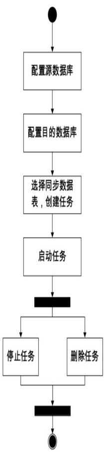
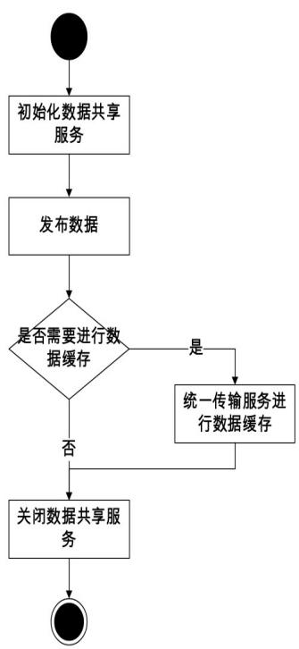
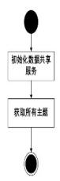
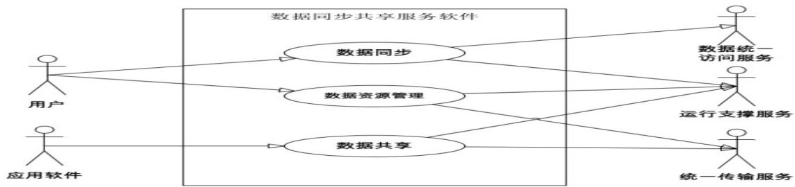

## 目 录

1 范围..  
1.1 标识.  
1.2 系统概述.  
1.2.1 系统和软件的用途...  
1.2.2 系统和软件的一般特性..  
1.3 文档概述. .2  
2 引用文档.... ..2  
3 需求.... ..3  
3.1 要求的状态和方式. ..3  
3.1.1 软件活动图... ..3  
3.1.1.1 数据同步服务软件活动图. ..3  
3.1.1.2 数据共享服务软件活动图 ..6  
3.1.1.3 数据资源管理软件活动图.. ...8  
3.2 CSCI 能力需求. ..10  
3.2.1 数据同步能力(PZXQ-GN-SJTB). .12  
3.2.1.1 主备达梦增量同步(PZXQ-GN-SJTB-ZBZLTB)... ..13  
3.2.1.2 数据下载（PZXQ-GN-SJTB-SJXZ） ..30  
3.2.1.3 数据上传（PZXQ-GN-SJTB-SJSC）. ..33  
3.2.1.4 日志记录功能(PZXQ-GN-SJTB-RZJLGN). ..36  
3.2.2 数据共享能力（PZXQ-GN-SJGX）. ..39  
3.2.2.1 获取主题 (PZXQ-GN-SJGX-HQZT). ..39  
3.2.2.2 数据发布(PZXQ-GN-SJGX-SJFB).. ..40  
3.2.2.3 主题订阅(PZXQ-GN-SJGX-ZTDY).. ..41  
3.2.3 数据资源管理能力(PZXQ-GN-SJZYGL). ..43  
3.2.3.1 数据资源目录展现(PZXQ-GN-SJZYGL-SJZYMLZX). ..43  
3.2.3.2 数据资源修改(PZXQ-GN-SJZYGL-SJZYXG). ..45  
3.3 CSCI 外部接口需求.. ..46  
3.3.1 接口标识和接口图. ...46  
3.3.2 与应用软件接口（PZXQ-WBJK-YYRJ） ..47  
3.3.2.1 数据发布... ..47  
3.3.2.2 数据订阅. ..48  
3.3.3 与运行支撑服务接口（PZXQ-WBJK-YXZCFW） ..48  
3.3.4 与数据统一访问服务接口（PZXQ-WBJK-SJTYFW） ....48  
3.3.4.1 数据存储.. ..48  
3.3.4.2 数据访问... ..49  
3.3.5 人机交互接口（PZXQ-WBJK-RJJH）. ..50  
3.3.6 与统一传输服务接口（PZXQ-WBJK-TYCSFW） ..50  
3.3.6.1 缓存数据存储.. ..50  
3.4 CSCI 内部接口需求. ..50  
3.4.1 接口标识和接口图. ..50  
3.4.2 数据共享与数据资源管理接口(PZXQ-NBJK-SJGX-SJZYGL).. ..51  
3.4.3 数据同步与数据共享接口(PZXQ-NBJK-SJTB-SJGX). ..51  
3.5 CSCI 内部数据需求. ..52  
3.6 适应性需求 ..54  
3.7 安全性需求. ..54  
3.8 保密性需求. ..55  
3.9 CSCI环境需求. ..55  
3.9.1 运行环境需求. ..55  
3.9.2 开发环境需求... ...55  
3.10 计算机资源需求.... ...56  
3.10.1 计算机硬件需求. ...56  
3.10.2 计算机硬件资源利用需求.. ..56  
3.10.3 计算机软件需求.. ...56  
3.10.4 计算机通信需求. ...57  
3.11 软件质量因素.... ..57  
3.12 设计和构造的约束. ...57  
3.13 人员需求.... ...57  
3.14 培训需求.. ..58  
3.15 软件保障需求. .58  
3.16 其他需求.... ..58  
3.17 验收、交付和包装需求. ..59  
3.18 需求的优先顺序和关键性. ..59  
4 合格性规定. ..59  
5 需求可追踪性.. ..60  
6 注释.... ...65

## 1 范围

## 1.1 标识

a) 本文档已被批准的标识号： $\mathrm { A } Z _ { 6 9 3 } 2 . 4 9 0 . 0 1 0 9 \mathrm { S R S }$

b)本文档所适用的软件名称为：数据同步共享服务；

c) 本文档的版本号为：V1.00.03/2020年06月25日；

d)本文档所适用的软件所属系统为：某级信息系统软件。

## 1.2 系统概述

## 1.2.1 系统和软件的用途

某级信息系统软件按照国产自主可控要求，进行基础软件环境选型，以及应用软件的新研和国产化迁移改造，对功能要素分散、流程独立的业务功能进行整合优化，研制适应不同使用需求、使用场景的软件，实现信息系统软件的融合、型谱优化和业务提能推动某信息系统软件向“国产化、服务化、轻量化”方向发展。

某信息服务环境软件是某信息系统软件的重要组成，是连接底层各类硬件信息基础设施与上层各种应用系统的桥梁，通过基础平台融合汇聚底层资源，规范技术体制、支撑体系运行、促进互通互联等，是支撑构建某信息系统的重要支撑，其软件主要部署运行在各级机构的信息处理设备上，提供系统运维、数据运维、信息传输、信息处理、信息展现等功能，支撑应用软件和用户完成开发、集成、运维、运行全流程的使用。

数据同步共享服务完成信息服务环境软件功能域数据同步共享的功能，提供桌面、平板两种形态的软件，主要为上层应用软件提供数据同步和数据共享功能，建立以用户需求为中心的信息的请求/应答和按需共享机制。数据共享功能提供桌面版和平板版，支持应用软件按主题订阅或发布数据；数据同步功能包括主备数据库同步功能、数据下载功能和数据上传功能。其中，主备数据库同步功能仅提供桌面版；数据下载功能和数据上传功能均仅提供平板版。数据资源管理功能仅提供桌面版，支持数据资源目录展现、资源主题的模糊查找功能和数据资源的修改功能。

## 1.2.2 系统和软件的一般特性

a)需方：某单位；

b)使用方：某单位；

c) 开发方：某单位；

d)保障机构：某单位；

e)运行方案：系统开机后，进入系统运维，切换至本软件的相关功能菜单。

## 1.3 文档概述

在本文档中，第2章列出了本文档中引用的其它文档的信息，第3章详细描述了数据同步共享服务的各种需求以及实现方式，第4章规定了确认第3章各项需求正确实现的合格性验证方法，第5章描述本文档列出的各项需求与相应的系统需求规格说明文档列出的需求的对应关系。其中，第3章是本文档的主要部分。

## 2 引用文档

本软件引用的文档主要包括国家相关军用标准以及本工程内部的指导性文件，凡不注明日期或版次的标准其最新文档适用于本文档。本文档中的引用文档参见表1。

表 1引用文档表
<table><tr><td rowspan=1 colspan=1>文档编号</td><td rowspan=1 colspan=1>标题</td><td rowspan=1 colspan=1>修订版本</td><td rowspan=1 colspan=1>修订日期</td><td rowspan=1 colspan=1>编写单位</td></tr><tr><td rowspan=1 colspan=1>GJB 438B-2009</td><td rowspan=1 colspan=1>《军用软件开发文档通用要求》</td><td rowspan=1 colspan=1>一</td><td rowspan=1 colspan=1>2009年5月</td><td rowspan=1 colspan=1>总装备部</td></tr><tr><td rowspan=1 colspan=1>GJB 439A-2013</td><td rowspan=1 colspan=1>《军品软件质量保证通用要求》</td><td rowspan=1 colspan=1></td><td rowspan=1 colspan=1>2013年7月</td><td rowspan=1 colspan=1>国防科学技术工业委员会</td></tr><tr><td rowspan=1 colspan=1>GJB/Z102A-2012</td><td rowspan=1 colspan=1>《军用软件安全性设计指南》</td><td rowspan=1 colspan=1></td><td rowspan=1 colspan=1>2012年7月</td><td rowspan=1 colspan=1>总装备部</td></tr><tr><td rowspan=1 colspan=1>GJB 1267-1991</td><td rowspan=1 colspan=1>《军用软件维护》</td><td rowspan=1 colspan=1></td><td rowspan=1 colspan=1>1991 年 10月</td><td rowspan=1 colspan=1>国防科学技术工业委员会</td></tr><tr><td rowspan=1 colspan=1>GJB2786A-2009</td><td rowspan=1 colspan=1>《军用软件开发通用要求》</td><td rowspan=1 colspan=1></td><td rowspan=1 colspan=1>2009年5月</td><td rowspan=1 colspan=1>总装备部</td></tr><tr><td rowspan=1 colspan=1>GJB1268A-2004</td><td rowspan=1 colspan=1>《军用软件验收要求》</td><td rowspan=1 colspan=1></td><td rowspan=1 colspan=1>2004年9月</td><td rowspan=1 colspan=1>总装备部</td></tr><tr><td rowspan=1 colspan=1>GJB 5235-2004</td><td rowspan=1 colspan=1>《军用软件配置管理》</td><td rowspan=1 colspan=1></td><td rowspan=1 colspan=1>2004年9月</td><td rowspan=1 colspan=1>总装备部</td></tr></table>

## 3 需求

## 3.1 要求的状态和方式

数据同步共享服务只有一个活动运行状态，无需多个运行状态。数据同步共享服务运行方式在桌面版、平板版。

## 3.1.1 软件活动图

## 3.1.1.1 数据同步服务软件活动图

数据同步服务在车上状态时活动图如图1所示。

  
图1数据同步服务车上状态时活动图

数据同步服务在车上运行状态下的活动图如上图1所示。首先，配置源数据库，源数据库的数据库类型默认为DM数据库；输入源数据库的IP地址、用户名、密码。其次，配置目标数据库；输入同步目标数据库的IP地址、用户名、密码信息。输入同步任务的相关信息，如同步任务的任务名称作为同步任务的标识，同步频率、优先级、同步策略、需求方等信息。配置完成后点击下一步。最后，选择好同步的数据表，同步任务创建成功。用户可以在任务监控页面对数据同步任务进行管理，并修改同步任务的状态。可以对某同步任务进行开始、停止和删除操作。

数据同步服务在下车状态时活动图如图2所示。

  
图2 数据同步服务下车状态时活动图

数据同步服务在下车运行状态下的活动图如上图2所示。进入接收到下车作业信号，进入下车状态后，首先读取同步数据表、用户ID、同步数据的起始时间和终止时间等配置信息，创建下载任务并运行，运行完成后，将数据下载到平板，下车运行状态结束。

数据同步服务在上车状态时活动图如图3所示。

图3 数据同步服务上车状态时活动图

数据同步服务在上车运行状态下的活动图如上图3所示。接收到上车作业信号后，进入上车状态，首先读取sqlite3数据库中的日志记录，创建数据上传任务并运行，任务完成后，将平板数据上传到服务器，上车运行状态结束。

## 3.1.1.2 数据共享服务软件活动图

数据共享服务在发布数据状态时活动图如图4所示。

  
图4数据共享服务在数据发布状态时活动图

数据共享服务在数据发布状态下的活动图如上图4所示。进入数据发布状态后，首先初始化数据共享服务，在初始化成功后，调用数据发布接口进行数据发布，发布数据结束，关闭数据共享服务，数据发布状态结束。

数据共享服务在主题订阅状态时活动图如图5所示。

  
图 5 数据共享服务在主题订阅状态时活动图

数据共享服务在主题订阅状态下的活动图如上图5所示。进入主题订阅状态后，首先初始化数据共享服务，在初始化成功，订阅相关数据，如果订阅成功，在有相关数据时，调用接收回调函数，主题订阅状态结束。

## 3.1.1.3数据资源管理软件活动图

数据资源管理中目录展现活动图如图6所示。

图6 数据资源管理中目录展现活动图

数据资源管理中目录展现活动图如上图6所示。进入数据资源管理中目录展现状态后，首先需要初始化数据共享服务，待初始化成功后就绪，接下来便可以调用获取所有主题接口获取所有注册主题，所有主题获取成功后，即可将主题目录展现到前台界面，目录展现状态结束。

数据资源管理中数据资源修改活动图如图7所示。

  
图7数据资源管理中数据资源修改活动图

数据资源管理中数据资源修改活动图如上图7所示。进入数据资源管理中数据资源修改状态后，首先需要初始化数据共享服务，待初始化成功后就绪，接下来在前台界面中选中某主题，修改该主题内容后，提交修改结果，修改成功后，数据资源修改状态结束。

## 3.2 CSCI 能力需求

数据同步共享服务包括数据同步服务、数据共享服务和数据资源管理三个模块。数据同步共享服务功能图，如图8所示。

  
图 8 数据同步共享服务功能图  
软件用例图如下图9所示。

  
图9 数据同步共享服务用例图  
数据同步共享服务所有能力标识表，见表2所示。

表2数据同步共享服务所有能力标识
<table><tr><td rowspan=1 colspan=1>序号</td><td rowspan=1 colspan=1>Use case名称</td><td rowspan=1 colspan=1>项目唯一标识符</td><td rowspan=1 colspan=1>需求描述</td><td rowspan=1 colspan=1>需求重用</td><td rowspan=1 colspan=1>方式名称</td><td rowspan=1 colspan=1>运行状态</td><td rowspan=1 colspan=1>对应的任务书功能</td></tr><tr><td rowspan=1 colspan=1>1</td><td rowspan=1 colspan=1>数据同步</td><td rowspan=1 colspan=1>PZXQ-GN-SJTB</td><td rowspan=1 colspan=1>车上状态下，同步主备达梦数据库间数据、上车和下车状态下同步达梦数据库和sqlite 数据库间数据</td><td rowspan=1 colspan=1>沿用</td><td rowspan=1 colspan=1>桌面、平板</td><td rowspan=1 colspan=1>运行阶段</td><td rowspan=1 colspan=1>4.1.2</td></tr></table>